# proDAD Ango Exchange

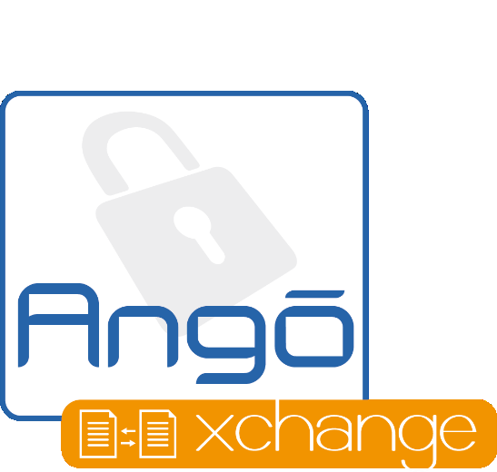

**Einführung**

© proDAD GmbH

Autor: Stephan Hübenthal

## INHALT

- [Vorwort: Was leistet proDAD Ango xchange?](#vorwort-was-leistet-prodad-ango-xchange)
- [Copyright / Rechtliches](#copyright--rechtliches)
- [Willkommen zu proDAD Ango xchange!](#willkommen-zu-prodad-ango-xchange)
- [Schematische Darstellung des Workflows](#schematische-darstellung-des-workflows)
  - [Der erste Programmstart](#der-erste-programmstart)
  - [Eichrichten eines neuen Kontaktes und Austausch der Kontaktdaten](#eichrichten-eines-neuen-kontaktes-und-austausch-der-kontaktdaten)
  - [Datei sicher verschlüsseln und versenden](#datei-sicher-verschlüsseln-und-versenden)
  - [Empfangene verschlüsselte Datei entschlüsseln und weiterverarbeiten](#empfangene-verschlüsselte-datei-entschlüsseln-und-weiterverarbeiten)
- [Kapitel 1: Die Musterfirma GmbH richtet Ango nach der Installation erstmals ein und versendet ihre Kontaktdaten an den Kunden Max Webermann](#kapitel-1-die-musterfirma-gmbh-richtet-ango-nach-der-installation-erstmals-ein-und-versendet-ihre-kontaktdaten-an-den-kunden-max-webermann)
  - [1.1 Stammdatenerfassung nach dem erstem Programmstart](#11-stammdatenerfassung-nach-dem-erstem-programmstart)
  - [1.2 Kontaktdaten importieren](#12-kontaktdaten-importieren)
  - [1.3 Eigene Kontaktdaten versenden](#13-eigene-kontaktdaten-versenden)
  - [1.3.1 Kontaktdaten verschlüsseln](#131-kontaktdaten-verschlüsseln)
  - [1.3.2 Ergänzen und Absenden der Einladung per E-Mail](#132-ergänzen-und-absenden-der-einladung-per-e-mail)
  - [1.3.3 Sicherheitshinweis zur Passwortübermittlung](#133-sicherheitshinweis-zur-passwortübermittlung)
- [Kapitel 2: Max Webermann installiert Ango und importiert den Kontakt der Musterfirma GmbH. Dann sendet er die eigenen Kontaktdaten an die Musterfirma GmbH](#kapitel-2-max-webermann-installiert-ango-und-importiert-den-kontakt-der-musterfirma-gmbh-dann-sendet-er-die-eigenen-kontaktdaten-an-die-musterfirma-gmbh)
  - [2.1 Stammdatenerfassung nach erstem Programmstart](#21-stammdatenerfassung-nach-erstem-programmstart)
  - [2.2 Einlesen der Kontaktdaten der Musterfirma GmbH](#22-einlesen-der-kontaktdaten-der-musterfirma-gmbh)
  - [2.2.1 Passworterfassung zur Kontakt-Aktivierung](#221-passworterfassung-zur-kontakt-aktivierung)
  - [2.2.2 Kontrollanzeige des Kontaktes](#222-kontrollanzeige-des-kontaktes)
  - [2.2.3 Auflistung der zu importierrenden Kontakte](#223-auflistung-der-zu-importierrenden-kontakte)
  - 2.3 Weitergabe der eigenen Kontaktdaten von Max Webermann an die Musterfirma
  - [2.3.1 Verschlüsselung der eigenen Kontaktdaten](#231-verschlüsselung-der-eigenen-kontaktdaten)
  - [2.3.2 Speicherort der Kontaktdatendatei](#232-speicherort-der-kontaktdatendatei)
  - [2.3.3 Anzeige des Passwortes](#233-anzeige-des-passwortes)
- [Kapitel 3: Sachbearbeiterin Anne Best der Musterfirma GmbH importiert die Kontaktdaten von Max Webermann](#kapitel-3-sachbearbeiterin-anne-best-der-musterfirma-gmbh-importiert-die-kontaktdaten-von-max-webermann)
  - [3.1 Kontaktdaten importieren](#31-kontaktdaten-importieren)
  - [3.2 Importierte Kontaktdaten entschlüsseln](#32-importierte-kontaktdaten-entschlüsseln)
  - [3.3 Anzeigen der eingelesenen Kontaktdaten](#33-anzeigen-der-eingelesenen-kontaktdaten)
- [Kapitel 4: So einfach funktioniert das Verschlüsseln und Entschlüsseln von Dateien](#kapitel-4-so-einfach-funktioniert-das-verschlüsseln-und-entschlüsseln-von-dateien)
  - [4.1 Verschlüsseln von Dateien](#41-verschlüsseln-von-dateien)
  - [4.2 Auswahl des Adressaten](#42-auswahl-des-adressaten)
  - [4.3 Verschlüsselte Datei bereit zur Versendung](#43-verschlüsselte-datei-bereit-zur-versendung)
  - [4.4 Versand per E-Mail](#44-versand-per-e-mail)
  - [4.5 Ergänzen und Absenden der Email](#45-ergänzen-und-absenden-der-email)
  - [4.6 Entschlüsseln und Weiterverarbeiten der Datei durch den Empfänger](#46-entschlüsseln-und-weiterverarbeiten-der-datei-durch-den-empfänger)
- [TIPP: Sie können Ango auch über den Windows-Datei-Explorer nutzen](#tipp-sie-können-ango-auch-über-den-windows-datei-explorer-nutzen)

## Vorwort: Was leistet proDAD Ango xchange?

Herzlichen Glückwunsch. Sie haben sich entschlossen, Daten mit proDAD Ango sicher, DSGVO-konform und zugleich schnell und komfortabel auszutauschen.

proDAD Ango bietet den optimalen Schutz all Ihrer Dateien beim Versand und auch als E-Mailanhang. proDAD Ango schützt jede Datei, gleich ob Textdokument oder Tabellenkalkulation, Video- oder Audiodatei. Sensible Daten werden DSGVO-konform verschlüsselt.

- Es werden keinerlei Daten online abgelegt
- Es müssen keine Passwörter für unterschiedliche Empfänger notiert werden
- Dateien können direkt aus allen Programmen heraus verschlüsselt versendet werden

Die Datenschutz-Grundverordnung (DSGVO) stellt hohe Anforderungen an die Unternehmen. Verschlüsselung von Dokumenten ist eine Kernforderung, denn Verschlüsselung schützt z.B. vor den weitreichenden Folgen einer Datenpanne. Beim Versand einer nicht verschlüsselten E-Mail sind Sie verantwortlich, dass die Anhänge ausschließlich von ihrem Geschäftspartner gelesen werden können.

Mit proDAD Ango gewährleisten Sie das schnell und einfach. Die Verschlüsselung - insbesondere personensensibler Daten - mit unserer Software stellt eine optimale technisch organisatorische Maßnahme (TOM) im Sinne der EU- Datenschutzgrundverordnung (DSGVO) dar.\
Im Unterschied zu vielen Online-Lösungen, die Daten serverseitig verarbeiten oder bevorraten, wurde proDAD Ango als Anwender-zu-Anwender (Peer2Peer) Verschlüsselung entwickelt. Hierbei sind ausschließlich die jeweiligen Nutzer in der Lage, die von ihnen übersandten Inhalte zu entschlüsseln.

Indem auf externe Server verzichtet wird, entfällt zudem ein potenzielles Angriffsziel für Hacker. Die Daten sind also weder bei der Übermittlung von anderen mitlesbar, noch können diese durch etwaige Hacker-Angriffe für Dritte lesbar gemacht werden.

## Copyright / Rechtliches

Rechtliches\
Copyright proDAD GmbH. Alle Rechte vorbehalten.

Lizenzbestimmungen\
Vor der Installation lesen Sie bitte folgende Lizenzbestimmungen sorgfältig durch.

Lizenzvertrag\
Beim Start des Setups wird ein Lizenzvertrag angezeigt, den Sie bitte sorgfältig durchlesen. Mit der Installation erkennen Sie diese Copyrightbestimmungen, den Lizenzvertrag und das Lizenzierungsverfahren an.

Lizenzgewähr\
proDAD GmbH räumt den bestimmungsgemäßen und erlaubten Gebrauch des vorliegenden Produkts ein. Das vorliegende Produkt kann nur auf einem Arbeitsplatz eingesetzt werden. Weder die Software, noch die Anleitung darf, auch in Teilen, reproduziert werden, es sei denn, es liegt eine schriftliche Genehmigung der proDAD GmbH vor. Mit Installation des Produkts gilt die Lizenzgewähr, die Urheberrechtsbestimmung, sowie die Haftungsbegrenzung als anerkannt.

Warenzeichen\
Alle Produkt- und Warenzeichen, die in diesem Produkt erwähnt wurden, sind Warenzeichen der jeweiligen Eigentümer. Alle Warenzeichen werden ohne Gewährleistung der freien Verwendbarkeit benutzt und sind eventuell eingetragene Warenzeichen.

Haftungsbegrenzung\
Der gesamte Haftungsumfang besteht im alleinigen Anspruch auf Ersatz des Produkts. Dies gilt für proDAD GmbH, Lizenznehmer und evtl. Vertreiber. Anspruch besteht nur bei korrekter Rückgabe der Software unter Angabe einer Warenrücksendenummer, die zuvor mit proDAD GmbH vereinbart werden muss. Ferner muss bei der Rückgabe ein Kaufbeleg beiliegen. Ist eine Fehlfunktion des vorliegenden Produkts auf eine fehlerhafte Anwendung, Missbrauch, Unfall oder unsachgemäße Handhabung zurückzuführen, gilt die Garantie nicht. proDAD GmbH, deren Vertriebspartner und Lizenznehmer haften nicht für Schäden und Folgeschäden, die aufgrund der unmöglichen Nutzung des vorliegenden Produkts entstehen. In jedem Fall ist der Haftungsbetrag auf den Kaufpreis des Produkts beschränkt.

Dokumentationen\
Die Produktion und Übersetzung der Handbücher wurde mit größter Sorgfalt durchgeführt. Fehler können jedoch nicht hundertprozentig ausgeschlossen werden. proDAD GmbH übernimmt keinerlei Verantwortung oder Haftung für Folgen evtl. verbliebener fehlerhafter Aussagen oder Angaben. Technische und optische Änderungen vorbehalten. Hinweise sind stets willkommen.

Urheberrecht\
Die Software sowie die Einzelkomponenten dieses Produkts sind Eigentum der proDAD GmbH. Mit der Installation des vorliegenden Produkts stimmt der Lizenznehmer zu, unautorisierten Gebrauch und Duplizierung zu vermeiden. proDAD GmbH übernimmt keinerlei Verantwortung für die Anwendung des Programms und die Veröffentlichung von Inhalten und Daten, die mit diesem Programm erzeugt wurden.

ProDAD GmbH \* Gauertstr. 2 \* 78194 Immendingen \* Deutschland \* HRB 1077

## Willkommen zu proDAD Ango xchange!

Am Beispiel der Musterfirma GmbH und des Kunden Max Webermann stellen wir Ihnen vor, wie beide Parteien bei der Installation und Einrichtung von proDAD Ango vorgehen.

Nach der einmaligen Erfassung der eigenen Stammdaten und Einrichtung der Kontakte (wie in Kapitel 1 bis 3 beschrieben) erledigen Sie die Verschlüsselung und Entschlüsselung der auszutauschenden Dokumente mit nur wenigen Mausklicks bequem und schnell. Dies zeigen wir Ihnen in Kapitel 4.

Vorab veranschaulichen wir die Arbeitsschritte in schematischer Form und benennen zur schnellen Orientierung [in eckigen Klammern] das jeweilige Kapital dazu.

Die einmalige Einrichtung eines Kontakts dauert nur wenige Minuten. Danach werden Sie sich zur sicheren

Verschlüsselung und Entschlüsselung kein Passwort mehr merken müssen. Sie werden sehen, wie einfach und bequem proDAD Ango zu bedienen ist.

## Schematische Darstellung des Workflows

### Der erste Programmstart

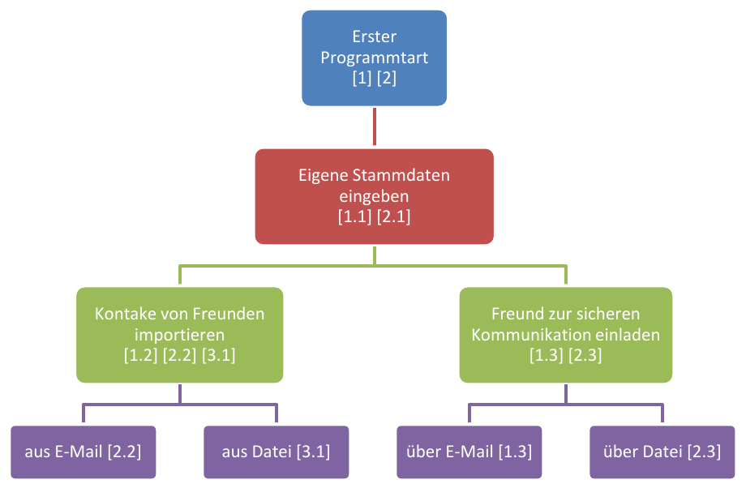

Erster Programmtart [1] [2]

Eigene Stammdaten eingeben [1.1] [2.1]

Kontake von Freunden importieren [1.2] [2.2] [3.1]

Freund zur sicheren Kommunikation einladen [1.3] [2.3]

aus E-Mail [2.2]

aus Datei [3.1]

über E-Mail [1.3]

über Datei [2.3]

(Die Ziffern in eckigen Klammern verweisen auf das jeweilige Kapitel in der nachfolgenden Anleitung)

### Eichrichten eines neuen Kontaktes und Austausch der Kontaktdaten

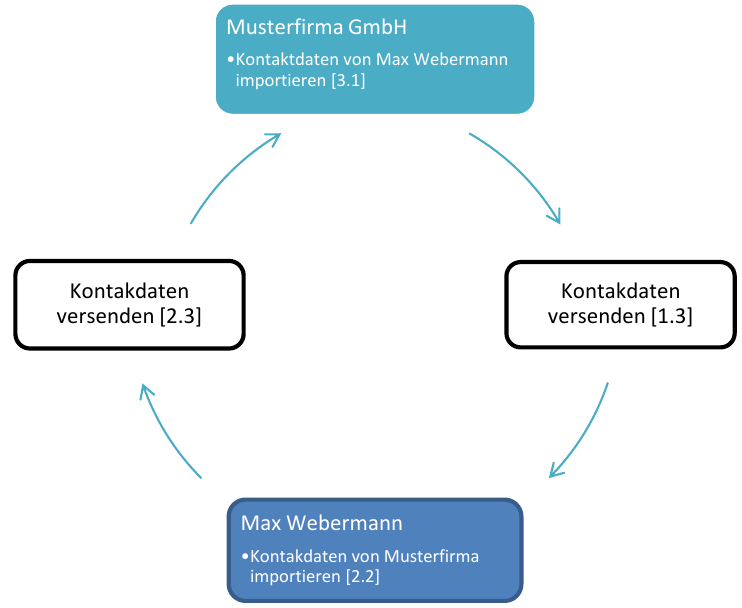

Musterfirma GmbH

- Kontaktdaten von Max Webermann importieren [3.1]

Kontakdaten versenden [2.3]

Kontakdaten versenden [1.3]

Max Webermann

- Kontakdaten von Musterfirma importieren [2.2]

(Die Ziffern in eckigen Klammern verweisen auf das jeweilige Kapitel in der nachfolgenden Anleitung)

### Datei sicher verschlüsseln und versenden

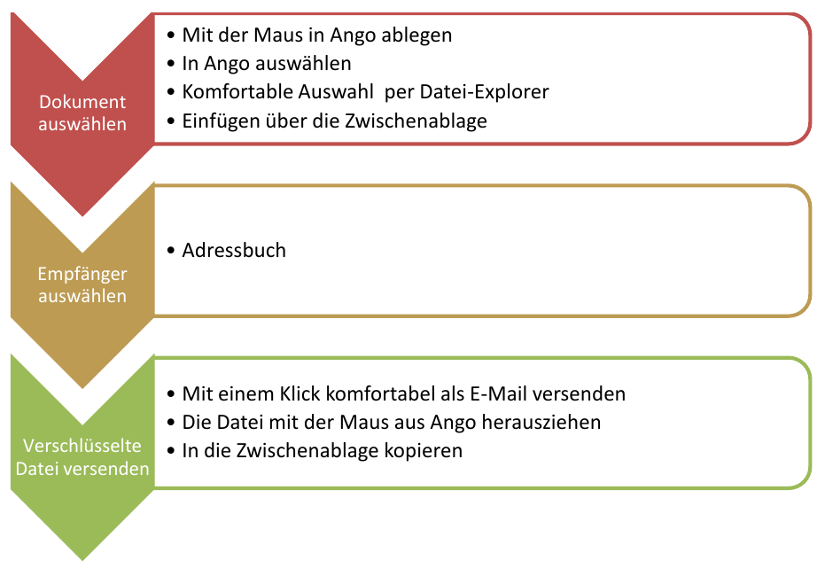

- Mit der Maus in Ango ablegen
- In Ango auswählen
- Komfortable Auswahl per Datei-Explorer
- Einfügen über die Zwischenablage

Dokument auswählen

- Adressbuch

Empfänger auswählen

- Mit einem Klick komfortabel als E-Mail versenden
- Die Datei mit der Maus aus Ango herausziehen
- In die Zwischenablage kopieren

Verschlüsselte Datei versenden

### Empfangene verschlüsselte Datei entschlüsseln und weiterverarbeiten

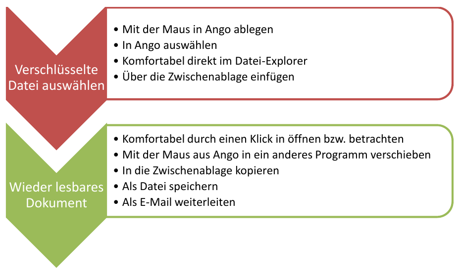

- Mit der Maus in Ango ablegen
- In Ango auswählen
- Komfortabel direkt im Datei-Explorer
- Über die Zwischenablage einfügen

Verschlüsselte Datei auswählen

- Komfortabel durch einen Klick in öffnen bzw. betrachten
- Mit der Maus aus Ango in ein anderes Programm verschieben
- In die Zwischenablage kopieren
- Als Datei speichern
- Als E-Mail weiterleiten

Wieder lesbares Dokument

**HINWEIS**

Die Einrichtungsschritte, wie in den folgenden Kapiteln 1-3 beschrieben, müssen nur einmalig bei der Erstellung eines neuen Kontaktes vorgenommen werden. Nach der Einrichtung erledigen Sie die Verschlüsselung und Entschlüsselung der auszutauschenden Dokumente mit nur wenigen Mausklicks bequem und schnell, ohne sich noch ein Passwort merken zu müssen. Wir zeigen Ihnen dies in Kapitel 4.

## Kapitel 1: Die Musterfirma GmbH richtet Ango nach der Installation erstmals ein und versendet ihre Kontaktdaten an den Kunden Max Webermann

### 1.1 Stammdatenerfassung nach dem erstem Programmstart

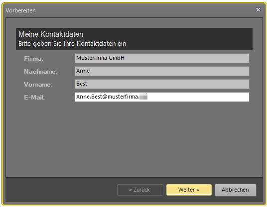

Die Musterfirma GmbH, vertreten durch Anne Best, installiert proDAD Ango, erfasst zunächst die eigenen Stammdaten und klickt dann auf weiter.

### 1.2 Kontaktdaten importieren

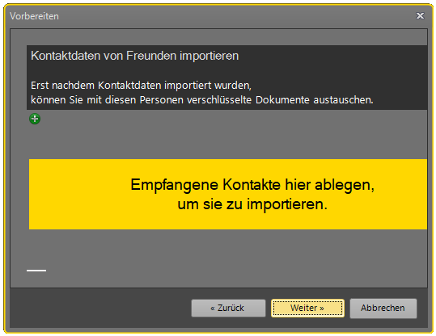

proDAD Ango bietet nun die Möglichkeit, die Kontaktdaten eines Freundes einzulesen. Als Freund bezeichnet proDAD Ango einen Partner, mit dem Daten verschlüsselt ausgetauscht werden sollen. Da die Musterfirma GmbH zu diesem Zeitpunkt noch über keinen neuen externen Kontakt verfügt, werden hier aktuell keine

Kontakt-Daten eingelesen.

### 1.3 Eigene Kontaktdaten versenden

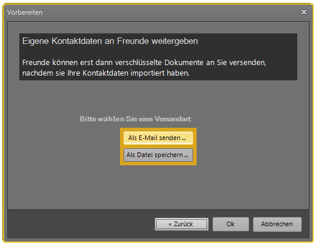

Anne Best möchte als Sachbearbeiterin der Musterfirma GmbH den Kunden Max Webermann einladen, ebenfalls proDAD Ango zu nutzen, um verschlüsselt und sicher gemeinsam Dateien auszutauschen. Diese

Einladung kann als Email über Outlook versandt werden. Alternativ kann die Einladung auch als Datei gespeichert werden, um durch ein anderes E-Mail-Programm oder auch durch einen Datenträger versandt zu werden.

#### 1.3.1 Kontaktdaten verschlüsseln

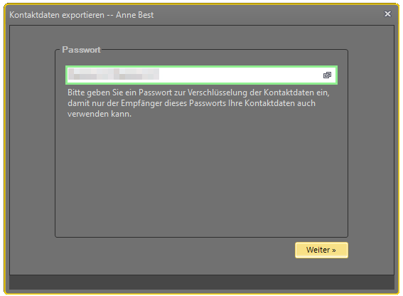

Nun fordert Ango dazu auf, ein Passwort zur Verschlüsselung der Kontaktdaten einzugeben. Somit hat ausschließlich der gewünschte Empfänger Zugriff auf die Daten. Sobald das eingegebene Passwort wenigstens

16 Stellen umfasst, akzeptiert Ango die Eingabe und der Rahmen um das Eingabefeld wechselt von Rot zu Grün.

#### 1.3.2 Ergänzen und Absenden der Einladung per E-Mail

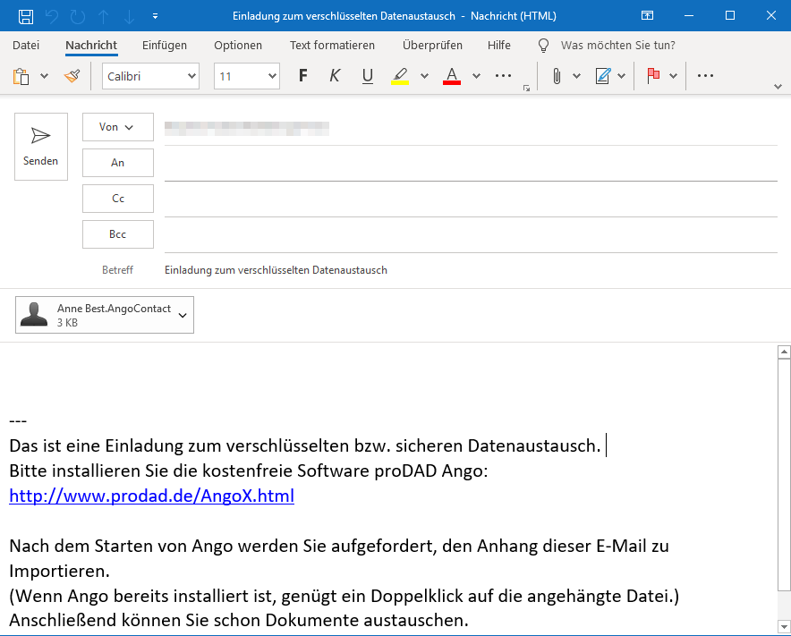

Anne Best hatte sich für den Versand der Kontaktdaten als E-Mail entschieden. Outlook hat die E-Mail bereits vorbereitet. Die Email enthält die verschlüsselten Kontaktdaten des Senders, in unserem Beispiel die Daten von Anne Best der Musterfirma GmbH. Nach Erfassung der Empfängeradresse und ggfs. noch einigen ergänzenden persönlichen Worten an Max Webermann kann die Mail versendet werden.

#### 1.3.3 Sicherheitshinweis zur Passwortübermittlung

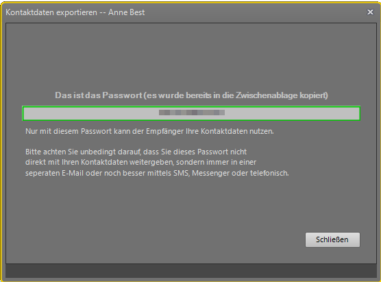

Damit Max Webermann die Kontaktdaten der Musterfirma auch in sein Ango-Programm einlesen kann, benötigt er selbstverständlich das Passwort. Ango weist darauf hin. dieses Passwort aus Sicherheitsgründen nicht mit den Kontaktdaten weiterzugeben, sondern in einer separaten Mail zu versenden oder noch besser mittels SMS, Messenger, telefonisch, per Fax oder Brief.

## Kapitel 2: Max Webermann installiert Ango und importiert den Kontakt der Musterfirma GmbH. Dann sendet er die eigenen Kontaktdaten an die Musterfirma GmbH

### 2.1 Stammdatenerfassung nach erstem Programmstart

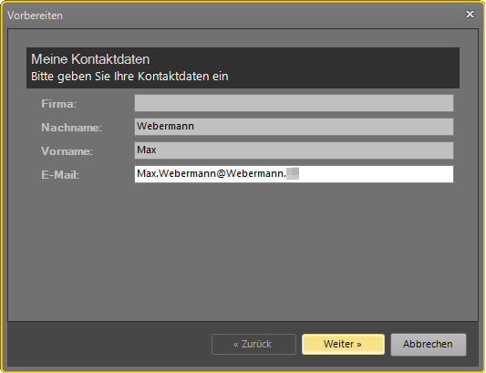

Max Webermann hat die Nachricht der Musterfirma GmbH per Mail erhalten und Ango installiert. Im ersten

Schritt erfasst auch Max Webermann seine eigenen Stammdaten.

### 2.2 Einlesen der Kontaktdaten der Musterfirma GmbH

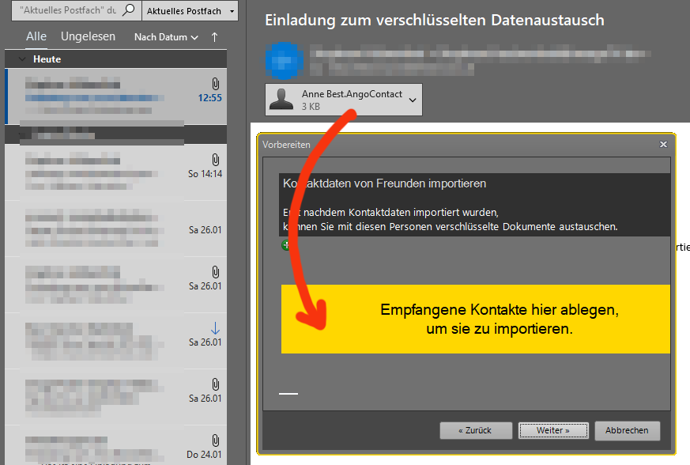

Die Kontaktdaten der Musterfirma GmbH kann er per Drag und Drop ganz einfach aus dem Anhang der empfangenen E-Mail in den gelben Kasten von Ango ziehen.

#### 2.2.1 Passworterfassung zur Kontakt-Aktivierung

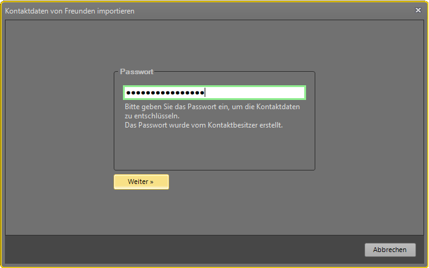

Max Webermann trägt das ihm zusätzlich mitgeteilte Passwort ein, um den Kontakt importieren zu können.

Anne Best hatte sich entschieden, ihm das Passwort per SMS mitgeteilt.

#### 2.2.2 Kontrollanzeige des Kontaktes

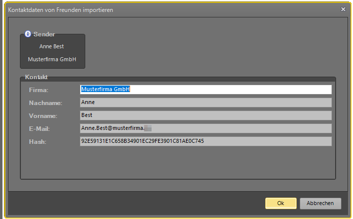

Die importierten Daten der Mustermann GmbH werden zur Kontrolle angezeigt.

#### 2.2.3 Auflistung der zu importierrenden Kontakte

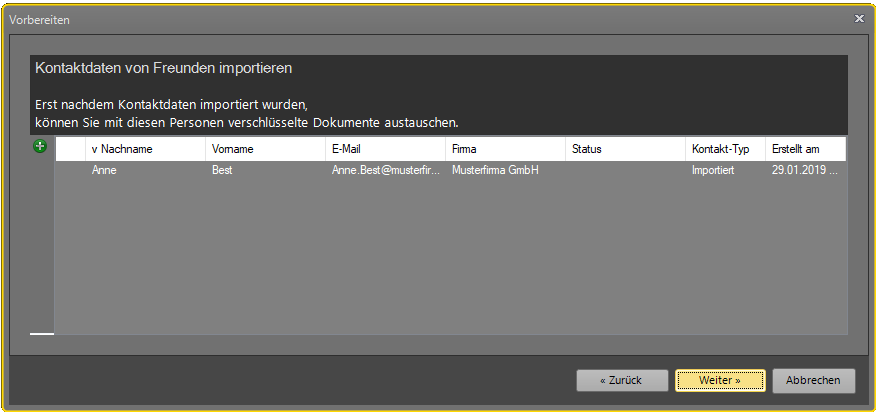

In der Übersicht werden sämtliche Kontaktdaten aufgelistet. Aktuell gibt es keine weiteren Einträge als den der Musterfirma GmbH.

2.3 WEITERGABE DER EIGEN EN KONTAKTDATEN VON MAX WEBERMANN AN DIE MUSTERFIRMA

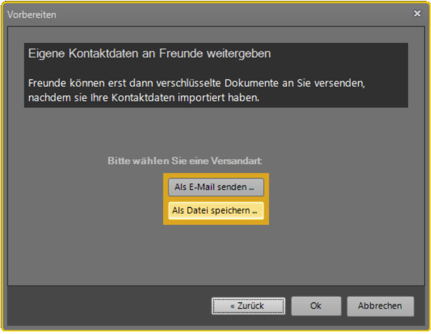

Nach Klick auf Weiter erhält Max Webermann die Gelegenheit seine Kontaktdaten an einen Freund (in diesem Beispiel die Musterfirma GmbH) weiterzuleiten. Dies ist erforderlich, damit der verschlüsselte Datenaustausch mit der Musterfirma GmbH und Max Webermann ermöglicht wird.

Max Webermann wählt die Option „Als Datei speichern“, da er die Kontaktdaten nicht per Outlook verschicken möchte.

#### 2.3.1 Verschlüsselung der eigenen Kontaktdaten

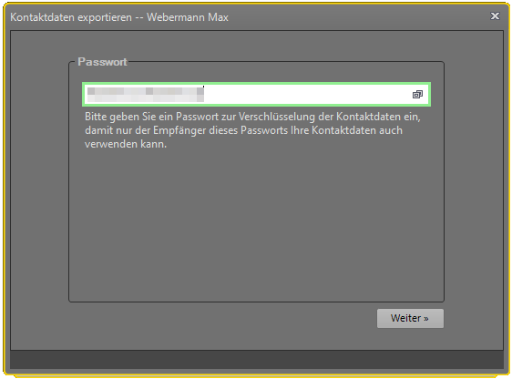

Max Webermann schützt seine Kontaktdaten ebenfalls mit einem Passwort.

#### 2.3.2 Speicherort der Kontaktdatendatei

Standardmäßig speichert Ango die Kontaktdaten im Verzeichnis Dokumente. Max Webermann kann die Kontaktdatei mit einem Mail-Programm versenden oder auch per USB-Stick mit der Musterfirma GmbH austauschen.

#### 2.3.3 Anzeige des Passwortes

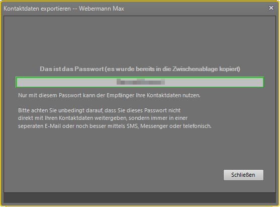

Auch Max Webermann erhält die Hinweise zur sicheren Übermittlung des Passwortes. Da es bereits in die

Zwischenablage kopiert wurde lässt es sich mit dem Einfügen-Befehl bequem in ein Textdokument übernehmen. Sie sollten das Passwort aus Sicherheitsgründen nicht gemeinsam mit Ihren Kontaktdaten versenden.

## Kapitel 3: Sachbearbeiterin Anne Best der Musterfirma GmbH importiert die Kontaktdaten von Max Webermann

### 3.1 Kontaktdaten importieren

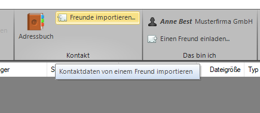

Anne Best von der Musterfirma GmbH hat die Kontaktdatei und das benötigte Passwort erhalten. Sie klickt im Menü das Icon „Freunde importieren“ an.

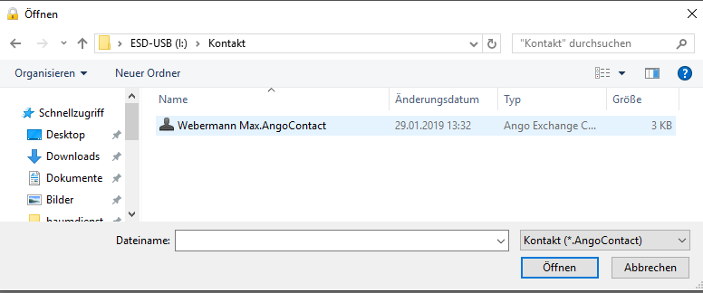

Dann wählt sie das Verzeichnis, das die Kontaktdatei enthält. Sie klickt auf die Datei und dann auf „Öffnen“.

### 3.2 Importierte Kontaktdaten entschlüsseln

Anne Best gibt das ihr mitgeteilte Passwort ein.

### 3.3 Anzeigen der eingelesenen Kontaktdaten

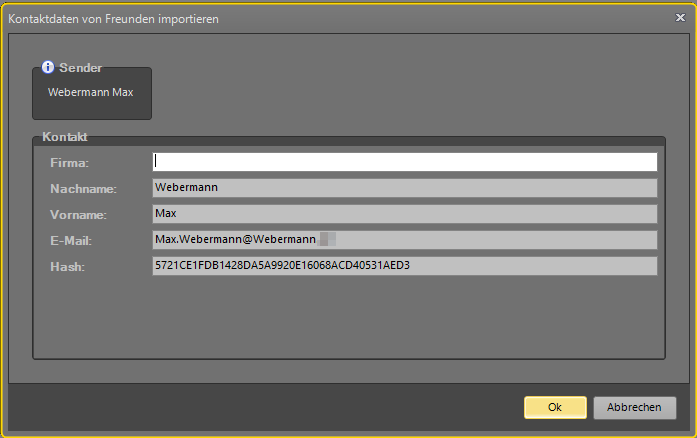

Die eingelesenen Kontaktdaten werden zur Kontrolle angezeigt. Von nun an sind beide Parteien bereit zum verschlüsselten Austausch von Dateien.

## Kapitel 4: So einfach funktioniert das Verschlüsseln und Entschlüsseln von Dateien

Anne Best von der Musterfirma GmbH und Max Webermann können nun untereinander Dateien verschlüsseln, austauschen und entschlüsseln. Anne Best wird Herrn Mustermann ein verschlüsseltes Dokument zusenden. Hierzu sind keinerlei Angaben von Passwörtern mehr notwendig.

### 4.1 Verschlüsseln von Dateien

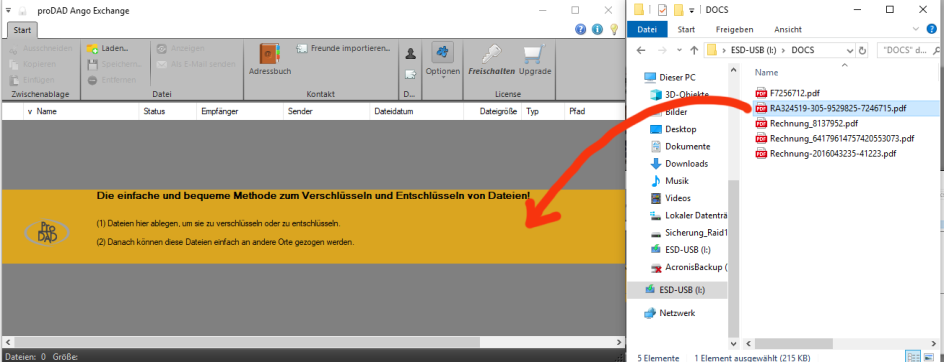

Dazu startet sie Ango und zieht die zu verschlüsselnde Datei in das Ango-Fenster.

Nun öffnet sich ein Auswahlfenster, um den Empfänger der verschlüsselten Datei festzulegen.

### 4.2 Auswahl des Adressaten

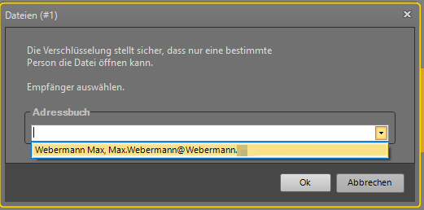

Anne Best wählt aus dem Adressbuch Max Webermann aus.

### 4.3 Verschlüsselte Datei bereit zur Versendung

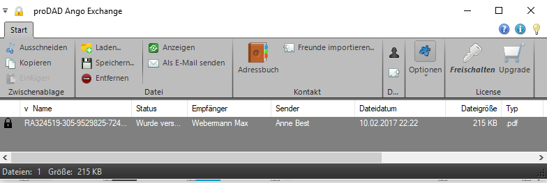

Die Arbeitsfläche von Ango zeigt nun die bereits verschlüsselte Datei. Das geschlossene Schloss symbolisiert den Status, die Datei wurde erfolgreich verschlüsselt. Empfänger ist Max Webermann, Sender ist Anne Best.

Nur diese beiden Partner sind in der Lage die Datei zu entschlüsseln.

### 4.4 Versand per E-Mail

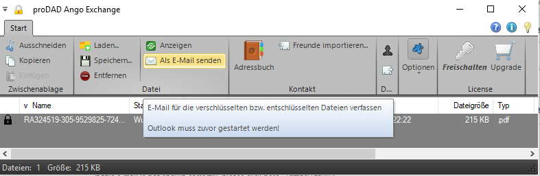

Anne Best möchte das verschlüsselte Dokument per Outlook versenden. Dazu klickt sie auf „Als E-Mail“ senden.

### 4.5 Ergänzen und Absenden der Email

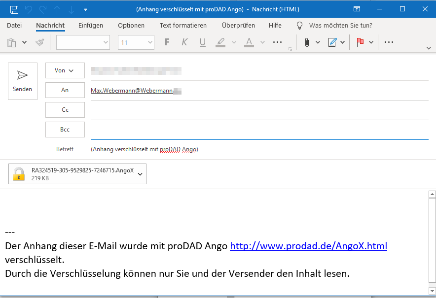

Ango hat die Mail bereits erstellt, die wiederum um einen persönlichen Text ergänzt werden kann. Anne Best versendet die Datei.

### 4.6 Entschlüsseln und Weiterverarbeiten der Datei durch den Empfänger

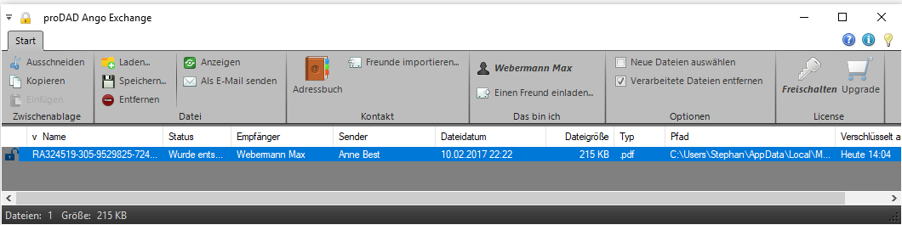

Sobald Max Webermann die verschlüsselte Datei erhalten hat, kann er die Datei entweder in Outlook doppelklicken oder die Datei mit der Maus in das geöffnete Ango-Fenster ziehen. Der offene Schlüssel zeigt an, dass die Datei erfolgreich entschlüsselt werden konnte. Max Webermann kann das Dokument in Ango betrachten (sofern der Dateityp unterstützt wird). Die entschlüsselte Datei kann ebenso mit der Maus in ein beliebiges Verzeichnis oder einen Datenträger zur Weiterverarbeitung abgelegt werden.

## TIPP: Sie können Ango auch über den Windows-Datei-Explorer nutzen

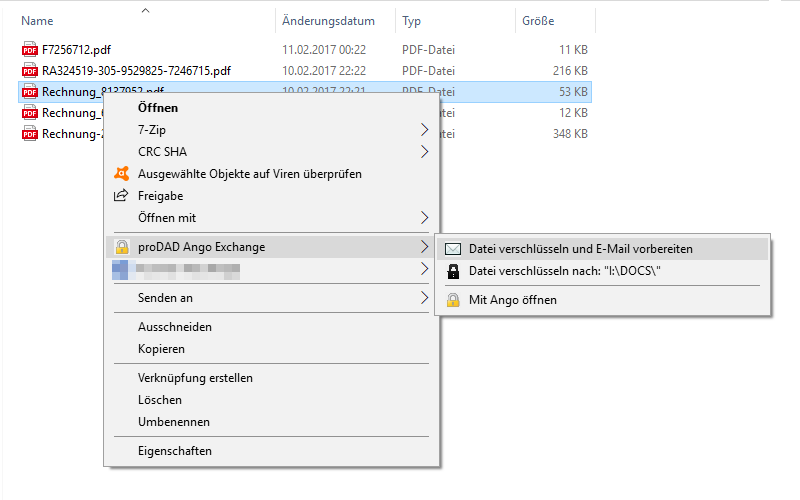

Klicken Sie auf der gewünschten Datei die rechte Maustaste und wählen Sie den Eintrag „proDAD Ango Exchange“. Über das Auswahlmenü lässt sich die Datei verschlüsseln und als E-Mail vorbereiten. Alternativ lässt sich die Datei im aktuellen Verzeichnis verschlüsselt ablegen oder auch mit Ango öffnen.
