# proDAD Ango Exchange

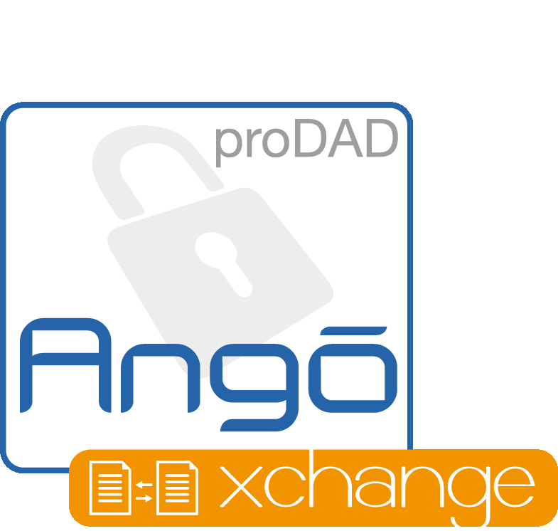

**Introduction / First Steps**

© proDAD GmbH

Author: Stephan Hübenthal

## CONTENT

- [Preface: What is the purpose and benefit of proDAD Ango xchange?](#preface-what-is-the-purpose-and-benefit-of-prodad-ango-xchange)
- [Copyright / Legal Information](#copyright--legal-information)
- [Welcome to proDAD Ango xchange!](#welcome-to-prodad-ango-xchange)
- [Workflow Chart](#workflow-chart)
  - [Starting up Ango the first time](#starting-up-ango-the-first-time)
  - [Setting up a new contact and exchanging contact data](#setting-up-a-new-contact-and-exchanging-contact-data)
  - [Securely encrypt and send file](#securely-encrypt-and-send-file)
  - [Decrypting and working with the received encrypted file](#decrypting-and-working-with-the-received-encrypted-file)
- [Chapter 1: The Service Company sets up Ango after the installation for the first time and sends its contact data to customer Tom Miller](#chapter-1-the-service-company-sets-up-ango-after-the-installation-for-the-first-time-and-sends-its-contact-data-to-customer-tom-miller)
  - [1.1 Entering the basis data after the initial program startup](#11-entering-the-basis-data-after-the-initial-program-startup)
  - [1.2 Importing contact data](#12-importing-contact-data)
  - [1.3 Sending own contact data](#13-sending-own-contact-data)
  - [1.3.1 Encrypting contact data](#131-encrypting-contact-data)
  - [1.3.2 Completing and sending the invitation by email](#132-completing-and-sending-the-invitation-by-email)
  - [1.3.3 Security advice sending passwords](#133-security-advice-sending-passwords)
- [Chapter 2: Tom Miller sets up Ango and imports the contact data of the Service Company. Then he sends his own contact data to the Service Company](#chapter-2-tom-miller-sets-up-ango-and-imports-the-contact-data-of-the-service-company-then-he-sends-his-own-contact-data-to-the-service-company)
  - [2.1 Entering the basis data after the initial program startup](#21-entering-the-basis-data-after-the-initial-program-startup)
  - [2.2 Importing the contact data of the Service Company](#22-importing-the-contact-data-of-the-service-company)
  - [2.2.1 Entering password to activate contact](#221-entering-password-to-activate-contact)
  - [2.2.2 Reviewing the imported contact DATA](#222-reviewing-the-imported-contact-data)
  - [2.2.3 Listing the contacts to be imported](#223-listing-the-contacts-to-be-imported)
  - [2.3 Tom Miller sends his contact data to the Service Company](#23-tom-miller-sends-his-contact-data-to-the-service-company)
  - [2.3.1 Encrypting the own contact data](#231-encrypting-the-own-contact-data)
  - [2.3.2 Location of the contact data file](#232-location-of-the-contact-data-file)
  - [2.3.3 Displaying the password](#233-displaying-the-password)
- [Chapter 3: Ann Best of the Service Company imports the contact data of Tom Miller](#chapter-3-ann-best-of-the-service-company-imports-the-contact-data-of-tom-miller)
  - [3.1 Importing contact data](#31-importing-contact-data)
  - [3.2 Decrypting the imported contact data](#32-decrypting-the-imported-contact-data)
  - [3.3 Reviewing the imported contact data](#33-reviewing-the-imported-contact-data)
- [Chapter 4: Encrypting and decrypting of files is as easy as that](#chapter-4-encrypting-and-decrypting-of-files-is-as-easy-as-that)
  - [4.1 Encrypting files](#41-encrypting-files)
  - [4.2 Selecting the recipient](#42-selecting-the-recipient)
  - [4.3 Encrypted file ready to be send](#43-encrypted-file-ready-to-be-send)
  - [4.4 Transfer via email](#44-transfer-via-email)
  - [4.5 Completing and sending off the email](#45-completing-and-sending-off-the-email)
  - [4.6 Decrypting and working with the file by the recipient](#46-decrypting-and-working-with-the-file-by-the-recipient)
- [TIPP: Using Ango with the Windows File Explorer](#tipp-using-ango-with-the-windows-file-explorer)

## Preface: What is the purpose and benefit of proDAD Ango xchange?

Congratulations. You have decided to exchange data with proDAD Ango securely, EU-GDPR-compliant, fast and comfortable.

proDAD Ango offers the optimal protection for all your files - when sending them as attachments by email for instance. proDAD Ango protects any kind of file like text documents, spreadsheets, audio or video files. Encrypting sensible data is fully compliant to the EU General Data Protection Regulation (GDPR)

- No online data storage needed
- No need to remember passwords for different recipients
- Files can be encrypted and sent directly from programs like the Windows explorer

The EU General Data Protection Regulation (GDPR) sets high standards for companies. The encryption of documents is a key request because encryption can protect you from the dramatic consequences of a data leak. If you send of an unencrypted email you are responsible that only the intended recipient will be able to read the attachment(s).

With proDAD Ango you ensure this quick and easily. Encrypting files – especially if personal data are involved – is being regarded as an optimal technical organizational measure in the sense of the EU General Data Protection Regulation.

Different to many online solutions which are processing or storing data on remote servers, proDAD Ango was developed as a peer2peer encryption method. This ensures that the respective users only can decrypt the data they have received.

Not to deploy external servers means more cyber security leaving no potential target for hackers. This way data cannot be read by others during the transfer process nor can cyber-attacks make this content available to third parties.

## Copyright / Legal Information

Copyright proDAD GmbH. All rights reserved.

Licensing Conditions\
Please read these licensing conditions carefully before installing the software.

Licensing agreement

When setup starts, a licensing agreement is shown, which you should read carefully. By installing the software, you state that you accept the copyright conditions, the licensing agreement and the licensing procedure.

License Guarantee\
proDAD GmbH grants the user the right to use this product for its proper and permitted purpose. The present product may only be installed on one computer. proDAD hereby guarantees to provide a license key free of charge. By installing this product, the user acknowledges and accepts the license guarantee, the copyright terms, and the limitation of liability.

Trademarks\
All products and trademarks mentioned in association with this product are trademarks that belong to the respective owners. All trademarks are used without any guarantee that they may be used freely, and they may be registered trademarks.

Limitation of Liability\
The extent of liability for any one claim is limited to a replacement of the product. This applies to proDAD GmbH, all licensees and retailers. Claims shall only be recognized if the software is returned in an orderly manner, together with the returned goods number that has to be previously arranged with proDAD GmbH. The goods must also be accompanied by proof of purchase. This guarantee becomes void if a malfunction of this product is due to improper use, mistreatment, an accident or improper handling. proDAD GmbH, its sales partners and licensees, shall not be held liable for damages or subsequent damages arising from the impossible usage of this product. Liability is limited in all cases to the purchase price of the product.

Documentation\
The greatest of care has been taken in compiling and translating the handbook. However, the possibility of errors cannot be fully excluded. proDAD GmbH shall assume no responsibility or liability whatsoever for the consequences of any incorrect statements or information which the documentation or translation may contain. Subject to technical and optical modifications. Information regarding any inaccuracies is always welcome.

Copyright\
The software and the individual components of this product are the property of proDAD GmbH. By installing this product, the licensee agrees to refrain from unauthorized use and duplication.

proDAD GmbH does not accept any responsibility for the usage of this program and the publication of its contents and data that has been created with this program.

ProDAD GmbH \* Gauertstr. 2 \* 78194 Immendingen \* Deutschland \* HRB 1077

## Welcome to proDAD Ango xchange!

With the example of Ann Vest of the Service Company und their customer Tom Miller we will show you how both parties go ahead setting up proDAD Ango.

After initially entering your own master data and setting up your contact(s) (as described in chapter 1 to 3) you will then manage the encryption and decryption of documents to be exchanged with just a few clicks quick and easy. This we will show you in chapter 4.

Before this we would like to visualize the workflow with the following chart. For a quick orientation we have also referred to the respective chapter numbers printed in [brackets].

Setting up a contact only takes a few minutes. Afterwards you will not have to memorize any password anymore to securely encrypt and decrypt files. You will see how easy and comfortable proDAD Ango is to work with.

## Workflow Chart

### Starting up Ango the first time

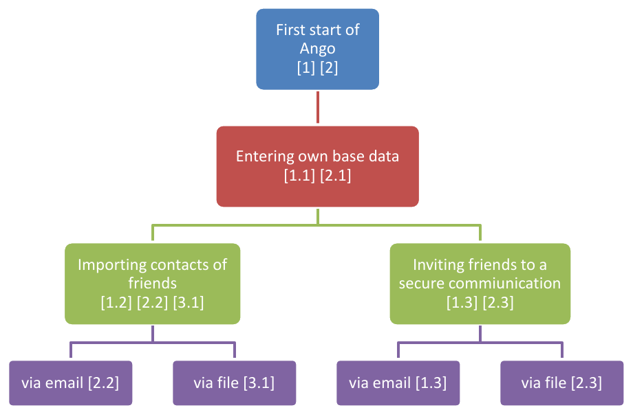

First start of Ango [1] [2]

Entering own base data [1.1] [2.1]

Importing contacts of friends [1.2] [2.2] [3.1]

Inviting friends to a secure commiunication [1.3] [2.3]

via email [2.2]

via file [3.1]

via email [1.3]

via file [2.3]

(The numbers in brackets refer to the respective chapter numbers on the following pages)

### Setting up a new contact and exchanging contact data

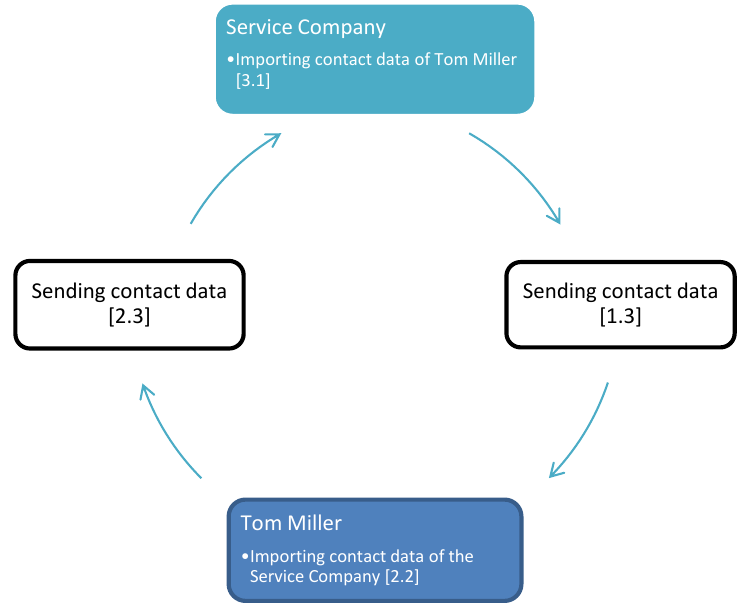

Service Company

- Importing contact data of Tom Miller [3.1]

Sending contact data [2.3]

Sending contact data [1.3]

Tom Miller

- Importing contact data of the Service Company [2.2]

(The numbers in brackets refer to the respective chapter numbers on the following pages)

### Securely encrypt and send file

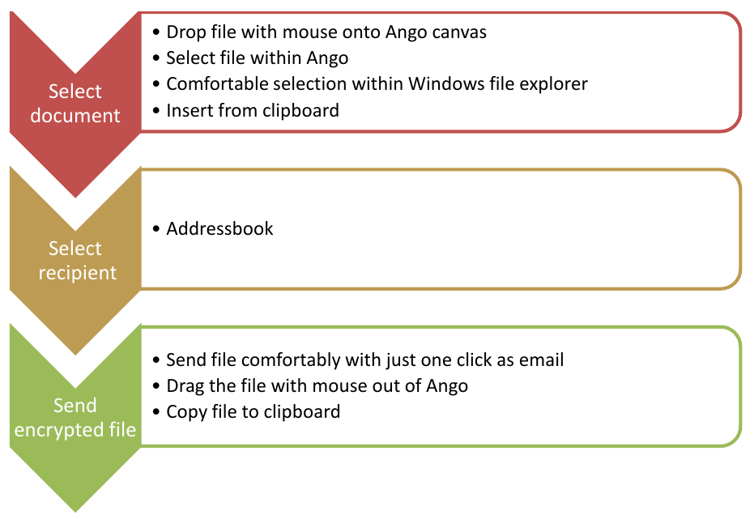

- Drop file with mouse onto Ango canvas
- Select file within Ango
- Comfortable selection within Windows file explorer
- Insert from clipboard

Select document

Select recipient

- Addressbook
- Send file comfortably with just one click as email
- Drag the file with mouse out of Ango
- Copy file to clipboard

Send encrypted file

### Decrypting and working with the received encrypted file

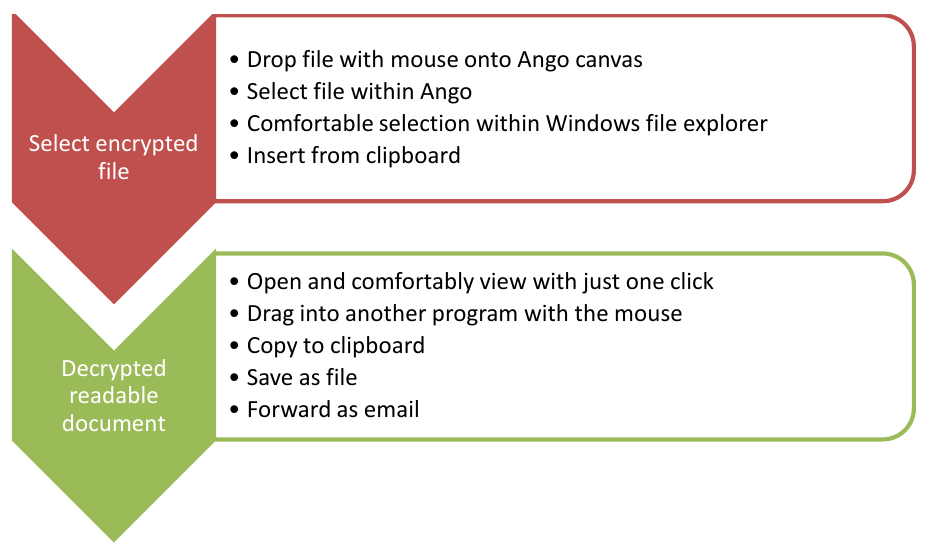

- Drop file with mouse onto Ango canvas
- Select file within Ango
- Comfortable selection within Windows file explorer
- Insert from clipboard

Select encrypted file

- Open and comfortably view with just one click
- Drag into another program with the mouse
- Copy to clipboard
- Save as file
- Forward as email

Decrypted readable document

**Remark**

The initial preparation steps as described in the following chapters 1 to 3 only need to be applied once when setting up a new contact. After the setup you handle the encryption and decryption of the documents to be exchanged with this contact with just a few clicks – quick and easy without ever needing to enter a password again. This we will show you in chapter 4.

## Chapter 1: The Service Company sets up Ango after the installation for the first time and sends its contact data to customer Tom Miller

### 1.1 Entering the basis data after the initial program startup

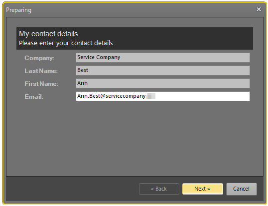

The Service Company, represented by Anne Best, sets up proDAD Ango, enters the own base data and then clicks Next.

### 1.2 Importing contact data

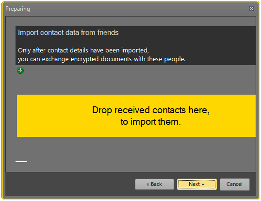

proDAD Ango now offers the possibility to import the contact data of a friend. proDAD Ango calls a partner a friend, whenever encrypted data shall be exchanged between the two. Right now, the Service Company does not have an external contact yet. Therefore, no contact files are being imported now.

### 1.3 Sending own contact data

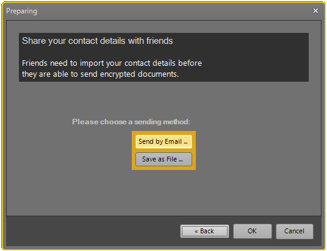

Ann Best of the Service Company would like to invite customer Tom Miller to also use proDAD Ango, to securely exchange files between each other. The invitation can be sent as email via Outlook. Alternatively, the invitation can also be stored as a file to be sent by another email program or to be exchanged by devices like USB sticks or memory cards.

#### 1.3.1 Encrypting contact data

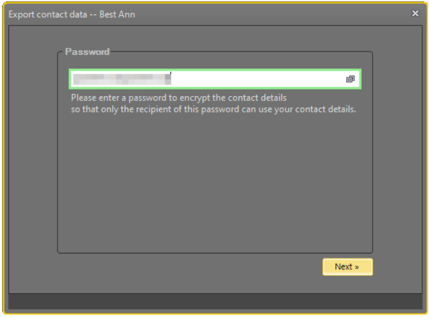

Ango now asks to enter a password to encrypt the contact file. This is to ensure that the intended recipient only is able to import the data. As soon as the entered password is at least 16 digits long Ango accepts the input and changes the frame surrounding the input field from red to green.

#### 1.3.2 Completing and sending the invitation by email

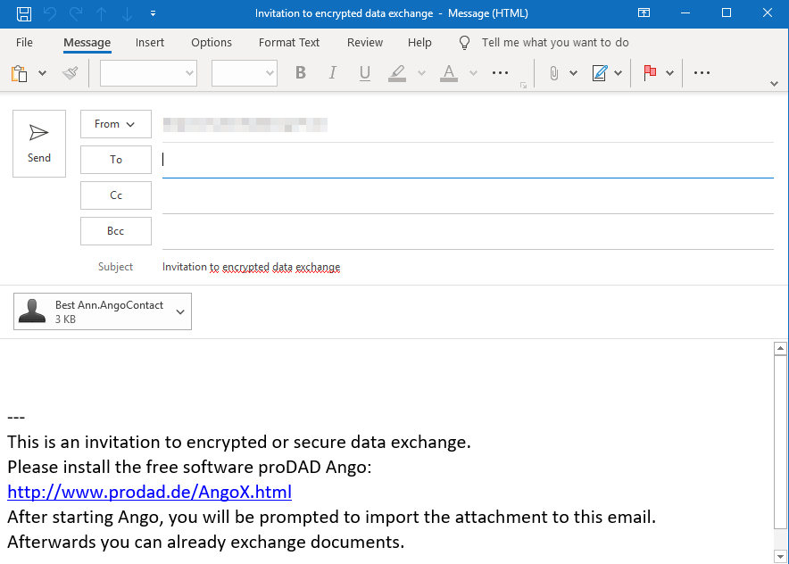

Ann Best had decided to send the contact data by email. Outlook already prepared the mail. The email includes the encrypted contact data of the sender – in our example the data of Ann Best of the Service Company. After adding the recipients email address and maybe a few additional personal words regarding the recipient the mail is ready to be sent.

#### 1.3.3 Security advice sending passwords

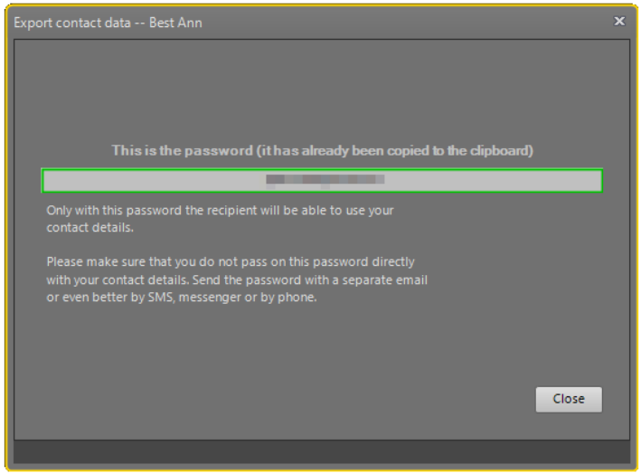

For Tom Miller to be able to import the Service Company’s contact data into his Ango program, he of course needs to be informed about the password. Ango advises the sender not to share the password together with the contact data file. For security reasons a separate email should be used – or even better – another messenger service, SMS, telephone, fax or letter.

## Chapter 2: Tom Miller sets up Ango and imports the contact data of the Service Company. Then he sends his own contact data to the Service Company

### 2.1 Entering the basis data after the initial program startup

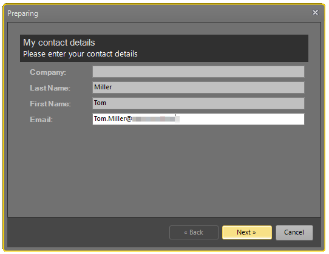

Tom Miller received the message of the Service Company by email and installed Ango. To start off Tom Miller enters his own basis data as well.

### 2.2 Importing the contact data of the Service Company

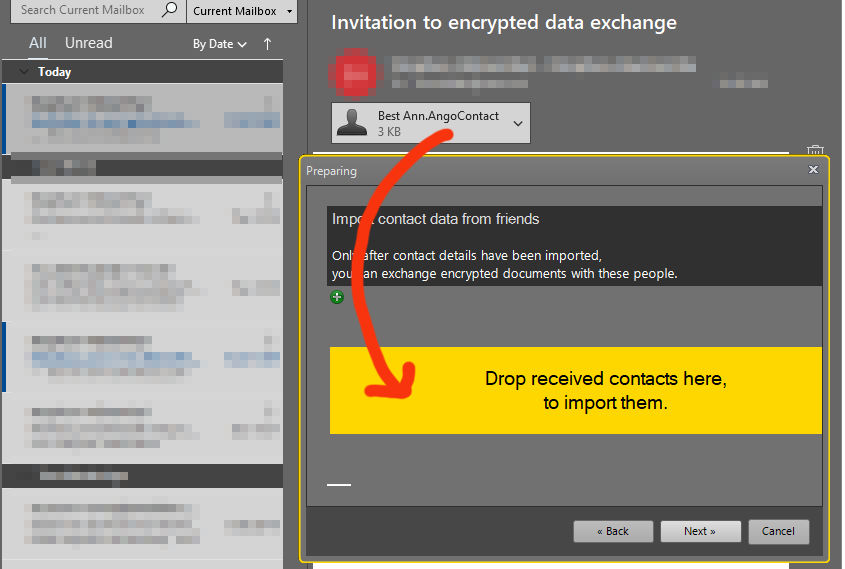

The contact data of the Service Company can simply be imported by dragging and dropping the contact file attachment of the received mail into the yellow window of Ango.

#### 2.2.1 Entering password to activate contact

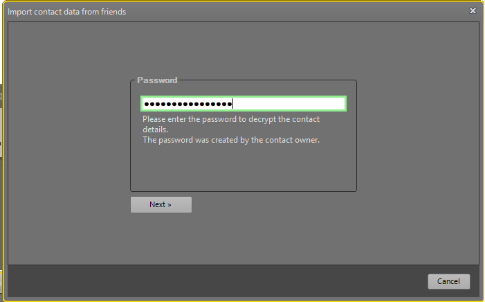

Tom Miller enters the password he had additionally received to be able to import the contact. Ann Best had decided to send him the password by SMS.

#### 2.2.2 Reviewing the imported contact DATA

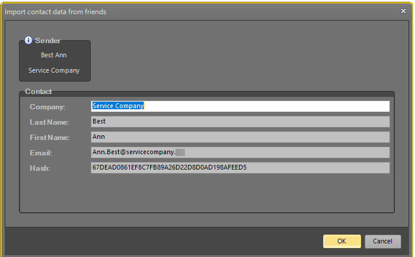

The imported data of the Service Company is being shown.

#### 2.2.3 Listing the contacts to be imported

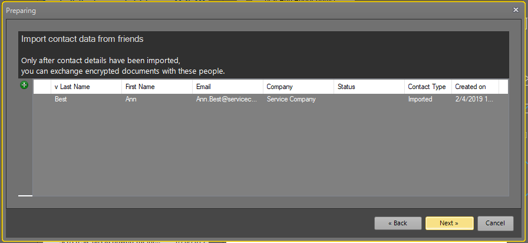

In this view all contact data are listed. Right now there is no other entry than this of the Service Company.

### 2.3 Tom Miller sends his contact data to the Service Company

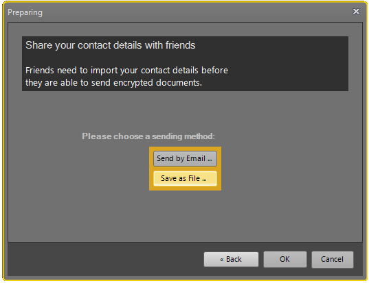

Tom Miller now can send his contact data to a friend, in this example the Service Company. The contact data needs to be sent so that the Service Company and Tom Miller can start exchanging encrypted files.

Tom Miller chooses the option ”Save as file“ because he does not want to send his contact data by Outlook.

#### 2.3.1 Encrypting the own contact data

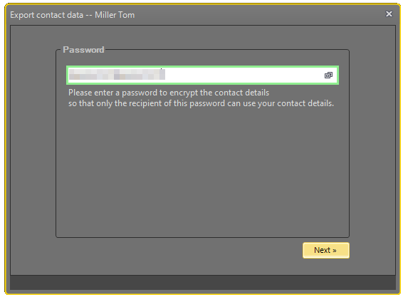

Tom Miller also secures his contact data with a password.

#### 2.3.2 Location of the contact data file

Ango stores the contact data file in ”documents“ as the default directory. Tom Miller can either send the contact data file with an email program or copy the file onto an USB Stick to exchange with the Service Company.

#### 2.3.3 Displaying the password

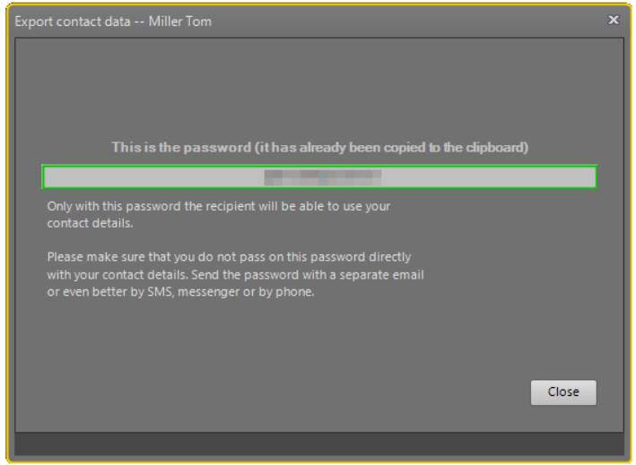

Tom Miller is also notified how to securely handle the exchange of a password. Ango already copied the password to the clipboard so it can easily be pasted into a text document. As said before: For safety reasons you should not send the password together with the contact data file.

## Chapter 3: Ann Best of the Service Company imports the contact data of Tom Miller

### 3.1 Importing contact data

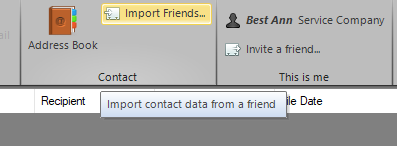

Ann Best of the Service Company had already received the contact data file and the required password. She clicks on ”Import Friends“ in the upper menu.

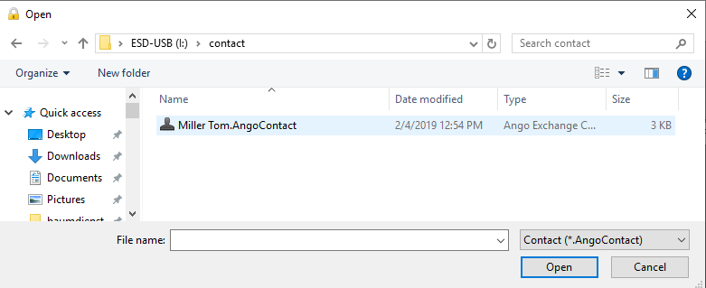

Then she locates the appropriate subdirectory, selects the contact data file and clicks on ”Open“.

### 3.2 Decrypting the imported contact data

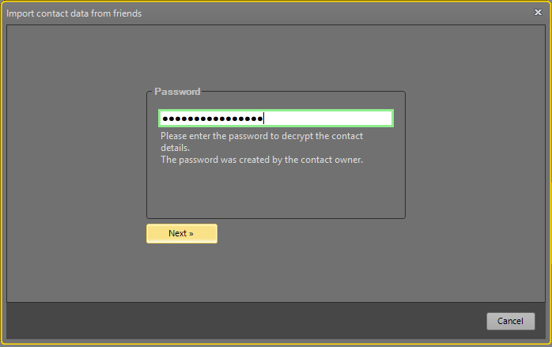

Ann Best enters the password she had received and clicks on “Next”.

### 3.3 Reviewing the imported contact data

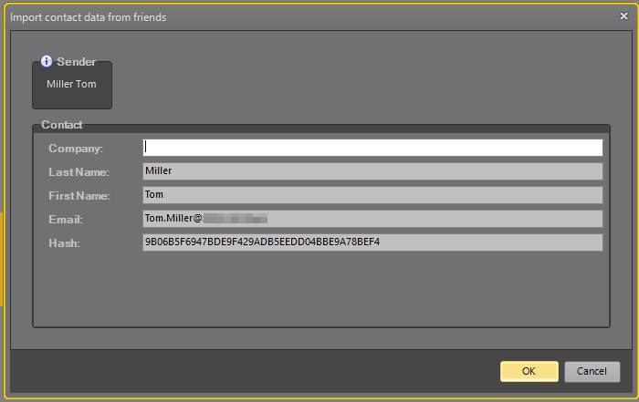

The imported contact data are being displayed for review.

From now on both parties are ready for the secure exchange of encrypted files.

## Chapter 4: Encrypting and decrypting of files is as easy as that

Ann Best of the Service Company and Tom Miller can now encrypt and decrypt files and exchange them both ways. Ann Best will now send Tom Miller an encrypted document. From now on no passwords are required anymore.

### 4.1 Encrypting files

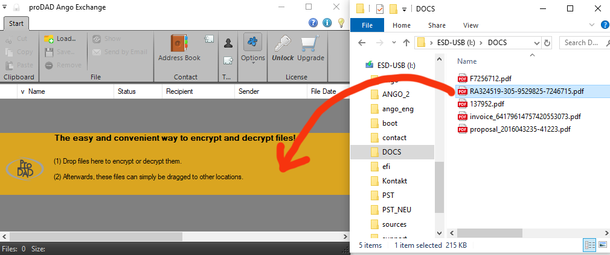

To do so Ann Best starts up Ango and drags the file to be encrypted onto the Ango canvas.

A window pops up to select the desired recipient of the encrypted file.

### 4.2 Selecting the recipient

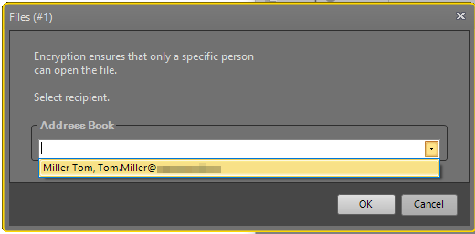

Anne Best selects Tom Miller from the address book.

### 4.3 Encrypted file ready to be send

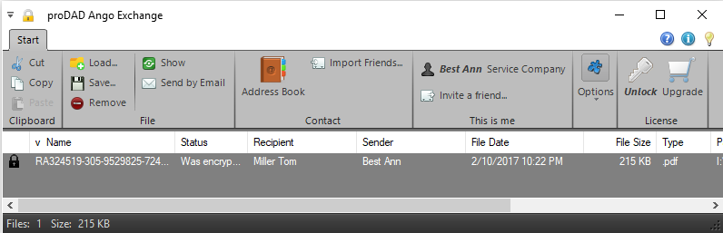

The Ango workspace now shows the already encrypted file. The closed key symbolizes the status, the file was successfully encrypted. Recipient is Tom Miller, Ann Best is the sender. Those two partners only can decrypt the file.

### 4.4 Transfer via email

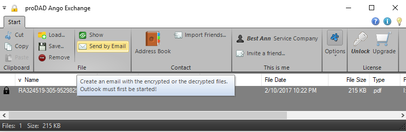

Ann Best would like to send the encrypted document via Outlook. She clicks on „Send by Email“ in the upper menu.

### 4.5 Completing and sending off the email

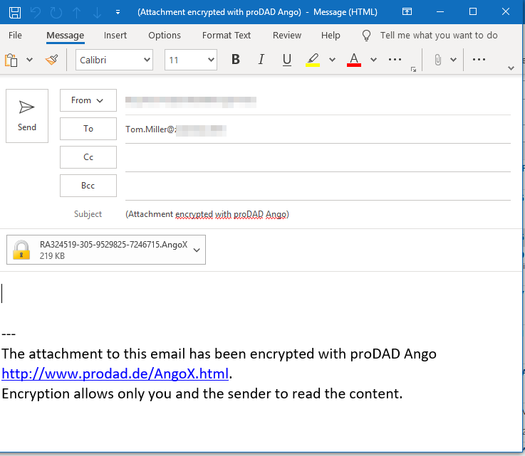

Ango has already prepared the email that can be further customized by an individual message.

Ann Best sends off the file.

### 4.6 Decrypting and working with the file by the recipient

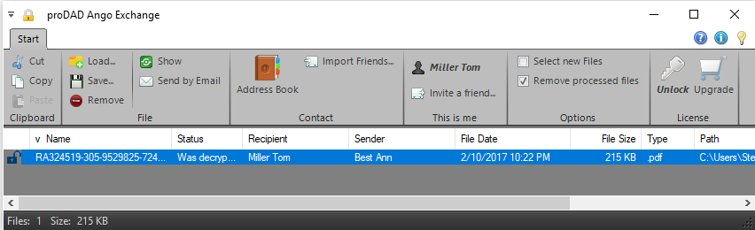

As soon as Tom Miller has received the encrypted file he can either double click the file in Outlook or drag the file onto the Ango canvas for decryption. The open key shows the successful decryption. Tom Miller can view he document within Ango (as long as the filetype is supported). The decrypted file can as well be dragged into a directory of your choice as well as stored on removable media like a USB stick or memory card.

## TIPP: Using Ango with the Windows File Explorer

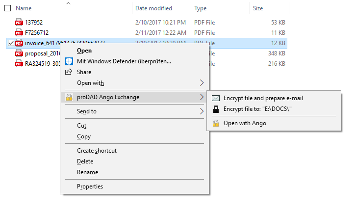

Select a file and click on the right mouse button. Then choose „proDAD Ango Exchange“. With this menu you can encrypt the file and prepare it to be send by email. You might as well store the file encrypted in the current directory or open the file with Ango.
