# proDAD Ango Exchange

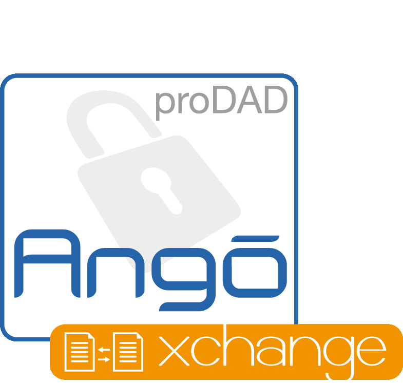

**Giriş / İlk Adımlar**

© proDAD GmbH

Yazar:

## İÇERİK

- [Önsöz: proDAD Ango Xchange'in amacı ve faydaları nedir?](#önsöz-prodad-ango-xchangein-amacı-ve-faydaları-nedir)
- [Telif Hakkı / Yasal Bilgiler](#telif-hakkı--yasal-bilgiler)
- [Ango Xchange'e Hoşgeldiniz!](#ango-xchangee-hoşgeldiniz)
- [İş Akış Şeması](#iş-akış-şeması)
  - [Ango'yu İlk Kez Başlatma](#angoyu-ilk-kez-başlatma)
  - [Yeni Bir İletişim Kurma Ve İletişim Verilerini Değiştirme](#yeni-bir-iletişim-kurma-ve-iletişim-verilerini-değiştirme)
  - [Güvenli Şifreleme Ve Dosya Gönderme](#güvenli-şifreleme-ve-dosya-gönderme)
  - [Alınan Şifreli Dosya İle Şifre Çözme Ve Çalışma](#alınan-şifreli-dosya-ile-şifre-çözme-ve-çalışma)
- [Bölüm 1: Service Company Ango’yu Kurulumdan Sonra İlk Kez Ayarlar Ve İletişim Bilgilerini Müşterİ Tom Miller’e Gönderir](#bölüm-1-service-company-angoyu-kurulumdan-sonra-ilk-kez-ayarlar-ve-iletişim-bilgilerini-müşteri-tom-millere-gönderir)
  - [1.1 İlk Program Başlangıcından Sonra Temel Verileri Girme](#11-ilk-program-başlangıcından-sonra-temel-verileri-girme)
  - [1.2 İletişim Verilerini İçe Aktarma](#12-iletişim-verilerini-içe-aktarma)
  - [1.3 Kendi İletişim Verilerini Gönderme](#13-kendi-iletişim-verilerini-gönderme)
  - [1.3.1 İletişim Verilerini Şifreleme](#131-iletişim-verilerini-şifreleme)
  - [1.3.2 Daveti Tamamlama Ve E-Posta İle Gönderme](#132-daveti-tamamlama-ve-e-posta-ile-gönderme)
  - [1.3.3 Şifreleri Gönderme Güvenlik Önerisi](#133-şifreleri-gönderme-güvenlik-önerisi)
- [Bölüm 2: Tom Miller, Ango'yu Kuruyor Ve Service Copmpany’nin İletişim Verilerini İçe Aktarıyor. Daha Sonra Kendi İletişim Verilerini Service Copmpany’ye Gönderiyor](#bölüm-2-tom-miller-angoyu-kuruyor-ve-service-copmpanynin-iletişim-verilerini-içe-aktarıyor-daha-sonra-kendi-iletişim-verilerini-service-copmpanyye-gönderiyor)
  - [2.1 İlk Program Başlangıcından Sonra Temel Verileri Girme](#21-ilk-program-başlangıcından-sonra-temel-verileri-girme)
  - [2.2 Service Company İletişim Verilerinin İçe Aktarılması](#22-service-company-iletişim-verilerinin-içe-aktarılması)
  - [2.2.1 İletişimi Etkinleştirmek İçin Şifre Girme](#221-iletişimi-etkinleştirmek-için-şifre-girme)
  - [2.2.2 İçe Aktarılan İletişim Verilerinin İncelenmesi](#222-içe-aktarılan-iletişim-verilerinin-incelenmesi)
  - [2.2.3 İçe Aktarılacak İletişim Listesi](#223-içe-aktarılacak-iletişim-listesi)
  - [2.3 Tom Miller İletişim Bilgilerini Service Company’ye Gönderir](#23-tom-miller-iletişim-bilgilerini-service-companyye-gönderir)
  - [2.3.1 Kendİ İletişim Verilerinin Şifrelenmesi](#231-kendi-iletişim-verilerinin-şifrelenmesi)
  - [2.3.2 İletişim Veri Dosyasının Yeri](#232-iletişim-veri-dosyasının-yeri)
  - [2.3.3 Şifrenin Görüntülenmesi](#233-şifrenin-görüntülenmesi)
- [Bölüm 3: Service Company’den Ann Best, Tom Miller'in İletişim Verilerini İçe Aktarıyor](#bölüm-3-service-companyden-ann-best-tom-millerin-iletişim-verilerini-içe-aktarıyor)
  - [3.1 İletişim Verilerini İçe Aktarma](#31-iletişim-verilerini-içe-aktarma)
  - [3.2 İçe Aktarılan İletişim Verilerinin Şifresini Çözme](#32-içe-aktarılan-iletişim-verilerinin-şifresini-çözme)
  - [3.3 İçe Aktarılan İletişim Verilerinin İncelenmesi](#33-içe-aktarılan-iletişim-verilerinin-incelenmesi)
- [Bölüm 4: Dosyaların Şifrelenmesi Ve Şifresini Çözmek Bu Kadar Kolaydır](#bölüm-4-dosyaların-şifrelenmesi-ve-şifresini-çözmek-bu-kadar-kolaydır)
  - [4.1 Dosyaları Şifrelemek](#41-dosyaları-şifrelemek)
  - [4.2 Alıcının Seçilmesi](#42-alıcının-seçilmesi)
  - [4.3 Şifreli Dosya Gönderilmeye Hazır](#43-şifreli-dosya-gönderilmeye-hazır)
  - [4.4 E-Posta İle Transfer](#44-e-posta-ile-transfer)
  - [4.5 E-Postanın Tamamlanması Ve Gönderilmesi](#45-e-postanın-tamamlanması-ve-gönderilmesi)
  - [4.6 Alıcı Tarafından Dosya İle Şifre Çözme Ve Çalışma](#46-alıcı-tarafından-dosya-ile-şifre-çözme-ve-çalışma)
- [İPUCU: Windows Dosya Gezgini İle Ango Kullanma](#ipucu-windows-dosya-gezgini-ile-ango-kullanma)

## Önsöz: proDAD Ango Xchange'in amacı ve faydaları nedir?

Tebrikler. ProDAD Ango ile AB-GDPR uyumlu, hızlı ve rahat bir şekilde veri alışverişi yapmaya karar verdiniz.

proDAD Ango, örneğin e-posta ile ek olarak gönderirken tüm dosyalarınız için en uygun korumayı sunar. proDAD Ango, metin belgeleri, elektronik tablolar, ses veya video dosyaları gibi her türlü dosyayı korur. Hassas verilerin şifrelenmesi, AB Genel Veri Koruma Yönetmeliği (GDPR) ile tamamen uyumludur

- Çevrimiçi veri depolama gerekmez
- Farklı alıcılar için şifreleri hatırlamanıza gerek yok
- Dosyalar şifrelenebilir ve doğrudan Windows gezgini gibi programlardan gönderilebilir

AB Genel Veri Koruma Yönetmeliği (GDPR) şirketler için yüksek standartlar getirmektedir. Dokümanların şifrelenmesi önemli bir taleptir çünkü şifreleme sizi veri sızıntısının çarpıcı sonuçlarından koruyabilir. Şifrelenmemiş bir e-posta gönderirseniz, yalnızca hedeflenen alıcının ekleri okuyabileceği sorumluluğu size aittir.

ProDAD Ango ile bunu hızlı ve kolay bir şekilde sağlayabilirsiniz. Şifreleme dosyaları - özellikle kişisel veriler söz konusuysa - AB Genel Veri Koruma Yönetmeliği anlamında en uygun teknik kurumsal önlem olarak kabul edilmektedir.

ProDAD Ango, uzak sunucularda veri işleyen veya depolayan birçok çevrimiçi çözümden farklı olarak, peer2peer şifreleme yöntemi olarak geliştirilmiştir. Bu, ilgili kullanıcıların yalnızca aldıkları verilerin şifresini çözebilmesini sağlar.

Harici sunucuları dağıtmamak, daha fazla siber güvenlik anlamına gelir ve bilgisayar korsanları için potansiyel bir hedef kalmaz. Bu şekilde, aktarım işlemi sırasında veriler başkaları tarafından okunamaz ve siber saldırılar bu içeriği üçüncü tarafların kullanımına sunamaz.

## Telif Hakkı / Yasal Bilgiler

Telif hakkı proDAD GmbH. Tüm hakları saklıdır.

Lisans Koşulları\
Yazılımı yüklemeden önce lütfen bu lisans koşullarını dikkatle okuyun.

Lisans anlaşması

Kurulum başladığında, dikkatle okumanız gereken bir lisans sözleşmesi gösterilir. Yazılımı yükleyerek, telif hakkı koşullarını, lisans sözleşmesini ve lisanslama prosedürünü kabul ettiğinizi belirtirsiniz.

Lisans Garantisi\
proDAD GmbH kullanıcıya bu ürünü doğru ve izin verilen amaçlarla kullanma hakkını verir. Mevcut ürün yalnızca bir bilgisayara kurulabilir. proDAD işbu belgeyle ücretsiz bir lisans anahtarı sağlamayı garanti eder. Bu ürünü kurarak, kullanıcı lisans garantisini, telif hakkı koşullarını ve sorumluluk sınırlamasını kabul eder.

Ticari Markalar\
Bu ürünle ilişkili olarak belirtilen tüm ürünler ve ticari markalar, ilgili sahiplere ait ticari markalardır. Tüm ticari markalar, özgürce kullanılabileceklerine dair herhangi bir garanti olmaksızın kullanılır ve tescilli ticari markalar olabilir.

Sorumluluk Sınırlaması\
Herhangi bir talep için sorumluluk derecesi ürünün değiştirilmesiyle sınırlıdır. Bu, proDAD GmbH, tüm lisans sahipleri ve perakendeciler için geçerlidir. Talepler, yalnızca yazılımın daha önce proDAD GmbH ile düzenlenmesi gereken iade edilen mal sayısıyla birlikte düzenli bir şekilde iade edilmesi durumunda tanınacaktır. Mallara ayrıca satın alma kanıtı eşlik etmelidir. Bu garanti, ürünün hatalı kullanımı, kötü muamele, kaza veya yanlış kullanımdan dolayı geçersizdir. proDAD GmbH, satış ortakları ve lisans sahipleri, bu ürünün imkansız kullanımından doğacak zararlardan veya müteakip zararlardan sorumlu tutulamaz. Sorumluluk, her durumda ürünün satın alma fiyatı ile sınırlıdır.

Belgeleme\
El kitabının derlenmesinde ve tercüme edilmesinde en büyük özen gösterilmiştir. Ancak, hata olasılığı tamamen göz ardı edilemez. proDAD GmbH, belgelerin veya çevirinin içerebileceği yanlış beyanların veya bilgilerin sonuçları için hiçbir şekilde sorumluluk veya yükümlülük kabul etmez. Teknik ve optik değişikliklere tabidir. Herhangi bir yanlışlık ile ilgili bilgileri her zaman bekleriz.

Telif Hakkı\
Bu ürünün yazılımı ve tek tek bileşenleri proDAD GmbH şirketinin malıdır. Bu ürünü yükleyerek lisans sahibi, yetkisiz kullanım ve çoğaltmadan kaçınmayı kabul eder.

proDAD GmbH, bu programın kullanımı ve bu programla oluşturulan içeriklerinin ve verilerinin yayınlanması konusunda hiçbir sorumluluk kabul etmez.

ProDAD GmbH \* Gauertstr. 2 \* 78194 Immendingen \* Deutschland \* HRB 1077

## Ango Xchange'e Hoşgeldiniz!

Service Company'den Ann Vest ve müşterileri Tom Miller örneğiyle, size her iki tarafın da proDAD Ango'yu kurmaya nasıl devam edeceğini göstereceğiz.

Başlangıçta kendi ana verilerinizi girdikten ve kişilerinizi kurduktan sonra (bölüm 1 ila 3'te açıklandığı gibi), değiştirilecek belgelerin şifrelemesini ve şifresini çözmeyi sadece birkaç tıklamayla hızlı ve kolay bir şekilde yöneteceksiniz. Bunu size 4. bölümde göstereceğiz.

Bundan önce iş akışını aşağıdaki grafikle görselleştirmek istiyoruz. Hızlı bir yönlendirme için [köşeli parantez] içinde basılan ilgili bölüm numaralarına da değindik.

Bir kişi ayarlamak yalnızca birkaç dakika sürer. Daha sonra, dosyaları güvenli bir şekilde şifrelemek ve şifresini çözmek için artık herhangi bir şifreyi ezberlemeniz gerekmeyecektir. ProDAD Ango ile birlikte çalışmanın ne kadar kolay ve rahat olduğunu göreceksiniz.

## İş Akış Şeması

### Ango'yu İlk Kez Başlatma

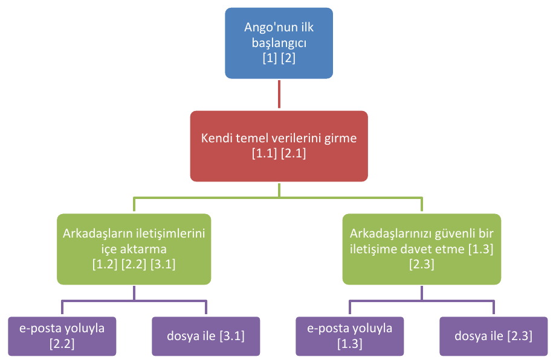

Ango'nun ilk başlangıcı [1] [2]

Kendi temel verilerini girme [1.1] [2.1]

Arkadaşların iletişimlerini içe aktarma [1.2] [2.2] [3.1]

Arkadaşlarınızı güvenli bir iletişime davet etme [1.3] [2.3]

e-posta yoluyla [2.2]

dosya ile [3.1]

e-posta yoluyla [1.3]

dosya ile [2.3]

(Parantez içindeki sayılar sonraki sayfalarda ilgili bölüm numaralarına karşılık gelmektedir)

### Yeni Bir İletişim Kurma Ve İletişim Verilerini Değiştirme

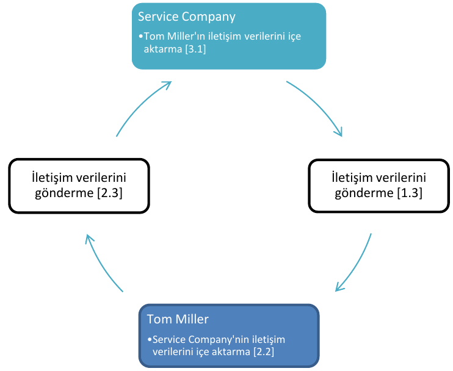

Service Company

- Tom Miller'ın iletişim verilerini içe aktarma [3.1]

İletişim verilerini gönderme [2.3]

İletişim verilerini gönderme [1.3]

Tom Miller

- Service Company'nin iletişim verilerini içe aktarma [2.2]

(Parantez içindeki sayılar sonraki sayfalarda ilgili bölüm numaralarına karşılık gelmektedir)

### Güvenli Şifreleme Ve Dosya Gönderme

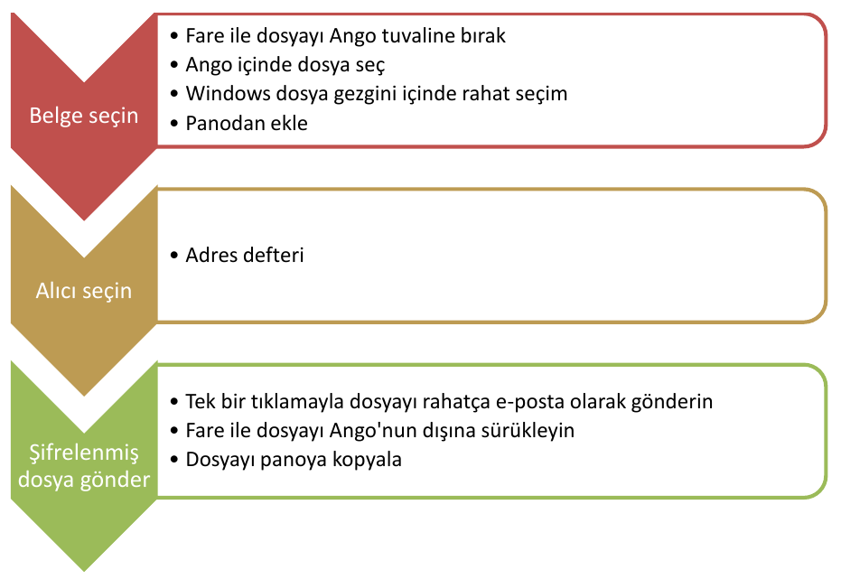

- Fare ile dosyayı Ango tuvaline bırak
- Ango içinde dosya seç
- Windows dosya gezgini içinde rahat seçim
- Panodan ekle

Belge seçin

- Adres defteri

Alıcı seçin

- Tek bir tıklamayla dosyayı rahatça e-posta olarak gönderin
- Fare ile dosyayı Ango'nun dışına sürükleyin
- Dosyayı panoya kopyala

Şifrelenmiş dosya gönder

### Alınan Şifreli Dosya İle Şifre Çözme Ve Çalışma

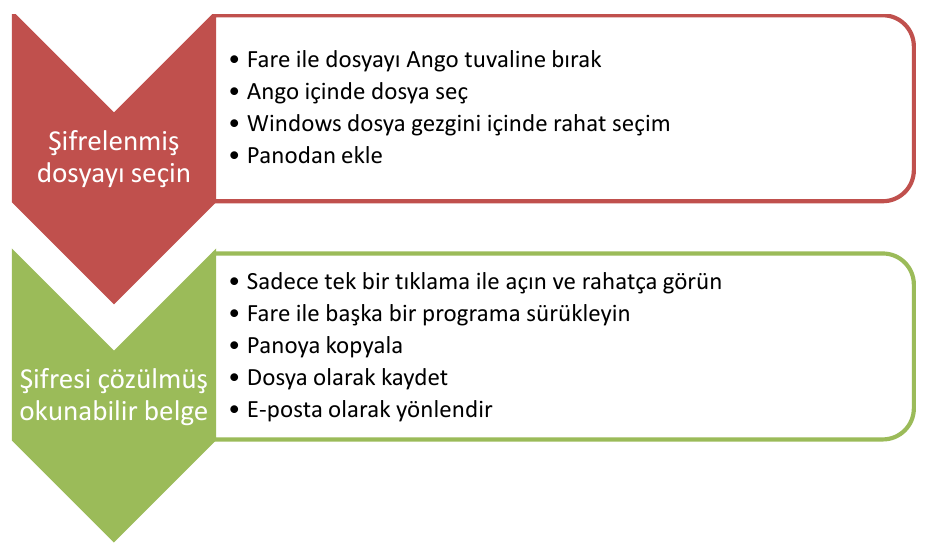

- Fare ile dosyayı Ango tuvaline bırak
- Ango içinde dosya seç
- Windows dosya gezgini içinde rahat seçim
- Panodan ekle

Şifrelenmiş dosyayı seçin

- Sadece tek bir tıklama ile açın ve rahatça görün
- Fare ile başka bir programa sürükleyin
- Panoya kopyala
- Dosya olarak kaydet
- E-posta olarak yönlendir

Şifresi çözülmüş okunabilir belge

**Açıklama**

Aşağıdaki bölüm 1 ila 3'te açıklanan ilk hazırlık adımlarının, yeni bir iletişim kurarken yalnızca bir kez uygulanması gerekir. Kurulumdan sonra, bu iletişim ile değiştirilecek belgelerin şifreleme ve şifre çözme işlemlerini sadece birkaç tıklamayla ele alırsınız - tekrar şifre girmenize gerek kalmadan hızlı ve kolay. Bunu size

4. bölümde göstereceğiz.

## Bölüm 1: Service Company Ango’yu Kurulumdan Sonra İlk Kez Ayarlar Ve İletişim Bilgilerini Müşterİ Tom Miller’e Gönderir

### 1.1 İlk Program Başlangıcından Sonra Temel Verileri Girme

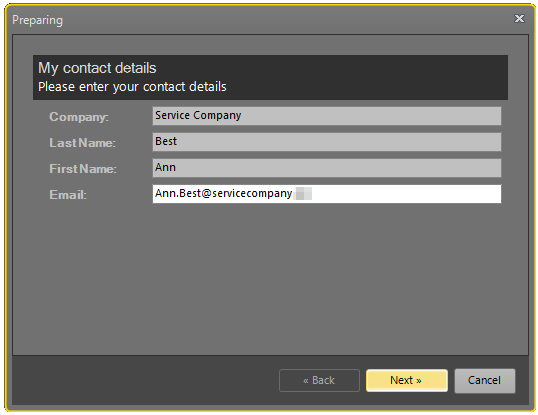

Ann Best tarafından temsil edilen Service Company, proDAD Ango'yu kurar, kendi temel verilerini girer ve ardından İleri'yi tıklatır.

### 1.2 İletişim Verilerini İçe Aktarma

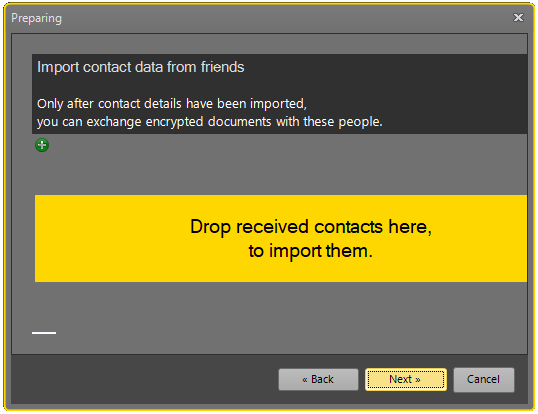

proDAD Ango artık bir arkadaşınızın iletişim verilerini içe aktarma olanağı sunuyor. proDAD Ango, ikisi arasında şifreli veri alışverişinde bulunulduğunda, bir ortağı bir arkadaş olarak çağırır. Şu anda, Service Company'nin henüz harici bir kişisi yok. Bu nedenle, şu anda hiçbir kişi dosyası içe aktarılmamaktadır.

### 1.3 Kendi İletişim Verilerini Gönderme

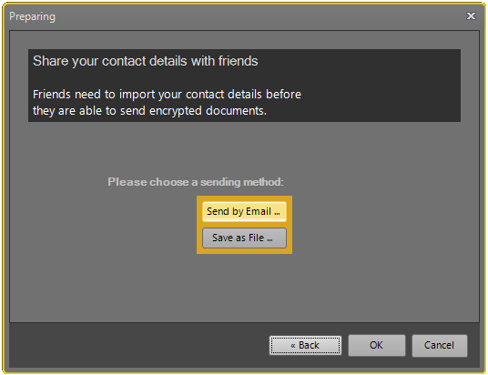

Service Company’den Ann Best, müşteri Tom Miller'ı birbirleri arasında güvenli bir şekilde dosya alışverişi yapmak için proDAD Ango'yu kullanmaya davet etmek istiyor. Davetiye Outlook üzerinden e-posta olarak gönderilebilir. Alternatif olarak, davet ayrıca başka bir e-posta programı tarafından gönderilecek veya USB bellekler veya hafıza kartları gibi cihazlarla değiştirilecek bir dosya olarak saklanabilir.

#### 1.3.1 İletişim Verilerini Şifreleme

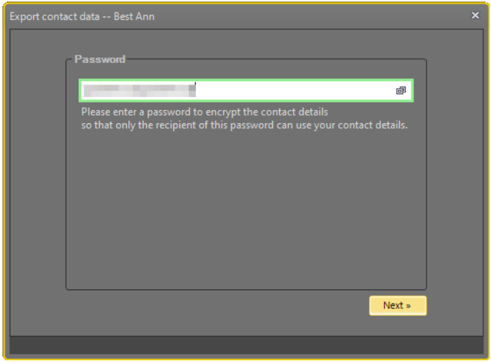

Ango artık iletişim dosyasını şifrelemek için bir şifre girmenizi istiyor. Bu, amaçlanan alıcının sadece verileri içe aktarabilmesini sağlamak içindir. Girilen şifre en az 16 basamak uzunluğunda ise Ango girişi kabul eder ve giriş alanını çevreleyen çerçeveyi kırmızıdan yeşile değiştirir.

#### 1.3.2 Daveti Tamamlama Ve E-Posta İle Gönderme

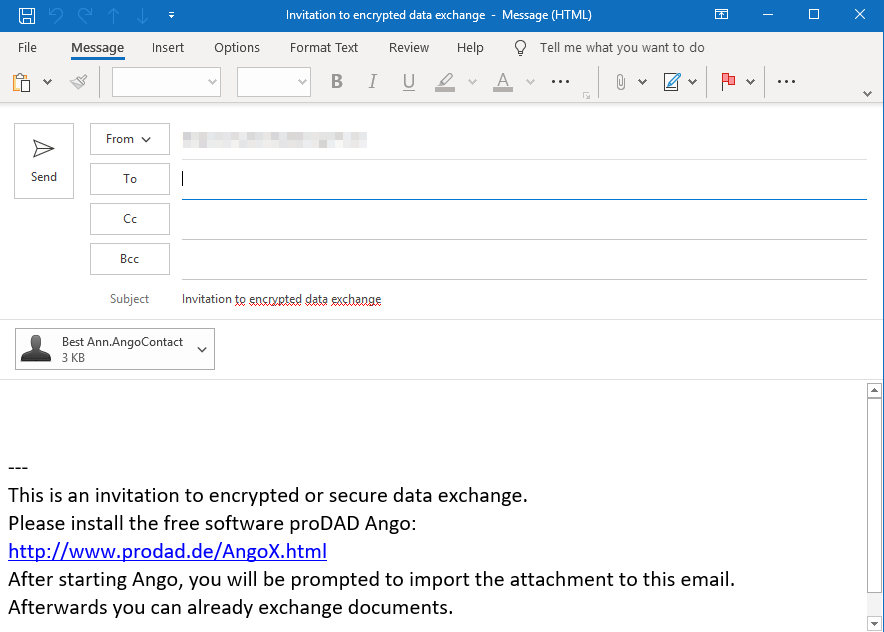

Ann Best iletişim verilerini e-posta ile göndermeye karar vermişti. Outlook zaten posta hazırladı. E-posta gönderenin şifrelenmiş iletişim verilerini içerir - örneğimizde Service Company’den Ann Best'in verileri. Alıcıların e-posta adresini ve belki de alıcıyla ilgili birkaç ek kişisel kelimeyi ekledikten sonra posta gönderilmeye hazırdır.

#### 1.3.3 Şifreleri Gönderme Güvenlik Önerisi

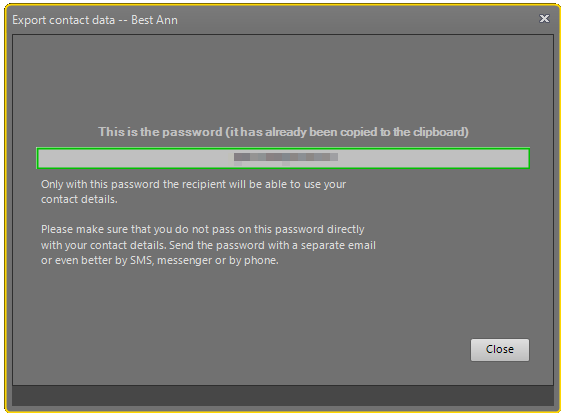

Tom Miller'ın, Service Company'nin iletişim verilerini Ango programına aktarabilmesi için elbette şifre hakkında bilgilendirilmesi gerekir. Ango gönderene, şifreyi kişi veri dosyasıyla paylaşmamasını önerir. Güvenlik nedeniyle, başka bir mesajlaşma servisi, SMS, telefon, faks veya mektup gibi ayrı bir e-posta adresi (veya daha iyisi) kullanılmalıdır.

## Bölüm 2: Tom Miller, Ango'yu Kuruyor Ve Service Copmpany’nin İletişim Verilerini İçe Aktarıyor. Daha Sonra Kendi İletişim Verilerini Service Copmpany’ye Gönderiyor

### 2.1 İlk Program Başlangıcından Sonra Temel Verileri Girme

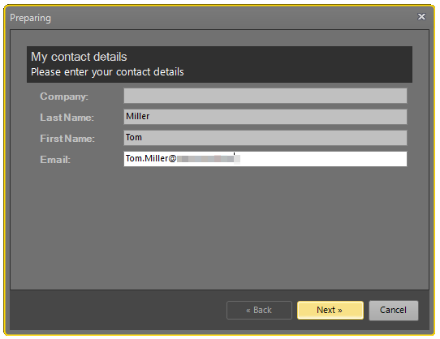

Tom Miller, Service Company'nin mesajını e-posta ile aldı ve Ango'yu kurdu. Başlamak için Tom Miller kendi temel verilerini de girer.

### 2.2 Service Company İletişim Verilerinin İçe Aktarılması

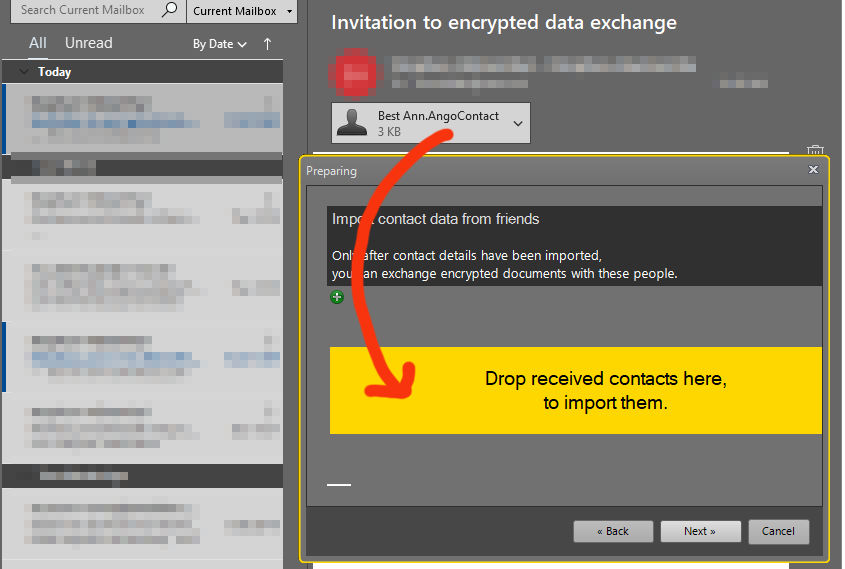

Service Company'nin iletişim verileri, alınan postanın iletişim dosyası eki Ango'nun sarı penceresine sürükleyip bırakılarak kolayca içe aktarılabilir.

#### 2.2.1 İletişimi Etkinleştirmek İçin Şifre Girme

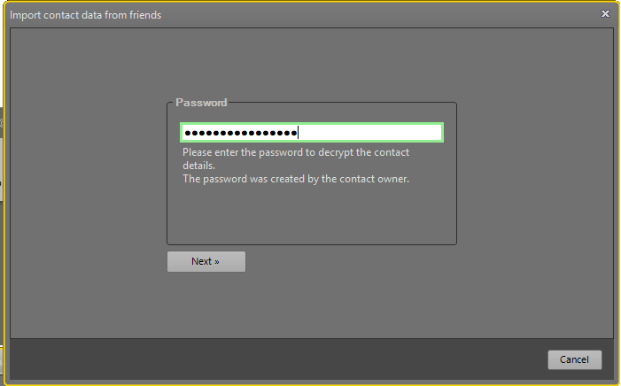

Tom Miller, iletişimi içe aktarabilmek için ek olarak aldığı şifreyi girer. Ann Best ona şifreyi SMS ile göndermeye karar vermişti.

#### 2.2.2 İçe Aktarılan İletişim Verilerinin İncelenmesi

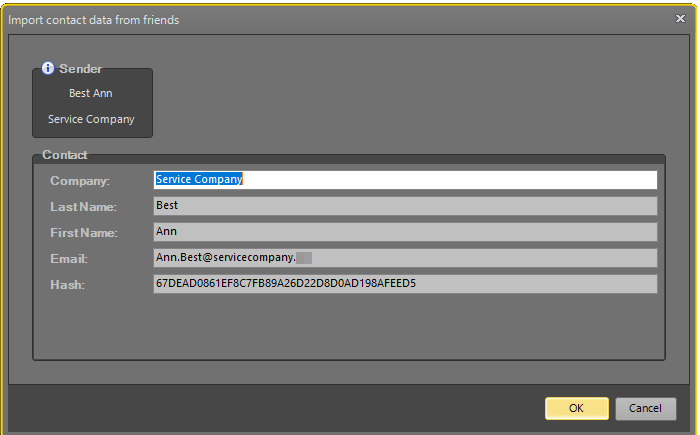

Service Company'nin içe aktarılan verileri gösteriliyor.

#### 2.2.3 İçe Aktarılacak İletişim Listesi

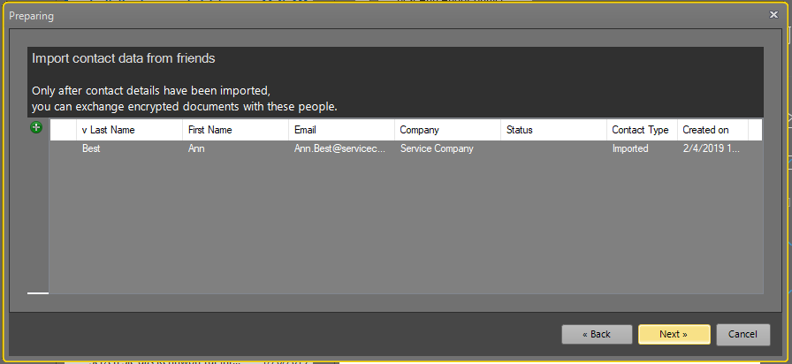

Bu görünümde tüm iletişim verileri listelenir. Şu anda Service Company'nin başka bir girişi bulunmamaktadır.

### 2.3 Tom Miller İletişim Bilgilerini Service Company’ye Gönderir

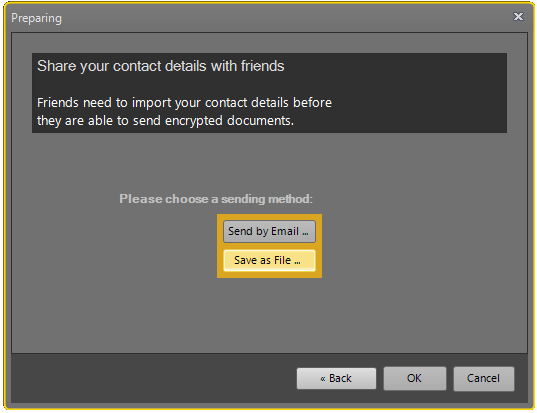

Tom Miller artık iletişim bilgilerini bir arkadaşına, bu örnekte Service Company'ye gönderebilir. Service Company ve Tom Miller'in şifreli dosyaları değiştirmeye başlayabilmesi için iletişim verilerinin gönderilmesi gerekir.

Tom Miller, iletişim verilerini Outlook tarafından göndermek istemediği için ”Dosya olarak kaydet“ seçeneğini seçer.

#### 2.3.1 Kendİ İletişim Verilerinin Şifrelenmesi

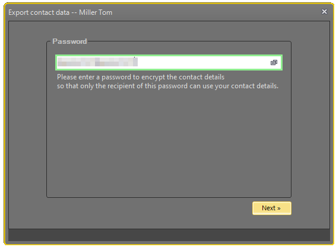

Tom Miller ayrıca iletişim bilgilerini bir şifre ile korur.

#### 2.3.2 İletişim Veri Dosyasının Yeri

Ango kişi veri dosyasını varsayılan olarak "belgeler" içinde saklar. Tom Miller, iletişim verileri dosyasını bir e-posta programı ile gönderebilir veya Service Company ile alışveriş yapmak için dosyayı bir USB Belleğe kopyalayabilir.

#### 2.3.3 Şifrenin Görüntülenmesi

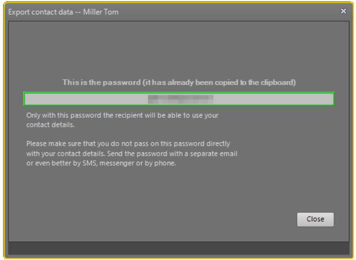

Tom Miller'a ayrıca bir şifre değişiminin güvenli bir şekilde nasıl yapılacağı bildirilir. Ango, şifreyi zaten bir metin belgesine kolayca yapıştırılabilmesi için panoya kopyaladı. Daha önce de belirtildiği gibi: Güvenlik nedeniyle, şifreyi iletişim veri dosyasıyla birlikte göndermemelisiniz.

## Bölüm 3: Service Company’den Ann Best, Tom Miller'in İletişim Verilerini İçe Aktarıyor

### 3.1 İletişim Verilerini İçe Aktarma

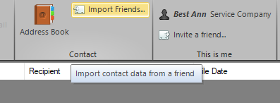

Service Company’den Ann Best, iletişim veri dosyasını ve gerekli şifreyi zaten almıştı. Üst menüdeki "Arkadaşları İçe Aktar" ı tıklatır.

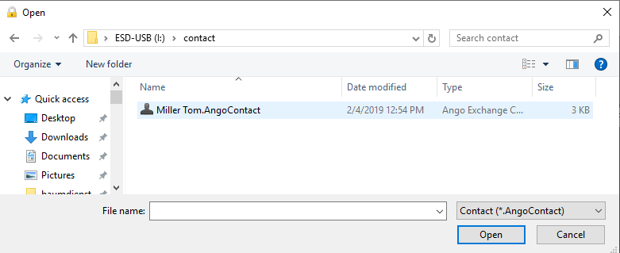

Ardından uygun alt dizini bulur, iletişim veri dosyasını seçer ve ”Aç” a tıklar.

### 3.2 İçe Aktarılan İletişim Verilerinin Şifresini Çözme

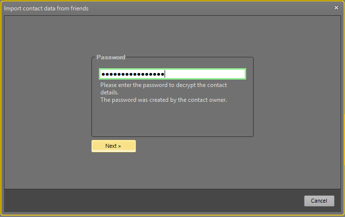

Ann Best aldığı şifreyi girer ve “İleri” ye tıklar.

### 3.3 İçe Aktarılan İletişim Verilerinin İncelenmesi

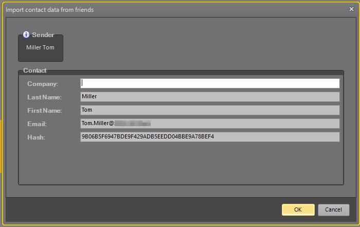

İçe aktarılan iletişim verileri incelenmek üzere görüntüleniyor.

Şu andan itibaren her iki taraf da şifrelenmiş dosyaların güvenli alışverişine hazırdır.

## Bölüm 4: Dosyaların Şifrelenmesi Ve Şifresini Çözmek Bu Kadar Kolaydır

Service Company’den Ann Best ve Tom Miller artık dosyaları şifreleyebilir ve şifrelerini çözebilir ve her iki şekilde de değiştirebilir. Ann Best şimdi Tom Miller'e şifreli bir belge gönderecek. Artık şifre gerekmemektedir.

### 4.1 Dosyaları Şifrelemek

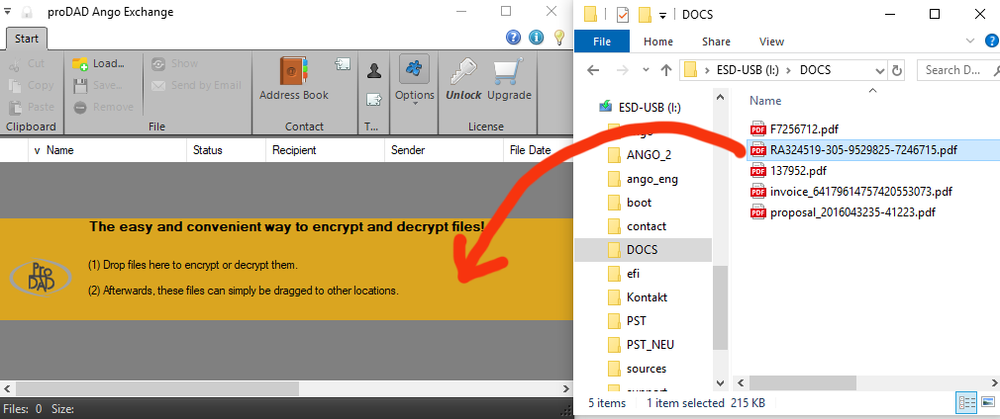

Bunu yapmak için Ann Best, Ango'yu başlatır ve şifrelenecek dosyayı Ango tuvaline sürükler.

Şifrelenmiş dosyanın istenen alıcısını seçmek için bir pencere açılır.

### 4.2 Alıcının Seçilmesi

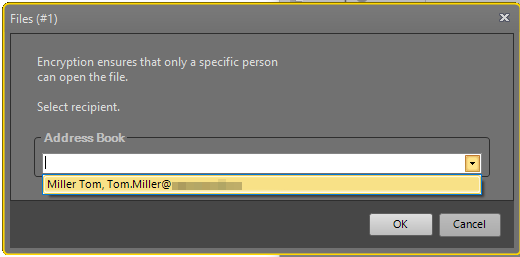

Ann Best, adres defterinden Tom Miller'i seçer.

### 4.3 Şifreli Dosya Gönderilmeye Hazır

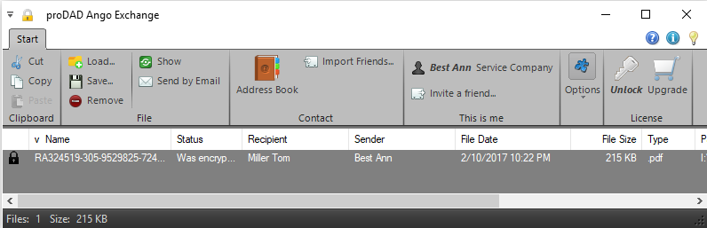

Ango çalışma alanı şimdi zaten şifrelenmiş dosyayı gösteriyor. Kapalı anahtar durumu sembolize eder, dosya başarıyla şifrelenir. Alıcı Tom Miller, gönderen Ann Best. Bu iki ortak yalnızca dosyanın şifresini çözebilir.

### 4.4 E-Posta İle Transfer

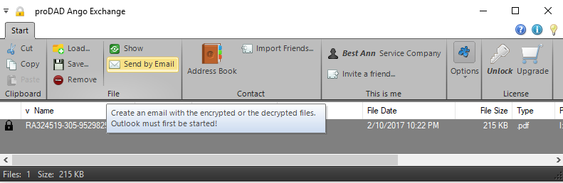

Ann Best şifrelenmiş belgeyi Outlook ile göndermek istiyor. Üst menüdeki "E-posta ile Gönder" i tıklatır.

### 4.5 E-Postanın Tamamlanması Ve Gönderilmesi

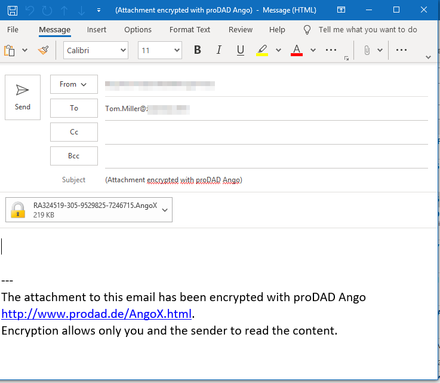

Ango, bireysel bir mesajla daha da özelleştirilebilen e-postayı zaten hazırladı.

Ann Best dosyayı gönderir.

### 4.6 Alıcı Tarafından Dosya İle Şifre Çözme Ve Çalışma

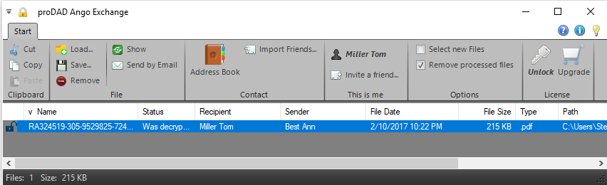

Tom Miller şifrelenmiş dosyayı alır almaz Outlook'ta dosyayı çift tıklayabilir veya şifresini çözmek için Ango tuvaline sürükleyebilir. Açık anahtar başarılı bir şifre çözme işlemini gösterir. Tom Miller Ango içinde belgelerini görüntüleyebilir (dosya türü desteklendiği sürece). Şifresi çözülen dosya, seçtiğiniz bir dizine sürüklenebilir ve

USB bellek veya hafıza kartı gibi çıkarılabilir ortamlarda saklanabilir.

## İPUCU: Windows Dosya Gezgini İle Ango Kullanma

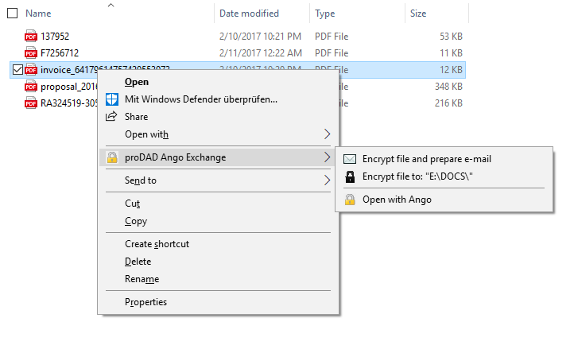

Bir dosya seçin ve sağ fare düğmesine tıklayın. Ardından "proDAD Ango Exchange" i seçin. Bu menü ile dosyayı şifreleyebilir ve e-posta ile gönderilmek üzere hazırlayabilirsiniz. Geçerli dizinde şifrelenmiş dosyayı depolayabilir veya Ango ile açabilirsiniz.
