# proDAD DeFishr

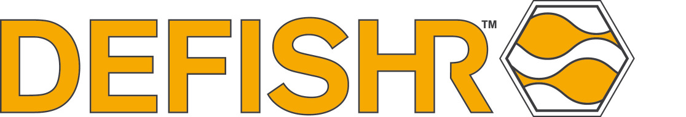

**proDAD DeFishr**

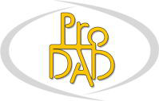

© proDAD GmbH – www.prodad.com

Autor : Uwe Wenz

## Inhaltsverzeichnis

- Willkommen
- [Allgemeine Informationen](#allgemeine-informationen)
  - [Copyright / Rechtliches](#copyright--rechtliches)
  - [Was ist DeFishr?](#was-ist-defishr)
  - [Installation und Registrierung](#installation-und-registrierung)
  - [Programmhilfe](#programmhilfe)
- [Defishr im Detail](#defishr-im-detail)
  - [Erste Anwendung und Programmoberfläche](#erste-anwendung-und-programmoberfläche)
  - [Media Bin](#media-bin)
    - [Import Media (Video importieren...)](#import-media-video-importieren)
    - [Clear/Open/Save (Projekt/Clip löschen, öffnen und sichern)](#clearopensave-projektclip-löschen-öffnen-und-sichern)
  - [Camera Profile](#camera-profile)
    - [Select Profile (Profil zur Korrektur auswählen)](#select-profile-profil-zur-korrektur-auswählen)
    - [Edit (Profil bearbeiten)](#edit-profil-bearbeiten)
    - Der Calibrator, wann für was und wie richtig einsetzen
      - [Wie erstelle ich ein eigenes Kameraprofil?](#wie-erstelle-ich-ein-eigenes-kameraprofil)
      - [Eigene Kameraaufnahmen für eigene Profile](#eigene-kameraaufnahmen-für-eigene-profile)
      - [Die Analyse Ihrer Aufnahme](#die-analyse-ihrer-aufnahme)
      - [Graph - Grid Histogram - Parameter - Tips](#graph---grid-histogram---parameter---tips)
  - [Viewer (Ansichten)](#viewer-ansichten)
  - [Additional correction](#additional-correction)
  - [Viewer / Playback und Zeitleiste](#viewer--playback-und-zeitleiste)
  - [Register Media Bin](#register-media-bin)
  - [Export](#export)

#### Willkommen zu proDAD DeFishr !

DeFishr dient der nachträglichen Entfernung des Fisheye-Effektes, entstanden bei Aufnahmen durch Kameras mit Linsenkrümmung. Somit ist DeFishr ein äußerst wichtiges Tool zur Optimierung wertvoller Aufnahmen insbesondere von Action-Kameras.

Wir wünschen Ihnen viel Freude mit proDAD DeFishr und stets effektvolle Ergebnisse !

## Allgemeine Informationen

### Copyright / Rechtliches

Rechtliches\
Copyright proDAD GmbH. Alle Rechte vorbehalten.

Lizenzbestimmungen\
Vor der Installation lesen Sie bitte folgende Lizenzbestimmungen sorgfältig durch.

Lizenzvertrag\
Beim Start des Setups wird ein Lizenzvertrag angezeigt, den Sie bitte sorgfältig durchlesen.\
Mit der Installation erkennen Sie diese Copyrightbestimmungen, den Lizenzvertrag und das Lizenzierungsverfahren an.

Lizenzgewähr\
proDAD GmbH räumt den bestimmungsgemäßen und erlaubten Gebrauch des vorliegenden Produkts ein. Das vorliegende Produkt kann nur auf einem Arbeitsplatz eingesetzt werden. Weder die Software, noch die Anleitung darf, auch in Teilen, reproduziert werden, es sei denn, es liegt eine schriftliche Genehmigung der proDAD GmbH vor. Mit Installation des Produkts gilt die Lizenzgewähr, die Urheberrechtsbestimmung, sowie die Haftungsbegrenzung als anerkannt.

Warenzeichen\
Alle Produkt- und Warenzeichen, die in diesem Produkt erwähnt wurden, sind Warenzeichen der jeweiligen Eigentümer. Alle Warenzeichen werden ohne Gewährleistung der freien Verwendbarkeit benutzt und sind eventuell eingetragene Warenzeichen.

Haftungsbegrenzung\
Der gesamte Haftungsumfang besteht im alleinigen Anspruch auf Ersatz des Produkts. Dies gilt für proDAD GmbH, Lizenznehmer und evtl. Vertreiber. Anspruch besteht nur bei korrekter Rückgabe der Software unter Angabe einer Warenrücksendenummer, die zuvor mit proDAD GmbH vereinbart werden muss. Ferner muss bei der Rückgabe ein Kaufbelege beiliegen. Ist eine Fehlfunktion des vorliegenden Produkts auf eine fehlerhafte Anwendung, Missbrauch, Unfall oder unsachgemäße Handhabung zurückzuführen, gilt die Garantie nicht. proDAD GmbH, deren Vertriebspartner und Lizenznehmer haften nicht für Schäden und Folgeschäden, die aufgrund der unmöglichen Nutzung des vorliegenden Produkts entstehen. In jedem Fall ist der Haftungsbetrag auf den Kaufpreis des Produkts beschränkt.

Dokumentationen\
Die Produktion und Übersetzung der Handbücher wurde mit größter Sorgfalt durchgeführt. Fehler können jedoch nicht hundertprozentig ausgeschlossen werden. proDAD GmbH übernimmt keinerlei Verantwortung oder Haftung für Folgen evtl. verbliebener fehlerhafter Aussagen oder Angaben. Technische und optische Änderungen vorbehalten. Hinweise sind stets willkommen.

Urheberrecht\
Die Software sowie die Einzelkomponenten dieses Produkts sind Eigentum der proDAD GmbH. Mit der Installation des vorliegenden Produkts stimmt der Lizenznehmer zu, unautorisierten Gebrauch und Duplizierung zu vermeiden.

proDAD GmbH übernimmt keinerlei Verantwortung für die Anwendung des Programms und die Veröffentlichung von Inhalten und Daten, die mit diesem Programm erzeugt wurden.

ProDAD GmbH \* Gauertstr. 2 \* 78194 Immendingen \* Deutschland \* HRB 1077

### Was ist DeFishr?

**DeFishr** ist ein Werkzeug zur nachträglichen Entfernung des Fisheye-Effektes und zur Korrektur sogenannter "Stürzenden Linien", entstanden bei Aufnahmen durch Kameras mit Linsenkrümmung.\
Somit ist DeFishr ein äußerst wichtiges Tool zur Optimierung wertvoller Aufnahmen insbesondere von Action-Kameras oder bei Verwendung extremer Weitwinkel-Objektiven.

**DeFishr** beinhaltet verschiedene Kamera-Profile zur Korrektur des Fisheye-Effektes bzw. bietet die Möglichkeit ein eigenes Profil für die verwendete Kamera zu erstellen. Das ist von Bedeutung, wenn Ihre Kamera in der Profilliste nicht verfügbar ist bzw. wenn die Profile nicht das gewünschte Ergebnis liefern. Das sogenannte Kalibrieren wird direkt im Programm mit dem **Calibrator** ermöglicht. Ein Filmen des Calibration Grids (Schachbrett) und der dann folgenden Analyse bereitet das zur Korrektur notwendige Profil auf.

### Installation und Registrierung

Um die **Installation** zu starten, klicken Sie bitte einfach doppelt auf die Setup-Datei. Mit der Installation stimmen Sie den Bedingungen unter Rechtliches und den Lizenzbedingungen zu. Wenn Sie **DeFishr** als Download bezogen haben, wird das Programmarchiv zunächst entpackt und die Installation gestartet. Wählen Sie dann das Zielverzeichnis in dem DeFishr installiert werden soll.

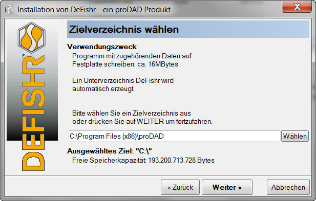

Folgen Sie nun den Installationsanweisungen. Weitere Hinweise zur Nutzung als **DEMO** bzw. zur **Aktivierung** finden Sie hier.

**Registrierung von DeFishr**\
Sie möchten Updates und weitere Informationen über DeFishr erhalten, dann registrieren Sie Ihr **proDAD DeFishr** unter http://www.prodad.de/register.html.

### Programmhilfe

Die Programmhilfe ist generell per F1-Taste erreichbar.

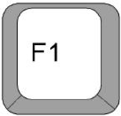

Außerdem steht Sie in PDF-Form zum direkten Aufruf im Programm-Menü zur Verfügung, zu finden im

**Windows-Start-Menü**

Programme

proDAD

Manual-DeFishr

Bitte verwenden Sie auch die Suche-Funktion zum schnellen Auffinden von bestimmten Begriffen oder Themen in der Anleitung.

## Defishr im Detail

### Erste Anwendung und Programmoberfläche

**DeFishr** kann per **Shortcut** auf dem Desktop

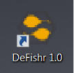

oder über **Start/Programme/proDAD/DeFishr** gestartet werden.

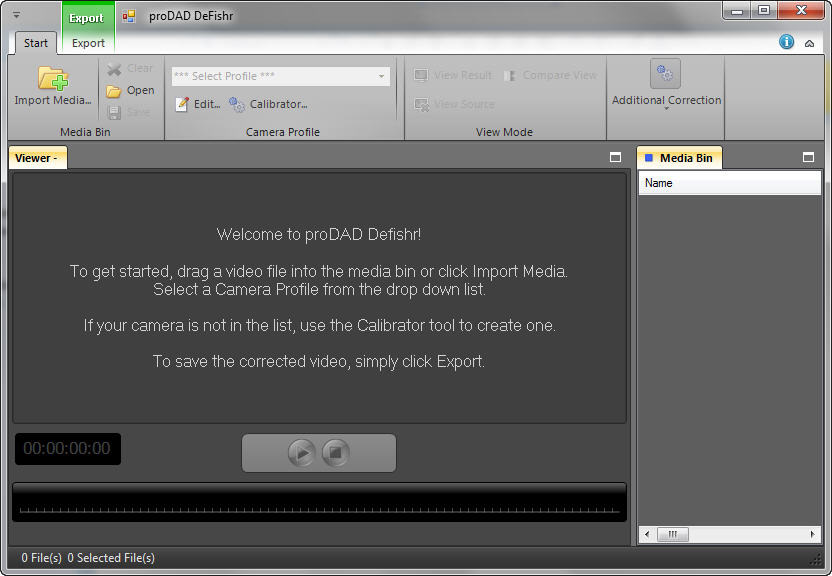

Beim ersten Programmstart von DeFishr werden Sie zur Eingabe eines **Aktivierungscodes** (Seriennummer) aufgefordert, geben Sie den Code ein, den Sie bei elektronischer Lieferung mit der Download-Instructions-Email erhalten haben, oder falls Sie eine physische Lieferung (auf DVD) erhalten haben, innerhalb der Box vorfinden. Klicken Sie dann **Unlock**. Wenn Sie DeFishr im **DEMO-Modus** testen möchten, dann klicken Sie **Continue with Demo Version**. Die Demoversion ist solange aktiv, bis eine Seriennummerneingabe die Lizenz zur Vollversion wandelt.

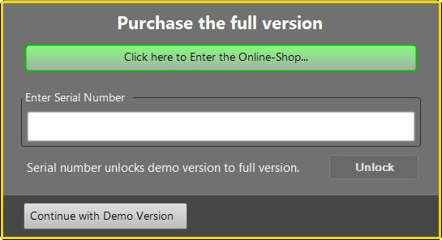

**DeFishr** startet dann mit dem aktiven Register **Start**.

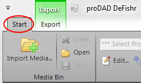

Zuerst importieren Sie Ihr Video. Sie können auch das Playback des Originalvideos (via Control) in der DeFishr-Vorschau starten. Anschließend wählen Sie ein Profil aus, das Ihrer verwendeten Kamera entspricht.

**WICHTIG!**\
Wenn kein passendes Profil zu Ihrer Kamera im Menü **Camera Profile** erscheint, dann finden Sie hier wichtige Hinweise zur Erstellung eigener Kameraprofile.

**Ein Beispiel:**\
Bei Verwendung von Videos von der **Action-Kamera GoPro Hero** wählen Sie einfach das bereits verfügbare **Profil** aus. Der Clip wird sofort korrigiert in der Vorschau angezeigt.

Mit dem Parameter **Lens** (verfügbar im Bereich **Additional Correction**) kann ein vorhandenes **Profil** weiter angepaßt werden. Das Ergebnis ist lediglich eine Näherung und bei größeren Werten können auch unerwünschte Verzerrungen auftreten, dann muß eine Kalibrierung durchgeführt werden.

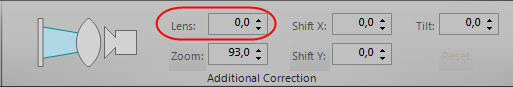

Weitere Hinweise zur Verwendung von Profilen finden Sie hier.

### Media Bin

#### Import Media (Video importieren...)

Klicken Sie auf die Option **Import Media...** um das Video (bzw. ein Bild) zu importieren.

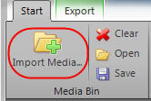

Es öffnet der Dialog **Öffnen**, navigieren Sie jetzt in das entsprechende Verzeichnis in dem Ihr Video/Bild gespeichert wurde.\
Markieren Sie es und klicken auf **Öffnen**. Das Video/Bild wird nun in der **DeFishr-Vorschau** angezeigt. Der **Fisheye-Effekt** ist im Viewer sichtbar.

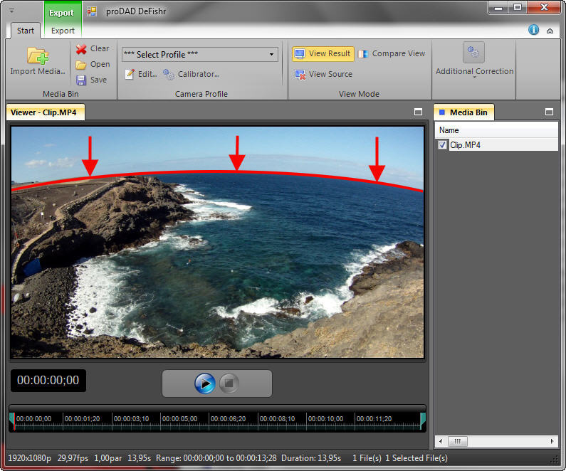

#### Clear/Open/Save (Projekt/Clip löschen, öffnen und sichern)

Im Bereich **Media Bin** haben Sie weiterhin die Möglichkeit das importierte Video/Bild in der **DeFishr-Vorschau** zu löschen (Clear), ein Projekt zu öffnen (Open) und zu speichern (Save).

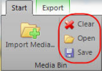

### Camera Profile

#### Select Profile (Profil zur Korrektur auswählen)

In diesem Beispiel wurde die Action Camera **GoPro Hero** verwendet.\
Direkt nach der Auswahl des vorinstallierten Profiles **GoProHero** wird die Korrektur des **Fisheye-Effektes** in der Vorschau angezeigt.

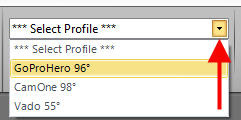

Um den Vergleich **Original-Video/korrigiertes Video** zu sehen, sollte die Option **Compare View** im Viewer gewählt werden, so erhalten Sie eine Gegenüberstellung.

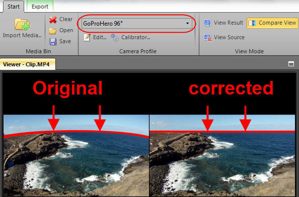

Weitere Hinweise zur Verwendung von Profilen finden Sie hier.

#### Edit (Profil bearbeiten)

Über die Option **Edit** können Sie Profile bearbeiten, laden und speichern.

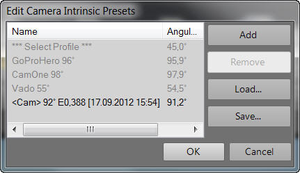

## Der Calibrator, wann für was und wie

## richtig einsetzen

##### Wie erstelle ich ein eigenes Kameraprofil?

Behalten Sie folgende Empfehlungen im Auge.

1. Erstellen Sie Ihre Aufnahme wie in Eigene Kameraaufnahmen für eigene Profile beschrieben.
2. Führen Sie die Analyse Ihrer Aufnahme durch, wie in Die Analyse Ihrer Aufnahme beschrieben.
3. Bewerten Sie die erfolgte Analyse und optimieren Sie ggf. die Aufnahme unter Verwendung der Tips und dem Instruction Video zur Veranschaulichung einer Aufnahme.

##### Eigene Kameraaufnahmen für eigene Profile

Nun benötigen Sie Ihre Kamera zum Abfilmen eines im Calibrator enthaltenen **Schachbrettmusters (Calibration grid)**. Anhand dieses Videos ermittelt der Calibrator nach dem erfolgten Import des Videos die evt. verfügbaren Fisheye-Verzerrungen. Es wird ein Profil erstellt, das die Verzerrungen (Fisheye) entfernt. Dieses Profil wird dem **DeFishr** übergeben und es steht Ihnen dann für alle kommenden Videos in der Profilliste zur Verfügung.

Klicken Sie zuerst auf die Option **Calibrator...**.

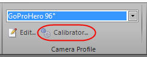

Es startet der Calibrator, wechseln Sie hier in das Register **Calibration Grid (1)**. Es erscheint das **Schachbrettmuster (2)**, welches nun nahezu in den **Vollbildmodus** geschaltet werden muß. Nutzen Sie dazu die Minimierungs-Optionen **(3) und (4)**.

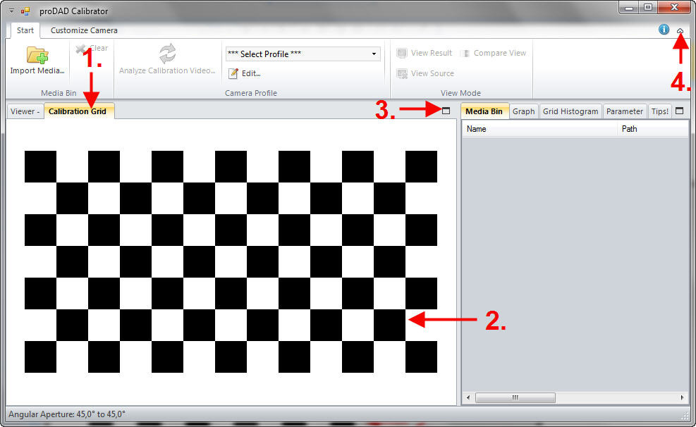

**Wichtige Tipps zur Kalibrierung Ihrer Kamera.**

Um eine möglichst genaue Analyse zur Kalibrierung Ihrer Kamera/Linse zu erhalten, beherzigen Sie bitte folgende Tipps\
(Die Schritte 1 und 2 müssen unbedingt in einem einzigen Video erfolgen, also ohne Aufnahmestopp!):

1. Bewegen Sie zuerst die Kamera immer über alle Richtungen des Schachbretts hinaus (oben, unten, rechts, links, über jede einzelne Ecke), zielen dabei IMMER auf die Mitte des Schachbretts, sodas eine Rotation der Kamera hin zum Mittelpunkt des Schachbretts entsteht!
2. Bewegen Sie dann die Kamera immer über alle Richtungen des Schachbretts hinaus (oben, unten, rechts, links, über jede einzelne Ecke), OHNE auf die Mitte des Schachbretts zu zielen, sondern halten die Kamera dabei geradeaus!
3. Filmen Sie das Schachbrett immer größtmöglich, also in der Aufnahme flächendeckend ab!
4. Filmen Sie das Schachbrett möglichst scharf ab.
5. Versuchen Sie möglichst kurze Verschlusszeiten anzuwenden, also filmen Sie idealerweise bei guten Lichtverhältnissen.
6. Vermeiden Sie stetiges Wackeln oder legen bewußte Pausen ein, wenn Sie mit der Kamera das Schachbrett erfassen. Somit hat die folgende Analyse die Chance klare Bilder zu erkennen.
7. Sofern Ihre Kamera nicht über eine Vorschauanzeige verfügt, filmen Sie das Schachbrett aus verschiedenen Entfernungen zum Monitor in einem einzigen Videoclip ab. Idealerweise nehmen Sie jede Kamera-Bewegung direkt nacheinander von nah nach fern vom Schachbrett auf und legen dabei bewußte Pausen ein.

Im Register ***Tips*** finden Sie ein **Instruction Video**, das die Aufnahme des Calibration Grids zeigt.

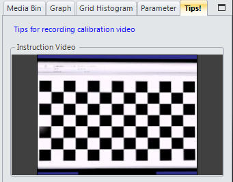

**Eine gut erfolgte Kalibrierung erkennen Sie wie folgt:**

**a)** Die Analyse findet min. 20 Bilder (Zähler = grün), idealerweise sogar 50+ Bilder, anhand der geometrischen Punkte, die erkannt werden können.\
**b)** Im Tab für das Grid-Histogramm rechts sind **KEINE rot blinkenden Flächen** mehr sichtbar. Das bedeutet, dass Sie ALLE Bereiche, die zur Kalibrierung notwendig waren, durch die Schritte 1 und 2 erfasst haben.

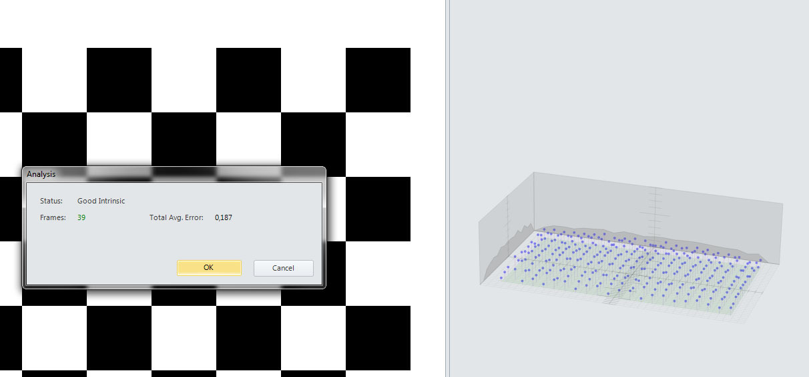

Je weniger Bereiche unerfaßt bleiben, desto genauer ist die spätere Korrektur und somit das Ergebnis in Ihren Videos.

***Tipp:***\
*Sofern immer noch* ***rot blinkende Flächen*** *zu sehen sind, fahren Sie im oberen Punkt 1 und 2* *einfach langsam weiter hinaus in die angegebenen Richtungen.*

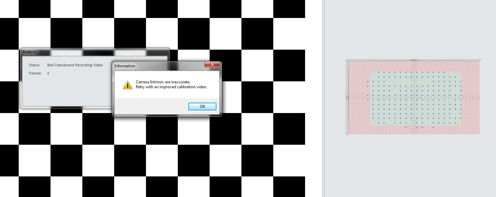

**c)** Gut erfolgte Analysen und daraus resultierende Profile werden mit "&lt;CAM>" gekennzeichnet, weniger optimale mit "&lt;BAD>".\
**d)** Gute Profile werden mit einem "Total Average Error" kleiner 0,3 angezeigt. Sehr gute Profile erreichen sogar Werte um 0,1 bis 0,15.\
**e)** Ob Ihr selbst generiertes Profil in der Praxis funktioniert, sehen Sie idealerweise nach der Analyse nach Umschaltung von "Calibration Grid" auf "Viewer" und dort bei Aktivierung der Splitscreen-Ansicht "Compare View".\
**f)** Wie Ihr Video funktioniert, signalisiert Ihnen das Programm, wenn Sie "View Source" anwählen und mit dem Timeline-Cursor manuell durchfahren, oder das Video abspielen. Hierbei zeigt Defishr die gefundenen Flächen (gelb) und Punkte an. Fehlende Flächen sind später wie in b) beschrieben, gekennzeichnet. Schlecht oder gar nicht erkannte Punkte fehlen im Grid-Histogramm oder sind weniger hoch ausgeprägt.

**Fazit:**\
Sollte Ihre erfolgte Analyse

\- weniger als 30 erkannte Bilder\
- einen "Total Average Error" größer 0,3

anzeigen, ist es ratsam die Analyse erneut mit optimierten Kamerabewegungen und evt. auch mit bewußt mehreren Pausen in unterschiedlichsten Positionen, durchzuführen. Ansonsten können spätere Korrekturen von unerwünschten Fischaugen-Effekten evt. ungenau oder im schlimmsten Fall gar falsch sein, und DeFishr so nur teilweise erfolgreich genutzt werden.

Hinweise zum **Import** des Videos finden Sie hier.

##### Die Analyse Ihrer Aufnahme

Zuerst kopieren Sie das aufgenommene Video von der Kamera in ein Verzeichnis auf Ihre Video-Festplatte.\
Klicken Sie auf die Option **Import Media...** um das Video zu importieren.

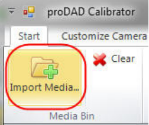

Es öffnet der Dialog **Öffnen**, navigieren Sie jetzt in das entsprechende Verzeichnis in dem Ihr Video gespeichert wurde.\
Markieren Sie es und klicken auf **Öffnen**. Das Video wird nun im **Viewer** (Vorschau) angezeigt.

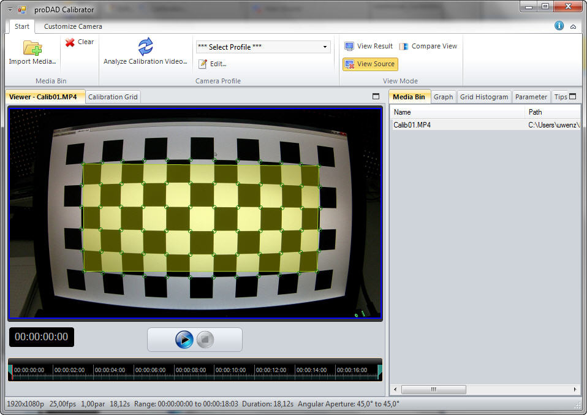

Zum Start der **Analyse** klicken Sie jetzt auf die Option **Analyse Calibration Video...**.

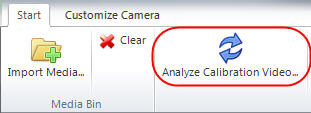

Die Zum Abschluß der Analyse erscheint eine Zusammenfassung.

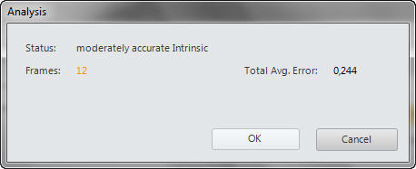

Übernehmen Sie mit **OK**.\
In der **Profilliste** erscheint das neu erstellte Profil.\
Um den Vergleich **Original-Video/korrigiertes Video** zu sehen, sollte die Option **Compare View** im Viewer gewählt werden, so erhalten Sie eine Gegenüberstellung.

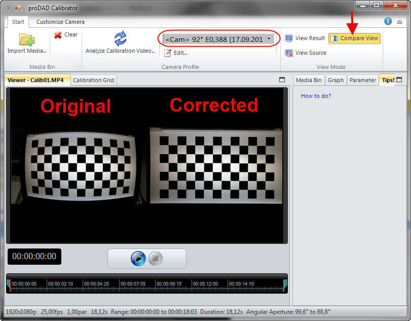

Über die Option **Edit** können Sie Profile bearbeiten, laden und speichern.

***Hinweis:***\
*Wenn Sie jetzt den Calibrator und den DeFishr schliessen, dann wird das neu erstellt Profil beim* *Neustart von DeFishr in der Profilliste automatisch übernommen. Es kann zur Korrektur direkt* *ausgewählt werden.*

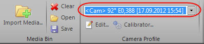

##### Graph - Grid Histogram - Parameter - Tips

Im Register **Media Bin** wird das importierte Video mit seinem Pfad angezeigt.

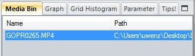

Im Register **Graph** werden Diagramme mit Analysedaten zum kalibrierten Video angezeigt.

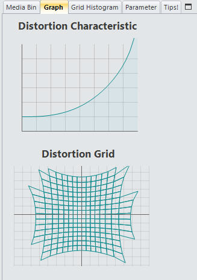

Das Register **Grid Histogram** zeigt nach der Analyse rotblinkend die fehlenden Bereiche (die während der Kalibrierung nicht erkannt wurden) an. So erkennen Sie an welchen Positionen das Schachbrett nie gefunden wurde. Ideal wäre, das keine roten Bereiche angezeigt werden.

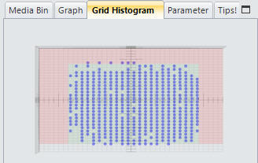

Im Register **Parameter** werden ermittelte Analysedaten zum kalibrierten Video angezeigt.

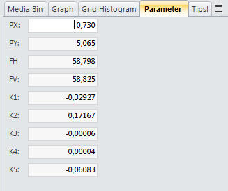

Im Register **Tips** sind ein **Instruction Video** zur Veranschaulichung der Aufnahme des Calibration Grids sowie Hinweise zur Kalibrierung bzw. Verlinkungen auf wichtige Informationen verfügbar.

### Viewer (Ansichten)

Im Bereich **View Mode** können Sie zwischen 3 verschiedenen Vorschau-Ansichten (Viewer) wählen.

1. View Result (Ergebnis zeigen)

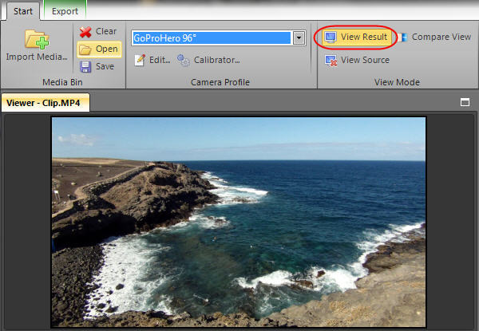

2. View Source (Original zeigen)

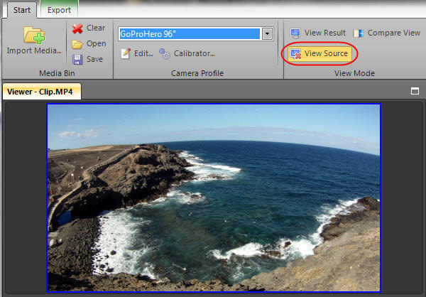

3. Compare View (Ansicht Original/Ergebnis)

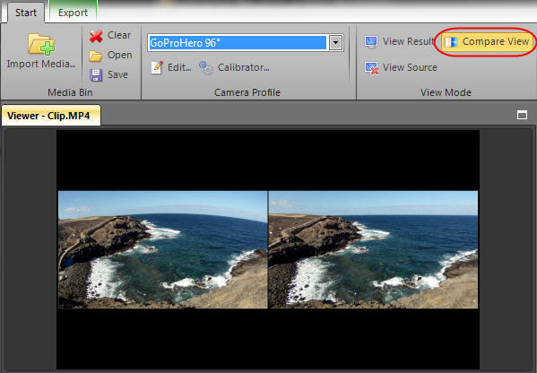

### Additional correction

Hier ändern Sie **Tilt, Shift** und **Zoom** zur Korrektur der sogenannten **Stürzenden Linien**.

**Stürzende Linien** sind Linien und Kanten in Fotos, die durch die Kameralinse bedingt, aufeinander zustreben, obwohl sie in Wirklichkeit parallel verlaufen. Dieser Effekt tritt auf, wenn die Kanten des Abbildungsgegenstandes nicht parallel zur Projektionsfläche liegen, also zum Beispiel von schräg unten gefilmt wurde.

Zur Veränderung der Optionen nutzen Sie die **Pfeile** bzw. geben direkt **Zahlenwerte** ein.

1. **Lens** (Veränderung der Linsenkrümmung)
2. **Zoom** (Veränderung des Zooms IN und OUT)
3. **Shift X** - Verschiebung des Videos auf der X-Achse (links/rechts)
4. **Shift Y** - Verschiebung des Videos auf der Y-Achse (oben/unten)
5. **Tilt** - Neigen des Videos (Optimal zum Gerade stellen von schräg nach oben gefilmten Objekten (Häusern))

In diesem Beispiel ist eine weitere **Optimierung** von z.B. **schräg unten gefilmten Objekten** möglich.\
Dazu nutzen Sie die Option **Tilt**.

**Vorher:**

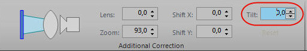

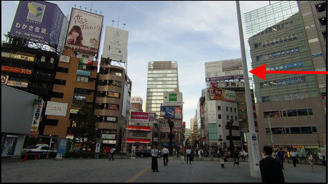

**Nachher:**

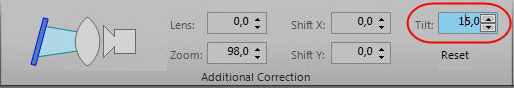

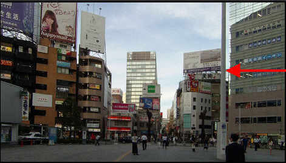

### Viewer / Playback und Zeitleiste

Im Viewer ist die **Vorschau (1)** des Videos verfügbar. Die **Steuerung (2)** mit Zeitinformation des Videos finden Sie unterhalb der Vorschau. Darunter befindet sich die **Zeitleiste (3)**.

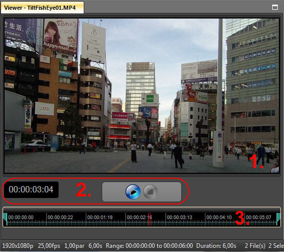

In der Zeitleiste ist der **Positionszeiger (1)** sowie **2 Marker für IN- und Out-Punkte(2)** verfügbar. Hiermit legen Sie den Abspielbereich des Videos fest. Darunter werden noch die **Videoeigenschaften (3)** angezeigt.

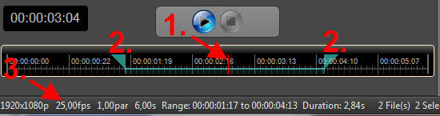

### Register Media Bin

Im Register **Media Bin** wird das importierte Video mit seinem Pfad angezeigt.

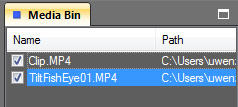

### Export

**DeFishr** exportiert im MP4-Format bzw. bei Verwendung von Bildern in das JPG-Format. Wechseln Sie in das Register **Export**.

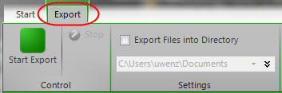

Klicken Sie **Start Export** um das korrigierte Video/Bild in eine neue Datei zu exportieren.

Markieren Sie die Option **Export Files into Directory**

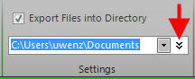

dann besteht die Möglichkeit einen eigenen **Export-Pfad** festzulegen. Klicken Sie auf den gekennzeichnten Pfeil und der Dialog **Ordner suchen** öffnet. Hier legen Sie einen eigenen Zielordner fest.

© proDAD GmbH

www.prodad.com
