# proDAD DeFishr

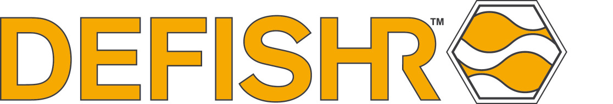

**proDAD DeFishr**

© proDAD GmbH – www.prodad.com

Autor : Uwe Wenz

## Content

- Welcome
- [General information](#general-information)
  - [Copyright / Legal information](#copyright--legal-information)
  - [What is DeFishr?](#what-is-defishr)
  - [Installation and registration](#installation-and-registration)
  - [Help function](#help-function)
- [Defishr in Detail](#defishr-in-detail)
  - [Using DeFishr for the first time and User Surface](#using-defishr-for-the-first-time-and-user-surface)
  - [Media Bin](#media-bin)
    - [Import Media](#import-media)
    - Clear/Open/Save
  - [Camera Profile](#camera-profile)
    - [Select Profile](#select-profile)
    - [Edit](#edit)
    - [How to use properly the Calibrator](#how-to-use-properly-the-calibrator)
      - [How to create your own camera profiles?](#how-to-create-your-own-camera-profiles)
      - [Your footage for your own Profiles](#your-footage-for-your-own-profiles)
      - [The Analysis of your footage](#the-analysis-of-your-footage)
      - [Graph - Grid Histogram - Parameter - Tips](#graph---grid-histogram---parameter---tips)
  - [Viewer](#viewer)
  - [Additional correction](#additional-correction)
  - [Viewer / Playback and Timeline](#viewer--playback-and-timeline)
  - [Register Media Bin](#register-media-bin)
  - [Export](#export)

#### Welcome to proDAD DeFishr !

DeFishr is a tool that allows you to eliminate subsequently the fisheye-effect, which occurs in footage captured with a lens that is bend (e.g. a wide-angle lens). Therefore it is a very important tool when it comes to optimizing your footage, particularly those shoot with Action cameras.

We hope you enjoy working with proDAD DeFishr and that you achieve good results!

## General information

### Copyright / Legal information

Copyright proDAD GmbH. All rights reserved.

Licensing Conditions\
Please read these licensing conditions carefully before installing the software.

Licensing agreement\
When setup starts, a licensing agreement is shown, which you should read carefully.\
By installing the software, you state that you accept the copyright conditions, the licensing agreement and the licensing procedure.

License Guarantee\
proDAD GmbH grants the user the right to use this product for its proper and permitted purpose. The present product may only be installed on one computer. proDAD hereby guarantees to provide a license key free of charge. By installing this product, the user acknowledges and accepts the license guarantee, the copyright terms, and the limitation of liability.

Trademarks\
All products and trademarks mentioned in association with this product are trademarks that belong to the respective owners. All trademarks are used without any guarantee that they may be used freely, and they may be registered trademarks.

Limitation of Liability\
The extent of liability for any one claim is limited to a replacement of the product. This applies to proDAD GmbH, all licensees and retailers. Claims shall only be recognized if the software is returned in an orderly manner, together with the returned goods number that has to be previously arranged with proDAD GmbH. The goods must also be accompanied by proof of purchase. This guarantee becomes void if a malfunction of this product is due to improper use, mistreatment, an accident or improper handling. proDAD GmbH, its sales partners and licensees, shall not be held liable for damages or subsequent damages arising from the impossible usage of this product. Liability is limited in all cases to the purchase price of the product.

Documentation\
The greatest of care has been taken in compiling and translating the handbook. However, the possibility of errors cannot be fully excluded. proDAD GmbH shall assume no responsibility or liability whatsoever for the consequences of any incorrect statements or information which the documentation or translation may contain. Subject to technical and optical modifications. Information regarding any inaccuracies is always welcome.

Copyright\
The software and the individual components of this product are the property of proDAD GmbH. By installing this product, the licensee agrees to refrain from unauthorized use and duplication.

proDAD GmbH does not accept any responsibility for the usage of this program and the publication of its contents and data that has been created with this program.

ProDAD GmbH \* Gauertstr. 2 \* 78194 Immendingen \* Deutschland \* HRB 1077

### What is DeFishr?

**DeFishr** is a tool that allows you to eliminate subsequently the Fisheye effect and correct the perspective distortion, that occurs frequently when the footage has been captured with a bent lens, for instance.\
Therefore DeFishr is a very important tool for optimizing of valuable takes, particularly those that have been captured with Action cameras or using extreme wide-angle lenses.

**DeFishr** contains various camera profiles that help you correct the Fisheye effect. It also allows you to create an own profile for your camera. This is relevant when you can't find your camera on the profile list or when you are not satisfied with the results of the profiles. You can calibrate your footage directly in the program using the **Calibrator**. The filming of the Calibration Grid and the following analysis process the profile which is necessary for the correction.

### Installation and registration

Double-click the Setup-file to start the **Installation**. By carrying out the installation you agree with the legal conditions and the licence terms. If you have purchased **DeFishr** as a download version, the Program archive will be unpacked before the installation starts. Then select a directory in which you would like to install DeFishr.

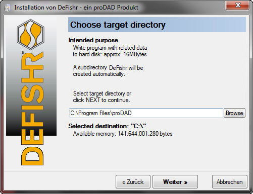

Now follow the installation instructions. You'll find further information on the use of the program as a **DEMO** and on **Activation** here.

**Registering proDAD DeFishr**\
You would like to receive Updates and further information about DeFishr? Please register your **proDAD DeFishr** at http://www.prodad.de/register.html.

### Help function

Pressing the **F1 key** opens the Help function.

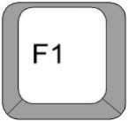

The user guide is also available in PDF format directly from the Programs menu. Go to

**Windows Start menu**

Programs

proDAD

Manual-DeFishr

You can also use the Search function to quickly find specific terms or topics in the user guide.

## Defishr in Detail

### Using DeFishr for the first time and User Surface

You can start **DeFishr** via **Shortcut** on your desktop

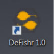

or via **Start/Program/proDAD/DeFishr**.

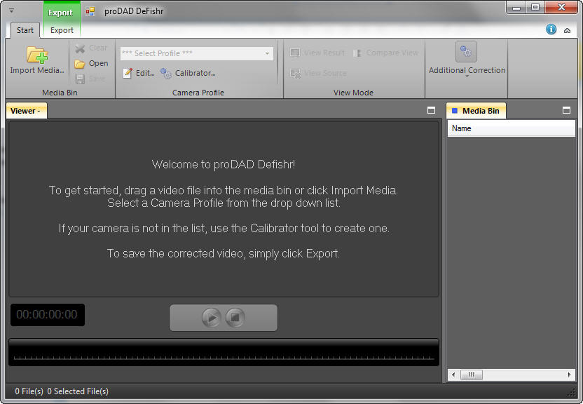

When you start DeFishr for the first time, you will be asked to enter a **Code** (Serial Number) to activate the program. In case that you purchased the download version, enter the Code which you received along with the download instructions email. In case that you purchased the DVD version, you'll find the code inside the box. Click **Unlock**. If you want to test DeFishr in the **DEMO-Mode**, click **Continue with Demo Version**. The Demo version is activated until you enter the serial number. By entering the serial number you obtain the licence that converts it into the full version.

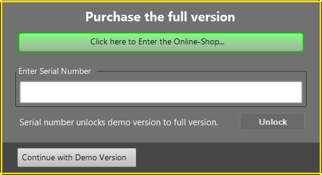

**DeFishr** starts with the **Start** Register activated.

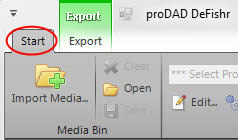

Firstly, import your video. You can also start the Playback of the original video (via Control) in the DeFishr Preview. Then you select a profile that corresponds to the profile of your camera.

**IMPORTANT!**\
If none of the profiles from the **Camera Profile** Menu is suitable for your camera, you'll find useful notes on the Creation of your own camera profiles.

**An examplel:**\
If you are using videos of the **Action Camera GoPro Hero**, just select the **Profile** that is already available. The corrected Clip will be shown immediately in the preview.

You can carry out further adjustments to a **Profile** via the parameter **Lens** (in the **Additional Correction** area). The result is merely an approach. Greater values can lead to unwanted distortions. In that case, it is necessary to carry out a Calibration.

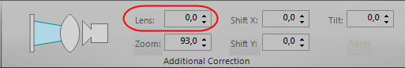

Click here to find further information on how to use profiles.

### Media Bin

You import, open and clear your video in the **Media Bin** area.

#### Import Media

Click the **Import Media...** option to import a video (or an image).

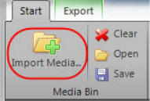

The **Open** dialog is activated now and allows you to navigate to the directory in which you saved the video/image file.\
Select it and click **Open**. The video/image will now be reproduced in the **DeFishr-Preview**. The **Fisheye Effect** can be seen in the Viewer.

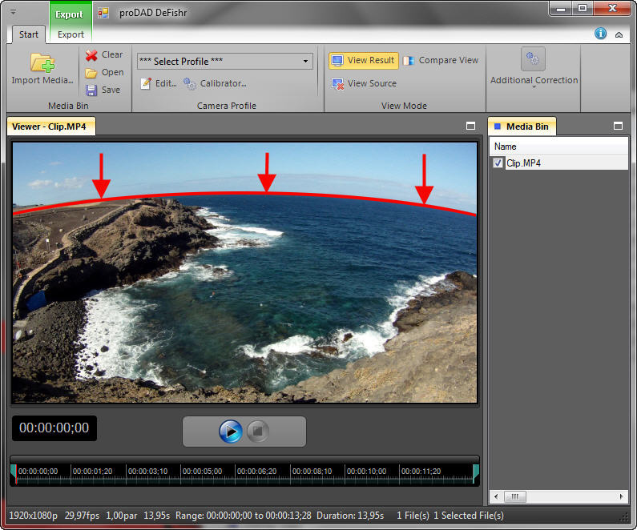

### Clear/Open/Save Project

In the **Media Bin** area you can also clear the imported video/image in the **DeFishr-preview**, open a project and save it .

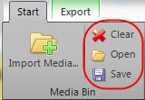

### Camera Profile

#### Select Profile

In this example the footage was captured with the **GoPro Hero** Action Camera.\
Directly after selecting the pre-installed profile **GoProHero** the correction of the **Fisheye effect** will be shown in the preview.

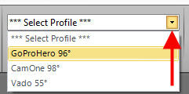

Select **Compare View** option in the Viewer to compare **Original/corrected Video**.

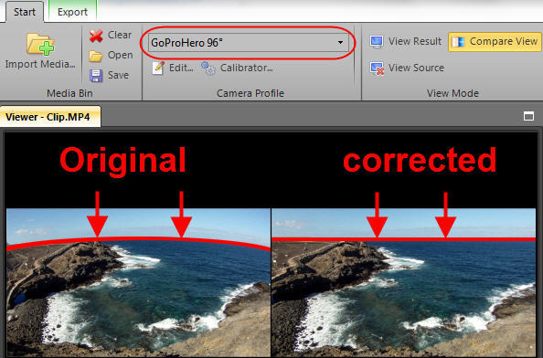

Click here for further information about the use of profiles.

#### Edit

You can edit, load and save profile via the **Edit** option.

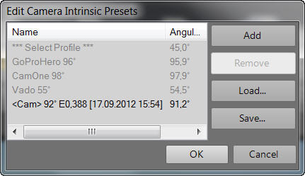

#### How to use properly the Calibrator

##### How to create your own camera profiles?

Please bear in mind the following recommendations.

1. Create your footage as described in Your footage for your own profiles.
2. Carry out the analysis of your footage as described in The Analysis of your footage.
3. Evaluate the analysis and, if necessary, optimize the footage following the Tips and the Instruction Video.

##### Your footage for your own Profiles

Now it is necessary to capture the **Chessboard pattern (Calibration grid)** with your camera in the Calibrator. On the basis of this video the Calibrator will detect potential Fisheye Distortions after the import of the video. A profile will be created, which eliminates the distortions (Fisheye). This profile will be saved in **DeFishr** and it will be available in the profile list for your future videos.

First, click the **Calibrator...** option...

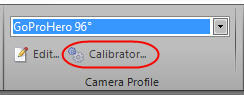

... to start the Calibrator. Go to the **Calibration Grid (1)** register and the **chessboard pattern (2)** appears. It is convenient to use the **full-screen mode**. In order to do so, make use of the minimization options **(3) and (4)**.

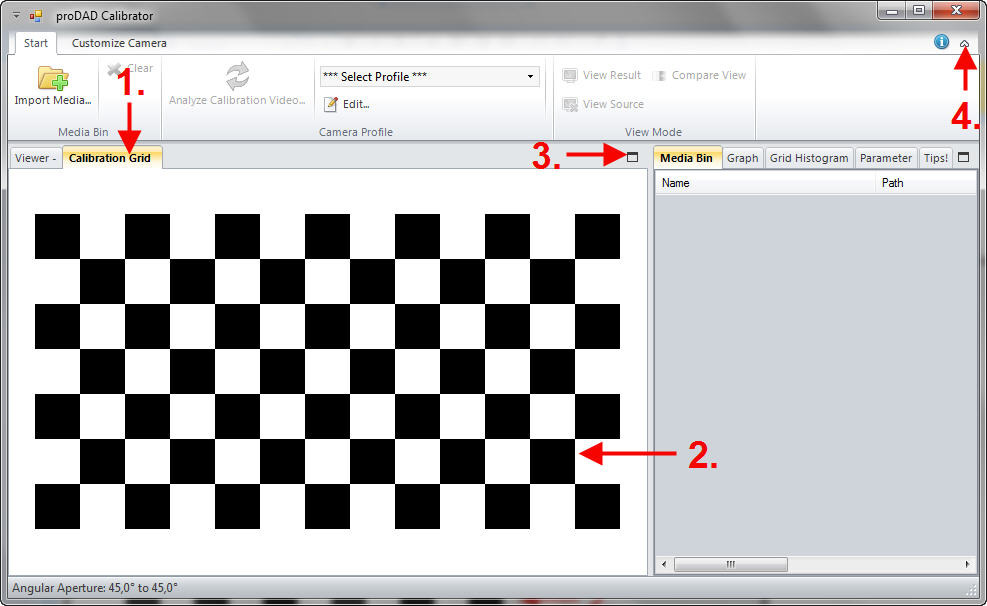

**Useful Tips for the Calibration of your Camera.**

To achieve a precise analysis for the calibration of your camera/lens, please bear in mind the following tips\
(Steps 1 and 2 need to be carried out in one single video, i.e. without interrupting the recording!):

1. First, move the camera beyond all the edges of the calibration grid (chessboard) (top, bottom, right, left, beyond every corner), ALWAYS aiming at the centre of the chessboard so as to achieve a movement of the camera towards the centre of the chessboard pattern!
2. Then move the camera beyond all the edges of the calibration grid (top, bottom, right, left, beyond every corner), WITHOUT aiming at the centre of the chessboard. Hold the camera straight instead!
3. Film the chessboard as large as possible, covering the whole area in recording!
4. Film the chessboard as sharp as possible.
5. Intend to use always short shutter speed, i.e. under good conditions of illumination.
6. Avoid constant shaking of the camera or stop moving it when capturing the chessboard. Thus, the following analysis will lead to better results because the images are recognized more clearly.
7. In case that your camera does not dispose of a preview display, film the chessboard from various distances moving it towards the monitor in one single Video clip. The ideal way of doing it is to capture every camera movement subsequently starting from close and removing the camera slowly and thus enhancing the distance to the chessboard and pausing every now and then.

In the ***Tips*** register you'll find an **Instruction Video**, which explains how to capture the Calibration Grid.

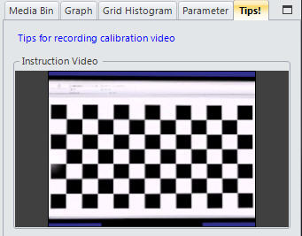

**This is how you recognize a successful Calibration:**

**a)** The analysis finds at least 20 images (Counter = green), ideally even 50+ images, on the basis of the geometrical points that were recognized.\
**b)** There are **no longer redly flashing areas** in the Tab for the Grid histogram on the right. That means that all the areas that were necessary for the calibration have been captured in step1 and 2.

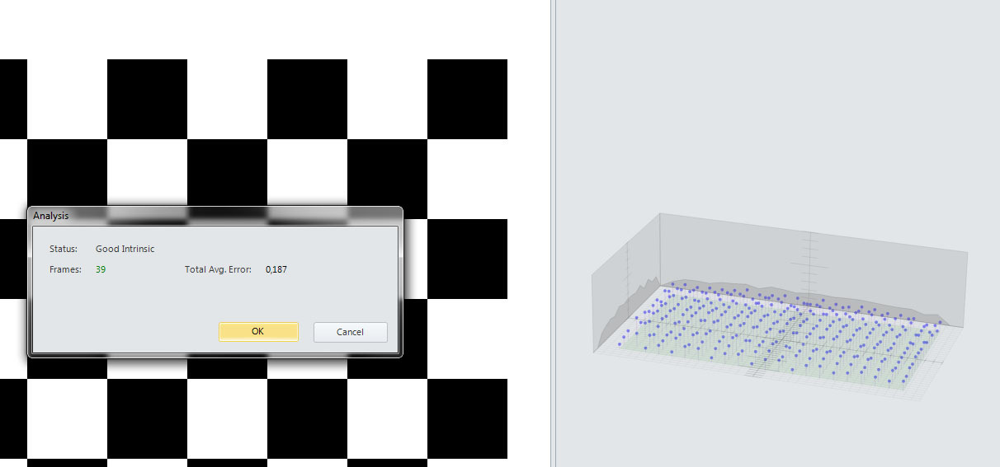

The more areas you capture, the better the results of the latter corrections of your videos.

***Tip:***\
*If there are still* ***redly flashing areas****, move the camera slowly in the indicated directions, go* *slowly beyond the upper points 1 and 2 in the indicated directions.*

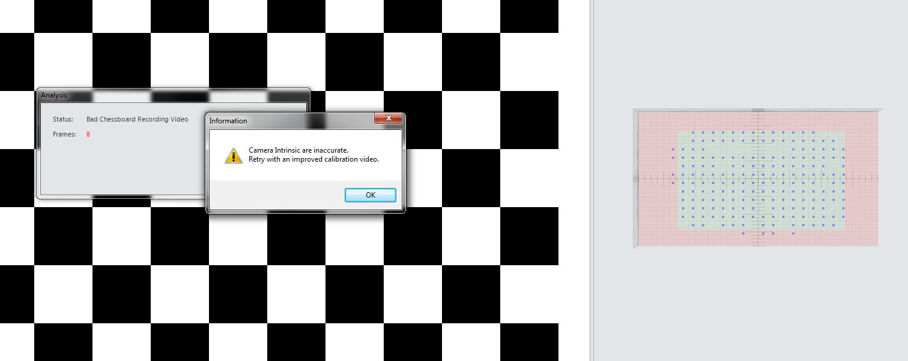

**c)** Successful analyses and profiles resulting from them will be marked as "&lt;CAM>", less successful ones as "&lt;BAD>".\
**d)** Good Profiles will be displayed with a "Total Average Error" below 0,3. Excellent profiles can even reach values between 0,1 and 0,15.\
**e)** Whether the profile you have generated works in practice, can be seen after the analysis. Switch from "Calibration Grid" to "Viewer" and activate the splitscreen view "Compare View".\
**f)** Select "View Source" and move the Timeline cursor manually over it or reproduce the video to get detailled information on how your video works. Defishr shows the areas (yellow) and points. Missing areas will be marked as described in b). Those points that were either recognized poorly or even weren't recognized at all will be missing in the Grid histogram or will appear less marked.

**Conclusion:**\
In case that the analysis contains

\- less than 30 recognized images\
- a "Total Average Error" greater than 0,3

it is advisable to repeat the analysis with optimized camera movements and plan pauses in different camera positions. Otherweise your future corrections of unwanted Fisheye effects might be imprecise or even wrong, in the worst case.

Here you'll find information on the import of videos.

##### The Analysis of your footage

First, copy the video from the camera into a directory of your video hard-disk.\
Click the **Import Media...** option to import the video.

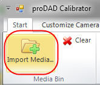

The **Open** dialog opens. Now navigate to the directory where you have saved your video. Select it and click **Open**. The Video will be shown in the **Viewer** (preview).

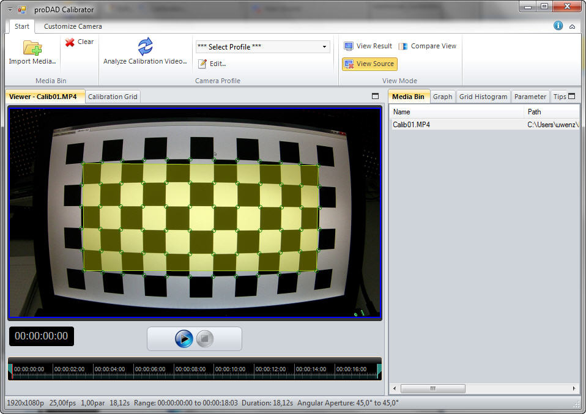

Click the **Analyze Calibration Video...** option to start the **analysis**.

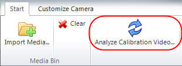

At the end of the analysis you can read the summary.

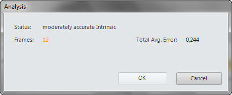

Click **OK** to accept it.

The newly created profile appears in the **Profile list**.\
Select the **Compare View** option in the Viewer to see the split view of the **Original-/Corrected Video**.

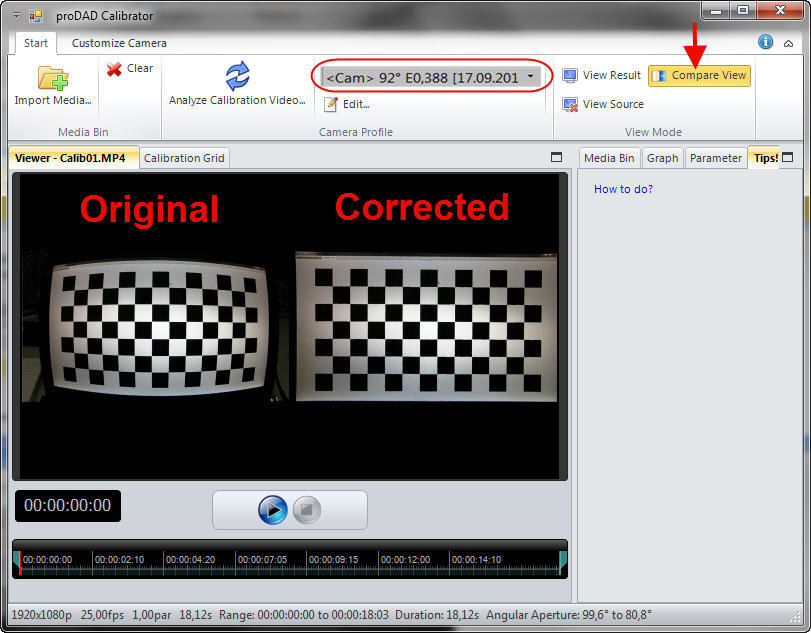

The **Edit** option allows you to edit, load and save profiles.

***Note:***\
*When you close the Calibrator and DeFishr, the newly created profile will be adopted automatically* *in the profile list the next time you start DeFishr. You can select it directly for your future* *corrections.*

##### Graph - Grid Histogram - Parameter - Tips

The path of the imported video is indicated in the **Media Bin**.

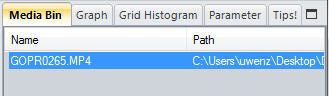

In the **Graph** register there are diagrams with the data of the analysis of the calibrated video.

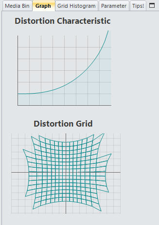

The **Grid Histogram** shows the areas that were not recognized in the calibration (blinking red). It indicates in which positions the chessboard has not been recognized. The ideal case is when there is no red area in the histogram.

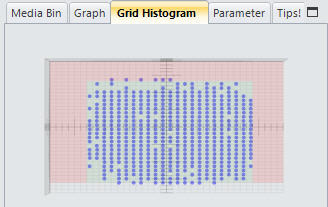

The data of the analysis of the calibrated video are shown in the **Parameter** register.

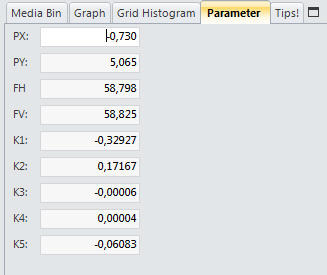

There is an **Instruction Video** available in the **tips** register. The video explains the Calibration Grids and contains useful tips for Calibration and provides links to important information.

### Viewer

In the **View Mode** area you can choose between 3 different preview options (Viewer).

1. View Result

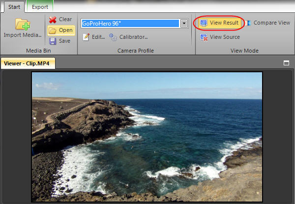

2. View Source

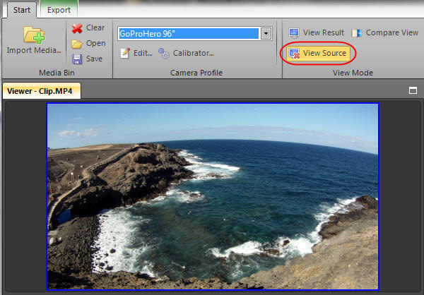

3. Compare View (Split View, before/after)

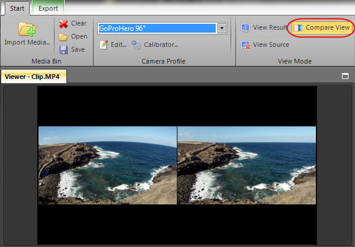

### Additional correction

Here you can adjust **Tilt, Shift** and **Zoom** to correct the so-called **Perspective Distortion**.

**Perspective Distortion** are lines and edges in photos that head towards each other due to the characteristics of the lens, even though in reality the lines are parallel. This effect occurs, when the edges of the subject are not parallel to the projection surface. This happens, for instance, when the camera is held in an upward inclination.

Use the **arrow** or set the **numeric value** to modify the options.

1. **Lens** (Modification of the bend of the lens)
2. **Zoom** (Modification of the zoom IN and OUT)
3. **Shift X** - shifts the video along the x-axis (left/right)
4. **Shift Y** - shifts the video along the y-axis (up/down)
5. **Tilt** - tilts the video (very useful for straighten footage of subjects (e.g. buildings) that have been filmed with the camera held upwards)

In this case it is possible to achieve further **Optimization**, e.g. of **objects filmed at an upward angle**.\
To do so, use the **Tilt** option.

**Before:**

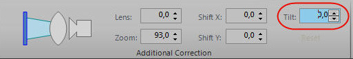

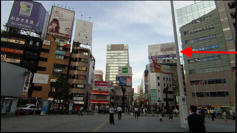

**After:**

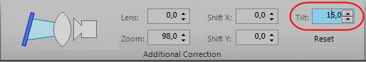

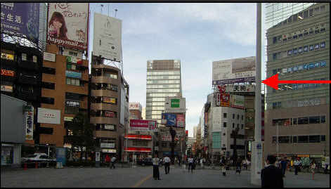

### Viewer / Playback and Timeline

There is a **Preview (1)** of the video available in the Viewer. The **Control (2)** with the chronometrical data of the video is under the preview. Underneath the control is the **Timeline (3)**.

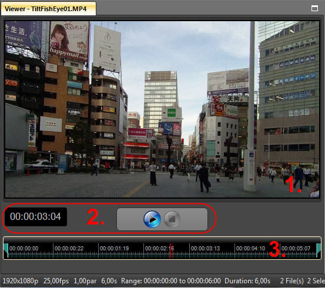

There is a needle that indicates **Position (1)** as well as **2 Markers for IN- and Out-Points(2)** in the timeline. This is where you determine the area of the video that you would like to reproduce. You find the **Video properties (3)** under the timeline.

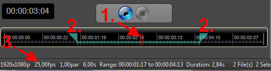

### Register Media Bin

The path of the imported video is indicated in the **Media Bin** register .

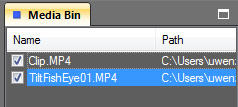

### Export

**DeFishr** exports the results in MP4 format or, in case that you use images, in JPG format. Go to the **Export** register.

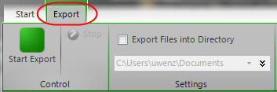

Click **Start Export** to export the corrected Video/Image into a new file.

Select the **Export Files into Directory** option

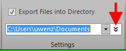

then you can determine an own **Export path**. Click the arrow to open the **Search Archives** dialog. This is where you select an own directory.

© proDAD GmbH

www.prodad.com
