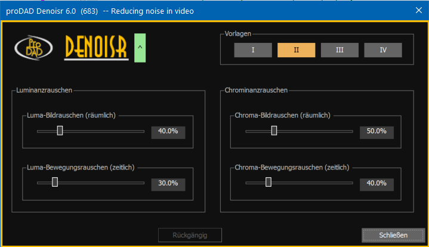

# proDAD Denoisr Plug-in Handbuch

  
  

  
  
  
  
  
  
  
  
  
  
  
  
  
  
  
-----

**Software-Entwickler:** Holger Burkarth  
**Handbuch-Autor:** Holger Burkarth  
**Copyright:** © 2026 proDAD GmbH  
*Alle Rechte vorbehalten. Die Nutzung der Software unterliegt den Lizenzbedingungen der proDAD GmbH.*

-----

## **Einführung**

Die proDAD **Denoisr** Plug-ins wurden speziell für die Videorauschreduzierung entwickelt. **Denoisr** eignet sich für Aufnahmen mit geringem bis starkem Bildrauschen oder schwierigen Lichtverhältnissen.
**Denoisr** arbeitet extrem schnell und kann Videos in UHD-Auflösung in Echtzeit verarbeiten. Es ist ideal für die Nachbearbeitung von Aufnahmen unter schwierigen Lichtbedingungen, wie z. B. Nachtaufnahmen, Innenaufnahmen oder bei der Verwendung von Kameras mit hoher ISO-Empfindlichkeit.

**Denoisr** arbeitet im YUV-Farbraum mit 8-Bit- und 10-Bit-Farbtiefe.
Dank der Funktion „Temporal Noise Reduction“ (TNR) kann **Denoisr** auch bei Videoaufnahmen mit Bewegung eingesetzt werden, da die Rauschreduzierung auf Basis mehrerer Frames erfolgt und so die Bildqualität verbessert wird, ohne Bewegungsunschärfe zu erzeugen.
Eine einfache und schnelle Bedienung wird durch integrierte **Vorlagen** gewährleistet, die für verschiedene Szenarien optimiert sind. Diese **Vorlagen** können als Ausgangspunkt für die Rauschreduzierung verwendet werden und bieten eine schnelle Möglichkeit, die gewünschten Ergebnisse zu erzielen.

---

## **Inhaltsverzeichnis**

1. Einführung & Über proDAD
2. Kontakt & Rechtliche Hinweise
3. **Denoisr** (Video-Rauschreduzierung)
    * Menüpunkte
    * UI-Parameter
    * Hinweise zur *Temporalen* Rauschreduzierung (TNR)
    * Hinweise zu *Luma* und *Chroma*

## Über proDAD

proDAD ist ein renommiertes deutsches Unternehmen, das sich auf die Entwicklung und den Vertrieb hochwertiger Video- und Bildbearbeitungssoftware spezialisiert hat. Seit seiner Gründung im Jahr 1990 hat sich proDAD als führender Anbieter innovativer Lösungen für die professionelle Videobearbeitung etabliert.

Das Unternehmen proDAD zeichnet sich durch eine ausgeprägte Expertise in den Bereichen digitale Bild- und Videotechnologie sowie Softwareentwicklung aus. Mit einem engagierten Team erfahrener Entwickler und Designer arbeitet das Unternehmen kontinuierlich an der Entwicklung fortschrittlicher Lösungen, die den Anforderungen professioneller Anwender gerecht werden.

Die Softwareprodukte von proDAD bieten eine Vielzahl von Funktionen und Werkzeugen zur Optimierung, Bearbeitung und Verbesserung von Videos und Bildern. Die Lösungen zeichnen sich durch eine intuitive Benutzeroberfläche, hohe Leistungsfähigkeit und hervorragende Qualität aus. Geeignet sowohl für Einsteiger als auch für erfahrene Profis, bieten sie ein breites Spektrum an Effekten, Filtern, Stabilisierungstechniken und weiteren Werkzeugen zur Verbesserung der visuellen Qualität von Medieninhalten.

Ein Schwerpunkt von proDAD liegt auf der Videostabilisierung. Das Unternehmen hat mehrere patentierte Verfahren entwickelt, um Verwacklungen und Unruhen in Videos effektiv zu reduzieren und eine gleichmäßige, professionelle Bildstabilisierung zu erreichen. Diese Technologie wird von vielen Profis in der Filmbranche, bei Fernsehproduktionen und bei Sportaufnahmen eingesetzt.

proDAD ist bekannt für die enge Zusammenarbeit mit führenden Herstellern von Videobearbeitungssoftware. Die Produkte des Unternehmens werden als eigenständige Softwarelösungen angeboten, lassen sich aber auch nahtlos in bestehende Videobearbeitungsprogramme integrieren. Dadurch profitieren Anwender von erweiterten Funktionen und Möglichkeiten, um ihre Videoprojekte auf professionellem Niveau zu erstellen.

Mit jahrelanger Erfahrung, technischer Innovation und einem starken Fokus auf Kundenzufriedenheit hat sich proDAD als vertrauenswürdiger Partner in der Videobearbeitungsbranche etabliert. Die Softwarelösungen des Unternehmens werden von professionellen Videoeditoren, Filmemachern, YouTubern und anderen Kreativen weltweit eingesetzt, um beeindruckende visuelle Inhalte zu produzieren.

## **Kontakt & Rechtliche Hinweise**

### **Kontaktinformationen**

Wir bei proDAD beantworten gerne alle Fragen zu unserem Programm.

* **E-Mail:** [support@prodad.com](mailto:support@prodad.com)
* **Postanschrift:** proDAD GmbH, Gauertstr. 2, 78194 Immendingen, Deutschland
* **Homepage:** [www.proDAD.com](https://www.prodad.com)

### **Lizenz- und Copyright-Informationen**

**Denoisr** ist ein proprietäres Softwareprodukt, das von der proDAD GmbH entwickelt und vertrieben wird. Alle Rechte vorbehalten. Die Nutzung der Software unterliegt den Lizenzbedingungen der proDAD GmbH.

### **Lizenzvereinbarung**

  * **Installation:** Mit der Installation der Software erklären Sie sich mit den Copyright-Bedingungen, der Lizenzvereinbarung und dem Lizenzierungsverfahren einverstanden.
  * **Nutzung:** Die proDAD GmbH gewährt dem Anwender das Recht, dieses Produkt für den vorgesehenen Zweck auf einem Computer zu nutzen.
  * **Haftung:** Der Haftungsumfang für jegliche Ansprüche ist auf den Ersatz oder den Kaufpreis des Produkts beschränkt. Die proDAD GmbH und ihre Lizenznehmer haften nicht für Schäden, die aus der Unmöglichkeit der Nutzung dieses Produkts entstehen.
  * **Dokumentation:** Das Handbuch wurde mit größter Sorgfalt erstellt; proDAD übernimmt jedoch keine Verantwortung für die Folgen unrichtiger Angaben oder Informationen.

## **Denoisr** (Video-Rauschreduzierung)

Das **Denoisr**-Plug-in ermöglicht die Rauschreduzierung und Bildverbesserung in Videoaufnahmen. Es bietet eine benutzerfreundliche Oberfläche, die Rauschen schnell und effektiv reduziert, um ein natürliches Erscheinungsbild Ihrer Videos zu gewährleisten. Es ist ideal für Videografen, die die Qualität ihrer Aufnahmen verbessern und Rauschen unter verschiedenen Lichtbedingungen minimieren möchten.

### **Menüpunkte**

* **Freischalten:** Öffnet ein Dialogfenster zur Aktivierung des Plug-ins über einen Aktivierungscode. Es bietet außerdem die Möglichkeit, die Shop-Seite zu besuchen, um einen Aktivierungscode zu erwerben.
* **News:** Zeigt Meldungen oder Updates des Herstellers an.
* **Handbuch:** Öffnet die Hilfedokumentation für das Plug-in.
* **Über:** Zeigt Informationen zum Plug-in an, z. B. die Versionsnummer. Ermöglicht außerdem die Prüfung auf Plug-in-Updates.

### **Denoisr UI-Parameter**

* Die **Vorlagen** ermöglichen es Ihnen, Rauschreduzierung schnell und einfach auf Ihre Videoaufnahmen anzuwenden. Sie können die **Vorlagen** als Ausgangspunkt verwenden und die Einstellungen bei Bedarf anpassen, um die gewünschten Ergebnisse zu erzielen.

* **Luma-Bildrauschen (räumlich):** Steuert die Stärke der räumlichen Rauschreduzierung im Luminanzkanal (Helligkeit). Der Algorithmus analysiert und glättet das Rauschen innerhalb eines einzelnen Frames auf Basis benachbarter Pixel. Höhere Werte entfernen stärkeres Luma-Rauschen (z. B. Körnung in Schattenbereichen), zu hohe Einstellungen können jedoch feine Details und Texturen entfernen. Diese Funktion eignet sich ideal zur gezielten Bereinigung von Helligkeitsrauschen, ohne die Farbkanäle zu beeinflussen.

* **Chroma-Bildrauschen (räumlich):** Steuert die Stärke der räumlichen Rauschreduzierung im Chrominanzkanal (Farbe). Der Algorithmus analysiert und glättet das Rauschen innerhalb eines einzelnen Frames auf Basis benachbarter Pixel. Höhere Werte entfernen stärkeres Chroma-Rauschen (z. B. Farbflackern in Schattenbereichen), zu hohe Einstellungen können jedoch feine Details und Texturen entfernen. Diese Funktion eignet sich ideal zur gezielten Bereinigung von Farbrauschen, ohne die Helligkeitskanäle zu beeinflussen.

* **Luma-Bewegungsrauschen (zeitlich):** Dieser Parameter legt die Intensität der zeitlichen Rauschreduzierung im Luminanzkanal fest. Der Algorithmus verwendet statistische Analysen, um ähnliche Bereiche über mehrere Frames hinweg zu vergleichen und das Rauschen herauszumitteln. Dadurch bleiben statische Details besser erhalten als bei rein räumlicher Rauschreduzierung. Während höhere Werte stärkeres temporales Luma-Rauschen entfernen, können sie bei schnellen Bewegungen oder ungenauer Bewegungserkennung Artefakte wie Ghosting- oder Nachzieheffekte erzeugen.

* **Chroma-Bewegungsrauschen (zeitlich):** Dieser Parameter legt die Intensität der zeitlichen Rauschreduzierung im Chrominanzkanal fest. Der Algorithmus verwendet statistische Analysen, um ähnliche Bereiche über mehrere Frames hinweg zu vergleichen und das Rauschen herauszumitteln. Dadurch bleiben statische Details besser erhalten als bei rein räumlicher Rauschreduzierung. Während höhere Werte stärkeres temporales Chroma-Rauschen entfernen, können sie bei schnellen Bewegungen oder ungenauer Bewegungserkennung Artefakte wie Ghosting- oder Nachzieheffekte erzeugen.

> ### **Hinweise zur Temporalen Rauschreduzierung (TNR)**
> 
> **Räumliche** Parameter arbeiten frameweise, sind weniger rechenintensiv und können Details schneller verwischen. **Temporale** Parameter nutzen hingegen die Dimension der Zeit. Bei korrekter Bewegungserkennung wird dadurch eine höhere Schärfe erreicht. Sie sind jedoch empfindlicher gegenüber schnellen oder komplexen Bewegungen.
> 
> Die **Temporalen** Parameter sollten am besten während der Wiedergabe des Videos eingestellt werden, um die Auswirkungen auf Bewegung und Details in Echtzeit zu beobachten. Bei Verwendung eines Standbildes können die Effekte der **Temporalen** Parameter nicht korrekt beurteilt werden. Setzen Sie Mark-In- und Mark-Out-Punkte für den Vorschaubereich und lassen Sie die Videowiedergabe in einer Schleife laufen, um die Auswirkungen der **Temporalen** Parameter auf Bewegung und Detail in Echtzeit zu überwachen.

> ### **Hinweise zu Luma und Chroma**
> 
> Als allgemeine Regel sollten die Einstellungen für **Luma** und **Chroma** separat angepasst werden, da sich Rauschcharakteristik und visuelle Wahrnehmung unterscheiden. Beginnen Sie mit moderaten Werten und beurteilen Sie das Ergebnis sowohl in ruhigen als auch in bewegten Bildbereichen.
