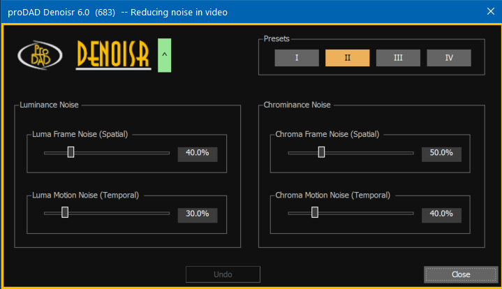

# proDAD Denoisr Plug-in Manual

  
  

  
  
  
  
  
  
  
  
  
  
  
  
  
  
  
-----

**Software Developer:** Holger Burkarth  
**Manual Author:** Holger Burkarth  
**Copyright:** © 2026 proDAD GmbH  
*All rights reserved. Use of the software is subject to the license terms of proDAD GmbH.*

-----

## **Introduction**

The proDAD **Denoisr** plug-ins were specifically developed for video noise reduction. **Denoisr** is suitable for footage ranging from low to high image noise or poor lighting conditions.
**Denoisr** works extremely fast and can process videos in UHD resolution in real-time. It is ideal for post-processing footage captured under difficult lighting conditions, such as night shots, indoor recordings, or when using cameras with high ISO sensitivity.

**Denoisr** operates in the YUV color space with 8-bit and 10-bit color depth.
Thanks to the "Temporal Noise Reduction" (TNR) feature, **Denoisr** can also be used on video recordings with motion, as it performs noise reduction based on multiple frames, thereby improving image quality without creating motion blur.
Simple and fast operation is ensured through built-in **Presets** optimized for various scenarios. These **Presets** can be used as a starting point for noise reduction and offer a quick way to achieve the desired results.

---

## **Table of Contents**

1. Introduction & About proDAD
2. Contact & Legal Information
3. **Denoisr** (Video Noise Reduction)
    * Menu Items
    * UI Parameters
    * Notes on *Temporal* Noise Reduction (TNR)
    * Notes on *Luma* and *Chroma*

## About proDAD

proDAD is a renowned German company specializing in developing and distributing high-quality video and image editing software. Since its founding in 1990, proDAD has established itself as a leading provider of innovative solutions for professional video editing.

The proDAD company is characterized by a distinctive expertise in the areas of digital image and video technology as well as software development. With a dedicated team of experienced developers and designers, the company works continuously to develop advanced solutions that meet the needs of professional users.

proDAD's software products offer a wide range of features and tools for optimizing, editing and enhancing video and images. The solutions are characterized by an intuitive user interface, high performance and excellent quality. Suitable for both beginners and experienced professionals, they offer a wide range of effects, filters, stabilization techniques and other tools to improve the visual quality of media content.

One of proDAD's main focuses is video stabilization. The company has developed several patented techniques to effectively reduce shake and jitter in video and achieve consistent, professional-quality image stabilization. This technology is used by many professionals in the film industry, television productions and sports footage.

proDAD is known for its close collaboration with leading video editing software manufacturers. The company's products are offered as stand-alone software solutions, but can also be seamlessly integrated into existing video editing programs. As a result, users benefit from enhanced features and capabilities to create their video projects at a professional level.

With years of experience, technical innovation and a strong focus on customer satisfaction, proDAD has established itself as a trusted partner in the video editing industry. The company's software solutions are used by professional video editors, filmmakers, YouTubers and other creators worldwide to produce stunning visual content.

## **Contact & Legal Information**

### **Contact Information**

We at proDAD are happy to answer any questions you may have about our program.

* **Email:** [support@prodad.com](mailto:support@prodad.com)
* **Postal Mail:** proDAD GmbH, Gauertstr. 2, 78194 Immendingen, Germany
* **Homepage:** [www.proDAD.com](https://www.prodad.com)

### **License and Copyright Information**

**Denoisr** is a proprietary software product developed and distributed by proDAD GmbH. All rights reserved. Use of the software is subject to the license terms of proDAD GmbH.

### **License Agreement**

  * **Installation:** By installing the software, you agree to be bound by the copyright terms, the license agreement, and the licensing procedure.
  * **Usage:** proDAD GmbH grants the user the right to use this product for its intended purpose on one computer.
  * **Liability:** The extent of liability for any claim is limited to the replacement or purchase price of the product. proDAD GmbH and its licensees are not liable for damages resulting from the inability to use this product.
  * **Documentation:** The manual has been compiled with the utmost care; however, proDAD assumes no responsibility for the consequences of incorrect statements or information.

## **Denoisr** (Video Noise Reduction)

The **Denoisr** plug-in allows for noise reduction and image enhancement in video recordings. It offers a user-friendly interface that quickly and effectively reduces noise to ensure a natural look for your videos. It is ideal for videographers who want to improve the quality of their footage and minimize noise under various lighting conditions.

### **Menu Items**

* **Unlock:** Opens a dialog window for activating the plug-in via an activation code. It also provides the option to visit the shop page to purchase an activation code.
* **News:** Displays messages or updates from the manufacturer.
* **Manual:** Opens the help documentation for the plug-in.
* **About:** Displays information about the plug-in, such as the version number. It also allows you to check for plug-in updates.

### **Denoisr UI Parameters**

* The **Presets** allow you to quickly and easily apply noise reduction to your video recordings. You can use the **Presets** as a starting point and adjust the settings as needed to achieve your desired results.

* **Luma Frame Noise (Spatial):** This controls the strength of spatial noise reduction in the luminance (brightness) channel. The algorithm analyzes and smooths the noise within a single frame based on neighboring pixels. Higher values remove stronger luma noise (e.g., graininess in shadow areas), but setting this too high may remove fine details and textures. This function is ideal for targeted cleaning of brightness noise without affecting the color channels.

* **Chroma Frame Noise (Spatial):** This controls the strength of spatial noise reduction in the chrominance (color) channel. The algorithm analyzes and smooths the noise within a single frame based on neighboring pixels. Higher values remove stronger chroma noise (e.g., color flickering in shadow areas), but setting this too high may remove fine details and textures. This function is ideal for targeted cleaning of color noise without affecting the brightness channels.

* **Luma Motion Noise (Temporal):** This parameter sets the intensity of temporal noise reduction in the luminance channel. The algorithm uses statistical analysis to compare similar areas across multiple frames and average out the noise. As a result, static details are better preserved than with purely spatial noise reduction. While higher values remove stronger temporal luma noise, they can create artifacts such as ghosting or trailing effects during fast movements or inaccurate motion detection.

* **Chroma Motion Noise (Temporal):** This parameter sets the intensity of temporal noise reduction in the chrominance channel. The algorithm uses statistical analysis to compare similar areas across multiple frames and average out the noise. As a result, static details are better preserved than with purely spatial noise reduction. While higher values remove stronger temporal chroma noise, they can create artifacts such as ghosting or trailing effects during fast movements or inaccurate motion detection.

> ### **Notes on Temporal Noise Reduction (TNR)**
> 
> **Spatial** parameters operate on a frame-by-frame basis, are less computationally intensive, and can blur details more quickly. **Temporal** parameters, on the other hand, utilize the dimension of time. With correct motion detection, this achieves greater sharpness. However, they are more sensitive to fast or complex movements.
> 
> The **Temporal** parameters are best adjusted while playing the video to observe the effects on motion and details in real-time. If a still image is used instead, the effects of the **Temporal** parameters cannot be accurately evaluated. Set Mark-In and Mark-Out points for the preview area and loop the video playback to monitor the impact of **Temporal** parameters on movement and detail in real-time.

> ### **Notes on Luma and Chroma**
> 
> As a general rule, the settings for **Luma** and **Chroma** should be adjusted separately, since noise characteristics and visual perception differ. Start with moderate values and evaluate the result in both still and moving areas of the image.
