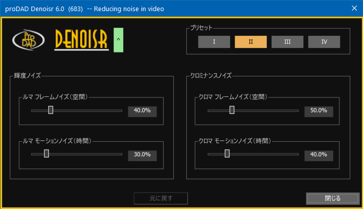

# proDAD Denoisr プラグイン マニュアル

  
  

  
  
  
  
  
  
  
  
  
  
  
  
  
  
  
-----

**ソフトウェア開発者:** Holger Burkarth  
**マニュアル著者:** Holger Burkarth  
**著作権:** © 2026 proDAD GmbH  
*すべての権利を留保します。ソフトウェアの使用は proDAD GmbH のライセンス条件に従います。*

-----

## **はじめに**

proDAD **Denoisr** プラグインは、ビデオノイズリダクション専用に開発されました。**Denoisr** は、低から高までの画像ノイズや、照明条件の悪い映像に適しています。
**Denoisr** は非常に高速に動作し、UHD 解像度のビデオをリアルタイムで処理できます。夜間撮影、屋内撮影、または高 ISO 感度のカメラを使用した場合など、困難な照明条件下で撮影された映像の後処理に最適です。

**Denoisr** は、8 ビットおよび 10 ビットの色深度で YUV 色空間で動作します。
「Temporal Noise Reduction」（TNR）機能のおかげで、**Denoisr** は動きのあるビデオ録画にも使用でき、複数のフレームに基づいてノイズリダクションを行うことで、モーションブラーを発生させずに画質を向上させます。
さまざまなシナリオに最適化された内蔵の **プリセット** により、シンプルかつ迅速な操作が保証されます。これらの **プリセット** はノイズリダクションの出発点として使用でき、希望する結果を迅速に得る方法を提供します。

---

## **目次**

1. はじめに & proDAD について
2. お問い合わせ & 法的情報
3. **Denoisr**（ビデオノイズリダクション）
    * メニュー項目
    * UI パラメータ
    * *Temporal* ノイズリダクション（TNR）に関する注意事項
    * *Luma* および *Chroma* に関する注意事項

## proDAD について

proDAD は、高品質なビデオおよび画像編集ソフトウェアの開発・販売を専門とするドイツの著名な企業です。1990 年の創業以来、proDAD はプロフェッショナルなビデオ編集向けの革新的なソリューションのリーディングプロバイダーとして地位を確立しています。

proDAD 社は、デジタル画像・ビデオ技術およびソフトウェア開発の分野における卓越した専門知識を特徴としています。経験豊富な開発者およびデザイナーからなる専任チームとともに、プロフェッショナルユーザーのニーズに応える先進的なソリューションの開発を継続的に行っています。

proDAD のソフトウェア製品は、ビデオおよび画像の最適化、編集、強化のための幅広い機能とツールを提供します。これらのソリューションは、直感的なユーザーインターフェース、高いパフォーマンス、優れた品質を特徴としています。初心者から経験豊富なプロフェッショナルまで対応し、メディアコンテンツの視覚的品質を向上させるための豊富なエフェクト、フィルター、安定化技術、その他のツールを提供します。

proDAD の主要な重点分野のひとつはビデオ安定化です。同社は、ビデオの揺れやジッターを効果的に低減し、一貫したプロフェッショナル品質の画像安定化を実現する複数の特許技術を開発しています。この技術は、映画業界、テレビ制作、スポーツ映像の多くのプロフェッショナルに使用されています。

proDAD は、主要なビデオ編集ソフトウェアメーカーとの緊密な協力で知られています。同社の製品はスタンドアロンのソフトウェアソリューションとして提供されるだけでなく、既存のビデオ編集プログラムにシームレスに統合することも可能です。その結果、ユーザーは拡張された機能と能力の恩恵を受け、ビデオプロジェクトをプロフェッショナルレベルで作成できます。

長年の経験、技術革新、顧客満足への強い焦点により、proDAD はビデオ編集業界における信頼できるパートナーとしての地位を確立しています。同社のソフトウェアソリューションは、世界中のプロフェッショナルビデオエディター、映画制作者、YouTuber、その他のクリエイターによって使用され、素晴らしいビジュアルコンテンツを制作しています。

## **お問い合わせ & 法的情報**

### **お問い合わせ情報**

proDAD では、プログラムに関するご質問にお答えします。

* **メール:** [support@prodad.com](mailto:support@prodad.com)
* **郵便物:** proDAD GmbH, Gauertstr. 2, 78194 Immendingen, Germany
* **ホームページ:** [www.proDAD.com](https://www.prodad.com)

### **ライセンスおよび著作権情報**

**Denoisr** は、proDAD GmbH が開発・販売するプロプライエタリソフトウェア製品です。すべての権利を留保します。ソフトウェアの使用は proDAD GmbH のライセンス条件に従います。

### **ライセンス契約**

  * **インストール:** ソフトウェアをインストールすることにより、著作権条項、ライセンス契約、およびライセンス手続きに拘束されることに同意したものとみなされます。
  * **使用:** proDAD GmbH は、ユーザーに対し、本製品をその意図された目的で 1 台のコンピュータ上で使用する権利を付与します。
  * **責任:** いかなる請求に対する責任の範囲も、製品の交換または購入価格に限定されます。proDAD GmbH およびそのライセンシーは、本製品を使用できないことから生じる損害について責任を負いません。
  * **ドキュメント:** マニュアルは細心の注意を払って作成されていますが、proDAD は誤った記述や情報の結果について責任を負いません。

## **Denoisr**（ビデオノイズリダクション）

**Denoisr** プラグインは、ビデオ録画におけるノイズリダクションと画像強化を可能にします。ユーザーフレンドリーなインターフェースを提供し、ノイズを迅速かつ効果的に低減して、ビデオの自然な見た目を確保します。さまざまな照明条件下で映像の品質を向上させ、ノイズを最小限に抑えたいビデオグラファーに最適です。

### **メニュー項目**

* **解除:** アクティベーションコードを使用してプラグインをアクティベートするためのダイアログウィンドウを開きます。また、ショップページにアクセスしてアクティベーションコードを購入するオプションも提供します。
* **News:** メーカーからのメッセージやアップデートを表示します。
* **マニュアル:** プラグインのヘルプドキュメントを開きます。
* **製品について:** バージョン番号など、プラグインに関する情報を表示します。また、プラグインのアップデートを確認することもできます。

### **Denoisr UI パラメータ**

* **プリセット** を使用すると、ビデオ録画にノイズリダクションを迅速かつ簡単に適用できます。**プリセット** を出発点として使用し、必要に応じて設定を調整して希望する結果を得ることができます。

* **ルマ フレームノイズ（空間）:** 輝度（明るさ）チャンネルにおける空間的ノイズリダクションの強度を制御します。アルゴリズムは、単一フレーム内の隣接ピクセルに基づいてノイズを分析し平滑化します。値を高くすると、より強いルマノイズ（例：影の領域の粒状感）が除去されますが、高く設定しすぎると細かいディテールやテクスチャが失われる可能性があります。この機能は、色チャンネルに影響を与えることなく明るさノイズをターゲットにしてクリーンアップするのに理想的です。

* **クロマ フレームノイズ（空間）:** 色度（色）チャンネルにおける空間的ノイズリダクションの強度を制御します。アルゴリズムは、単一フレーム内の隣接ピクセルに基づいてノイズを分析し平滑化します。値を高くすると、より強いクロマノイズ（例：影の領域の色のちらつき）が除去されますが、高く設定しすぎると細かいディテールやテクスチャが失われる可能性があります。この機能は、明るさチャンネルに影響を与えることなく色ノイズをターゲットにしてクリーンアップするのに理想的です。

* **ルマ モーションノイズ（時間）:** このパラメータは、輝度チャンネルにおける時間的ノイズリダクションの強度を設定します。アルゴリズムは統計分析を使用して、複数のフレームにわたる類似領域を比較し、ノイズを平均化します。その結果、純粋に空間的なノイズリダクションよりも静的なディテールがより良く保持されます。値を高くすると、より強い時間的ルマノイズが除去されますが、高速な動きや不正確な動き検出の際にゴーストやトレーリング効果などのアーティファクトが発生する可能性があります。

* **クロマ モーションノイズ（時間）:** このパラメータは、色度チャンネルにおける時間的ノイズリダクションの強度を設定します。アルゴリズムは統計分析を使用して、複数のフレームにわたる類似領域を比較し、ノイズを平均化します。その結果、純粋に空間的なノイズリダクションよりも静的なディテールがより良く保持されます。値を高くすると、より強い時間的クロマノイズが除去されますが、高速な動きや不正確な動き検出の際にゴーストやトレーリング効果などのアーティファクトが発生する可能性があります。

> ### **Temporal ノイズリダクション（TNR）に関する注意事項**
> 
> **空間** パラメータはフレーム単位で動作し、計算負荷が少なく、ディテールをより早くぼかす可能性があります。一方、**時間** パラメータは時間の次元を利用します。正確な動き検出により、より高いシャープネスが得られます。ただし、高速または複雑な動きに対してより敏感です。
> 
> **時間** パラメータは、ビデオを再生しながら調整するのが最適です。動きとディテールへの影響をリアルタイムで観察できます。静止画を使用した場合、**時間** パラメータの効果を正確に評価できません。プレビュー領域にマークインおよびマークアウトポイントを設定し、ビデオ再生をループさせて、**時間** パラメータが動きとディテールに与える影響をリアルタイムで監視してください。

> ### **Luma および Chroma に関する注意事項**
> 
> 一般的なルールとして、**Luma** と **Chroma** の設定は個別に調整する必要があります。ノイズ特性と視覚的な知覚が異なるためです。中程度の値から始めて、画像の静止領域と動いている領域の両方で結果を評価してください。
