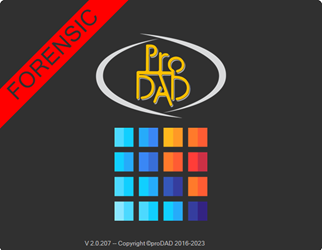
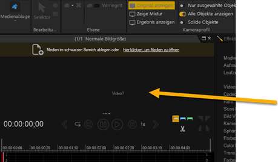
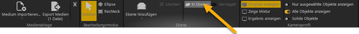
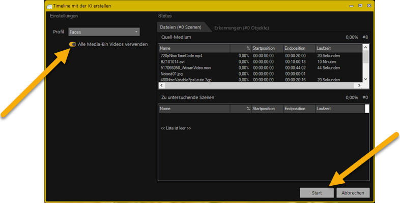
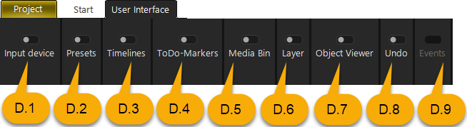
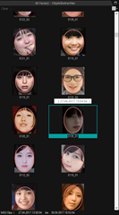
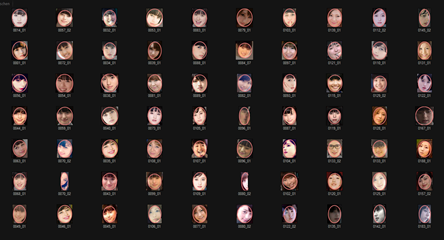
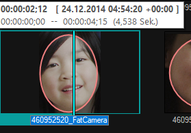
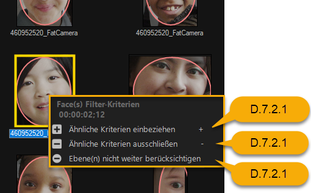
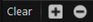

<!-- title: Phantom -->
<!-- author: Holger Burkarth -->
<!-- date: 2023 -->

<!-- 
Ignore Spelling: proDAD Immendingen Gauertstr Holger Burkarth lightgray changelog mediabin quickstart ui fx blocksize 
Ignore Spelling: rangemode timline simp del Un viewmode subfolder timecode supercode Behringer kbd objectview
Ignore Spelling: Ebenenanalyse Entf 
-->

 proDAD Disguise Forensic 2.0 Schnellstart

## Inhaltsverzeichnis
- [proDAD Disguise Forensic 2.0 Schnellstart](#Root)
- [Inhaltsverzeichnis](#inhaltsverzeichnis)
- [*Schnellstart*](#workshop-quick-start) 
- [*D.7* Objektbetrachter](#D.7)
  - [*D.7.1* Details anzeigen, wenn man mit dem Mauszeiger über ein Objekt fährt](#D.7.1) 
  - [*D.7.2* Filterkriterien festlegen](#D.7.2) 
  - [*D.7.3* Was tue ich, wenn keine Objekte angezeigt werden?](#D.7.3) 
- [Systemvoraussetzungen](#system-requirements)
- [Über proDAD](#prodad)
- [Kontakt](#contact)
- [Urheberrecht](#copyright)

##  *Schnellstart*
Die folgenden Schritte sind Beispiele dafür, wie man Personen oder Gesichter in Fotos und Videos findet.

#### 1. Importieren Sie Videos und Fotos durch einfaches Ziehen und Ablegen.
Ziehen Sie die Video- und Fotodateien zum Importieren einfach per Drag & Drop in die Anwendung.

> :bulb: Wenn Sie einen Ordner ablegen, werden automatisch alle Videos und Fotos importiert, die sich in allen Unterordnern befinden.

> :exclamation: Dieser Vorgang kann mehrere Minuten dauern. Die Zeit hängt von der Anzahl der zu durchsuchenden Unterverzeichnisse
die gescannt werden müssen, und von der Anzahl der darin enthaltenen Dateien ab. Videos brauchen länger als Fotos. Dateien auf externen Speichermedien
werden in der Regel langsamer verarbeitet als Dateien auf internen Speichergeräten. 

#### 2. Öffnen Sie das KI-Tool, um Medien zu analysieren und sie für die spätere Suche nach Merkmalen (z. B. Gesichtern) vorzubereiten.

#### 3. Wenn die Analyse gestartet wird, werden alle Medien nach den Merkmalen durchsucht. Für die gefundenen Merkmale werden Ebenen erstellt, die den zeitlichen Verlauf darstellen. 

> :bulb: Wählen Sie die Option "Alle Medien", wenn Sie alle Medien verarbeiten wollen.

> :exclamation: Für die Auswertung von hochauflösenden Fotos und Videos ist ein leistungsstarker PC erforderlich.
( Stand 2023) Rechnen Sie damit, dass Sie zwei- bis viermal so viel Bearbeitungszeit benötigen wie die Laufzeit der Videos. 

#### 4. Öffnen Sie den Objektbetrachter, um alle erkannten Objekte anzuzeigen.

Sobald die Analyse abgeschlossen ist, kann die Suche beginnen.
Die gefundenen Objekte werden aufgelistet und zusätzliche Optionen können verwendet werden, um bestimmte Merkmale herauszufiltern.

Weitere Informationen finden Sie hier: [*D.7* Objektbetrachter](#D.7)

> :bulb: Speichern Sie das Projekt, damit Sie es später verwenden können, ohne es erneut analysieren zu müssen. 

> :bulb: Zusätzliche Fotos und Videos können später hinzugefügt werden. Wenn Sie die Schaltfläche Start drücken, müssen nur die neu hinzugefügten Medien analysiert werden.  

##  *D.7* Objektbetrachter

Alle in der Mediendatei als Ebenen/Masken erkannten Objekte werden in der Liste Gefundene Objekte übersichtlich dargestellt. So können z.B. Gesichter schnell und effizient identifiziert und herausgefiltert werden. Ähnliche Gesichter zu einer Referenz können mit wenigen Klicks identifiziert werden. Informationen über das Medium und das Aufnahmedatum werden angezeigt.   

> :bulb: **Ebenen**: In der Bild- und Videoanalyse sind Ebenen übereinander angeordnete Schichten, die verschiedene Informationen oder Merkmale innerhalb des Mediums darstellen.
Eine Ebene kann zum Beispiel eine Person oder ihr Gesicht in einem Video darstellen. 

   ...    

+ [*D.7.1* Details anzeigen, wenn man mit dem Mauszeiger über ein Element fährt](#D.7.1) 
+ [*D.7.2* Filterkriterien festlegen](#D.7.2) 
+ [*D.7.3* Was mache ich, wenn keine Objekte angezeigt werden?](#D.7.3) 

####  *D.7.1* Details anzeigen, wenn der Mauszeiger über einem Objekt schwebt
Wenn der Mauszeiger länger als eine Sekunde über einem Objekt verweilt, ohne zu klicken,
wird die Videosequenz oder das Aufnahmedatum angezeigt. Zur Kennzeichnung wird ein Rahmen um das Objekt gezeichnet.
Wenn ein Video verfügbar ist, können Sie durch das Video navigieren, indem Sie den Mauszeiger horizontal bewegen. 

> :exclamation: Es kann vorkommen, dass der Modus auch nach längerer Zeit nicht aktiviert wird.
Sie können versuchen, den Mauszeiger aus der Box heraus und wieder in das Objekt hinein zu bewegen.
Wenn dies nicht funktioniert, klicken Sie in das Feld, um sicherzustellen, dass der Fokus auf dem Objekt liegt.  

####  *D.7.2* Filterkriterien festlegen
Die Anzahl der aufgelisteten Objekte kann durch die Definition von Kriterien eingeschränkt werden. Die Merkmale der ausgewählten Ebenen können über das Kontextmenü oder die Tastatur als Filterkriterien definiert werden. 

> :bulb: Wenn die Anzeige im Schwebemodus ist, werden bei einem Video (im Gegensatz zu einem Foto) nur die Merkmale verwendet, die sich auf die angezeigte Zeit oder das angezeigte Bild beziehen.
Ansonsten werden alle Merkmale über das gesamte Zeitintervall genommen.

> :bulb: Empfehlung: Verwenden Sie die Tasten <kbd>+</kbd>, <kbd>-</kbd>, and <kbd>Entf</kbd>, um die Filterkriterien schnell und einfach zu steuern.

#####  *D.7.2.1* <kbd>+</kbd> Ähnliche Kriterien einbeziehen
Nur Objekte mit ähnlichen Eigenschaften wie das ausgewählte Objekt werden aufgelistet.

> :bulb: Wenn man beispielsweise nach einem bestimmten Gesicht sucht, kann es hilfreich sein, mehrere Bilder/Positionen der Person aufzunehmen. Dadurch wird der Ähnlichkeitsvergleich schärfer und Sie können unpassende Objekte schnell herausfiltern.

#####  *D.7.2.2* <kbd>-</kbd> Ähnliche Kriterien ausschließen
Es werden keine Objekte aufgelistet, die ähnliche Eigenschaften wie das ausgewählte Objekt haben.

> :exclamation: Der Ausschluss von Merkmalen sollte immer sorgfältig bedacht werden. Obwohl der Ausschlussvergleich viel strenger ist als der Einschlussvergleich, kann es zu unbeabsichtigten Ausschlüssen kommen. 

#####  *D.7.2.3* <kbd>DEL</kbd> Ebene(n) nicht weiter berücksichtigen
Die ausgewählte Ebene wird aus der Liste entfernt und nicht mehr bearbeitet.

####  *D.7.3* Was kann ich tun, wenn keine Objekte angezeigt werden?

- Löschen Sie alle oder bestimmte Filterkriterien mit einem einzigen Klick.  
- Stellen Sie sicher, dass die erforderliche AI-Ebenenanalyse bereits durchgeführt wurde. Siehe [Schnellstart](#workshop-quick-start) 

##  System requirements
- 64bit Windows 7, 8, 10 or 11 
- Minimum 8 GB of RAM, 64 GB of RAM recommended

##  Über proDAD

proDAD ist ein renommiertes Unternehmen, das sich auf die Entwicklung und den Vertrieb von hochwertiger Video- und Bildbearbeitungssoftware spezialisiert hat. Seit der Gründung im Jahr 1990 hat sich proDAD als führender Anbieter von innovativen Lösungen für die professionelle Videobearbeitung etabliert.

Das Unternehmen proDAD zeichnet sich durch eine ausgeprägte Kompetenz in den Bereichen digitale Bild- und Videotechnik sowie Softwareentwicklung aus. Mit einem engagierten Team aus erfahrenen Entwicklern und Designern arbeitet das Unternehmen kontinuierlich an der Entwicklung fortschrittlicher Lösungen, die den Anforderungen professioneller Anwender gerecht werden.

Die Softwareprodukte von proDAD bieten eine breite Palette von Funktionen und Werkzeugen zur Optimierung, Bearbeitung und Verbesserung von Videos und Bildern. Die Lösungen zeichnen sich durch eine intuitive Benutzeroberfläche, hohe Leistung und hervorragende Qualität aus. Sie eignen sich sowohl für Einsteiger als auch für erfahrene Profis und bieten eine breite Palette an Effekten, Filtern, Stabilisierungstechniken und anderen Werkzeugen zur Verbesserung der visuellen Qualität von Medieninhalten.

Einer der Schwerpunkte von proDAD ist die Videostabilisierung. Das Unternehmen hat mehrere patentierte Techniken entwickelt, um Verwacklungen und Zittern in Videos effektiv zu reduzieren und eine konsistente Bildstabilisierung in professioneller Qualität zu erreichen. Diese Technologie wird von vielen Profis in der Filmindustrie, bei Fernsehproduktionen und Sportaufnahmen eingesetzt.

proDAD ist bekannt für seine enge Zusammenarbeit mit führenden Herstellern von Videobearbeitungssoftware. Die Produkte des Unternehmens werden als eigenständige Softwarelösungen angeboten, können aber auch nahtlos in bestehende Videobearbeitungsprogramme integriert werden. Dadurch profitieren die Anwender von erweiterten Funktionen und Möglichkeiten, um ihre Videoprojekte auf professionellem Niveau zu erstellen.

Mit jahrelanger Erfahrung, technischer Innovation und einem starken Fokus auf Kundenzufriedenheit hat sich proDAD als zuverlässiger Partner in der Videobearbeitungsbranche etabliert. Die Softwarelösungen des Unternehmens werden von professionellen Videoeditoren, Filmemachern, YouTubern und anderen Kreativen weltweit eingesetzt, um beeindruckende visuelle Inhalte zu produzieren.

##  Kontakt

Wir von [proDAD](#prodad) beantworten gerne alle Ihre Fragen zu unserem Programm. 

Kontaktieren Sie uns einfach 
- per E-Mail: support@prodad.com 
- per Telefon: +49 (0)7462 9459 0
- per Post: proDAD GmbH, Gauertstr. 2, 78194 Immendingen, Deutschland
- Homepage: [www.proDAD.com](https://www.prodad.com)

> :bulb: Bei Fragen oder Problemen wenden Sie sich bitte per E-Mail an den Kundensupport unter [support@prodad.com](mailto:support@prodad.com) 
> Siehe auch [*G.2.1* Support-Protokoll](#G.2.1)

##  Copyright
Copyright proDAD GmbH. Alle Rechte vorbehalten. 

Lizenzbestimmungen und Bedingungen  
Bitte lesen Sie diese Lizenzvereinbarung sorgfältig durch, bevor Sie die Software installieren. 

Lizenzvereinbarung  
Beim Start des Setups wird eine Lizenzvereinbarung angezeigt, die Sie sorgfältig lesen sollten. 
Mit der Installation der Software erklären Sie sich mit den Urheberrechtsbestimmungen, der Lizenzvereinbarung und dem Lizenzierungsverfahren einverstanden. 

Lizenz-Garantie  
Die proDAD GmbH gewährt dem Benutzer das Recht, dieses Produkt für den vorgesehenen und zulässigen Zweck zu verwenden. Dieses Produkt darf nur auf einem Computer installiert werden. proDAD garantiert die kostenlose Bereitstellung eines Lizenzschlüssels. Mit der Installation dieses Produktes erkennt der Nutzer die Lizenzgarantie, die Copyright-Bedingungen und die Haftungsbeschränkung an und akzeptiert sie. 

Markenzeichen-Hinweis  
Alle im Zusammenhang mit diesem Produkt erwähnten Produkte und Warenzeichen sind Warenzeichen der jeweiligen Eigentümer. Alle Marken werden ohne Gewährleistung der freien Verwendung verwendet und können eingetragene Marken sein. 

Beschränkung der Haftung   
Der Umfang der Haftung für jegliche Ansprüche ist auf den Ersatz des Produktes beschränkt. Dies gilt für die proDAD GmbH, alle Lizenznehmer und Wiederverkäufer. Reklamationen werden nur anerkannt, wenn die Software ordnungsgemäß unter Angabe der mit der proDAD GmbH vorab zu vereinbarenden Rücksendenummer zurückgesandt wird. Ein Kaufnachweis ist beizufügen. Diese Garantie erlischt, wenn eine Fehlfunktion dieses Produktes auf Missbrauch, Fehlbedienung, Unfall oder unsachgemäße Handhabung zurückzuführen ist. proDAD GmbH, ihre Distributoren und Lizenznehmer haften nicht für Schäden oder Folgeschäden, die aus der Unmöglichkeit der Nutzung dieses Produktes resultieren. Die Haftung ist auf den Kaufpreis des Produkts beschränkt. 

Dokumentation   
Das Handbuch wurde mit größtmöglicher Sorgfalt erstellt und übersetzt. Dennoch können Fehler nicht vollständig ausgeschlossen werden. Die proDAD GmbH übernimmt keine Verantwortung oder Haftung für die Folgen von fehlerhaften Angaben oder Informationen in der Dokumentation oder Übersetzung. Technische und optische Änderungen bleiben vorbehalten. Hinweise auf mögliche Ungenauigkeiten sind jederzeit willkommen. 

Copyright-Hinweis   
Die Software und ihre Komponenten sind Eigentum der proDAD GmbH. Mit der Installation dieses Produktes verpflichtet sich der Lizenznehmer, die unautorisierte Nutzung und Vervielfältigung zu unterlassen. 

Die proDAD GmbH übernimmt keine Verantwortung für die Verwendung dieses Programms und die Veröffentlichung seiner Inhalte und der mit diesem Programm erstellten Daten.  

ProDAD GmbH * Gauertstr. 2 * 78194 Immendingen * Deutschland * HRB 1077 

##  *G.2.1* Support Protocol
Die Protokollierung von Problemen und Fehlermeldungen in einer Protokolldatei kann sehr hilfreich sein, um die Ursache zu ermitteln und eine Lösung zu finden. In der Regel erübrigen sich dadurch technische Rückfragen zu früheren Ereignissen. Um dem Support ein effizientes Arbeiten zu ermöglichen, ist es ratsam, die Protokolldatei mit jeder Supportanfrage mitzusenden.

> Um die Protokolldatei vorzubereiten und zu übermitteln, gehen Sie bitte wie folgt vor:
> - Klicken Sie mit gehaltener <kbd>SHIFT</kbd> Taste auf das Menü *G.2* und wählen Sie die Schaltfläche __"Support-Protocol"__.

> :bulb: Die Protokolldatei enthält keine persönlichen oder vertraulichen Daten. Sie wird nur zur Analyse des Problems und zur Verbesserung unserer Software verwendet. Wir danken Ihnen für Ihre Mitarbeit und Ihr Verständnis.

> :exclamation: Wenn Sie Fragen oder Probleme haben, wenden Sie sich bitte per E-Mail an den Kundendienst unter [support@prodad.com](mailto:support@prodad.com) 

