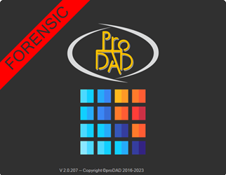
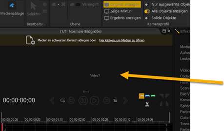
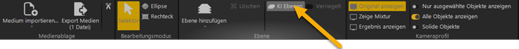
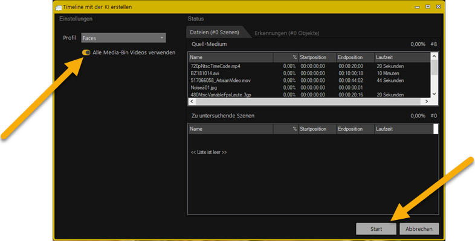
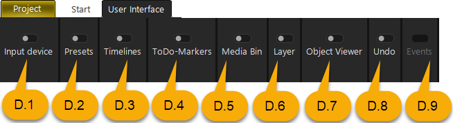
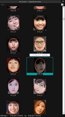
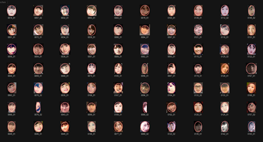
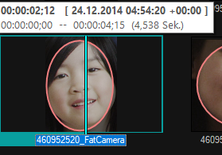
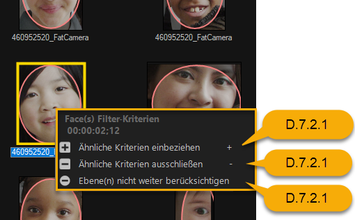
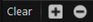

<!-- title: Phantom -->
<!-- author: Holger Burkarth -->
<!-- date: 2023 -->

<!-- 
Ignore Spelling: proDAD Immendingen Gauertstr Holger Burkarth lightgray changelog mediabin quickstart ui fx blocksize 
Ignore Spelling: rangemode timline simp del Un viewmode subfolder timecode supercode Behringer kbd objectview
-->

#  proDAD Disguise Forensic 2.0 Quick Start

> This documentation was written by Holger Burkarth. Translations were made by technical translators. 

## Table of content
- [ proDAD Disguise Forensic 2.0](#Root)
- [Table of content](#table-of-content)
- [*Quick Start*](#workshop-quick-start) 
- [*D.7* Object Viewer](#D.7)
  - [*D.7.1* Show details by hovering over an item](#D.7.1) 
  - [*D.7.2* Set filter criteria](#D.7.2) 
  - [*D.7.3* What do I do if no objects are displayed?](#D.7.3) 
- [System requirements](#system-requirements)
- [About proDAD](#prodad)
- [Contact](#contact)
- [Copyright](#copyright)

##  *Quick Start*
The following steps are examples of how to find people or faces in photos and videos.

#### 1. Import videos and photos with a simple drag and drop.
Simply drag and drop videos and photos files into the application for import.

> :bulb: Dropping a folder automatically imports all videos and photos contained in all sub-folders.

> :exclamation: This process may take several minutes. The time depends on the number of subdirectories
to scan and the number of files they contain. Videos take longer than photos. Files on external storage
devices are typically processed more slowly than files on internal storage devices. 

#### 2. Open AI tool to analyze media and prepare it for later searches for characteristics (e.g. faces).

#### 3. When the analysis is started, all media are searched for the characteristics. Layers are created for the characteristics found, representing the progression over time. 

> :bulb: Select the All Media option if you want to process all media.

> :exclamation: A powerful PC is required to analyze high-resolution photos and videos.
(As of 2023) Expect to spend two to four times as much time processing as you would for video. 

#### 4. Open Object Viewer to view all recognized objects.

Once the analysis is complete, the search can begin.
The objects found are listed and additional options can be used to filter out specific characteristics.

More information can be found here: [*D.7* Object Viewer](#D.7)

> :bulb: Save the project so you can use it later without having to analyze it again. 

> :bulb: Additional photos and videos can be added later. When you press the Start button, only the newly added media needs to be analyzed.  

##  *D.7* Object Viewer

All objects recognized as layers/masks in the media file are clearly displayed in the Found Objects list. Faces, for example, can be identified and filtered out quickly and efficiently. Similar faces to a reference can be identified with just a few clicks. Information on the medium and date of recording is displayed.   

> :bulb: **Layers**: In image and video analysis, layers are superimposed layers that represent different information or characteristics within the medium.
For example, a layer may represent a person or their face in a video. 

   ...    

+ [*D.7.1* Show details by hovering over an item](#D.7.1) 
+ [*D.7.2* Set filter criteria](#D.7.2) 
+ [*D.7.3* What do I do if no objects are displayed?](#D.7.3) 

####  *D.7.1* Show details by hovering over an item
When the mouse pointer hovers over an object for more than one second without clicking,
the video sequence or recording date is displayed. A frame is drawn around the object to indicate this.
If a video is available, you can navigate through the video by moving the mouse pointer horizontally. 

> :exclamation: It may happen that the mode is not activated even after a long time.
You can try moving the mouse pointer out of the box and back into the object.
If this does not work, click inside the box to make sure the focus is on the object.  

####  *D.7.2* Set filter criteria
The number of listed objects can be limited by defining criteria. The characteristics of the selected layers can be defined as filter criteria using the context menu or the keyboard. 

> :bulb: When the display is in hover mode, a video (unlike a photo) uses only those characteristics that relate to the time or image being displayed.
Otherwise, all characteristics are taken over the entire time interval.

> :bulb: Recommendation: Use the <kbd>+</kbd>, <kbd>-</kbd>, and <kbd>DEL</kbd> keys to quickly and easily control the filter criteria.

#####  *D.7.2.1* <kbd>+</kbd> Include similar criteria
Only objects with similar characteristics to the selected object are listed.

> :bulb: For example, if you are looking for a specific face, it may be helpful to take multiple images/positions of the person. This makes the similarity comparison sharper and allows you to quickly filter out inappropriate objects.

#####  *D.7.2.2* <kbd>-</kbd> Exclude similar criteria
No objects are listed that have similar characteristics to the selected object.

> :exclamation: Exclusion of features should always be carefully considered. Although the similarity comparison is much stricter than the inclusion comparison, unintentional exclusions can occur. 

#####  *D.7.2.3* <kbd>DEL</kbd> Do not consider layer(s) any further
The selected layer will be removed from the list and will no longer be processed.

####  *D.7.3* What do I do if no objects are displayed?

- Clear all or any filter criteria with a single click.  
- Make sure that the required AI-Layer analysis has already been performed. See [Quick Start](#workshop-quick-start) 

##  System requirements
- 64bit Windows 7, 8, 10 or 11 
- Minimum 8 GB of RAM, 64 GB of RAM recommended

##  About proDAD

proDAD is a renowned company specializing in the development and distribution of high-quality video and image editing software. Since its founding in 1990, proDAD has established itself as a leading provider of innovative solutions for professional video editing.

The proDAD company is characterized by a distinctive expertise in the areas of digital image and video technology as well as software development. With a dedicated team of experienced developers and designers, the company works continuously to develop advanced solutions that meet the needs of professional users.

proDAD's software products offer a wide range of features and tools for optimizing, editing and enhancing video and images. The solutions are characterized by an intuitive user interface, high performance and excellent quality. Suitable for both beginners and experienced professionals, they offer a wide range of effects, filters, stabilization techniques and other tools to improve the visual quality of media content.

One of proDAD's main focuses is video stabilization. The company has developed several patented techniques to effectively reduce shake and jitter in video and achieve consistent, professional-quality image stabilization. This technology is used by many professionals in the film industry, television productions and sports footage.

proDAD is known for its close collaboration with leading video editing software manufacturers. The company's products are offered as stand-alone software solutions, but can also be seamlessly integrated into existing video editing programs. As a result, users benefit from enhanced features and capabilities to create their video projects at a professional level.

With years of experience, technical innovation and a strong focus on customer satisfaction, proDAD has established itself as a trusted partner in the video editing industry. The company's software solutions are used by professional video editors, filmmakers, YouTubers and other creators worldwide to produce stunning visual content.

##  Contact us

We at [proDAD](#prodad) are happy to answer any questions you may have about our program. 

Simply contact us 
- by email: support@prodad.com 
- by phone: +49 (0)7462 9459 0
- by postal mail: proDAD GmbH, Gauertstr. 2, 78194 Immendingen, Germany
- homepage: [www.proDAD.com](https://www.prodad.com)

> 💡 If you have any questions or problems, please email customer support at [support@prodad.com](mailto:support@prodad.com) 
> See also [*G.2.1* Support Protocol](#G.2.1)

##  Copyright
Copyright proDAD GmbH. All rights reserved. 

License Terms and Conditions  
Please read this license agreement carefully before installing the software. 

License Agreement  
When the setup starts, a license agreement is displayed, which you should read carefully. 
By installing the software, you agree to be bound by the copyright terms, the license agreement, and the licensing procedure. 

License Warranty  
proDAD GmbH grants the user the right to use this product for its intended and permitted purpose. This product may only be installed on one computer. proDAD guarantees to provide a license key free of charge. By installing this product, the user acknowledges and accepts the license guarantee, the copyright conditions and the limitation of liability. 

Trademark Notice  
All products and trademarks mentioned in connection with this product are trademarks of their respective owners. All trademarks are used without warranty of free use and may be registered trademarks. 

Limitation of Liability   
The extent of liability for any claim is limited to replacement of the product. This applies to proDAD GmbH, all licensees and resellers. Claims will only be accepted if the software is returned in an orderly manner, together with the return number to be agreed with proDAD GmbH in advance. Proof of purchase must also be enclosed. This warranty is void if a malfunction of this product is due to misuse, abuse, accident or improper handling. proDAD GmbH, its distributors and licensees are not liable for damages or consequential damages resulting from the inability to use this product. Liability is limited to the purchase price of the product. 

Documentation   
The manual has been compiled and translated with the utmost care. However, the possibility of errors cannot be completely excluded. proDAD GmbH assumes no responsibility or liability for the consequences of any incorrect statements or information contained in the documentation or translation. Subject to technical and optical changes. Information about possible inaccuracies is always welcome. 

Copyright notice   
The software and its components are the property of proDAD GmbH. By installing this product, the licensee agrees to refrain from unauthorized use and reproduction. 

proDAD GmbH assumes no responsibility for the use of this program and the publication of its contents and data created with this program.  

ProDAD GmbH * Gauertstr. 2 * 78194 Immendingen * Germany * HRB 1077 

##  *G.2.1* Support Protocol
Logging problems and error messages in a log file can be very helpful in determining the cause and finding a solution. As a rule, this eliminates the need for technical queries about previous events. To enable support to work efficiently, it is advisable to send the protocol file with every support request.

> To prepare and submit the log file, please proceed as follows:
> - Click on the *G.2* menu with <kbd>SHIFT</kbd> and select the __"Support-Protocol"__ button.

> 💡 The log file does not contain any personal or confidential data. It is only used to analyze the problem and > improve our software. We thank you for your cooperation and understanding.

> :exclamation: If you have any questions or problems, please email customer support at [support@prodad.com](mailto:support@prodad.com) 

