<!-- title: Phantom -->
<!-- author: Holger Burkarth -->
<!-- date: 2023 -->

<!-- 
Ignore Spelling: proDAD Immendingen Gauertstr Holger Burkarth lightgray changelog mediabin quickstart ui fx blocksize 
Ignore Spelling: rangemode timline simp del Un viewmode subfolder timecode supercode Behringer kbd objectview
-->

#  proDAD Disguise Forensic 2.0

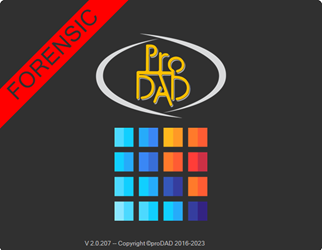

> This documentation was written by Holger Burkarth. Translations were made by technical translators. 

## Table of content
- [ proDAD Disguise Forensic 2.0](#Root)
  - [Table of content](#table-of-content)
  - [System requirements](#system-requirements)
  - [Change Log](#changelog)
  - [About proDAD](#prodad)
  - [Contact](#contact)
  - [Copyright](#copyright)
- [ Main UI](#MainUI)
- [ Workshops](#workshops)
   - [*Quick Start*](#workshop-quick-start) 
- [ *A* Canvas](#A)
- [ *C* Timeline](#C)
  - [ *C.1* Timeline-Range](#C.1)
    - [ *C.1.1* Timeline-Range / Mode](#C.1.1)
    - [ *C.1.2* Timeline-Range / Select](#C.1.2)
  - [ *C.2* Ruler](#C.2)
  - [ *C.3* Layer](#C.3)
    - [ *C.3.1* Layer / Edit](#C.3.1)
    - [ *C.3.2* Layer / Select](#C.3.2)
    - [ *C.3.3* Layer / Navigate](#C.3.3)
    - [ *C.3.4* Layer / Style](#C.3.4)
    - [ *C.3.5* Layer / Types](#C.3.5)
  - [ *C.4* Keyframe](#C.4)
    - [ *C.4.1* Keyframe / Edit](#C.4.1)
    - [ *C.4.2* Keyframe / Select](#C.4.2)
    - [ *C.4.3* Keyframe / Navigate](#C.4.3)
  - [ *C.5* Time-Cursor](#C.5)
    - [ *C.5.1* Style](#C.5.1)
  - [ *C.6* Timeline-Title](#C.6)
  - [ *C.7* Snapping-Switch](#C.7)
  - [ *C.8* Timeline-Zoom](#C.8)
  - [ *C.9* Timeline-Scrollbar](#C.9)
    - [*C.10* Timeline Context-Menu](#C.10) 
      - [*C.10.1* Cut, Copy, Paste](#C.10.1)
      - [*C.10.2* Special Copy, Paste](#C.10.2)
      - [*C.10.3* Delete](#C.10.3)
      - [*C.10.4* Delete keyframes until end position ](#C.10.4)
      - [*C.10.5* Set Work-Area to the Layer(s)](#C.10.5)
      - [*C.10.6* Group, Un-group](#C.10.6)
      - [*C.10.8* Add Timeline until time cursor](#C.10.8)
      - [*C.10.9* Split Timeline at time cursor](#C.10.9)
      - [*C.10.10* New Timeline for selected Layer(s)](#C.10.10)
      - [*C.10.11* Split the time range into separate timeline](#C.10.11)
      - [*C.10.12* Compress Timeline](#C.10.12)
      - [*C.10.13* Select All](#C.10.13)
      - [*C.10.14* Go to Layer](#C.10.14)
- [ *D* Optional Views](#D)
  - [*D.7* Object Viewer](#D.7)
    - [*D.7.1* Show details by hovering over an item](#D.7.1) 
    - [*D.7.2* Set filter criteria](#D.7.2)
    - [*D.7.3* What do I do if no objects are displayed?](#D.7.3) 
- [ *E* Ribbon Menu](#E)
  - [ *E.1* Import/Export Media-Files](#E.1)
    - [ *E.1.1* Import Media-Files](#E.1.1)
    - [ *E.1.2* Export Media-Files](#E.1.2)
  - [ *E.2* Mask Edit](#E.2)
  - [ *E.3* Layer](#E.3)
    - [ *E.3.1* Delete-Layer](#E.3.1)
    - [ *E.3.2* Layer-Group](#E.3.2)
      - [ *E.3.2.3* Mosaic effect anchor point for spherical videos](#E.3.2.3)
    - [ *E.3.3* Effect-Lift](#E.3.3)
    - [ *E.3.4* Layer-Order](#E.3.4)
    - [ *E.3.5* Exclude-Layer](#E.3.5)
    - [ *E.3.6* Enable-Layer](#E.3.6)
    - [ *E.3.7* Lock-Layer](#E.3.7)
    - [ *E.3.8* AI-Layer](#E.3.8)
    - [ *E.3.9* Add Layer](#E.3.9)
  - [ *E.4* Canvas View-Mode](#E.4)
    - [ *E.4.1* View Result](#E.4.1)
    - [ *E.4.2* View Source](#E.4.2)
    - [ *E.4.3* View Mixture](#E.4.3)
    - [ *E.4.4* Show only selected objects](#E.4.4)
    - [ *E.4.5* Show all objects](#E.4.5)
    - [ *E.4.6* Solid objects](#E.4.6)
  - [ *E.5* Timeline View-Mode](#E.5)
    - [*E.5.1* Compacted](#E.5.1)
    - [*E.5.2* Keyframes](#E.5.2)
    - [*E.5.3* Mosaic Keyframes](#E.5.3)
  - [ *E.6* S3D-Video Options](#E.6)
    - [*E.6.1* Show Grid](#E.6.1)
    - [*E.6.2* View Mode](#E.6.2)
    - [*E.6.3* Zero Depth](#E.6.3)
    - [*E.6.4* Set Object Depth](#E.6.4)
    - [*E.6.5* Link with edit Object](#E.6.5)
- [ *F* Project](#F)
  - [ *F.1* Project Menu](#F.1)
    - [ *F.1.1* New Project](#F.1.1)
    - [ *F.1.2* Open Project](#F.1.2)
    - [ *F.1.3* Append Project](#F.1.3)
    - [ *F.1.4* Save Project](#F.1.4)
    - [ *F.1.5* Save Project as](#F.1.5)
    - [ *F.1.6* Import Media](#F.1.6)
    - [ *F.1.7* Export Media](#F.1.7)
    - [ *F.1.8* Create Team Project](#F.1.8)
    - [ *F.1.9* Import Team Project](#F.1.9)
    - [ *F.1.10* Project Settings](#F.1.10)
      - [ *F.1.10.1* Project](#F.1.10.1)
      - [ *F.1.10.2* User Interface](#F.1.10.2)
      - [ *F.1.10.3* Input Device](#F.1.10.3)
        - [ *F.1.10.3.1* Pedals](#F.1.10.3.1)
        - [ *F.1.10.3.2* MIDI](#F.1.10.3.2)
      - [ *F.1.10.4* Editing](#F.1.10.4)
        - [ *F.1.10.4.1* Object Tracker](#F.1.10.4.1)
        - [ *F.1.10.4.2* Layer](#F.1.10.4.2)
  - [ *F.2* Undo/Redo](#F.2)
- [ *G* Tutorials / Info / Updates](#G)
- [ *H* Timeline Tools](#H)
- [ *J* Playback Control](#J)
  - [ *J.1* Auto-Repeat](#J.1)
  - [ *J.2* Play/Stop](#J.2)
  - [ *J.3* Jump to Begin/End](#J.3)
  - [ *J.4* Playback-Speed](#J.4)
- [Keyboard Short-Cuts](#short-cuts)
- [Keyboard Super-Codes](#super-short-cuts)
- [Devices](#devices)
  - [Pedals](#devices-pedals)
  - [MIDI](#devices-midi)
  - [Keyboard](#devices-keyboard)
 

##  System requirements
- 64bit Windows 7, 8, 10 or 11 
- Minimum 8 GB of RAM, 64 GB of RAM recommended

##  About proDAD

proDAD is a renowned company specializing in the development and distribution of high-quality video and image editing software. Since its founding in 1990, proDAD has established itself as a leading provider of innovative solutions for professional video editing.

The proDAD company is characterized by a distinctive expertise in the areas of digital image and video technology as well as software development. With a dedicated team of experienced developers and designers, the company works continuously to develop advanced solutions that meet the needs of professional users.

proDAD's software products offer a wide range of features and tools for optimizing, editing and enhancing video and images. The solutions are characterized by an intuitive user interface, high performance and excellent quality. Suitable for both beginners and experienced professionals, they offer a wide range of effects, filters, stabilization techniques and other tools to improve the visual quality of media content.

One of proDAD's main focuses is video stabilization. The company has developed several patented techniques to effectively reduce shake and jitter in video and achieve consistent, professional-quality image stabilization. This technology is used by many professionals in the film industry, television productions and sports footage.

proDAD is known for its close collaboration with leading video editing software manufacturers. The company's products are offered as stand-alone software solutions, but can also be seamlessly integrated into existing video editing programs. As a result, users benefit from enhanced features and capabilities to create their video projects at a professional level.

With years of experience, technical innovation and a strong focus on customer satisfaction, proDAD has established itself as a trusted partner in the video editing industry. The company's software solutions are used by professional video editors, filmmakers, YouTubers and other creators worldwide to produce stunning visual content.

##  Contact us

We at [proDAD](#prodad) are happy to answer any questions you may have about our program. 

Simply contact us 
- by email: support@prodad.com 
- by phone: +49 (0)7462 9459 0
- by postal mail: proDAD GmbH, Gauertstr. 2, 78194 Immendingen, Germany
- homepage: [www.proDAD.com](https://www.prodad.com)

> 💡 If you have any questions or problems, please email customer support at [support@prodad.com](mailto:support@prodad.com) 
> See also [*G.2.1* Support Protocol](#G.2.1)

##  Copyright
Copyright proDAD GmbH. All rights reserved. 

License Terms and Conditions  
Please read this license agreement carefully before installing the software. 

License Agreement  
When the setup starts, a license agreement is displayed, which you should read carefully. 
By installing the software, you agree to be bound by the copyright terms, the license agreement, and the licensing procedure. 

License Warranty  
proDAD GmbH grants the user the right to use this product for its intended and permitted purpose. This product may only be installed on one computer. proDAD guarantees to provide a license key free of charge. By installing this product, the user acknowledges and accepts the license guarantee, the copyright conditions and the limitation of liability. 

Trademark Notice  
All products and trademarks mentioned in connection with this product are trademarks of their respective owners. All trademarks are used without warranty of free use and may be registered trademarks. 

Limitation of Liability   
The extent of liability for any claim is limited to replacement of the product. This applies to proDAD GmbH, all licensees and resellers. Claims will only be accepted if the software is returned in an orderly manner, together with the return number to be agreed with proDAD GmbH in advance. Proof of purchase must also be enclosed. This warranty is void if a malfunction of this product is due to misuse, abuse, accident or improper handling. proDAD GmbH, its distributors and licensees are not liable for damages or consequential damages resulting from the inability to use this product. Liability is limited to the purchase price of the product. 

Documentation   
The manual has been compiled and translated with the utmost care. However, the possibility of errors cannot be completely excluded. proDAD GmbH assumes no responsibility or liability for the consequences of any incorrect statements or information contained in the documentation or translation. Subject to technical and optical changes. Information about possible inaccuracies is always welcome. 

Copyright notice   
The software and its components are the property of proDAD GmbH. By installing this product, the licensee agrees to refrain from unauthorized use and reproduction. 

proDAD GmbH assumes no responsibility for the use of this program and the publication of its contents and data created with this program.  

ProDAD GmbH * Gauertstr. 2 * 78194 Immendingen * Germany * HRB 1077 

#  Main UI

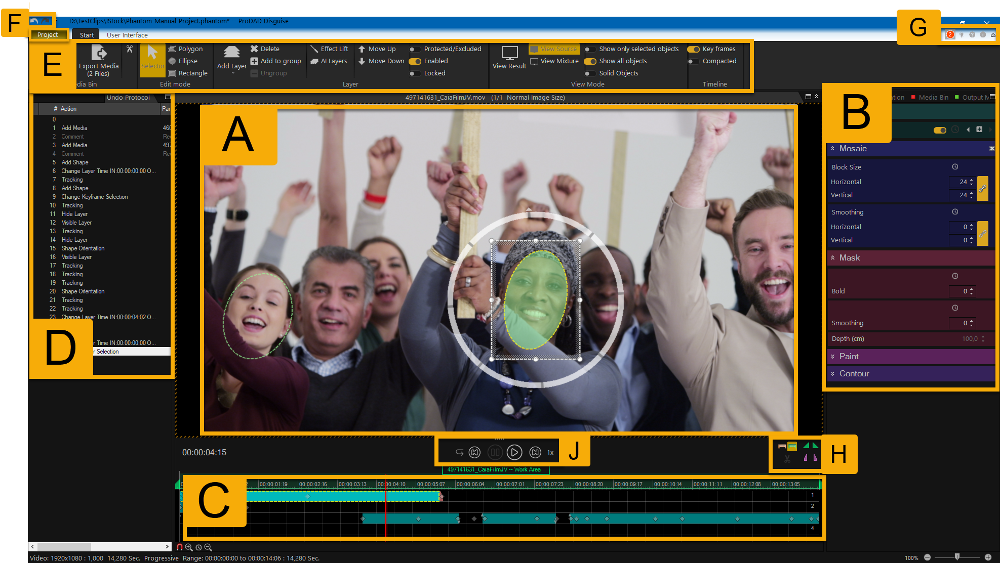

+ [*A* Canvas](#A) 
+ [*B* Inspector](#B)
+ [*C* Timeline](#C)
+ [*D* Optional Views](#D)
+ [*E* Ribbon Menu](#E)
+ [*F* Project](#F)
+ [*G* Tutorials / Application Info / Update News](#G)
+ [*H* Timeline Tools](#H)
+ [*J* Playback Control](#J)

#  Workshops

<!--
+ [Quick Start](#workshop-quick-start) 

-->

##  *Quick Start*
The following steps are examples of how to find people or faces in photos and videos.

#### 1. Import videos and photos with a simple drag and drop.
Simply drag and drop videos and photos files into the application for import.

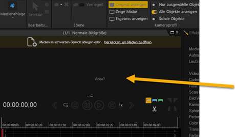

> :bulb: Dropping a folder automatically imports all videos and photos contained in all sub-folders.

> :exclamation: This process may take several minutes. The time depends on the number of subdirectories
to scan and the number of files they contain. Videos take longer than photos. Files on external storage
devices are typically processed more slowly than files on internal storage devices. 

#### 2. Open AI tool to analyze media and prepare it for later searches for characteristics (e.g. faces).
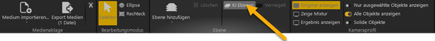

#### 3. When the analysis is started, all media are searched for the characteristics. Layers are created for the characteristics found, representing the progression over time. 

> :bulb: Select the All Media option if you want to process all media.

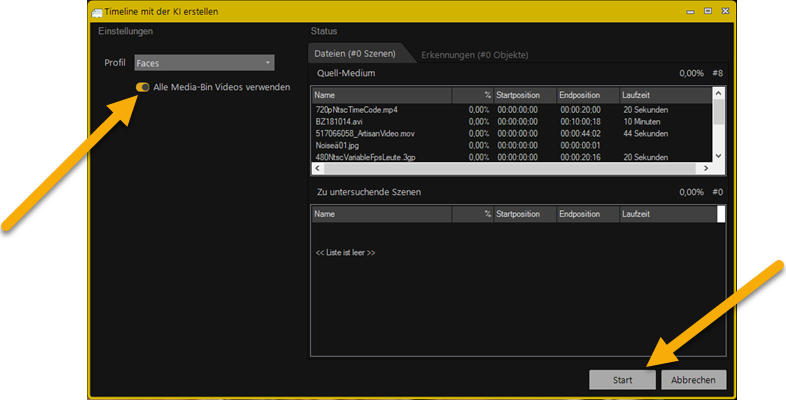

> :bulb: **Layers**: In image and video analysis, layers are superimposed layers that represent different information or characteristics within the medium.
For example, a layer may represent a person or their face in a video. 

> :exclamation: A powerful PC is required to analyze high-resolution photos and videos.
(As of 2023) Expect to spend two to four times as much time processing as you would for video. 

#### 4. Open Object Viewer to view all recognized objects.

Once the analysis is complete, the search can begin.
The objects found are listed and additional options can be used to filter out specific characteristics.

More information can be found here: [*D.7* Object Viewer](#D.7)

> :bulb: Save the project so you can use it later without having to analyze it again. 

> :bulb: Additional photos and videos can be added later. When you press the Start button, only the newly added media needs to be analyzed.  

#  *C* Timeline

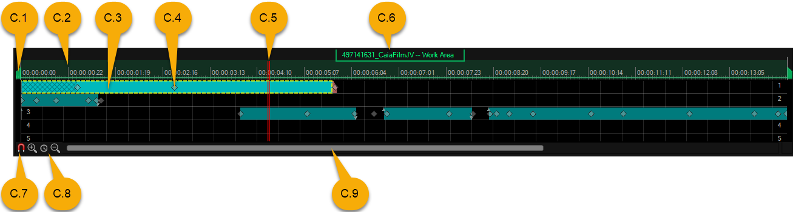

+ [*C.1* Timeline-Range](#C.1) 
+ [*C.2* Ruler](#C.2) 
+ [*C.3* Layer](#C.3) 
+ [*C.4* Keyframe](#C.4) 
+ [*C.5* Time-Cursor](#C.5) 
+ [*C.6* Timeline-Title](#C.6) 
+ [*C.7* Snapping-Switch](#C.7) 
+ [*C.8* Timeline-Zoom](#C.8) 
+ [*C.9* Timeline-Scrollbar](#C.9) 
+ [*C.10* Timeline Context-Menu](#C.10) 

##  *C.1* Timeline-Range

The start/end markers can be moved with the mouse. The whole area can be moved over the title. Double-click to maximize the marker. The <kbd>I</kbd> and <kbd>O</kbd> keys can also be used to set the start/end markers to the current position.

> 💡 Pressing and holding <kbd>SHIFT</kbd> while moving will display the corresponding video frame.

###  *C.1.1* Timeline-Range / Mode

> Video trimming:  
> Edit the video trim points. This is also the export time range.   
> 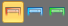 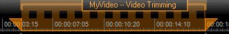  
 
> Timelines:  
> Edit Sub-Timelines.     
> 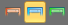 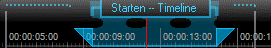  

> Effect/Workspace:  
> Edit workspace start/end point. And edit effects such as Mosaic within this mode.   
>  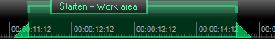  

###  *C.1.2* Timeline-Range / Select

Double-clicking on a layer sets the workspace to that layer.

See also: 
- [Timeline-Ruler](#C.2)
- [Time-Cursor](#C.5)
- [Time-Title](#C.6)

##  *C.2* Ruler

See also: 
- [Timeline-Range](#C.1)
- [Time-Cursor](#C.5)
- [Time-Title](#C.6)
 

##  *C.3* Layer

A layer represents the chronological effect of a mask. Multiple masks acting simultaneously in time extend or limit the area of effect.

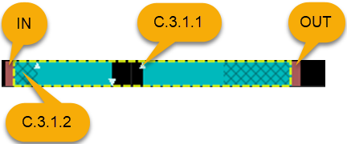

+ [*C.3.1* Layer / Edit](#C.3.1) 
+ [*C.3.2* Layer / Select](#C.3.2) 
+ [*C.3.3* Layer / Navigate](#C.3.3) 
+ [*C.3.4* Layer / Style](#C.3.4) 
+ [*C.3.5* Layer / Types](#C.3.5) 

See also:
- [ *E.5* Timeline View-Mode](#E.5)
---

###  *C.3.1* Layer / Edit

The selected layers can be deleted with the <kbd>DEL</kbd> key.

*C.3.1.2* shows an area where the mask has not yet been defined by keyframes and where there may be inappropriate positions of the mask. 

*C.3.1.1* shows the change in visibility of the mask and therefore where the mask works and where it does not.
[A.6](#A.6) [B.1.4](#B.1.4)

###  *C.3.2* Layer / Select

Layers can be selected using the mouse. The typical Windows combinations of <kbd>SHIFT</kbd> and <kbd>CTRL</kbd> can also be used. To select the previous or next layer, use the <kbd>UP</kbd> and <kbd>DOWN</kbd> cursor keys also in combination with <kbd>SHIFT</kbd>.

###  *C.3.3* Layer / Navigate

Double-clicking on the start/end layer positions the time cursor at that point.

---

###  *C.3.4* Layer / Style

Standard:  
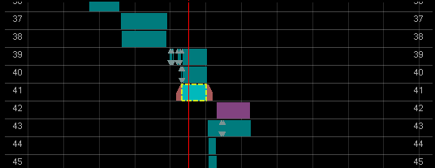

Compact:  
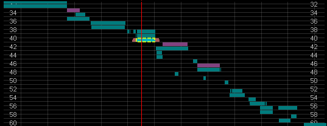

See also:
- [*E.5.1* Ribbon Compacted](#E.5.1)

---

###  *C.3.5* Layer / Types

A layer can have different functions and have different relationships to other layers. The timeline shows these differences.

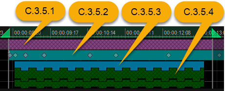

- *C.3.5.1* Layer with a protection/exclude mask
- *C.3.5.2* Normal Layer
- *C.3.5.3* Head of a Layer-Group
- *C.3.5.4* Member of a Layer-Group

##  *C.4* Keyframe

Keyframes shows the position of parameters or masks in time.

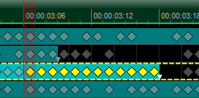

See also:
- [*E.5.2* Keyframes](#E.5.2)
---

###  *C.4.1* Keyframe / Edit

The selected keyframes can be deleted with the <kbd>DEL</kbd> key.

> 💡 SHIFT DEL deletes all keyframes of the selected layer from the time cursor to the end of the workspace.   
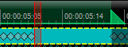

###  *C.4.2* Keyframe / Select

Keyframes can be selected using the mouse. The typical Windows combinations of <kbd>SHIFT</kbd> and <kbd>CTRL</kbd> can also be used.

###  *C.4.3* Keyframe / Navigate

Double-clicking on the keyframe positions the time cursor at that point.

##  *C.5* Time-Cursor

Displays the current position in the video. The marker can be moved using the mouse. The cursor keys <kbd>LEFT</kbd> and <kbd>RIGHT</kbd> or the keys <kbd>B</kbd> and <kbd>N</kbd> can also be used. If the numeric keypad is activated, keys <kbd>NP-4</kbd> and <kbd>NP-6</kbd> can be used to move the marker.

The <kbd>HOME</kbd> and <kbd>END</kbd> keys can be used to move to the start or end of the Timeline. Markers on the Timeline can be jumped to using the <kbd>PAGE-UP</kbd> and <kbd>PAGE-DOWN</kbd> keys or the Numeric Keypad <kbd>NP-9</kbd> and <kbd>NP-3</kbd> keys.

###  *C.5.1* Style 
The display can be switched between SPAN and SIMP.
With SPAN, the time cursor shows the time range of the frame. With SIMP, only the time is displayed.

| Type | First Range Frame | Last Range Frame |
|--|--|--|
|SPAN | 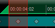 | 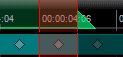 | 
|SIMP | 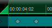 | 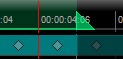 | 

See also: 
- [Timeline-Range](#C.1)
- [Ruler](#C.2)
- [Time-Title](#C.6)
- [Project Settings: User Interface](#F.1.10.2) 

##  *C.6* Timeline-Title

See also: 
- [Timeline-Range](#C.1)
- [Ruler](#C.2)
- [Time-Cursor](#C.5)

##  *C.7* Snapping-Switch

Enables markers to be snapped to existing markers when editing with the mouse.

##  *C.8* Timeline-Zoom

⌛ Under construction

##  *C.9* Timeline-Scrollbar

⌛ Under construction

##  *C.10* Timeline Context-Menu

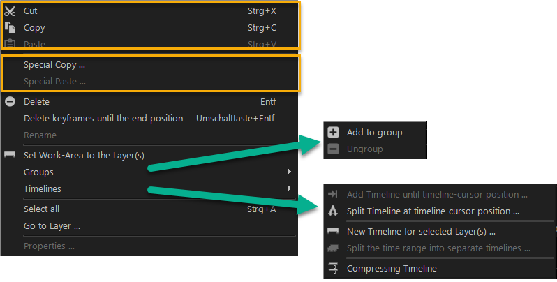

+ [*C.10.1* Cut, Copy, Paste](#C.10.1)
+ [*C.10.2* Special Copy, Paste](#C.10.2)
+ [*C.10.3* Delete](#C.10.3)
+ [*C.10.4* Delete keyframes until end position ](#C.10.4)
+ [*C.10.5* Set Work-Area to the Layer(s)](#C.10.5)
+ [*C.10.6* Group, Un-group](#C.10.6)
+ [*C.10.8* Add Timeline until time cursor](#C.10.8)
+ [*C.10.9* Split Timeline at time cursor](#C.10.9)
+ [*C.10.10* New Timeline for selected Layer(s)](#C.10.10)
+ [*C.10.11* Split the time range into separate timeline](#C.10.11)
+ [*C.10.12* Compress Timeline](#C.10.13)
+ [*C.10.13* Select All](#C.10.14)
+ [*C.10.14* Go to Layer](#C.10.15)

---

###  *C.10.1* Cut, Copy, Paste
Copy selected items to the clipboard or paste items from the clipboard.

###  *C.10.2* Special Copy, Paste
Copy only special parameters of selected items to the clipboard or paste items from the clipboard.

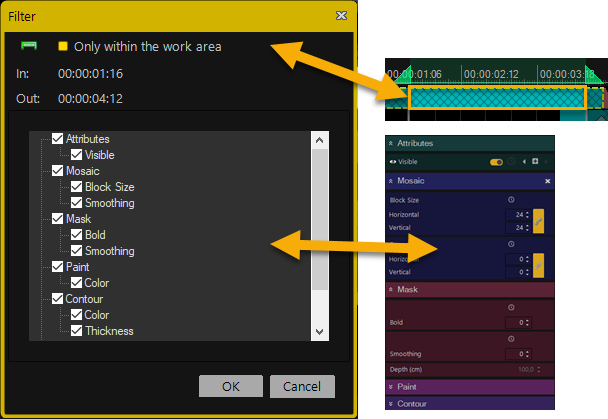

> 💡 It is also possible to create a template based on the filtered parameters. See Presets.

###  *C.10.3* Delete
Delete selected items.

###  *C.10.4* Delete keyframes until end position
Delete all keyframes between the time cursor and the end marker.

###  *C.10.5* Set Work-Area to the Layer(s)
Set the workspace for the time span of the selected layers.

###  *C.10.6* Group, Un-group
Add selected layers to a group or remove them from a group.

###  *C.10.8* Add Timeline until time cursor
Create a new sub-timeline from the last position to the time cursor.

###  *C.10.9* Split Timeline at time cursor
Split sub-timeline at the time cursor position.

###  *C.10.10* New Timeline for selected Layer(s)
Create a new sub-timeline for the time span of the selected layers.

###  *C.10.11* Split the time range into separate timeline 
⌛ Under construction

###  *C.10.12* Compress Timeline 
Arrange layers more compactly so that subsequent layers appear further down the timeline. 

###  *C.10.13* Select All
Select all layers or select all keyframes in a layer.

###  *C.10.14* Go to Layer 
Select a layer by its number.

#  *D* Optional Views

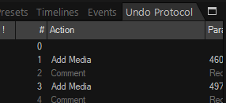

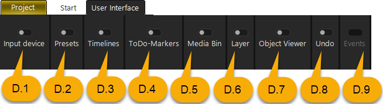

+ [*D.1* Input Device](#D.1)
+ [*D.2* Presets](#D.2)
+ [*D.3* Timelines](#D.3)
+ [*D.4* ToDo Markers](#D.4)
+ [*D.5* Media Bin](#D.5)
+ [*D.6* Layers](#D.6)
+ [*D.7* Object Viewer](#D.7)
+ [*D.8* Undo-Protocol](#D.8)
+ [*D.9* Processing-Events](#D.9)

###  *D.1* Input Device
🔗 [More Details about Pedals](#devices-pedals)

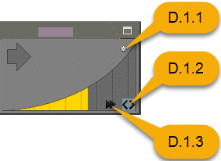

####  *D.1.1* Settings
See [*F.1.10.3.1* Pedals Settings](#F.1.10.3.1)

####  *D.1.2* Range
This limits the time range to the working range.

####  *D.1.3* Speed
Increase in speed by a factor of 4.

###  *D.4* ToDo Markers
⌛ Under construction

###  *D.5* Media Bin
⌛ Under construction

###  *D.6* Layers
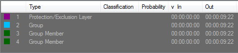

⌛ Under construction

###  *D.7* Object Viewer
All objects recognized as layers/masks in the media file are clearly displayed in the Found Objects list. Faces, for example, can be identified and filtered out quickly and efficiently. Similar faces to a reference can be identified with just a few clicks. Information on the medium and date of recording is displayed.   

> :bulb: **Layers**: In image and video analysis, layers are superimposed layers that represent different information or characteristics within the medium.
For example, a layer may represent a person or their face in a video. 

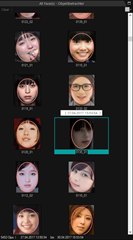   ...    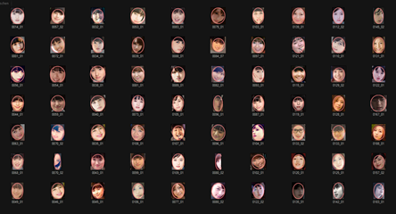

> :bulb: If you do not see this window, read here ([*D* Ribbon](#D)) how to enable it.

+ [*D.7.1* Show details by hovering over an item](#D.7.1) 
+ [*D.7.2* Set filter criteria](#D.7.2) 
+ [*D.7.3* What do I do if no objects are displayed?](#D.7.3) 

####  *D.7.1* Show details by hovering over an item
When the mouse pointer hovers over an object for more than one second without clicking,
the video sequence or recording date is displayed. A frame is drawn around the object to indicate this.
If a video is available, you can navigate through the video by moving the mouse pointer horizontally. 

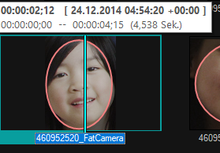

> :exclamation: It may happen that the mode is not activated even after a long time.
You can try moving the mouse pointer out of the box and back into the object.
If this does not work, click inside the box to make sure the focus is on the object.  

####  *D.7.2* Set filter criteria
The number of listed objects can be limited by defining criteria. The characteristics of the selected layers can be defined as filter criteria using the context menu or the keyboard. 

> :bulb: When the display is in hover mode, a video (unlike a photo) uses only those characteristics that relate to the time or image being displayed.
Otherwise, all characteristics are taken over the entire time interval.

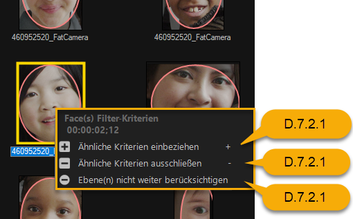

> :bulb: Recommendation: Use the <kbd>+</kbd>, <kbd>-</kbd>, and <kbd>DEL</kbd> keys to quickly and easily control the filter criteria.

#####  *D.7.2.1* <kbd>+</kbd> Include similar criteria
Only objects with similar characteristics to the selected object are listed.

> :bulb: For example, if you are looking for a specific face, it may be helpful to take multiple images/positions of the person. This makes the similarity comparison sharper and allows you to quickly filter out inappropriate objects.

#####  *D.7.2.2* <kbd>-</kbd> Exclude similar criteria
No objects are listed that have similar characteristics to the selected object.

> :exclamation: Exclusion of features should always be carefully considered. Although the similarity comparison is much stricter than the inclusion comparison, unintentional exclusions can occur. 

#####  *D.7.2.3* <kbd>DEL</kbd> Do not consider layer(s) any further
The selected layer will be removed from the list and will no longer be processed.

####  *D.7.3* What do I do if no objects are displayed?

- Clear all or any filter criteria with a single click.  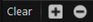
- Make sure that the required AI-Layer analysis has already been performed. See [Quick Start](#workshop-quick-start) 

###  *D.8* Undo-Protocol
⌛ Under construction

###  *D.9* Processing-Events
⌛ Under construction

#  *E* Ribbon Menu

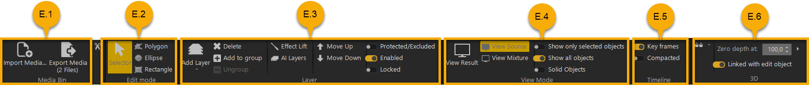

+ [*E.1* Import/Export Media-Files](#E.1) 
+ [*E.2* Mask Edit](#E.2) 
+ [*E.3* Timeline-Layer](#E.3) 
+ [*E.4* Canvas View-Mode](#E.4) 
+ [*E.5* Timeline View-Mode](#E.5) 
+ [*E.6* S3D-Video Options](#E.6) 

##  *E.1* Import/Export Media-Files

###  *E.1.1* Import Media-Files
Add video(s) to media bin. 

See also:
- [Import Media](#F.1.6)

###  *E.1.2* Export Media-Files

Export the rendered video as a video file.

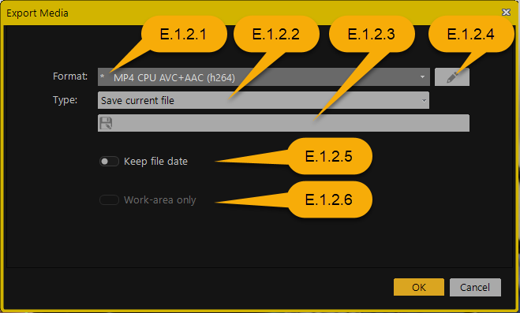

See also:
- [Export Media](#F.1.7)

#### *E.1.2.1* Format 
Select export video format. The formats marked with _*_ can be played on most devices without any problems.

#### *E.1.2.2* Type 
⌛ Under construction
#### *E.1.2.3* Target-Path 
⌛ Under construction
#### *E.1.2.4* Edit 
⌛ Under construction
#### *E.1.2.5* Keep file date 
⌛ Under construction
#### *E.1.2.6* Work-area only 
Only the work-area is exported when this option is enabled.

>  
>This option can only be selected if the work area has been activated.

##  *E.2* Mask Edit

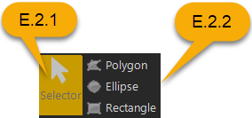

### *E.2.1* Selector 
Edit/Select Mask

### *E.2.2* Shapes 
Create a new mask in the selected shape.

##  *E.3* Layer

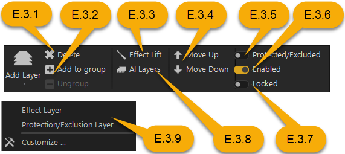

+ [*E.3.1* Delete-Layer](#E.3.1) 
+ [*E.3.2* Layer-Group](#E.3.2) 
+ [*E.3.3* Effect-Lift](#E.3.3) 
+ [*E.3.4* Layer-Order](#E.3.4) 
+ [*E.3.5* Exclude-Layer](#E.3.5) 
+ [*E.3.6* Enable-Layer](#E.3.6) 
+ [*E.3.7* Lock-Layer](#E.3.7) 
+ [*E.3.8* AI-Layer](#E.3.8) 
+ [*E.3.9* Add-Layer](#E.3.9) 

###  *E.3.1* Delete-Layer
Delete selected layers.

###  *E.3.2* Layer-Group

Several layers (*E.3.2.2*) can be grouped together to form a composite effect mask. Such a mask is used in effect rendering as one large mask with common properties. This is particularly useful for S3D videos or when the mosaic needs to look uniform throughout.    

> :exclamation: Once the layers are in a group, the Mosaic and S3D depth parameters can only be edited if the group header (*E.3.2.1*) is selected.

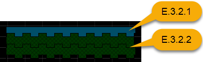

####  *E.3.2.3* Mosaic effect anchor point for spherical videos 

The first layer (*E.3.2.4*) in the group acts as an anchor, setting the direction of the mosaic effect. All other layers in the group are aligned in the same way, creating a large, uniform mask. 

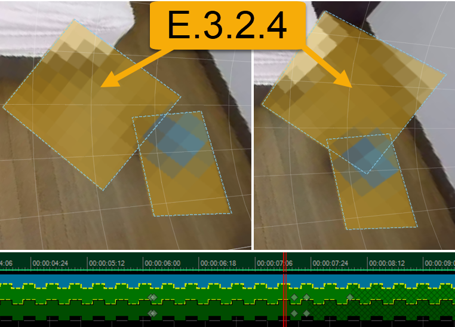

See also:
- [*B.1* Effect-Parameter](#B.1)
- [*C.3.5* Layer / Types](#C.3.5)
- [*B.3.1.1* Camera Type](#B.3.1.1)
- [*E.3.2* Layer-Group](#E.3.2)
- [*E.6.3* Zero Depth](#E.6.3)

###  *E.3.3* Effect-Lift

Allows you to change the keyframes of all effect parameters over a range of time on the Timeline. As opposed to setting parameter values, this increases or decreases the values by a selectable amount. The change can be a numeric value or a percentage.

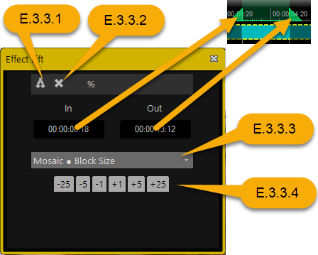

#### *E.3.3.1* Insert Keyframes 
Keyframes are inserted at the beginning (IN) and end (OUT) of the workspace for the selected parameter. This prevents changes from affecting anything beyond the boundaries of the workspace.

#### *E.3.3.2* Delete Keyframes 
Remove all keyframes associated with the selected parameter in the workspace between the IN and OUT points. 

#### *E.3.3.3* Parameters 
Select the parameter to edit.

#### *E.3.3.4* Amount 
Change the selected parameter by one value. The change value is applied to all existing keyframes in the workspace between IN and OUT.

###  *E.3.4* Layer-Order

See also: 
- [Layer order and protected mask](#workshop-layer-order)
- [Exclude-Layer](#E.3.5)

###  *E.3.5* Exclude-Layer

The mask defines the area in which the effect is to be rendered. An Exclude mask defines the area in which the effect will not be rendered. The vertical order in the timeline determines which mask is combined with which exclude mask.  

> 💡 The layer of an Exclude mask must be vertically on top in the Timeline, then the following mask layers cannot change the protected area.

- E.3.5.1 Normal  Mask -> Union 
- E.3.5.2 Exclude Mask -> Protect 

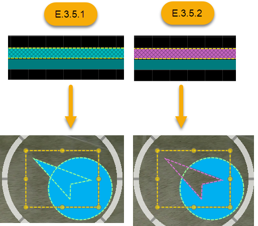

See also:
- [Layer order and protected mask](#workshop-layer-order)
- [Effect-Parameter](#B.1) 
- [Layer-Group](#E.3.2)

---

###  *E.3.6* Enable-Layer
Allow selected layers for effect rendering or exclude them from effect rendering.

###  *E.3.7* Lock-Layer
Protect selected layers from further modification.

###  *E.3.8* AI-Layer
⌛ Under construction

###  *E.3.9* Add Layer
Creates a new layer.
In the settings you can specify whether the new layer should be created over the entire workspace or from the current position of the time cursor.

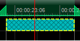
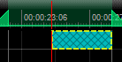

See also:
- [F.1.10.4.2 Project Settings: Layer](#F.1.10.4.2)

##  *E.4* Canvas View-Mode

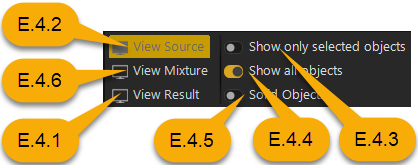

###  *E.4.1* View Result
Display the result of the effect rendering in the canvas.

###  *E.4.2* View Source
Do no effects rendering in the Canvas and display the source video.

###  *E.4.3* View Mixture
In the Canvas, display the effect rendering mixed with markers.

###  *E.4.4* Show only selected objects
Show editing markers only for the selected layers.

###  *E.4.5* Show all objects
Display the edit markers for all layers at all times.

###  *E.4.6* Solid objects
Display editing markers for the masks filled.

##  *E.5* Timeline View-Mode

View details of events on the timeline.

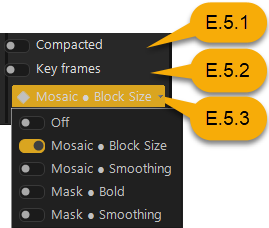

- [Compacted](#E.5.1)
- [Keyframes](#E.5.2)
- [Mosaic Keyframes](#E.5.3)

###  *E.5.1* Compacted

The Timeline can be displayed in a compact mode to make room for more layers.

Standard:  

Compact:  

See also:
- [C.3.4 Layer / Style](#C.3.4)

---

###  *E.5.2* Keyframes

View mask adjustments over time using symbols in the timeline.

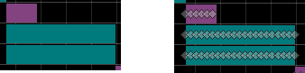

See also:
- [C.4 Keyframe](#C.4)

---

###  *E.5.3* Mosaic Keyframes

Indicates time-based changes to FX parameters, such as the mosaic, with superscript icons in the timeline.

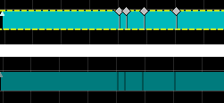

See also:
- [B.1 Effect-Parameter](#B.1)

##  *E.6* S3D-Video Options
These settings are displayed to a stereoscopic spherical video and allow to visualize and define the spatial depth.

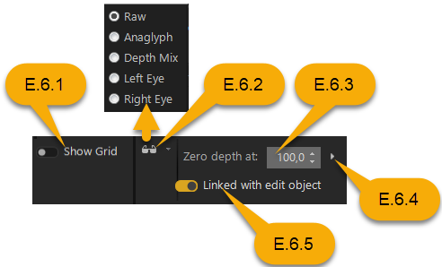

- [Show Grid](#E.6.1)
- [View Mode](#E.6.2)
- [Zero Depth](#E.6.3)
- [Set Object Depth](#E.6.4)
- [Link with edit Object](#E.6.5)

###  *E.6.1* Show Grid
A grid of latitude and longitude is displayed. This helps with orientation on the sphere, which is displayed according to the camera's optics.

###  *E.6.2* View Mode
Specifies how the video images for the left and right eyes are displayed. 

> 💡 __Depth-Mix__ mode is recommended for prolonged work.    
The Depth-Mix display mode makes it possible to see image shifts of objects at different spatial depths without anaglyph color glasses.

###  *E.6.3* Zero Depth
To effectively process stereoscopic video, the images for the left and right eyes are processed together. In the superimposed display, image offset only occurs when the object is not in the depth of the screen plane. This state is called __zero depth__. When processing the mask, the object should always be at this zero depth, since the mask is then optimally positioned for the left and right eyes.   

|Correct|Incorrect in Depth-Mix view |Incorrect in Anaglyph view|
|--|--|--|
|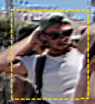|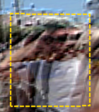|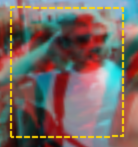|

###  *E.6.4* Set Object Depth
Applies the current zero depth value to the mask. 

###  *E.6.5* Link with edit Object
The zero depth display refers to the depth values of the selected mask. As you move along the timeline, the depth of the mask may change. 

> 💡 This is very helpful for immediately recognizing the correct spatial depth of the mask. Objects under the mask that do not conform to the depth values indicate an incorrectly selected depth.

See also:
- [How to create a mask on a S3D video](#workshop-s3d-mask)
- [*B.1.9* S3D Edit](#B.1.9)
- [*B.3.1.1* Camera Type](#B.3.1.1)
- [*E.3.2* Layer-Group](#E.3.2)

#  *F* Project

##  *F.1* Project Menu

- [New Project](#F.1.1)
- [Open Project](#F.1.2)
- [Append Project](#F.1.3)
- [Save Project](#F.1.4)
- [Save Project as](#F.1.5)
- [Import Media](#F.1.6)
- [Export Media](#F.1.7)
- [Create Team Project](#F.1.8)
- [Import Team Project](#F.1.9)
- [Project Settings](#F.1.10)

###  *F.1.1* New Project

Start a new project.

###  *F.1.2* Open Project

Open an existing project.

###  *F.1.3* Append Project

Add a project to an already loaded project

###  *F.1.4* Save Project
Save the project with the same filename.

###  *F.1.5* Save Project as
Save the project with a new file name.

###  *F.1.6* Import Media
See also:
- [E.1.1 Import Media-Files](#E.1.1)

###  *F.1.7* Export Media
See also:
- [E.1.2 Export Media-Files](#E.1.2)

###  *F.1.8* Create Team Project

__Use Custom Size__:   
Reduce the resolution to reduce file size.

__Encode profile__:  
Low: produces the smallest file size but takes longer to render.

__Project Folder__:  
Destination folder for all files. Media files will be placed in the Media subfolder.

__Project Name__:  
The name of the project file.  Usually the same as the project folder name.  

__OK button__:  
Starts the process. The button can only be clicked if 'Project Folder' and 'Project Name' are valid.

> :exclamation: The master project (the current project) is required for the later import (*F.1.9*) and merge process! 

###  *F.1.9* Import Team Project

Importing Team Project(s)

- First open the Master Project (the Team Project(s) were created by the Master Project).
- Click on the 'Import Team Project' menu item
- Select one or more Team Project files and press the 'Open' button.
- All new Team Layers will be added to the Master Project.

> :exclamation: Note:
> - New media bin clips will be ignored.
> - Any change to the order of the media bin clips will be ignored.
> - All layers that exist when the team project is created are set to protected mode and remain unchanged when the team projects are merged. Any edits made by the team members will be lost. 

###  *F.1.10* Project Settings

- [*F.1.10.1* Project](#F.1.10.1)
- [*F.1.10.2* User Interface](#F.1.10.2)
- [*F.1.10.3* Input Device](#F.1.10.3)
- [*F.1.10.4* Editing](#F.1.10.4)

####  *F.1.10.1* Project

__Save Interval__:
Specifies the frequency at which backups of the project are created. A backup can be used to restore project data after a crash or power failure.

__Create project backup files__:
Specifies whether copies of the project are also stored in a separate folder.

> :exclamation: It is very important to use unique project names. Saving project files with the same name can result in unwanted overwriting. 

__Time Code__:  
NTSC: "00:00:00;00" or "00:00:00:00"

####  *F.1.10.2* User Interface

__The mouse wheel moves the timecode forward__  
Defines in which direction the mouse wheel moves the time cursor.

__Media navigation using the numeric keypad__  
Specify whether to use the NumPad keys to navigate the Timeline. For example, to move the time cursor and jump to markers. Otherwise, the numbers are used as numeric characters. 

__Timeline with visualization of the time span__  
See [Time Cursor Style](#C.5.1)

####  *F.1.10.3* Input Device

#####  *F.1.10.3.1* Pedals
🔗 [More Details about Pedals](#devices-pedals)

#####  *F.1.10.3.2* MIDI
🔗 [More Details about MIDI](#devices-midi)

How to assign a command:
- Move a device slider or turn a device knob. This will select the device control for mapping.
- Select the command by clicking on the command name.
- Press the Set button or double-click the command name. This will bind the device control to the command.
>💡 First select an object and activate teach-in mode. Then open the settings panel. Now you can see if the assigned commands are working.

>:exclamation: Some commands only work when a special mode is activated. 
> For example, the object commands only work in teach-in mode or during object tracking.

####  *F.1.10.4* Editing

#####  *F.1.10.4.1* Object Tracker

__Grid size__:
Higher values are faster, but tracking may go wrong. Smaller values require more processing power and result in slower tracking.

Object motion __detection__:  
__Rotation__: detects object rotation  
__Zoom__: detects object zoom

#####  *F.1.10.4.2* Layer
__Create layer at cursor time__

See [E.3.9 Add Layer](#E.3.9)

##  *F.2* Undo/Redo

⌛ Under construction

#  *G* Tutorials / Info / Updates

##  *G.1* Tutorials
⌛ Under construction

---

##  *G.2* App-About

##  *G.2.1* Support Protocol
Logging problems and error messages in a log file can be very helpful in determining the cause and finding a solution. As a rule, this eliminates the need for technical queries about previous events. To enable support to work efficiently, it is advisable to send the protocol file with every support request.

> To prepare and submit the log file, please proceed as follows:
> - Click on the *G.2* menu with <kbd>SHIFT</kbd> and select the __"Support-Protocol"__ button.

> 💡 The log file does not contain any personal or confidential data. It is only used to analyze the problem and > improve our software. We thank you for your cooperation and understanding.

> :exclamation: If you have any questions or problems, please email customer support at [support@prodad.com](mailto:support@prodad.com) 

---

##  *G.3* User manual
Shows this document.

#  *H* Timeline Tools

⌛ Under construction

#  *J* Playback Control

+ [*J.1* Auto-Repeat](#J.1) 
+ [*J.2* Play/Stop](#J.2) 
+ [*J.3* Jump to Begin/End](#J.3) 
+ [*J.4* Playback-Speed](#J.4) 

##  *J.1* Auto-Repeat

Allows playback in a loop. When it reaches the end, it starts again from the beginning. This is useful if you want to watch a particular part of the video repeatedly.

##  *J.2* Play/Stop

Start or stop playback. Can also be controlled using the <kbd>SPACE</kbd> and <kbd>ENTER</kbd> keys. This function allows you to pause or resume the video at any time.

##  *J.3* Jump to Begin/End

Jump to the beginning/end of the workspace. Also controllable with the <kbd>HOME</kbd> and <kbd>END</kbd> keys. This function allows you to quickly jump to the beginning or end of the video.

##  *J.4* Playback-Speed

This function allows you to adjust the speed of the video. Click to increase the speed, <kbd>SHIFT</kbd> click to decrease the speed. <kbd>CTRL</kbd> click restores the default state.

# ⌨️  Keyboard Short-Cuts 

> - NP -> Numeric Pad - [*F.1.10.2*](#F.1.10.2) 
> - <kbd>SPACE</kbd> ; <kbd>ENTER</kbd> -> SPACE or ENTER 
> - <kbd>CTRL</kbd><kbd>SPACE</kbd> -> Hold CTRL and press SPACE

| Keys | Available | Description | See also
|:----|:----|:-------|---|
|<kbd>CTRL</kbd><kbd>C</kbd> ; <kbd>CTRL</kbd><kbd>X</kbd> <kbd>CTRL</kbd><kbd>V</kbd>| All | Clipboard |  |
|<kbd>CTRL</kbd><kbd>Z</kbd> ; <kbd>CTRL</kbd><kbd>Y</kbd>| All | Undo/Redo |  |
|<kbd>SPACE</kbd> ; <kbd>ENTER</kbd>| [*A*](#A) [*C*](#C) | Playback | [*J.2*](#J.2) |
|<kbd>CTRL</kbd><kbd>SPACE</kbd> ; <kbd>CTRL</kbd><kbd>ENTER</kbd>| ALL | Playback | [*J.2*](#J.2) |
|<kbd>NP-8</kbd> ; <kbd>NP-2</kbd>| ALL | Next Video |  |
|<kbd>HOME</kbd> ; <kbd>END</kbd> ; <kbd>NP-7</kbd> ; <kbd>NP-1</kbd> | [*A*](#A) [*C*](#C) | Jump to Begin/End | [*J.3*](#J.3) [*C.5*](#C.5) |
| <kbd>PAGE-UP</kbd> ; <kbd>PAGE-DOWN</kbd> ; <kbd>NP-9</kbd> ; <kbd>NP-3</kbd>| [*A*](#A) [*C*](#C) | Next Timeline Marker | [*C.5*](#C.5) |
|<kbd>SHIFT</kbd><kbd>CURSOR</kbd>| [*A*](#A) | Edit-Mask | [*A.2*](#A.2) [*A.3*](#A.3) |
|<kbd>SHIFT</kbd><kbd>CURSOR</kbd> ; <kbd>ESC</kbd>| [*A*](#A) | Tracking-Mask | [*A.4*](#A.4) [*A.5*](#A.5) |
|<kbd>B</kbd> ; <kbd>N</kbd> ; <kbd>NP-4</kbd> ; <kbd>NP-6</kbd> | [*A*](#A) [*C*](#C) | Next Frame | [*J.3*](#J.3) [*C.5*](#C.5) |
|<kbd>T</kbd>| [*A*](#A) | Start Tracking | [*A.4*](#A.4) |
|<kbd>H</kbd>| [*A*](#A) | Hide-Mask | [*A.6*](#A.6) |
|<kbd>+</kbd> ; <kbd>-</kbd>| [*A*](#A) | Increase/Decrease Mosaic size |  |
|<kbd>F</kbd>| [*A*](#A) | Hide Tracking-Marks | [Object Tracking](#workshop-tracking-object)  |
|<kbd>I</kbd> ; <kbd>O</kbd>| [*C*](#C) | Timeline IN/OUT | [*C.1*](#C.1)  |
|<kbd>UP</kbd> ; <kbd>DOWN</kbd>| [*C*](#C) | Select next/prev Layer | [*C.3.2*](#C.3.2)  |
|<kbd>SHIFT</kbd><kbd>UP</kbd> ; <kbd>SHIFT</kbd><kbd>DOWN</kbd>| [*C*](#C) | Add next/prev Layer to selection|  |
|<kbd>LEFT</kbd> ; <kbd>RIGHT</kbd>| [*C*](#C) | Forward/Backward Time-Cursor ||
|<kbd>CTRL</kbd><kbd>LEFT</kbd> ; <kbd>CTRL</kbd><kbd>RIGHT</kbd>| [*C*](#C) | Jump to start/end mark ||
|<kbd>CTRL</kbd> <kbd>0</kbd> ... <kbd>4</kbd>||Set Timeline Zoom |
|<kbd>DEL</kbd>| [*C*](#C) | Delete | [*C.3.1*](#C.3.1) [*C.4.1*](#C.4.1)  |
|<kbd>SHIFT</kbd><kbd>DEL</kbd>| [*C*](#C) | Delete all keyframes between time cursor and end mark | |
|<kbd>CTRL</kbd><kbd>A</kbd>| [*C*](#C) | Select All | |
|<kbd>CTRL</kbd><kbd>O</kbd>| | Open Project | |
|<kbd>CTRL</kbd><kbd>S</kbd>| | Save Project | |
|<kbd>CTRL</kbd><kbd>SHIFT</kbd><kbd>S</kbd>| | Save Project as | |
|<kbd>CTRL</kbd><kbd>SHIFT</kbd><kbd>I</kbd>| | Import video file(s) | |
|<kbd>CTRL</kbd><kbd>SHIFT</kbd><kbd>T</kbd>| | Activate Selector mask mode | |
|<kbd>CTRL</kbd><kbd>SHIFT</kbd><kbd>P</kbd>| | Activate Polygon mask mode | |
|<kbd>CTRL</kbd><kbd>SHIFT</kbd><kbd>E</kbd>| | Activate Ellipse mask mode | |
|<kbd>CTRL</kbd><kbd>SHIFT</kbd><kbd>R</kbd>| | Activate Rectangle mask mode | |
|<kbd>CTRL</kbd><kbd>SHIFT</kbd><kbd>L</kbd>| | Show Add-Layer menu | |
|<kbd>CTRL</kbd><kbd>SHIFT</kbd><kbd>G</kbd> ; <kbd>F5</kbd>| | Activate Source render mode | |
|<kbd>CTRL</kbd><kbd>SHIFT</kbd><kbd>F</kbd> ; <kbd>F6</kbd>| | Activate Result render mode | |
|<kbd>F7</kbd>| | Activate Mix render mode | |

#  Keyboard Super-Codes

Control of program functions through sequences of characters that can be programmed through input devices. 

> A supercode starts with <kbd>CTRL</kbd>+<kbd>TAB</kbd> or <kbd>CTRL</kbd>+<kbd>#</kbd>  
> In the table, the super code is shown as <kbd>CTRL#</kbd>  
> The first character after the supercode identifies the destination of the following characters. For example, <kbd>CTRL#</kbd><kbd>T</kbd> addresses the timeline for the following command.

> Triggering a super code is described here using <kbd>CTRL#</kbd><kbd>T</kbd><kbd>+</kbd>
> - Press and hold down the <kbd>CTRL</kbd> key
> - Press and release the <kbd>#</kbd> key
> - Press and release the <kbd>T</kbd> key
> - Press and release the <kbd>+</kbd> key
> - Release the <kbd>CTRL</kbd> key to exit the Super-Code mode  
  
---

Target as *Timeline* | <kbd>CTRL#</kbd><kbd>T</kbd> ...

| Keys | Description | See also |
|:----|:----|:-------|
|<kbd>CTRL#</kbd><kbd>T</kbd><kbd>+</kbd>|Zoom In||
|<kbd>CTRL#</kbd><kbd>T</kbd><kbd>-</kbd>|Zoom Out||
|<kbd>CTRL#</kbd><kbd>T</kbd><kbd>0</kbd> ... <kbd>4</kbd>|Set Zoom Measure ||
|<kbd>CTRL#</kbd><kbd>T</kbd><kbd>S</kbd>|Set Trim Start ||
|<kbd>CTRL#</kbd><kbd>T</kbd><kbd>E</kbd>|Set Trim End||
|<kbd>CTRL#</kbd><kbd>T</kbd><kbd>N</kbd>|Set Workspace Start||
|<kbd>CTRL#</kbd><kbd>T</kbd><kbd>M</kbd>|Set Workspace End||
|<kbd>CTRL#</kbd><kbd>T</kbd><kbd>I</kbd>|Set IN, depended on trim-mode||
|<kbd>CTRL#</kbd><kbd>T</kbd><kbd>O</kbd>|Set OUT, depended on trim-mode||
|<kbd>CTRL#</kbd><kbd>T</kbd><kbd>T</kbd>|Toggle trim-mode||
|<kbd>CTRL#</kbd><kbd>T</kbd><kbd>K</kbd>|Set Layer Start||
|<kbd>CTRL#</kbd><kbd>T</kbd><kbd>L</kbd>|Set Layer End||
|<kbd>CTRL#</kbd><kbd>T</kbd><kbd>RIGHT</kbd>|Next Frame||
|<kbd>CTRL#</kbd><kbd>T</kbd><kbd>LEFT</kbd>|Prev. Frame||
|<kbd>CTRL#</kbd><kbd>T</kbd><kbd>HOME</kbd>|Jump to Start||
|<kbd>CTRL#</kbd><kbd>T</kbd><kbd>END</kbd>|Jump to End||

---

Target as *Layer* | <kbd>CTRL#</kbd><kbd>L</kbd> ...

| Keys | Description | See also |
|:----|:----|:-------|
|<kbd>CTRL#</kbd><kbd>L</kbd><kbd>C</kbd>|Copy Layer to Clipboard||
|<kbd>CTRL#</kbd><kbd>L</kbd><kbd>X</kbd>|Cut Layer to Clipboard||
|<kbd>CTRL#</kbd><kbd>L</kbd><kbd>V</kbd>|Paste Layer from Clipboard||
|<kbd>CTRL#</kbd><kbd>L</kbd><kbd>E</kbd>|Add Standrad Layer||
|<kbd>CTRL#</kbd><kbd>L</kbd><kbd>P</kbd>|Add Protected/Exclude Layer||
|<kbd>CTRL#</kbd><kbd>L</kbd><kbd>DEL</kbd>|Delete selected Layer(s)||
|<kbd>CTRL#</kbd><kbd>L</kbd><kbd>DOWN</kbd>|Select next Layer||
|<kbd>CTRL#</kbd><kbd>L</kbd><kbd>UP</kbd>|Select prev. Layer||
|<kbd>CTRL#</kbd><kbd>L</kbd><kbd>U</kbd>|Move Layer Up||
|<kbd>CTRL#</kbd><kbd>L</kbd><kbd>D</kbd>|Move Layer Down||
|<kbd>CTRL#</kbd><kbd>L</kbd><kbd>J</kbd>|Delete all keyframes between time cursor and end mark ||
|<kbd>CTRL#</kbd><kbd>L</kbd><kbd>K</kbd>|Special-Clipboard Copy Layer||
|<kbd>CTRL#</kbd><kbd>L</kbd><kbd>F</kbd>|Special-Clipboard Paste Layer||
|<kbd>CTRL#</kbd><kbd>L</kbd><kbd>W</kbd>|Set workspace over all selected layers||
|<kbd>CTRL#</kbd><kbd>L</kbd><kbd>A</kbd>|Select all Layers|
|<kbd>CTRL#</kbd><kbd>L</kbd><kbd>G</kbd>|Group selected Layers||
|<kbd>CTRL#</kbd><kbd>L</kbd><kbd>R</kbd>|Un-group selected Layers||

---

Target as *Mode* | <kbd>CTRL#</kbd><kbd>M</kbd> ...

| Keys | Description | See also |
|:----|:----|:-------|
|<kbd>CTRL#</kbd><kbd>M</kbd><kbd>T</kbd>|Activate Selector/Pointer Mode|Ribbon|
|<kbd>CTRL#</kbd><kbd>M</kbd><kbd>P</kbd>|Activate polygon shape|Ribbon|
|<kbd>CTRL#</kbd><kbd>M</kbd><kbd>E</kbd>|Activate ellipse shape|Ribbon|
|<kbd>CTRL#</kbd><kbd>M</kbd><kbd>R</kbd>|Activate rectangle shape|Ribbon|
|<kbd>CTRL#</kbd><kbd>M</kbd><kbd>V</kbd>|Activate Teach-In Mode||

---

Target as *Object-Tracker* | <kbd>CTRL#</kbd><kbd>K</kbd> ...

| Keys | Description | See also |
|:----|:----|:-------|
|<kbd>CTRL#</kbd><kbd>K</kbd><kbd>R</kbd>|Toggle (start/end) Object-Tracking||
|<kbd>CTRL#</kbd><kbd>K</kbd><kbd>DOWN</kbd>|Moves the tracker one frame forward||
|<kbd>CTRL#</kbd><kbd>K</kbd><kbd>UP</kbd>|Moves the tracker one frame backward||
|<kbd>CTRL#</kbd><kbd>K</kbd><kbd>HOME</kbd>|Run the tracker all frames to the start mark ||
|<kbd>CTRL#</kbd><kbd>K</kbd><kbd>END</kbd>|Run the tracker all frames to the end mark||

---

Target as *Window* | <kbd>CTRL#</kbd><kbd>W</kbd> ...

| Keys | Description | See also |
|:----|:----|:-------|
|<kbd>CTRL#</kbd><kbd>W</kbd><kbd>C</kbd>|Activate Canvas Window||
|<kbd>CTRL#</kbd><kbd>W</kbd><kbd>T</kbd>|Activate Timeline Window||

---

Target as *Canvas* | <kbd>CTRL#</kbd><kbd>C</kbd> ...

| Keys | Description | See also |
|:----|:----|:-------|
|<kbd>CTRL#</kbd><kbd>C</kbd><kbd>LEFT</kbd>|Scroll left||
|<kbd>CTRL#</kbd><kbd>C</kbd><kbd>RIGHT</kbd>|Scroll right||
|<kbd>CTRL#</kbd><kbd>C</kbd><kbd>UP</kbd>|Scroll up||
|<kbd>CTRL#</kbd><kbd>C</kbd><kbd>DOWN</kbd>|Scroll down||
|<kbd>CTRL#</kbd><kbd>C</kbd><kbd>PAGE-UP</kbd>|Zoom In||
|<kbd>CTRL#</kbd><kbd>C</kbd><kbd>PAGE-DOWN</kbd>|Zoom Out||
|<kbd>CTRL#</kbd><kbd>C</kbd><kbd>L</kbd>|Activate S3D Left-Eye view mode||
|<kbd>CTRL#</kbd><kbd>C</kbd><kbd>R</kbd>|Activate S3D Right-Eye view mode||
|<kbd>CTRL#</kbd><kbd>C</kbd><kbd>A</kbd>|Activate S3D Anaglyph view mode||
|<kbd>CTRL#</kbd><kbd>C</kbd><kbd>D</kbd>|Activate S3D Depth-Mix view mode||
|<kbd>CTRL#</kbd><kbd>C</kbd><kbd>N</kbd>|Increase displayed S3D-Depth | [*E.6.3* Zero Depth](#E.6.3) |
|<kbd>CTRL#</kbd><kbd>C</kbd><kbd>M</kbd>|Decrease displayed S3D-Depth | [*E.6.3* Zero Depth](#E.6.3) |

See also:
- [Extra Keyboard](#devices-keyboard)

#  Devices

+ [Pedals](#devices-pedals)
+ [MIDI](#devices-midi)
+ [Keyboard](#devices-keyboard)

---
##  Pedals
Pedals allow you to move through the video. This allows precise positioning of the video frame and playback in both directions at any speed. Similar to the accelerator in a car. Pedals are recommended for professional use.

  
--- https://www.chproducts.com/Pro-Pedals-v13-d-716.html --- 

>Using the foot pedals to navigate through the video allows precise control of playback speed and frame-accurate positioning both forward and backward. The hands can be used simultaneously to perform other functions, such as adjusting the mask size. This method of operation is more intuitive and efficient, resulting in faster processing. Another advantage is that the focus can remain on the video, as there is no need to constantly look at the keyboard.
>
>Using pedals as input devices makes it easier to navigate through the video. The pedal allows precise control of playback speed as you move forward or backward through the footage. This allows for precise control and positioning at specific points in the video.
>
>By controlling other functions at the same time, such as adjusting the size of the mask, you can increase the efficiency of your editing. You can focus on the video instead of constantly switching between input devices.

> 💡 Overall, this way of working allows for faster editing by keeping the focus on the video, more intuitive operation, and precise control over the various functions.

> :exclamation: All DirectX-compatible game pedals are supported.

See also:
- [*F.1.10.3.1* Pedals Settings](#F.1.10.3.1)
- [*D.1* Input Device View](#D.1)

##  MIDI ##
MIDI devices with sliders and knobs can be used to make it easier to set values such as mask size and mosaic size. This can significantly increase the speed of your work. MIDI devices are highly recommended for professional use.  

  
-- Behringer BCF2000 B-Control Fader --

> Such input devices are particularly useful for adjustments during object tracking and for subsequent changes. These include
>
> + Mask Size: Sliders or knobs can be used to intuitively adjust the size of the mask.
> + Mosaic grid: Use sliders and knobs to easily and efficiently change the properties of the mosaic grid.
> + 3D video depth: Use input devices to easily adjust the spatial depth of S3D videos to achieve the desired visual effect.
> + Zoom: Input devices allow precise adjustment of the zoom value for specific areas of the video for optimal adjustment and control.
Using sliders and knobs instead of clicks provides a more intuitive way to adjust values. This results in more efficient editing that allows for faster progress.

> 💡 The combination of these features and input devices gives you an easy-to-use and powerful editing environment that lets you make precise adjustments and edit efficiently.

See also:
- [*F.1.10.3.2* MIDI Settings](#F.1.10.3.2)

##  Keyboard
Programmable keyboards can be used to simplify the way functions are triggered. Many commands can be programmed for different functions, which can then be triggered with just one key.
Such keyboards are highly recommended for professional use.

   
--- https://gaming.logitech.com/en-us/gaming-keyboards --- 

See also:
- [Keyboard Super-Codes](#super-short-cuts)

---

### Logitech G13 Short-Cuts

The included commands allow you to customize the preset keys. You can select a specific command from a list of commands and assign it to a key. [See Commands](#super-short-cuts)

> 💡 The import of the XML file will make the commands available.   
> **"C:\Program Files\proDAD\ ... \Resources\LogitechKeyboardDefinition.xml"**
 

##  Change Log

#### 2.0.202 (2023-06-05)
- Bugfix *E.1.2.6*
- Bugfix *E.1.10.4.2*
- A new function allows you to move the timecode of the video. This option was already available in version 1.5. You can set it in the video properties.
- A video file must be indexed before it can be loaded. For intra-frame video (Canopus-Codec, Apple ProRes) this process is now much faster. 
- Network export performance has been improved and network export speed has been increased.
 

