<!-- title: Disguise (Phantom) -->
<!-- author: Holger Burkarth -->
<!-- version: 2.0.212 -->
<!-- date: 2024-03-27 -->

<!-- 
Ignore Spelling: proDAD Immendingen Gauertstr Holger Burkarth lightgray changelog mediabin quickstart ui fx blocksize 
Ignore Spelling: rangemode timline simp del Un viewmode subfolder timecode supercode Behringer kbd 
Ignore Spelling: pixelating pixelation editmode S3D NTSC XML NLE HQ HQX Canvas Inspektor Keyframe Zeitleiste Menüband Verpixelung Mosaik Effektlift Exclude Nulltiefe Parallaxe Arbeitsbereich Sub timeline Teach In Shortcut Nummernblock Kontextvariable
-->

# *p*  proDAD Disguise 2.0

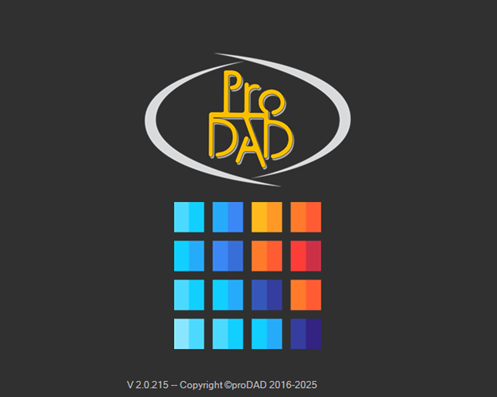

Die Software Disguise 2.0 ist eine leistungsstarke Anwendung, die speziell für die Verpixelung von Bildinhalten in Videos entwickelt wurde. Der daraus resultierende Effekt wird als Mosaik bezeichnet und eignet sich hervorragend zum Verbergen sensibler oder vertraulicher Informationen in Videos.

Die besondere Stärke von Disguise liegt in seiner effektiven und zeitsparenden Fähigkeit, auch sehr lange Videos mit komplexen Konstellationen einfach zu bearbeiten. Egal, ob Sie Einzelpersonen, bestimmte Objekte oder Text verpixeln möchten, Disguise ermöglicht Ihnen dies mit Präzision und Professionalität.

Eine herausragende Funktion der Software ist die Möglichkeit, zusätzliche Hardware wie Pedale zu verwenden, um die Bedienung noch einfacher und intuitiver zu gestalten. Dies ermöglicht es Benutzern, ihren Video-Workflow zu vereinfachen und gleichzeitig die Produktivität zu steigern.

Disguise 1.0 hat sich bereits einen hervorragenden Ruf erworben und wird von vielen professionellen Studios erfolgreich eingesetzt. Mit der neuen Version 2.0 wurden die Funktionen weiter verbessert und erweitert, um den gestiegenen Anforderungen der Benutzer gerecht zu werden.

Egal, ob Sie ein professioneller Videoeditor, ein Content Creator oder ein Unternehmen sind, das sensible Daten schützen muss, Disguise 2.0 bietet Ihnen die Werkzeuge und die Effizienz, um Ihre Videos schnell und präzise zu verpixeln. Mit dieser Software können Sie sicherstellen, dass vertrauliche Informationen geschützt bleiben, während Sie Ihre Arbeit effizient erledigen.

> Diese Dokumentation wurde von Holger Burkarth verfasst. Die Übersetzungen wurden von technischen Übersetzern durchgeführt.

## *p.1.1*  Inhaltsverzeichnis
- [*p* proDAD Disguise 2.0](#Root)
  - [*p.1.1* Inhaltsverzeichnis](#table-of-content)
  - [*p.1.2* Neue Funktionen in Disguise 2.0 (Phantom)](#new-features)
  - [*p.1.3* Lizenzmodelle](#licensing-models)
  - [*p.1.4* Systemanforderungen](#system-requirements)
  - [*p.1.5* Änderungsprotokoll](#changelog)
  - [*p.1.6* Über proDAD](#prodad)
  - [*p.1.7* Kontakt](#contact)
  - [*p.1.8* Copyright](#copyright)
- [*p.2* Haupt-Benutzeroberfläche (UI)](#MainUI)
- [*W* Workshops](#workshops)
  - [*W.1* Schnellstart](#workshop-quick-start) 
  - [*W.2* Ebenenreihenfolge und Schutzmaske](#workshop-layer-order)
  - [*W.3* Objektverfolgung (Tracking)](#workshop-tracking-object)
  - [*W.4* Erstellen einer Maske in einem S3D-Video](#workshop-s3d-mask) 
- [*A* Canvas (Arbeitsfläche)](#A)
  - [*A.1* Effektmaske](#A.1)
  - [*A.2* Bearbeitungsgriffe](#A.2)
  - [*A.3* Rotation](#A.3)
  - [*A.4* Tracking starten (Automatisch/Halbautomatisch)](#A.4)
  - [*A.5* Teach-In starten (Manuelles Tracking)](#A.5)
  - [*A.6* Maske ausblenden/einblenden (Effekt an/aus)](#A.6)
- [*B* Inspektor](#B)
  - [*B.1* Effektparameter](#B.1)
    - [*B.1.1* Parameter-Keyframes](#B.1.1)
    - [*B.1.2* Zurücksetzen](#B.1.2)
    - [*B.1.3* Proportional](#B.1.3)
    - [*B.1.4* Sichtbar](#B.1.4)
    - [*B.1.5* Mosaik-Blockgröße](#B.1.5)
    - [*B.1.6* Mosaik-Glättung](#B.1.6)
    - [*B.1.7* Maskenkontur (Stärke)](#B.1.7)
    - [*B.1.8* Maskenglättung (Weichzeichnen)](#B.1.8)
    - [*B.1.9* S3D-Tiefe](#B.1.9)
    - [*B.1.10* Füllfarbe + Kontur](#B.1.10)
  - [*B.2* Informationen](#B.2)
  - [*B.3* Medienablage (Media Bin)](#B.3)
    - [*B.3.1* Medieneigenschaften](#B.3.1)
        - [*B.3.1.1* Kameratyp](#B.3.1.1)
        - [*B.3.1.2* Frame-Packing (Bildanordnung)](#B.3.1.2)
        - [*B.3.1.3* Augenabstand (Interpupillardistanz)](#B.3.1.3)
    - [*B.3.2* Medium duplizieren](#B.3.2)
    - [*B.3.3* Medium entfernen](#B.3.3)
  - [*B.4* Ausgabemedium](#B.4)
- [*C* Zeitleiste (Timeline)](#C)
  - [*C.1* Zeitleistenbereich](#C.1)
    - [*C.1.1* Zeitleistenbereich / Modus](#C.1.1)
    - [*C.1.2* Zeitleistenbereich / Auswahl](#C.1.2)
  - [*C.2* Lineal](#C.2)
  - [*C.3* Ebene (Layer)](#C.3)
    - [*C.3.1* Ebene / Anzeige und Bearbeitung](#C.3.1)
    - [*C.3.2* Ebene / Auswahl](#C.3.2)
    - [*C.3.3* Ebene / Navigation](#C.3.3)
    - [*C.3.4* Ebene / Stil](#C.3.4)
    - [*C.3.5* Ebene / Typen](#C.3.5)
  - [*C.4* Keyframe](#C.4)
    - [*C.4.1* Keyframe / Bearbeitung](#C.4.1)
    - [*C.4.2* Keyframe / Auswahl](#C.4.2)
    - [*C.4.3* Keyframe / Navigation](#C.4.3)
  - [*C.5* Zeitcursor (Abspielkopf)](#C.5)
    - [*C.5.1* Stil](#C.5.1)
  - [*C.6* Zeitleistentitel (Zeitanzeige)](#C.6)
  - [*C.7* Einrasten Ein/Aus](#C.7)
  - [*C.8* Zeitleisten-Zoom](#C.8)
  - [*C.9* Zeitleisten-Scrollleiste](#C.9)
  - [*C.10* Zeitleisten-Kontextmenü](#C.10) 
      - [*C.10.1* Ausschneiden, Kopieren, Einfügen](#C.10.1)
      - [*C.10.2* Attribute kopieren, Attribute einfügen](#C.10.2)
      - [*C.10.3* Löschen](#C.10.3)
      - [*C.10.4* Keyframes bis Endposition löschen](#C.10.4)
      - [*C.10.5* Arbeitsbereich auf Ebene(n) setzen](#C.10.5)
      - [*C.10.6* Gruppieren, Gruppierung aufheben](#C.10.6)
      - [*C.10.8* Sub-Timeline bis Zeitcursor erstellen](#C.10.8)
      - [*C.10.9* Sub-Timeline am Zeitcursor teilen](#C.10.9)
      - [*C.10.10* Neue Sub-Timeline für ausgewählte Ebene(n)](#C.10.10)
      - [*C.10.11* Zeitbereich in separate Sub-Timeline aufteilen](#C.10.11)
      - [*C.10.12* Zeitleiste komprimieren](#C.10.12)
      - [*C.10.13* Alles auswählen](#C.10.13)
      - [*C.10.14* Gehe zu Ebene](#C.10.14)
- [*D* Optionale Ansichten](#D)
    - [*D.1* Eingabegerät](#D.1)
    - [*D.2* Presets (Voreinstellungen)](#D.2)
    - [*D.3* Zeitleisten (Sub-Timeline Verwaltung)](#D.3)
    - [*D.4* ToDo-Marker](#D.4)
    - [*D.5* Medienablage (Media Bin)](#D.5)
    - [*D.6* Ebenen (Listenansicht)](#D.6)
    - [*D.7* Objekt-Viewer](#D.7)
    - [*D.8* Undo-Protokoll (Bearbeitungsverlauf)](#D.8)
    - [*D.9* Verarbeitungsereignisse](#D.9)
- [*E* Menüband (Ribbon)](#E)
  - [*E.1* Mediendateien Import/Export](#E.1)
    - [*E.1.1* Mediendateien importieren](#E.1.1)
    - [*E.1.2* Mediendateien exportieren](#E.1.2)
  - [*E.2* Maskenbearbeitung](#E.2)
  - [*E.3* Ebene](#E.3)
    - [*E.3.1* Ebene löschen](#E.3.1)
    - [*E.3.2* Ebenengruppe](#E.3.2)
      - [*E.3.2.3* Mosaikeffekt-Ankerpunkt für sphärische Videos](#E.3.2.3)
    - [*E.3.3* Effekt-Lift (Parameteranpassung)](#E.3.3)
    - [*E.3.4* Ebenenreihenfolge](#E.3.4)
    - [*E.3.5* Ausschluss-Ebene (Schutzmaske)](#E.3.5)
    - [*E.3.6* Ebene aktivieren/deaktivieren](#E.3.6)
    - [*E.3.7* Ebene sperren/entsperren](#E.3.7)
    - [*E.3.8* AI-Ebene](#E.3.8)
    - [*E.3.9* Ebene hinzufügen](#E.3.9)
  - [*E.4* Canvas-Ansichtsmodus](#E.4)
    - [*E.4.1* Ergebnis anzeigen](#E.4.1)
    - [*E.4.2* Quelle anzeigen](#E.4.2)
    - [*E.4.3* Mischansicht anzeigen](#E.4.3)
    - [*E.4.4* Nur ausgewählte Objekte anzeigen](#E.4.4)
    - [*E.4.5* Alle Objekte anzeigen](#E.4.5)
    - [*E.4.6* Solide Objekte (Gefüllt anzeigen)](#E.4.6)
  - [*E.5* Zeitleisten-Ansichtsmodus](#E.5)
    - [*E.5.1* Komprimierte Ansicht](#E.5.1)
    - [*E.5.2* Keyframes anzeigen (Transformation)](#E.5.2)
    - [*E.5.3* Keyframes anzeigen (Effektparameter)](#E.5.3)
  - [*E.6* S3D-Video Optionen](#E.6)
    - [*E.6.1* Gitter anzeigen](#E.6.1)
    - [*E.6.2* Ansichtsmodus](#E.6.2)
    - [*E.6.3* Nulltiefe (Zero Depth)](#E.6.3)
    - [*E.6.4* Objekttiefe setzen](#E.6.4)
    - [*E.6.5* Mit Bearbeitungsobjekt verknüpfen](#E.6.5)
- [*F* Projekt](#F)
  - [*F.1* Projektmenü](#F.1)
    - [*F.1.1* Neues Projekt](#F.1.1)
    - [*F.1.2* Projekt öffnen](#F.1.2)
    - [*F.1.3* Projekt anhängen (Zusammenführen)](#F.1.3)
    - [*F.1.4* Projekt speichern](#F.1.4)
    - [*F.1.5* Projekt speichern unter](#F.1.5)
    - [*F.1.6* Medien importieren](#F.1.6)
    - [*F.1.7* Medien exportieren](#F.1.7)
    - [*F.1.8* Team-Projekt erstellen](#F.1.8)
    - [*F.1.9* Team-Projekt importieren (Integrieren)](#F.1.9)
    - [*F.1.10* Projekteinstellungen](#F.1.10)
      - [*F.1.10.1* Projekt](#F.1.10.1)
      - [*F.1.10.2* Benutzeroberfläche](#F.1.10.2)
      - [*F.1.10.3* Eingabegerät](#F.1.10.3)
        - [*F.1.10.3.1* Pedale](#F.1.10.3.1)
        - [*F.1.10.3.2* MIDI](#F.1.10.3.2)
      - [*F.1.10.4* Bearbeitung](#F.1.10.4)
        - [*F.1.10.4.1* Objekt-Tracker](#F.1.10.4.1)
        - [*F.1.10.4.2* Ebene](#F.1.10.4.2)
  - [*F.2* Rückgängig/Wiederherstellen](#F.2)
- [*G* Tutorials / Info / Updates](#G)
- [*H* Zeitleisten-Werkzeuge](#H)
- [*J* Wiedergabesteuerung](#J)
  - [*J.1* Automatische Wiederholung (Loop)](#J.1)
  - [*J.2* Wiedergabe/Stopp](#J.2)
  - [*J.3* Zum Anfang/Ende springen (In/Out-Punkt)](#J.3)
  - [*J.4* Wiedergabegeschwindigkeit](#J.4)
- [*p.3.1* Tastenkürzel (Shortcuts)](#short-cuts)
- [*p.3.2* Tastatur-Supercodes](#super-short-cuts)
- [*p.3.3* Geräte](#devices)
  - [*p.3.3.1* Pedale](#devices-pedals)
  - [*p.3.3.2* MIDI](#devices-midi)
  - [*p.3.3.3* Tastatur](#devices-keyboard)
    - [*p.3.3.3.1* Logitech G13 Shortcuts](#devices-Logitech-g13)

## *p.1.2*  Neue Funktionen in Disguise 2.0 (Phantom)

> Siehe auch [*p.1.5* Änderungsprotokoll](#changelog)

Die Disguise Version 2.0 bietet eine Reihe neuer Funktionen, die die Benutzerfreundlichkeit und Effizienz weiter verbessern. Hier ist ein Überblick über die wichtigsten Neuerungen:

- **Rückgängig/Wiederherstellen und Bearbeitungsverlauf**: Die Software ermöglicht es Benutzern nun, Bearbeitungsschritte rückgängig zu machen und wiederherzustellen, mit der Option, ein Protokoll (Verlauf) anzuzeigen. Dies gibt Benutzern die volle Kontrolle über ihre Änderungen und erleichtert deren Nachverfolgung.

- **Vereinheitlichte Objektverfolgung (Tracking)**: Die Verfolgung von Objekten mit Masken wurde vereinheitlicht. Sowohl der automatische Objekt-Tracker als auch das manuelle Tracking per Maus können nun auf die gleiche Weise verwendet werden. Verschiedene Eingabemethoden wie [Pedale](#devices-pedals), Tastatur oder Videowiedergabesteuerung können genutzt werden. Im Tracker-Modus stehen die gleichen Anpassungsoptionen zur Verfügung.

- **Schnellere Objektverfolgung**: Die Objektverfolgung und das manuelle Tracking sind nun schneller, insbesondere bei langen Videos/Zeitleisten. Dies macht die Bearbeitung großer Projekte effizienter.

- **Verbesserte Keyframe-Handhabung**: Sowohl bei der Objektverfolgung als auch beim manuellen Tracking werden unnötige Keyframes vermieden. Dies führt zu schnellerem Laden und Speichern von Projektdateien.

- **Keyframe-Anzeige in der Zeitleiste**: Keyframes für ausgewählte Effektparameter (z.B. Mosaik) können nun in der Zeitleiste angezeigt werden. Dies ermöglicht eine präzise Steuerung und Anpassung von Effekten an verschiedenen Stellen im Video.

- **Überarbeiteter Videoexport**: Der Videoexport wurde komplett überarbeitet, um neue Formate und Hardwarebeschleunigung (falls unterstützt) zu unterstützen. Die Berechnungsgeschwindigkeit wurde erheblich gesteigert, sodass Benutzer Videos schneller exportieren können.

- **Einfacheres Ein-/Ausblenden von UI-Elementen**: Das Ein- und Ausblenden von Elementen der Benutzeroberfläche ist jetzt einfacher und kann an individuelle Benutzerbedürfnisse angepasst werden.

- **Bessere Unterstützung für Monitorauflösungen**: Die Benutzeroberfläche passt sich besser an die Auflösung verschiedener Monitore an, um eine optimale Darstellung zu gewährleisten.

- **Verbessertes Erscheinungsbild der Benutzeroberfläche**: Die Benutzeroberfläche wurde visuell überarbeitet, um ein modernes und ansprechendes Erscheinungsbild zu bieten.

- **Verbesserte Leistung**: Viele Funktionen der Software laufen schneller als in der Vorgängerversion. Die allgemeine Reaktionsfähigkeit der Software wurde erhöht, um ein flüssigeres und effizienteres Arbeiten zu ermöglichen.

Mit all diesen neuen Funktionen bietet Disguise 2.0 eine verbesserte Benutzererfahrung, schnellere Bearbeitungszeiten und mehr Kontrolle über die Verpixelung von Bildinhalten in Videos.

> :bulb: Die Kompatibilität mit den Vorgängerversionen Phantom 1.0 und 1.5 wurde beibehalten. Projekte aus diesen Versionen können geladen werden, und die Bedienung ist weitgehend identisch. Dies ermöglicht einen sofortigen Umstieg auf die neue Version ohne nennenswerte Einarbeitungszeit.

> :exclamation: Projekte aus den Versionen Phantom 1.0 und 1.5 können geöffnet werden. Sie werden automatisch in das Format der Version 2.0 konvertiert und sollten mit der neuen Erweiterung ".phantom" gespeichert werden. Eine mit Version 2.0 gespeicherte Projektdatei kann jedoch nicht mit Version 1.5 oder 1.0 geöffnet werden.

## *p.1.3*  Lizenzmodelle
Funktionen werden durch verschiedene Lizenzmodelle gesteuert. Die folgende Tabelle vergleicht die Funktionen und die erforderlichen Lizenzen. Jede höhere Lizenzstufe beinhaltet die Funktionen der vorherigen Stufe und fügt neue Funktionen hinzu. Die höchste Lizenz beinhaltet alle verfügbaren Funktionen.

| Funktion | Limited | Standard | Extended | Mehr |
|---|---|---|---|---|
|Projektdateien | *[x]* | *[x]* | *[x]* |  |
|Unbegrenzte Videos | *[x]* | *[x]* | *[x]* |  |
|Ergebnisvideo exportieren | *[x]* | *[x]* | *[x]* |  |
|Objekt-Tracker | *[x]* | *[x]* | *[x]* | [Objektverfolgung (Tracking)](#workshop-tracking-object) |
|FX-Presets (Voreinstellungen) |   | *[x]* | *[x]* | [Presets (Voreinstellungen)](#D.2) |
|Effekt-Lift |   | *[x]* | *[x]* | [Effekt-Lift (Parameteranpassung)](#E.3.3) |
|Pedal-Gerät |   | *[x]* | *[x]* | [Pedale](#devices-pedals) |
|MIDI-Gerät |   | *[x]* | *[x]* | [MIDI](#devices-midi) |
|Zusatztastatur |   | *[x]* | *[x]* | [Tastatur](#devices-keyboard) |
|S3D-Video |   |   | *[x]* | [Kameratyp](#B.3.1.1) | 
|Sub-Timelines (Unter-Zeitleisten) |   |   | *[x]* | [Zeitleisten (Sub-Timeline Verwaltung)](#D.3) |
|Objekt-Viewer |   |   | *[x]* | [Objekt-Viewer](#D.7) |
|Ebenenansicht |   |   | *[x]* | [Ebenen (Listenansicht)](#D.6) |
|TODO-Liste |   |   | *[x]* | [ToDo-Marker](#D.4) |
|Undo-Protokoll (Verlauf) |   |   | *[x]* | [Undo-Protokoll (Bearbeitungsverlauf)](#D.8) |
|Team-Projekte erstellen |   |   | *[x]* | [Team-Projekt erstellen](#F.1.8) |
|Team-Projekte importieren |   |   | *[x]* | [Team-Projekt importieren (Integrieren)](#F.1.9) |

## *p.1.4*  Systemanforderungen
- 64-Bit Windows 7, 8, 10 oder 11
- Mindestens 8 GB RAM, 16 GB RAM empfohlen

## *p.1.5*  Änderungsprotokoll

#### 2.0.212 (2024-03-26)
- Behoben: Problem mit der Videoverschlüsselung. Die Verschlüsselung wurde beim Erstellen von Team-Projekten und in den Videoeigenschaften fälschlicherweise angewendet und war daher nicht nutzbar.

#### 2.0.211 (2024-03-13)
- Behoben: Die Pedalsteuerung konnte unerwünschte Bewegungen in der Zeitleiste verursachen, wenn zwischen angedocktem/abgedocktem Canvas- und Zeitleistenfenster gewechselt wurde.

#### 2.0.209 (2023-12-09)
- Verbessert: Deutlich schnellere erstmalige Lade-/Indexierungszeiten für große Videodateien, insbesondere über Netzwerke oder von langsameren Speichergeräten. Erfordert geeignete Containerformate (z.B. AVI, MP4, MOV) mit Keyframe-Informationen.

#### 2.0.208 (2023-12-04)
- Behoben: Ein Problem, bei dem das Tracking in einen unklaren Zustand geraten und dann für ca. 10 Sekunden nicht mehr reagieren konnte, was die Weiterarbeit erschwerte.
- Behoben: Das Abbrechen des Trackings mit der <kbd>ESC</kbd>-Taste hat nicht immer alle während dieser Tracking-Sitzung vorgenommenen Änderungen korrekt zurückgesetzt.
- Verbessert: Erhöhte Geschwindigkeit beim Laden und Speichern von Projektdaten, besonders spürbar bei sehr großen Projekten mit vielen Keyframes.
- Hinzugefügt: Pedale und MIDI-Geräte können nun auch im Test-/Tryout-Modus vor der Aktivierung getestet werden.

#### 2.0.202 (2023-06-05)
- Fehlerbehebung: Fehler im Zusammenhang mit der Exportoption "Nur Arbeitsbereich" ([*E.1.2.6*](#E.1.2.6)).
- Fehlerbehebung: Fehler im Zusammenhang mit der Einstellung "Ebene an Cursorposition erstellen" ([*F.1.10.4.2*](#F.1.10.4.2)).
- Hinzugefügt: Option zum Verschieben des Timecodes eines Videoclips (wiederhergestellt aus V1.5). Zugänglich in den Videoeigenschaften ([*B.3.1*](#B.3.1)).
- Verbessert: Schnellerer Indexierungsprozess für Intra-Frame-Video-Codecs (z.B. Canopus HQ/HQX, Apple ProRes).
- Verbessert: Leistung und Geschwindigkeit beim Exportieren von Videodateien über eine Netzwerkverbindung.

## *p.1.6*  Über proDAD

proDAD ist ein renommiertes Unternehmen, das sich auf die Entwicklung und den Vertrieb hochwertiger Video- und Bildbearbeitungssoftware spezialisiert hat. Seit seiner Gründung im Jahr 1990 hat sich proDAD als führender Anbieter innovativer Lösungen für die professionelle Videobearbeitung etabliert.

Das Unternehmen proDAD zeichnet sich durch eine ausgeprägte Expertise in den Bereichen digitale Bild- und Videotechnik sowie Softwareentwicklung aus. Mit einem engagierten Team erfahrener Entwickler und Designer arbeitet das Unternehmen kontinuierlich an der Entwicklung fortschrittlicher Lösungen, die den Bedürfnissen professioneller Anwender gerecht werden.

Die Softwareprodukte von proDAD bieten eine breite Palette an Funktionen und Werkzeugen zur Optimierung, Bearbeitung und Verbesserung von Videos und Bildern. Die Lösungen zeichnen sich durch eine intuitive Benutzeroberfläche, hohe Leistungsfähigkeit und exzellente Qualität aus. Sie eignen sich sowohl für Einsteiger als auch für erfahrene Profis und bieten eine Vielzahl von Effekten, Filtern, Stabilisierungstechniken und anderen Werkzeugen zur Verbesserung der visuellen Qualität von Medieninhalten.

Ein Hauptaugenmerk von proDAD liegt auf der Videostabilisierung. Das Unternehmen hat mehrere patentierte Techniken entwickelt, um Verwacklungen und Jitter in Videos effektiv zu reduzieren und eine konsistente, professionelle Bildstabilisierung zu erreichen. Diese Technologie wird von vielen Profis in der Filmindustrie, bei Fernsehproduktionen und Sportaufnahmen eingesetzt.

proDAD ist bekannt für seine enge Zusammenarbeit mit führenden Herstellern von Videoschnittsoftware. Die Produkte des Unternehmens werden als eigenständige Softwarelösungen angeboten, können aber auch nahtlos in bestehende Videoschnittprogramme integriert werden. Dadurch profitieren Anwender von erweiterten Funktionen und Möglichkeiten, um ihre Videoprojekte auf professionellem Niveau zu gestalten.

Mit jahrelanger Erfahrung, technischer Innovation und einem starken Fokus auf Kundenzufriedenheit hat sich proDAD als vertrauenswürdiger Partner in der Videobearbeitungsbranche etabliert. Die Softwarelösungen des Unternehmens werden von professionellen Videoeditoren, Filmemachern, YouTubern und anderen Kreativen weltweit eingesetzt, um beeindruckende visuelle Inhalte zu produzieren.

## *p.1.7*  Kontaktieren Sie uns

Wir bei [proDAD](#prodad) beantworten gerne Ihre Fragen zu unserem Programm.

Kontaktieren Sie uns einfach:
- per E-Mail: [support@prodad.com](mailto:support@prodad.com) 
- per Telefon: +49 (0)7462 9459 0
- per Post: proDAD GmbH, Gauertstr. 2, 78194 Immendingen, Deutschland
- Homepage: [www.proDAD.com](https://www.prodad.com)

:bulb: Bei Fragen oder Problemen senden Sie bitte eine E-Mail an den Kundensupport unter [support@prodad.com](mailto:support@prodad.com).
Siehe auch [*G.2.1* Support-Protokoll](#G.2.1).

## *p.1.8*  Copyright
Copyright proDAD GmbH. Alle Rechte vorbehalten.

**Lizenzbedingungen**
Bitte lesen Sie diese Lizenzvereinbarung sorgfältig durch, bevor Sie die Software installieren.

**Lizenzvereinbarung**
Beim Start des Setups wird eine Lizenzvereinbarung angezeigt, die Sie sorgfältig lesen sollten. Durch die Installation der Software erklären Sie sich mit den Copyright-Bedingungen, der Lizenzvereinbarung und dem Lizenzierungsverfahren einverstanden.

**Lizenzgarantie**
Die proDAD GmbH gewährt dem Nutzer das Recht, dieses Produkt für den vorgesehenen und zulässigen Zweck zu verwenden. Dieses Produkt darf nur auf einem Computer installiert werden. proDAD garantiert die kostenlose Bereitstellung eines Lizenzschlüssels. Durch die Installation dieses Produkts erkennt der Nutzer die Lizenzgarantie, die Copyright-Bedingungen und die Haftungsbeschränkung an und akzeptiert diese.

**Markenhinweis**
Alle im Zusammenhang mit diesem Produkt genannten Produkte und Marken sind Marken ihrer jeweiligen Eigentümer. Alle Marken werden ohne Gewährleistung der freien Verwendung genutzt und können eingetragene Marken sein.

**Haftungsbeschränkung**
Der Umfang der Haftung für jegliche Ansprüche ist auf den Ersatz des Produkts beschränkt. Dies gilt für die proDAD GmbH, alle Lizenznehmer und Wiederverkäufer. Ansprüche werden nur anerkannt, wenn die Software ordnungsgemäß zusammen mit der vorab mit der proDAD GmbH zu vereinbarenden Rücksendenummer zurückgesandt wird. Ein Kaufnachweis muss ebenfalls beigefügt sein. Diese Garantie erlischt, wenn eine Fehlfunktion dieses Produkts auf Missbrauch, unsachgemäße Verwendung, Unfall oder unsachgemäße Handhabung zurückzuführen ist. Die proDAD GmbH, ihre Vertriebspartner und Lizenznehmer haften nicht für Schäden oder Folgeschäden, die aus der Unfähigkeit zur Nutzung dieses Produkts resultieren. Die Haftung ist auf den Kaufpreis des Produkts beschränkt.

**Dokumentation**
Das Handbuch wurde mit größter Sorgfalt zusammengestellt und übersetzt. Die Möglichkeit von Fehlern kann jedoch nicht vollständig ausgeschlossen werden. Die proDAD GmbH übernimmt keine Verantwortung oder Haftung für die Folgen von falschen Aussagen oder Informationen in der Dokumentation oder Übersetzung. Technische und optische Änderungen vorbehalten. Informationen über mögliche Ungenauigkeiten sind jederzeit willkommen.

**Copyright-Hinweis**
Die Software und ihre Komponenten sind Eigentum der proDAD GmbH. Durch die Installation dieses Produkts verpflichtet sich der Lizenznehmer, von einer unbefugten Nutzung und Vervielfältigung abzusehen.

Die proDAD GmbH übernimmt keine Verantwortung für die Nutzung dieses Programms sowie für die Veröffentlichung der mit diesem Programm erstellten Inhalte und Daten.

ProDAD GmbH * Gauertstr. 2 * 78194 Immendingen * Deutschland * HRB 1077

# *p.2*  Haupt-Benutzeroberfläche (UI)

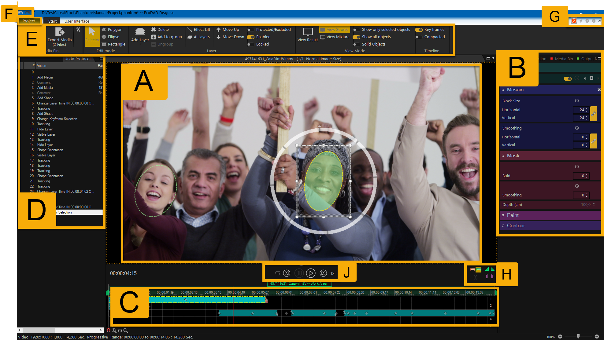

+ [*A* Canvas (Arbeitsfläche)](#A) 
+ [*B* Inspektor](#B)
+ [*C* Zeitleiste (Timeline)](#C)
+ [*D* Optionale Ansichten](#D)
+ [*E* Menüband (Ribbon)](#E)
+ [*F* Projekt](#F)
+ [*G* Tutorials / Info / Updates](#G)
+ [*H* Zeitleisten-Werkzeuge](#H)
+ [*J* Wiedergabesteuerung](#J)

#  *W* Workshops

+ [*W.1* Schnellstart](#workshop-quick-start) 
+ [*W.2* Ebenenreihenfolge und Schutzmaske](#workshop-layer-order) 
+ [*W.3* Objektverfolgung (Tracking)](#workshop-tracking-object) 
+ [*W.4* Erstellen einer Maske in einem S3D-Video](#workshop-s3d-mask) 

##  *W.1* Schnellstart
Hier sind die Schritte, um ein Video zur Bearbeitung zu öffnen und das Gesicht einer Person zu verpixeln.

> 1. Öffnen Sie das Video, das Sie bearbeiten möchten (über die Schaltfläche "Medien importieren").

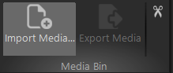

> 2. Wählen Sie die passende Maskenform (z.B. Ellipse) aus dem Menüband und ziehen Sie einen Rahmen über das Gesicht im Canvas.

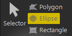

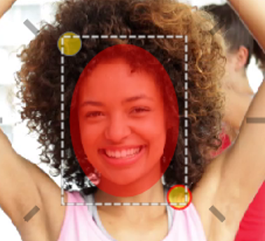

> 3. Bestätigen Sie die neu erstellte Maske, indem Sie auf die Schaltfläche "Anwenden" klicken (erscheint normalerweise nach dem Zeichnen).

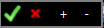

> 4. Starten Sie den Objekt-Tracker, um Bewegungen einfach zu erfassen.
Klicken Sie auf das Tracker-Symbol auf der Maskenüberlagerung, drücken Sie die Taste <kbd>T</kbd> oder doppelklicken Sie auf die Maske.

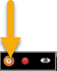

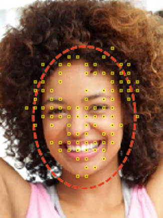

> :exclamation: Sobald der Tracker gestartet ist, "haftet" der Mauszeiger an der Maske. Jede Mausbewegung wird auf die Position der Maske übertragen. Während der Objektverfolgung kann die Maus nicht zur Auswahl anderer Optionen verwendet werden, bis das Tracking gestoppt wird.

> 5. Die Erfassung der Bewegungen erfolgt durch Durchlaufen des Videos in der Zeit.
Die Tasten der Tastatur (<kbd>B</kbd>;<kbd>N</kbd>;<kbd>NP-4</kbd>;<kbd>NP-6</kbd>) können hierfür verwendet werden. Zusätzlich kann die Leertaste <kbd>SPACE</kbd> zur Wiedergabe genutzt werden. Fußpedale eignen sich am besten zur präzisen Steuerung der Geschwindigkeit.  
 

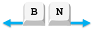

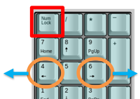

> :bulb: Um Ihre professionelle Arbeit effektiv zu unterstützen, empfehlen wir die Verwendung zusätzlicher Geräte. Diese können Ihnen helfen, Ihre Produktivität zu steigern, Ihren Workflow zu optimieren und eine hohe Verarbeitungsqualität zu erzielen. Hier sind einige empfohlene Zubehörteile: [*Pedale*](#devices-pedals) [*MIDI*](#devices-midi) [*Tastatur*](#devices-keyboard)

> 6. Während des Vorgangs kann die Position der Maske durch Bewegen der Maus angepasst werden. Die Pfeiltasten <kbd>↑</kbd>/<kbd>↓</kbd> können verwendet werden, um die Größe proportional anzupassen. Halten Sie die <kbd>SHIFT</kbd>-Taste gedrückt, um die Bewegung nur in eine Richtung zu beschränken. Verwenden Sie die Pfeiltasten <kbd>←</kbd>/<kbd>→</kbd>, um die Maske zu drehen. 

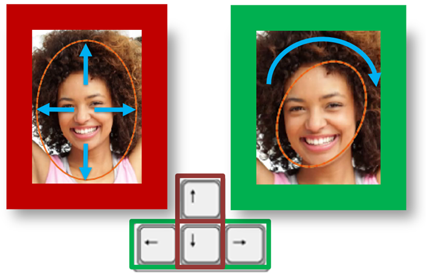

> 7. Die Position der Maske kann jederzeit korrigiert werden, indem sie mit der Maus verschoben wird.
   
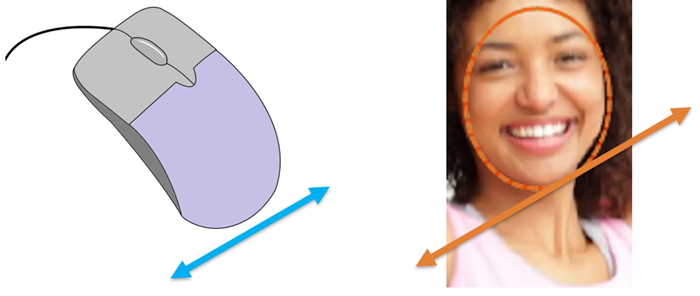

> 8. Die Zeitleiste zeigt Keyframes an, die darstellen, wie die Maske während Ihrer Arbeit angepasst wird.
     
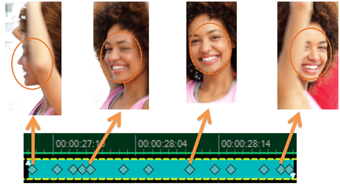

> 9. Die Objektverfolgung wird mit einem einzigen Mausklick abgeschlossen (oder <kbd>ESC</kbd> zum Abbrechen).
    
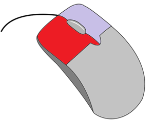

> 10. Das Endergebnis kann durch Umschalten des Anzeigemodus überprüft werden (z.B. "Ergebnis anzeigen").
       
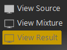

##  *W.2* Ebenenreihenfolge und Schutzmaske

Manchmal soll ein Objekt im Vordergrund nicht durch den Effekt verändert werden, der auf den Hintergrund oder ein anderes Objekt angewendet wird. Für solche Aufgaben kann eine Ausschluss-Ebene (Schutzmaske) verwendet werden, um das zu schützende Objekt abzudecken. Ordnen Sie die Ebenen in der Zeitleiste an, um den gewünschten Schutzeffekt zu erzielen.

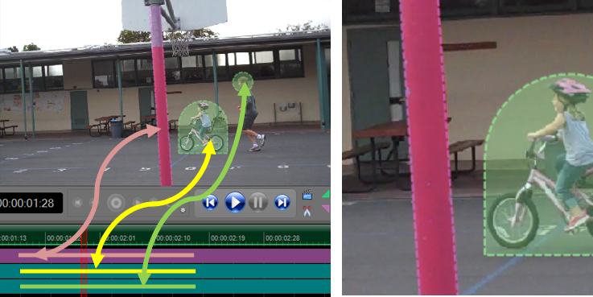

> :bulb: Die Ausschluss-Ebene muss in der Zeitleiste *über* der Effektmaske platziert werden, die sie beeinflussen soll. Die Ebenenreihenfolge bestimmt, wie Effekte interagieren.

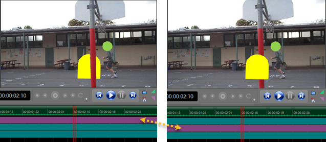

Siehe auch: [*E.3.4* Ebenenreihenfolge](#E.3.4), [*E.3.5* Ausschluss-Ebene (Schutzmaske)](#E.3.5)

##  *W.3* Objektverfolgung (Tracking)
Es werden Werkzeuge bereitgestellt, um eine Maske über mehrere Videoframes hinweg auf dem zu maskierenden Objekt zu positionieren. Der Objekt-Tracker verfolgt das Objekt automatisch und passt die Maske an Bewegungen, Rotationen und Größenänderungen an. Der Prozess kann während des Trackings durch Mausbewegungen und Tastenkürzel unterstützt werden.

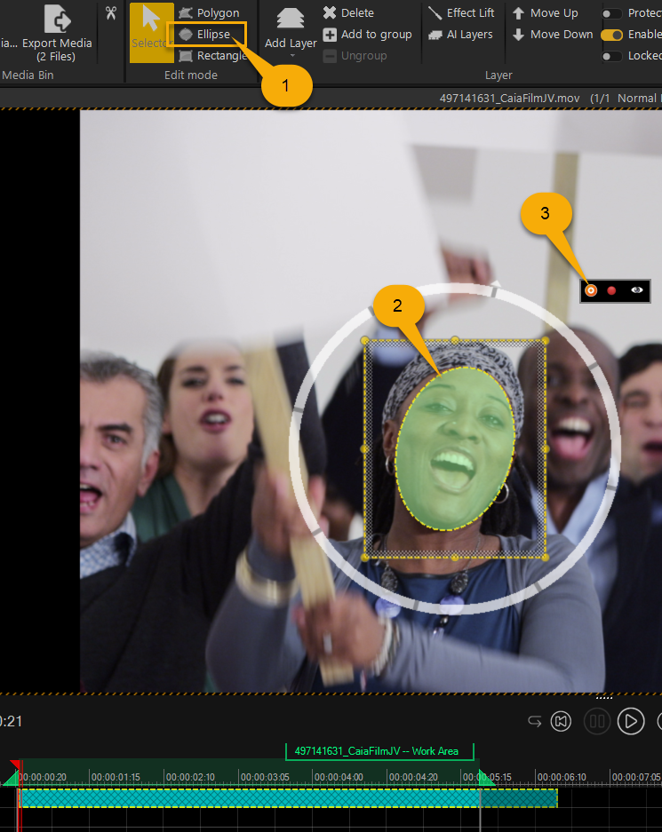

1. Wählen Sie eine geeignete Maskenform aus ([*E.2*](#E.2)).
2. Erstellen Sie eine Maske über dem Objekt, indem Sie mit der Maus einen Rahmen im Canvas ([*A*](#A)) ziehen.
3. Starten Sie das Tracking, indem Sie auf die entsprechende Schaltfläche ([*A.4*](#A.4) oder [*A.5*](#A.5)) auf der Maskenüberlagerung klicken.

, Teach-In starten (A.5)")

*   **[*A.5* Teach-In starten (Manuelles Tracking)](#A.5)** ermöglicht die Objektverfolgung hauptsächlich durch manuelles Führen der Maske mit der Maus, während das Video abgespielt oder schrittweise durchlaufen wird. In komplexen Szenen mit überlappenden Objekten oder anderen Störungen kann diese Methode manchmal zu einem schnelleren Ergebnis führen, wenn das automatische Tracking Schwierigkeiten hat.

*   **[*A.4* Tracking starten (Automatisch/Halbautomatisch)](#A.4)** wird für die halbautomatische Objektverfolgung empfohlen. Es versucht, das Objekt automatisch zu verfolgen und berücksichtigt dabei möglicherweise auch Rotationen und Größenänderungen. Manuelle Korrekturen können jederzeit mit der Maus oder Tastatur vorgenommen werden, ohne den automatischen Prozess zu stören oder zu unterbrechen.

> Unsere Empfehlung ist normalerweise **[*A.4* Tracking starten](#A.4)**.

Wählen Sie Ihren bevorzugten Tracker aus, um den Vorgang zu starten.

> :bulb: [*A.4* Tracking starten](#A.4) kann auch durch Doppelklick auf die Maske oder durch Drücken der Taste <kbd>T</kbd> gestartet werden.

>:exclamation: Ein Mausklick beendet normalerweise den Tracking-Vorgang und übernimmt alle vorgenommenen Änderungen (Keyframes). Das Drücken der Taste <kbd>ESC</kbd> bricht den Tracking-Vorgang normalerweise ab und verwirft alle seit dem Start des Trackings vorgenommenen Änderungen.

Während des Tracking-Vorgangs (in beiden Modi) kann die Position der Maske durch Bewegen der Maus angepasst werden. Die Pfeiltasten <kbd>↑</kbd>/<kbd>↓</kbd> können verwendet werden, um die Größe proportional anzupassen. Halten Sie die <kbd>SHIFT</kbd>-Taste gedrückt, um die Bewegung horizontal oder vertikal zu beschränken (falls unterstützt). Verwenden Sie die Pfeiltasten <kbd>←</kbd>/<kbd>→</kbd>, um die Maske zu drehen.

> :bulb: Um Ihre professionelle Arbeit effektiv zu unterstützen, empfehlen wir die Verwendung zusätzlicher Geräte. Diese können Ihnen helfen, Ihre Produktivität zu steigern, Ihren Workflow zu optimieren und eine hohe Verarbeitungsqualität zu erzielen. Hier sind einige empfohlene Zubehörteile: [*Pedale*](#devices-pedals) [*MIDI*](#devices-midi) [*Tastatur*](#devices-keyboard)

> Die Maus bleibt während des gesamten Tracking-Prozesses an der Maske "haften". Jede Bewegung wird sofort auf die Maske übertragen, sodass auch lange Szenen potenziell mühelos und ermüdungsfrei bearbeitet werden können.

Sie müssen nun den Zeitcursor durch das zu bearbeitende Segment bewegen. Folgende Methoden stehen zur Verfügung:
- Video abspielen, möglicherweise mit langsamerer Geschwindigkeit: Siehe [*J* Wiedergabesteuerung](#J) für Details.
- Video Frame für Frame navigieren: Siehe [*C.5* Zeitcursor (Abspielkopf)](#C.5) für Details.
- Video mit Pedalen navigieren: Siehe [*F.1.10.3.1* Pedale](#F.1.10.3.1) für Details.

Ein Klick stoppt das Tracking.

> :bulb: Die angezeigten Tracking-Markierungen (normalerweise kleine Punkte innerhalb oder um die Maske bei Verwendung von *A.4*) zeigen an, welche Merkmale der Tracker überwacht.
> Diese Markierungen können oft durch Drücken von <kbd>F</kbd> während des Trackings ausgeblendet werden.

##  *W.4* Erstellen einer Maske in einem S3D-Video
Zeigt, wie eine Maske auf einem Objekt erstellt wird, wenn mit stereoskopischem (S3D) sphärischem Video gearbeitet wird.
Die Einstellung der korrekten Nulltiefe (Zero Depth) stellt sicher, dass die Maske für das linke und rechte Auge mit minimaler Anpassung korrekt ausgerichtet ist.

Importieren Sie das Video und nehmen Sie die entsprechenden Einstellungen für das S3D-Video in den Medieneigenschaften vor:
- [*B.3.1.1* Kameratyp](#B.3.1.1) (Auf "Sphärisch" setzen)
- [*B.3.1.2* Frame-Packing (Bildanordnung)](#B.3.1.2) (z.B. Oben-Unten, Links-Rechts)

Wählen Sie einen S3D-Anzeigemodus (z.B. Anaglyph oder Depth-Mix) im Menüband [*E.6*](#E.6), um die räumliche Tiefe von Objekten im Canvas [*A*](#A) zu visualisieren.
- [*E.6.2* Ansichtsmodus](#E.6.2)

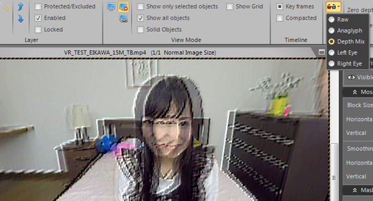

Passen Sie den Parameter Nulltiefe ([*E.6.3*](#E.6.3)) an, bis das Zielobjekt minimale oder keine Parallaxenverschiebung zwischen der linken und rechten Augenansicht zeigt (es sollte im Depth-Mix- oder Anaglyph-Modus "flach" oder ausgerichtet erscheinen). Ziel ist es, die virtuelle "Bildschirmebene" auf die Tiefe des zu maskierenden Objekts zu legen.

 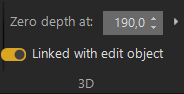

Wählen Sie eine geeignete Maskenform ([*E.2*](#E.2)) und ziehen Sie sie auf das Objekt im Canvas.
- [*E.2* Maskenbearbeitung](#E.2)

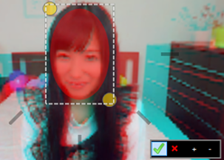

Nach Bestätigung der Maskenerstellung werden die Maske und die ihr zugewiesene Ebene erstellt. Der aktuelle Nulltiefenwert wird möglicherweise automatisch auf die Tiefeneigenschaft der Maske ([*B.1.9*](#B.1.9)) angewendet, oder Sie müssen ihn explizit mit [*E.6.4* Objekttiefe setzen](#E.6.4) festlegen.

Siehe auch:
- [*E.3.2* Ebenengruppe](#E.3.2) (Nützlich zum Gruppieren von Masken, die dieselbe Tiefe haben sollen)

#  *A* Canvas (Arbeitsfläche)

Der Canvas ist ein wichtiger Teil der Benutzeroberfläche. Er ermöglicht es dem Benutzer, die Bearbeitungsmaske zu erstellen und zu ändern, indem er ihre Form, Position und Größe mit der Maus oder Tastatur eingibt. Er zeigt auch das Endergebnis der Bearbeitung an, indem er die Maske auf das Originalbild anwendet. Der Canvas bietet Steuerelemente direkt auf der Maskenüberlagerung für häufige Aktionen wie das Tracking. Tracking ist eine Funktion, die die Maske automatisch (oder halbautomatisch) an die Bewegung eines Objekts im Video anpasst.

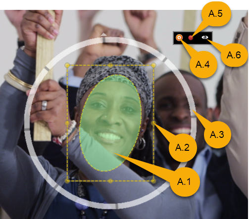

+ [*A.1* Effektmaske](#A.1) 
+ [*A.2* Bearbeitungsgriffe](#A.2) 
+ [*A.3* Rotation](#A.3) 
+ [*A.4* Tracking starten (Automatisch/Halbautomatisch)](#A.4) 
+ [*A.5* Teach-In starten (Manuelles Tracking)](#A.5) 
+ [*A.6* Maske ausblenden/einblenden (Effekt an/aus)](#A.6) 

##  *A.1* Effektmaske

Die Maske definiert den Bereich, in dem der Effekt (z.B. Mosaik) auf das Video angewendet wird. Die Form der Maske kann aus dem Menüband [*E.2* Maskenbearbeitung](#E.2) ausgewählt werden. Eine Maske kann entweder den Bereich definieren, in dem der Effekt angewendet *wird* (Standardebene), oder einen sicheren Bereich, in dem *kein* Effekt sichtbar ist (Ausschluss-Ebene, siehe [*E.3.5*](#E.3.5)).

##  *A.2* Bearbeitungsgriffe

Dies sind die Anfasser (normalerweise kleine Quadrate oder Kreise) am Begrenzungsrahmen der ausgewählten Maske. Um die Maske an das gewünschte Objekt anzupassen, können Sie ihre Größe und Position ändern. Wählen Sie zuerst die Maske durch Anklicken aus. Sie können dann die Bearbeitungsgriffe anklicken und ziehen, um die Größe der Maske zu ändern. Klicken und ziehen Sie die Maske selbst (nicht die Griffe), um sie zu verschieben. Sie können auch die Tastatur verwenden: Verwenden Sie die <kbd>Pfeiltasten</kbd>, um die Position der Maske schrittweise zu verschieben. Während Sie die Maustaste auf einem Griff gedrückt halten, können Sie möglicherweise die Pfeiltasten <kbd>↑</kbd>/<kbd>↓</kbd> verwenden, um die Größe der Maske proportional zu ändern. Das Gedrückthalten der <kbd>SHIFT</kbd>-Taste beim Ziehen eines Griffs kann das Seitenverhältnis beibehalten, oder beim Ziehen der Maske die Bewegung auf horizontale/vertikale Achsen beschränken. Verwenden Sie die Pfeiltasten <kbd>←</kbd>/<kbd>→</kbd> (möglicherweise während Sie eine Modifikatortaste wie <kbd>CTRL</kbd> oder <kbd>ALT</kbd> gedrückt halten oder während des Trackings), um die Maske zu drehen (siehe [*A.3*](#A.3)).

##  *A.3* Rotation

Rotiert die ausgewählte Maske. Dies kann durch Ziehen eines speziellen Rotationsgriffs (falls vorhanden) oder durch Verwendung von Tastenkürzeln wie den Pfeiltasten <kbd>←</kbd>/<kbd>→</kbd> erfolgen, insbesondere während des Trackings ([*A.4*](#A.4), [*A.5*](#A.5)).

##  *A.4* Tracking starten (Automatisch/Halbautomatisch)

Startet den halbautomatischen Objektverfolgungsprozess. Diese Schaltfläche erscheint normalerweise auf der Maskenüberlagerung, wenn die Maske ausgewählt ist. Das Tracking kann oft auch durch Doppelklick auf die Maske oder durch Drücken der Taste <kbd>T</kbd> gestartet werden.

>:exclamation: Ein Mausklick schließt den Tracking-Vorgang normalerweise ab und übernimmt die generierten Keyframes. Das Drücken der Taste <kbd>ESC</kbd> bricht die Tracking-Aktion normalerweise ab und verwirft die während dieser Tracking-Sitzung generierten Keyframes.

Während der Tracking-Aktion können Sie den Tracker unterstützen, indem Sie die Position der Maske durch Bewegen der Maus anpassen. Verwenden Sie die Pfeiltasten <kbd>↑</kbd>/<kbd>↓</kbd>, um die Größe proportional anzupassen. Halten Sie die <kbd>SHIFT</kbd>-Taste für eingeschränkte Bewegung/Größenänderung gedrückt, falls erforderlich. Verwenden Sie die Pfeiltasten <kbd>←</kbd>/<kbd>→</kbd>, um die Maske zu drehen. Siehe Workshop [*W.3* Objektverfolgung (Tracking)](#workshop-tracking-object).
  

##  *A.5* Teach-In starten (Manuelles Tracking)

Startet den manuellen Tracking-Modus ("Teach-In"). Diese Schaltfläche erscheint normalerweise auf der Maskenüberlagerung. In diesem Modus folgt die Maske dem Mauszeiger, während Sie den Zeitcursor vorwärts bewegen (z.B. durch Wiedergabe oder Pedale). Sie führen die Maske manuell Frame für Frame oder während der Wiedergabe. Siehe Workshop [*W.3* Objektverfolgung (Tracking)](#workshop-tracking-object).

[Siehe Tracking-Steuerung unter A.4](#A.4)

##  *A.6* Maske ausblenden/einblenden (Effekt an/aus)

Schaltet die Sichtbarkeit (Anwendung) des *Effekts*, der mit der ausgewählten Maske verbunden ist, an der aktuellen Zeitposition in der Zeitleiste um. Eine ausgeblendete (nicht angewendete) Maske hat zu diesem Zeitpunkt keinen Effekt – an dieser Stelle wird kein Effekt berechnet (normalerweise wird ein Keyframe für den Sichtbarkeitsparameter erstellt). Auch verfügbar durch Drücken der Taste <kbd>H</kbd>, wenn eine Maske ausgewählt ist.

Siehe auch:
- [Parameter: Sichtbar](#B.1.4) 
- [Ebene / Anzeige und Bearbeitung: Sichtbarkeitsindikator](#C.3.1)

#  *B* Inspektor

Das Inspektor-Panel zeigt typischerweise detaillierte Eigenschaften und Einstellungen für das aktuell ausgewählte Element an (z.B. eine Maske/Ebene, eine Mediendatei oder das Gesamtprojekt) und ermöglicht deren Bearbeitung.

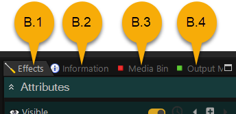

+ [*B.1* Effektparameter](#B.1) 
+ [*B.2* Informationen](#B.2) 
+ [*B.3* Medienablage (Media Bin)](#B.3) 
+ [*B.4* Ausgabemedium](#B.4) 

##  *B.1* Effektparameter

Zeigt die Parameter für den von der ausgewählten Maske/Ebene angewendeten Effekt an und ermöglicht deren Bearbeitung.

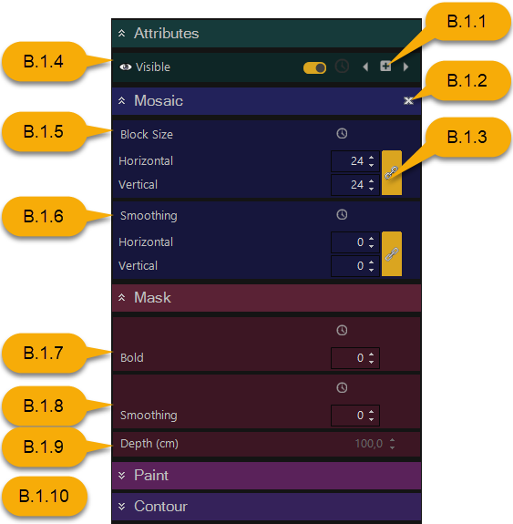

+ [*B.1.1* Parameter-Keyframes](#B.1.1) 
+ [*B.1.2* Zurücksetzen](#B.1.2) 
+ [*B.1.3* Proportional](#B.1.3) (Bezieht sich auf Größen-/Skalierungsparameter, falls vorhanden)
+ [*B.1.4* Sichtbar](#B.1.4) 
+ [*B.1.5* Mosaik-Blockgröße](#B.1.5) 
+ [*B.1.6* Mosaik-Glättung](#B.1.6) 
+ [*B.1.7* Maskenkontur (Stärke)](#B.1.7) 
+ [*B.1.8* Maskenglättung (Weichzeichnen)](#B.1.8) 
+ [*B.1.9* S3D-Tiefe](#B.1.9) 
+ [*B.1.10* Füllfarbe + Kontur](#B.1.10) (Bezieht sich wahrscheinlich auf Füllfarbe/Deckkraft und Umrisseinstellungen für bestimmte Maskentypen)

###  *B.1.1* Parameter-Keyframes
Steuert, ob sich ein Parameter über die Zeit ändern kann (mit Keyframes versehen werden kann) oder konstant bleibt.

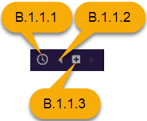

- *B.1.1.1* Keyframe-Steuerung aktivieren/deaktivieren: Klicken Sie auf das Uhrensymbol oder das Kontrollkästchen, um das Keyframing für diesen Parameter zu aktivieren/deaktivieren.
- *B.1.1.2* Vorheriger/Nächster Keyframe: Springt mit dem Zeitcursor zum vorherigen oder nächsten Keyframe *für diesen spezifischen Parameter* auf der ausgewählten Ebene.
- *B.1.1.3* Keyframe hinzufügen/löschen: Setzt oder löscht einen Keyframe für diesen Parameter an der aktuellen Zeitcursorposition.

Siehe auch:
- [*E.5.3* Keyframes anzeigen (Effektparameter)](#E.5.3) (Visuelle Anzeige von Parameter-Keyframes in der Zeitleiste)
---

###  *B.1.2* Zurücksetzen
Setzt die Parameter in diesem Abschnitt (oder möglicherweise nur den ausgewählten Parameter) auf ihre Standardwerte zurück.

###  *B.1.3* Proportional
Beim Anpassen von Größenparametern (wie Breite und Höhe, falls hier über die Maskenform hinaus anwendbar) verknüpft diese Option sie, um das aktuelle Seitenverhältnis beizubehalten.

###  *B.1.4* Sichtbar
Steuert die Sichtbarkeit (Anwendung) der Effektmaske an der aktuellen Zeitcursorposition. Wenn Sie dies deaktivieren, ist der Effekt zu diesem Zeitpunkt inaktiv. Dieser Parameter kann mit Keyframes versehen werden ([*B.1.1*](#B.1.1)).

Siehe auch:
- [Maske ausblenden/einblenden Schaltfläche](#A.6)
- [Ebene / Anzeige und Bearbeitung: Sichtbarkeitsindikator](#C.3.1)

###  *B.1.5* Mosaik-Blockgröße
Passt die Größe der einzelnen Pixelblöcke im Mosaikeffekt an. Größere Werte führen zu einer gröberen Verpixelung.

| Blockgröße: 10 | Blockgröße: 20 | Blockgröße: 40 |
|---|---|---|
|  | 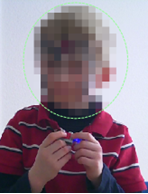 | 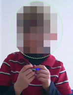 |

Siehe auch:
- [*E.3.2* Ebenengruppe](#E.3.2) (Gemeinsame Parameter für gruppierte Ebenen)
- [*E.3.2.3* Mosaikeffekt-Ankerpunkt für sphärische Videos](#E.3.2.3)
- [*C.3.5* Ebene / Typen](#C.3.5)
- [*E.5.3* Keyframes anzeigen (Effektparameter)](#E.5.3) (Zeigt Keyframes für diesen Parameter in der Zeitleiste an)

###  *B.1.6* Mosaik-Glättung
Wendet einen Glättungsfilter auf die Kanten der Mosaikblöcke an, um harte Übergänge zu reduzieren. Höhere Werte erhöhen die Glättung.

| Glättung: 0 | Glättung: 3 | Glättung: 7 |
|---|---|---|
| ") | 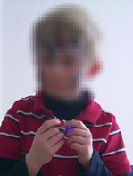 | 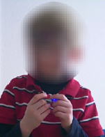 |

Siehe auch:
- [*E.3.2* Ebenengruppe](#E.3.2)
- [*E.3.2.3* Mosaikeffekt-Ankerpunkt für sphärische Videos](#E.3.2.3)
- [*C.3.5* Ebene / Typen](#C.3.5)

###  *B.1.7* Maskenkontur (Stärke)
Erweitert (positive Werte) oder verkleinert (negative Werte) den Maskenbereich. Dies macht die Maskengrenze effektiv dicker oder dünner.

| Stärke: 0 | Stärke: 40 |
|---|---|
| 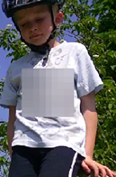 | ") |

###  *B.1.8* Maskenglättung (Weichzeichnen)
Macht den Rand der Maske weicher und erzeugt einen allmählichen Übergang zwischen dem betroffenen und dem nicht betroffenen Bereich (Feathering/Weiche Kante). Höhere Werte vergrößern den Weichzeichnungsabstand.

| Glättung: 0 | Glättung: 40 |
|---|---|
| ") | ") |

###  *B.1.9* S3D-Tiefe
Für stereoskopische (S3D) Videos definiert dieser Parameter wahrscheinlich die wahrgenommene Tiefe der Maske selbst. Diese sollte idealerweise mit der Tiefe des maskierten Objekts übereinstimmen, um eine korrekte Darstellung in 3D zu gewährleisten. Dieser Wert kann beim Erstellen der Maske mit einer bestimmten [*E.6.3* Nulltiefe](#E.6.3) Einstellung automatisch gesetzt oder hier manuell angepasst werden.

Siehe auch:
- [*E.6.4* Objekttiefe setzen](#E.6.4)
- [*W.4* Erstellen einer Maske in einem S3D-Video](#workshop-s3d-mask)
- [*E.3.2.3* Mosaikeffekt-Ankerpunkt für sphärische Videos](#E.3.2.3)

###  *B.1.10* Füllfarbe + Kontur
Diese Parameter steuern wahrscheinlich das Aussehen, wenn die Maske nicht nur für Mosaik, sondern vielleicht auch zum Überlagern einer Volltonfarbe oder eines Umrisses verwendet wird.
*   **Füllfarbe (Paint):** Steuert die Füllfarbe und ihre Deckkraft/Transparenz.
*   **Kontur:** Steuert das Aussehen (Farbe, Dicke, Stil) einer Umrisslinie um die Maskenform.

| Füllfarbe/Deckkraft: 100% | Füllfarbe/Deckkraft: 50% |
|---|---|
| 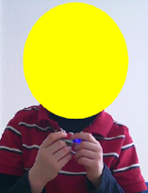 | 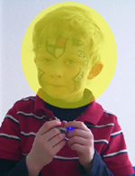 |

##  *B.2* Informationen

:hourglass_flowing_sand: In Bearbeitung
(Dieser Abschnitt zeigt wahrscheinlich Metadaten zum ausgewählten Element an, wie Dauer, Auflösung, Dateipfad usw.)

##  *B.3* Medienablage (Media Bin)

Dieser Abschnitt oder diese Ansicht listet die in das aktuelle Projekt importierten Videodateien auf. Die Auswahl einer Mediendatei hier zeigt wahrscheinlich ihre Eigenschaften im Inspektor an.

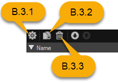

- [*B.3.1* Medieneigenschaften](#B.3.1) (Schaltfläche zum Öffnen des Eigenschaftsdialogs für ausgewählte Medien)
- [*B.3.2* Medium duplizieren](#B.3.2) (Schaltfläche zum Duplizieren des ausgewählten Medieneintrags)
- [*B.3.3* Medium entfernen](#B.3.3) (Schaltfläche zum Entfernen ausgewählter Medien aus dem Projekt)

###  *B.3.1* Medieneigenschaften
Öffnet einen Dialog zum Anzeigen und Bearbeiten der Eigenschaften der ausgewählten Videodatei im Projektkontext.

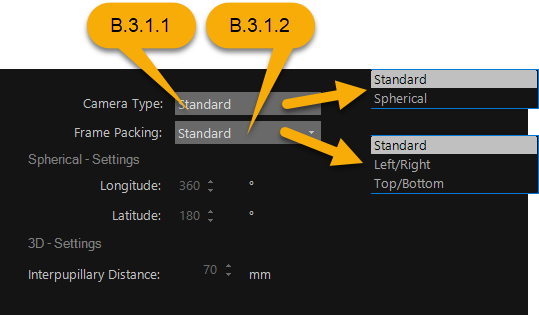

- [*B.3.1.1* Kameratyp](#B.3.1.1)
- [*B.3.1.2* Frame-Packing (Bildanordnung)](#B.3.1.2)
- [*B.3.1.3* Augenabstand (Interpupillardistanz)](#B.3.1.3)

####  *B.3.1.1* Kameratyp

Definiert den Typ des verwendeten Kameraobjektivs, was hauptsächlich für die korrekte Projektionszuordnung wichtig ist.
*   **Standard**: Normale geradlinige Kameraansicht.
*   **Sphärisch**: Kamera mit einem 360°- oder teilweisen sphärischen Sichtfeld (normalerweise wird eine äquirektanguläre Projektion angenommen).

> :exclamation: Bei sphärischen Videos ist die Einstellung Frame-Packing ([*B.3.1.2*](#B.3.1.2)) entscheidend für die korrekte Anzeige und Verarbeitung im Canvas.

####  *B.3.1.2* Frame-Packing (Bildanordnung)

Gibt an, wie die Ansichten für stereoskopisches (S3D) oder Multi-View-Video innerhalb des einzelnen Videoframes angeordnet sind.
*   **Mono**: Standard-Einzelansichtsvideo.
*   **Links-Rechts** (oder Side-by-Side): Die linke Augenansicht befindet sich in der linken Hälfte, die rechte Augenansicht in der rechten Hälfte. Kann volle Breite (gestaucht) oder halbe Breite sein.
*   **Oben-Unten** (oder Over-Under): Die linke Augenansicht befindet sich in der oberen Hälfte, die rechte Augenansicht in der unteren Hälfte.

##### Beispiele für verschiedene sphärische Videos mit horizontaler Bildanordnung (**Links-Rechts**).

| Längengrad: 360° Breitengrad: 180° (Vollsphärisch S3D) | Längengrad: 180° Breitengrad: 180° (Halbsphärisch S3D) |
|---|---|
|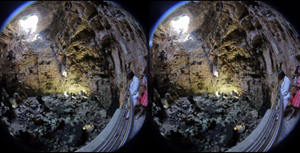|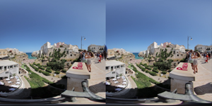|

---
##### Beispiele für verschiedene sphärische Videos mit vertikaler Bildanordnung (**Oben-Unten**).

| Längengrad: 360° Breitengrad: 180° (Vollsphärisch S3D) |
|---|
|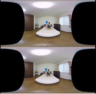|

---

####  *B.3.1.3* Augenabstand (Interpupillardistanz)
Der Augenabstand (Interpupillardistanz, IPD) wird bei stereoskopischen sphärischen Videos für die korrekte Darstellungsskalierung und die genaue Verarbeitung der räumlichen Beziehung zwischen den beiden Videoquellen verwendet.

Der Wert beeinflusst direkt die Wahrnehmung von räumlicher Tiefe und Maßstab. Ein durchschnittlicher menschlicher IPD liegt bei etwa 65-70 mm. Die korrekte Einstellung hilft sicherzustellen, dass der 3D-Effekt natürlich erscheint.

Siehe auch:
- [*W.4* Erstellen einer Maske in einem S3D-Video](#workshop-s3d-mask)
- [*B.1.9* S3D-Tiefe](#B.1.9) (Masken-Tiefenparameter)
- [*E.3.2* Ebenengruppe](#E.3.2) (Gruppierung von S3D-Masken)
- [*E.6* S3D-Video Optionen](#E.6) (Menüband-Steuerelemente für S3D-Bearbeitung)

###  *B.3.2* Medium duplizieren
:hourglass_flowing_sand: In Bearbeitung
(Dupliziert wahrscheinlich das ausgewählte Medienelement in der Ablage, möglicherweise nützlich, um verschiedene Effekte oder Bearbeitungen auf dasselbe Quellmaterial in unterschiedlichen Kontexten innerhalb des Projekts anzuwenden.)

###  *B.3.3* Medium entfernen
:hourglass_flowing_sand: In Bearbeitung
(Entfernt den Verweis auf die ausgewählte Mediendatei aus dem Projekt. Dies löscht normalerweise nicht die Originaldatei von der Festplatte, entfernt sie aber aus der Medienablage und potenziell aus allen Zeitleisten, die sie verwenden.)

##  *B.4* Ausgabemedium

:hourglass_flowing_sand: In Bearbeitung
(Dieser Abschnitt könnte Eigenschaften anzeigen, die sich auf das endgültige exportierte Video beziehen, möglicherweise die Konfiguration von Exporteinstellungen direkt im Inspektor ermöglichen, bevor der Exportprozess initiiert wird.)

#  *C* Zeitleiste (Timeline)

Die Zeitleiste bietet eine visuelle Darstellung Ihres Videoprojekts über die Zeit und zeigt die Anordnung von Medienclips, Ebenen, Effekten und Keyframes.

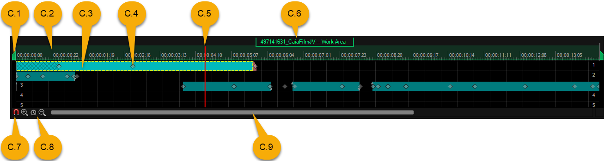

+ [*C.1* Zeitleistenbereich](#C.1) (Marker zur Definition spezifischer Zeitbereiche)
+ [*C.2* Lineal](#C.2) (Zeitmaßstabsanzeige)
+ [*C.3* Ebene (Layer)](#C.3) (Spuren mit Masken und Effekten)
+ [*C.4* Keyframe](#C.4) (Zeitpunkte, an denen sich Eigenschaften ändern)
+ [*C.5* Zeitcursor (Abspielkopf)](#C.5) (Zeigt die aktuelle Wiedergabe-/Bearbeitungsposition an)
+ [*C.6* Zeitleistentitel (Zeitanzeige)](#C.6) (Zeigt Informationen wie den aktuellen Timecode an)
+ [*C.7* Einrasten Ein/Aus](#C.7) (Schaltet das Einrastverhalten um)
+ [*C.8* Zeitleisten-Zoom](#C.8) (Steuert den horizontalen Zoomfaktor)
+ [*C.9* Zeitleisten-Scrollleiste](#C.9) (Zur horizontalen und vertikalen Navigation)
+ [*C.10* Zeitleisten-Kontextmenü](#C.10) (Rechtsklickmenü für Zeitleistenoperationen)

##  *C.1* Zeitleistenbereich

Marker auf dem Zeitleistenlineal ([*C.2*](#C.2)) definieren spezifische Zeitsegmente. Diese Bereiche können Wiedergabeschleifen, Exportdauern oder Arbeitsbereiche steuern.
*   **Start-/Endmarker (IN/OUT-Punkte):** Diese definieren typischerweise das aktive Segment für Wiedergabe, Export oder Bearbeitungsoperationen.
*   **Marker verschieben:** Klicken und ziehen Sie die Start- (oft mit 'I' markiert) oder Endmarker (oft mit 'O' markiert) mit der Maus.
*   **Gesamten Bereich verschieben:** Klicken und ziehen Sie die Titelleiste *zwischen* den IN- und OUT-Markern, um den gesamten Bereich zu verschieben, ohne seine Dauer zu ändern.
*   **Marker setzen:** Verwenden Sie die Taste <kbd>I</kbd>, um den IN-Punkt, und die Taste <kbd>O</kbd>, um den OUT-Punkt an der aktuellen Zeitcursorposition ([*C.5*](#C.5)) zu setzen.
*   **Bereich maximieren:** Ein Doppelklick auf die Bereichstitelleiste kann den Bereich auf die volle Dauer des Videos oder der aktuellen Sub-Timeline erweitern.

> :bulb: Das Drücken und Halten von <kbd>SHIFT</kbd> während des Ziehens eines IN- oder OUT-Markers kann den entsprechenden Videoframe im Canvas [*A*](#A) anzeigen (Live-Scrubbing).

###  *C.1.1* Zeitleistenbereich / Modus

Verschiedene Modi können ändern, was die IN/OUT-Marker steuern:

> **Video-Trimming:**  
> Bearbeiten Sie die Gesamtstart- und Endpunkte des im Projekt verwendeten Quellvideoclips. Dieser Bereich definiert normalerweise auch die Standard-Exportdauer, sofern nicht überschrieben.
>  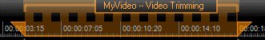  
 
> **Zeitleisten / Sub-Timelines:**  
> Wenn Sub-Timelines ([*D.3*](#D.3)) verwendet werden, kann dieser Modus das Definieren oder Auswählen des von einer spezifischen Sub-Timeline abgedeckten Zeitbereichs ermöglichen.
> 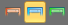 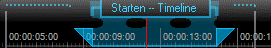  

> **Effekt / Arbeitsbereich:**  
> Definieren Sie einen temporären Arbeitsbereich (oft als Work Area oder In/Out-Bereich bezeichnet) für fokussierte Bearbeitung, Schleifenwiedergabe ([*J.1*](#J.1)) oder das Rendern/Exportieren nur eines spezifischen Abschnitts ([*E.1.2.6*](#E.1.2.6)). Dies ist oft der am häufigsten verwendete Bereichsmodus während der Bearbeitung.
>  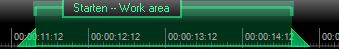  

###  *C.1.2* Zeitleistenbereich / Auswahl

Ein Doppelklick auf eine Ebenenleiste ([*C.3*](#C.3)) in der Zeitleiste kann den Arbeitsbereich ([*C.1.1*](#C.1.1)) IN- und OUT-Punkte automatisch so setzen, dass sie den Start- und Endzeiten dieser spezifischen Ebene entsprechen.

Siehe auch: 
- [*C.2* Lineal](#C.2)
- [*C.5* Zeitcursor (Abspielkopf)](#C.5)
- [*C.6* Zeitleistentitel (Zeitanzeige)](#C.6)

##  *C.2* Lineal

Das horizontale Lineal am oberen Rand der Zeitleiste zeigt Zeiteinheiten (z.B. Sekunden, Frames, Timecode) an und gibt die Position des Zeitcursors, der Bereichsmarker und anderer zeitbasierter Elemente an.

Siehe auch: 
- [*C.1* Zeitleistenbereich](#C.1)
- [*C.5* Zeitcursor (Abspielkopf)](#C.5)
- [*C.6* Zeitleistentitel (Zeitanzeige)](#C.6)
 

##  *C.3* Ebene (Layer)

Ebenen sind horizontale Spuren in der Zeitleiste, die die Effektmasken ([*A.1*](#A.1)) und ihre zugehörigen Keyframes ([*C.4*](#C.4)) über die Zeit enthalten. Die vertikale Stapelreihenfolge der Ebenen kann wichtig sein, insbesondere bei Verwendung von Ausschluss-Ebenen ([*E.3.5*](#E.3.5)) oder Gruppierung von Ebenen ([*E.3.2*](#E.3.2)).

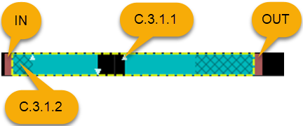

+ [*C.3.1* Ebene / Anzeige und Bearbeitung](#C.3.1) (Visuelle Indikatoren auf der Ebenenleiste)
+ [*C.3.2* Ebene / Auswahl](#C.3.2) (Wie Ebenen ausgewählt werden)
+ [*C.3.3* Ebene / Navigation](#C.3.3) (Bewegen des Zeitcursors basierend auf Ebenen)
+ [*C.3.4* Ebene / Stil](#C.3.4) (Aussehensoptionen)
+ [*C.3.5* Ebene / Typen](#C.3.5) (Verschiedene Arten von Ebenen)

Siehe auch:
- [*E.5* Zeitleisten-Ansichtsmodus](#E.5) (Optionen, die die Ebenenanzeige beeinflussen)
---

###  *C.3.1* Ebene / Anzeige und Bearbeitung

Die Ebenenleiste selbst bietet visuelles Feedback:
*   **Löschen:** Ausgewählte Ebenen können durch Drücken der Taste <kbd>DEL</kbd> gelöscht werden.
*   **Undefinierte Bereiche (*C.3.1.2*):** Ein anderes Muster oder eine andere Farbe auf der Ebenenleiste kann Zeitsegmente *innerhalb* der Ebenendauer anzeigen, in denen die Position/Eigenschaften der Maske nicht explizit durch Keyframes definiert wurden (z.B. vor dem ersten Keyframe oder nach dem letzten, wenn das Tracking nicht über die gesamte Dauer durchgeführt wurde). Die Maske behält in diesen Bereichen möglicherweise ihren letzten bekannten Zustand bei oder verhält sich unerwartet.
*   **Sichtbarkeitsindikator (*C.3.1.1*):** Eine Änderung des Erscheinungsbilds der Ebenenleiste (z.B. eine gestrichelte Linie, andere Farbe oder Symbolüberlagerung) kann anzeigen, wo die Sichtbarkeit der Maske ([*B.1.4*](#B.1.4), [*A.6*](#A.6)) über Keyframes ausgeschaltet wurde. Dies zeigt an, wo der Effekt entlang der Ebenendauer aktiv und inaktiv ist.

###  *C.3.2* Ebene / Auswahl

*   **Einzelne Auswahl:** Klicken Sie auf eine Ebenenleiste, um sie auszuwählen.
*   **Mehrfachauswahl (zusammenhängend):** Klicken Sie auf die erste Ebene, halten Sie dann <kbd>SHIFT</kbd> gedrückt und klicken Sie auf die letzte Ebene, um einen Bereich auszuwählen.
*   **Mehrfachauswahl (nicht zusammenhängend):** Halten Sie <kbd>CTRL</kbd> gedrückt und klicken Sie auf einzelne Ebenen, um sie zur Auswahl hinzuzufügen oder daraus zu entfernen.
*   **Tastaturauswahl:** Verwenden Sie die Pfeiltasten <kbd>↑</kbd> und <kbd>↓</kbd>, um die vorherige oder nächste Ebene auszuwählen. Halten Sie <kbd>SHIFT</kbd> gedrückt, während Sie die Pfeiltasten verwenden, um die Auswahl zu erweitern.

###  *C.3.3* Ebene / Navigation

Ein Doppelklick auf den Start- oder Endrand einer Ebenenleiste bewegt den Zeitcursor ([*C.5*](#C.5)) normalerweise genau zu diesem Zeitpunkt.

---

###  *C.3.4* Ebene / Stil

Die vertikale Höhe und der Detailgrad der Ebenenleisten können oft geändert werden:

**Standard:**  
Zeigt den Ebenennamen und möglicherweise mehr Details an.
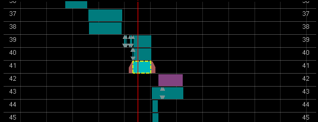

**Kompakt:**  
Reduziert die Ebenenhöhe, um mehr Ebenen vertikal auf dem Bildschirm unterzubringen.
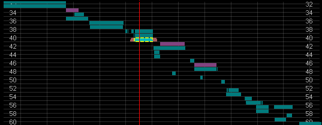

Siehe auch:
- [*E.5.1* Menüband Komprimierte Ansicht](#E.5.1) (Schaltfläche zum Umschalten des Kompaktmodus)

---

###  *C.3.5* Ebene / Typen

Ebenen können unterschiedliche Funktionen haben, die durch ihr Aussehen oder Symbole angezeigt werden:

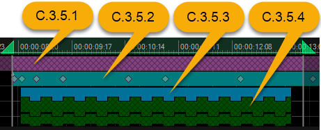

- *C.3.5.1* **Ausschluss-Ebene:** Enthält eine Maske, die einen geschützten Bereich definiert, in dem Effekte von darunterliegenden Ebenen (in der Stapelreihenfolge der Zeitleiste) *nicht* angewendet werden. Hat oft eine eindeutige Farbe oder ein Symbol. Siehe [*E.3.5*](#E.3.5).
- *C.3.5.2* **Normale Ebene:** Eine Standardebene, die eine Effektmaske enthält (z.B. zur Verpixelung).
- *C.3.5.3* **Gruppenkopf:** Repräsentiert eine Ebenengruppe ([*E.3.2*](#E.3.2)). Die Auswahl dieser Ebene ermöglicht die Bearbeitung von Parametern, die allen Ebenen innerhalb der Gruppe gemeinsam sind (wie Mosaikeinstellungen oder S3D-Tiefe).
- *C.3.5.4* **Gruppenmitglied:** Eine Ebene, die zu einer Ebenengruppe gehört. Sie ist visuell eingerückt oder mit dem darüberliegenden Gruppenkopf verknüpft. Ihre individuellen Effektparameter können durch die Gruppeneinstellungen überschrieben werden.

##  *C.4* Keyframe

Keyframes sind Markierungen auf einer Ebenenleiste, die einen bestimmten Zeitpunkt anzeigen, an dem eine oder mehrere Eigenschaften der Maske (wie Position, Größe, Rotation, Sichtbarkeit oder Effektparameter) einen definierten Wert haben. Die Software interpoliert die Werte zwischen Keyframes, um flüssige Animationen oder Änderungen über die Zeit zu erzeugen.

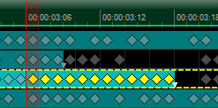

Siehe auch:
- [*E.5.2* Keyframes anzeigen (Transformation)](#E.5.2) (Zeitleisten-Ansichtsmodus zum Ein-/Ausblenden von Masken-Keyframes)
- [*E.5.3* Keyframes anzeigen (Effektparameter)](#E.5.3) (Zeitleisten-Ansichtsmodus zum Ein-/Ausblenden von Effektparameter-Keyframes)
---

###  *C.4.1* Keyframe / Bearbeitung

*   **Auswahl löschen:** Wählen Sie einen oder mehrere Keyframes aus und drücken Sie die Taste <kbd>DEL</kbd>, um sie zu entfernen.
*   **Bereich löschen:** Das Drücken von <kbd>SHIFT</kbd>+<kbd>DEL</kbd> löscht normalerweise alle Keyframes auf der/den ausgewählten Ebene(n) von der aktuellen Zeitcursorposition ([*C.5*](#C.5)) bis zum Ende der Ebene oder des Arbeitsbereichs ([*C.1.1*](#C.1.1)). Dies ist nützlich, um einen Abschnitt neu zu tracken.

> 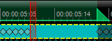

###  *C.4.2* Keyframe / Auswahl

*   **Einzelne Auswahl:** Klicken Sie auf eine Keyframe-Markierung.
*   **Mehrfachauswahl (Rahmen):** Klicken und ziehen Sie einen Auswahlrahmen um mehrere Keyframes auf einer oder mehreren ausgewählten Ebenen.
*   **Mehrfachauswahl (zusammenhängend):** Klicken Sie auf den ersten Keyframe, halten Sie dann <kbd>SHIFT</kbd> gedrückt und klicken Sie auf den letzten Keyframe auf *derselben Ebene*, um den Bereich auszuwählen.
*   **Mehrfachauswahl (nicht zusammenhängend):** Halten Sie <kbd>CTRL</kbd> gedrückt und klicken Sie auf einzelne Keyframes, um sie zur Auswahl hinzuzufügen oder daraus zu entfernen.

###  *C.4.3* Keyframe / Navigation

*   **Zu Keyframe springen:** Ein Doppelklick auf eine Keyframe-Markierung bewegt den Zeitcursor ([*C.5*](#C.5)) normalerweise genau zu diesem Zeitpunkt.
*   **Vorheriger/Nächster Keyframe:** Verwenden Sie Tastenkürzel (oft <kbd>PAGE-UP</kbd>/<kbd>PAGE-DOWN</kbd> oder dedizierte Schaltflächen) oder die parameterspezifischen Navigationsschaltflächen ([*B.1.1.2*](#B.1.1.2)), um zwischen Keyframes auf der/den ausgewählten Ebene(n) zu springen.

##  *C.5* Zeitcursor (Abspielkopf)

Auch als Abspielkopf (Playhead) bezeichnet, zeigt diese vertikale Linie den aktuell im Canvas [*A*](#A) angezeigten Frame und den genauen Zeitpunkt für Bearbeitungsaktionen wie das Setzen von Keyframes an.
*   **Verschieben:** Klicken und ziehen Sie den Zeitcursor-Griff im Linealbereich ([*C.2*](#C.2)) oder klicken Sie direkt irgendwo in das Zeitleistenlineal oder den Ebenenbereich, um den Cursor zu springen.
*   **Frame-weise:** Verwenden Sie die Pfeiltasten <kbd>←</kbd> und <kbd>→</kbd> oder die Tasten <kbd>B</kbd> und <kbd>N</kbd>.
*   **Nummernblock-Navigation:** Falls aktiviert ([*F.1.10.2*](#F.1.10.2)), verwenden Sie <kbd>NP-4</kbd> und <kbd>NP-6</kbd> (Nummernblocktasten 4 und 6, bei aktiviertem Num Lock), um Frame für Frame zu navigieren.
*   **Zum Anfang/Ende springen:** Verwenden Sie die Tasten <kbd>HOME</kbd> und <kbd>END</kbd>, um zum Anfang oder Ende des aktuellen Ansichtsbereichs (oft des Arbeitsbereichs) zu springen. Die Nummernblocktasten <kbd>NP-7</kbd> und <kbd>NP-1</kbd> können ähnliche Aktionen ausführen.
*   **Zu Markern/Keyframes springen:** Verwenden Sie die Tasten <kbd>PAGE-UP</kbd> und <kbd>PAGE-DOWN</kbd> oder die Nummernblocktasten <kbd>NP-9</kbd> und <kbd>NP-3</kbd>, um zum vorherigen/nächsten Keyframe oder potenziell anderen Markern (wie Schnittpunkten oder benutzerdefinierten Markern) zu springen.

###  *C.5.1* Stil 
Das Erscheinungsbild des Zeitcursors kann manchmal geändert werden:
*   **SPAN:** Der Zeitcursor kann die Dauer des aktuellen Frames visuell anzeigen und sich leicht horizontal ausdehnen.
*   **SIMP (Simple):** Der Zeitcursor wird als einzelne dünne vertikale Linie angezeigt.

| Typ | Erster Frame im Bereich | Letzter Frame im Bereich |
|---|---|---|
|SPAN | 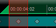 | 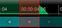 | 
|SIMP |  |  | 

Siehe auch: 
- [*C.1* Zeitleistenbereich](#C.1)
- [*C.2* Lineal](#C.2)
- [*C.6* Zeitleistentitel (Zeitanzeige)](#C.6)
- [*F.1.10.2* Projekteinstellungen: Benutzeroberfläche](#F.1.10.2) (Option zum Umschalten des Stils)

##  *C.6* Zeitleistentitel (Zeitanzeige)

Dieser Bereich, oft in der Nähe des Lineals oder des Zeitcursors, zeigt den genauen Timecode oder die Frame-Nummer der aktuellen Zeitcursorposition an.

Siehe auch: 
- [*C.1* Zeitleistenbereich](#C.1)
- [*C.2* Lineal](#C.2)
- [*C.5* Zeitcursor (Abspielkopf)](#C.5)

##  *C.7* Einrasten Ein/Aus

Schaltet das Einrasten in der Zeitleiste ein oder aus. Wenn aktiviert, "rasten" Elemente (wie der Zeitcursor, Bereichsmarker, Ebenenkanten oder Keyframes), die mit der Maus bewegt werden, präzise an anderen Elementen (Keyframes, Marker, Ebenenkanten, Cursorposition) ein, wenn sie nahe genug kommen. Dies hilft bei der präzisen Ausrichtung.

##  *C.8* Zeitleisten-Zoom

:hourglass_flowing_sand: In Bearbeitung
(Steuert die horizontale Vergrößerung der Zeitleiste. Enthält typischerweise einen Schieberegler oder Schaltflächen wie [+] und [-], um hineinzuzoomen (mehr Details über kürzere Zeit) oder herauszuzoomen (längere Dauer mit weniger Details anzeigen).)

##  *C.9* Zeitleisten-Scrollleiste

:hourglass_flowing_sand: In Bearbeitung
(Standard-Scrollleisten zur Navigation in der Zeitleistenansicht horizontal (wenn hineingezoomt) und vertikal (wenn mehr Ebenen vorhanden sind, als auf den Bildschirm passen).)

##  *C.10* Zeitleisten-Kontextmenü

Ein Rechtsklick auf eine Ebene, einen Keyframe oder den Zeitleistenhintergrund öffnet normalerweise ein kontextsensitives Menü mit relevanten Befehlen.

+ [*C.10.1* Ausschneiden, Kopieren, Einfügen](#C.10.1)
+ [*C.10.2* Attribute kopieren, Attribute einfügen](#C.10.2)
+ [*C.10.3* Löschen](#C.10.3)
+ [*C.10.4* Keyframes bis Endposition löschen](#C.10.4)
+ [*C.10.5* Arbeitsbereich auf Ebene(n) setzen](#C.10.5)
+ [*C.10.6* Gruppieren, Gruppierung aufheben](#C.10.6)
+ [*C.10.8* Sub-Timeline bis Zeitcursor erstellen](#C.10.8) (Bezieht sich wahrscheinlich auf Sub-Timelines)
+ [*C.10.9* Sub-Timeline am Zeitcursor teilen](#C.10.9) (Bezieht sich wahrscheinlich auf Sub-Timelines)
+ [*C.10.10* Neue Sub-Timeline für ausgewählte Ebene(n)](#C.10.10) (Bezieht sich wahrscheinlich auf Sub-Timelines)
+ [*C.10.11* Zeitbereich in separate Sub-Timeline aufteilen](#C.10.11) (Bezieht sich wahrscheinlich auf Sub-Timelines)
+ [*C.10.12* Zeitleiste komprimieren](#C.10.12) (Ordnet möglicherweise Ebenen neu an)
+ [*C.10.13* Alles auswählen](#C.10.13)
+ [*C.10.14* Gehe zu Ebene](#C.10.14)

---

###  *C.10.1* Ausschneiden, Kopieren, Einfügen
Standard-Zwischenablageoperationen für ausgewählte Elemente (Ebenen oder Keyframes).
*   **Ausschneiden:** Kopiert das/die ausgewählte(n) Element(e) in die Zwischenablage und entfernt es/sie aus der Zeitleiste.
*   **Kopieren:** Kopiert das/die ausgewählte(n) Element(e) in die Zwischenablage.
*   **Einfügen:** Fügt den Inhalt der Zwischenablage an der aktuellen Zeitcursorposition oder über der Auswahl ein.

###  *C.10.2* Attribute kopieren, Attribute einfügen
Ermöglicht das Kopieren und Einfügen nur bestimmter *Attribute* oder Parameter der ausgewählten Ebene(n) oder Keyframe(s), anstatt des gesamten Elements.

> :bulb: Es ist möglicherweise auch möglich, diese gefilterten Parameter als wiederverwendbares Preset ([*D.2* Presets](#D.2)) zu speichern.

###  *C.10.3* Löschen
Löscht das/die ausgewählte(n) Element(e) (Ebenen oder Keyframes). Entspricht dem Drücken der Taste <kbd>DEL</kbd>.

###  *C.10.4* Keyframes bis Endposition löschen
Löscht alle Keyframes auf der/den ausgewählten Ebene(n) von der aktuellen Zeitcursorposition ([*C.5*](#C.5)) bis zum Ende des Arbeitsbereichs ([*C.1.1*](#C.1.1)) oder der Ebenendauer. Entspricht <kbd>SHIFT</kbd>+<kbd>DEL</kbd>.

###  *C.10.5* Arbeitsbereich auf Ebene(n) setzen
Passt die IN- und OUT-Punkte des Arbeitsbereichs ([*C.1.1*](#C.1.1)) an die Start- und Endzeiten der aktuell ausgewählten Ebene(n) an.

###  *C.10.6* Gruppieren, Gruppierung aufheben
Fügt die ausgewählten Ebenen zu einer neuen oder bestehenden Ebenengruppe ([*E.3.2*](#E.3.2)) hinzu oder entfernt ausgewählte Ebenen aus ihrer aktuellen Gruppe.

###  *C.10.8* Sub-Timeline bis Zeitcursor erstellen
Bezieht sich wahrscheinlich auf Sub-Timelines ([*D.3*](#D.3)). Erstellt eine neue Sub-Timeline, die vom Ende der vorherigen Sub-Timeline (oder dem Anfang des Videos) bis zur aktuellen Zeitcursorposition reicht.

###  *C.10.9* Sub-Timeline am Zeitcursor teilen
Bezieht sich wahrscheinlich auf Sub-Timelines ([*D.3*](#D.3)). Teilt die aktuelle Sub-Timeline an der Zeitcursorposition in zwei separate Sub-Timelines auf.

###  *C.10.10* Neue Sub-Timeline für ausgewählte Ebene(n)
Bezieht sich wahrscheinlich auf Sub-Timelines ([*D.3*](#D.3)). Erstellt eine neue Sub-Timeline, deren Dauer dem von der/den ausgewählten Ebene(n) abgedeckten Zeitbereich entspricht.

###  *C.10.11* Zeitbereich in separate Sub-Timeline aufteilen 
:hourglass_flowing_sand: In Bearbeitung
(Erstellt möglicherweise mehrere Sub-Timelines basierend auf Lücken oder Markern innerhalb des ausgewählten Zeitbereichs.)

###  *C.10.12* Zeitleiste komprimieren 
Ordnet Ebenen vertikal neu an, um Lücken zu minimieren und den gesamten vertikalen Platzbedarf zu reduzieren, wodurch möglicherweise Ebenen, die sich zeitlich nicht überlappen, denselben vertikalen Spurbereich teilen können.

###  *C.10.13* Alles auswählen
Wählt alle aktuell in der Zeitleiste sichtbaren Ebenen aus, oder wenn bereits eine Ebene ausgewählt ist, wählt möglicherweise alle Keyframes auf dieser Ebene aus. Entspricht <kbd>CTRL</kbd>+<kbd>A</kbd>.

###  *C.10.14* Gehe zu Ebene 
Öffnet einen Dialog oder eine Eingabeaufforderung, um eine Ebene anhand ihrer Nummer oder ihres Namens auszuwählen, nützlich in Projekten mit vielen Ebenen.

#  *D* Optionale Ansichten

Dies sind zusätzliche Panels oder Fenster, die ein- oder ausgeblendet werden können, um weitere Werkzeuge oder Informationen bereitzustellen. Sie können normalerweise über das Hauptmenü oder eine dedizierte Werkzeugleiste umgeschaltet werden.

+ [*D.1* Eingabegerät](#D.1) (Status/Steuerung für Pedale/MIDI)
+ [*D.2* Presets (Voreinstellungen)](#D.2) (Gespeicherte Effekteinstellungen)
+ [*D.3* Zeitleisten (Sub-Timeline Verwaltung)](#D.3) (Verwaltung von Sub-Timelines)
+ [*D.4* ToDo-Marker](#D.4) (Liste von Projektmarkern/Aufgaben)
+ [*D.5* Medienablage (Media Bin)](#D.5) (Liste importierter Mediendateien)
+ [*D.6* Ebenen (Listenansicht)](#D.6) (Listenansicht aller Ebenen)
+ [*D.7* Objekt-Viewer](#D.7) (Möglicherweise eine Detailansicht zur Tracking-Analyse)
+ [*D.8* Undo-Protokoll (Bearbeitungsverlauf)](#D.8) (Verlauf der Bearbeitungsaktionen)
+ [*D.9* Verarbeitungsereignisse](#D.9) (Protokoll von Hintergrundaufgaben wie Rendern/Export)

###  *D.1* Eingabegerät
Bietet Statusinformationen und möglicherweise Schnellsteuerungen für angeschlossene externe Eingabegeräte wie Pedale oder MIDI-Controller.
🔗 [Weitere Details zu Pedalen](#devices-pedals)

")

####  *D.1.1* Einstellungen
Öffnet den Haupt-Einstellungsdialog für Eingabegeräte ([*F.1.10.3*](#F.1.10.3)).

####  *D.1.2* Bereich
Begrenzt möglicherweise den von den Pedalen gesteuerten Bereich auf den aktuellen Arbeitsbereich ([*C.1.1*](#C.1.1)) anstelle der gesamten Videodauer.

####  *D.1.3* Geschwindigkeit
Ein Umschalter oder Multiplikator (z.B. 4x), um die Empfindlichkeit oder die maximal erreichbare Geschwindigkeit der Pedaleingabe zu erhöhen.

###  *D.2* Presets (Voreinstellungen)
:hourglass_flowing_sand: In Bearbeitung
(Wahrscheinlich ein Panel, das gespeicherte Effekteinstellungen (Presets) auflistet. Ermöglicht das Anwenden vorkonfigurierter Sätze von Effektparametern ([*B.1*](#B.1)) auf ausgewählte Ebenen, möglicherweise erstellt über [*C.10.2* Attribute kopieren](#C.10.2).)

###  *D.3* Zeitleisten (Sub-Timeline Verwaltung)

Dieses Panel hilft bei der Verwaltung von Projekten, insbesondere sehr langer Videos, indem es ermöglicht, die Hauptzeitleiste in kleinere, besser handhabbare Abschnitte namens "Sub-Timelines" zu unterteilen.
*   **Übersicht:** Wenn dieses Panel aktiv ist oder sich in einem spezifischen 'Zeitleisten'-Bereichsmodus ([*C.1.1*](#C.1.1)) befindet, kann die Hauptzeitleiste eine übergeordnete Ansicht aller Sub-Timelines anzeigen.
*   **Fokussierte Bearbeitung:** Die Auswahl einer Sub-Timeline (entweder in diesem Panel oder in der Übersichtszeitleiste) schaltet die Hauptzeitleistenansicht ([*C*](#C)) um, sodass *nur* die Ebenen und der Zeitbereich angezeigt werden, die in dieser spezifischen Sub-Timeline enthalten sind. Dies macht die Ansicht viel übersichtlicher und verbessert möglicherweise die Leistung bei sehr großen Projekten.

> **Zeitleisten-Übersichtsmodus:** Zeigt eine symbolische Darstellung aller Sub-Timelines.
> 

> **Arbeitsbereichmodus (Sub-Timeline ausgewählt):** Zeigt nur die Ebenen innerhalb des Zeitbereichs der ausgewählten Sub-Timeline an.
> 

###  *D.4* ToDo-Marker
:hourglass_flowing_sand: In Bearbeitung
(Wahrscheinlich ein Panel, das benutzerdefinierte Marker auflistet, die auf der Zeitleiste platziert wurden, möglicherweise mit Notizen oder Statuskennzeichnungen, und als Aufgabenliste oder wichtige Punkte innerhalb des Projekts fungiert.)

###  *D.5* Medienablage (Media Bin)
:hourglass_flowing_sand: In Bearbeitung
(Eine dedizierte Panel-Ansicht, die alle importierten Mediendateien ([*B.3*](#B.3)) auflistet. Bietet eine alternative oder erweiterte Ansicht im Vergleich zum Inspektor-Abschnitt.)

###  *D.6* Ebenen (Listenansicht)
:hourglass_flowing_sand: In Bearbeitung
(Wahrscheinlich ein Panel, das eine Listenansicht aller Ebenen im Projekt oder der aktuellen Sub-Timeline bietet. Könnte Sortierung, Filterung, Schnellauswahl und möglicherweise die Bearbeitung von Ebeneneigenschaften wie Name, Sperrstatus, Aktivierungsstatus usw. ermöglichen, ähnlich wie Ebenen-Panels in anderen NLEs oder Grafikprogrammen.)
")

###  *D.7* Objekt-Viewer
:hourglass_flowing_sand: In Bearbeitung
(Dies könnte eine spezialisierte Ansicht zur Analyse oder Verfeinerung von Objektverfolgungsdaten sein. Könnte möglicherweise Tracking-Pfade, Konfidenzniveaus anzeigen oder eine detaillierte Bearbeitung von Tracking-Punkten ermöglichen.)

###  *D.8* Undo-Protokoll (Bearbeitungsverlauf)
:hourglass_flowing_sand: In Bearbeitung
(Ein Panel, das den Verlauf der durchgeführten Bearbeitungsaktionen auflistet. Ermöglicht das Überprüfen vergangener Schritte und möglicherweise das Zurückkehren zu einem bestimmten Zustand durch Auswahl einer Aktion in der Liste, was mehr Kontrolle bietet als einfaches Rückgängig/Wiederherstellen ([*F.2*](#F.2)).)

###  *D.9* Verarbeitungsereignisse
:hourglass_flowing_sand: In Bearbeitung
(Ein Protokoll- oder Statuspanel, das Hintergrundprozesse wie Videoanalyse, Rendern von Vorschauen oder Exportfortschritt und alle zugehörigen Meldungen oder Fehler anzeigt.)

#  *E* Menüband (Ribbon)

Das Menüband bietet Zugriff auf Hauptfunktionen und Modi, organisiert in Registerkarten und Gruppen.

+ [*E.1* Mediendateien Import/Export](#E.1) 
+ [*E.2* Maskenbearbeitung](#E.2) (Werkzeuge zum Erstellen/Auswählen von Masken)
+ [*E.3* Ebene](#E.3) (Befehle bezogen auf Zeitleisten-Ebenen)
+ [*E.4* Canvas-Ansichtsmodus](#E.4) (Steuerelemente für die Canvas-Anzeige)
+ [*E.5* Zeitleisten-Ansichtsmodus](#E.5) (Steuerelemente für Zeitleisten-Anzeigedetails)
+ [*E.6* S3D-Video Optionen](#E.6) (Spezifische Steuerelemente für stereoskopisches Video)

##  *E.1* Mediendateien Import/Export

###  *E.1.1* Mediendateien importieren
Öffnet einen Dateibrowser, um eine oder mehrere Videodateien auszuwählen und zur Medienablage des Projekts ([*B.3*](#B.3), [*D.5*](#D.5)) hinzuzufügen.

Siehe auch:
- [*F.1.6* Medien importieren](#F.1.6) (Entsprechender Menübefehl)

###  *E.1.2* Mediendateien exportieren

Öffnet den Exportdialog, um das endgültige Video mit angewendeten Effekten in eine Datei zu rendern.

Siehe auch:
- [*F.1.7* Medien exportieren](#F.1.7) (Entsprechender Menübefehl)

#### *E.1.2.1* Format 
Wählen Sie das gewünschte Ausgabe-Videoformat (z.B. MP4, MOV, AVI). Mit `_*_` markierte Formate können empfohlene oder weitgehend kompatible Optionen anzeigen.

#### *E.1.2.2* Typ / Preset (Voreinstellung)
:hourglass_flowing_sand: In Bearbeitung
(Wählt einen spezifischen Codec, Qualitätspreset oder ein Kodierungsprofil innerhalb des gewählten Formats aus, z.B. H.264 Hohe Qualität, ProRes 422.)

#### *E.1.2.3* Zielpfad / Dateiname
:hourglass_flowing_sand: In Bearbeitung
(Gibt den Ordner und den Dateinamen für die exportierte Videodatei an.)

#### *E.1.2.4* Bearbeiten / Konfigurieren
:hourglass_flowing_sand: In Bearbeitung
(Öffnet einen erweiterten Konfigurationsdialog für das ausgewählte Format/Preset, der die Feinabstimmung von Parametern wie Bitrate, Auflösung, Bildrate, Audioeinstellungen, Hardwarebeschleunigungsoptionen usw. ermöglicht.)

#### *E.1.2.5* Dateidatum beibehalten 
:hourglass_flowing_sand: In Bearbeitung
(Falls aktiviert, wird versucht, das Änderungsdatum der exportierten Datei an das Datum des ursprünglichen Quellvideos anzupassen.)

#### *E.1.2.6* Nur Arbeitsbereich 
Falls aktiviert, wird nur das Zeitsegment exportiert, das durch die IN/OUT-Marker des Arbeitsbereichs ([*C.1.1*](#C.1.1)) definiert ist. Andernfalls wird die gesamte Projektdauer (oder der Trimmbereich) exportiert.

>  
>Diese Option kann normalerweise nur ausgewählt werden, wenn ein Arbeitsbereich definiert wurde und der entsprechende Bereichsmodus aktiv ist oder implizit für den Export verwendet wird.

##  *E.2* Maskenbearbeitung

Werkzeuge zum Erstellen und Interagieren mit Masken im Canvas [*A*](#A).

### *E.2.1* Selektor / Zeiger
Aktiviert das Standard-Auswahlwerkzeug. Wird verwendet, um vorhandene Masken im Canvas auszuwählen, zu verschieben und deren Größe zu ändern.

### *E.2.2* Formen (Rechteck, Ellipse, Polygon usw.)
Wählt ein Zeichenwerkzeug aus. Klicken und ziehen Sie im Canvas, um eine neue Maske der gewählten Form zu erstellen. Polygonwerkzeuge erfordern normalerweise mehrere Klicks, um Eckpunkte zu definieren.

##  *E.3* Ebene

Befehle im Zusammenhang mit der Verwaltung von Ebenen in der Zeitleiste [*C*](#C).

+ [*E.3.1* Ebene löschen](#E.3.1) 
+ [*E.3.2* Ebenengruppe](#E.3.2) (Gruppieren/Aufheben Befehle)
+ [*E.3.3* Effekt-Lift (Parameteranpassung)](#E.3.3) (Parameter über Zeitbereich anpassen)
+ [*E.3.4* Ebenenreihenfolge](#E.3.4) (Ebenen nach oben/unten verschieben)
+ [*E.3.5* Ausschluss-Ebene (Schutzmaske)](#E.3.5) (Ebenentyp umschalten)
+ [*E.3.6* Ebene aktivieren/deaktivieren](#E.3.6) (Aktiven Status der Ebene umschalten)
+ [*E.3.7* Ebene sperren/entsperren](#E.3.7) (Bearbeitungsschutz der Ebene umschalten)
+ [*E.3.8* AI-Ebene](#E.3.8) (KI-unterstützte Ebenenfunktionen)
+ [*E.3.9* Ebene hinzufügen](#E.3.9) (Neue Ebene erstellen)

###  *E.3.1* Ebene löschen
Löscht die aktuell ausgewählte(n) Ebene(n) aus der Zeitleiste.

###  *E.3.2* Ebenengruppe

Kombiniert mehrere ausgewählte Ebenen ([*E.3.2.2* Gruppenmitglied](#C.3.5)) zu einer einzigen logischen Einheit, dargestellt durch einen Gruppenkopf ([*E.3.2.1* Gruppenkopf](#C.3.5)) in der Zeitleiste. Masken innerhalb einer Gruppe werden beim Rendern oft als eine einzige zusammengesetzte Maske behandelt, die gemeinsame Eigenschaften teilt. Dies ist besonders nützlich für S3D-Videos (Sicherstellung konsistenter Tiefe) oder komplexe Mosaikmuster, bei denen Einheitlichkeit über mehrere maskierte Bereiche gewünscht ist.

> :exclamation: Sobald Ebenen gruppiert sind, können Parameter wie Mosaikeinstellungen ([*B.1.5*](#B.1.5), [*B.1.6*](#B.1.6)) und S3D-Tiefe ([*B.1.9*](#B.1.9)) oft nur durch Auswahl der Gruppenkopf-Ebene (*E.3.2.1*) bearbeitet werden.

####  *E.3.2.3* Mosaikeffekt-Ankerpunkt für sphärische Videos 

Wenn Mosaikeffekte auf gruppierte Ebenen in sphärischen Videos angewendet werden, fungiert die *erste* zur Gruppe hinzugefügte Ebene (*E.3.2.4* im Bild, die oberste Mitgliedsebene) oft als "Anker". Ihre Position und Ausrichtung auf der Sphäre bestimmen das Ausrichtungsgitter für den Mosaikeffekt, der auf den *gesamten* gruppierten Maskenbereich angewendet wird. Alle anderen Mitgliedsebenen in der Gruppe verwenden dieselbe Gitterausrichtung, wodurch ein konsistentes, nahtloses Mosaikmuster über die kombinierte Form hinweg gewährleistet wird, selbst wenn sie sich um die Sphäre wickelt.

Siehe auch:
- [*B.1* Effektparameter](#B.1) (Parameter, die von der Gruppe gesteuert werden)
- [*C.3.5* Ebene / Typen](#C.3.5) (Visuelle Darstellung von Gruppen)
- [*B.3.1.1* Kameratyp](#B.3.1.1) (Sphärische Einstellung)
- [*E.6.3* Nulltiefe (Zero Depth)](#E.6.3) (Relevant für S3D-Gruppen)

###  *E.3.3* Effekt-Lift (Parameteranpassung)

Öffnet einen Dialog, um die Werte von mit Keyframes versehenen Effektparametern ([*B.1*](#B.1)) über den aktuellen Arbeitsbereich ([*C.1.1*](#C.1.1)) auf der/den ausgewählten Ebene(n) anzupassen. Anstatt absolute Werte festzulegen, wird ein angegebener Betrag (oder Prozentsatz) zu den vorhandenen Keyframe-Werten innerhalb des Bereichs *hinzugefügt* oder *davon abgezogen*. Dies ermöglicht das "Anheben" oder "Absenken" einer Animationskurve, ohne jeden Keyframe manuell bearbeiten zu müssen.

#### *E.3.3.1* Keyframes einfügen 
Falls aktiviert, werden Keyframes für den ausgewählten Parameter automatisch an den IN- und OUT-Punkten des Arbeitsbereichs eingefügt, bevor die Anpassung angewendet wird. Dies verhindert, dass die Anpassung die Parameterwerte außerhalb des definierten Bereichs beeinflusst.

#### *E.3.3.2* Keyframes löschen 
Falls aktiviert, werden alle vorhandenen Keyframes für den ausgewählten Parameter *innerhalb* des Arbeitsbereichs (zwischen IN und OUT, ausgenommen die Grenz-Keyframes, wenn *E.3.3.1* ebenfalls aktiviert ist) entfernt, bevor die Anpassung angewendet wird. Dies kann verwendet werden, um die Animationskurve innerhalb des Bereichs zu vereinfachen.

#### *E.3.3.3* Parameter 
Wählen Sie den spezifischen Effektparameter (z.B. Mosaik-Blockgröße, Maskenkontur), der angepasst werden soll.

#### *E.3.3.4* Betrag / Wert
Geben Sie den Wert ein, der zu den vorhandenen Keyframes des ausgewählten Parameters innerhalb des Arbeitsbereichs hinzugefügt (positive Zahl) oder davon abgezogen (negative Zahl) werden soll. Es können auch prozentuale Änderungen unterstützt werden.

###  *E.3.4* Ebenenreihenfolge

Befehle zum Ändern der vertikalen Stapelreihenfolge ausgewählter Ebenen in der Zeitleiste. Enthält typischerweise "Nach vorne bringen", "Nach hinten bringen", "In den Vordergrund", "In den Hintergrund". Die Reihenfolge ist entscheidend dafür, wie Effekte interagieren, insbesondere mit Ausschluss-Ebenen ([*E.3.5*](#E.3.5)).

Siehe auch: 
- [*W.2* Ebenenreihenfolge und Schutzmaske](#workshop-layer-order)
- [*E.3.5* Ausschluss-Ebene (Schutzmaske)](#E.3.5)

###  *E.3.5* Ausschluss-Ebene (Schutzmaske)

Schaltet den Typ der ausgewählten Ebene zwischen einer normalen Effektebene und einer Ausschluss- (oder Schutz-) Ebene um.
*   **Normale Maske (*E.3.5.1*):** Definiert den Bereich, in dem der Effekt angewendet *wird* (Vereinigung).
*   **Ausschlussmaske (*E.3.5.2*):** Definiert einen Bereich, in dem Effekte von Ebenen, die im Zeitleistenstapel *darunter* liegen, *nicht* gerendert werden (Schutz).

> :bulb: Damit eine Ausschlussmaske einen Bereich vor einem Effekt auf einer anderen Ebene schützt, muss die Ausschluss-Ebene im Zeitleistenstapel vertikal *über* der Effektebene platziert werden.

Siehe auch:
- [*W.2* Ebenenreihenfolge und Schutzmaske](#workshop-layer-order)
- [*B.1* Effektparameter](#B.1) 
- [*E.3.2* Ebenengruppe](#E.3.2) (Gruppen können Ausschluss-Ebenen enthalten)

---

###  *E.3.6* Ebene aktivieren/deaktivieren
Schaltet den aktiven Status der ausgewählten Ebene(n) um. Eine deaktivierte Ebene hat keinen Einfluss auf die Ausgabe und wird beim Rendern ignoriert, bleibt aber im Projekt erhalten. Nützlich, um Effekte vorübergehend auszuschalten, ohne die Ebene zu löschen.

###  *E.3.7* Ebene sperren/entsperren
Schaltet den gesperrten Status der ausgewählten Ebene(n) um. Eine gesperrte Ebene kann nicht versehentlich geändert werden (verschoben, Größe geändert, Keyframes bearbeitet). Nützlich zum Schutz abgeschlossener Arbeiten.

###  *E.3.8* AI-Ebene
:hourglass_flowing_sand: In Bearbeitung
(Könnte sich auf Ebenen beziehen, die durch KI-Funktionen generiert oder unterstützt werden, z.B. automatische Objekterkennung, die eine anfängliche Maskenebene erstellt.)

###  *E.3.9* Ebene hinzufügen
Erstellt eine neue, leere Ebene in der Zeitleiste. Abhängig von den Projekteinstellungen ([*F.1.10.4.2*](#F.1.10.4.2)) kann die neue Ebene den gesamten Arbeitsbereich umfassen oder an der aktuellen Zeitcursorposition mit einer Standarddauer beginnen.

> Neue Ebene, die den Arbeitsbereich umfasst:
> 
> Neue Ebene, die an der Zeitcursorposition beginnt:
> 

Siehe auch:
- [*F.1.10.4.2* Projekteinstellungen: Ebene](#F.1.10.4.2) (Einstellung für das Verhalten neuer Ebenen)

##  *E.4* Canvas-Ansichtsmodus

Steuert, wie das Video und die Effekte im Canvas-Fenster [*A*](#A) angezeigt werden.

###  *E.4.1* Ergebnis anzeigen
Zeigt die endgültige gerenderte Ausgabe im Canvas an, d.h. das Quellvideo mit allen aktiven Effekten.

###  *E.4.2* Quelle anzeigen
Zeigt das ursprüngliche, unbearbeitete Quellvideo im Canvas an, ohne angewendete Effekte. Masken können je nach anderen Einstellungen zur Bearbeitung dennoch überlagert sein.

###  *E.4.3* Mischansicht anzeigen
Zeigt eine Kombination an, oft das Endergebnis, aber mit Maskenumrissen, Tracking-Punkten oder anderen Bearbeitungshilfslinien überlagert zur Orientierung.

###  *E.4.4* Nur ausgewählte Objekte anzeigen
Beim Bearbeiten von Masken werden nur die Umrisse und Griffe für die aktuell ausgewählte(n) Ebene(n) im Canvas angezeigt.

###  *E.4.5* Alle Objekte anzeigen
Zeigt die Umrisse und Griffe für alle sichtbaren Ebenen gleichzeitig im Canvas an, unabhängig von der Auswahl.

###  *E.4.6* Solide Objekte (Gefüllt anzeigen)
Zeigt Masken als gefüllte Formen (möglicherweise halbtransparent) anstelle von nur Umrissen an. Hilft, den betroffenen Bereich deutlicher zu visualisieren.

##  *E.5* Zeitleisten-Ansichtsmodus

Optionen zur Steuerung des Detailgrads, der auf den Ebenenleisten in der Zeitleiste [*C*](#C) angezeigt wird.

- [*E.5.1* Komprimierte Ansicht](#E.5.1) (Kompakten Ebenenstil umschalten)
- [*E.5.2* Keyframes anzeigen (Transformation)](#E.5.2) (Anzeige von Masken-Transformations-Keyframes umschalten)
- [*E.5.3* Keyframes anzeigen (Effektparameter)](#E.5.3) (Anzeige von Effektparameter-Keyframes umschalten)

###  *E.5.1* Komprimierte Ansicht

Schaltet die vertikale Höhe der Ebenenleisten zwischen Standard- und Kompaktstil um. Der Kompaktmodus passt mehr Ebenen vertikal an.

Standard:  

Kompakt:  

Siehe auch:
- [*C.3.4* Ebene / Stil](#C.3.4)

---

###  *E.5.2* Keyframes anzeigen (Transformation)

Schaltet die Anzeige von Keyframe-Markierungen (normalerweise kleine Rauten oder Quadrate) direkt auf den Ebenenleisten um, die Änderungen an den Kerneigenschaften der Maske wie Position, Größe und Rotation darstellen.

Siehe auch:
- [*C.4* Keyframe](#C.4)

---

###  *E.5.3* Keyframes anzeigen (Effektparameter)

Schaltet die Anzeige spezieller Symbole oder Markierungen auf den Ebenenleisten um, die Keyframes für spezifische *Effektparameter* (wie Mosaik-Blockgröße, Glättung, Sichtbarkeit usw., siehe [*B.1*](#B.1)) anzeigen, im Gegensatz zu nur der Transformation der Maske.

")

Siehe auch:
- [*B.1.1* Parameter-Keyframes](#B.1.1) (Steuerelemente für Effektparameter)

##  *E.6* S3D-Video Optionen
Diese Einstellungen und Werkzeuge erscheinen im Menüband, wenn mit stereoskopischem (S3D) Video gearbeitet wird (wie in [*B.3.1*](#B.3.1) definiert) und helfen bei der Visualisierung und Verwaltung der räumlichen Tiefe.

- [*E.6.1* Gitter anzeigen](#E.6.1)
- [*E.6.2* Ansichtsmodus](#E.6.2)
- [*E.6.3* Nulltiefe (Zero Depth)](#E.6.3)
- [*E.6.4* Objekttiefe setzen](#E.6.4)
- [*E.6.5* Mit Bearbeitungsobjekt verknüpfen](#E.6.5)

###  *E.6.1* Gitter anzeigen
Schaltet die Anzeige eines sphärischen Breiten-/Längengrad-Gitter-Overlays im Canvas um. Dies hilft bei der Orientierung bei der Arbeit mit äquirektangulärem sphärischem Video.

###  *E.6.2* Ansichtsmodus
Wählt aus, wie die linke und rechte Augenansicht des S3D-Videos zur Anzeige im Canvas kombiniert werden:
*   **Linkes Auge / Rechtes Auge:** Zeigt nur die Ansicht eines Auges an.
*   **Anaglyph:** Kombiniert Ansichten mittels Farbfilterung (erfordert rot/cyan-Brille). Zeigt Tiefenwahrnehmung.
*   **Side-by-Side (Nebeneinander):** Zeigt linke und rechte Ansicht nebeneinander an.
*   **Depth-Mix (Tiefenmischung):** Ein spezieller Modus, der oft die beiden Augen mit Transparenz oder Farbgebung überlagert, wodurch Parallaxenverschiebungen (Tiefenunterschiede) ohne Brille sichtbar werden. Objekte an der aktuellen Nulltiefeneinstellung erscheinen ausgerichtet oder monochrom, während Objekte davor oder dahinter Trennung oder Farbsäume zeigen.

> :bulb: Der **Depth-Mix**-Modus wird oft empfohlen, um die Nulltiefe ([*E.6.3*](#E.6.3)) effizient ohne Anaglyphenbrille einzustellen.

###  *E.6.3* Nulltiefe (Zero Depth)
Passt den Konvergenzpunkt an und legt damit effektiv die virtuelle "Bildschirmtiefe" innerhalb der 3D-Szene fest. Objekte, die sich genau in dieser Tiefe befinden, scheinen keine Parallaxenverschiebung zwischen der linken und rechten Augenansicht aufzuweisen – sie erscheinen im Depth-Mix-Modus ausgerichtet oder im Anaglyph-Modus perfekt überlagert (ohne tiefenbedingtes Ghosting). Beim Erstellen oder Anpassen einer Maske ([*A.1*](#A.1)) sollten Sie die Nulltiefe so einstellen, dass sie der Tiefe des zu maskierenden Objekts entspricht. Dies stellt sicher, dass die Maske selbst im 3D-Raum für beide Augen korrekt platziert ist.

| Korrekte Nulltiefe (Objekt ausgerichtet) | Falsche Nulltiefe (Objekt im Depth-Mix verschoben) | Falsche Nulltiefe (Objekt-Ghosting im Anaglyph) |
|---|---|---|
||||

###  *E.6.4* Objekttiefe setzen
Wendet den aktuellen Nulltiefenwert ([*E.6.3*](#E.6.3)) auf die S3D-Tiefeneigenschaft ([*B.1.9*](#B.1.9)) der ausgewählten Maske an. Dies legt die Position der Maske im 3D-Raum explizit fest.

###  *E.6.5* Mit Bearbeitungsobjekt verknüpfen
Falls aktiviert, bezieht sich die Nulltiefen-Visualisierung im Canvas (z.B. die Ausrichtung im Depth-Mix-Modus) dynamisch auf den S3D-Tiefenwert ([*B.1.9*](#B.1.9)) der aktuell ausgewählten Maske. Wenn Sie den Zeitcursor entlang der Zeitleiste bewegen und sich die Tiefe der Maske durch Keyframes ändert, wird die Visualisierung automatisch aktualisiert.

> :bulb: Dies ist sehr hilfreich, um schnell zu überprüfen, ob die gespeicherte Tiefe der Maske an einem bestimmten Frame korrekt mit dem darunterliegenden Objekt übereinstimmt. Wenn das Objekt unter der Maske Parallaxenverschiebung zeigt, während dieser Modus aktiv ist, deutet dies darauf hin, dass die S3D-Tiefe der Maske ([*B.1.9*](#B.1.9)) für diesen Frame falsch ist.

Siehe auch:
- [*W.4* Erstellen einer Maske in einem S3D-Video](#workshop-s3d-mask)
- [*B.1.9* S3D-Tiefe](#B.1.9) (Der Tiefenparameter der Maske)
- [*B.3.1.1* Kameratyp](#B.3.1.1) (Erfordert den Typ "Sphärisch")
- [*E.3.2* Ebenengruppe](#E.3.2) (Nützlich für konsistente Tiefe über mehrere Masken hinweg)

#  *F* Projekt

Befehle und Einstellungen, die sich auf die gesamte Projektdatei und das Anwendungsverhalten beziehen.

##  *F.1* Projektmenü

Zugänglich über das Hauptmenü "Datei" oder "Projekt".

- [*F.1.1* Neues Projekt](#F.1.1)
- [*F.1.2* Projekt öffnen](#F.1.2)
- [*F.1.3* Projekt anhängen (Zusammenführen)](#F.1.3)
- [*F.1.4* Projekt speichern](#F.1.4)
- [*F.1.5* Projekt speichern unter](#F.1.5)
- [*F.1.6* Medien importieren](#F.1.6)
- [*F.1.7* Medien exportieren](#F.1.7)
- [*F.1.8* Team-Projekt erstellen](#F.1.8)
- [*F.1.9* Team-Projekt importieren (Integrieren)](#F.1.9)
- [*F.1.10* Projekteinstellungen](#F.1.10)

###  *F.1.1* Neues Projekt

Schließt das aktuelle Projekt (ggf. mit Aufforderung zum Speichern von Änderungen) und startet ein neues, leeres Projekt.

###  *F.1.2* Projekt öffnen

Öffnet einen Dateibrowser zur Auswahl und zum Laden einer vorhandenen Disguise-Projektdatei (z.B. `.phantom` oder ältere Formate).

###  *F.1.3* Projekt anhängen (Zusammenführen)

Lädt die Ebenen und Medienreferenzen aus einer anderen Projektdatei und fügt sie dem aktuell geöffneten Projekt hinzu. Nützlich zum Zusammenführen von Arbeiten oder Kombinieren von Projektsegmenten.

###  *F.1.4* Projekt speichern
Speichert den aktuellen Zustand des Projekts unter seinem vorhandenen Dateinamen und Speicherort. Verwendet <kbd>CTRL</kbd>+<kbd>S</kbd>.

###  *F.1.5* Projekt speichern unter
Öffnet einen Dateibrowser, um den aktuellen Zustand des Projekts unter einem neuen Dateinamen oder Speicherort zu speichern. Nützlich zum Erstellen von Backups oder Versionen.

###  *F.1.6* Medien importieren
Fügt Videodateien zum Projekt hinzu. Gleiche Funktion wie die Schaltfläche im Menüband ([*E.1.1*](#E.1.1)).

Siehe auch:
- [*E.1.1* Mediendateien importieren](#E.1.1)

###  *F.1.7* Medien exportieren
Öffnet den Exportdialog zum Rendern des Projekts. Gleiche Funktion wie die Schaltfläche im Menüband ([*E.1.2*](#E.1.2)).

Siehe auch:
- [*E.1.2* Mediendateien exportieren](#E.1.2)

###  *F.1.8* Team-Projekt erstellen

Exportiert eine spezielle Version des aktuellen Projekts, die für kollaborative Workflows konzipiert ist. Dies beinhaltet typischerweise das Verpacken der Projektdatei und der zugehörigen Medien (möglicherweise transkodiert oder herunterskaliert) in eine Ordnerstruktur, die mit Teammitgliedern geteilt werden kann. Änderungen, die von Teammitgliedern in ihren Kopien vorgenommen werden, können später mithilfe von [*F.1.9* Team-Projekt importieren (Integrieren)](#F.1.9) wieder in das ursprüngliche "Master"-Projekt zusammengeführt werden.

*   **Benutzerdefinierte Größe verwenden**: Ermöglicht das Reduzieren der Videoauflösung während des Verpackens, um kleinere Dateien für eine einfachere Weitergabe zu erstellen.
*   **Kodierungsprofil**: Wählt eine Kodierungsqualität für alle transkodierten Medien aus. 'Niedrig' erzeugt typischerweise die kleinste Dateigröße, kann aber länger zum Kodieren dauern und eine geringere Qualität aufweisen.
*   **Projektordner**: Gibt den Zielordner an, in dem das gepackte Team-Projekt (Projektdatei + Medien-Unterordner) erstellt wird.
*   **Projektname**: Legt den Namen für die Team-Projektdatei fest (z.B. `MeinProjekt_Team_UserA.phantom`). Sollte für jedes Teammitglied oder jede Version eindeutig sein.
*   **OK-Schaltfläche**: Startet den Verpackungsprozess. Erfordert gültige Ordner- und Namenseinträge.

> :exclamation: **Wichtig:** Die ursprüngliche Projektdatei, aus der die Team-Projekte erstellt werden (das **Master-Projekt**), wird später benötigt, um die Änderungen mithilfe von [*F.1.9* Team-Projekt importieren (Integrieren)](#F.1.9) zu importieren und zusammenzuführen! Bewahren Sie die Master-Projektdatei sicher auf.

###  *F.1.9* Team-Projekt importieren (Integrieren)

Führt Änderungen, die in einem oder mehreren Team-Projektpaketen vorgenommen wurden, wieder in das ursprüngliche Master-Projekt zusammen.

**Workflow:**
1.  Öffnen Sie zuerst das ursprüngliche **Master-Projekt** (dasjenige, das zur Erstellung der Team-Projekte über [*F.1.8*](#F.1.8) verwendet wurde).
2.  Wählen Sie den Menüpunkt 'Team-Projekt importieren'.
3.  Wählen Sie im Dateibrowser eine oder mehrere Team-Projektdateien (`.phantom`-Dateien aus den von Teammitgliedern erstellten Ordnern) aus.
4.  Klicken Sie auf 'Öffnen'.
5.  Die Anwendung analysiert die Team-Projekte und führt *neue* Ebenen, die von den Teammitgliedern erstellt wurden, in das Master-Projekt zusammen.

> :exclamation: **Hinweise zum Zusammenführen:**
> *   Änderungen, die von Teammitgliedern an Ebenen vorgenommen wurden, die zum Zeitpunkt der Erstellung des Team-Projekts *bereits* im Master-Projekt vorhanden waren, werden typischerweise **ignoriert**. Diese ursprünglichen Ebenen werden normalerweise während des Zusammenführens geschützt, um Bearbeitungskonflikte zu vermeiden. Nur *neu hinzugefügte* Ebenen aus den Team-Projekten werden importiert.
> *   Änderungen an der Medienablage (Hinzufügen/Entfernen von Clips, Ändern von Eigenschaften) in den Team-Projekten werden normalerweise ignoriert.
> *   Die Ebenenreihenfolge kann auf der Reihenfolge des Imports basieren oder am Ende angehängt werden.

###  *F.1.10* Projekteinstellungen

Öffnet einen Dialog zur Konfiguration anwendungsweiter Einstellungen und Präferenzen.

- [*F.1.10.1* Projekt](#F.1.10.1) (Allgemeine Projekteinstellungen)
- [*F.1.10.2* Benutzeroberfläche](#F.1.10.2) (UI-Verhalten)
- [*F.1.10.3* Eingabegerät](#F.1.10.3) (Pedal/MIDI-Konfiguration)
- [*F.1.10.4* Bearbeitung](#F.1.10.4) (Tracking- und Ebenen-Standardwerte)

####  *F.1.10.1* Projekt

")

*   **Speicherintervall** (Autosave): Gibt an, wie oft (in Minuten) die Software automatisch eine Sicherungskopie des aktuellen Projekts speichert. Hilft bei der Wiederherstellung der Arbeit nach einem Absturz. `0` deaktiviert normalerweise Autosave.
*   **Projekt-Sicherungsdateien erstellen**: Wenn aktiviert, werden bei jedem manuellen Speichern sequenzielle Sicherungsversionen (z.B. `Projektname.bak1`, `Projektname.bak2`) in einem separaten Ordner oder neben der Hauptprojektdatei erstellt.
*   **Timecode** (Anzeigeformat): Wählt das Format für die Anzeige des Timecodes in der Zeitleiste und anderen UI-Elementen (z.B. NTSC Drop-Frame `00:00:00;00` vs. Non-Drop `00:00:00:00`, oder Frames).

> :exclamation: Die Verwendung eindeutiger Projektnamen ist entscheidend, insbesondere wenn Sicherungsdateien aktiviert sind, um ein versehentliches Überschreiben wichtiger Versionen zu vermeiden.

####  *F.1.10.2* Benutzeroberfläche

")

*   **Das Mausrad bewegt den Timecode vorwärts/rückwärts**: Definiert die Richtung, in die sich der Zeitcursor ([*C.5*](#C.5)) bewegt, wenn das Mausrad über der Zeitleiste verwendet wird.
*   **Mediennavigation über den Nummernblock**: Aktiviert/deaktiviert die Verwendung der Tasten des Nummernblocks (wie <kbd>NP-4</kbd>, <kbd>NP-6</kbd>, <kbd>NP-7</kbd> usw.) für die Zeitleistennavigation (Bewegen des Zeitcursors, Springen zu Markern). Erfordert, dass Num Lock aktiv ist. Wenn deaktiviert, geben die Nummernblocktasten Zahlen ein.
*   **Zeitleiste mit Visualisierung des Zeitraums** (Zeitcursor-Stil): Schaltet das Erscheinungsbild des Zeitcursors zwischen den Modi SPAN und SIMP um. Siehe [*C.5.1* Stil](#C.5.1).

####  *F.1.10.3* Eingabegerät

Konfiguration für externe Hardware-Controller.

#####  *F.1.10.3.1* Pedale
🔗 [Weitere Details zu Pedalen](#devices-pedals)

Konfiguriert angeschlossene DirectX-kompatible Gaming-Pedale für die Zeitleistennavigation.
*   **Geräteauswahl:** Wählen Sie das angeschlossene Pedalgerät aus.
*   **Achsenzuweisung:** Weisen Sie Pedalachsen (z.B. Linker Zeh, Rechter Zeh, Ruder) Funktionen wie "Zeitcursor vorwärts/rückwärts bewegen" zu.
*   **Empfindlichkeit/Totzone:** Passen Sie die Reaktionskurven an.

#####  *F.1.10.3.2* MIDI
🔗 [Weitere Details zu MIDI](#devices-midi)

Konfiguriert angeschlossene MIDI-Controller (wie den Behringer BCF2000) zur Steuerung von Parametern.

**So weisen Sie einen Befehl zu:**
1.  Bewegen Sie einen physischen Schieberegler oder drehen Sie einen Knopf an Ihrem MIDI-Gerät. Das entsprechende Steuerelement sollte im Einstellungsfenster hervorgehoben oder erkannt werden.
2.  Wählen Sie in der Liste der zuweisbaren Befehle (z.B. "Maskengröße", "Mosaik-Blockgröße") den Befehl aus, den Sie steuern möchten.
3.  Klicken Sie auf die Schaltfläche "Setzen" oder "Zuweisen" oder doppelklicken Sie möglicherweise auf den Befehlsnamen, um das erkannte MIDI-Steuerelement mit dem ausgewählten Befehl zu verknüpfen.

>:bulb: Um Zuweisungen zu testen: Wählen Sie ein Objekt (Maske) im Canvas/Zeitleiste aus, aktivieren Sie möglicherweise den Teach-In-Modus ([*A.5*](#A.5)) oder das Tracking ([*A.4*](#A.4)), wenn der Befehl kontextspezifisch ist, und öffnen Sie dann dieses Einstellungsfenster. Bewegen Sie das zugewiesene MIDI-Steuerelement und beobachten Sie, ob sich der entsprechende Wert ändert oder die Aktion ausgeführt wird.

>:exclamation: Einige Befehle sind kontextsensitiv und funktionieren nur, wenn ein bestimmter Modus aktiv ist. Zum Beispiel erfordern Maskenanpassungsbefehle typischerweise, dass eine Maske ausgewählt ist, und trackingbezogene Befehle funktionieren nur während einer aktiven Tracking-Sitzung ([*A.4*](#A.4) oder [*A.5*](#A.5)).

####  *F.1.10.4* Bearbeitung

Einstellungen im Zusammenhang mit dem Bearbeitungsworkflow.

#####  *F.1.10.4.1* Objekt-Tracker

*   **Rastergröße / Suchbereich**: Steuert die Größe des Bereichs, den der Tracker um das Objekt herum analysiert. Höhere Werte können schneller tracken oder schnellere Bewegungen verarbeiten, könnten aber weniger genau sein oder dazu neigen, sich an Hintergrundelemente zu heften. Kleinere Werte können für feine Details genauer sein, sind aber langsamer.
*   Objektbewegung **Erkennung**: Kontrollkästchen zum Aktivieren/Deaktivieren der Fähigkeit des Trackers, Folgendes automatisch zu erkennen und zu kompensieren:
    *   **Rotation**: Änderungen der Ausrichtung des Objekts.
    *   **Zoom / Skalierung**: Änderungen der Größe des Objekts relativ zur Kamera.

#####  *F.1.10.4.2* Ebene
")

*   **Ebene an Cursorposition erstellen**: Wenn aktiviert, beginnen neu erstellte Ebenen ([*E.3.9*](#E.3.9)) an der aktuellen Zeitcursorposition mit einer Standarddauer. Wenn deaktiviert, können sie standardmäßig den gesamten Arbeitsbereich oder die Projektdauer umfassen. Siehe [*E.3.9* Ebene hinzufügen](#E.3.9).

##  *F.2* Rückgängig/Wiederherstellen
Standardmäßige Rückgängig- und Wiederherstellen-Funktionen, um kürzliche Bearbeitungsaktionen rückgängig zu machen oder erneut anzuwenden.
*   **Rückgängig:** Macht die letzte Aktion rückgängig. Tastenkürzel: <kbd>CTRL</kbd>+<kbd>Z</kbd>.
*   **Wiederherstellen:** Wendet die letzte rückgängig gemachte Aktion erneut an. Tastenkürzel: <kbd>CTRL</kbd>+<kbd>Y</kbd>.
*   **Verlauf:** Ein optionales Panel ([*D.8* Undo-Protokoll](#D.8)) kann eine detaillierte Liste der Aktionen bereitstellen.

:hourglass_flowing_sand: In Bearbeitung (Detaillierte Beschreibung des Undo-Verlaufs steht aus)

#  *G* Tutorials / Info / Updates

Zugangspunkte für Hilfe, Dokumentation und Anwendungsinformationen.

##  *G.1* Tutorials
:hourglass_flowing_sand: In Bearbeitung
(Verlinkt wahrscheinlich zu Online-Video-Tutorials oder integrierten Anleitungen.)

---

##  *G.2* Über die App

Zeigt Informationen über die Anwendung an, einschließlich Versionsnummer, Lizenzstatus und Support-Ressourcen.

###  *G.2.1* Support-Protokoll
Generiert eine diagnostische Protokolldatei, die bei der Fehlerbehebung mit dem proDAD-Support hilfreich sein kann.

> **So generieren und übermitteln Sie das Support-Protokoll:**
> 1. Halten Sie die <kbd>SHIFT</kbd>-Taste gedrückt, während Sie auf den Menüpunkt klicken, der den 'Über'-Dialog öffnet (*G.2*).
> 2. Klicken Sie im erscheinenden 'Über'-Dialog auf die Schaltfläche **"Support-Protokoll"**.
> 3. Dies speichert wahrscheinlich eine Protokolldatei (z.B. `.txt` oder `.zip`) an einem angegebenen Ort (oft Ihr Desktop oder Dokumentenordner).
> 4. Hängen Sie diese generierte Datei an, wenn Sie den Kundensupport kontaktieren.

> :bulb: Die Protokolldatei enthält typischerweise technische Informationen über den Betrieb der Software und die Systemumgebung. Sie enthält im Allgemeinen keine persönlichen oder vertraulichen Videoinhalte. Die Bereitstellung dieses Protokolls hilft dem Support, Probleme effizienter zu diagnostizieren.

> :exclamation: Bei Problemen senden Sie bitte eine E-Mail an den Kundensupport unter [support@prodad.com](mailto:support@prodad.com) und hängen Sie nach Möglichkeit die Support-Protokolldatei an.

---

##  *G.3* Benutzerhandbuch
Öffnet diese Dokumentationsdatei.

#  *H* Zeitleisten-Werkzeuge

Eine Werkzeugleiste in der Nähe der Zeitleiste, die schnellen Zugriff auf gängige Bearbeitungsfunktionen bietet.

:hourglass_flowing_sand: In Bearbeitung
(Enthält wahrscheinlich Schaltflächen für Aktionen wie: Ebene/Clip teilen, Marker hinzufügen, Verknüpfen/Verknüpfung aufheben, Ripple-Löschen, Anheben/Extrahieren usw.)

#  *J* Wiedergabesteuerung

Standard-Transportsteuerungen zur Wiedergabe und Navigation des Videos in der Zeitleiste und im Canvas.

+ [*J.1* Automatische Wiederholung (Loop)](#J.1) 
+ [*J.2* Wiedergabe/Stopp](#J.2) 
+ [*J.3* Zum Anfang/Ende springen (In/Out-Punkt)](#J.3) 
+ [*J.4* Wiedergabegeschwindigkeit](#J.4) 

##  *J.1* Automatische Wiederholung (Loop)

Schaltet die Schleifenwiedergabe um. Wenn aktiviert, startet die Wiedergabe automatisch wieder vom IN-Punkt des Arbeitsbereichs ([*C.1.1*](#C.1.1)), nachdem der OUT-Punkt erreicht wurde. Nützlich zur wiederholten Überprüfung eines bestimmten Segments.

##  *J.2* Wiedergabe/Stopp

Startet die Wiedergabe von der aktuellen Zeitcursorposition. Wenn abgespielt wird, stoppt die Wiedergabe. Kann auch mit der <kbd>SPACE</kbd>-Leertaste oder der <kbd>ENTER</kbd>-Taste gesteuert werden.

##  *J.3* Zum Anfang/Ende springen (In/Out-Punkt)

Bewegt den Zeitcursor ([*C.5*](#C.5)) sofort zum IN-Punkt (Anfang) oder OUT-Punkt (Ende) des aktuellen Arbeitsbereichs ([*C.1.1*](#C.1.1)). Auch steuerbar mit den Tasten <kbd>HOME</kbd> (Anfang) und <kbd>END</kbd> (Ende).

##  *J.4* Wiedergabegeschwindigkeit

Passt die Wiedergabegeschwindigkeit an.
*   **Klick:** Erhöht die Wiedergabegeschwindigkeit (z.B. 1x -> 1.5x -> 2x).
*   **<kbd>SHIFT</kbd>+Klick:** Verringert die Wiedergabegeschwindigkeit (z.B. 2x -> 1.5x -> 1x -> 0.5x).
*   **<kbd>CTRL</kbd>+Klick:** Setzt die Wiedergabegeschwindigkeit auf normal (1x) zurück.
*   **Anzeige:** Die Schaltfläche zeigt wahrscheinlich den aktuellen Wiedergabegeschwindigkeitsfaktor an.

# ⌨️  *p.3.1* Tastenkürzel (Shortcuts)

> - NP -> Nummernblock (Erfordert aktivierten Num Lock, siehe [*F.1.10.2*](#F.1.10.2))
> - <kbd>SPACE</kbd> ; <kbd>ENTER</kbd> -> Entweder Leertaste oder Enter-Taste
> - <kbd>CTRL</kbd>+<kbd>SPACE</kbd> -> Strg-Taste gedrückt halten, dann Leertaste drücken

| Tasten | Kontext | Beschreibung | Siehe auch |
|:----|:----|:-------|---|
|<kbd>CTRL</kbd>+<kbd>C</kbd> | Alle | Ausgewähltes Element kopieren | [*C.10.1*](#C.10.1) |
|<kbd>CTRL</kbd>+<kbd>X</kbd> | Alle | Ausgewähltes Element ausschneiden | [*C.10.1*](#C.10.1) |
|<kbd>CTRL</kbd>+<kbd>V</kbd> | Alle | Aus Zwischenablage einfügen | [*C.10.1*](#C.10.1) |
|<kbd>CTRL</kbd>+<kbd>Z</kbd> | Alle | Letzte Aktion rückgängig machen | [*F.2*](#F.2) |
|<kbd>CTRL</kbd>+<kbd>Y</kbd> | Alle | Letzte rückgängig gemachte Aktion wiederherstellen | [*F.2*](#F.2) |
|<kbd>SPACE</kbd> ; <kbd>ENTER</kbd>| Canvas/Zeitleiste | Wiedergabe / Stopp | [*J.2*](#J.2) |
|<kbd>CTRL</kbd>+<kbd>SPACE</kbd> ; <kbd>CTRL</kbd>+<kbd>ENTER</kbd>| Alle | Wiedergabe / Stopp (Global?) | [*J.2*](#J.2) |
|<kbd>NP-8</kbd> ; <kbd>NP-2</kbd>| Alle | Zum vorherigen/nächsten Videoclip navigieren? |  |
|<kbd>HOME</kbd> ; <kbd>END</kbd> | Canvas/Zeitleiste | Zeitcursor zum Anfang/Ende des Arbeitsbereichs springen | [*J.3*](#J.3), [*C.5*](#C.5) |
|<kbd>NP-7</kbd> ; <kbd>NP-1</kbd> | Canvas/Zeitleiste | Zeitcursor zum Anfang/Ende des Arbeitsbereichs springen (Nummernblock) | [*J.3*](#J.3), [*C.5*](#C.5) |
| <kbd>PAGE-UP</kbd> ; <kbd>PAGE-DOWN</kbd>| Canvas/Zeitleiste | Zum vorherigen/nächsten Keyframe/Marker springen | [*C.5*](#C.5), [*C.4.3*](#C.4.3) |
| <kbd>NP-9</kbd> ; <kbd>NP-3</kbd> | Canvas/Zeitleiste | Zum vorherigen/nächsten Keyframe/Marker springen (Nummernblock) | [*C.5*](#C.5), [*C.4.3*](#C.4.3) |
|<kbd>Pfeiltasten</kbd> | Canvas (Maske ausgewählt) | Maskenposition verschieben | [*A.2*](#A.2) |
|<kbd>SHIFT</kbd>+<kbd>Pfeiltasten</kbd> | Canvas (Maske ausgewählt) | Größerer Verschiebungsschritt? Eingeschränkte Bewegung/Größenänderung? | [*A.2*](#A.2) |
|<kbd>↑</kbd>/<kbd>↓</kbd> Pfeil | Canvas (Tracking aktiv) | Maskengröße proportional anpassen | [*A.4*](#A.4), [*A.5*](#A.5), [*W.1*](#workshop-quick-start) |
|<kbd>←</kbd>/<kbd>→</kbd> Pfeil | Canvas (Tracking aktiv) | Maske drehen | [*A.3*](#A.3), [*A.4*](#A.4), [*A.5*](#A.5) |
|<kbd>SHIFT</kbd>+Ziehen | Canvas (Tracking aktiv) | Mausbewegung einschränken (Horiz/Vert)? | [*A.4*](#A.4), [*A.5*](#A.5) |
|<kbd>ESC</kbd> | Canvas (Tracking aktiv) | Tracking-Vorgang abbrechen | [*A.4*](#A.4), [*A.5*](#A.5) |
|<kbd>B</kbd> ; <kbd>N</kbd> | Canvas/Zeitleiste | Zeitcursor zum vorherigen/nächsten Frame bewegen | [*C.5*](#C.5) |
|<kbd>NP-4</kbd> ; <kbd>NP-6</kbd> | Canvas/Zeitleiste | Zeitcursor zum vorherigen/nächsten Frame bewegen (Nummernblock) | [*C.5*](#C.5) |
|<kbd>T</kbd>| Canvas (Maske ausgewählt) | Objektverfolgung starten | [*A.4*](#A.4) |
|<kbd>H</kbd>| Canvas (Maske ausgewählt) | Maskensichtbarkeit zur aktuellen Zeit umschalten | [*A.6*](#A.6), [*B.1.4*](#B.1.4) |
|<kbd>+</kbd> ; <kbd>-</kbd>| Canvas/Zeitleiste | Mosaik-Blockgröße erhöhen/verringern? Zeitleisten-Zoom? | [*B.1.5*](#B.1.5)? [*C.8*](#C.8)? |
|<kbd>F</kbd>| Canvas (Tracking aktiv) | Sichtbarkeit der Tracking-Markierungen umschalten | [*W.3* Objektverfolgung (Tracking)](#workshop-tracking-object)  |
|<kbd>I</kbd> ; <kbd>O</kbd>| Zeitleiste | Arbeitsbereich IN / OUT Punkt am Zeitcursor setzen | [*C.1*](#C.1)  |
|<kbd>↑</kbd> ; <kbd>↓</kbd> Pfeil | Zeitleiste | Vorherige/Nächste Ebene auswählen | [*C.3.2*](#C.3.2)  |
|<kbd>SHIFT</kbd>+<kbd>↑</kbd> Pfeil ; <kbd>SHIFT</kbd>+<kbd>↓</kbd> Pfeil| Zeitleiste | Vorherige/Nächste Ebene zur Auswahl hinzufügen | [*C.3.2*](#C.3.2)  |
|<kbd>←</kbd> ; <kbd>→</kbd> Pfeil | Zeitleiste | Zeitcursor zum vorherigen/nächsten Frame bewegen | [*C.5*](#C.5) |
|<kbd>CTRL</kbd>+<kbd>←</kbd> Pfeil ; <kbd>CTRL</kbd>+<kbd>→</kbd> Pfeil| Zeitleiste | Zum vorherigen/nächsten Keyframe/Marker springen? | [*C.4.3*](#C.4.3)? |
|<kbd>CTRL</kbd> + <kbd>0</kbd> ... <kbd>4</kbd>| Zeitleiste | Zeitleisten-Zoomstufe voreinstellen | [*C.8*](#C.8)? |
|<kbd>DEL</kbd>| Zeitleiste | Ausgewählte Ebene(n) oder Keyframe(s) löschen | [*C.3.1*](#C.3.1), [*C.4.1*](#C.4.1), [*C.10.3*](#C.10.3) |
|<kbd>SHIFT</kbd>+<kbd>DEL</kbd>| Zeitleiste | Keyframes vom Cursor bis zur Endmarkierung löschen | [*C.4.1*](#C.4.1), [*C.10.4*](#C.10.4) |
|<kbd>CTRL</kbd>+<kbd>A</kbd>| Zeitleiste | Alle Ebenen auswählen oder alle Keyframes auf ausgewählter Ebene | [*C.10.13*](#C.10.13) |
|<kbd>CTRL</kbd>+<kbd>N</kbd>| Alle | Neues Projekt | [*F.1.1*](#F.1.1) |
|<kbd>CTRL</kbd>+<kbd>O</kbd>| Alle | Projekt öffnen | [*F.1.2*](#F.1.2) |
|<kbd>CTRL</kbd>+<kbd>S</kbd>| Alle | Projekt speichern | [*F.1.4*](#F.1.4) |
|<kbd>CTRL</kbd>+<kbd>SHIFT</kbd>+<kbd>S</kbd>| Alle | Projekt speichern unter | [*F.1.5*](#F.1.5) |
|<kbd>CTRL</kbd>+<kbd>I</kbd>| Alle | Mediendatei(en) importieren | [*F.1.6*](#F.1.6), [*E.1.1*](#E.1.1) |
|<kbd>CTRL</kbd>+<kbd>E</kbd>| Alle | Mediendatei exportieren | [*F.1.7*](#F.1.7), [*E.1.2*](#E.1.2) |
|<kbd>CTRL</kbd>+<kbd>SHIFT</kbd>+<kbd>T</kbd>| Canvas | Selektor/Zeiger-Maskenmodus aktivieren | [*E.2.1*](#E.2.1) |
|<kbd>CTRL</kbd>+<kbd>SHIFT</kbd>+<kbd>P</kbd>| Canvas | Polygon-Maskenzeichnungsmodus aktivieren | [*E.2.2*](#E.2.2) |
|<kbd>CTRL</kbd>+<kbd>SHIFT</kbd>+<kbd>E</kbd>| Canvas | Ellipsen-Maskenzeichnungsmodus aktivieren | [*E.2.2*](#E.2.2) |
|<kbd>CTRL</kbd>+<kbd>SHIFT</kbd>+<kbd>R</kbd>| Canvas | Rechteck-Maskenzeichnungsmodus aktivieren | [*E.2.2*](#E.2.2) |
|<kbd>CTRL</kbd>+<kbd>SHIFT</kbd>+<kbd>L</kbd>| Zeitleiste | Neue Ebene hinzufügen | [*E.3.9*](#E.3.9) |
|<kbd>CTRL</kbd>+<kbd>SHIFT</kbd>+<kbd>G</kbd> ; <kbd>F5</kbd>| Canvas | Quellenansicht-Modus aktivieren | [*E.4.2*](#E.4.2) |
|<kbd>CTRL</kbd>+<kbd>SHIFT</kbd>+<kbd>F</kbd> ; <kbd>F6</kbd>| Canvas | Ergebnisansicht-Modus aktivieren | [*E.4.1*](#E.4.1) |
|<kbd>F7</kbd>| Canvas | Mischansicht-Modus aktivieren | [*E.4.3*](#E.4.3) |

#  *p.3.2* Tastatur-Supercodes

Erweiterte Steuerung von Programmfunktionen mittels spezifischer Tastensequenzen, oft zur Programmierung auf externen Tastaturen oder Makrogeräten gedacht ([*p.3.3* Geräte](#devices)).

> Ein Supercode beginnt typischerweise damit, dass man <kbd>CTRL</kbd> gedrückt hält, dann <kbd>TAB</kbd> (oder manchmal <kbd>#</kbd>) drückt und loslässt, gefolgt von einem Buchstaben, der den Zielbereich identifiziert (z.B. `T` für Zeitleiste), und schließlich einem Buchstaben für den spezifischen Befehl. Danach <kbd>CTRL</kbd> loslassen.
>
> In den folgenden Tabellen wird der initiale Trigger <kbd>CTRL</kbd>+<kbd>TAB</kbd> oder <kbd>CTRL</kbd>+<kbd>#</kbd> als <kbd>CTRL#</kbd> dargestellt.
>
> Zum Beispiel wird die Sequenz für "Zeitleiste Zoom In" (<kbd>CTRL#</kbd><kbd>T</kbd><kbd>+</kbd>) wie folgt ausgeführt:
> 1. Halten Sie die Taste <kbd>CTRL</kbd> gedrückt.
> 2. Drücken und lassen Sie die Taste <kbd>TAB</kbd> (oder <kbd>#</kbd>) los.
> 3. Drücken und lassen Sie die Taste <kbd>T</kbd> los.
> 4. Drücken und lassen Sie die Taste <kbd>+</kbd> los.
> 5. Lassen Sie die Taste <kbd>CTRL</kbd> los.
  
---

Ziel: **Zeitleiste** (`T`) | <kbd>CTRL#</kbd><kbd>T</kbd> ...

| Tasten | Beschreibung | Siehe auch |
|:----|:----|:-------|
|<kbd>CTRL#</kbd><kbd>T</kbd><kbd>+</kbd>|Zeitleiste horizontal vergrößern (Zoom In)| [*C.8*](#C.8) |
|<kbd>CTRL#</kbd><kbd>T</kbd><kbd>-</kbd>|Zeitleiste horizontal verkleinern (Zoom Out)| [*C.8*](#C.8) |
|<kbd>CTRL#</kbd><kbd>T</kbd><kbd>0</kbd> ... <kbd>4</kbd>|Zeitleisten-Zoom auf voreingestellte Stufe setzen | [*C.8*](#C.8)? |
|<kbd>CTRL#</kbd><kbd>T</kbd><kbd>S</kbd>|Video-Trim Startpunkt am Cursor setzen| [*C.1.1*](#C.1.1) |
|<kbd>CTRL#</kbd><kbd>T</kbd><kbd>E</kbd>|Video-Trim Endpunkt am Cursor setzen| [*C.1.1*](#C.1.1) |
|<kbd>CTRL#</kbd><kbd>T</kbd><kbd>N</kbd>|Arbeitsbereich Start (IN) Punkt am Cursor setzen| [*C.1.1*](#C.1.1) |
|<kbd>CTRL#</kbd><kbd>T</kbd><kbd>M</kbd>|Arbeitsbereich Ende (OUT) Punkt am Cursor setzen| [*C.1.1*](#C.1.1) |
|<kbd>CTRL#</kbd><kbd>T</kbd><kbd>I</kbd>|IN-Punkt am Cursor setzen (abhängig vom Bereichsmodus)| [*C.1*](#C.1) |
|<kbd>CTRL#</kbd><kbd>T</kbd><kbd>O</kbd>|OUT-Punkt am Cursor setzen (abhängig vom Bereichsmodus)| [*C.1*](#C.1) |
|<kbd>CTRL#</kbd><kbd>T</kbd><kbd>T</kbd>|Zeitleisten-Bereichsmodus umschalten (Trim / Arbeitsbereich / Sub-Timeline)| [*C.1.1*](#C.1.1) |
|<kbd>CTRL#</kbd><kbd>T</kbd><kbd>K</kbd>|Ebenen-Startzeit am Cursor setzen (Ebenen-Start trimmen)| [*C.3*](#C.3)? |
|<kbd>CTRL#</kbd><kbd>T</kbd><kbd>L</kbd>|Ebenen-Endzeit am Cursor setzen (Ebenen-Ende trimmen)| [*C.3*](#C.3)? |
|<kbd>CTRL#</kbd><kbd>T</kbd><kbd>RIGHT</kbd>|Zeitcursor zum nächsten Frame bewegen| [*C.5*](#C.5) |
|<kbd>CTRL#</kbd><kbd>T</kbd><kbd>LEFT</kbd>|Zeitcursor zum vorherigen Frame bewegen| [*C.5*](#C.5) |
|<kbd>CTRL#</kbd><kbd>T</kbd><kbd>HOME</kbd>|Zeitcursor zum Anfang des Arbeitsbereichs springen| [*C.5*](#C.5), [*J.3*](#J.3) |
|<kbd>CTRL#</kbd><kbd>T</kbd><kbd>END</kbd>|Zeitcursor zum Ende des Arbeitsbereichs springen| [*C.5*](#C.5), [*J.3*](#J.3) |

---

Ziel: **Ebene** (`L`) | <kbd>CTRL#</kbd><kbd>L</kbd> ...

| Tasten | Beschreibung | Siehe auch |
|:----|:----|:-------|
|<kbd>CTRL#</kbd><kbd>L</kbd><kbd>C</kbd>|Ausgewählte Ebene(n) kopieren| [*C.10.1*](#C.10.1) |
|<kbd>CTRL#</kbd><kbd>L</kbd><kbd>X</kbd>|Ausgewählte Ebene(n) ausschneiden| [*C.10.1*](#C.10.1) |
|<kbd>CTRL#</kbd><kbd>L</kbd><kbd>V</kbd>|Ebene(n) aus Zwischenablage einfügen| [*C.10.1*](#C.10.1) |
|<kbd>CTRL#</kbd><kbd>L</kbd><kbd>E</kbd>|Neue Standardebene hinzufügen| [*E.3.9*](#E.3.9) |
|<kbd>CTRL#</kbd><kbd>L</kbd><kbd>P</kbd>|Neue Schutz-/Ausschlussebene hinzufügen| [*E.3.5*](#E.3.5), [*E.3.9*](#E.3.9) |
|<kbd>CTRL#</kbd><kbd>L</kbd><kbd>DEL</kbd>|Ausgewählte Ebene(n) löschen| [*E.3.1*](#E.3.1) |
|<kbd>CTRL#</kbd><kbd>L</kbd><kbd>DOWN</kbd>|Nächste Ebene auswählen| [*C.3.2*](#C.3.2) |
|<kbd>CTRL#</kbd><kbd>L</kbd><kbd>UP</kbd>|Vorherige Ebene auswählen| [*C.3.2*](#C.3.2) |
|<kbd>CTRL#</kbd><kbd>L</kbd><kbd>U</kbd>|Ausgewählte Ebene(n) in der Stapelreihenfolge nach oben verschieben| [*E.3.4*](#E.3.4) |
|<kbd>CTRL#</kbd><kbd>L</kbd><kbd>D</kbd>|Ausgewählte Ebene(n) in der Stapelreihenfolge nach unten verschieben| [*E.3.4*](#E.3.4) |
|<kbd>CTRL#</kbd><kbd>L</kbd><kbd>J</kbd>|Keyframes vom Cursor bis zur Endmarkierung löschen (wie SHIFT+DEL)| [*C.10.4*](#C.10.4) |
|<kbd>CTRL#</kbd><kbd>L</kbd><kbd>K</kbd>|Ebenenattribute kopieren| [*C.10.2*](#C.10.2) |
|<kbd>CTRL#</kbd><kbd>L</kbd><kbd>F</kbd>|Ebenenattribute einfügen| [*C.10.2*](#C.10.2) |
|<kbd>CTRL#</kbd><kbd>L</kbd><kbd>W</kbd>|Arbeitsbereich so setzen, dass er alle ausgewählten Ebenen umfasst| [*C.10.5*](#C.10.5) |
|<kbd>CTRL#</kbd><kbd>L</kbd><kbd>A</kbd>|Alle Ebenen auswählen| [*C.10.13*](#C.10.13) |
|<kbd>CTRL#</kbd><kbd>L</kbd><kbd>G</kbd>|Ausgewählte Ebenen gruppieren| [*E.3.2*](#E.3.2), [*C.10.6*](#C.10.6) |
|<kbd>CTRL#</kbd><kbd>L</kbd><kbd>R</kbd>|Gruppierung ausgewählter Ebenen aufheben (falls Teil einer Gruppe)| [*E.3.2*](#E.3.2), [*C.10.6*](#C.10.6) |

---

Ziel: **Modus** (`M`) | <kbd>CTRL#</kbd><kbd>M</kbd> ...

| Tasten | Beschreibung | Siehe auch |
|:----|:----|:-------|
|<kbd>CTRL#</kbd><kbd>M</kbd><kbd>T</kbd>|Selektor/Zeiger-Werkzeug aktivieren| [*E.2.1*](#E.2.1) |
|<kbd>CTRL#</kbd><kbd>M</kbd><kbd>P</kbd>|Polygon-Form Zeichenwerkzeug aktivieren| [*E.2.2*](#E.2.2) |
|<kbd>CTRL#</kbd><kbd>M</kbd><kbd>E</kbd>|Ellipsen-Form Zeichenwerkzeug aktivieren| [*E.2.2*](#E.2.2) |
|<kbd>CTRL#</kbd><kbd>M</kbd><kbd>R</kbd>|Rechteck-Form Zeichenwerkzeug aktivieren| [*E.2.2*](#E.2.2) |
|<kbd>CTRL#</kbd><kbd>M</kbd><kbd>V</kbd>|Teach-In (Manuelles) Tracking-Modus aktivieren?| [*A.5*](#A.5)? |

---

Ziel: **Objekt-Tracker** (`K`) | <kbd>CTRL#</kbd><kbd>K</kbd> ... (Steuert wahrscheinlich den automatischen Tracker [*A.4*](#A.4))

| Tasten | Beschreibung | Siehe auch |
|:----|:----|:-------|
|<kbd>CTRL#</kbd><kbd>K</kbd><kbd>R</kbd>|Objektverfolgungsprozess starten/stoppen| [*A.4*](#A.4) |
|<kbd>CTRL#</kbd><kbd>K</kbd><kbd>DOWN</kbd>|Tracker-Analyse einen Frame vorwärts bewegen| [*A.4*](#A.4)? |
|<kbd>CTRL#</kbd><kbd>K</kbd><kbd>UP</kbd>|Tracker-Analyse einen Frame rückwärts bewegen (erneut analysieren?)| [*A.4*](#A.4)? |
|<kbd>CTRL#</kbd><kbd>K</kbd><kbd>HOME</kbd>|Tracker-Analyse rückwärts bis zur Startmarkierung des Arbeitsbereichs laufen lassen?| [*A.4*](#A.4)? |
|<kbd>CTRL#</kbd><kbd>K</kbd><kbd>END</kbd>|Tracker-Analyse vorwärts bis zur Endmarkierung des Arbeitsbereichs laufen lassen?| [*A.4*](#A.4)? |

---

Ziel: **Fenster** (`W`) | <kbd>CTRL#</kbd><kbd>W</kbd> ... (Fokussiert spezifische UI-Panels)

| Tasten | Beschreibung | Siehe auch |
|:----|:----|:-------|
|<kbd>CTRL#</kbd><kbd>W</kbd><kbd>C</kbd>|Canvas-Fenster aktivieren/fokussieren| [*A*](#A) |
|<kbd>CTRL#</kbd><kbd>W</kbd><kbd>T</kbd>|Zeitleisten-Fenster aktivieren/fokussieren| [*C*](#C) |

---

Ziel: **Canvas** (`C`) | <kbd>CTRL#</kbd><kbd>C</kbd> ... (Steuert Canvas-Ansicht, besonders für Sphärisch/S3D)

| Tasten | Beschreibung | Siehe auch |
|:----|:----|:-------|
|<kbd>CTRL#</kbd><kbd>C</kbd><kbd>LEFT</kbd>|Canvas-Ansicht nach links scrollen/verschieben| [*A*](#A) |
|<kbd>CTRL#</kbd><kbd>C</kbd><kbd>RIGHT</kbd>|Canvas-Ansicht nach rechts scrollen/verschieben| [*A*](#A) |
|<kbd>CTRL#</kbd><kbd>C</kbd><kbd>UP</kbd>|Canvas-Ansicht nach oben scrollen/verschieben| [*A*](#A) |
|<kbd>CTRL#</kbd><kbd>C</kbd><kbd>DOWN</kbd>|Canvas-Ansicht nach unten scrollen/verschieben| [*A*](#A) |
|<kbd>CTRL#</kbd><kbd>C</kbd><kbd>PAGE-UP</kbd>|In Canvas-Ansicht hineinzoomen| [*A*](#A) |
|<kbd>CTRL#</kbd><kbd>C</kbd><kbd>PAGE-DOWN</kbd>|Aus Canvas-Ansicht herauszoomen| [*A*](#A) |
|<kbd>CTRL#</kbd><kbd>C</kbd><kbd>L</kbd>|S3D Linkes-Auge Ansichtsmodus aktivieren| [*E.6.2*](#E.6.2) |
|<kbd>CTRL#</kbd><kbd>C</kbd><kbd>R</kbd>|S3D Rechtes-Auge Ansichtsmodus aktivieren| [*E.6.2*](#E.6.2) |
|<kbd>CTRL#</kbd><kbd>C</kbd><kbd>A</kbd>|S3D Anaglyph Ansichtsmodus aktivieren| [*E.6.2*](#E.6.2) |
|<kbd>CTRL#</kbd><kbd>C</kbd><kbd>D</kbd>|S3D Depth-Mix Ansichtsmodus aktivieren| [*E.6.2*](#E.6.2) |
|<kbd>CTRL#</kbd><kbd>C</kbd><kbd>N</kbd>|Angezeigten S3D-Nulltiefenwert erhöhen | [*E.6.3* Nulltiefe (Zero Depth)](#E.6.3) |
|<kbd>CTRL#</kbd><kbd>C</kbd><kbd>M</kbd>|Angezeigten S3D-Nulltiefenwert verringern | [*E.6.3* Nulltiefe (Zero Depth)](#E.6.3) |

Siehe auch:
- [*p.3.3.3* Zusatztastatur](#devices-keyboard)

#  *p.3.3* Geräte

Die Verwendung externer Hardwaregeräte kann den Arbeitsablauf erheblich beschleunigen und die Präzision verbessern.

+ [*p.3.3.1* Pedale](#devices-pedals)
+ [*p.3.3.2* MIDI](#devices-midi)
+ [*p.3.3.3* Tastatur](#devices-keyboard)

---
##  *p.3.3.1* Pedale
Pedale ermöglichen die freihändige Steuerung der Wiedergabegeschwindigkeit und -richtung des Videos in der Zeitleiste. Dies ermöglicht eine präzise Frame-Positionierung, während gleichzeitig Maus und Tastatur für Maskenanpassungen während des Trackings verwendet werden. Pedale werden für professionelle Effizienz dringend empfohlen.

  
*(Beispiel Produktlink: https://www.chproducts.com/Pro-Pedals-v13-d-716.html)* 

**Vorteile:**
>Die Verwendung von Fußpedalen zur Navigation durch das Video ermöglicht eine präzise Steuerung der Wiedergabegeschwindigkeit und eine framegenaue Positionierung sowohl vorwärts als auch rückwärts. Die Hände bleiben frei, um gleichzeitig andere Funktionen auszuführen, wie z.B. die Anpassung der Maskengröße oder -rotation mit der Maus oder Tastenkürzeln. Diese Bedienungsmethode kann sich intuitiver und effizienter anfühlen und potenziell zu schnelleren Bearbeitungszeiten führen. Ein weiterer Vorteil ist, dass der Fokus auf dem Canvas bleiben kann, was die Notwendigkeit reduziert, ständig auf die Tastatur für Navigationstasten zu schauen.
>
>Die variable Geschwindigkeitssteuerung, die Pedale bieten (ähnlich dem Gaspedal eines Autos), ermöglicht eine sanfte Zeitlupenwiedergabe oder schnelles Scrubbing, angepasst an die Komplexität der zu trackenden Szene.

> :bulb: Insgesamt kann die Verwendung von Pedalen eine schnellere Bearbeitung ermöglichen, indem sie gleichzeitige Steuerung ermöglicht, den Fokus auf den Videoinhalt aufrechterhält, eine intuitive Bedienung bietet und eine präzise Kontrolle über die Wiedergabe ermöglicht.

> :exclamation: Die meisten standardmäßigen DirectX-kompatiblen USB-Gamepedale (wie Flugsimulator-Ruderpedale oder Rennpedale) sollten unterstützt werden.

Siehe auch:
- [*F.1.10.3.1* Pedale Einstellungen](#F.1.10.3.1) (Konfiguration)
- [*D.1* Eingabegerät Ansicht](#D.1) (Statuspanel)

##  *p.3.3.2* MIDI ##
MIDI-Controller mit physischen Schiebereglern und Knöpfen können so zugewiesen werden, dass verschiedene Effektparameter (wie Maskengröße, Mosaikeinstellungen, S3D-Tiefe) intuitiver und schneller gesteuert werden können als nur mit der Maus. Dies kann die Arbeitsgeschwindigkeit erheblich erhöhen, insbesondere bei der Feinabstimmung von Parametern während des Trackings oder über die Zeit. MIDI-Geräte werden für den professionellen Einsatz dringend empfohlen.

  
*(Beispielprodukt: Behringer BCF2000 B-Control Fader)*

**Vorteile:**
>Die Verwendung physischer Schieberegler und Knöpfe bietet taktiles Feedback und ermöglicht eine sanfte, kontinuierliche Anpassung von Parametern, was schneller und präziser sein kann als das Klicken und Ziehen virtueller Schieberegler. Dies ist besonders nützlich für:
>
> + **Maskengröße/-rotation/-kontur/-glättung:** Intuitive Anpassung der Maskengeometrie während des Trackings oder Keyframings.
> + **Mosaikparameter:** Einfaches Anpassen von Blockgröße und Glättung ([*B.1.5*](#B.1.5), [*B.1.6*](#B.1.6)) während der Betrachtung des Ergebnisses.
> + **S3D-Tiefe:** Feinabstimmung der räumlichen Tiefe der Maske ([*B.1.9*](#B.1.9)) für stereoskopisches Video.
> + **Effekt-Lift Betrag:** Steuerung des Anpassungswertes im Effekt-Lift-Dialog ([*E.3.3*](#E.3.3)).
> + **Canvas Zoom/Pan:** Potenzielle Zuweisung von Steuerelementen zur Navigation der Canvas-Ansicht.
>
>Das Anpassen von Werten wird flüssiger, sodass Sie sich auf das visuelle Ergebnis im Canvas konzentrieren können, anstatt auf die Bedienelemente der Benutzeroberfläche.

> :bulb: Die Kombination aus MIDI-Steuerung für Parameter und Pedalen für die Navigation schafft eine äußerst effiziente Bearbeitungsumgebung, die die Mausinteraktion für sich wiederholende Aufgaben minimiert.

Siehe auch:
- [*F.1.10.3.2* MIDI Einstellungen](#F.1.10.3.2) (Konfiguration und Zuweisung)

##  *p.3.3.3* Tastatur
Programmierbare Tastaturen oder Keypads ermöglichen die Zuweisung komplexer Befehle oder Sequenzen (wie die [*p.3.2* Tastatur-Supercodes](#super-short-cuts)) zu einzelnen Tastendrücken. Dies vereinfacht das Auslösen von Funktionen, die sonst mehrere Klicks oder komplexe Tastenkürzel erfordern würden. Solche Geräte werden für professionelle Anwender, die maximale Effizienz anstreben, dringend empfohlen.

   
*(Beispielproduktlinien: Logitech G Serie, Razer Keypads, Elgato Stream Deck usw.)* 

Siehe auch:
- [*p.3.2* Tastatur-Supercodes](#super-short-cuts) (Zu programmierende Befehle)

---

###  *p.3.3.3.1* Logitech G13 Shortcuts (Beispiel)

Für Geräte wie das Logitech G13 (oder ähnliche, die die Logitech G Hub Software verwenden) können Sie oft Profile importieren, um Tasten schnell zuzuweisen.

Disguise stellt möglicherweise eine XML-Definitionsdatei bereit, die die verfügbaren Supercodes als benutzerdefinierte Befehle innerhalb der Logitech-Software definiert. Dies erleichtert deren Zuweisung zu den G-Tasten.

> :bulb: **Importieren von Befehlen (Logitech G Hub Beispiel):**
> 1. Suchen Sie die mit Disguise bereitgestellte Definitionsdatei (überprüfen Sie den Installationsordner, z.B. `"C:\Program Files\proDAD\Disguise\Resources\LogitechKeyboardDefinition.xml"` oder ähnlich).
> 2. Öffnen Sie die Logitech G Hub Software.
> 3. Wählen Sie Ihr Tastatur-/Keypad-Gerät aus.
> 4. Navigieren Sie zum Abschnitt "Zuweisungen" oder "Makros".
> 5. Suchen Sie nach einer Option zum "Importieren" oder "Neue Befehle/Aktionen hinzufügen".
> 6. Navigieren Sie zur von Disguise bereitgestellten `.xml`-Datei und wählen Sie sie aus.
> 7. Die Supercode-Befehle ([*p.3.2*](#super-short-cuts)) sollten nun in einer Liste innerhalb von G Hub erscheinen und können per Drag & Drop auf die gewünschten G-Tasten im virtuellen Tastaturlayout gezogen werden.

> (Hinweis: Die spezifischen Schritte können je nach Logitech Softwareversion und Gerät variieren.)

Ziel: **Canvas** (`C`) | <kbd>CTRL#</kbd><kbd>C</kbd> ... (Steuert Canvas-Ansicht, besonders für Sphärisch/S3D)

| Tasten | Beschreibung | Siehe auch |
|:----|:----|:-------|
|<kbd>CTRL#</kbd><kbd>C</kbd><kbd>LEFT</kbd>|Canvas-Ansicht nach links scrollen/verschieben| [*A*](#A) |
|<kbd>CTRL#</kbd><kbd>C</kbd><kbd>RIGHT</kbd>|Canvas-Ansicht nach rechts scrollen/verschieben| [*A*](#A) |
|<kbd>CTRL#</kbd><kbd>C</kbd><kbd>UP</kbd>|Canvas-Ansicht nach oben scrollen/verschieben| [*A*](#A) |
|<kbd>CTRL#</kbd><kbd>C</kbd><kbd>DOWN</kbd>|Canvas-Ansicht nach unten scrollen/verschieben| [*A*](#A) |
|<kbd>CTRL#</kbd><kbd>C</kbd><kbd>PAGE-UP</kbd>|In Canvas-Ansicht hineinzoomen| [*A*](#A) |
|<kbd>CTRL#</kbd><kbd>C</kbd><kbd>PAGE-DOWN</kbd>|Aus Canvas-Ansicht herauszoomen| [*A*](#A) |
|<kbd>CTRL#</kbd><kbd>C</kbd><kbd>L</kbd>|S3D Linkes-Auge Ansichtsmodus aktivieren| [*E.6.2*](#E.6.2) |
|<kbd>CTRL#</kbd><kbd>C</kbd><kbd>R</kbd>|S3D Rechtes-Auge Ansichtsmodus aktivieren| [*E.6.2*](#E.6.2) |
|<kbd>CTRL#</kbd><kbd>C</kbd><kbd>A</kbd>|S3D Anaglyph Ansichtsmodus aktivieren| [*E.6.2*](#E.6.2) |
|<kbd>CTRL#</kbd><kbd>C</kbd><kbd>D</kbd>|S3D Depth-Mix Ansichtsmodus aktivieren| [*E.6.2*](#E.6.2) |
|<kbd>CTRL#</kbd><kbd>C</kbd><kbd>N</kbd>|Angezeigten S3D-Nulltiefenwert erhöhen | [*E.6.3* Nulltiefe (Zero Depth)](#E.6.3) |
|<kbd>CTRL#</kbd><kbd>C</kbd><kbd>M</kbd>|Angezeigten S3D-Nulltiefenwert verringern | [*E.6.3* Nulltiefe (Zero Depth)](#E.6.3) |

Siehe auch:
- [*p.3.3.3* Tastatur](#devices-keyboard)

#  *p.3.3* Geräte

Die Verwendung externer Hardwaregeräte kann den Arbeitsablauf erheblich beschleunigen und die Präzision verbessern.

+ [*p.3.3.1* Pedale](#devices-pedals)
+ [*p.3.3.2* MIDI](#devices-midi)
+ [*p.3.3.3* Tastatur](#devices-keyboard)

---
##  *p.3.3.1* Pedale
Pedale ermöglichen die freihändige Steuerung der Wiedergabegeschwindigkeit und -richtung des Videos in der Zeitleiste. Dies ermöglicht eine präzise Frame-Positionierung, während gleichzeitig Maus und Tastatur für Maskenanpassungen während des Trackings verwendet werden. Pedale werden für professionelle Effizienz dringend empfohlen.

  
*(Beispiel Produktlink: https://www.chproducts.com/Pro-Pedals-v13-d-716.html)* 

**Vorteile:**
>Die Verwendung von Fußpedalen zur Navigation durch das Video ermöglicht eine präzise Steuerung der Wiedergabegeschwindigkeit und eine framegenaue Positionierung sowohl vorwärts als auch rückwärts. Die Hände bleiben frei, um gleichzeitig andere Funktionen auszuführen, wie z.B. die Anpassung der Maskengröße oder -rotation mit der Maus oder Tastenkürzeln. Diese Bedienungsmethode kann sich intuitiver und effizienter anfühlen und potenziell zu schnelleren Bearbeitungszeiten führen. Ein weiterer Vorteil ist, dass der Fokus auf dem Canvas bleiben kann, was die Notwendigkeit reduziert, ständig auf die Tastatur für Navigationstasten zu schauen.
>
>Die variable Geschwindigkeitssteuerung, die Pedale bieten (ähnlich dem Gaspedal eines Autos), ermöglicht eine sanfte Zeitlupenwiedergabe oder schnelles Scrubbing, angepasst an die Komplexität der zu trackenden Szene.

> :bulb: Insgesamt kann die Verwendung von Pedalen eine schnellere Bearbeitung ermöglichen, indem sie gleichzeitige Steuerung ermöglicht, den Fokus auf den Videoinhalt aufrechterhält, eine intuitive Bedienung bietet und eine präzise Kontrolle über die Wiedergabe ermöglicht.

> :exclamation: Die meisten standardmäßigen DirectX-kompatiblen USB-Gamepedale (wie Flugsimulator-Ruderpedale oder Rennpedale) sollten unterstützt werden.

Siehe auch:
- [*F.1.10.3.1* Pedale Einstellungen](#F.1.10.3.1) (Konfiguration)
- [*D.1* Eingabegerät](#D.1) (Statuspanel)

##  *p.3.3.2* MIDI ##
MIDI-Controller mit physischen Schiebereglern und Knöpfen können so zugewiesen werden, dass verschiedene Effektparameter (wie Maskengröße, Mosaikeinstellungen, S3D-Tiefe) intuitiver und schneller gesteuert werden können als nur mit der Maus. Dies kann die Arbeitsgeschwindigkeit erheblich erhöhen, insbesondere bei der Feinabstimmung von Parametern während des Trackings oder über die Zeit. MIDI-Geräte werden für den professionellen Einsatz dringend empfohlen.

  
*(Beispielprodukt: Behringer BCF2000 B-Control Fader)*

**Vorteile:**
>Die Verwendung physischer Schieberegler und Knöpfe bietet taktiles Feedback und ermöglicht eine sanfte, kontinuierliche Anpassung von Parametern, was schneller und präziser sein kann als das Klicken und Ziehen virtueller Schieberegler. Dies ist besonders nützlich für:
>
> + **Maskengröße/-rotation/-kontur/-glättung:** Intuitive Anpassung der Maskengeometrie während des Trackings oder Keyframings.
> + **Mosaikparameter:** Einfaches Anpassen von Blockgröße und Glättung ([*B.1.5*](#B.1.5), [*B.1.6*](#B.1.6)) während der Betrachtung des Ergebnisses.
> + **S3D-Tiefe:** Feinabstimmung der räumlichen Tiefe der Maske ([*B.1.9*](#B.1.9)) für stereoskopisches Video.
> + **Effekt-Lift Betrag:** Steuerung des Anpassungswertes im Effekt-Lift-Dialog ([*E.3.3*](#E.3.3)).
> + **Canvas Zoom/Pan:** Potenzielle Zuweisung von Steuerelementen zur Navigation der Canvas-Ansicht.
>
>Das Anpassen von Werten wird flüssiger, sodass Sie sich auf das visuelle Ergebnis im Canvas konzentrieren können, anstatt auf die Bedienelemente der Benutzeroberfläche.

> :bulb: Die Kombination aus MIDI-Steuerung für Parameter und Pedalen für die Navigation schafft eine äußerst effiziente Bearbeitungsumgebung, die die Mausinteraktion für sich wiederholende Aufgaben minimiert.

Siehe auch:
- [*F.1.10.3.2* MIDI Einstellungen](#F.1.10.3.2) (Konfiguration und Zuweisung)

##  *p.3.3.3* Tastatur
Programmierbare Tastaturen oder Keypads ermöglichen die Zuweisung komplexer Befehle oder Sequenzen (wie die [*p.3.2* Tastatur-Supercodes](#super-short-cuts)) zu einzelnen Tastendrücken. Dies vereinfacht das Auslösen von Funktionen, die sonst mehrere Klicks oder komplexe Tastenkürzel erfordern würden. Solche Geräte werden für professionelle Anwender, die maximale Effizienz anstreben, dringend empfohlen.

   
*(Beispielproduktlinien: Logitech G Serie, Razer Keypads, Elgato Stream Deck usw.)* 

Siehe auch:
- [*p.3.2* Tastatur-Supercodes](#super-short-cuts) (Zu programmierende Befehle)

---

###  *p.3.3.3.1* Logitech G13 Shortcuts (Beispiel)

Für Geräte wie das Logitech G13 (oder ähnliche, die die Logitech G Hub Software verwenden) können Sie oft Profile importieren, um Tasten schnell zuzuweisen.

Disguise stellt möglicherweise eine XML-Definitionsdatei bereit, die die verfügbaren Supercodes als benutzerdefinierte Befehle innerhalb der Logitech-Software definiert. Dies erleichtert deren Zuweisung zu den G-Tasten.

> :bulb: **Importieren von Befehlen (Logitech G Hub Beispiel):**
> 1. Suchen Sie die mit Disguise bereitgestellte Definitionsdatei (überprüfen Sie den Installationsordner, z.B. `"C:\Program Files\proDAD\Disguise\Resources\LogitechKeyboardDefinition.xml"` oder ähnlich).
> 2. Öffnen Sie die Logitech G Hub Software.
> 3. Wählen Sie Ihr Tastatur-/Keypad-Gerät aus.
> 4. Navigieren Sie zum Abschnitt "Zuweisungen" oder "Makros".
> 5. Suchen Sie nach einer Option zum "Importieren" oder "Neue Befehle/Aktionen hinzufügen".
> 6. Navigieren Sie zur von Disguise bereitgestellten `.xml`-Datei und wählen Sie sie aus.
> 7. Die Supercode-Befehle ([*p.3.2*](#super-short-cuts)) sollten nun in einer Liste innerhalb von G Hub erscheinen und können per Drag & Drop auf die gewünschten G-Tasten im virtuellen Tastaturlayout gezogen werden.

> (Hinweis: Die spezifischen Schritte können je nach Logitech Softwareversion und Gerät variieren.)

## *p.1.5*  Änderungsprotokoll

#### 2.0.212 (2024-03-26)
- Behoben: Problem mit der Videoverschlüsselung. Die Verschlüsselung wurde beim Erstellen von Team-Projekten und in den Videoeigenschaften fälschlicherweise angewendet und war daher nicht nutzbar.

#### 2.0.211 (2024-03-13)
- Behoben: Die Pedalsteuerung konnte unerwünschte Bewegungen in der Zeitleiste verursachen, wenn zwischen angedocktem/abgedocktem Canvas- und Zeitleistenfenster gewechselt wurde.

#### 2.0.209 (2023-12-09)
- Verbessert: Deutlich schnellere erstmalige Lade-/Indexierungszeiten für große Videodateien, insbesondere über Netzwerke oder von langsameren Speichergeräten. Erfordert geeignete Containerformate (z.B. AVI, MP4, MOV) mit Keyframe-Informationen.

#### 2.0.208 (2023-12-04)
- Behoben: Ein Problem, bei dem das Tracking in einen unklaren Zustand geraten und dann für ca. 10 Sekunden nicht mehr reagieren konnte, was die Weiterarbeit erschwerte.
- Behoben: Das Abbrechen des Trackings mit der <kbd>ESC</kbd>-Taste hat nicht immer alle während dieser Tracking-Sitzung vorgenommenen Änderungen korrekt zurückgesetzt.
- Verbessert: Erhöhte Geschwindigkeit beim Laden und Speichern von Projektdaten, besonders spürbar bei sehr großen Projekten mit vielen Keyframes.
- Hinzugefügt: Pedale und MIDI-Geräte können nun auch im Test-/Tryout-Modus vor der Aktivierung getestet werden.

#### 2.0.202 (2023-06-05)
- Fehlerbehebung: Fehler im Zusammenhang mit der Exportoption "Nur Arbeitsbereich" ([*E.1.2.6*](#E.1.2.6)).
- Fehlerbehebung: Fehler im Zusammenhang mit der Einstellung "Ebene an Cursorposition erstellen" ([*F.1.10.4.2*](#F.1.10.4.2)).
- Hinzugefügt: Option zum Verschieben des Timecodes eines Videoclips (wiederhergestellt aus V1.5). Zugänglich in den Videoeigenschaften ([*B.3.1*](#B.3.1)).
- Verbessert: Schnellerer Indexierungsprozess für Intra-Frame-Video-Codecs (z.B. Canopus HQ/HQX, Apple ProRes).
- Verbessert: Leistung und Geschwindigkeit beim Exportieren von Videodateien über eine Netzwerkverbindung.
