<!-- title: Disguise (Phantom) -->
<!-- author: Holger Burkarth -->
<!-- version: 2.0.215 -->
<!-- date: 2025-04-17 -->

<!-- 
Ignore Spelling: proDAD Immendingen Gauertstr Holger Burkarth lightgray changelog mediabin quickstart ui fx blocksize 
Ignore Spelling: rangemode timline simp del Un viewmode subfolder timecode supercode Behringer kbd 
Ignore Spelling: pixelating pixelation editmode S3D Anaglyph ProRes NumPad mailto NumLock
-->

# *p*  proDAD Disguise 2.0

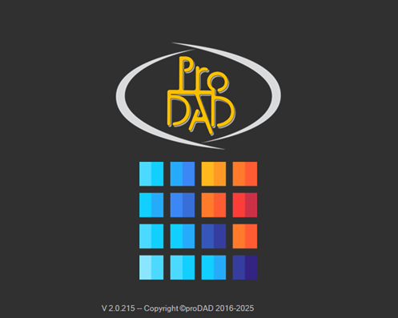

Disguise 2.0 software is a powerful application specifically designed for pixelating image content in videos. The resulting effect is called mosaic and is excellent for hiding sensitive or confidential information in videos.

Disguise's special strength lies in its effective and time-saving ability to easily process even very long videos with complex constellations. Whether you want to pixelate individuals, specific objects, or text, Disguise allows you to do it with precision and professionalism.

An outstanding feature of the software is the ability to use additional hardware, such as pedals, to make operation even easier and more intuitive. This allows users to simplify their video editing workflow while increasing productivity.

Disguise 1.0 has already gained an excellent reputation and is successfully used by many professional studios. With the new version 2.0, the features have been further improved and expanded to meet the increased demands of users.

Whether you're a professional video editor, a content creator, or a company that needs to protect sensitive data, Disguise 2.0 gives you the tools and efficiency to pixelate your videos quickly and accurately. With this software, you'll be able to ensure that confidential information remains protected while you get the job done efficiently.

> This documentation was written by Holger Burkarth. Translations were made by technical translators. 

## *p.1.1*  Table of content
- [*p* proDAD Disguise 2.0](#Root)
  - [*p.1.1* Table of content](#table-of-content)
  - [*p.1.2* New Disguise 2.0 Features (Phantom)](#new-features)
  - [*p.1.3* Licensing Models](#licensing-models)
  - [*p.1.4* System requirements](#system-requirements)
  - [*p.1.5* Change Log](#changelog)
  - [*p.1.6* About proDAD](#prodad)
  - [*p.1.7* Contact](#contact)
  - [*p.1.8* Copyright](#copyright)
- [*p.2* Main UI](#MainUI)
- [*W* Workshops](#workshops)
  - [*W.1* Quick Start](#workshop-quick-start) 
  - [*W.2* Layer order and protected mask](#workshop-layer-order)
  - [*W.3* Object Tracking](#workshop-tracking-object)
  - [*W.4* How to create a mask on a S3D video](#workshop-s3d-mask) 
- [ *A* Canvas](#A)
  - [ *A.1* Effect-Mask](#A.1)
  - [ *A.2* Edit-Button](#A.2)
  - [ *A.3* Rotation](#A.3)
  - [ *A.4* Start Tracking](#A.4)
  - [ *A.5* Start Teach-In](#A.5)
  - [ *A.6* Hide/View Mask](#A.6)
- [ *B* Inspector](#B)
  - [ *B.1* Effect-Parameter](#B.1)
    - [ *B.1.1* Parameter-Keyframes](#B.1.1)
    - [ *B.1.2* Clear](#B.1.2)
    - [ *B.1.3* Proportional](#B.1.3)
    - [ *B.1.4* Visible](#B.1.4)
    - [ *B.1.5* Mosaic Block Size](#B.1.5)
    - [ *B.1.6* Mosaic Smoothing](#B.1.6)
    - [ *B.1.7* Mask Bold](#B.1.7)
    - [ *B.1.8* Mask Smoothing](#B.1.8)
    - [ *B.1.9* S3D Depth](#B.1.9)
    - [ *B.1.10* Paint + Contour](#B.1.10)
  - [ *B.2* Information](#B.2)
  - [ *B.3* Media-Bin](#B.3)
    - [ *B.3.1* Media Properties](#B.3.1)
        - [*B.3.1.1* Camera Type](#B.3.1.1)
        - [*B.3.1.2* Frame Packing](#B.3.1.2)
        - [*B.3.1.3* Interpupillary Distance](#B.3.1.3)
    - [*B.3.2* Clone Media](#B.3.2)
    - [*B.3.3* Remove Media](#B.3.3)
  - [ *B.4* Output-Media](#B.4)
- [ *C* Timeline](#C)
  - [ *C.1* Timeline-Range](#C.1)
    - [ *C.1.1* Timeline-Range / Mode](#C.1.1)
    - [ *C.1.2* Timeline-Range / Select](#C.1.2)
  - [ *C.2* Ruler](#C.2)
  - [ *C.3* Layer](#C.3)
    - [ *C.3.1* Layer / Edit](#C.3.1)
    - [ *C.3.2* Layer / Select](#C.3.2)
    - [ *C.3.3* Layer / Navigate](#C.3.3)
    - [ *C.3.4* Layer / Style](#C.3.4)
    - [ *C.3.5* Layer / Types](#C.3.5)
  - [ *C.4* Keyframe](#C.4)
    - [ *C.4.1* Keyframe / Edit](#C.4.1)
    - [ *C.4.2* Keyframe / Select](#C.4.2)
    - [ *C.4.3* Keyframe / Navigate](#C.4.3)
  - [ *C.5* Time-Cursor](#C.5)
    - [ *C.5.1* Style](#C.5.1)
  - [ *C.6* Timeline-Title](#C.6)
  - [ *C.7* Snapping-Switch](#C.7)
  - [ *C.8* Timeline-Zoom](#C.8)
  - [ *C.9* Timeline-Scrollbar](#C.9)
    - [*C.10* Timeline Context-Menu](#C.10) 
      - [*C.10.1* Cut, Copy, Paste](#C.10.1)
      - [*C.10.2* Special Copy, Paste](#C.10.2)
      - [*C.10.3* Delete](#C.10.3)
      - [*C.10.4* Delete keyframes until end position ](#C.10.4)
      - [*C.10.5* Set Work-Area to the Layer(s)](#C.10.5)
      - [*C.10.6* Group, Un-group](#C.10.6)
      - [*C.10.8* Add Timeline until time cursor](#C.10.8)
      - [*C.10.9* Split Timeline at time cursor](#C.10.9)
      - [*C.10.10* New Timeline for selected Layer(s)](#C.10.10)
      - [*C.10.11* Split the time range into separate timeline](#C.10.11)
      - [*C.10.12* Compress Timeline](#C.10.12)
      - [*C.10.13* Select All](#C.10.13)
      - [*C.10.14* Go to Layer](#C.10.14)
- [ *D* Optional Views](#D)
    - [*D.1* Input Device](#D.1)
    - [*D.2* Presets](#D.2)
    - [*D.3* Timelines](#D.3)
    - [*D.4* ToDo Markers](#D.4)
    - [*D.5* Media Bin](#D.5)
    - [*D.6* Layers](#D.6)
    - [*D.7* Object Viewer](#D.7)
    - [*D.8* Undo-Protocol](#D.8)
    - [*D.9* Processing-Events](#D.9)
- [ *E* Ribbon Menu](#E)
  - [ *E.1* Import/Export Media-Files](#E.1)
    - [ *E.1.1* Import Media-Files](#E.1.1)
    - [ *E.1.2* Export Media-Files](#E.1.2)
  - [ *E.2* Mask Edit](#E.2)
  - [ *E.3* Layer](#E.3)
    - [ *E.3.1* Delete-Layer](#E.3.1)
    - [ *E.3.2* Layer-Group](#E.3.2)
      - [ *E.3.2.3* Mosaic effect anchor point for spherical videos](#E.3.2.3)
    - [ *E.3.3* Effect-Lift](#E.3.3)
    - [ *E.3.4* Layer-Order](#E.3.4)
    - [ *E.3.5* Exclude-Layer](#E.3.5)
    - [ *E.3.6* Enable-Layer](#E.3.6)
    - [ *E.3.7* Lock-Layer](#E.3.7)
    - [ *E.3.8* AI-Layer](#E.3.8)
    - [ *E.3.9* Add Layer](#E.3.9)
  - [ *E.4* Canvas View-Mode](#E.4)
    - [ *E.4.1* View Result](#E.4.1)
    - [ *E.4.2* View Source](#E.4.2)
    - [ *E.4.3* View Mixture](#E.4.3)
    - [ *E.4.4* Show only selected objects](#E.4.4)
    - [ *E.4.5* Show all objects](#E.4.5)
    - [ *E.4.6* Solid objects](#E.4.6)
  - [ *E.5* Timeline View-Mode](#E.5)
    - [*E.5.1* Compacted](#E.5.1)
    - [*E.5.2* Keyframes](#E.5.2)
    - [*E.5.3* Mosaic Keyframes](#E.5.3)
  - [ *E.6* S3D-Video Options](#E.6)
    - [*E.6.1* Show Grid](#E.6.1)
    - [*E.6.2* View Mode](#E.6.2)
    - [*E.6.3* Zero Depth](#E.6.3)
    - [*E.6.4* Set Object Depth](#E.6.4)
    - [*E.6.5* Link with edit Object](#E.6.5)
- [ *F* Project](#F)
  - [ *F.1* Project Menu](#F.1)
    - [ *F.1.1* New Project](#F.1.1)
    - [ *F.1.2* Open Project](#F.1.2)
    - [ *F.1.3* Append Project](#F.1.3)
    - [ *F.1.4* Save Project](#F.1.4)
    - [ *F.1.5* Save Project as](#F.1.5)
    - [ *F.1.6* Import Media](#F.1.6)
    - [ *F.1.7* Export Media](#F.1.7)
    - [ *F.1.8* Create Team Project](#F.1.8)
    - [ *F.1.9* Import Team Project](#F.1.9)
    - [ *F.1.10* Project Settings](#F.1.10)
      - [ *F.1.10.1* Project](#F.1.10.1)
      - [ *F.1.10.2* User Interface](#F.1.10.2)
      - [ *F.1.10.3* Input Device](#F.1.10.3)
        - [ *F.1.10.3.1* Pedals](#F.1.10.3.1)
        - [ *F.1.10.3.2* MIDI](#F.1.10.3.2)
      - [ *F.1.10.4* Editing](#F.1.10.4)
        - [ *F.1.10.4.1* Object Tracker](#F.1.10.4.1)
        - [ *F.1.10.4.2* Layer](#F.1.10.4.2)
  - [ *F.2* Undo/Redo](#F.2)
- [ *G* Tutorials / Info / Updates](#G)
- [ *H* Timeline Tools](#H)
- [ *J* Playback Control](#J)
  - [ *J.1* Auto-Repeat](#J.1)
  - [ *J.2* Play/Stop](#J.2)
  - [ *J.3* Jump to Begin/End](#J.3)
  - [ *J.4* Playback-Speed](#J.4)
- [*p.3.1* Keyboard Short-Cuts](#short-cuts)
- [*p.3.2* Keyboard Super-Codes](#super-short-cuts)
- [*p.3.3* Devices](#devices)
  - [*p.3.3.1* Pedals](#devices-pedals)
  - [*p.3.3.2* MIDI](#devices-midi)
  - [*p.3.3.3* Keyboard](#devices-keyboard)
    - [*p.3.3.3.1* Logitech G13 Short-Cuts](#devices-Logitech-g13)

## *p.1.2*  New Disguise 2.0 Features (Phantom)

> See also [*p.1.5* Change Log](#changelog)

Disguise version 2.0 offers a number of new features that further improve usability and efficiency. Here is an overview of the most important new features:

- Undo/Redo and Edit History: The software now allows users to undo and redo editing steps, with an option to view the edit history log. This allows users to maintain full control over their changes and easily track them.

- Unified object tracking: Object tracking (mask tracking) has been unified. Both the automatic Object Tracker and manual mouse tracking can now be used in the same way. Various input methods, such as [pedals](#devices-pedals), the keyboard, or video playback controls, can be used. The same customization options are available in tracker mode.

- Faster object tracking: Object tracking and manual tracking are now faster, especially with long videos/timelines. This makes editing large projects more efficient.

- Improved keyframe handling: Unnecessary keyframes are avoided in both object tracking and manual tracking. This results in faster loading and saving of project files.

- Keyframe display in the Timeline: Keyframes for selected effect parameters (e.g., Mosaic) can now be displayed in the Timeline. This allows for precise control and adjustment of effects at different points in the video.

- Revised video export: Video export has been completely redesigned to support new formats and hardware acceleration. Rendering speed has been significantly increased, allowing users to export videos faster.

- Easily show/hide UI elements: Showing and hiding UI elements is now easier and customizable to meet individual user needs.

- Improved multi-monitor and high-resolution display support: The user interface adapts better to the resolution of different monitors for optimal viewing.

- Refreshed user interface look and feel: The user interface has been visually redesigned to provide a modern and appealing appearance.

- Improved performance: Many features of the software run faster than in the previous version. Overall software responsiveness has been increased to provide a smoother and more efficient experience.

With these new features, Disguise 2.0 offers an improved user experience, faster editing times, and more control over the pixelation of image content in videos.

> :bulb: Compatibility with previous versions Phantom 1.0 and 1.5 has been maintained. Projects created in those versions can be loaded, and operation is largely the same. This allows an immediate transition to the new version without a significant training period.

> :exclamation: Projects from versions Phantom 1.0 and 1.5 can be opened. They are automatically converted to version 2.0 format and should be saved with the new extension ".phantom". However, a project file saved with version 2.0 cannot be opened with version 1.5 or 1.0.

## *p.1.3*  Licensing Models
Features are enabled by different license tiers. The following table compares the features and the required licenses. Each higher tier includes the features of the previous tiers and adds new features. The highest license includes all available features.

| Feature | Limited | Standard | Extended | More |
|--|--|--|--|--|
|Project files  | *[x]* | *[x]* | *[x]* |  |
|Unlimited Videos| *[x]* | *[x]* | *[x]* |  |
|Export Result-Video| *[x]* | *[x]* | *[x]* |  |
|Object-Tracker | *[x]* | *[x]* | *[x]* | [Object Tracking](#workshop-tracking-object) |
|FX-Presets     |       | *[x]* | *[x]* | [Presets](#D.2) |
|Effect-Lift    |       | *[x]* | *[x]* | [Effect-Lift](#E.3.3) |
|Pedals Device  |       | *[x]* | *[x]* | [Pedals](#devices-pedals) |
|MIDI Device    |       | *[x]* | *[x]* | [MIDI](#devices-midi) |
|Extra Keyboard |       | *[x]* | *[x]* | [Keyboard](#devices-keyboard) |
|S3D Video      |       |       | *[x]* | [Camera Type](#B.3.1) | 
|Sub-Timelines  |       |       | *[x]* | [Timelines](#D.3) |
|Object Viewer  |       |       | *[x]* | [Object Viewer](#D.7) |
|Layers View    |       |       | *[x]* | [Layers](#D.6) |
|TODO List      |       |       | *[x]* | [ToDo Markers](#D.4) |
|Undo Protocol  |       |       | *[x]* | [Undo-Protocol](#D.8) |
|Create Team Projects | |       | *[x]* | [Create Team Project](#F.1.8) |
|Import Team Projects | |       | *[x]* | [Import Team Project](#F.1.9) |

## *p.1.4*  System requirements
- 64-bit Windows 7, 8, 10 or 11 
- Minimum 8 GB of RAM, 16 GB of RAM recommended

## *p.1.6*  About proDAD

proDAD is a renowned company specializing in developing and distributing high-quality video and image editing software. Since its founding in 1990, proDAD has established itself as a leading provider of innovative solutions for professional video editing.

The proDAD company is characterized by a distinctive expertise in the areas of digital image and video technology as well as software development. With a dedicated team of experienced developers and designers, the company works continuously to develop advanced solutions that meet the needs of professional users.

proDAD's software products offer a wide range of features and tools for optimizing, editing and enhancing video and images. The solutions are characterized by an intuitive user interface, high performance and excellent quality. Suitable for both beginners and experienced professionals, they offer a wide range of effects, filters, stabilization techniques and other tools to improve the visual quality of media content.

One of proDAD's main focuses is video stabilization. The company has developed several patented techniques to effectively reduce shake and jitter in video and achieve consistent, professional-quality image stabilization. This technology is used by many professionals in the film industry, television productions and sports footage.

proDAD is known for its close collaboration with leading video editing software manufacturers. The company's products are offered as stand-alone software solutions, but can also be seamlessly integrated into existing video editing programs. As a result, users benefit from enhanced features and capabilities to create their video projects at a professional level.

With years of experience, technical innovation and a strong focus on customer satisfaction, proDAD has established itself as a trusted partner in the video editing industry. The company's software solutions are used by professional video editors, filmmakers, YouTubers and other creators worldwide to produce stunning visual content.

## *p.1.7*  Contact us

We at [proDAD](#prodad) are happy to answer any questions you may have about our program. 

Simply contact us 
- by email: [support@prodad.com](mailto:support@prodad.com) 
- by phone: +49 (0)7462 9459 0
- by postal mail: proDAD GmbH, Gauertstr. 2, 78194 Immendingen, Germany
- homepage: [www.proDAD.com](https://www.prodad.com)

:bulb: If you have any questions or problems, please email customer support at [support@prodad.com](mailto:support@prodad.com) 
See also [*G.2.1* Support Protocol](#G.2.1)

## *p.1.8*  Copyright
Copyright proDAD GmbH. All rights reserved. 

License Terms and Conditions  
Please read this license agreement carefully before installing the software. 

License Agreement  
When the setup starts, a license agreement is displayed, which you should read carefully. 
By installing the software, you agree to be bound by the copyright terms, the license agreement, and the licensing procedure. 

License Warranty  
proDAD GmbH grants the user the right to use this product for its intended and permitted purpose. This product may only be installed on one computer. proDAD guarantees to provide a license key free of charge. By installing this product, the user acknowledges and accepts the license guarantee, the copyright conditions and the limitation of liability. 

Trademark Notice  
All products and trademarks mentioned in connection with this product are trademarks of their respective owners. All trademarks are used without warranty of free use and may be registered trademarks. 

Limitation of Liability   
The extent of liability for any claim is limited to replacement of the product. This applies to proDAD GmbH, all licensees and resellers. Claims will only be accepted if the software is returned in an orderly manner, together with the return number to be agreed with proDAD GmbH in advance. Proof of purchase must also be enclosed. This warranty is void if a malfunction of this product is due to misuse, abuse, accident or improper handling. proDAD GmbH, its distributors and licensees are not liable for damages or consequential damages resulting from the inability to use this product. Liability is limited to the purchase price of the product. 

Documentation   
The manual has been compiled and translated with the utmost care. However, the possibility of errors cannot be completely excluded. proDAD GmbH assumes no responsibility or liability for the consequences of any incorrect statements or information contained in the documentation or translation. Subject to technical and optical changes. Information about possible inaccuracies is always welcome. 

Copyright notice   
The software and its components are the property of proDAD GmbH. By installing this product, the licensee agrees to refrain from unauthorized use and reproduction. 

proDAD GmbH assumes no responsibility for the use of this program and the publication of its contents and data created with this program.  

ProDAD GmbH * Gauertstr. 2 * 78194 Immendingen * Germany * HRB 1077 

# *p.2*  Main UI

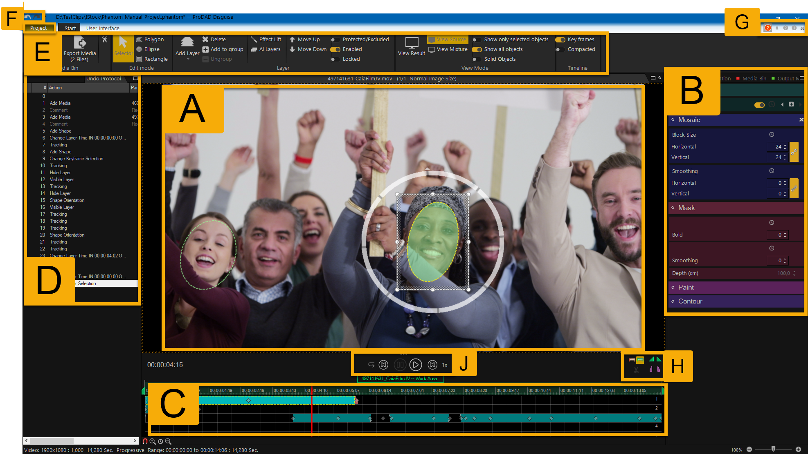

+ [*A* Canvas](#A) 
+ [*B* Inspector](#B)
+ [*C* Timeline](#C)
+ [*D* Optional Views](#D)
+ [*E* Ribbon Menu](#E)
+ [*F* Project](#F)
+ [*G* Tutorials / Application Info / Update News](#G)
+ [*H* Timeline Tools](#H)
+ [*J* Playback Control](#J)

#  *W* Workshops

+ [*W.1* Quick Start](#workshop-quick-start) 
+ [*W.2* Layer order and protected mask](#workshop-layer-order) 
+ [*W.3* Object Tracking](#workshop-tracking-object) 
+ [*W.4* How to create a mask on a S3D video](#workshop-s3d-mask) 

##  *W.1* Quick Start
Here are the steps to open a video for editing and pixelate a person's face.

> 1. Open the video you want to edit using the Import Media button.

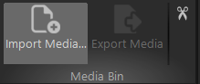

> 2. Select the appropriate mask shape (e.g., Ellipse) from the Ribbon and draw a frame over the face in the Canvas.

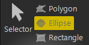

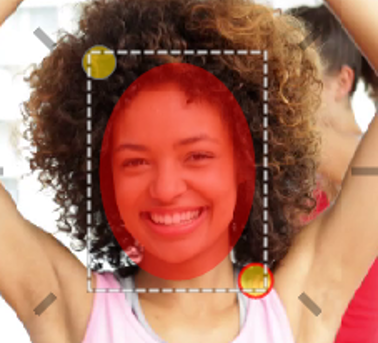

> 3. Confirm the new mask you have created by clicking the Apply button (usually appears after drawing).

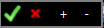

> 4. Start the Object Tracker to easily capture any movement. 
Click the Tracker icon on the mask overlay, press the <kbd>T</kbd> key, or double-click the mask.

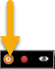

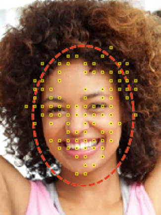

> :exclamation: Once the tracker is started, the mouse pointer will "stick" to the mask. Any mouse movement is transferred to the position of the mask. During object tracking, the mouse cannot be used to select other UI options until tracking is stopped.

> 5. The capture of the movements is done by advancing through the video timeline.
The keys of the keyboard (<kbd>B</kbd>;<kbd>N</kbd>;<kbd>NP-4</kbd>;<kbd>NP-6</kbd>) can be used for frame-by-frame movement. In addition, the <kbd>SPACE</kbd> bar can be used for playback. Foot pedals are often best suited for precise control of the speed, allowing continuous adjustment while tracking.  
 

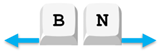

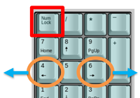

> :bulb: To effectively support your professional work, we recommend the use of additional equipment. These can help you increase your productivity, streamline your workflow, and achieve high processing quality. Here are some recommended accessories: [*Pedals*](#devices-pedals) [*MIDI*](#devices-midi) [*Keyboard*](#devices-keyboard)

> 6. During tracking, the position of the mask can be adjusted by moving the mouse. Use the <kbd>UP</kbd>/<kbd>DOWN</kbd> arrow keys to adjust the size proportionally. Hold down the <kbd>SHIFT</kbd> key while dragging to constrain movement horizontally or vertically (if applicable). Use the <kbd>LEFT</kbd>/<kbd>RIGHT</kbd> arrow keys to rotate the mask. 

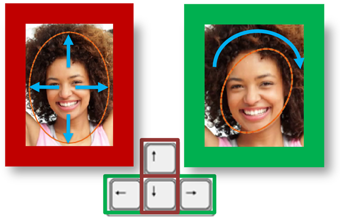

> 7. You can correct the mask's position at any time by clicking and dragging it with the mouse.
   
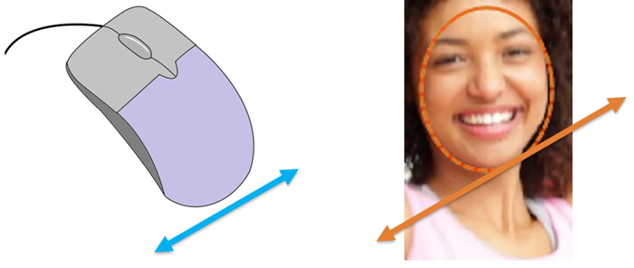

> 8. The Timeline displays keyframes representing the mask's position and properties over time as you work.
     
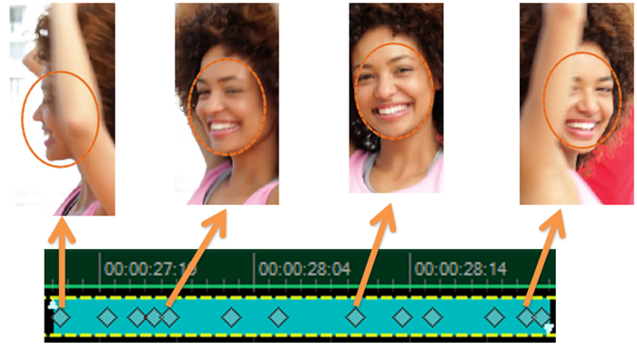

> 9. Object tracking is completed with a single mouse click (or sometimes pressing <kbd>ESC</kbd> to cancel changes since starting tracking).
    
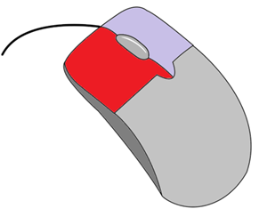

> 10. The final result can be checked by switching the Canvas view mode (e.g., to 'View Result').
       
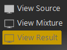

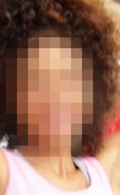

##  *W.2* Layer order and protected mask

Sometimes, an object in the foreground needs to remain unaffected by the pixelation applied to the background or another object. For such tasks, an Exclude layer (protection mask) can be used to cover the object you want to protect. Arrange the layers in the Timeline to achieve the desired protection effect.

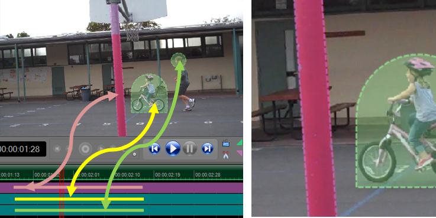

> :bulb: In the Timeline, the Exclude layer must be placed *above* the effect layer it needs to modify. The layer order determines how effects interact.

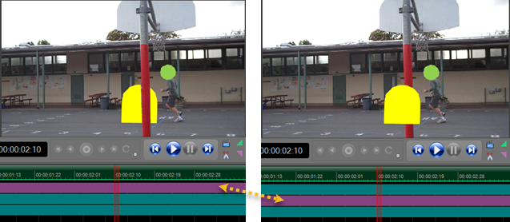

See also: [*E.3.4* Layer Order](#E.3.4), [*E.3.5* Exclude Layer](#E.3.5)

##  *W.3* Object Tracking
Tools are provided to keep a mask positioned over an object across multiple video frames. The Object Tracker automatically follows the object, adapting the mask to its movement, rotation, and size changes. You can assist the process with mouse movements and keyboard shortcuts during tracking.

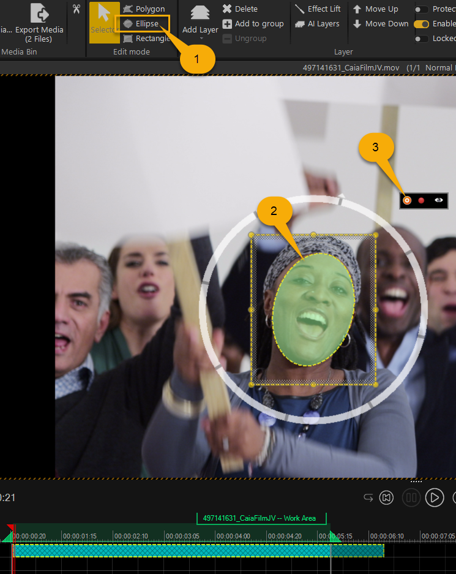

1. Select a suitable mask shape from the Ribbon [*E.2*](#E.2).
2. Create a mask over the object by drawing a bounding box with the mouse in the Canvas [*A*](#A).
3. Click the appropriate tracking button ([*A.4*](#A.4) or [*A.5*](#A.5)) on the mask overlay to start tracking.

, Start Teach-In (A.5)")

[*A.5* Start Teach-In](#A.5) allows object tracking primarily by manually guiding the mask with the mouse as the video plays or steps through. In complex scenes with overlapping objects or other disturbances, this method can sometimes lead to a faster result if automatic tracking struggles.

[*A.4* Start Tracking](#A.4) is recommended for semi-automatic object tracking. It attempts to follow the object automatically, potentially considering rotations and size changes. Manual corrections can be made at any time with the mouse or keyboard without interrupting the automatic process.

> Our recommendation is usually [*A.4* Start Tracking](#A.4).

Select your preferred tracker to start the process.

> :bulb: [*A.4* Start Tracking](#A.4) can also be started by double-clicking on the mask or pressing the <kbd>T</kbd> key.

>:exclamation: A mouse click typically completes the tracking operation and accepts all the changes made. Pressing the <kbd>ESC</kbd> key usually cancels the tracking operation, discarding any changes made since tracking started.

During the tracking action (either mode), the mask's position can be adjusted by moving the mouse. The <kbd>UP</kbd>/<kbd>DOWN</kbd> arrow keys can be used to adjust the size proportionally. Hold down the <kbd>SHIFT</kbd> key while dragging to constrain movement horizontally or vertically (if supported). Use the <kbd>LEFT</kbd>/<kbd>RIGHT</kbd> arrow keys to rotate the mask.

> :bulb: To effectively support your professional work, we recommend the use of additional equipment. These can help you increase your productivity, streamline your workflow, and achieve high processing quality. Here are some recommended accessories: [*Pedals*](#devices-pedals) [*MIDI*](#devices-midi) [*Keyboard*](#devices-keyboard)

> The mouse remains attached to the mask throughout the tracking process. Any movement is immediately transferred to the mask, so even long scenes can potentially be edited with ease and without fatigue.

You now need to advance the time cursor through the segment you are editing. The following methods are available:
- Play the video, possibly at a slower speed: See [*J* Playback Control](#J) for more details.
- Navigate the video frame by frame: See [*C.5* Time-Cursor](#C.5) for more details.
- Navigate through the video using pedals: See [*F.1.10.3.1* Pedals](#F.1.10.3.1) for more details.

One click stops the tracking.

> :bulb: The tracking markers displayed (usually small points within or around the mask when using *A.4*) indicate which features the tracker is monitoring.
> These markers can often be hidden by pressing <kbd>F</kbd> during tracking.

##  *W.4* How to create a mask on a S3D video
Shows how to create a mask on an object when working with stereoscopic (S3D) spherical video. 
Setting the correct zero depth ensures the mask aligns properly for both left and right eyes with minimal adjustment.

Import the video and configure the appropriate settings for the S3D video in the Media Bin properties:
- [*B.3.1.1* Camera Type](#B.3.1.1) (Set to Spherical)
- [*B.3.1.2* Frame Packing](#B.3.1.2) (e.g., Top-Bottom, Left-Right)

Select an S3D view mode (e.g., Anaglyph or Depth-Mix) in the Ribbon [*E.6*](#E.6) to visualize the spatial depth of objects in the Canvas [*A*](#A).
- [*E.6.2* View Mode](#E.6.2)

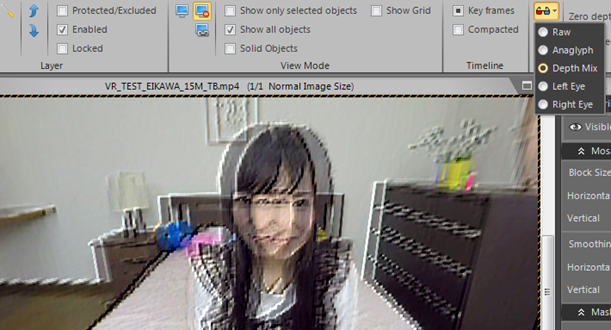

Adjust the Zero Depth parameter ([*E.6.3*](#E.6.3)) until the target object shows minimal or no parallax shift between the left and right eye views (it should appear 'flat' or aligned in Depth-Mix or Anaglyph view). The goal is to place the virtual "screen plane" at the depth of the object you want to mask.

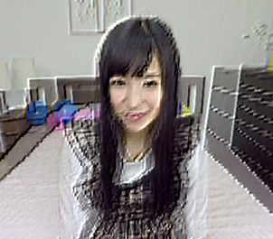 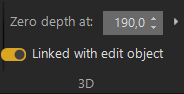

Select an appropriate mask shape ([*E.2*](#E.2)) and drag it onto the object in the Canvas. 
- [*E.2* Mask Edit](#E.2)

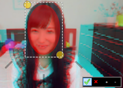

After confirming the mask creation, the mask and its assigned layer are created. The current zero depth value might be automatically applied to the mask's depth property ([*B.1.9*](#B.1.9)), or you might need to explicitly set it using [*E.6.4* Set Object Depth](#E.6.4).

See also:
- [*E.3.2* Layer-Group](#E.3.2) (Useful for grouping masks that should share the same depth)

#  *A* Canvas

The canvas is a crucial part of the user interface. It allows the user to create and modify the editing mask by defining its shape, position, and size using the mouse or keyboard. It also displays the final result of the edit by applying the mask effect to the original image. The canvas provides controls directly on the mask overlay for common actions like tracking. Tracking is a function that automatically (or semi-automatically) adjusts the mask to the movement of an object in the video.

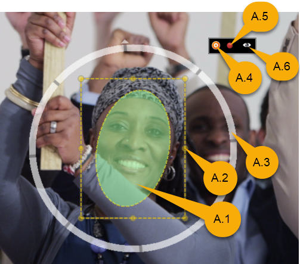

+ [*A.1* Effect-Mask](#A.1) 
+ [*A.2* Edit-Button](#A.2) 
+ [*A.3* Rotation](#A.3) 
+ [*A.4* Start Tracking](#A.4) 
+ [*A.5* Start Teach-In](#A.5) 
+ [*A.6* Hide/View Mask](#A.6) 

##  *A.1* Effect-Mask

The mask defines the area where the effect (e.g., mosaic) will be applied to the video. The shape of the mask can be selected from the Ribbon [*E.2* Mask Edit](#E.2). A mask can either define the area where the effect *will* be applied (standard layer) or a safe area where *no* effect will be visible (Exclude layer, see [*E.3.5*](#E.3.5)).

##  *A.2* Edit-Button

These are the handles (usually small squares or circles) on the selected mask's bounding box. To adapt the mask to the desired object, you can change its size and position. First, select the mask by clicking on it. You can then click and drag the edit handles to resize the mask. Click and drag the mask itself (not the handles) to move it. You can also use the keyboard: Use the <kbd>ARROW</kbd> keys to nudge the mask's position. While holding down the mouse button on a handle, you might be able to use the <kbd>UP</kbd>/<kbd>DOWN</kbd> arrow keys to change the mask's size proportionally. Holding down the <kbd>SHIFT</kbd> key while dragging a handle might constrain the aspect ratio, or while dragging the mask might constrain movement to horizontal/vertical axes. Use the <kbd>LEFT</kbd>/<kbd>RIGHT</kbd> arrow keys (possibly while holding a modifier like <kbd>CTRL</kbd> or <kbd>ALT</kbd>, or during tracking) to rotate the mask (see [*A.3*](#A.3)).

##  *A.3* Rotation

Rotate the selected mask. This might be done by dragging a dedicated rotation handle (if available) or using keyboard shortcuts like the <kbd>LEFT</kbd>/<kbd>RIGHT</kbd> arrow keys, especially during tracking ([*A.4*](#A.4), [*A.5*](#A.5)).

##  *A.4* Start Tracking

Starts the semi-automatic object tracking process. This button usually appears on the mask overlay when the mask is selected. Tracking can often also be started by double-clicking on the mask or pressing the <kbd>T</kbd> key. 

>:exclamation: A mouse click typically completes the tracking operation and accepts the generated keyframes. Pressing the <kbd>ESC</kbd> key usually cancels the tracking action, discarding the keyframes generated during that tracking session.

During the tracking action, you can assist the tracker by adjusting the mask's position by moving the mouse. Use the <kbd>UP</kbd>/<kbd>DOWN</kbd> arrow keys to adjust the size proportionally. Hold down the <kbd>SHIFT</kbd> key for constrained movement/resizing if needed. Use the <kbd>LEFT</kbd>/<kbd>RIGHT</kbd> arrow keys to rotate the mask. See Workshop [*W.3* Object Tracking](#workshop-tracking-object).
  

##  *A.5* Start Teach-In

Starts the manual tracking ("Teach-In") mode. This button usually appears on the mask overlay. In this mode, the mask follows the mouse cursor as you move the time cursor forward (e.g., using playback or pedals). You manually guide the mask frame by frame or during playback. See Workshop [*W.3* Object Tracking](#workshop-tracking-object).

[See Tracking Controls under A.4](#A.4)

##  *A.6* Hide/View Mask

Toggles the visibility of the *effect* associated with the selected mask at the current time position on the Timeline. An invisible mask has no effect calculated at that specific point in time (a keyframe is typically created for the visibility parameter). Also available by pressing the <kbd>H</kbd> key when a mask is selected.

See also:
- [Parameter: Visible](#B.1.4) 
- [Layer Edit: Visibility Indicator](#C.3.1)

#  *B* Inspector

The Inspector panel typically displays detailed properties and settings for the currently selected item (e.g., a mask/layer, media file, or the overall project).

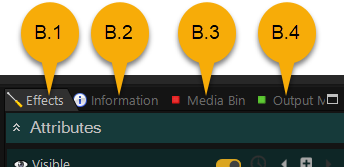

+ [*B.1* Effect-Parameter](#B.1) 
+ [*B.2* Information](#B.2) 
+ [*B.3* Media-Bin](#B.3) 
+ [*B.4* Output-Media](#B.4) 

##  *B.1* Effect-Parameter

Displays and allows editing of the parameters for the effect applied by the selected mask/layer.

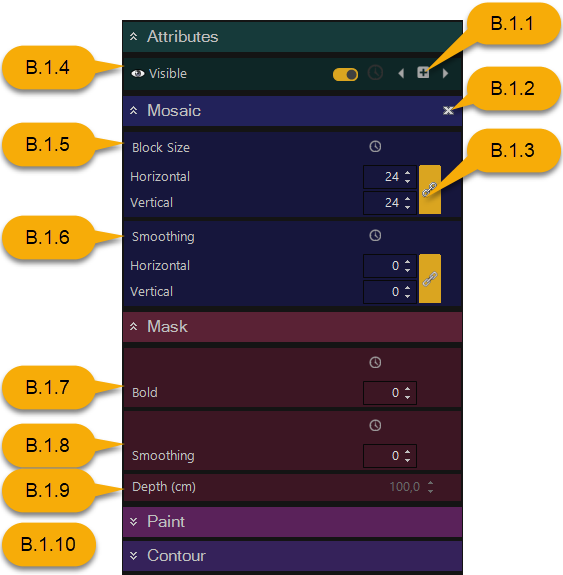

+ [*B.1.1* Parameter-Keyframes](#B.1.1) 
+ [*B.1.2* Clear](#B.1.2) 
+ [*B.1.3* Proportional](#B.1.3) (Relates to Size/Scale parameters if present)
+ [*B.1.4* Visible](#B.1.4) 
+ [*B.1.5* Mosaic Block Size](#B.1.5) 
+ [*B.1.6* Mosaic Smoothing](#B.1.6) 
+ [*B.1.7* Mask Bold](#B.1.7) 
+ [*B.1.8* Mask Smoothing](#B.1.8) 
+ [*B.1.9* S3D Depth](#B.1.9) 
+ [*B.1.10* Paint + Contour](#B.1.10) (Likely relates to fill color/opacity and outline settings for certain mask types)

###  *B.1.1* Parameter-Keyframes
Controls whether a parameter can change over time (be keyframed) or remain constant.

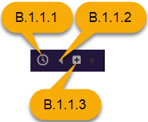

- *B.1.1.1* Enable/Disable Keyframe-Control: Click the clock icon or checkbox to enable/disable keyframing for this parameter.
- *B.1.1.2* Previous/Next Keyframe: Jumps the time cursor to the previous or next keyframe *for this specific parameter* on the selected layer.
- *B.1.1.3* Add/Delete Keyframe: Sets or deletes a keyframe for this parameter at the current time cursor position.

See also:
- [*E.5.3* Timeline Mosaic Keyframes](#E.5.3) (Visual indication of parameter keyframes on the timeline)
---

###  *B.1.2* Clear
Resets the parameters in this section (or possibly just the selected parameter) to their default values.

###  *B.1.3* Proportional
When adjusting size parameters (like width and height, if applicable here beyond the mask shape itself), this option links them to maintain the current aspect ratio.

###  *B.1.4* Visible
Controls the visibility of the effect mask at the current time cursor position. Unchecking this makes the effect inactive at this time. This parameter can be keyframed ([*B.1.1*](#B.1.1)).

See also:
- [Hide/View Mask Button](#A.6)
- [Layer Edit: Visibility Indicator](#C.3.1)

###  *B.1.5* Mosaic Block Size
Adjusts the size of the individual pixel blocks in the mosaic effect. Larger values result in coarser pixelation.

| Block Size: 10 | Block Size: 20 | Block Size: 40 |
|--|--|--|
|  | 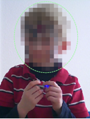 | 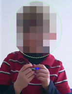 |

See also:
- [*E.3.2* Layer-Group](#E.3.2) (Common parameters for grouped layers)
- [*E.3.2.3* Mosaic effect anchor point for spherical videos](#E.3.2.3)
- [*C.3.5* Layer / Types](#C.3.5)
- [*E.5.3* Timeline Mosaic Keyframes](#E.5.3) (Shows keyframes for this parameter on the timeline)

###  *B.1.6* Mosaic Smoothing
Applies a smoothing filter to the edges of the mosaic blocks, reducing harsh transitions. Higher values increase smoothing.

| Smoothing: 0 | Smoothing: 3 | Smoothing: 7 |
|--|--|--|
| ") | 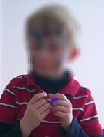 | 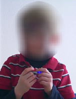 |

See also:
- [*E.3.2* Layer-Group](#E.3.2)
- [*E.3.2.3* Mosaic effect anchor point for spherical videos](#E.3.2.3)
- [*C.3.5* Layer / Types](#C.3.5)

###  *B.1.7* Mask Bold
Expands (positive values) or contracts (negative values) the mask area. This effectively makes the mask boundary thicker or thinner.

| Bold: 0 | Bold: 40 |
|--|--|
| 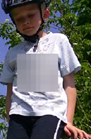 | ") |

###  *B.1.8* Mask Smoothing
Softens the edge of the mask, creating a gradual transition between the effected and unaffected areas (feathering). Higher values increase the feathering distance.

| Smoothing: 0 | Smoothing: 40 |
|--|--|
| ") | ") |

###  *B.1.9* S3D Depth
For stereoscopic (S3D) videos, this parameter likely defines the perceived depth of the mask itself. This should ideally match the depth of the object being masked for correct rendering in 3D. This value might be set automatically when creating the mask at a specific [*E.6.3* Zero Depth](#E.6.3) setting or adjusted manually here.

See also:
- [*E.6.4* Set Object Depth](#E.6.4)
- [*W.4* How to create a mask on a S3D video](#workshop-s3d-mask)
- [*E.3.2.3* Mosaic effect anchor point for spherical videos](#E.3.2.3)

###  *B.1.10* Paint + Contour
These parameters likely control the appearance if the mask is used not just for mosaic but perhaps for overlaying a solid color or outline.
*   **Paint:** Controls the fill color and its opacity/transparency.
*   **Contour:** Controls the appearance (color, thickness, style) of an outline around the mask shape.

| Paint/Opacity: 100% | Paint/Opacity: 50% |
|--|--|
| 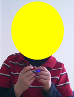 | 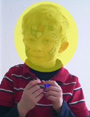 |

##  *B.2* Information

:hourglass_flowing_sand: Under construction
(This section likely displays metadata about the selected item, like duration, resolution, file path, etc.)

##  *B.3* Media-Bin

This section or view lists the video files imported into the current project. Selecting a media file here likely displays its properties in the Inspector.

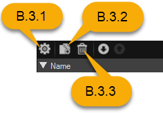

- [*B.3.1* Media Properties](#B.3.1) (Button to open properties dialog for selected media)
- [*B.3.2* Clone Media](#B.3.2) (Button to duplicate selected media entry)
- [*B.3.3* Remove Media](#B.3.3) (Button to remove selected media from the project)

###  *B.3.1* Media Properties
Opens a dialog to view and edit properties of the selected video file within the project context.

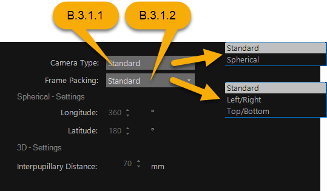

- [*B.3.1.1* Camera Type](#B.3.1.1)
- [*B.3.1.2* Frame Packing](#B.3.1.2)
- [*B.3.1.3* Interpupillary Distance](#B.3.1.3)

####  *B.3.1.1* Camera Type

Defines the type of camera lens used, primarily important for correct projection mapping.
*   __Standard__: Normal rectilinear camera view.
*   __Spherical__: Camera with a 360° or partial spherical field of view (Equirectangular projection usually assumed).

> :exclamation: For Spherical video, the Frame Packing setting ([*B.3.1.2*](#B.3.1.2)) is crucial for correct display and processing in the canvas.

####  *B.3.1.2* Frame Packing

Specifies how the views for stereoscopic (S3D) or multi-view video are arranged within the single video frame.
*   __Mono__: Standard single view video.
*   __Left-Right__ (or Side-by-Side): Left eye view is in the left half, right eye view in the right half. Can be full width (squashed) or half width.
*   __Top-Bottom__ (or Over-Under): Left eye view is in the top half, right eye view in the bottom half.

##### Examples of different spherical videos with a horizontal image arrangement (__Left-Right__).  

|Longitude: 360° Latitude: 180° (Full Spherical S3D)| Longitude: 180° Latitude: 180° (Hemispherical S3D) |
|--|--|
|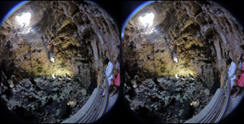|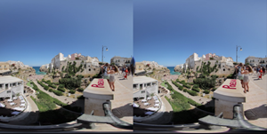|

---
##### Examples of different spherical videos with a vertical image arrangement (__Top-Bottom__).  

|Longitude: 360° Latitude: 180° (Full Spherical S3D) |
|--|
|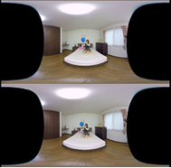|

---

####  *B.3.1.3* Interpupillary Distance
The interpupillary distance (IPD), or eye spacing, is used in stereoscopic spherical videos for correct display scaling and accurate processing of the spatial relationship between the two video sources.

The value directly influences the perception of spatial depth and scale. An average human IPD is around 65-70 mm. Setting this correctly helps ensure the 3D effect appears natural.

See also:
- [*W.4* How to create a mask on a S3D video](#workshop-s3d-mask)
- [*B.1.9* S3D Depth](#B.1.9) (Mask depth parameter)
- [*E.3.2* Layer-Group](#E.3.2) (Grouping S3D masks)
- [*E.6* S3D-Video Options](#E.6) (Ribbon controls for S3D editing)

###  *B.3.2* Clone Media
:hourglass_flowing_sand: Under construction
(Likely duplicates the selected media item in the bin, possibly useful for applying different effects or edits to the same source footage in different contexts within the project).

###  *B.3.3* Remove Media
:hourglass_flowing_sand: Under construction
(Removes the selected media file reference from the project. This usually doesn't delete the original file from the disk but removes it from the Media Bin and potentially any timelines using it).

##  *B.4* Output-Media

:hourglass_flowing_sand: Under construction
(This section might display properties related to the final exported video, possibly allowing configuration of export settings directly in the Inspector before initiating the export process).

#  *C* Timeline

The Timeline provides a visual representation of your video project over time, showing the arrangement of media clips, layers, effects, and keyframes.

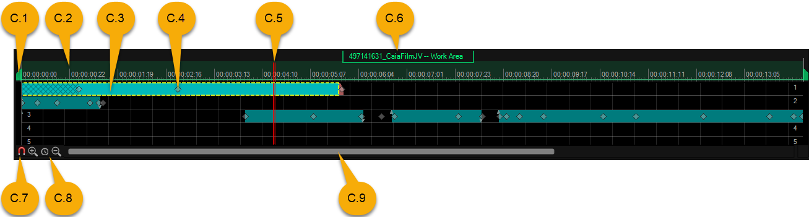

+ [*C.1* Timeline-Range](#C.1) (Markers for defining specific time ranges)
+ [*C.2* Ruler](#C.2) (Time scale indicator)
+ [*C.3* Layer](#C.3) (Tracks containing masks and effects)
+ [*C.4* Keyframe](#C.4) (Points in time where properties change)
+ [*C.5* Time-Cursor](#C.5) (Indicates the current playback/editing position)
+ [*C.6* Timeline-Title](#C.6) (Displays information like current timecode)
+ [*C.7* Snapping-Switch](#C.7) (Toggles snapping behavior)
+ [*C.8* Timeline-Zoom](#C.8) (Controls horizontal zoom level)
+ [*C.9* Timeline-Scrollbar](#C.9) (For navigating horizontally and vertically)
+ [*C.10* Timeline Context-Menu](#C.10) (Right-click menu for timeline operations)

##  *C.1* Timeline-Range

Markers on the timeline ruler ([*C.2*](#C.2)) define specific time segments. These ranges can control playback loops, export durations, or working areas.
*   **Start/End Markers (IN/OUT):** These typically define the active segment for playback, export, or editing operations.
*   **Moving Markers:** Click and drag the start (often marked 'I') or end (often marked 'O') markers with the mouse.
*   **Moving Range:** Click and drag the title bar *between* the IN and OUT markers to move the entire range without changing its duration.
*   **Setting Markers:** Use the <kbd>I</kbd> key to set the IN point and the <kbd>O</kbd> key to set the OUT point at the current time cursor position ([*C.5*](#C.5)).
*   **Maximizing Range:** Double-clicking the range title bar might extend the range to the full duration of the video or the current sub-timeline.

> :bulb: Pressing and holding <kbd>SHIFT</kbd> while dragging an IN or OUT marker might display the corresponding video frame in the Canvas [*A*](#A) (live scrubbing).

###  *C.1.1* Timeline-Range / Mode

Different modes might change what the IN/OUT markers control:

> **Video trimming:**  
> Edit the overall start and end points of the source video clip used in the project. This range also typically defines the default export duration unless overridden.
> 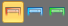 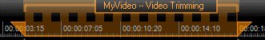  
 
> **Timelines / Sub-Timelines:**  
> If using sub-timelines ([*D.3*](#D.3)), this mode might allow defining or selecting the time range covered by a specific sub-timeline.
> 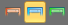 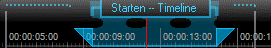  

> **Effect / Work-Area:**  
> Define a temporary working range (often called Work Area or In/Out Range) for focused editing, looped playback ([*J.1*](#J.1)), or rendering/exporting only a specific section ([*E.1.2.6*](#e126-work-area-only)). This is often the most frequently used range mode during editing.
>  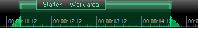  

###  *C.1.2* Timeline-Range / Select

Double-clicking on a layer bar ([*C.3*](#C.3)) in the timeline might automatically set the Work Area ([*C.1.1*](#C.1.1)) IN and OUT points to match the start and end times of that specific layer.

See also: 
- [*C.2* Ruler](#C.2)
- [*C.5* Time-Cursor](#C.5)
- [*C.6* Timeline-Title](#C.6)

##  *C.2* Ruler

The horizontal ruler at the top of the timeline displays time units (e.g., seconds, frames, timecode) and indicates the position of the time cursor, range markers, and other time-based elements.

See also: 
- [*C.1* Timeline-Range](#C.1)
- [*C.5* Time-Cursor](#C.5)
- [*C.6* Timeline-Title](#C.6)
 

##  *C.3* Layer

Layers are horizontal tracks in the timeline that contain the effect masks ([*A.1*](#A.1)) and their associated keyframes ([*C.4*](#C.4)) over time. The vertical stacking order of layers can be important, especially when using Exclude layers ([*E.3.5*](#E.3.5)) or grouping layers ([*E.3.2*](#E.3.2)).

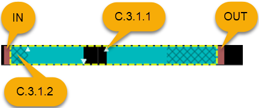

+ [*C.3.1* Layer / Edit](#C.3.1) (Visual indicators on the layer bar)
+ [*C.3.2* Layer / Select](#C.3.2) (How to select layers)
+ [*C.3.3* Layer / Navigate](#C.3.3) (Moving the time cursor based on layers)
+ [*C.3.4* Layer / Style](#C.3.4) (Appearance options)
+ [*C.3.5* Layer / Types](#C.3.5) (Different kinds of layers)

See also:
- [*E.5* Timeline View-Mode](#E.5) (Options affecting layer display)
---

###  *C.3.1* Layer / Edit

The layer bar itself provides visual feedback:
*   **Deleting:** Selected layers can be deleted by pressing the <kbd>DEL</kbd> key.
*   **Undefined Areas (*C.3.1.2*):** A different pattern or color on the layer bar might indicate time segments *within* the layer's duration where the mask's position/properties haven't been explicitly defined by keyframes (e.g., before the first keyframe or after the last one if tracking wasn't performed over the entire duration). The mask might hold its last known state or behave unexpectedly in these areas.
*   **Visibility Indicator (*C.3.1.1*):** A change in the layer bar's appearance (e.g., a dashed line, different color, or icon overlay) can show where the mask's visibility ([*B.1.4*](#B.1.4), [*A.6*](#A.6)) has been turned off via keyframes. This indicates where the effect is active and inactive along the layer's duration.

###  *C.3.2* Layer / Select

*   **Single Select:** Click on a layer bar to select it.
*   **Multi-Select (Contiguous):** Click the first layer, then hold <kbd>SHIFT</kbd> and click the last layer to select a range.
*   **Multi-Select (Non-Contiguous):** Hold <kbd>CTRL</kbd> and click individual layers to add or remove them from the selection.
*   **Keyboard Select:** Use the <kbd>UP</kbd> and <kbd>DOWN</kbd> arrow keys to select the previous or next layer. Hold <kbd>SHIFT</kbd> while using the arrow keys to extend the selection.

###  *C.3.3* Layer / Navigate

Double-clicking on the start or end edge of a layer bar typically moves the time cursor ([*C.5*](#C.5)) to that specific point in time.

---

###  *C.3.4* Layer / Style

The vertical height and detail level of layer bars can often be changed:

**Standard:**  
Displays layer name and potentially more detail.
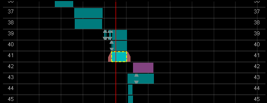

**Compact:**  
Reduces layer height to fit more layers vertically on screen.
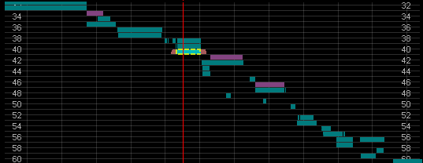

See also:
- [*E.5.1* Ribbon Compacted](#E.5.1) (Button to toggle compact mode)

---

###  *C.3.5* Layer / Types

Layers can have different functions, indicated by their appearance or icons:

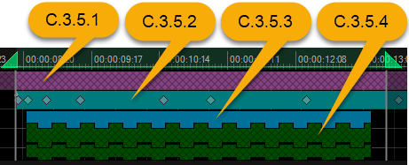

- *C.3.5.1* __Exclude Layer:__ Contains a mask defining a protected area where effects from layers below it (in the timeline stacking order) will *not* be applied. Often has a distinct color or icon. See [*E.3.5*](#E.3.5).
- *C.3.5.2* __Normal Layer:__ A standard layer containing an effect mask (e.g., for pixelation).
- *C.3.5.3* __Group Header:__ Represents a Layer Group ([*E.3.2*](#E.3.2)). Selecting this layer allows editing parameters common to all layers within the group (like Mosaic settings or S3D Depth).
- *C.3.5.4* __Group Member:__ A layer that belongs to a Layer Group. It's visually indented or linked to the Group Header above it. Its individual effect parameters might be overridden by the group settings.

##  *C.4* Keyframe

Keyframes are markers on a layer bar that indicate a specific point in time where one or more properties of the mask (like position, size, rotation, visibility, or effect parameters) have a defined value. The software interpolates the values between keyframes to create smooth animation or changes over time.

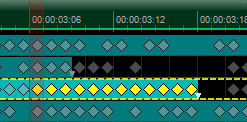

See also:
- [*E.5.2* Keyframes](#E.5.2) (Timeline view mode to show/hide mask keyframes)
---

###  *C.4.1* Keyframe / Edit

*   **Delete Selected:** Select one or more keyframes and press the <kbd>DEL</kbd> key to remove them.
*   **Delete Range:** Pressing <kbd>SHIFT</kbd>+<kbd>DEL</kbd> typically deletes all keyframes on the selected layer(s) from the current time cursor position ([*C.5*](#C.5)) to the end of the layer or the end of the Work Area ([*C.1.1*](#C.1.1)). This is useful for re-tracking a section.

> 

###  *C.4.2* Keyframe / Select

*   **Single Select:** Click on a keyframe marker.
*   **Multi-Select (Box):** Click and drag a selection box around multiple keyframes on one or more selected layers.
*   **Multi-Select (Contiguous):** Click the first keyframe, then hold <kbd>SHIFT</kbd> and click the last keyframe on the *same layer* to select the range.
*   **Multi-Select (Non-Contiguous):** Hold <kbd>CTRL</kbd> and click individual keyframes to add or remove them from the selection.

###  *C.4.3* Keyframe / Navigate

*   **Jump to Keyframe:** Double-clicking on a keyframe marker usually moves the time cursor ([*C.5*](#C.5)) to that exact point in time.
*   **Previous/Next Keyframe:** Use keyboard shortcuts (often <kbd>PAGE-UP</kbd>/<kbd>PAGE-DOWN</kbd> or dedicated buttons) or the parameter-specific navigation buttons ([*B.1.1.2*](#B.1.1.2)) to jump between keyframes on the selected layer(s).

##  *C.5* Time-Cursor

Also known as the Playhead, this vertical line indicates the current frame being displayed in the Canvas [*A*](#A) and the precise point in time for editing actions like setting keyframes.
*   **Moving:** Click and drag the time cursor handle in the ruler area ([*C.2*](#C.2)) or click directly anywhere in the timeline ruler or layer area to jump the cursor.
*   **Frame-by-Frame:** Use the <kbd>LEFT</kbd> and <kbd>RIGHT</kbd> arrow keys, or the <kbd>B</kbd> and <kbd>N</kbd> keys.
*   **NumPad Navigation:** If enabled ([*F.1.10.2*](#F.1.10.2)), use <kbd>NP-4</kbd> and <kbd>NP-6</kbd> (Numeric Keypad keys 4 and 6, with Num Lock enabled) to move frame by frame.
*   **Jump to Start/End:** Use the <kbd>HOME</kbd> and <kbd>END</kbd> keys to jump to the beginning or end of the current view range (often the Work Area). NumPad keys <kbd>NP-7</kbd> and <kbd>NP-1</kbd> might perform similar actions.
*   **Jump to Markers/Keyframes:** Use <kbd>PAGE-UP</kbd> and <kbd>PAGE-DOWN</kbd> keys, or NumPad keys <kbd>NP-9</kbd> and <kbd>NP-3</kbd>, to jump to the previous/next keyframe or potentially other markers (like edit points or user-defined markers).

###  *C.5.1* Style 
The appearance of the time cursor can sometimes be changed:
*   **SPAN:** The time cursor might visually indicate the duration of the current frame, extending slightly horizontally.
*   **SIMP (Simple):** The time cursor is displayed as a single thin vertical line.

| Type | First Range Frame | Last Range Frame |
|---|---|---|
|SPAN |  |  | 
|SIMP |  |  | 

See also: 
- [*C.1* Timeline-Range](#C.1)
- [*C.2* Ruler](#C.2)
- [*C.6* Timeline-Title](#C.6)
- [*F.1.10.2* Project Settings: User Interface](#F.1.10.2) (Option to toggle style)

##  *C.6* Timeline-Title

This area, often located near the ruler or time cursor, displays the exact timecode or frame number of the current time cursor position.

See also: 
- [*C.1* Timeline-Range](#C.1)
- [*C.2* Ruler](#C.2)
- [*C.5* Time-Cursor](#C.5)

##  *C.7* Snapping-Switch

Toggles timeline snapping on or off. When enabled, moving items (like the time cursor, range markers, layer edges, or keyframes) with the mouse will "snap" precisely to other items (keyframes, markers, layer edges, cursor position) when they get close enough. This aids in precise alignment.

##  *C.8* Timeline-Zoom

:hourglass_flowing_sand: Under construction
(Controls the horizontal magnification of the timeline. Typically includes a slider or buttons like [+] and [-] to zoom in (see more detail over shorter time) or zoom out (see longer duration with less detail)).

##  *C.9* Timeline-Scrollbar

:hourglass_flowing_sand: Under construction
(Standard scrollbars for navigating the timeline view horizontally (if zoomed in) and vertically (if there are more layers than fit on screen)).

##  *C.10* Timeline Context-Menu

Right-clicking on a layer, keyframe, or the timeline background usually brings up a context-sensitive menu with relevant commands.

+ [*C.10.1* Cut, Copy, Paste](#C.10.1)
+ [*C.10.2* Special Copy, Paste](#C.10.2)
+ [*C.10.3* Delete](#C.10.3)
+ [*C.10.4* Delete keyframes until end position ](#C.10.4)
+ [*C.10.5* Set Work-Area to the Layer(s)](#C.10.5)
+ [*C.10.6* Group, Un-group](#C.10.6)
+ [*C.10.8* Add Timeline until time cursor](#C.10.8) (Likely relates to Sub-Timelines)
+ [*C.10.9* Split Timeline at time cursor](#C.10.9) (Likely relates to Sub-Timelines)
+ [*C.10.10* New Timeline for selected Layer(s)](#C.10.10) (Likely relates to Sub-Timelines)
+ [*C.10.11* Split the time range into separate timeline](#C.10.11) (Likely relates to Sub-Timelines)
+ [*C.10.12* Compress Timeline](#C.10.12) (Possibly rearranges layers)
+ [*C.10.13* Select All](#C.10.13)
+ [*C.10.14* Go to Layer](#C.10.14)

---

###  *C.10.1* Cut, Copy, Paste
Standard clipboard operations for selected items (layers or keyframes).
*   **Cut:** Copies the selected item(s) to the clipboard and removes them from the timeline.
*   **Copy:** Copies the selected item(s) to the clipboard.
*   **Paste:** Inserts the clipboard content at the current time cursor position or over the selection.

###  *C.10.2* Special Copy, Paste
Allows copying and pasting only specific *attributes* or parameters of the selected layer(s) or keyframe(s), rather than the entire item.

> :bulb: It might also be possible to save these filtered parameters as a reusable preset ([*D.2* Presets](#D.2)).

###  *C.10.3* Delete
Deletes the selected item(s) (layers or keyframes). Same as pressing the <kbd>DEL</kbd> key.

###  *C.10.4* Delete keyframes until end position
Deletes all keyframes on the selected layer(s) from the current time cursor position ([*C.5*](#C.5)) to the end of the Work Area ([*C.1.1*](#C.1.1)) or layer duration. Same as <kbd>SHIFT</kbd>+<kbd>DEL</kbd>.

###  *C.10.5* Set Work-Area to the Layer(s)
Adjusts the Work Area IN and OUT points ([*C.1.1*](#C.1.1)) to match the start and end times of the currently selected layer(s).

###  *C.10.6* Group, Un-group
Adds the selected layers to a new or existing Layer Group ([*E.3.2*](#E.3.2)), or removes selected layers from their current group.

###  *C.10.8* Add Timeline until time cursor
Likely related to Sub-Timelines ([*D.3*](#D.3)). Creates a new sub-timeline spanning from the end of the previous sub-timeline (or the start of the video) up to the current time cursor position.

###  *C.10.9* Split Timeline at time cursor
Likely related to Sub-Timelines ([*D.3*](#D.3)). Splits the current sub-timeline into two separate sub-timelines at the time cursor position.

###  *C.10.10* New Timeline for selected Layer(s)
Likely related to Sub-Timelines ([*D.3*](#D.3)). Creates a new sub-timeline whose duration matches the time span covered by the selected layer(s).

###  *C.10.11* Split the time range into separate timeline 
:hourglass_flowing_sand: Under construction
(Perhaps creates multiple sub-timelines based on gaps or markers within the selected time range).

###  *C.10.12* Compress Timeline 
Rearranges layers vertically to minimize gaps and reduce the total vertical space used, potentially allowing layers that don't overlap in time to share the same vertical track space.

###  *C.10.13* Select All
Selects all layers currently visible in the timeline, or if a layer is already selected, might select all keyframes on that layer. Same as <kbd>CTRL</kbd>+<kbd>A</kbd>.

###  *C.10.14* Go to Layer 
Opens a dialog or prompt to select a layer by its number or name, useful in projects with many layers.

#  *D* Optional Views

These are additional panels or windows that can be shown or hidden to provide more tools or information. They can usually be toggled via the main menu or a dedicated toolbar.

+ [*D.1* Input Device](#D.1) (Status/Control for Pedals/MIDI)
+ [*D.2* Presets](#D.2) (Saved effect settings)
+ [*D.3* Timelines](#D.3) (Management of Sub-Timelines)
+ [*D.4* ToDo Markers](#D.4) (List of project markers/tasks)
+ [*D.5* Media Bin](#D.5) (List of imported media files)
+ [*D.6* Layers](#D.6) (List view of all layers)
+ [*D.7* Object Viewer](#D.7) (Possibly a detailed view for tracking analysis)
+ [*D.8* Undo-Protocol](#D.8) (History of editing actions)
+ [*D.9* Processing-Events](#D.9) (Log of background tasks like rendering/export)

###  *D.1* Input Device
Provides status information and potentially quick controls for connected external input devices like Pedals or MIDI controllers.
🔗 [More Details about Pedals](#devices-pedals)

")

####  *D.1.1* Settings
Opens the main settings dialog for input devices ([*F.1.10.3*](#F.1.10.3)).

####  *D.1.2* Range
Possibly limits the range controlled by the pedals to the current Work Area ([*C.1.1*](#C.1.1)) instead of the entire video duration.

####  *D.1.3* Speed
A toggle or multiplier (e.g., 4x) to increase the sensitivity or maximum speed achievable with the pedal input.

###  *D.2* Presets
:hourglass_flowing_sand: Under construction
(Likely a panel listing saved effect presets. Allows applying pre-configured sets of effect parameters ([*B.1*](#B.1)) to selected layers, potentially created via [*C.10.2* Special Copy](#C.10.2)).

###  *D.3* Timelines

This panel helps manage projects, especially very long videos, by allowing the main timeline to be divided into smaller, more manageable sections called "sub-timelines".
*   **Overview:** When this panel is active or in a specific 'Timeline' range mode ([*C.1.1*](#C.1.1)), the main timeline might show a high-level view of all sub-timelines.
*   **Focused Editing:** Selecting a sub-timeline (either in this panel or on the overview timeline) switches the main timeline view ([*C*](#C)) to show *only* the layers and time range contained within that specific sub-timeline. This makes the view much clearer and potentially improves performance for very large projects.

> **Timeline Overview Mode:** Shows symbolic representation of all sub-timelines.
> 

> **Workspace Mode (Sub-Timeline Selected):** Shows only the layers within the selected sub-timeline's time range.
> 

###  *D.4* ToDo Markers
:hourglass_flowing_sand: Under construction
(Likely a panel listing custom markers placed on the timeline, possibly with notes or status flags, acting as a task list or points of interest within the project).

###  *D.5* Media Bin
:hourglass_flowing_sand: Under construction
(A dedicated panel view listing all imported media files ([*B.3*](#B.3)). Provides an alternative or expanded view compared to the Inspector section).

###  *D.6* Layers
:hourglass_flowing_sand: Under construction
(Likely a panel providing a list view of all layers in the project or current sub-timeline. Might offer sorting, filtering, quick selection, and potentially editing of layer properties like name, lock status, enable status, etc., similar to layer panels in other NLEs or graphics software).
")

###  *D.7* Object Viewer
:hourglass_flowing_sand: Under construction
(This might be a specialized view for analyzing or refining object tracking data. Could potentially show tracking paths, confidence levels, or allow detailed editing of tracking points).

###  *D.8* Undo-Protocol
:hourglass_flowing_sand: Under construction
(A panel listing the history of editing actions performed. Allows reviewing past steps and potentially reverting to a specific state by selecting an action in the list, offering more control than simple Undo/Redo ([*F.2*](#F.2))).

###  *D.9* Processing-Events
:hourglass_flowing_sand: Under construction
(A log or status panel showing background processes like video analysis, rendering previews, or export progress and any associated messages or errors).

#  *E* Ribbon Menu

The Ribbon provides access to major functions and modes, organized into tabs and groups.

+ [*E.1* Import/Export Media-Files](#E.1) 
+ [*E.2* Mask Edit](#E.2) (Tools for creating/selecting masks)
+ [*E.3* Layer](#E.3) (Commands related to timeline layers)
+ [*E.4* Canvas View-Mode](#E.4) (Controls for how the canvas displays content)
+ [*E.5* Timeline View-Mode](#E.5) (Controls for timeline display details)
+ [*E.6* S3D-Video Options](#E.6) (Specific controls for stereoscopic video)

##  *E.1* Import/Export Media-Files

###  *E.1.1* Import Media-Files
Opens a file browser to select and add one or more video files to the project's Media Bin ([*B.3*](#B.3), [*D.5*](#D.5)).

See also:
- [*F.1.6* Import Media](#F.1.6) (Equivalent menu command)

###  *E.1.2* Export Media-Files

Opens the export dialog to render the final video with applied effects to a file.

See also:
- [*F.1.7* Export Media](#F.1.7) (Equivalent menu command)

#### *E.1.2.1* Format 
Select the desired output video file format (e.g., MP4, MOV, AVI). Formats marked with `_*_` might indicate recommended or widely compatible options.

#### *E.1.2.2* Type / Preset
:hourglass_flowing_sand: Under construction
(Selects a specific codec, quality preset, or encoding profile within the chosen format, e.g., H.264 High Quality, ProRes 422).

#### *E.1.2.3* Target-Path / Filename
:hourglass_flowing_sand: Under construction
(Specifies the folder and filename for the exported video file).

#### *E.1.2.4* Edit / Configure
:hourglass_flowing_sand: Under construction
(Opens an advanced configuration dialog for the selected format/preset, allowing fine-tuning of parameters like bitrate, resolution, frame rate, audio settings, hardware acceleration options, etc.).

#### *E.1.2.5* Keep file date 
:hourglass_flowing_sand: Under construction
(If checked, attempts to set the modification date of the exported file to match the original source video's date).

#### *E.1.2.6* Work-area only 
If checked, only the time segment defined by the Work Area IN/OUT markers ([*C.1.1*](#C.1.1)) will be exported. Otherwise, the entire project duration (or trim range) is exported.

>  
>This option can typically only be selected if a Work Area has been defined and the corresponding range mode is active or implicitly used for export.

##  *E.2* Mask Edit

Tools for creating and interacting with masks in the Canvas [*A*](#A).

### *E.2.1* Selector / Pointer
Activates the standard selection tool. Used to select, move, and resize existing masks in the Canvas.

### *E.2.2* Shapes (Rectangle, Ellipse, Polygon, etc.)
Selects a drawing tool. Click and drag in the Canvas to create a new mask of the chosen shape. Polygon tools typically require multiple clicks to define vertices.

##  *E.3* Layer

Commands related to managing layers in the Timeline [*C*](#C).

+ [*E.3.1* Delete-Layer](#E.3.1) 
+ [*E.3.2* Layer-Group](#E.3.2) (Group/Ungroup commands)
+ [*E.3.3* Effect-Lift](#E.3.3) (Adjust parameters over time range)
+ [*E.3.4* Layer-Order](#E.3.4) (Move layers up/down)
+ [*E.3.5* Exclude-Layer](#E.3.5) (Toggle layer type)
+ [*E.3.6* Enable-Layer](#E.3.6) (Toggle layer active status)
+ [*E.3.7* Lock-Layer](#E.3.7) (Toggle layer edit protection)
+ [*E.3.8* AI-Layer](#E.3.8) (AI-assisted layer features)
+ [*E.3.9* Add-Layer](#E.3.9) (Create new layer)

###  *E.3.1* Delete-Layer
Deletes the currently selected layer(s) from the timeline.

###  *E.3.2* Layer-Group

Combines multiple selected layers ([*E.3.2.2* Group Member](#C.3.5)) into a single logical unit, represented by a Group Header ([*E.3.2.1* Group Header](#C.3.5)) in the timeline. Masks within a group are often treated as a single composite mask for rendering, sharing common properties. This is particularly useful for S3D videos (ensuring consistent depth) or complex mosaic patterns where uniformity is desired across multiple masked areas.

> :exclamation: Once layers are grouped, parameters like Mosaic settings ([*B.1.5*](#B.1.5), [*B.1.6*](#B.1.6)) and S3D Depth ([*B.1.9*](#B.1.9)) can often only be edited by selecting the Group Header layer (*E.3.2.1*).

####  *E.3.2.3* Mosaic effect anchor point for spherical videos 

When applying mosaic effects to grouped layers in spherical video, the *first* layer added to the group (*E.3.2.4* in the image, the top-most member layer) often acts as an "anchor". Its position and orientation on the sphere determine the alignment grid for the mosaic effect applied to the *entire* grouped mask area. All other member layers in the group will use this same grid alignment, ensuring a consistent, seamless mosaic pattern across the combined shape, even if it wraps around the sphere.

See also:
- [*B.1* Effect-Parameter](#B.1) (Parameters controlled by group)
- [*C.3.5* Layer / Types](#C.3.5) (Visual representation of groups)
- [*B.3.1.1* Camera Type](#B.3.1.1) (Spherical setting)
- [*E.6.3* Zero Depth](#E.6.3) (Relevant for S3D groups)

###  *E.3.3* Effect-Lift

Opens a dialog to adjust the values of keyframed effect parameters ([*B.1*](#B.1)) across the current Work Area ([*C.1.1*](#C.1.1)) on the selected layer(s). Instead of setting absolute values, it *adds* or *subtracts* a specified amount (or percentage) to the existing keyframe values within the range. This allows "lifting" or "lowering" an animation curve without manually editing each keyframe.

#### *E.3.3.1* Insert Keyframes 
If checked, automatically inserts keyframes for the selected parameter at the IN and OUT points of the Work Area before applying the lift. This prevents the adjustment from affecting the parameter's values outside the defined range.

#### *E.3.3.2* Delete Keyframes 
If checked, removes all existing keyframes for the selected parameter *within* the Work Area (between IN and OUT, excluding the boundary keyframes if *E.3.3.1* is also checked) before applying the lift. This can be used to simplify the animation curve within the range.

#### *E.3.3.3* Parameters 
Select the specific effect parameter (e.g., Mosaic Block Size, Mask Bold) to adjust.

#### *E.3.3.4* Amount / Value
Enter the value to add (positive number) or subtract (negative number) from the existing keyframes of the selected parameter within the Work Area. It might also support percentage-based changes.

###  *E.3.4* Layer-Order

Commands to change the vertical stacking order of selected layers in the timeline. Typically includes "Bring Forward", "Send Backward", "Bring to Front", "Send to Back". The order is crucial for how effects interact, especially with Exclude layers ([*E.3.5*](#E.3.5)).

See also: 
- [*W.2* Layer order and protected mask](#workshop-layer-order)
- [*E.3.5* Exclude-Layer](#E.3.5)

###  *E.3.5* Exclude-Layer

Toggles the type of the selected layer between a normal effect layer and an Exclude (or protection) layer.
*   **Normal Mask (*E.3.5.1*):** Defines the area where the effect *is* applied (Union).
*   **Exclude Mask (*E.3.5.2*):** Defines an area where effects from layers *below* it in the timeline stack will *not* be rendered (Protect).

> :bulb: For an Exclude mask to protect an area from an effect on another layer, the Exclude layer must be placed vertically *above* the effect layer in the Timeline stack.

See also:
- [*W.2* Layer order and protected mask](#workshop-layer-order)
- [*B.1* Effect-Parameter](#B.1) 
- [*E.3.2* Layer-Group](#E.3.2) (Groups can contain exclude layers)

---

###  *E.3.6* Enable-Layer
Toggles the active state of the selected layer(s). A disabled layer has no effect on the output and is ignored during rendering, but remains in the project. Useful for temporarily turning effects off without deleting the layer.

###  *E.3.7* Lock-Layer
Toggles the locked state of the selected layer(s). A locked layer cannot be accidentally modified (moved, resized, keyframes edited). Useful for protecting completed work.

###  *E.3.8* AI-Layer
:hourglass_flowing_sand: Under construction
(Might refer to layers generated or assisted by AI features, e.g., automatic object detection creating an initial mask layer).

###  *E.3.9* Add Layer
Creates a new, empty layer in the timeline. Depending on project settings ([*F.1.10.4.2*](#F.1.10.4.2)), the new layer might span the entire Work Area or start at the current time cursor position with a default duration.

> New layer spanning the Work Area:
> 
> New layer starting at the time cursor:
> 

See also:
- [*F.1.10.4.2* Project Settings: Layer](#F.1.10.4.2) (Setting for new layer behavior)

##  *E.4* Canvas View-Mode

Controls how the video and effects are displayed in the Canvas window [*A*](#A).

###  *E.4.1* View Result
Displays the final rendered output in the Canvas, showing the source video with all active effects applied.

###  *E.4.2* View Source
Displays the original, unprocessed source video in the Canvas, without any effects applied. Masks might still be overlaid for editing depending on other settings.

###  *E.4.3* View Mixture
Displays a combination, often showing the final result but with mask outlines, tracking points, or other editing guides overlaid for context.

###  *E.4.4* Show only selected objects
When editing masks, only the outlines and handles for the currently selected layer(s) are displayed in the Canvas.

###  *E.4.5* Show all objects
Displays the outlines and handles for all visible layers simultaneously in the Canvas, regardless of selection.

###  *E.4.6* Solid objects
Displays masks as solid filled shapes (potentially semi-transparent) instead of just outlines. Helps visualize the affected area more clearly.

##  *E.5* Timeline View-Mode

Options to control the level of detail shown on the layer bars in the Timeline [*C*](#C).

- [*E.5.1* Compacted](#E.5.1) (Toggle compact layer style)
- [*E.5.2* Keyframes](#E.5.2) (Toggle display of mask transform keyframes)
- [*E.5.3* Mosaic Keyframes](#E.5.3) (Toggle display of effect parameter keyframes)

###  *E.5.1* Compacted

Toggles the vertical height of layer bars between standard and compact styles. Compact mode fits more layers vertically.

Standard:  

Compact:  

See also:
- [*C.3.4* Layer / Style](#C.3.4)

---

###  *E.5.2* Keyframes

Toggles the display of keyframe markers (usually small diamonds or squares) directly on the layer bars, representing changes in the mask's core properties like position, size, and rotation.

See also:
- [*C.4* Keyframe](#C.4)

---

###  *E.5.3* Mosaic Keyframes

Toggles the display of special icons or markers on the layer bars indicating keyframes for specific *effect parameters* (like Mosaic Block Size, Smoothing, Visibility, etc., see [*B.1*](#B.1)), as opposed to just the mask's transformation.

")

See also:
- [*B.1.1* Parameter-Keyframes](#B.1.1) (Controls for effect parameters)

##  *E.6* S3D-Video Options
These settings and tools appear in the Ribbon when working with stereoscopic (S3D) video (as defined in [*B.3.1*](#B.3.1)) and help visualize and manage spatial depth.

- [*E.6.1* Show Grid](#E.6.1)
- [*E.6.2* View Mode](#E.6.2)
- [*E.6.3* Zero Depth](#E.6.3)
- [*E.6.4* Set Object Depth](#E.6.4)
- [*E.6.5* Link with edit Object](#E.6.5)

###  *E.6.1* Show Grid
Toggles the display of a spherical latitude/longitude grid overlay in the Canvas. This helps with orientation when working with equirectangular spherical video.

###  *E.6.2* View Mode
Selects how the left and right eye views of the S3D video are combined for display in the Canvas:
*   **Left Eye / Right Eye:** Show only one eye's view.
*   **Anaglyph:** Combine views using color filtering (requires red/cyan glasses). Shows depth perception.
*   **Side-by-Side:** Display left and right views next to each other.
*   **Depth-Mix:** A special mode that often overlays the two eyes with transparency or color tinting, making parallax shifts (depth differences) visible without glasses. Objects at the current Zero Depth setting appear aligned or monochrome, while objects in front or behind show separation or color fringing.

> :bulb: __Depth-Mix__ mode is often recommended for efficiently setting the Zero Depth ([*E.6.3*](#E.6.3)) without needing anaglyph glasses.

###  *E.6.3* Zero Depth
Adjusts the convergence point, effectively setting the virtual "screen depth" within the 3D scene. Objects located exactly at this depth will appear to have zero parallax shift between the left and right eye views – they will look aligned in Depth-Mix mode or perfectly superimposed (without ghosting related to depth) in Anaglyph mode. When creating or adjusting a mask ([*A.1*](#A.1)), you should set the Zero Depth to match the depth of the object being masked. This ensures the mask itself is placed correctly in 3D space for both eyes.

| Correct Zero Depth (Object Aligned) | Incorrect Zero Depth (Object Shifted in Depth-Mix) | Incorrect Zero Depth (Object Ghosting in Anaglyph) |
|---|---|---|
||||

###  *E.6.4* Set Object Depth
Applies the current Zero Depth value ([*E.6.3*](#E.6.3)) to the selected mask's S3D Depth property ([*B.1.9*](#B.1.9)). This explicitly sets the mask's position in 3D space.

###  *E.6.5* Link with edit Object
If enabled, the Zero Depth visualization in the Canvas (e.g., the alignment in Depth-Mix mode) dynamically references the S3D Depth value ([*B.1.9*](#B.1.9)) of the currently selected mask. As you move the time cursor along the timeline, if the mask's depth changes via keyframes, the visualization updates automatically.

> :bulb: This is very helpful for quickly verifying if the mask's stored depth correctly matches the object underneath it at any given frame. If the object under the mask shows parallax shift while this mode is active, it indicates the mask's S3D Depth ([*B.1.9*](#B.1.9)) is incorrect for that frame.

See also:
- [*W.4* How to create a mask on a S3D video](#workshop-s3d-mask)
- [*B.1.9* S3D Depth](#B.1.9) (The mask's depth parameter)
- [*B.3.1.1* Camera Type](#B.3.1.1) (Requires Spherical type)
- [*E.3.2* Layer-Group](#E.3.2) (Useful for consistent depth across multiple masks)

#  *F* Project

Commands and settings related to the overall project file and application behavior.

##  *F.1* Project Menu

Accessed via the main "File" or "Project" menu.

- [*F.1.1* New Project](#F.1.1)
- [*F.1.2* Open Project](#F.1.2)
- [*F.1.3* Append Project](#F.1.3)
- [*F.1.4* Save Project](#F.1.4)
- [*F.1.5* Save Project as](#F.1.5)
- [*F.1.6* Import Media](#F.1.6)
- [*F.1.7* Export Media](#F.1.7)
- [*F.1.8* Create Team Project](#F.1.8)
- [*F.1.9* Import Team Project](#F.1.9)
- [*F.1.10* Project Settings](#F.1.10)

###  *F.1.1* New Project

Closes the current project (if any, prompting to save changes) and starts a new, empty project.

###  *F.1.2* Open Project

Opens a file browser to select and load an existing Disguise project file (e.g., `.phantom` or older formats).

###  *F.1.3* Append Project

Loads the layers and media references from another project file and adds them to the currently open project. Useful for merging work or combining project segments.

###  *F.1.4* Save Project
Saves the current state of the project to its existing file name and location. Uses <kbd>CTRL</kbd>+<kbd>S</kbd>.

###  *F.1.5* Save Project as
Opens a file browser to save the current state of the project with a new file name or location. Useful for creating backups or versions.

###  *F.1.6* Import Media
Adds video files to the project. Same function as the button in the Ribbon ([*E.1.1*](#E.1.1)).

See also:
- [*E.1.1* Import Media-Files](#E.1.1)

###  *F.1.7* Export Media
Opens the export dialog to render the project. Same function as the button in the Ribbon ([*E.1.2*](#E.1.2)).

See also:
- [*E.1.2* Export Media-Files](#E.1.2)

###  *F.1.8* Create Team Project

Exports a special version of the current project designed for collaborative workflows. This typically involves packaging the project file and associated media (potentially transcoded or downscaled) into a folder structure that can be shared with team members. Edits made by team members in their copies can later be merged back into the original "master" project using [*F.1.9* Import Team Project](#F.1.9).

*   __Use Custom Size__: Allows reducing the video resolution during packaging to create smaller files for easier sharing.
*   __Encode profile__: Selects an encoding quality for any transcoded media. 'Low' typically produces the smallest file size but might take longer to encode and have lower quality.
*   __Project Folder__: Specifies the destination folder where the packaged team project (project file + media subfolder) will be created.
*   __Project Name__: Sets the name for the team project file (e.g., `MyProject_Team_UserA.phantom`). Should be unique for each team member or version.
*   __OK button__: Starts the packaging process. Requires valid Folder and Name entries.

> :exclamation: **Important:** The original project file from which the team projects are created (the **Master Project**) is required later to import and merge the changes back using [*F.1.9* Import Team Project](#F.1.9)! Keep the Master Project file safe.

###  *F.1.9* Import Team Project

Merges edits made in one or more team project packages back into the original Master Project.

**Workflow:**
1.  First, open the original **Master Project** (the one used to create the team projects via [*F.1.8*](#F.1.8)).
2.  Select the 'Import Team Project' menu item.
3.  In the file browser, select one or more team project files (`.phantom` files from the folders created by team members).
4.  Click 'Open'.
5.  The application analyzes the team projects and merges *new* layers created by the team members into the Master Project.

> :exclamation: **Notes on Merging:**
> *   Changes made by team members to layers that *already existed* in the Master Project when the team project was created are typically **ignored**. Those original layers are usually protected during the merge to avoid conflicting edits. Only *newly added* layers from the team projects are imported.
> *   Changes to the Media Bin (adding/removing clips, changing properties) in the team projects are usually ignored.
> *   The layer order might be based on the order of import or appended to the end.

###  *F.1.10* Project Settings

Opens a dialog to configure application-wide settings and preferences.

- [*F.1.10.1* Project](#F.1.10.1) (General project settings)
- [*F.1.10.2* User Interface](#F.1.10.2) (UI behavior)
- [*F.1.10.3* Input Device](#F.1.10.3) (Pedal/MIDI configuration)
- [*F.1.10.4* Editing](#F.1.10.4) (Tracking and layer defaults)

####  *F.1.10.1* Project

")

*   __Save Interval__ (Autosave): Specifies how often (in minutes) the software automatically saves a backup copy of the current project. Helps recover work after a crash. `0` typically disables autosave.
*   __Create project backup files__: If enabled, creates sequential backup versions (e.g., `ProjectName.bak1`, `ProjectName.bak2`) in a separate folder or alongside the main project file each time you manually save.
*   __Time Code__ (Display Format): Selects the format for displaying timecode in the timeline and other UI elements (e.g., NTSC Drop-Frame `00:00:00;00` vs. Non-Drop `00:00:00:00`, or Frames).

> :exclamation: Using unique project names is crucial, especially if backup files are enabled, to avoid accidentally overwriting important versions.

####  *F.1.10.2* User Interface

")

*   __The mouse wheel moves the timecode forward/backward__: Defines the direction the time cursor ([*C.5*](#C.5)) moves when using the mouse wheel over the timeline.
*   __Media navigation using the numeric keypad__: Enables/disables using the numeric keypad (NumPad) keys (like <kbd>NP-4</kbd>, <kbd>NP-6</kbd>, <kbd>NP-7</kbd>, etc.) for timeline navigation (moving time cursor, jumping to markers). Requires Num Lock to be active. If disabled, NumPad keys input numbers.
*   __Timeline with visualization of the time span__ (Time Cursor Style): Toggles the time cursor appearance between SPAN and SIMP modes. See [*C.5.1* Style](#C.5.1).

####  *F.1.10.3* Input Device

Configuration for external hardware controllers.

#####  *F.1.10.3.1* Pedals
🔗 [More Details about Pedals](#devices-pedals)

Configures connected DirectX-compatible gaming pedals for timeline navigation.
*   **Device Selection:** Choose the connected pedal device.
*   **Axis Mapping:** Assign pedal axes (e.g., Left Toe, Right Toe, Rudder) to functions like "Move Time Cursor Forward/Backward".
*   **Sensitivity/Deadzone:** Adjust response curves.

#####  *F.1.10.3.2* MIDI
🔗 [More Details about MIDI](#devices-midi)

Configures connected MIDI controllers (like the Behringer BCF2000) for controlling parameters.

**How to assign a command:**
1.  Move a physical slider or turn a knob on your MIDI device. The corresponding control should be highlighted or detected in the settings panel.
2.  In the list of assignable commands (e.g., "Mask Size", "Mosaic Block Size"), select the command you want to control.
3.  Click the "Set" or "Assign" button, or possibly double-click the command name, to link the detected MIDI control to the selected command.

>:bulb: To test assignments: Select an object (mask) in the Canvas/Timeline, potentially activate Teach-In mode ([*A.5*](#A.5)) or Tracking ([*A.4*](#A.4)) if the command is context-specific, then open this settings panel. Move the assigned MIDI control and observe if the corresponding value changes or action occurs.

>:exclamation: Some commands are context-sensitive and only work when a specific mode is active. For example, mask adjustment commands typically require a mask to be selected, and tracking-related commands only function during an active tracking session ([*A.4*](#A.4) or [*A.5*](#A.5)).

####  *F.1.10.4* Editing

Settings related to editing workflow.

#####  *F.1.10.4.1* Object Tracker

*   __Grid size / Search Area__: Controls the size of the area the tracker analyzes around the object. Higher values might track faster or handle faster motion but could be less accurate or prone to latching onto background elements. Smaller values might be more accurate for fine details but slower.
*   Object motion __detection__: Checkboxes to enable/disable the tracker's ability to automatically detect and compensate for:
    *   __Rotation__: Changes in the object's orientation.
    *   __Zoom / Scale__: Changes in the object's size relative to the camera.

#####  *F.1.10.4.2* Layer
")

*   __Create layer at cursor time__: If checked, newly created layers ([*E.3.9*](#E.3.9)) will start at the current time cursor position with a default duration. If unchecked, they might span the entire Work Area or project duration by default. See [*E.3.9* Add Layer](#E.3.9).

##  *F.2* Undo/Redo
Standard Undo and Redo functions to reverse or re-apply recent editing actions.
*   **Undo:** Reverts the last action. Shortcut: <kbd>CTRL</kbd>+<kbd>Z</kbd>.
*   **Redo:** Re-applies the last undone action. Shortcut: <kbd>CTRL</kbd>+<kbd>Y</kbd>.
*   **History:** An optional panel ([*D.8* Undo-Protocol](#D.8)) might provide a detailed list of actions.

:hourglass_flowing_sand: Under construction (Detailed Undo History description pending)

#  *G* Tutorials / Info / Updates

Access points for help, documentation, and application information.

##  *G.1* Tutorials
:hourglass_flowing_sand: Under construction
(Likely links to online video tutorials or built-in guides).

---

##  *G.2* App-About

Displays information about the application, including version number, licensing status, and support resources.

###  *G.2.1* Support Protocol
Generates a diagnostic log file that can be helpful for troubleshooting issues with proDAD support.

> **To generate and submit the support protocol:**
> 1.  Hold down the <kbd>SHIFT</kbd> key while clicking on the menu item that opens the 'About' dialog (*G.2*).
> 2.  In the 'About' dialog that appears, click the **"Support-Protocol"** button.
> 3.  This will likely save a log file (e.g., `.txt` or `.zip`) to a specified location (often your Desktop or Documents folder).
> 4.  Attach this generated file when contacting customer support.

> :bulb: The log file typically contains technical information about the software's operation and system environment. It generally does not contain personal or confidential video content. Providing this log helps support diagnose problems more efficiently.

> :exclamation: If you encounter issues, please email customer support at [support@prodad.com](mailto:support@prodad.com) and attach the support protocol file if possible.

---

##  *G.3* User manual
Opens this documentation file.

#  *H* Timeline Tools

A toolbar located near the Timeline, providing quick access to common editing functions.

:hourglass_flowing_sand: Under construction
(Likely contains buttons for actions like: Split Layer/Clip, Add Marker, Link/Unlink, Ripple Delete, Lift/Extract, etc.)

#  *J* Playback Control

Standard transport controls for playing and navigating the video in the Timeline and Canvas.

+ [*J.1* Auto-Repeat](#J.1) (Loop Playback)
+ [*J.2* Play/Stop](#J.2) 
+ [*J.3* Jump to Begin/End](#J.3) (Go to In/Out Point)
+ [*J.4* Playback-Speed](#J.4) 

##  *J.1* Auto-Repeat

Toggles looped playback. When enabled, playback will automatically restart from the IN point of the Work Area ([*C.1.1*](#C.1.1)) after reaching the OUT point. Useful for reviewing a specific segment repeatedly.

##  *J.2* Play/Stop

Starts playback from the current time cursor position. If playing, stops playback. Can also be controlled using the <kbd>SPACE</kbd> bar or <kbd>ENTER</kbd> key.

##  *J.3* Jump to Begin/End

Moves the time cursor ([*C.5*](#C.5)) instantly to the IN point (Begin) or OUT point (End) of the current Work Area ([*C.1.1*](#C.1.1)). Also controllable with the <kbd>HOME</kbd> (Begin) and <kbd>END</kbd> (End) keys.

##  *J.4* Playback-Speed

Adjusts the playback speed.
*   **Click:** Increases playback speed (e.g., 1x -> 1.5x -> 2x).
*   **<kbd>SHIFT</kbd>+Click:** Decreases playback speed (e.g., 2x -> 1.5x -> 1x -> 0.5x).
*   **<kbd>CTRL</kbd>+Click:** Resets playback speed to normal (1x).
*   **Display:** The button likely shows the current playback speed factor.

# ⌨️  *p.3.1* Keyboard Short-Cuts 

> - NP -> Numeric Pad (Requires Num Lock On, see [*F.1.10.2*](#F.1.10.2))
> - <kbd>SPACE</kbd> ; <kbd>ENTER</kbd> -> Either SPACE bar or ENTER key
> - <kbd>CTRL</kbd>+<kbd>SPACE</kbd> -> Hold CTRL key, then press SPACE bar

| Keys | Context | Description | See also |
|:----|:----|:-------|---|
|<kbd>CTRL</kbd>+<kbd>C</kbd> | All | Copy selected item(s) to clipboard | [*C.10.1*](#C.10.1) |
|<kbd>CTRL</kbd>+<kbd>X</kbd> | All | Cut selected item(s) to clipboard | [*C.10.1*](#C.10.1) |
|<kbd>CTRL</kbd>+<kbd>V</kbd> | All | Paste item(s) from clipboard | [*C.10.1*](#C.10.1) |
|<kbd>CTRL</kbd>+<kbd>Z</kbd> | All | Undo last action | [*F.2*](#F.2) |
|<kbd>CTRL</kbd>+<kbd>Y</kbd> | All | Redo last undone action | [*F.2*](#F.2) |
|<kbd>SPACE</kbd> ; <kbd>ENTER</kbd>| Canvas/Timeline | Play / Stop Playback | [*J.2*](#J.2) |
|<kbd>CTRL</kbd>+<kbd>SPACE</kbd> ; <kbd>CTRL</kbd>+<kbd>ENTER</kbd>| All | Play / Stop Playback (Global?) | [*J.2*](#J.2) |
|<kbd>NP-8</kbd> ; <kbd>NP-2</kbd>| All | Navigate to Previous/Next Video Clip (if multiple in Media Bin?) |  |
|<kbd>HOME</kbd> ; <kbd>END</kbd> | Canvas/Timeline | Jump Time Cursor to Work Area Start/End | [*J.3*](#J.3), [*C.5*](#C.5) |
|<kbd>NP-7</kbd> ; <kbd>NP-1</kbd> | Canvas/Timeline | Jump Time Cursor to Work Area Start/End (NumPad) | [*J.3*](#J.3), [*C.5*](#C.5) |
| <kbd>PAGE-UP</kbd> ; <kbd>PAGE-DOWN</kbd>| Canvas/Timeline | Jump to Previous/Next Keyframe/Marker | [*C.5*](#C.5), [*C.4.3*](#C.4.3) |
| <kbd>NP-9</kbd> ; <kbd>NP-3</kbd> | Canvas/Timeline | Jump to Previous/Next Keyframe/Marker (NumPad) | [*C.5*](#C.5), [*C.4.3*](#C.4.3) |
|<kbd>ARROW</kbd> Keys | Canvas (Mask Selected) | Nudge Mask Position | [*A.2*](#A.2) |
|<kbd>SHIFT</kbd>+<kbd>ARROW</kbd> Keys | Canvas (Mask Selected) | Larger nudge distance? Constrained move/resize? | [*A.2*](#A.2) |
|<kbd>UP</kbd>/<kbd>DOWN</kbd> Arrow | Canvas (Tracking Active) | Adjust Mask Size Proportionally | [*A.4*](#A.4), [*A.5*](#A.5), [*W.1*](#workshop-quick-start) |
|<kbd>LEFT</kbd>/<kbd>RIGHT</kbd> Arrow | Canvas (Tracking Active) | Rotate Mask | [*A.3*](#A.3), [*A.4*](#A.4), [*A.5*](#A.5) |
|<kbd>SHIFT</kbd>+Drag | Canvas (Tracking Active) | Constrain mouse movement (Horiz/Vert)? | [*A.4*](#A.4), [*A.5*](#A.5) |
|<kbd>ESC</kbd> | Canvas (Tracking Active) | Cancel Tracking Operation | [*A.4*](#A.4), [*A.5*](#A.5) |
|<kbd>B</kbd> ; <kbd>N</kbd> | Canvas/Timeline | Move Time Cursor Previous/Next Frame | [*C.5*](#C.5) |
|<kbd>NP-4</kbd> ; <kbd>NP-6</kbd> | Canvas/Timeline | Move Time Cursor Previous/Next Frame (NumPad) | [*C.5*](#C.5) |
|<kbd>T</kbd>| Canvas (Mask Selected) | Start Object Tracking | [*A.4*](#A.4) |
|<kbd>H</kbd>| Canvas (Mask Selected) | Toggle Mask Visibility at Current Time | [*A.6*](#A.6), [*B.1.4*](#B.1.4) |
|<kbd>+</kbd> ; <kbd>-</kbd>| Canvas/Timeline | Increase/Decrease Mosaic Block Size? Timeline Zoom? | [*B.1.5*](#B.1.5)? [*C.8*](#C.8)? |
|<kbd>F</kbd>| Canvas (Tracking Active) | Toggle Visibility of Tracking Markers | [*W.3* Object Tracking](#workshop-tracking-object)  |
|<kbd>I</kbd> ; <kbd>O</kbd>| Timeline | Set Work Area IN / OUT point at Time Cursor | [*C.1*](#C.1)  |
|<kbd>UP</kbd> ; <kbd>DOWN</kbd> Arrow | Timeline | Select Previous/Next Layer | [*C.3.2*](#C.3.2)  |
|<kbd>SHIFT</kbd>+<kbd>UP</kbd> Arrow ; <kbd>SHIFT</kbd>+<kbd>DOWN</kbd> Arrow| Timeline | Add Previous/Next Layer to Selection | [*C.3.2*](#C.3.2)  |
|<kbd>LEFT</kbd> ; <kbd>RIGHT</kbd> Arrow | Timeline | Move Time Cursor Previous/Next Frame | [*C.5*](#C.5) |
|<kbd>CTRL</kbd>+<kbd>LEFT</kbd> Arrow ; <kbd>CTRL</kbd>+<kbd>RIGHT</kbd> Arrow| Timeline | Jump to Previous/Next Keyframe/Marker? | [*C.4.3*](#C.4.3)? |
|<kbd>CTRL</kbd> + <kbd>0</kbd> ... <kbd>4</kbd>| Timeline | Set Timeline Zoom Level Preset | [*C.8*](#C.8)? |
|<kbd>DEL</kbd>| Timeline | Delete Selected Layer(s) or Keyframe(s) | [*C.3.1*](#C.3.1), [*C.4.1*](#C.4.1), [*C.10.3*](#C.10.3) |
|<kbd>SHIFT</kbd>+<kbd>DEL</kbd>| Timeline | Delete Keyframes from Cursor to End Mark | [*C.4.1*](#C.4.1), [*C.10.4*](#C.10.4) |
|<kbd>CTRL</kbd>+<kbd>A</kbd>| Timeline | Select All Layers or Keyframes on Selected Layer | [*C.10.13*](#C.10.13) |
|<kbd>CTRL</kbd>+<kbd>N</kbd>| All | New Project | [*F.1.1*](#F.1.1) |
|<kbd>CTRL</kbd>+<kbd>O</kbd>| All | Open Project | [*F.1.2*](#F.1.2) |
|<kbd>CTRL</kbd>+<kbd>S</kbd>| All | Save Project | [*F.1.4*](#F.1.4) |
|<kbd>CTRL</kbd>+<kbd>SHIFT</kbd>+<kbd>S</kbd>| All | Save Project As | [*F.1.5*](#F.1.5) |
|<kbd>CTRL</kbd>+<kbd>I</kbd>| All | Import Media File(s) | [*F.1.6*](#F.1.6), [*E.1.1*](#E.1.1) |
|<kbd>CTRL</kbd>+<kbd>E</kbd>| All | Export Media File | [*F.1.7*](#F.1.7), [*E.1.2*](#E.1.2) |
|<kbd>CTRL</kbd>+<kbd>SHIFT</kbd>+<kbd>T</kbd>| Canvas | Activate Selector/Pointer mask mode | [*E.2.1*](#e21-selector--pointer) |
|<kbd>CTRL</kbd>+<kbd>SHIFT</kbd>+<kbd>P</kbd>| Canvas | Activate Polygon mask drawing mode | [*E.2.2*](#e22-shapes-rectangle-ellipse-polygon-etc) |
|<kbd>CTRL</kbd>+<kbd>SHIFT</kbd>+<kbd>E</kbd>| Canvas | Activate Ellipse mask drawing mode | [*E.2.2*](#e22-shapes-rectangle-ellipse-polygon-etc) |
|<kbd>CTRL</kbd>+<kbd>SHIFT</kbd>+<kbd>R</kbd>| Canvas | Activate Rectangle mask drawing mode | [*E.2.2*](#e22-shapes-rectangle-ellipse-polygon-etc) |
|<kbd>CTRL</kbd>+<kbd>SHIFT</kbd>+<kbd>L</kbd>| Timeline | Add New Layer | [*E.3.9*](#E.3.9) |
|<kbd>CTRL</kbd>+<kbd>SHIFT</kbd>+<kbd>G</kbd> ; <kbd>F5</kbd>| Canvas | Activate View Source render mode | [*E.4.2*](#E.4.2) |
|<kbd>CTRL</kbd>+<kbd>SHIFT</kbd>+<kbd>F</kbd> ; <kbd>F6</kbd>| Canvas | Activate View Result render mode | [*E.4.1*](#E.4.1) |
|<kbd>F7</kbd>| Canvas | Activate View Mixture render mode | [*E.4.3*](#E.4.3) |

#  *p.3.2* Keyboard Super-Codes

Advanced control of program functions using specific key sequences, often intended for programming onto external keypads or macro devices ([*p.3.3* Devices](#devices)).

> A supercode sequence typically starts by pressing and holding <kbd>CTRL</kbd>, then pressing and releasing <kbd>TAB</kbd> (or sometimes <kbd>#</kbd>), followed by a character identifying the target area (e.g., `T` for Timeline), and finally a character for the specific command. Release <kbd>CTRL</kbd> afterwards.
>
> In the tables below, the initial trigger <kbd>CTRL</kbd>+<kbd>TAB</kbd> or <kbd>CTRL</kbd>+<kbd>#</kbd> is represented as <kbd>CTRL#</kbd>.
>
> For example, the sequence for "Timeline Zoom In" (<kbd>CTRL#</kbd><kbd>T</kbd><kbd>+</kbd>) would be executed as:
> 1. Press and hold down the <kbd>CTRL</kbd> key.
> 2. Press and release the <kbd>TAB</kbd> (or <kbd>#</kbd>) key.
> 3. Press and release the <kbd>T</kbd> key.
> 4. Press and release the <kbd>+</kbd> key.
> 5. Release the <kbd>CTRL</kbd> key.
  
---

Target: **Timeline** (`T`) | <kbd>CTRL#</kbd><kbd>T</kbd> ...

| Keys | Description | See also |
|:----|:----|:-------|
|<kbd>CTRL#</kbd><kbd>T</kbd><kbd>+</kbd>|Zoom In Timeline Horizontally| [*C.8*](#C.8) |
|<kbd>CTRL#</kbd><kbd>T</kbd><kbd>-</kbd>|Zoom Out Timeline Horizontally| [*C.8*](#C.8) |
|<kbd>CTRL#</kbd><kbd>T</kbd><kbd>0</kbd> ... <kbd>4</kbd>|Set Timeline Zoom to Preset Level | [*C.8*](#C.8)? |
|<kbd>CTRL#</kbd><kbd>T</kbd><kbd>S</kbd>|Set Video Trim Start point at Cursor| [*C.1.1*](#C.1.1) |
|<kbd>CTRL#</kbd><kbd>T</kbd><kbd>E</kbd>|Set Video Trim End point at Cursor| [*C.1.1*](#C.1.1) |
|<kbd>CTRL#</kbd><kbd>T</kbd><kbd>N</kbd>|Set Work Area Start (IN) point at Cursor| [*C.1.1*](#C.1.1) |
|<kbd>CTRL#</kbd><kbd>T</kbd><kbd>M</kbd>|Set Work Area End (OUT) point at Cursor| [*C.1.1*](#C.1.1) |
|<kbd>CTRL#</kbd><kbd>T</kbd><kbd>I</kbd>|Set IN point at Cursor (depends on current Range Mode)| [*C.1*](#C.1) |
|<kbd>CTRL#</kbd><kbd>T</kbd><kbd>O</kbd>|Set OUT point at Cursor (depends on current Range Mode)| [*C.1*](#C.1) |
|<kbd>CTRL#</kbd><kbd>T</kbd><kbd>T</kbd>|Toggle Timeline Range Mode (Trim / Work Area / Sub-Timeline)| [*C.1.1*](#C.1.1) |
|<kbd>CTRL#</kbd><kbd>T</kbd><kbd>K</kbd>|Set Layer Start time at Cursor (Trim Layer Start)| [*C.3*](#C.3)? |
|<kbd>CTRL#</kbd><kbd>T</kbd><kbd>L</kbd>|Set Layer End time at Cursor (Trim Layer End)| [*C.3*](#C.3)? |
|<kbd>CTRL#</kbd><kbd>T</kbd><kbd>RIGHT</kbd>|Move Time Cursor to Next Frame| [*C.5*](#C.5) |
|<kbd>CTRL#</kbd><kbd>T</kbd><kbd>LEFT</kbd>|Move Time Cursor to Previous Frame| [*C.5*](#C.5) |
|<kbd>CTRL#</kbd><kbd>T</kbd><kbd>HOME</kbd>|Jump Time Cursor to Work Area Start| [*C.5*](#C.5), [*J.3*](#J.3) |
|<kbd>CTRL#</kbd><kbd>T</kbd><kbd>END</kbd>|Jump Time Cursor to Work Area End| [*C.5*](#C.5), [*J.3*](#J.3) |

---

Target: **Layer** (`L`) | <kbd>CTRL#</kbd><kbd>L</kbd> ...

| Keys | Description | See also |
|:----|:----|:-------|
|<kbd>CTRL#</kbd><kbd>L</kbd><kbd>C</kbd>|Copy Selected Layer(s)| [*C.10.1*](#C.10.1) |
|<kbd>CTRL#</kbd><kbd>L</kbd><kbd>X</kbd>|Cut Selected Layer(s)| [*C.10.1*](#C.10.1) |
|<kbd>CTRL#</kbd><kbd>L</kbd><kbd>V</kbd>|Paste Layer(s) from Clipboard| [*C.10.1*](#C.10.1) |
|<kbd>CTRL#</kbd><kbd>L</kbd><kbd>E</kbd>|Add New Standard Layer| [*E.3.9*](#E.3.9) |
|<kbd>CTRL#</kbd><kbd>L</kbd><kbd>P</kbd>|Add New Protected/Exclude Layer| [*E.3.5*](#E.3.5), [*E.3.9*](#E.3.9) |
|<kbd>CTRL#</kbd><kbd>L</kbd><kbd>DEL</kbd>|Delete selected Layer(s)| [*E.3.1*](#E.3.1) |
|<kbd>CTRL#</kbd><kbd>L</kbd><kbd>DOWN</kbd>|Select Next Layer| [*C.3.2*](#C.3.2) |
|<kbd>CTRL#</kbd><kbd>L</kbd><kbd>UP</kbd>|Select Previous Layer| [*C.3.2*](#C.3.2) |
|<kbd>CTRL#</kbd><kbd>L</kbd><kbd>U</kbd>|Move Selected Layer(s) Up in stack order| [*E.3.4*](#E.3.4) |
|<kbd>CTRL#</kbd><kbd>L</kbd><kbd>D</kbd>|Move Selected Layer(s) Down in stack order| [*E.3.4*](#E.3.4) |
|<kbd>CTRL#</kbd><kbd>L</kbd><kbd>J</kbd>|Delete Keyframes from Cursor to End Mark (like SHIFT+DEL)| [*C.10.4*](#C.10.4) |
|<kbd>CTRL#</kbd><kbd>L</kbd><kbd>K</kbd>|Special Copy Layer Attributes| [*C.10.2*](#C.10.2) |
|<kbd>CTRL#</kbd><kbd>L</kbd><kbd>F</kbd>|Special Paste Layer Attributes| [*C.10.2*](#C.10.2) |
|<kbd>CTRL#</kbd><kbd>L</kbd><kbd>W</kbd>|Set Work Area to span all selected layers| [*C.10.5*](#C.10.5) |
|<kbd>CTRL#</kbd><kbd>L</kbd><kbd>A</kbd>|Select All Layers| [*C.10.13*](#C.10.13) |
|<kbd>CTRL#</kbd><kbd>L</kbd><kbd>G</kbd>|Group Selected Layers| [*E.3.2*](#E.3.2), [*C.10.6*](#C.10.6) |
|<kbd>CTRL#</kbd><kbd>L</kbd><kbd>R</kbd>|Ungroup Selected Layers (if part of a group)| [*E.3.2*](#E.3.2), [*C.10.6*](#C.10.6) |

---

Target: **Mode** (`M`) | <kbd>CTRL#</kbd><kbd>M</kbd> ...

| Keys | Description | See also |
|:----|:----|:-------|
|<kbd>CTRL#</kbd><kbd>M</kbd><kbd>T</kbd>|Activate Selector/Pointer Tool| [*E.2.1*](#e21-selector--pointer) |
|<kbd>CTRL#</kbd><kbd>M</kbd><kbd>P</kbd>|Activate Polygon Shape Drawing Tool| [*E.2.2*](#e22-shapes-rectangle-ellipse-polygon-etc) |
|<kbd>CTRL#</kbd><kbd>M</kbd><kbd>E</kbd>|Activate Ellipse Shape Drawing Tool| [*E.2.2*](#e22-shapes-rectangle-ellipse-polygon-etc) |
|<kbd>CTRL#</kbd><kbd>M</kbd><kbd>R</kbd>|Activate Rectangle Shape Drawing Tool| [*E.2.2*](#e22-shapes-rectangle-ellipse-polygon-etc) |
|<kbd>CTRL#</kbd><kbd>M</kbd><kbd>V</kbd>|Activate Teach-In Tracking Mode?| [*A.5*](#A.5)? |

---

Target: **Object-Tracker** (`K`) | <kbd>CTRL#</kbd><kbd>K</kbd> ... (Likely controls the automatic tracker [*A.4*](#A.4))

| Keys | Description | See also |
|:----|:----|:-------|
|<kbd>CTRL#</kbd><kbd>K</kbd><kbd>R</kbd>|Toggle (Start/Stop) Object Tracking Process| [*A.4*](#A.4) |
|<kbd>CTRL#</kbd><kbd>K</kbd><kbd>DOWN</kbd>|Advance tracker analysis one frame forward| [*A.4*](#A.4)? |
|<kbd>CTRL#</kbd><kbd>K</kbd><kbd>UP</kbd>|Move tracker analysis one frame backward (re-analyze?)| [*A.4*](#A.4)? |
|<kbd>CTRL#</kbd><kbd>K</kbd><kbd>HOME</kbd>|Run tracker analysis backward to Work Area start mark?| [*A.4*](#A.4)? |
|<kbd>CTRL#</kbd><kbd>K</kbd><kbd>END</kbd>|Run tracker analysis forward to Work Area end mark?| [*A.4*](#A.4)? |

---

Target: **Window** (`W`) | <kbd>CTRL#</kbd><kbd>W</kbd> ... (Focus specific UI panels)

| Keys | Description | See also |
|:----|:----|:-------|
|<kbd>CTRL#</kbd><kbd>W</kbd><kbd>C</kbd>|Activate/Focus Canvas Window| [*A*](#A) |
|<kbd>CTRL#</kbd><kbd>W</kbd><kbd>T</kbd>|Activate/Focus Timeline Window| [*C*](#C) |

---

Target: **Canvas** (`C`) | <kbd>CTRL#</kbd><kbd>C</kbd> ... (Control Canvas view, especially for Spherical/S3D)

| Keys | Description | See also |
|:----|:----|:-------|
|<kbd>CTRL#</kbd><kbd>C</kbd><kbd>LEFT</kbd>|Scroll/Pan Canvas View Left| [*A*](#A) |
|<kbd>CTRL#</kbd><kbd>C</kbd><kbd>RIGHT</kbd>|Scroll/Pan Canvas View Right| [*A*](#A) |
|<kbd>CTRL#</kbd><kbd>C</kbd><kbd>UP</kbd>|Scroll/Pan Canvas View Up| [*A*](#A) |
|<kbd>CTRL#</kbd><kbd>C</kbd><kbd>DOWN</kbd>|Scroll/Pan Canvas View Down| [*A*](#A) |
|<kbd>CTRL#</kbd><kbd>C</kbd><kbd>PAGE-UP</kbd>|Zoom In Canvas View| [*A*](#A) |
|<kbd>CTRL#</kbd><kbd>C</kbd><kbd>PAGE-DOWN</kbd>|Zoom Out Canvas View| [*A*](#A) |
|<kbd>CTRL#</kbd><kbd>C</kbd><kbd>L</kbd>|Activate S3D Left-Eye view mode| [*E.6.2*](#E.6.2) |
|<kbd>CTRL#</kbd><kbd>C</kbd><kbd>R</kbd>|Activate S3D Right-Eye view mode| [*E.6.2*](#E.6.2) |
|<kbd>CTRL#</kbd><kbd>C</kbd><kbd>A</kbd>|Activate S3D Anaglyph view mode| [*E.6.2*](#E.6.2) |
|<kbd>CTRL#</kbd><kbd>C</kbd><kbd>D</kbd>|Activate S3D Depth-Mix view mode| [*E.6.2*](#E.6.2) |
|<kbd>CTRL#</kbd><kbd>C</kbd><kbd>N</kbd>|Increase displayed S3D Zero Depth value | [*E.6.3* Zero Depth](#E.6.3) |
|<kbd>CTRL#</kbd><kbd>C</kbd><kbd>M</kbd>|Decrease displayed S3D Zero Depth value | [*E.6.3* Zero Depth](#E.6.3) |

See also:
- [*p.3.3.3* Extra Keyboard](#devices-keyboard)

#  *p.3.3* Devices

Using external hardware devices can significantly speed up workflow and improve precision.

+ [*p.3.3.1* Pedals](#devices-pedals)
+ [*p.3.3.2* MIDI](#devices-midi)
+ [*p.3.3.3* Keyboard](#devices-keyboard)

---
##  *p.3.3.1* Pedals
Pedals allow hands-free control of video playback speed and direction in the timeline. This enables precise frame positioning while simultaneously using the mouse and keyboard for mask adjustments during tracking. Pedals are highly recommended for professional efficiency.

  
*(Example Product Link: https://www.chproducts.com/Pro-Pedals-v13-d-716.html)* 

**Benefits:**
>Using foot pedals to navigate through the video allows precise control of playback speed and frame-accurate positioning, both forward and backward. The hands remain free to perform other functions simultaneously, such as adjusting the mask size or rotation using the mouse or keyboard shortcuts. This method of operation can feel more intuitive and efficient, potentially leading to faster processing times. Another advantage is that focus can remain on the Canvas, reducing the need to constantly look down at the keyboard for navigation keys.
>
>The variable speed control offered by pedals (similar to a car's accelerator) allows for smooth slow-motion playback or rapid scrubbing, tailored to the complexity of the scene being tracked.

> :bulb: Overall, using pedals can allow for faster editing by enabling simultaneous control, maintaining focus on the video content, providing intuitive operation, and offering precise control over playback.

> :exclamation: Most standard DirectX-compatible USB game pedals (like flight simulator rudder pedals or racing pedals) should be supported.

See also:
- [*F.1.10.3.1* Pedals Settings](#F.1.10.3.1) (Configuration)
- [*D.1* Input Device View](#D.1) (Status panel)

##  *p.3.3.2* MIDI ##
MIDI controllers with physical sliders and knobs can be mapped to control various effect parameters (like mask size, mosaic settings, S3D depth) more intuitively and quickly than using the mouse alone. This can significantly increase workflow speed, especially when fine-tuning parameters during tracking or over time. MIDI devices are highly recommended for professional use.

  
*(Example Product: Behringer BCF2000 B-Control Fader)*

**Benefits:**
>Using physical sliders and knobs provides tactile feedback and allows for smooth, continuous adjustment of parameters, which can be faster and more precise than clicking and dragging virtual sliders. This is particularly useful for:
>
> + __Mask Size/Rotation/Bold/Smoothing:__ Intuitively adjust mask geometry during tracking or keyframing.
> + __Mosaic Parameters:__ Easily tweak Block Size and Smoothing ([*B.1.5*](#B.1.5), [*B.1.6*](#B.1.6)) while viewing the result.
> + __S3D Depth:__ Fine-tune the mask's spatial depth ([*B.1.9*](#B.1.9)) for stereoscopic video.
> + __Effect-Lift Amount:__ Control the adjustment value in the Effect-Lift dialog ([*E.3.3*](#E.3.3)).
> + __Canvas Zoom/Pan:__ Potentially map controls for navigating the Canvas view.
>
>Adjusting values becomes more fluid, allowing you to focus on the visual result in the Canvas rather than the interface controls.

> :bulb: The combination of MIDI control for parameters and pedals for navigation creates a highly efficient editing environment, minimizing mouse interaction for repetitive tasks.

See also:
- [*F.1.10.3.2* MIDI Settings](#F.1.10.3.2) (Configuration and mapping)

##  *p.3.3.3* Keyboard
Programmable keyboards or keypads allow assigning complex commands or sequences (like the [*p.3.2* Keyboard Super-Codes](#super-short-cuts)) to single key presses. This simplifies triggering functions that would otherwise require multiple clicks or complex shortcuts. Such devices are highly recommended for professional users seeking maximum efficiency.

   
*(Example Product Lines: Logitech G Series, Razer Keypads, Elgato Stream Deck, etc.)* 

See also:
- [*p.3.2* Keyboard Super-Codes](#super-short-cuts) (Commands to program)

---

###  *p.3.3.3.1* Logitech G13 Short-Cuts (Example)

For devices like the Logitech G13 (or similar using Logitech G Hub software), you can often import profiles to quickly map keys.

Disguise may provide an XML definition file that defines the available Super-Codes as custom commands within the Logitech software. This makes assigning them to the G-keys easier.

> :bulb: **Importing Commands (Logitech G Hub Example):**
> 1. Locate the definition file provided with Disguise (check the installation folder, e.g., `"C:\Program Files\proDAD\Disguise\Resources\LogitechKeyboardDefinition.xml"` or similar).
> 2. Open the Logitech G Hub software.
> 3. Select your keyboard/keypad device.
> 4. Navigate to the Assignments or Macros section.
> 5. Look for an option to "Import" or "Add New Commands/Actions".
> 6. Browse to and select the `.xml` file provided by Disguise.
> 7. The Super-Code commands ([*p.3.2*](#super-short-cuts)) should now appear in a list within G Hub, ready to be dragged and dropped onto the desired G-keys on the virtual keyboard layout.

> (Note: Specific steps may vary depending on the Logitech software version and device.)

## *p.1.5*  Change Log

#### 2.0.215 (2025-04-17)
- After a scene change or cut, an additional keyframe is automatically set during tracking. This prevents unexpected mask shifts when tracking resumes.
- Changed the default tracking grid setting from 12 to 10 to improve tracking of small or low-contrast objects.
- The manual has been revised and optimized for clarity and readability. 

#### 2.0.212 (2024-03-26)
- Fixed: Issue with video encryption. Encryption was incorrectly applied when creating team projects and in video properties, making it unusable.

#### 2.0.211 (2024-03-13)
- Fixed: Pedal control could cause unwanted timeline movement when switching focus between docked/undocked Canvas and Timeline windows.

#### 2.0.209 (2023-12-09)
- Improved: Significantly faster initial loading/indexing of large video files, especially over networks or from slower storage. Requires suitable container formats (e.g., AVI, MP4, MOV) with keyframe information.

#### 2.0.208 (2023-12-04)
- Fixed: An issue where tracking could enter an unclear state and become unresponsive for ~10 seconds, making further work difficult.
- Fixed: Canceling tracking with the <kbd>ESC</kbd> key did not always correctly revert all changes made during that tracking session.
- Improved: Increased speed for loading and saving project data, particularly noticeable with very large projects containing many keyframes.
- Added: Pedals and MIDI devices can now be tested in the trial/tryout mode before activation.

#### 2.0.202 (2023-06-05)
- Fixed: Bug related to the "Work-area only" export option ([*E.1.2.6*](#e126-work-area-only)).
- Fixed: Bug related to the "Create layer at cursor time" setting ([*F.1.10.4.2*](#F.1.10.4.2)).
- Added: Option to offset the timecode of a video clip (restored from v1.5). Accessible in video properties ([*B.3.1*](#B.3.1)).
- Improved: Faster indexing process for intra-frame video codecs (e.g., Canopus HQ/HQX, Apple ProRes).
- Improved: Performance and speed of exporting video files over a network connection.
