<!-- title: Disguise (Phantom) -->
<!-- author: Holger Burkarth -->
<!-- version: 2.0.215 -->
<!-- date: 2025-04-17 -->

<!-- 
Ignore Spelling: proDAD Immendingen Gauertstr Holger Burkarth lightgray changelog mediabin quickstart ui fx blocksize 
Ignore Spelling: rangemode timline simp del Un viewmode subfolder timecode supercode Behringer kbd 
Ignore Spelling: pixelating pixelation editmode S3D NTSC XML NLE HQ HQX
-->

# *p*  proDAD Disguise 2.0

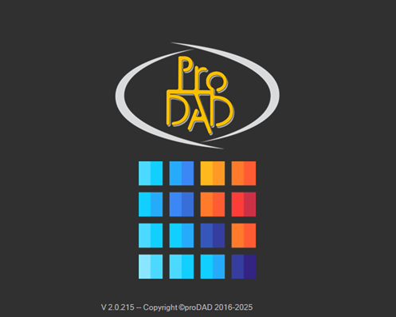

Disguise 2.0ソフトウェアは、ビデオの画像コンテンツをピクセル化（モザイク処理）するために特に設計された強力なアプリケーションです。生成される効果はモザイクと呼ばれ、ビデオ内の機密情報やプライベートな情報を隠すのに最適です。

Disguiseの特長は、非常に長いビデオや複雑な構成を持つビデオでも、効果的かつ時間を節約しながら簡単に処理できる能力にあります。特定の人物、オブジェクト、またはテキストをピクセル化したい場合でも、Disguiseを使えば正確かつプロフェッショナルに実行できます。

このソフトウェアの特筆すべき機能の一つは、ペダルなどの追加ハードウェアを使用して、操作をさらに簡単かつ直感的にできる点です。これにより、ユーザーはビデオ編集ワークフローを簡素化しつつ、生産性を向上させることが可能です。

Disguise 1.0はすでに高い評価を得ており、多くのプロフェッショナルスタジオで成功裏に使用されています。新しいバージョン2.0では、ユーザーの増大する要求に応えるため、機能がさらに改善・拡張されました。

プロのビデオ編集者、コンテンツ制作者、または機密データを保護する必要がある企業にとって、Disguise 2.0はビデオを迅速かつ正確にピクセル化するためのツールと効率性を提供します。このソフトウェアを使用することで、機密情報を保護しながら効率的に作業を進めることができます。

> このドキュメントはHolger Burkarthによって執筆されました。技術翻訳者によって翻訳が行われました。

## *p.1.1*  目次
- [*p* proDAD Disguise 2.0](#Root)
  - [*p.1.1* 目次](#table-of-content)
  - [*p.1.2* 新しい Disguise 2.0 の機能 (Phantom)](#new-features)
  - [*p.1.3* ライセンスモデル](#licensing-models)
  - [*p.1.4* システム要件](#system-requirements)
  - [*p.1.5* 変更履歴](#changelog)
  - [*p.1.6* proDAD について](#prodad)
  - [*p.1.7* お問い合わせ](#contact)
  - [*p.1.8* 著作権](#copyright)
- [*p.2* 主な UI](#MainUI)
- [*W* ワークショップ](#workshops)
  - [*W.1* クイックスタート](#workshop-quick-start) 
  - [*W.2* レイヤー順と保護マスク](#workshop-layer-order)
  - [*W.3* オブジェクトトラッキング](#workshop-tracking-object)
  - [*W.4* S3Dビデオにマスクを作成する方法](#workshop-s3d-mask) 
- [*A* キャンバス](#A)
  - [*A.1* エフェクトマスク](#A.1)
  - [*A.2* 編集ハンドル](#A.2)
  - [*A.3* 回転](#A.3)
  - [*A.4* トラッキング開始 (自動/半自動)](#A.4)
  - [*A.5* 教え込み開始 (手動トラッキング)](#A.5)
  - [*A.6* マスクを非表示/表示](#A.6)
- [*B* インスペクター](#B)
  - [*B.1* エフェクトパラメータ](#B.1)
    - [*B.1.1* パラメータキーフレーム](#B.1.1)
    - [*B.1.2* クリア](#B.1.2)
    - [*B.1.3* 比例](#B.1.3)
    - [*B.1.4* 表示/非表示](#B.1.4)
    - [*B.1.5* モザイクブロックサイズ](#B.1.5)
    - [*B.1.6* モザイク平滑化](#B.1.6)
    - [*B.1.7* マスク太さ](#B.1.7)
    - [*B.1.8* マスク平滑化 (ぼかし)](#B.1.8)
    - [*B.1.9* S3Dデプス (奥行き)](#B.1.9)
    - [*B.1.10* ペイント+輪郭](#B.1.10)
  - [*B.2* 情報](#B.2)
  - [*B.3* メディアビン](#B.3)
    - [*B.3.1* メディアプロパティ](#B.3.1)
        - [*B.3.1.1* カメラタイプ](#B.3.1.1)
        - [*B.3.1.2* フレームパッキング](#B.3.1.2)
        - [*B.3.1.3* 瞳孔間距離 (IPD)](#B.3.1.3)
    - [*B.3.2* メディアの複製](#B.3.2)
    - [*B.3.3* メディアの削除](#B.3.3)
  - [*B.4* 出力メディア](#B.4)
- [*C* タイムライン](#C)
  - [*C.1* タイムライン範囲](#C.1)
    - [*C.1.1* タイムライン範囲 / モード](#C.1.1)
    - [*C.1.2* タイムライン範囲 / 選択](#C.1.2)
  - [*C.2* ルーラー](#C.2)
  - [*C.3* レイヤー](#C.3)
    - [*C.3.1* レイヤー / 表示と編集](#C.3.1)
    - [*C.3.2* レイヤー / 選択](#C.3.2)
    - [*C.3.3* レイヤー / ナビゲート](#C.3.3)
    - [*C.3.4* レイヤー / スタイル](#C.3.4)
    - [*C.3.5* レイヤー / タイプ](#C.3.5)
  - [*C.4* キーフレーム](#C.4)
    - [*C.4.1* キーフレーム / 編集](#C.4.1)
    - [*C.4.2* キーフレーム / 選択](#C.4.2)
    - [*C.4.3* キーフレーム / ナビゲート](#C.4.3)
  - [*C.5* タイムカーソル (再生ヘッド)](#C.5)
    - [*C.5.1* スタイル](#C.5.1)
  - [*C.6* タイムラインタイトル (時間表示)](#C.6)
  - [*C.7* スナップ切り替え](#C.7)
  - [*C.8* タイムラインズーム](#C.8)
  - [*C.9* タイムラインスクロールバー](#C.9)
  - [*C.10* タイムライン コンテキストメニュー](#C.10) 
      - [*C.10.1* カット、コピー、ペースト](#C.10.1)
      - [*C.10.2* 属性コピー、属性ペースト](#C.10.2)
      - [*C.10.3* 削除](#C.10.3)
      - [*C.10.4* キーフレームを終了位置まで削除](#C.10.4)
      - [*C.10.5* ワークエリアをレイヤーに設定](#C.10.5)
      - [*C.10.6* グループ化、グループ解除](#C.10.6)
      - [*C.10.8* タイムカーソルまでサブタイムライン作成](#C.10.8)
      - [*C.10.9* タイムカーソルでサブタイムライン分割](#C.10.9)
      - [*C.10.10* 選択レイヤーから新規サブタイムライン](#C.10.10)
      - [*C.10.11* 時間範囲を別サブタイムラインに分割](#C.10.11)
      - [*C.10.12* タイムラインの圧縮](#C.10.12)
      - [*C.10.13* すべて選択](#C.10.13)
      - [*C.10.14* レイヤーに移動](#C.10.14)
- [*D* オプションビュー](#D)
    - [*D.1* 入力デバイス](#D.1)
    - [*D.2* プリセット](#D.2)
    - [*D.3* タイムライン (サブタイムライン管理)](#D.3)
    - [*D.4* ToDoマーカー](#D.4)
    - [*D.5* メディアビン](#D.5)
    - [*D.6* レイヤー (リスト表示)](#D.6)
    - [*D.7* オブジェクトビューア](#D.7)
    - [*D.8* アンドゥ履歴](#D.8)
    - [*D.9* 処理イベント](#D.9)
- [*E* リボンメニュー](#E)
  - [*E.1* メディアファイルのインポート/エクスポート](#E.1)
    - [*E.1.1* メディアファイルのインポート](#E.1.1)
    - [*E.1.2* メディアファイルのエクスポート](#E.1.2)
  - [*E.2* マスク編集](#E.2)
  - [*E.3* レイヤー](#E.3)
    - [*E.3.1* レイヤーの削除](#E.3.1)
    - [*E.3.2* レイヤーグループ](#E.3.2)
      - [*E.3.2.3* 球面ビデオ用モザイク効果アンカーポイント](#E.3.2.3)
    - [*E.3.3* エフェクトリフト](#E.3.3)
    - [*E.3.4* レイヤー順序](#E.3.4)
    - [*E.3.5* 除外レイヤー (保護マスク)](#E.3.5)
    - [*E.3.6* レイヤーの有効/無効](#E.3.6)
    - [*E.3.7* レイヤーのロック/解除](#E.3.7)
    - [*E.3.8* AIレイヤー](#E.3.8)
    - [*E.3.9* レイヤーの追加](#E.3.9)
  - [*E.4* キャンバス表示モード](#E.4)
    - [*E.4.1* 結果を表示](#E.4.1)
    - [*E.4.2* ソースを表示](#E.4.2)
    - [*E.4.3* 混合表示](#E.4.3)
    - [*E.4.4* 選択オブジェクトのみ表示](#E.4.4)
    - [*E.4.5* 全オブジェクト表示](#E.4.5)
    - [*E.4.6* ソリッド表示 (塗りつぶし)](#E.4.6)
  - [*E.5* タイムライン表示モード](#E.5)
    - [*E.5.1* コンパクト表示](#E.5.1)
    - [*E.5.2* キーフレーム表示 (変形)](#E.5.2)
    - [*E.5.3* キーフレーム表示 (エフェクト)](#E.5.3)
  - [*E.6* S3Dビデオオプション](#E.6)
    - [*E.6.1* グリッドを表示](#E.6.1)
    - [*E.6.2* 表示モード](#E.6.2)
    - [*E.6.3* ゼロデプス (基準深度)](#E.6.3)
    - [*E.6.4* オブジェクト深度を設定](#E.6.4)
    - [*E.6.5* 編集オブジェクトと連動](#E.6.5)
- [*F* プロジェクト](#F)
  - [*F.1* プロジェクトメニュー](#F.1)
    - [*F.1.1* 新規プロジェクト](#F.1.1)
    - [*F.1.2* プロジェクトを開く](#F.1.2)
    - [*F.1.3* プロジェクトを追加 (結合)](#F.1.3)
    - [*F.1.4* プロジェクトを保存](#F.1.4)
    - [*F.1.5* 別名でプロジェクトを保存](#F.1.5)
    - [*F.1.6* メディアをインポート](#F.1.6)
    - [*F.1.7* メディアをエクスポート](#F.1.7)
    - [*F.1.8* チームプロジェクトを作成](#F.1.8)
    - [*F.1.9* チームプロジェクトをインポート (統合)](#F.1.9)
    - [*F.1.10* プロジェクト設定](#F.1.10)
      - [*F.1.10.1* プロジェクト](#F.1.10.1)
      - [*F.1.10.2* ユーザーインターフェース](#F.1.10.2)
      - [*F.1.10.3* 入力デバイス](#F.1.10.3)
        - [*F.1.10.3.1* ペダル](#F.1.10.3.1)
        - [*F.1.10.3.2* MIDI](#F.1.10.3.2)
      - [*F.1.10.4* 編集](#F.1.10.4)
        - [*F.1.10.4.1* オブジェクトトラッカー](#F.1.10.4.1)
        - [*F.1.10.4.2* レイヤー](#F.1.10.4.2)
  - [*F.2* 元に戻す/やり直し](#F.2)
- [*G* チュートリアル / 情報 / アップデート](#G)
- [*H* タイムラインツール](#H)
- [*J* 再生コントロール](#J)
  - [*J.1* オートリピート (ループ再生)](#J.1)
  - [*J.2* 再生/停止](#J.2)
  - [*J.3* 先頭/末尾にジャンプ (イン/アウト点)](#J.3)
  - [*J.4* 再生速度](#J.4)
- [*p.3.1* キーボードショートカット](#short-cuts)
- [*p.3.2* キーボードスーパーコード](#super-short-cuts)
- [*p.3.3* デバイス](#devices)
  - [*p.3.3.1* ペダル](#devices-pedals)
  - [*p.3.3.2* MIDI](#devices-midi)
  - [*p.3.3.3* キーボード](#devices-keyboard)
    - [*p.3.3.3.1* Logitech G13 ショートカット](#devices-Logitech-g13)

## *p.1.2*  Disguise 2.0の新機能 (Phantom)

> [*p.1.5* 変更履歴](#changelog) も参照してください

Disguiseバージョン2.0では、使いやすさと効率性をさらに向上させるいくつかの新機能が提供されています。以下は、主な新機能の概要です。

- **元に戻す/やり直し と 編集履歴**: 編集操作の取り消しと再実行が可能になり、操作履歴（ログ）を表示するオプションも追加されました。これにより、変更内容を完全に管理し、容易に追跡できます。

- **統一されたオブジェクトトラッキング**: マスクを使用したオブジェクトトラッキングが統一されました。自動オブジェクトトラッカーと手動のマウストラッキング（教え込み）が同様の方法で使用できるようになりました。[ペダル](#devices-pedals)、キーボード、ビデオ再生など、様々な入力方法が利用可能です。トラッカーモードでも同じカスタマイズオプションが利用できます。

- **高速化されたオブジェクトトラッキング**: オブジェクトトラッキングと手動トラッキングが、特に長いタイムラインで高速化されました。これにより、大規模プロジェクトの編集効率が向上します。

- **キーフレーム処理の改善**: オブジェクトトラッキングと手動トラッキングの両方で、不要なキーフレームが自動的に回避されるようになりました。これにより、プロジェクトファイルの読み込みと保存が高速化されます。

- **タイムラインへのキーフレーム表示**: モザイクなどの選択されたエフェクトパラメータのキーフレームをタイムライン上に表示できるようになりました。これにより、ビデオの異なる時点でエフェクトを正確に制御・調整できます。

- **刷新されたビデオエクスポート**: ビデオエクスポート機能が全面的に再設計され、新しいフォーマットとハードウェアアクセラレーション（対応している場合）をサポートするようになりました。レンダリング速度が大幅に向上し、ビデオの書き出しがより迅速に行えます。

- **UI要素の簡単な表示/非表示**: UIパネルの表示/非表示が容易になり、個々のユーザーのニーズに合わせてカスタマイズ可能です。

- **モニター解像度サポートの向上**: 様々なモニター解像度への適応性が向上し、最適な表示が得られるようにユーザーインターフェースが改善されました。

- **ユーザーインターフェースの外観と操作感の向上**: モダンで魅力的な外観を提供するために、ユーザーインターフェースが視覚的に再設計されました。

- **パフォーマンスの向上**: 多くの機能が以前のバージョンより高速に動作します。ソフトウェア全体の応答性が向上し、よりスムーズで効率的な操作体験を提供します。

これらの新機能により、Disguise 2.0は、ユーザーエクスペリエンスの向上、編集時間の短縮、そしてビデオ内の画像コンテンツのピクセル化に対するより精密な制御を提供します。

> :bulb: 以前のバージョン Phantom 1.0 および 1.5 との互換性は維持されています。これらのバージョンで作成されたプロジェクトを読み込むことができ、操作もほぼ同じです。これにより、特別なトレーニング期間なしで新しいバージョンへスムーズに移行できます。

> :exclamation: Phantom 1.0 および 1.5 のプロジェクトを開くことができます。これらは自動的にバージョン 2.0 フォーマットに変換されるため、新しい拡張子 `.phantom` で保存することが推奨されます。ただし、バージョン 2.0 で保存されたプロジェクトファイルは、バージョン 1.5 または 1.0 で開くことはできません。

## *p.1.3*  ライセンスモデル
利用可能な機能は、異なるライセンス階層によって有効になります。以下の表は、機能と必要なライセンスを比較したものです。上位のライセンスは、下位ライセンスの機能をすべて含み、さらに新しい機能を追加します。最上位のライセンスは、利用可能なすべての機能を含みます。

| 機能 | Limited | Standard | Extended | 詳細 |
|---|---|---|---|---|
|プロジェクトファイル | *[x]* | *[x]* | *[x]* |  |
|ビデオ数の制限なし | *[x]* | *[x]* | *[x]* |  |
|結果ビデオのエクスポート | *[x]* | *[x]* | *[x]* |  |
|オブジェクトトラッカー | *[x]* | *[x]* | *[x]* | [オブジェクトトラッキング](#workshop-tracking-object) |
|FXプリセット |   | *[x]* | *[x]* | [プリセット](#D.2) |
|エフェクトリフト |   | *[x]* | *[x]* | [エフェクトリフト](#E.3.3) |
|ペダルデバイス |   | *[x]* | *[x]* | [ペダル](#devices-pedals) |
|MIDIデバイス |   | *[x]* | *[x]* | [MIDI](#devices-midi) |
|追加キーボード |   | *[x]* | *[x]* | [キーボード](#devices-keyboard) |
|S3Dビデオ |   |   | *[x]* | [カメラタイプ](#B.3.1.1) | 
|サブタイムライン |   |   | *[x]* | [タイムライン (サブタイムライン管理)](#D.3) |
|オブジェクトビューア |   |   | *[x]* | [オブジェクトビューア](#D.7) |
|レイヤービュー |   |   | *[x]* | [レイヤー (リスト表示)](#D.6) |
|TODOリスト |   |   | *[x]* | [ToDoマーカー](#D.4) |
|アンドゥ履歴 |   |   | *[x]* | [アンドゥ履歴](#D.8) |
|チームプロジェクトの作成 |   |   | *[x]* | [チームプロジェクトを作成](#F.1.8) |
|チームプロジェクトのインポート |   |   | *[x]* | [チームプロジェクトをインポート (統合)](#F.1.9) |

## *p.1.4*  システム要件
- 64ビット版 Windows 7, 8, 10, または 11
- 最小 8 GB RAM、推奨 16 GB RAM

## *p.1.6*  proDADについて

proDADは、高品質なビデオおよび画像編集ソフトウェアの開発と販売を専門とする著名な企業です。1990年の設立以来、proDADはプロフェッショナルなビデオ編集のための革新的なソリューションを提供するリーディングカンパニーとしての地位を確立してきました。

proDAD社は、デジタル画像・ビデオ技術およびソフトウェア開発の分野における卓越した専門知識によって特徴付けられています。経験豊富な開発者とデザイナーからなる専任チームと共に、同社はプロフェッショナルユーザーのニーズに応える先進的なソリューションを継続的に開発しています。

proDADのソフトウェア製品は、ビデオと画像の最適化、編集、強化のための幅広い機能とツールを提供します。これらのソリューションは、直感的なユーザーインターフェース、高性能、そして優れた品質を特徴としています。初心者から経験豊富なプロフェッショナルまで幅広く対応し、メディアコンテンツの視覚的品質を向上させるための多様なエフェクト、フィルター、手ぶれ補正技術、その他のツールを提供します。

proDADの主要な焦点の一つはビデオの手ぶれ補正です。同社は、ビデオ内の揺れやブレを効果的に低減し、一貫性のあるプロ品質の画像安定化を実現するためのいくつかの特許技術を開発しました。この技術は、映画産業、テレビ制作、スポーツ映像など、多くのプロフェッショナルによって使用されています。

proDADは、主要なビデオ編集ソフトウェアメーカーとの緊密な協力関係で知られています。同社の製品は、スタンドアロンのソフトウェアソリューションとして提供されるだけでなく、既存のビデオ編集プログラムにシームレスに統合することも可能です。これにより、ユーザーはプロフェッショナルレベルでビデオプロジェクトを作成するための強化された機能と能力の恩恵を受けることができます。

長年の経験、技術革新、そして顧客満足への強いコミットメントにより、proDADはビデオ編集業界における信頼できるパートナーとしての地位を確立しました。同社のソフトウェアソリューションは、世界中のプロのビデオ編集者、映画制作者、YouTuber、その他のクリエイターによって、魅力的なビジュアルコンテンツを制作するために使用されています。

## *p.1.7*  お問い合わせ

[proDAD](#prodad) では、本プログラムに関するご質問に喜んでお答えします。

以下の方法でお気軽にお問い合わせください：
- Eメール: [support@prodad.com](mailto:support@prodad.com) 
- 電話: +49 (0)7462 9459 0
- 郵送: proDAD GmbH, Gauertstr. 2, 78194 Immendingen, Germany
- ホームページ: [www.proDAD.com](https://www.prodad.com)

> :bulb: ご質問や問題が発生した場合は、カスタマーサポート [support@prodad.com](mailto:support@prodad.com) までメールでお問い合わせください。
> [*G.2.1* サポートプロトコル](#G.2.1) も参照してください。

## *p.1.8*  著作権
Copyright proDAD GmbH. All rights reserved. (すべての権利を保有します。)

**ライセンス利用規約**
ソフトウェアをインストールする前に、このライセンス契約をよくお読みください。

**ライセンス契約**
セットアップ開始時にライセンス契約が表示されますので、よくお読みください。ソフトウェアをインストールすることにより、お客様は著作権条件、ライセンス契約、およびライセンス手続きに拘束されることに同意したものとみなされます。

**ライセンス保証**
proDAD GmbHは、ユーザーに対し、本製品をその意図された許可された目的で使用する権利を許諾します。本製品は1台のコンピュータにのみインストールすることができます。proDADはライセンスキーを無償で提供することを保証します。本製品をインストールすることにより、ユーザーはライセンス保証、著作権条件、および責任制限を承認し、受け入れるものとします。

**商標に関する通知**
本製品に関連して言及されるすべての製品および商標は、それぞれの所有者の商標です。すべての商標は自由な使用を保証することなく使用されており、登録商標である場合があります。

**責任制限**
いかなる請求に対する責任の範囲も、製品の交換に限定されます。これは、proDAD GmbH、すべてのライセンシー、および再販業者に適用されます。請求は、ソフトウェアが事前にproDAD GmbHと合意された返品番号とともに、整然とした状態で返却された場合にのみ受け付けられます。購入証明書も同封する必要があります。本製品の不具合が誤用、乱用、事故、または不適切な取り扱いによるものである場合、この保証は無効となります。proDAD GmbH、その販売代理店、およびライセンシーは、本製品を使用できないことに起因する損害または結果的損害について責任を負いません。責任は、製品の購入価格に限定されます。

**ドキュメント**
マニュアルは細心の注意を払って編集および翻訳されています。ただし、誤りが完全に排除される可能性はありません。proDAD GmbHは、ドキュメントまたは翻訳に含まれる不正確な記述や情報の結果について、一切の責任を負いません。技術的および外観上の変更は予告なく行われる場合があります。不正確な箇所に関する情報はいつでも歓迎します。

**著作権表示**
ソフトウェアおよびそのコンポーネントはproDAD GmbHの財産です。本製品をインストールすることにより、ライセンシーは不正な使用および複製を控えることに同意するものとします。

proDAD GmbHは、本プログラムの使用、および本プログラムで作成されたコンテンツやデータの公開について、一切の責任を負いません。

ProDAD GmbH * Gauertstr. 2 * 78194 Immendingen * Germany * HRB 1077

# *p.2*  メインUI

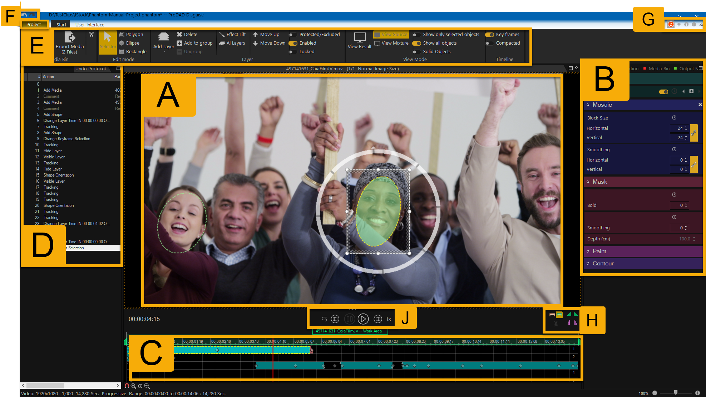

+ [*A* キャンバス](#A) 
+ [*B* インスペクター](#B)
+ [*C* タイムライン](#C)
+ [*D* オプションビュー](#D)
+ [*E* リボンメニュー](#E)
+ [*F* プロジェクト](#F)
+ [*G* チュートリアル/アプリ情報/アップデート](#G)
+ [*H* タイムラインツール](#H)
+ [*J* 再生コントロール](#J)

#  *W* ワークショップ

+ [*W.1* クイックスタート](#workshop-quick-start) 
+ [*W.2* レイヤー順序と保護マスク](#workshop-layer-order)
+ [*W.3* オブジェクトトラッキング](#workshop-tracking-object) 
+ [*W.4* S3Dビデオにマスクを作成する方法](#workshop-s3d-mask) 

##  *W.1* クイックスタート
ビデオを開き、人物の顔にピクセル化（モザイク）を適用する基本的な手順です。

> 1. 編集したいビデオを開きます（メディアインポートボタンを使用）。

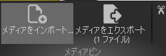

> 2. リボンメニューから適切なマスク形状（例：楕円）を選択し、キャンバス上で顔の上にドラッグしてマスクを描画します。

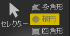

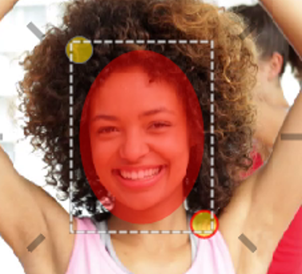

> 3. 描画後、通常表示される適用ボタンをクリックして、作成した新しいマスクを確定します。

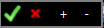

> 4. オブジェクトトラッカーを開始して、オブジェクトの動きを自動または半自動で追跡します。
マスクオーバーレイ上のトラッカーアイコンをクリックするか、<kbd>T</kbd> キーを押すか、マスク自体をダブルクリックします。

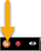

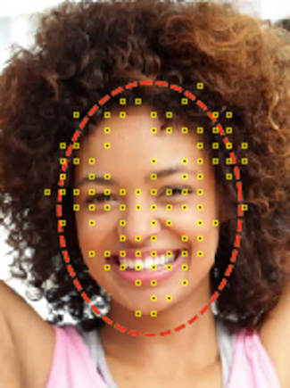

> :exclamation: トラッカーが開始されると、マウスポインターがマスクに「吸着」します。マウスの動きは直接マスクの位置に反映されます。オブジェクトトラッキング中は、トラッキングを停止するまでマウスで他のUIオプションを選択することはできません。

> 5. ビデオのタイムラインを進めながら、動きをキャプチャします。
キーボードの <kbd>B</kbd>, <kbd>N</kbd> キーやテンキーの <kbd>NP-4</kbd>, <kbd>NP-6</kbd> でフレーム単位で移動できます。 <kbd>SPACE</kbd> キーで再生も可能です。フットペダルを使用すると、速度を精密に制御しながらトラッキングできるため、最も効率的です。  
 

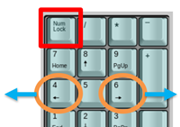

> :bulb: プロフェッショナルな作業を効率的に行うためには、追加の機材の使用を推奨します。これらは生産性を向上させ、ワークフローを合理化し、高品質な処理を実現するのに役立ちます。推奨されるアクセサリには、[*ペダル*](#devices-pedals)、[*MIDI*](#devices-midi)、[*キーボード*](#devices-keyboard) があります。

> 6. トラッキング中、マウスを動かしてマスクの位置を微調整できます。<kbd>↑</kbd>/<kbd>↓</kbd> 矢印キーでサイズを比例的に調整します。<kbd>SHIFT</kbd> キーを押しながらドラッグすると、水平または垂直方向の移動に制限される場合があります。<kbd>←</kbd>/<kbd>→</kbd> 矢印キーでマスクを回転させます。 

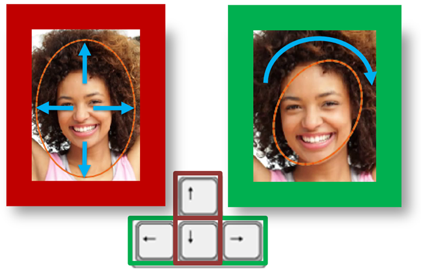

> 7. マスクの位置は、いつでもマウスでドラッグして修正することができます。
   
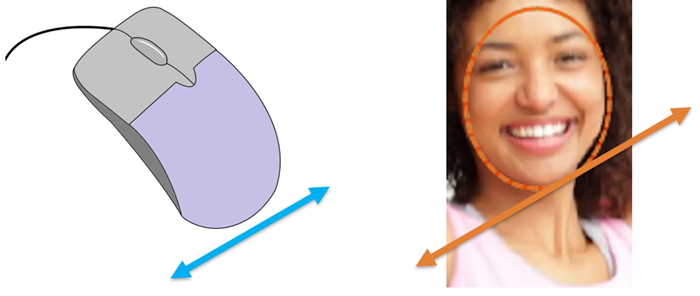

> 8. タイムラインには、作業中に作成されたマスクの位置やプロパティを示すキーフレームが表示されます。
     
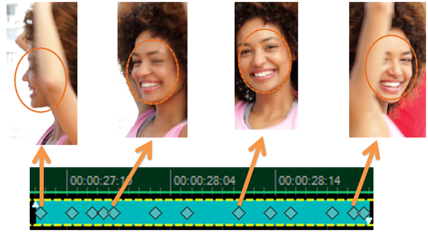

> 9. オブジェクトトラッキングは、通常マウスをクリックすることで完了します（または <kbd>ESC</kbd> キーでトラッキング開始以降の変更をキャンセルします）。
    
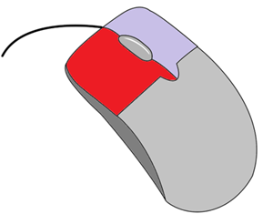

> 10. キャンバスの表示モードを切り替えて（例：「結果を表示」）、最終的なピクセル化の結果を確認します。
       
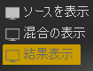

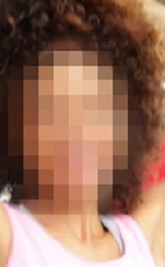

##  *W.2* レイヤー順序と保護マスク

前景にあるオブジェクトを、背景や他のオブジェクトに適用されるピクセル化の影響から保護したい場合があります。このような場合、「除外(Exclude)」レイヤー（保護マスク）を使用して、保護したいオブジェクトを覆います。タイムラインでレイヤーを適切に配置することで、望ましい保護効果が得られます。

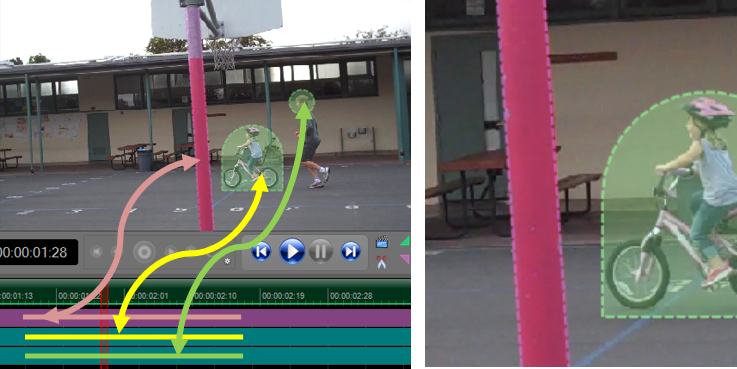

> :bulb: タイムラインにおいて、除外レイヤーは、それが影響を与える（保護する）エフェクトレイヤーよりも*上に*配置する必要があります。レイヤーの重なり順がエフェクトの相互作用を決定します。

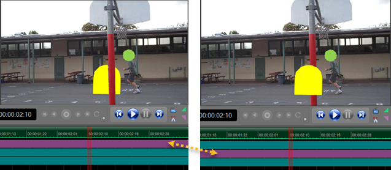

参照: [*E.3.4* レイヤー順序](#E.3.4), [*E.3.5* 除外レイヤー (保護マスク)](#E.3.5)

##  *W.3* オブジェクトトラッキング
複数のビデオフレームにわたって、マスクを特定のオブジェクト上に維持するためのツールが提供されています。オブジェクトトラッカーは、オブジェクトを自動的に追跡し、その動き、回転、サイズの変化に合わせてマスクを調整します。トラッキング中にマウス操作やキーボードショートカットでプロセスを補助することが可能です。

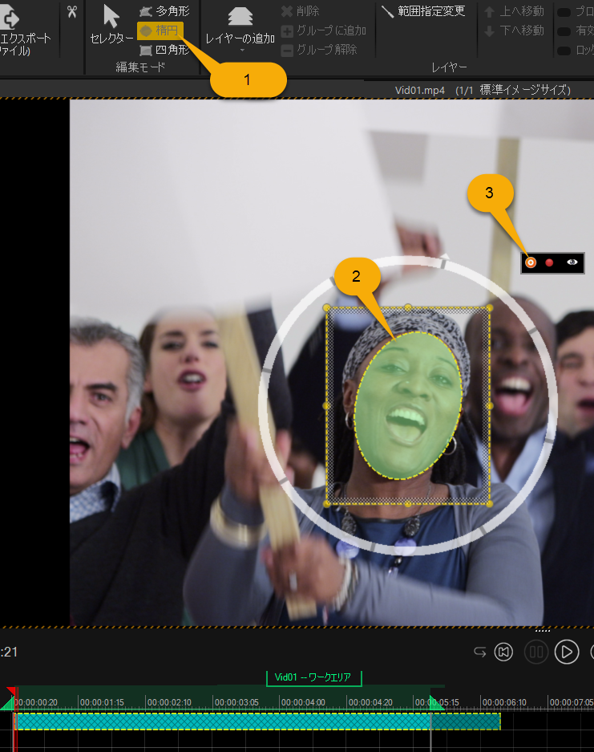

1. リボンメニュー [*E.2*](#E.2) から適切なマスク形状を選択します。
2. キャンバス [*A*](#A) 上で、対象オブジェクトを囲むようにマウスでドラッグしてマスクを作成します。
3. マスクオーバーレイ上の対応するトラッキングボタン ([*A.4*](#A.4) または [*A.5*](#A.5)) をクリックしてトラッキングを開始します。

, 教え込み開始 (A.5)")

*   **[*A.5* 教え込み開始 (手動トラッキング)](#A.5):** 主に、ビデオ再生中またはフレームを進めながら、マウスカーソルでマスクを手動でガイドするトラッキングモードです。オブジェクトが重なったり、他の妨害要因がある複雑なシーンで、自動追跡が困難な場合に、より速い結果が得られることがあります。

*   **[*A.4* トラッキング開始 (自動/半自動)](#A.4):** オブジェクトを自動的に追跡しようとする半自動トラッキングモードです。回転やサイズの変更も考慮される場合があります。自動処理中に、マウスやキーボードを使っていつでも手動で修正を加えることができ、プロセスを中断する必要はありません。

> 通常は **[*A.4* トラッキング開始](#A.4)** を推奨します。

好みのトラッカーを選択してプロセスを開始してください。

> :bulb: [*A.4* トラッキング開始](#A.4) は、マスクをダブルクリックするか、<kbd>T</kbd> キーを押すことでも開始できます。

>:exclamation: 通常、マウスクリックでトラッキング操作が完了し、行われたすべての変更（キーフレーム）が受け入れられます。<kbd>ESC</kbd> キーを押すと、通常、トラッキング操作がキャンセルされ、そのセッション中に行われた変更は破棄されます。

トラッキング操作中（どちらのモードでも）、マウスを動かしてマスクの位置を調整できます。<kbd>↑</kbd>/<kbd>↓</kbd> 矢印キーでサイズを比例的に調整します。<kbd>SHIFT</kbd> キーを押しながらドラッグすると、水平または垂直方向の移動に制限される場合があります。<kbd>←</kbd>/<kbd>→</kbd> 矢印キーでマスクを回転させます。

> :bulb: プロフェッショナルな作業を効率的にサポートするために、追加の機材の使用を推奨します。これらは生産性を向上させ、ワークフローを合理化し、高品質な処理を実現するのに役立ちます。推奨されるアクセサリには、[*ペダル*](#devices-pedals)、[*MIDI*](#devices-midi)、[*キーボード*](#devices-keyboard) があります。

> マウスはトラッキングプロセス中、マスクに追従します。どんな動きも即座にマスクに反映されるため、長いシーンでも疲れにくく、楽に編集できる可能性があります。

次に、編集対象の区間でタイムカーソルを進める必要があります。以下の方法が利用可能です:
- ビデオを再生する（場合によっては低速で）: 詳細は [*J* 再生コントロール](#J) を参照。
- ビデオをフレーム単位で移動する: 詳細は [*C.5* タイムカーソル (再生ヘッド)](#C.5) を参照。
- ペダルを使ってビデオ内を移動する: 詳細は [*F.1.10.3.1* ペダル](#F.1.10.3.1) を参照。

クリックするとトラッキングが停止します。

> :bulb: （通常 `A.4` モードで表示される）トラッキングマーカーは、トラッカーが監視している特徴点を示します。
> これらのマーカーは、トラッキング中に <kbd>F</kbd> キーを押すことで非表示にできる場合があります。

##  *W.4* S3Dビデオでマスクを作成する方法
ステレオスコピック（S3D）球面ビデオで作業する際に、オブジェクト上にマスクを作成する方法を示します。正しいゼロデプス（基準深度）を設定することで、左右の目に対して最小限の調整でマスクが適切に位置合わせされます。

ビデオをインポートし、メディアビンのプロパティでS3Dビデオに適した設定を行います:
- [*B.3.1.1* カメラタイプ](#B.3.1.1) (球面に設定)
- [*B.3.1.2* フレームパッキング](#B.3.1.2) (例: トップボトム、サイドバイサイド)

リボンメニュー [*E.6*](#E.6) でS3D表示モード（例: アナグリフ、デプスマイックス）を選択し、キャンバス [*A*](#A) でオブジェクトの空間的な奥行きを視覚化します。
- [*E.6.2* 表示モード](#E.6.2)

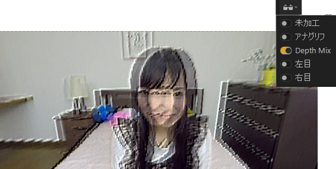

対象オブジェクトの左右のビュー間で視差シフト（パララックス）が最小限になるか、またはなくなるまで、ゼロデプスパラメータ ([*E.6.3*](#E.6.3)) を調整します（デプスマイックスまたはアナグリフ表示で、オブジェクトが「平坦」または「整列」して見えるようにします）。目標は、マスクしたいオブジェクトの深度に仮想的な「スクリーン平面」を配置することです。

 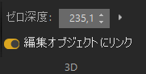

適切なマスク形状 ([*E.2*](#E.2)) を選択し、キャンバス上でオブジェクト上にドラッグします。
- [*E.2* マスク編集](#E.2)

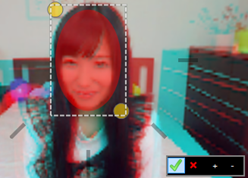

マスク作成を確定すると、マスクとそれに対応するレイヤーが作成されます。現在のゼロデプス値がマスクの深度プロパティ ([*B.1.9*](#B.1.9)) に自動的に適用されるか、[*E.6.4* オブジェクト深度を設定](#E.6.4) を使用して明示的に設定する必要がある場合があります。

参照:
- [*E.3.2* レイヤーグループ](#E.3.2) (同じ深度を共有すべきマスクをグループ化するのに便利)

#  *A* キャンバス

キャンバスはユーザーインターフェースの重要な部分です。マウスやキーボードを使用して、形状、位置、サイズを指定することで編集マスクを作成・変更できます。また、マスクエフェクトを元の画像に適用して、編集の最終結果を表示します。キャンバスでは、マスクオーバーレイ上に直接、トラッキングなどの一般的なアクションを実行するためのコントロールが提供されます。トラッキングは、ビデオ内のオブジェクトの動きに合わせてマスクを自動的（または半自動的）に調整する機能です。

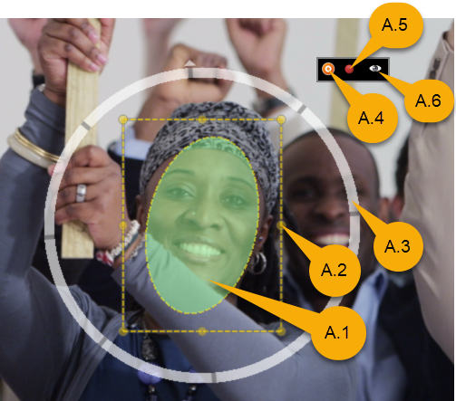

+ [*A.1* エフェクトマスク](#A.1) 
+ [*A.2* 編集ハンドル](#A.2)
+ [*A.3* 回転](#A.3) 
+ [*A.4* トラッキング開始 (自動/半自動)](#A.4)
+ [*A.5* 教え込み開始 (手動トラッキング)](#A.5)
+ [*A.6* マスクの表示/非表示 (エフェクト適用切替)](#A.6)

##  *A.1* エフェクトマスク

マスクは、ビデオにエフェクト（例：モザイク）が適用される領域を定義します。マスクの形状はリボンメニュー [*E.2* マスク編集](#E.2) から選択できます。マスクは、エフェクトが適用される領域（標準レイヤー）またはエフェクトが表示されない安全な領域（除外レイヤー、[*E.3.5*](#E.3.5) 参照）のいずれかを定義できます。

##  *A.2* 編集ハンドル

これらは、選択されたマスクのバウンディングボックス上にある小さな四角形や円形のコントロールポイントです。マスクを目的のオブジェクトに適合させるために、サイズと位置を変更できます。まず、マスクをクリックして選択します。次に、編集ハンドルをクリック＆ドラッグしてマスクのサイズを変更します。マスク自体（ハンドルではない部分）をクリック＆ドラッグすると移動できます。キーボードも使用できます：<kbd>矢印キー</kbd>でマスクの位置を微調整します。ハンドル上でマウスボタンを押したまま <kbd>↑</kbd>/<kbd>↓</kbd> 矢印キーを使用すると、サイズを比例的に変更できる場合があります。<kbd>SHIFT</kbd> キーを押しながらハンドルをドラッグするとアスペクト比が固定されたり、マスクをドラッグすると水平/垂直移動に制限されたりする場合があります。<kbd>←</kbd>/<kbd>→</kbd> 矢印キー（場合によっては <kbd>CTRL</kbd> や <kbd>ALT</kbd> との組み合わせ、またはトラッキング中）でマスクを回転させます（[*A.3*](#A.3) 参照）。

##  *A.3* 回転

選択したマスクを回転させます。専用の回転ハンドル（利用可能な場合）をドラッグするか、特にトラッキング中 ([*A.4*](#A.4), [*A.5*](#A.5)) に <kbd>←</kbd>/<kbd>→</kbd> 矢印キーなどのキーボードショートカットを使用します。

##  *A.4* トラッキング開始 (自動/半自動)

半自動オブジェクトトラッキングプロセスを開始します。このボタンは通常、マスクが選択されているときにマスクオーバーレイ上に表示されます。トラッキングは、マスクをダブルクリックするか <kbd>T</kbd> キーを押すことでも開始できることがよくあります。

>:exclamation: 通常、マウスクリックでトラッキング操作が完了し、生成されたキーフレームが受け入れられます。<kbd>ESC</kbd> キーを押すと通常、トラッキング操作がキャンセルされ、そのセッション中に生成されたキーフレームは破棄されます。

トラッキング操作中、マウスを動かしてトラッカーを補助し、マスクの位置を調整できます。<kbd>↑</kbd>/<kbd>↓</kbd> 矢印キーでサイズを比例的に調整します。<kbd>SHIFT</kbd> キーを押しながら操作すると、必要に応じて移動やサイズ変更が制限されます。<kbd>←</kbd>/<kbd>→</kbd> 矢印キーでマスクを回転させます。ワークショップ [*W.3* オブジェクトトラッキング](#workshop-tracking-object) も参照してください。

##  *A.5* 教え込み開始 (手動トラッキング)

手動トラッキング（「教え込み」）モードを開始します。このボタンは通常、マスクオーバーレイ上に表示されます。このモードでは、タイムカーソルを前方に移動させる（例：再生やペダルを使用）と、マスクがマウスポインターに追従します。フレームごと、または再生中に手動でマスクをガイドします。ワークショップ [*W.3* オブジェクトトラッキング](#workshop-tracking-object) も参照してください。

[トラッキング制御については A.4 を参照](#A.4)

##  *A.6* マスクの表示/非表示 (エフェクト適用切替)

タイムライン上の現在の時間位置における、選択されたマスクに関連付けられた*エフェクト*の適用/非適用を切り替えます。非表示（非適用）にすると、その時点ではエフェクトは計算されません（通常、可視性パラメータのキーフレームが作成されます）。マスクが選択されているときに <kbd>H</kbd> キーを押すことでも利用可能です。

参照:
- [パラメータ: 表示/非表示](#B.1.4) 
- [レイヤー / 表示と編集: 可視性インジケーター](#C.3.1)

#  *B* インスペクター

インスペクターパネルは通常、現在選択されているアイテム（例：マスク/レイヤー、メディアファイル、プロジェクト全体）の詳細なプロパティや設定を表示・編集します。

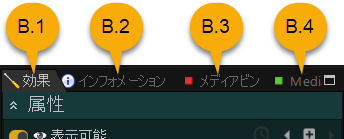

+ [*B.1* エフェクトパラメータ](#B.1) 
+ [*B.2* 情報](#B.2) 
+ [*B.3* メディアビン](#B.3) 
+ [*B.4* 出力メディア](#B.4) 

##  *B.1* エフェクトパラメータ

選択したマスク/レイヤーによって適用されるエフェクトのパラメータを表示し、編集を可能にします。

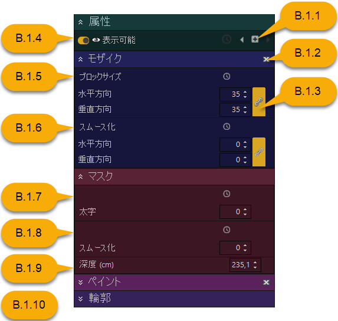

+ [*B.1.1* パラメータキーフレーム](#B.1.1) 
+ [*B.1.2* クリア](#B.1.2) 
+ [*B.1.3* 比例](#B.1.3) (サイズ/スケールパラメータに関連する場合)
+ [*B.1.4* 表示/非表示](#B.1.4) 
+ [*B.1.5* モザイクブロックサイズ](#B.1.5) 
+ [*B.1.6* モザイク平滑化](#B.1.6) 
+ [*B.1.7* マスク太さ](#B.1.7) 
+ [*B.1.8* マスク平滑化 (ぼかし)](#B.1.8) 
+ [*B.1.9* S3Dデプス (奥行き)](#B.1.9) 
+ [*B.1.10* ペイント＋輪郭](#B.1.10) (特定マスクタイプの塗りつぶし色/不透明度や輪郭設定に関連する可能性あり)

###  *B.1.1* パラメータキーフレーム
パラメータが時間経過と共に変化できるか（キーフレーム化されるか）、一定値を保つかを制御します。

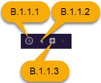

- *B.1.1.1* キーフレーム制御の有効化/無効化: 時計アイコンまたはチェックボックスをクリックして、このパラメータのキーフレーム化を有効/無効にします。
- *B.1.1.2* 前/次のキーフレーム: タイムカーソルを、選択したレイヤー上の*この特定のパラメータ*の前のキーフレームまたは次のキーフレームにジャンプさせます。
- *B.1.1.3* キーフレームの追加/削除: 現在のタイムカーソル位置に、このパラメータのキーフレームを設定または削除します。

参照:
- [*E.5.3* キーフレーム表示 (エフェクト)](#E.5.3) (タイムライン上でのパラメータキーフレームの視覚的表示)
---

###  *B.1.2* クリア
このセクションのパラメータ（または選択中のパラメータのみ）をデフォルト値にリセットします。

###  *B.1.3* 比例
サイズパラメータ（マスク形状自体の幅と高さなど、ここで適用可能な場合）を調整する際に、このオプションを有効にすると、現在のアスペクト比を維持するように連動します。

###  *B.1.4* 表示/非表示
現在のタイムカーソル位置におけるエフェクトマスクの適用/非適用を制御します。これをオフにすると、その時点ではエフェクトは無効になります。このパラメータはキーフレーム化できます ([*B.1.1*](#B.1.1))。

参照:
- [マスクの表示/非表示ボタン](#A.6)
- [レイヤー / 表示と編集: 可視性インジケーター](#C.3.1)

###  *B.1.5* モザイクブロックサイズ
モザイクエフェクトの個々のピクセルブロックのサイズを調整します。値が大きいほど、粗いピクセル化になります。

| ブロックサイズ: 10 | ブロックサイズ: 20 | ブロックサイズ: 40 |
|---|---|---|
| ") | ") | ") |

参照:
- [*E.3.2* レイヤーグループ](#E.3.2) (グループ化されたレイヤーの共通パラメータ)
- [*E.3.2.3* 球面ビデオ用モザイク効果アンカーポイント](#E.3.2.3)
- [*C.3.5* レイヤー / タイプ](#C.3.5)
- [*E.5.3* キーフレーム表示 (エフェクト)](#E.5.3) (タイムライン上でのこのパラメータのキーフレーム表示)

###  *B.1.6* モザイク平滑化
モザイクブロックのエッジにスムージングフィルターを適用し、硬い遷移を和らげます。値が大きいほどスムージングが強くなります。

| 平滑化: 0 | 平滑化: 3 | 平滑化: 7 |
|---|---|---|
| ") | 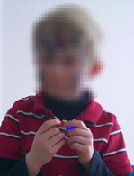 | 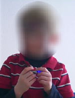 |

参照:
- [*E.3.2* レイヤーグループ](#E.3.2)
- [*E.3.2.3* 球面ビデオ用モザイク効果アンカーポイント](#E.3.2.3)
- [*C.3.5* レイヤー / タイプ](#C.3.5)

###  *B.1.7* マスク太さ
マスク領域を拡大（正の値）または縮小（負の値）します。これにより、マスクの境界が実質的に太くまたは細くなります。

| 太さ: 0 | 太さ: 40 |
|---|---|
| 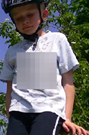 | ") |

###  *B.1.8* マスク平滑化 (ぼかし)
マスクのエッジを柔らかくし、エフェクト適用領域と非適用領域の間の遷移を段階的にします（フェザリング）。値が大きいほど、ぼかしの範囲が広くなります。

| 平滑化: 0 | 平滑化: 40 |
|---|---|
| ") | ") |

###  *B.1.9* S3Dデプス (奥行き)
ステレオスコピック（S3D）ビデオの場合、このパラメータはマスク自体の知覚的な奥行きを定義します。3Dで正しくレンダリングするためには、理想的にはマスクされるオブジェクトの奥行きと一致させる必要があります。この値は、特定の [*E.6.3* ゼロデプス](#E.6.3) 設定でマスクを作成する際に自動的に設定されるか、ここで手動で調整される場合があります。

参照:
- [*E.6.4* オブジェクト深度を設定](#E.6.4)
- [*W.4* S3Dビデオにマスクを作成する方法](#workshop-s3d-mask)
- [*E.3.2.3* 球面ビデオ用モザイク効果アンカーポイント](#E.3.2.3)

###  *B.1.10* ペイント + 輪郭
これらのパラメータは、マスクがモザイクだけでなく、単色や輪郭のオーバーレイとして使用される場合の外観を制御します。
*   **ペイント:** 塗りつぶしの色とその不透明度/透明度を制御します。
*   **輪郭:** マスク形状の周りの輪郭線の外観（色、太さ、スタイル）を制御します。

| ペイント/不透明度: 100% | ペイント/不透明度: 50% |
|---|---|
| 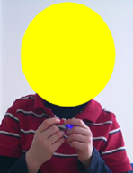 | 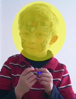 |

##  *B.2* 情報

:hourglass_flowing_sand: 工事中
(このセクションは、選択されたアイテムに関するメタデータ、例えば長さ、解像度、ファイルパスなどを表示する可能性があります。)

##  *B.3* メディアビン

このセクションまたはビューは、現在のプロジェクトにインポートされたビデオファイルの一覧を表示します。ここでメディアファイルを選択すると、通常インスペクターにそのプロパティが表示されます。

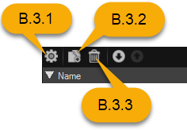

- [*B.3.1* メディアプロパティ](#B.3.1) (選択メディアのプロパティダイアログを開くボタン)
- [*B.3.2* メディアの複製](#B.3.2) (選択メディアエントリを複製するボタン)
- [*B.3.3* メディアの削除](#B.3.3) (選択メディアをプロジェクトから削除するボタン)

###  *B.3.1* メディアプロパティ
プロジェクトコンテキスト内で、選択されたビデオファイルのプロパティを表示および編集するためのダイアログを開きます。

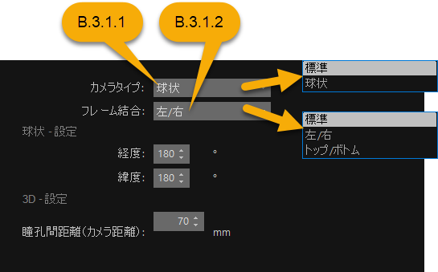

- [*B.3.1.1* カメラタイプ](#B.3.1.1)
- [*B.3.1.2* フレームパッキング](#B.3.1.2)
- [*B.3.1.3* 瞳孔間距離 (IPD)](#B.3.1.3)

####  *B.3.1.1* カメラタイプ

使用されたカメラレンズの種類を定義します。主に正しい投影マッピングのために重要です。
*   **標準**: 通常の直線的なカメラビュー。
*   **球面**: 360度または部分的な球状視野を持つカメラ（通常、正距円筒図法が想定されます）。

> :exclamation: 球面ビデオの場合、キャンバス上で正しく表示および処理するためには、フレームパッキング設定 ([*B.3.1.2*](#B.3.1.2)) が非常に重要です。

####  *B.3.1.2* フレームパッキング

ステレオスコピック（S3D）またはマルチビュービデオのビューが、単一のビデオフレーム内でどのように配置されているかを指定します。
*   **モノラル**: 標準的な単一ビューのビデオ。
*   **左右** (またはサイドバイサイド): 左目用ビューが左半分、右目用ビューが右半分に配置されます。フル幅（圧縮）またはハーフ幅の場合があります。
*   **上下** (またはトップボトム): 左目用ビューが上半分、右目用ビューが下半分に配置されます。

##### 水平画像配置（**左右/サイドバイサイド**）の球面ビデオ例

| 経度: 360° 緯度: 180° (全球面 S3D) | 経度: 180° 緯度: 180° (半球面 S3D) |
|---|---|
|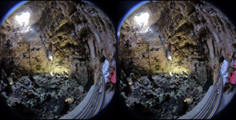|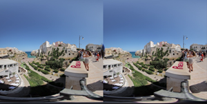|

---
##### 垂直画像配置（**上下/トップボトム**）の球面ビデオ例

| 経度: 360° 緯度: 180° (全球面 S3D) |
|---|
|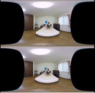|

---

####  *B.3.1.3* 瞳孔間距離 (IPD)
瞳孔間距離（IPD）、または眼間距離は、ステレオスコピック球面ビデオにおいて、正しい表示スケーリングと2つのビデオソース間の空間的関係の正確な処理のために使用されます。

この値は、空間的な奥行きとスケールの知覚に直接影響します。平均的な人間のIPDは約65〜70 mmです。これを正しく設定することで、3D効果が自然に見えるようになります。

参照:
- [*W.4* S3Dビデオにマスクを作成する方法](#workshop-s3d-mask)
- [*B.1.9* S3Dデプス (奥行き)](#B.1.9) (マスクの奥行きパラメータ)
- [*E.3.2* レイヤーグループ](#E.3.2) (S3Dマスクのグループ化)
- [*E.6* S3Dビデオオプション](#E.6) (S3D編集用リボンコントロール)

###  *B.3.2* メディアの複製
:hourglass_flowing_sand: 工事中
(選択されたメディアアイテムをビン内で複製します。プロジェクト内で同じソース映像に異なるエフェクトや編集を適用する場合などに役立つ可能性があります。)

###  *B.3.3* メディアの削除
:hourglass_flowing_sand: 工事中
(選択されたメディアファイルの参照をプロジェクトから削除します。通常、ディスク上の元のファイルは削除されませんが、メディアビンとそれを使用しているタイムラインから削除されます。)

##  *B.4* 出力メディア

:hourglass_flowing_sand: 工事中
(このセクションは、最終的にエクスポートされるビデオに関連するプロパティを表示する可能性があります。エクスポートプロセスを開始する前に、インスペクターで直接エクスポート設定を構成できるかもしれません。)

#  *C* タイムライン

タイムラインは、ビデオプロジェクトを時間軸に沿って視覚的に表現し、メディアクリップ、レイヤー、エフェクト、キーフレームの配置を示します。

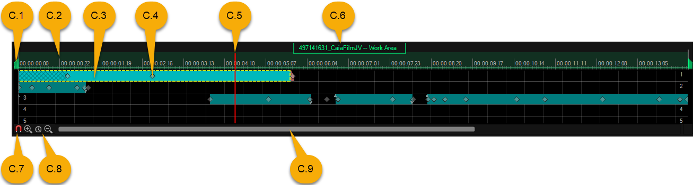

+ [*C.1* タイムライン範囲](#C.1) (特定の時間範囲を定義するマーカー)
+ [*C.2* ルーラー](#C.2) (時間スケールインジケーター)
+ [*C.3* レイヤー](#C.3) (マスクとエフェクトを含むトラック)
+ [*C.4* キーフレーム](#C.4) (プロパティが変化する時点)
+ [*C.5* タイムカーソル (再生ヘッド)](#C.5) (現在の再生/編集位置を示す)
+ [*C.6* タイムラインタイトル (時間表示)](#C.6) (現在のタイムコードなどを表示)
+ [*C.7* スナップ切り替え](#C.7) (スナップ動作のオン/オフ)
+ [*C.8* タイムラインズーム](#C.8) (水平方向のズームレベル制御)
+ [*C.9* タイムラインスクロールバー](#C.9) (水平・垂直方向のナビゲーション用)
+ [*C.10* タイムライン コンテキストメニュー](#C.10) (タイムライン操作用の右クリックメニュー)

##  *C.1* タイムライン範囲

タイムラインルーラー ([*C.2*](#C.2)) 上のマーカーは、特定の時間セグメントを定義します。これらの範囲は、再生ループ、エクスポート期間、または作業領域を制御できます。
*   **開始/終了マーカー (イン/アウト点):** これらは通常、再生、エクスポート、または編集操作のためのアクティブなセグメントを定義します。
*   **マーカーの移動:** 開始マーカー（多くの場合 'I' と表示）または終了マーカー（多くの場合 'O' と表示）をマウスでクリック＆ドラッグします。
*   **範囲全体の移動:** イン点とアウト点の間のタイトルバーをクリック＆ドラッグすると、期間を変更せずに範囲全体を移動できます。
*   **マーカーの設定:** <kbd>I</kbd> キーで現在のタイムカーソル位置 ([*C.5*](#C.5)) にイン点を設定し、<kbd>O</kbd> キーでアウト点を設定します。
*   **範囲の最大化:** 範囲タイトルバーをダブルクリックすると、範囲がビデオ全体または現在のサブタイムラインの全期間に拡張される場合があります。

> :bulb: イン点またはアウト点マーカーをドラッグ中に <kbd>SHIFT</kbd> キーを押し続けると、キャンバス [*A*](#A) に対応するビデオフレームが表示される場合があります（ライブスクラビング）。

###  *C.1.1* タイムライン範囲 / モード

異なるモードでは、イン/アウトマーカーが制御するものが変わる可能性があります：

> **ビデオトリミング:**  
> プロジェクトで使用されるソースビデオクリップ全体の開始点と終了点を編集します。この範囲は、上書きされない限り、通常デフォルトのエクスポート期間も定義します。
> 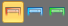 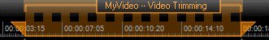  
 
> **タイムライン / サブタイムライン:**  
> サブタイムライン ([*D.3*](#D.3)) を使用している場合、このモードでは特定のサブタイムラインがカバーする時間範囲を定義または選択できる場合があります。
> 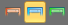 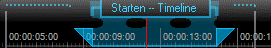  

> **エフェクト / ワークエリア:**  
> 集中的な編集、ループ再生 ([*J.1*](#J.1))、または特定セクションのみのレンダリング/エクスポート ([*E.1.2.6*](#E.1.2.6)) のための、一時的な作業範囲（しばしばワークエリアまたはイン/アウト範囲と呼ばれる）を定義します。これは編集中に最も頻繁に使用される範囲モードです。
>  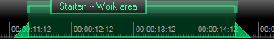  

###  *C.1.2* タイムライン範囲 / 選択

タイムライン上のレイヤーバー ([*C.3*](#C.3)) をダブルクリックすると、ワークエリア ([*C.1.1*](#C.1.1)) のイン点とアウト点がその特定のレイヤーの開始時間と終了時間に自動的に設定される場合があります。

参照: 
- [*C.2* ルーラー](#C.2)
- [*C.5* タイムカーソル (再生ヘッド)](#C.5)
- [*C.6* タイムラインタイトル (時間表示)](#C.6)

##  *C.2* ルーラー

タイムライン上部の水平ルーラーは、時間単位（例：秒、フレーム、タイムコード）を表示し、タイムカーソル、範囲マーカー、その他の時間ベースの要素の位置を示します。

参照: 
- [*C.1* タイムライン範囲](#C.1)
- [*C.5* タイムカーソル (再生ヘッド)](#C.5)
- [*C.6* タイムラインタイトル (時間表示)](#C.6)
 

##  *C.3* レイヤー

レイヤーは、エフェクトマスク ([*A.1*](#A.1)) とそれに関連するキーフレーム ([*C.4*](#C.4)) を時間軸に沿って含むタイムライン上の水平トラックです。レイヤーの垂直方向の重ね順は、特に除外レイヤー ([*E.3.5*](#E.3.5)) やレイヤーグループ ([*E.3.2*](#E.3.2)) を使用する場合に重要になります。

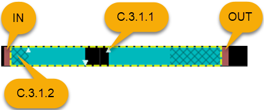

+ [*C.3.1* レイヤー / 表示と編集](#C.3.1) (レイヤーバー上の視覚的インジケーター)
+ [*C.3.2* レイヤー / 選択](#C.3.2) (レイヤーの選択方法)
+ [*C.3.3* レイヤー / ナビゲート](#C.3.3) (レイヤーに基づくタイムカーソルの移動)
+ [*C.3.4* レイヤー / スタイル](#C.3.4) (外観オプション)
+ [*C.3.5* レイヤー / タイプ](#C.3.5) (異なる種類のレイヤー)

参照:
- [*E.5* タイムライン表示モード](#E.5) (レイヤー表示に影響するオプション)
---

###  *C.3.1* レイヤー / 表示と編集

レイヤーバー自体が視覚的なフィードバックを提供します：
*   **削除:** 選択したレイヤーは <kbd>DEL</kbd> キーを押して削除できます。
*   **未定義領域 (*C.3.1.2*):** レイヤーバー上の異なるパターンや色は、レイヤー期間*内*でマスクの位置/プロパティがキーフレームによって明示的に定義されていない時間セグメントを示す場合があります（例：最初のキーフレームより前、またはトラッキングが全期間にわたって実行されなかった場合の最後のキーフレームの後）。これらの領域では、マスクは最後の既知の状態を保持するか、予期しない動作をする可能性があります。
*   **可視性インジケーター (*C.3.1.1*):** レイヤーバーの外観の変化（例：破線、異なる色、アイコンオーバーレイ）は、マスクの可視性 ([*B.1.4*](#B.1.4), [*A.6*](#A.6)) がキーフレームによってオフにされている場所を示すことができます。これにより、レイヤー期間に沿ってエフェクトがアクティブな場所と非アクティブな場所がわかります。

###  *C.3.2* レイヤー / 選択

*   **単一選択:** レイヤーバーをクリックして選択します。
*   **複数選択（連続）:** 最初のレイヤーをクリックし、<kbd>SHIFT</kbd> キーを押しながら最後のレイヤーをクリックして範囲を選択します。
*   **複数選択（非連続）:** <kbd>CTRL</kbd> キーを押しながら個々のレイヤーをクリックして、選択に追加または選択から除外します。
*   **キーボード選択:** <kbd>↑</kbd> および <kbd>↓</kbd> 矢印キーを使用して、前または次のレイヤーを選択します。<kbd>SHIFT</kbd> キーを押しながら矢印キーを使用すると、選択範囲を拡張できます。

###  *C.3.3* レイヤー / ナビゲート

レイヤーバーの開始端または終了端をダブルクリックすると、通常、タイムカーソル ([*C.5*](#C.5)) がその特定の時点に移動します。

---

###  *C.3.4* レイヤー / スタイル

レイヤーバーの垂直方向の高さと詳細レベルは、しばしば変更できます：

**標準:**  
レイヤー名と、より多くの詳細を表示する可能性があります。
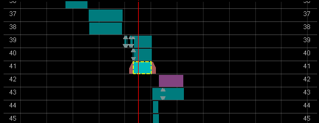

**コンパクト:**  
レイヤーの高さを減らして、画面上に垂直方向により多くのレイヤーを収めます。
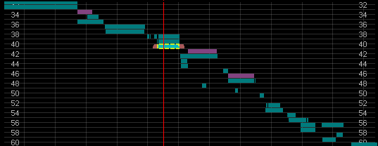

参照:
- [*E.5.1* リボン コンパクト表示](#E.5.1) (コンパクトモードを切り替えるボタン)

---

###  *C.3.5* レイヤー / タイプ

レイヤーは異なる機能を持ち、その外観やアイコンによって示されることがあります：

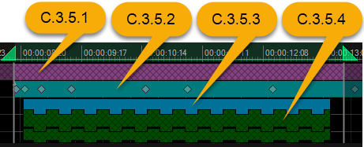

- *C.3.5.1* **除外レイヤー:** その下にあるレイヤー（タイムラインの重ね順で）のエフェクトが適用*されない*保護領域を定義するマスクを含みます。しばしば異なる色やアイコンを持ちます。[*E.3.5*](#E.3.5) を参照。
- *C.3.5.2* **通常レイヤー:** エフェクトマスク（例：ピクセル化用）を含む標準的なレイヤー。
- *C.3.5.3* **グループヘッダー:** レイヤーグループ ([*E.3.2*](#E.3.2)) を表します。このレイヤーを選択すると、グループ内のすべてのレイヤーに共通のパラメータ（モザイク設定やS3Dデプスなど）を編集できます。
- *C.3.5.4* **グループメンバー:** レイヤーグループに属するレイヤー。視覚的にインデントされるか、上のグループヘッダーにリンクされています。その個々のエフェクトパラメータは、グループ設定によって上書きされる場合があります。

##  *C.4* キーフレーム

キーフレームは、マスクのプロパティ（位置、サイズ、回転、可視性、エフェクトパラメータなど）の1つ以上が定義された値を持つ特定の時点を示すレイヤーバー上のマーカーです。ソフトウェアはキーフレーム間の値を補間して、時間経過に伴う滑らかなアニメーションや変化を作成します。

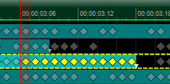

参照:
- [*E.5.2* キーフレーム表示 (変形)](#E.5.2) (マスク変形キーフレームの表示/非表示切り替え)
- [*E.5.3* キーフレーム表示 (エフェクト)](#E.5.3) (エフェクトパラメータキーフレームの表示/非表示切り替え)
---

###  *C.4.1* キーフレーム / 編集

*   **選択削除:** 1つ以上のキーフレームを選択し、<kbd>DEL</kbd> キーを押して削除します。
*   **範囲削除:** <kbd>SHIFT</kbd>+<kbd>DEL</kbd> を押すと、通常、選択したレイヤー上の現在のタイムカーソル位置 ([*C.5*](#C.5)) からレイヤーの終わり、またはワークエリア ([*C.1.1*](#C.1.1)) の終わりまでのすべてのキーフレームが削除されます。セクションを再トラッキングするのに便利です。

> 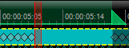

###  *C.4.2* キーフレーム / 選択

*   **単一選択:** キーフレームマーカーをクリックします。
*   **複数選択（ボックス）:** 1つまたは複数の選択されたレイヤー上の複数のキーフレームの周りに選択ボックスをドラッグします。
*   **複数選択（連続）:** 最初のキーフレームをクリックし、<kbd>SHIFT</kbd> キーを押しながら*同じレイヤー上*の最後のキーフレームをクリックして範囲を選択します。
*   **複数選択（非連続）:** <kbd>CTRL</kbd> キーを押しながら個々のキーフレームをクリックして、選択に追加または選択から除外します。

###  *C.4.3* キーフレーム / ナビゲート

*   **キーフレームへジャンプ:** キーフレームマーカーをダブルクリックすると、通常、タイムカーソル ([*C.5*](#C.5)) がその正確な時点に移動します。
*   **前/次のキーフレーム:** キーボードショートカット（多くの場合 <kbd>PAGE-UP</kbd>/<kbd>PAGE-DOWN</kbd> または専用ボタン）またはパラメータ固有のナビゲーションボタン ([*B.1.1.2*](#B.1.1.2)) を使用して、選択したレイヤー上のキーフレーム間をジャンプします。

##  *C.5* タイムカーソル (再生ヘッド)

再生ヘッドとも呼ばれ、この垂直線はキャンバス [*A*](#A) に表示されている現在のフレームと、キーフレームの設定などの編集アクションの正確な時点を示します。
*   **移動:** ルーラー領域 ([*C.2*](#C.2)) でタイムカーソルハンドルをクリック＆ドラッグするか、タイムラインルーラーまたはレイヤー領域のどこかをクリックしてカーソルをジャンプさせます。
*   **フレーム単位移動:** <kbd>←</kbd> および <kbd>→</kbd> 矢印キー、または <kbd>B</kbd> および <kbd>N</kbd> キーを使用します。
*   **テンキーナビゲーション:** 有効になっている場合 ([*F.1.10.2*](#F.1.10.2))、<kbd>NP-4</kbd> および <kbd>NP-6</kbd> (テンキーの4と6、Num Lockオン) を使用してフレーム単位で移動します。
*   **先頭/末尾へジャンプ:** <kbd>HOME</kbd> および <kbd>END</kbd> キーを使用して、現在のビュー範囲（多くの場合ワークエリア）の先頭または末尾にジャンプします。テンキーの <kbd>NP-7</kbd> および <kbd>NP-1</kbd> も同様のアクションを実行する場合があります。
*   **マーカー/キーフレームへジャンプ:** <kbd>PAGE-UP</kbd> および <kbd>PAGE-DOWN</kbd> キー、またはテンキーの <kbd>NP-9</kbd> および <kbd>NP-3</kbd> を使用して、前/次のキーフレームまたは他のマーカー（編集点やユーザー定義マーカーなど）にジャンプします。

###  *C.5.1* スタイル 
タイムカーソルの外観は変更できる場合があります：
*   **SPAN:** タイムカーソルが現在のフレームの期間を視覚的に示し、水平方向にわずかに広がる場合があります。
*   **SIMP (Simple):** タイムカーソルが単一の細い垂直線として表示されます。

| タイプ | 最初の範囲フレーム | 最後の範囲フレーム |
|---|---|---|
|SPAN | ") | ") | 
|SIMP | ") | ") | 

参照: 
- [*C.1* タイムライン範囲](#C.1)
- [*C.2* ルーラー](#C.2)
- [*C.6* タイムラインタイトル (時間表示)](#C.6)
- [*F.1.10.2* プロジェクト設定: ユーザーインターフェース](#F.1.10.2) (スタイル切り替えオプション)

##  *C.6* タイムラインタイトル (時間表示)

この領域は、多くの場合ルーラーやタイムカーソルの近くにあり、現在のタイムカーソル位置の正確なタイムコードまたはフレーム番号を表示します。

参照: 
- [*C.1* タイムライン範囲](#C.1)
- [*C.2* ルーラー](#C.2)
- [*C.5* タイムカーソル (再生ヘッド)](#C.5)

##  *C.7* スナップ切り替え

タイムラインのスナップ機能のオン/オフを切り替えます。有効にすると、アイテム（タイムカーソル、範囲マーカー、レイヤーエッジ、キーフレームなど）をマウスで移動する際に、他のアイテム（キーフレーム、マーカー、レイヤーエッジ、カーソル位置）に十分に近づくと正確に「吸着」します。これは正確な配置に役立ちます。

##  *C.8* タイムラインズーム

:hourglass_flowing_sand: 工事中
(タイムラインの水平方向の拡大率を制御します。通常、スライダーまたは [+] および [-] のようなボタンが含まれ、ズームイン（短時間で詳細表示）またはズームアウト（長時間で概要表示）します。)

##  *C.9* タイムラインスクロールバー

:hourglass_flowing_sand: 工事中
(タイムラインビューを水平方向（ズームイン時）および垂直方向（画面に収まらないほど多くのレイヤーがある場合）にナビゲートするための標準的なスクロールバー。)

##  *C.10* タイムライン コンテキストメニュー

レイヤー、キーフレーム、またはタイムラインの背景を右クリックすると、通常、関連するコマンドを含むコンテキスト依存メニューが表示されます。

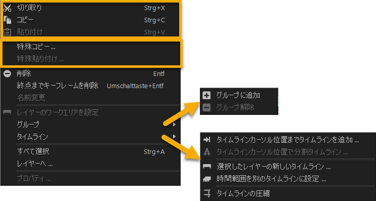

+ [*C.10.1* カット、コピー、ペースト](#C.10.1)
+ [*C.10.2* 属性コピー、属性ペースト](#C.10.2)
+ [*C.10.3* 削除](#C.10.3)
+ [*C.10.4* キーフレームを終了位置まで削除](#C.10.4)
+ [*C.10.5* ワークエリアをレイヤーに設定](#C.10.5)
+ [*C.10.6* グループ化、グループ解除](#C.10.6)
+ [*C.10.8* タイムカーソルまでサブタイムライン作成](#C.10.8)
+ [*C.10.9* タイムカーソルでサブタイムライン分割](#C.10.9)
+ [*C.10.10* 選択レイヤーから新規サブタイムライン](#C.10.10)
+ [*C.10.11* 時間範囲を別サブタイムラインに分割](#C.10.11)
+ [*C.10.12* タイムラインの圧縮](#C.10.12)
+ [*C.10.13* すべて選択](#C.10.13)
+ [*C.10.14* レイヤーに移動](#C.10.14)

---

###  *C.10.1* カット、コピー、ペースト
選択されたアイテム（レイヤーまたはキーフレーム）に対する標準的なクリップボード操作。
*   **カット:** 選択したアイテムをクリップボードにコピーし、タイムラインから削除します。
*   **コピー:** 選択したアイテムをクリップボードにコピーします。
*   **ペースト:** クリップボードの内容を現在のタイムカーソル位置または選択範囲上に挿入します。

###  *C.10.2* 属性コピー、属性ペースト
選択したレイヤーやキーフレームの全体ではなく、特定の*属性*やパラメータのみをコピー＆ペーストできます。

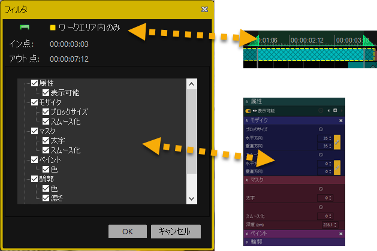

> :bulb: これらのフィルターされたパラメータを再利用可能なプリセットとして保存することも可能です（[*D.2* プリセット](#D.2) 参照）。

###  *C.10.3* 削除
選択したアイテム（レイヤーまたはキーフレーム）を削除します。<kbd>DEL</kbd> キーを押すのと同じです。

###  *C.10.4* キーフレームを終了位置まで削除
選択したレイヤー上の現在のタイムカーソル位置 ([*C.5*](#C.5)) からワークエリア ([*C.1.1*](#C.1.1)) またはレイヤー期間の終わりまでのすべてのキーフレームを削除します。<kbd>SHIFT</kbd>+<kbd>DEL</kbd> と同じです。

###  *C.10.5* ワークエリアをレイヤーに設定
ワークエリアのイン点とアウト点 ([*C.1.1*](#C.1.1)) を、現在選択されているレイヤーの開始時間と終了時間に合わせます。

###  *C.10.6* グループ化、グループ解除
選択したレイヤーを新規または既存のレイヤーグループ ([*E.3.2*](#E.3.2)) に追加するか、選択したレイヤーを現在のグループから解除します。

###  *C.10.8* タイムカーソルまでサブタイムライン作成
サブタイムライン ([*D.3*](#D.3)) に関連。前のサブタイムラインの終わり（またはビデオの開始）から現在のタイムカーソル位置までの範囲で新しいサブタイムラインを作成します。

###  *C.10.9* タイムカーソルでサブタイムライン分割
サブタイムライン ([*D.3*](#D.3)) に関連。現在のサブタイムラインをタイムカーソル位置で2つの別々のサブタイムラインに分割します。

###  *C.10.10* 選択レイヤーから新規サブタイムライン
サブタイムライン ([*D.3*](#D.3)) に関連。選択したレイヤーがカバーする時間範囲に一致する期間を持つ新しいサブタイムラインを作成します。

###  *C.10.11* 時間範囲を別サブタイムラインに分割 
:hourglass_flowing_sand: 工事中
(選択した時間範囲内のギャップやマーカーに基づいて複数のサブタイムラインを作成する可能性があります。)

###  *C.10.12* タイムラインの圧縮 
レイヤー間の垂直方向のギャップを最小限に抑え、使用される垂直方向のスペースを削減するようにレイヤーを再配置します。時間的に重ならないレイヤーが同じ垂直トラックスペースを共有できるようになる可能性があります。

###  *C.10.13* すべて選択
タイムラインに現在表示されているすべてのレイヤーを選択するか、レイヤーがすでに選択されている場合は、そのレイヤー上のすべてのキーフレームを選択する場合があります。<kbd>CTRL</kbd>+<kbd>A</kbd> と同じです。

###  *C.10.14* レイヤーに移動 
番号や名前でレイヤーを選択するためのダイアログまたはプロンプトを開きます。多くのレイヤーを持つプロジェクトで便利です。

#  *D* オプションビュー

これらは、追加のツールや情報を提供するために表示または非表示にできる追加のパネルまたはウィンドウです。通常、メインメニューまたは専用のツールバーから切り替えられます。

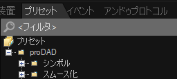

+ [*D.1* 入力デバイス](#D.1) (ペダル/MIDIのステータス/制御)
+ [*D.2* プリセット](#D.2) (保存されたエフェクト設定)
+ [*D.3* タイムライン (サブタイムライン管理)](#D.3) (サブタイムラインの管理)
+ [*D.4* ToDoマーカー](#D.4) (プロジェクトマーカー/タスクのリスト)
+ [*D.5* メディアビン](#D.5) (インポートされたメディアファイルのリスト)
+ [*D.6* レイヤー (リスト表示)](#D.6) (全レイヤーのリストビュー)
+ [*D.7* オブジェクトビューア](#D.7) (トラッキング分析用の詳細ビューの可能性あり)
+ [*D.8* アンドゥ履歴](#D.8) (編集操作の履歴)
+ [*D.9* 処理イベント](#D.9) (レンダリング/エクスポートなどのバックグラウンドタスクのログ)

###  *D.1* 入力デバイス
接続されているペダルやMIDIコントローラーなどの外部入力デバイスのステータス情報と、場合によってはクイックコントロールを提供します。
🔗 [ペダルに関する詳細](#devices-pedals)

")

####  *D.1.1* 設定
入力デバイスのメイン設定ダイアログ ([*F.1.10.3*](#F.1.10.3)) を開きます。

####  *D.1.2* 範囲
ペダルによって制御される範囲を、ビデオ全体の期間ではなく、現在のワークエリア ([*C.1.1*](#C.1.1)) に制限する可能性があります。

####  *D.1.3* スピード
ペダル入力で達成可能な感度または最大速度を増加させるためのトグルまたは乗数（例：4倍）。

###  *D.2* プリセット
:hourglass_flowing_sand: 工事中
(保存されたエフェクトプリセットをリスト表示するパネルの可能性が高いです。事前に構成されたエフェクトパラメータ ([*B.1*](#B.1)) のセットを選択したレイヤーに適用できます。[*C.10.2* 属性コピー](#C.10.2) を介して作成される可能性があります。)

###  *D.3* タイムライン (サブタイムライン管理)

このパネルは、特に非常に長いビデオのプロジェクトを管理するのに役立ちます。メインタイムラインを「サブタイムライン」と呼ばれる、より小さく管理しやすいセクションに分割できます。
*   **概要:** このパネルがアクティブな場合、または特定の「タイムライン」範囲モード ([*C.1.1*](#C.1.1)) の場合、メインタイムラインはすべてのサブタイムラインの概要ビューを表示することがあります。
*   **集中編集:** サブタイムライン（このパネルまたは概要タイムラインで）を選択すると、メインタイムラインビュー ([*C*](#C)) が、その特定のサブタイムライン内に含まれるレイヤーと時間範囲*のみ*を表示するように切り替わります。これにより、ビューが非常に明確になり、非常に大きなプロジェクトのパフォーマンスが向上する可能性があります。

> **タイムライン概要モード:** すべてのサブタイムラインの象徴的な表現を表示します。
> 

> **ワークスペースモード (サブタイムライン選択時):** 選択したサブタイムラインの時間範囲内のレイヤーのみを表示します。
> 

###  *D.4* ToDoマーカー
:hourglass_flowing_sand: 工事中
(タイムライン上に配置されたカスタムマーカーをリスト表示するパネルの可能性が高いです。メモやステータスフラグが付いている場合があり、プロジェクト内のタスクリストや注目点として機能します。)

###  *D.5* メディアビン
:hourglass_flowing_sand: 工事中
(インポートされたすべてのメディアファイル ([*B.3*](#B.3)) をリスト表示する専用パネルビュー。インスペクターセクションと比較して代替または拡張されたビューを提供します。)

###  *D.6* レイヤー (リスト表示)
:hourglass_flowing_sand: 工事中
(プロジェクトまたは現在のサブタイムライン内のすべてのレイヤーのリストビューを提供するパネルの可能性が高いです。他のNLEやグラフィックソフトウェアのレイヤーパネルと同様に、ソート、フィルタリング、クイック選択、およびレイヤープロパティ（名前、ロック状態、有効状態など）の編集を提供する可能性があります。)
")

###  *D.7* オブジェクトビューア
:hourglass_flowing_sand: 工事中
(これは、オブジェクトトラッキングデータを分析または改良するための特殊なビューである可能性があります。トラッキングパス、信頼度レベルを表示したり、トラッキングポイントの詳細な編集を可能にしたりする可能性があります。)

###  *D.8* アンドゥ履歴
:hourglass_flowing_sand: 工事中
(実行された編集操作の履歴をリスト表示するパネル。過去のステップを確認し、リスト内のアクションを選択することで特定の状態に戻すことが可能で、単純な元に戻す/やり直し ([*F.2*](#F.2)) よりも詳細な制御を提供します。)

###  *D.9* 処理イベント
:hourglass_flowing_sand: 工事中
(ビデオ分析、プレビューレンダリング、エクスポートの進行状況などのバックグラウンドプロセス、および関連するメッセージやエラーを表示するログまたはステータスパネル。)

#  *E* リボンメニュー

リボンメニューは、タブとグループに整理された主要な機能とモードへのアクセスを提供します。

+ [*E.1* メディアファイルのインポート/エクスポート](#E.1) 
+ [*E.2* マスク編集](#E.2) (マスク作成/選択ツール)
+ [*E.3* レイヤー](#E.3) (タイムラインレイヤー関連コマンド)
+ [*E.4* キャンバス表示モード](#E.4) (キャンバス表示方法の制御)
+ [*E.5* タイムライン表示モード](#E.5) (タイムライン表示詳細の制御)
+ [*E.6* S3Dビデオオプション](#E.6) (ステレオスコピックビデオ用特定制御)

##  *E.1* メディアファイルのインポート/エクスポート

###  *E.1.1* メディアファイルのインポート
ファイルブラウザを開き、1つ以上のビデオファイルを選択してプロジェクトのメディアビン ([*B.3*](#B.3), [*D.5*](#D.5)) に追加します。

参照:
- [*F.1.6* メディアをインポート](#F.1.6) (同等のメニューコマンド)

###  *E.1.2* メディアファイルのエクスポート

適用されたエフェクトを含む最終ビデオをファイルにレンダリングするためのエクスポートダイアログを開きます。

参照:
- [*F.1.7* メディアをエクスポート](#F.1.7) (同等のメニューコマンド)

#### *E.1.2.1* フォーマット 
希望する出力ビデオファイル形式（例：MP4, MOV, AVI）を選択します。`_*_` でマークされた形式は、推奨されるか、広く互換性のあるオプションを示す場合があります。

#### *E.1.2.2* タイプ / プリセット
:hourglass_flowing_sand: 工事中
(選択した形式内の特定のコーデック、品質プリセット、またはエンコーディングプロファイルを選択します。例：H.264 高品質、ProRes 422。)

#### *E.1.2.3* ターゲットパス / ファイル名
:hourglass_flowing_sand: 工事中
(エクスポートされるビデオファイルのフォルダとファイル名を指定します。)

#### *E.1.2.4* 編集 / 設定
:hourglass_flowing_sand: 工事中
(選択した形式/プリセットの詳細設定ダイアログを開き、ビットレート、解像度、フレームレート、オーディオ設定、ハードウェアアクセラレーションオプションなどのパラメータを微調整できます。)

#### *E.1.2.5* ファイル日付を保持 
:hourglass_flowing_sand: 工事中
(チェックされている場合、エクスポートされたファイルの変更日時を元のソースビデオの日時と一致させようとします。)

#### *E.1.2.6* ワークエリアのみ 
チェックされている場合、ワークエリアのイン/アウトマーカー ([*C.1.1*](#C.1.1)) で定義された時間セグメントのみがエクスポートされます。それ以外の場合、プロジェクト全体の期間（またはトリム範囲）がエクスポートされます。

>  
>このオプションは通常、ワークエリアが定義されており、対応する範囲モードがアクティブであるか、エクスポートに暗黙的に使用される場合にのみ選択できます。

##  *E.2* マスク編集

キャンバス [*A*](#A) でマスクを作成および操作するためのツール。

### *E.2.1* セレクター / ポインター
標準の選択ツールをアクティブにします。キャンバス内の既存のマスクを選択、移動、サイズ変更するために使用します。

### *E.2.2* 図形 (矩形、楕円、ポリゴンなど)
描画ツールを選択します。キャンバス内をクリック＆ドラッグして、選択した形状の新しいマスクを作成します。ポリゴンツールは通常、頂点を定義するために複数回のクリックが必要です。

##  *E.3* レイヤー

タイムライン [*C*](#C) のレイヤー管理に関連するコマンド。

+ [*E.3.1* レイヤー削除](#E.3.1) 
+ [*E.3.2* レイヤーグループ](#E.3.2) (グループ化/解除コマンド)
+ [*E.3.3* エフェクトリフト](#E.3.3) (時間範囲でのパラメータ調整)
+ [*E.3.4* レイヤー順序](#E.3.4) (レイヤーの上下移動)
+ [*E.3.5* 除外レイヤー (保護マスク)](#E.3.5) (レイヤータイプ切り替え)
+ [*E.3.6* レイヤーの有効/無効](#E.3.6) (レイヤーアクティブ状態切り替え)
+ [*E.3.7* レイヤーのロック/解除](#E.3.7) (レイヤー編集保護切り替え)
+ [*E.3.8* AIレイヤー](#E.3.8) (AI支援レイヤー機能)
+ [*E.3.9* レイヤー追加](#E.3.9) (新規レイヤー作成)

###  *E.3.1* レイヤー削除
現在選択されているレイヤーをタイムラインから削除します。

###  *E.3.2* レイヤーグループ

複数の選択されたレイヤー ([*E.3.2.2* グループメンバー](#C.3.5)) を、タイムライン上のグループヘッダー ([*E.3.2.1* グループヘッダー](#C.3.5)) で表される単一の論理ユニットにまとめます。グループ内のマスクは、レンダリング時に共通のプロパティを共有する単一の合成マスクとして扱われることがよくあります。これは、S3Dビデオ（一貫した深度を保証）や、複数のマスク領域にわたって均一性が望まれる複雑なモザイクパターンに特に役立ちます。

> :exclamation: レイヤーがグループ化されると、モザイク設定 ([*B.1.5*](#B.1.5), [*B.1.6*](#B.1.6)) や S3Dデプス ([*B.1.9*](#B.1.9)) などのパラメータは、多くの場合、グループヘッダーレイヤー (*E.3.2.1*) を選択することによってのみ編集できます。

####  *E.3.2.3* 球面ビデオのモザイク効果アンカーポイント 

球面ビデオのグループ化されたレイヤーにモザイク効果を適用する場合、グループに追加された*最初*のレイヤー（画像の *E.3.2.4*、最上位のメンバーレイヤー）がしばしば「アンカー」として機能します。球面上でのその位置と向きが、グループ化されたマスク領域*全体*に適用されるモザイク効果の配置グリッドを決定します。グループ内の他のすべてのメンバーレイヤーは、この同じグリッド配置を使用し、球体を回り込む場合でも、結合された形状全体で一貫性のあるシームレスなモザイクパターンを保証します。

参照:
- [*B.1* エフェクトパラメータ](#B.1) (グループによって制御されるパラメータ)
- [*C.3.5* レイヤー / タイプ](#C.3.5) (グループの視覚的表現)
- [*B.3.1.1* カメラタイプ](#B.3.1.1) (球面設定が必要)
- [*E.6.3* ゼロデプス (基準深度)](#E.6.3) (S3Dグループに関連)

###  *E.3.3* エフェクトリフト

選択したレイヤー上の現在のワークエリア ([*C.1.1*](#C.1.1)) にわたって、キーフレーム化されたエフェクトパラメータ ([*B.1*](#B.1)) の値を調整するためのダイアログを開きます。絶対値を設定する代わりに、指定された量（またはパーセンテージ）を範囲内の既存のキーフレーム値に*加算*または*減算*します。これにより、各キーフレームを手動で編集することなく、アニメーションカーブ全体を「持ち上げる」または「下げる」ことができます。

#### *E.3.3.1* キーフレームの挿入 
チェックされている場合、リフトを適用する前に、選択したパラメータのキーフレームをワークエリアのイン点とアウト点に自動的に挿入します。これにより、調整が定義された範囲外のパラメータ値に影響を与えるのを防ぎます。

#### *E.3.3.2* キーフレームの削除 
チェックされている場合、リフトを適用する前に、ワークエリア*内*（イン点とアウト点の間、*E.3.3.1*もチェックされている場合は境界キーフレームを除く）の選択されたパラメータの既存のキーフレームをすべて削除します。これにより、範囲内のアニメーションカーブを単純化できます。

#### *E.3.3.3* パラメータ 
調整する特定のエフェクトパラメータ（例：モザイクブロックサイズ、マスク太さ）を選択します。

#### *E.3.3.4* 量 / 値
ワークエリア内の選択されたパラメータの既存のキーフレームに加算（正の数）または減算（負の数）する値を入力します。パーセンテージベースの変更もサポートする場合があります。

###  *E.3.4* レイヤー順序

タイムライン内で選択したレイヤーの垂直方向の重ね順を変更するコマンド。「前面へ移動」、「背面へ移動」、「最前面へ」、「最背面へ」などが含まれます。順序は、特に除外レイヤー ([*E.3.5*](#E.3.5)) とのエフェクトの相互作用にとって重要です。

参照: 
- [*W.2* レイヤー順序と保護マスク](#workshop-layer-order)
- [*E.3.5* 除外レイヤー (保護マスク)](#E.3.5)

###  *E.3.5* 除外レイヤー (保護マスク)

選択したレイヤーのタイプを、通常のエフェクトレイヤーと除外（または保護）レイヤーの間で切り替えます。
*   **通常マスク (*E.3.5.1*):** エフェクトが適用*される*領域を定義します（Union）。
*   **除外マスク (*E.3.5.2*):** タイムラインスタックでその*下*にあるレイヤーからのエフェクトがレンダリング*されない*領域を定義します（Protect）。

> :bulb: 除外マスクがある領域を別のレイヤーのエフェクトから保護するためには、除外レイヤーをタイムラインスタック内でエフェクトレイヤーより垂直方向に*上に*配置する必要があります。

参照:
- [*W.2* レイヤー順序と保護マスク](#workshop-layer-order)
- [*B.1* エフェクトパラメータ](#B.1) 
- [*E.3.2* レイヤーグループ](#E.3.2) (グループは除外レイヤーを含むことができます)

---

###  *E.3.6* レイヤーの有効/無効
選択したレイヤーのアクティブ状態を切り替えます。無効化されたレイヤーは出力に影響を与えず、レンダリング時に無視されますが、プロジェクトには残ります。レイヤーを削除せずに一時的にエフェクトをオフにするのに便利です。

###  *E.3.7* レイヤーのロック/解除
選択したレイヤーのロック状態を切り替えます。ロックされたレイヤーは、誤って変更（移動、サイズ変更、キーフレーム編集）されるのを防ぎます。完成した作業を保護するのに便利です。

###  *E.3.8* AIレイヤー
:hourglass_flowing_sand: 工事中
(AI機能によって生成または支援されたレイヤーを指す可能性があります。例：自動オブジェクト検出によって初期マスクレイヤーが作成されるなど。)

###  *E.3.9* レイヤーの追加
タイムラインに新しい空のレイヤーを作成します。プロジェクト設定 ([*F.1.10.4.2*](#F.1.10.4.2)) に応じて、新しいレイヤーはワークエリア全体に広がるか、現在のタイムカーソル位置からデフォルトの期間で開始される場合があります。

> ワークエリアに広がる新しいレイヤー:
> 
> タイムカーソル位置から始まる新しいレイヤー:
> 

参照:
- [*F.1.10.4.2* プロジェクト設定: レイヤー](#F.1.10.4.2) (新しいレイヤーの動作設定)

##  *E.4* キャンバス表示モード

キャンバスウィンドウ [*A*](#A) でビデオとエフェクトがどのように表示されるかを制御します。

###  *E.4.1* 結果を表示
最終的にレンダリングされた出力をキャンバスに表示し、アクティブなすべてのエフェクトが適用されたソースビデオを表示します。

###  *E.4.2* ソースを表示
元の、未処理のソースビデオをキャンバスに表示し、エフェクトは適用されません。他の設定によっては、編集のためにマスクがオーバーレイ表示される場合があります。

###  *E.4.3* 混合表示
組み合わせを表示し、多くの場合、最終結果を表示しながら、コンテキストのためにマスクのアウトライン、トラッキングポイント、または他の編集ガイドをオーバーレイ表示します。

###  *E.4.4* 選択オブジェクトのみ表示
マスク編集中、現在選択されているレイヤーのアウトラインとハンドルのみをキャンバスに表示します。

###  *E.4.5* 全オブジェクト表示
選択状態に関わらず、表示可能なすべてのレイヤーのアウトラインとハンドルを同時にキャンバスに表示します。

###  *E.4.6* ソリッド表示 (塗りつぶし)
マスクを単なるアウトラインではなく、塗りつぶされた形状（場合によっては半透明）として表示します。影響を受ける領域をより明確に視覚化するのに役立ちます。

##  *E.5* タイムライン表示モード

タイムライン [*C*](#C) のレイヤーバーに表示される詳細レベルを制御するオプション。

- [*E.5.1* コンパクト表示](#E.5.1) (コンパクトなレイヤースタイルの切り替え)
- [*E.5.2* キーフレーム表示 (変形)](#E.5.2) (マスク変形キーフレームの表示切り替え)
- [*E.5.3* キーフレーム表示 (エフェクト)](#E.5.3) (エフェクトパラメータキーフレームの表示切り替え)

###  *E.5.1* コンパクト表示

レイヤーバーの垂直方向の高さを標準スタイルとコンパクトスタイルの間で切り替えます。コンパクトモードは、より多くのレイヤーを垂直方向に収めます。

標準:  

コンパクト:  

参照:
- [*C.3.4* レイヤー / スタイル](#C.3.4)

---

###  *E.5.2* キーフレーム表示 (変形)

マスクのコアプロパティ（位置、サイズ、回転など）の変化を表すキーフレームマーカー（通常は小さなひし形や四角形）をレイヤーバー上に直接表示するかどうかを切り替えます。

参照:
- [*C.4* キーフレーム](#C.4)

---

###  *E.5.3* キーフレーム表示 (エフェクト)

単なるマスクの変形ではなく、特定の*エフェクトパラメータ*（モザイクブロックサイズ、平滑化、表示/非表示など、[*B.1*](#B.1) 参照）のキーフレームを示す特別なアイコンやマーカーをレイヤーバー上に表示するかどうかを切り替えます。

参照:
- [*B.1.1* パラメータキーフレーム](#B.1.1) (エフェクトパラメータの制御)

##  *E.6* S3Dビデオオプション
これらの設定とツールは、ステレオスコピック（S3D）ビデオ（[*B.3.1*](#B.3.1) で定義）で作業しているときにリボンメニューに表示され、空間的な奥行きを視覚化し管理するのに役立ちます。

- [*E.6.1* グリッドを表示](#E.6.1)
- [*E.6.2* 表示モード](#E.6.2)
- [*E.6.3* ゼロデプス (基準深度)](#E.6.3)
- [*E.6.4* オブジェクト深度を設定](#E.6.4)
- [*E.6.5* 編集オブジェクトと連動](#E.6.5)

###  *E.6.1* グリッドを表示
キャンバスに球状の緯度/経度グリッドオーバーレイの表示を切り替えます。これは、正距円筒図法の球面ビデオで作業する際の方向付けに役立ちます。

###  *E.6.2* 表示モード
S3Dビデオの左目と右目のビューをキャンバスに表示するためにどのように組み合わせるかを選択します：
*   **左目 / 右目:** 片方の目のビューのみを表示します。
*   **アナグリフ:** 色フィルターを使用してビューを組み合わせます（赤/シアンメガネが必要）。奥行き知覚を表示します。
*   **サイドバイサイド:** 左目と右目のビューを隣り合わせに表示します。
*   **デプスマイックス:** 多くの場合、透明度や色合いで両目を重ね合わせる特別なモードで、メガネなしで視差シフト（奥行きの違い）を可視化します。現在のゼロデプス設定にあるオブジェクトは整列して見えるか単色に見え、手前または奥にあるオブジェクトは分離して見えるか色ずれが見えます。

> :bulb: **デプスマイックス** モードは、アナグリフメガネなしでゼロデプス ([*E.6.3*](#E.6.3)) を効率的に設定するためにしばしば推奨されます。

###  *E.6.3* ゼロデプス (基準深度)
輻輳点を調整し、3Dシーン内の仮想的な「スクリーン深度」を効果的に設定します。この深度に正確に位置するオブジェクトは、左目と右目のビュー間で視差シフトがゼロに見えます – デプスマイックスモードでは整列して見え、アナグリフモードでは（深度に関連するゴーストなしで）完全に重なって見えます。マスク ([*A.1*](#A.1)) を作成または調整する際には、マスクされるオブジェクトの深度にゼロデプスを一致させるべきです。これにより、マスク自体が両目に対して3D空間内で正しく配置されます。

| 正確なゼロデプス (オブジェクト整列) | 不正確なゼロデプス (デプスマイックスでオブジェクトがシフト) | 不正確なゼロデプス (アナグリフでオブジェクトがゴースト化) |
|---|---|---|
||||

###  *E.6.4* オブジェクト深度を設定
現在のゼロデプス値 ([*E.6.3*](#E.6.3)) を、選択されたマスクのS3Dデプスプロパティ ([*B.1.9*](#B.1.9)) に適用します。これにより、マスクの3D空間内での位置が明示的に設定されます。

###  *E.6.5* 編集オブジェクトと連動
有効にすると、キャンバス内のゼロデプス視覚化（例：デプスマイックスモードでの整列）は、現在選択されているマスクのS3Dデプス値 ([*B.1.9*](#B.1.9)) を動的に参照します。タイムラインに沿ってタイムカーソルを移動すると、マスクの深度がキーフレームによって変化する場合、視覚化は自動的に更新されます。

> :bulb: これは、特定のフレームでマスクの保存された深度がその下のオブジェクトと正しく一致しているかを迅速に確認するのに非常に役立ちます。このモードがアクティブなときにマスクの下のオブジェクトが視差シフトを示す場合、それはそのフレームのマスクのS3Dデプス ([*B.1.9*](#B.1.9)) が不正確であることを示します。

参照:
- [*W.4* S3Dビデオにマスクを作成する方法](#workshop-s3d-mask)
- [*B.1.9* S3Dデプス (奥行き)](#B.1.9) (マスクの深度パラメータ)
- [*B.3.1.1* カメラタイプ](#B.3.1.1) (球面タイプが必要)
- [*E.3.2* レイヤーグループ](#E.3.2) (複数のマスク間で一貫した深度を保つのに便利)

#  *F* プロジェクト

プロジェクトファイル全体とアプリケーションの動作に関連するコマンドと設定。

##  *F.1* プロジェクトメニュー

メインの「ファイル」または「プロジェクト」メニューからアクセスします。

- [*F.1.1* 新規プロジェクト](#F.1.1)
- [*F.1.2* プロジェクトを開く](#F.1.2)
- [*F.1.3* プロジェクトを追加 (結合)](#F.1.3)
- [*F.1.4* プロジェクトを保存](#F.1.4)
- [*F.1.5* 別名でプロジェクトを保存](#F.1.5)
- [*F.1.6* メディアをインポート](#F.1.6)
- [*F.1.7* メディアをエクスポート](#F.1.7)
- [*F.1.8* チームプロジェクトを作成](#F.1.8)
- [*F.1.9* チームプロジェクトをインポート (統合)](#F.1.9)
- [*F.1.10* プロジェクト設定](#F.1.10)

###  *F.1.1* 新規プロジェクト

現在のプロジェクトを閉じ（変更を保存するか尋ねられます）、新しい空のプロジェクトを開始します。

###  *F.1.2* プロジェクトを開く

ファイルブラウザを開き、既存のDisguiseプロジェクトファイル（例：`.phantom` または古い形式）を選択して読み込みます。

###  *F.1.3* プロジェクトを追加 (結合)

別のプロジェクトファイルからレイヤーとメディア参照を読み込み、現在開いているプロジェクトに追加します。作業をマージしたり、プロジェクトセグメントを組み合わせたりするのに便利です。

###  *F.1.4* プロジェクトを保存
現在のプロジェクトの状態を既存のファイル名と場所に保存します。<kbd>CTRL</kbd>+<kbd>S</kbd> を使用します。

###  *F.1.5* 別名でプロジェクトを保存
ファイルブラウザを開き、現在のプロジェクトの状態を新しいファイル名または場所で保存します。バックアップやバージョンを作成するのに便利です。

###  *F.1.6* メディアのインポート
ビデオファイルをプロジェクトに追加します。リボンメニューのボタン ([*E.1.1*](#E.1.1)) と同じ機能です。

参照:
- [*E.1.1* メディアファイルのインポート](#E.1.1)

###  *F.1.7* メディアのエクスポート
プロジェクトをレンダリングするためのエクスポートダイアログを開きます。リボンメニューのボタン ([*E.1.2*](#E.1.2)) と同じ機能です。

参照:
- [*E.1.2* メディアファイルのエクスポート](#E.1.2)

###  *F.1.8* チームプロジェクトを作成

共同作業ワークフロー用に設計された、現在のプロジェクトの特別バージョンをエクスポートします。これには通常、プロジェクトファイルと関連メディア（場合によってはトランスコードまたはダウンスケールされる）を、チームメンバーと共有できるフォルダ構造にパッケージ化することが含まれます。チームメンバーが自分のコピーで行った編集は、後で [*F.1.9* チームプロジェクトをインポート (統合)](#F.1.9) を使用して元の「マスター」プロジェクトにマージできます。

*   **カスタムサイズを使用**: 共有しやすいように小さなファイルを作成するために、パッケージ化中にビデオ解像度を下げることができます。
*   **エンコードプロファイル**: トランスコードされたメディアのエンコード品質を選択します。「低」は通常、最小のファイルサイズを生成しますが、エンコードに時間がかかり、品質が低下する可能性があります。
*   **プロジェクトフォルダ**: パッケージ化されたチームプロジェクト（プロジェクトファイル + メディアサブフォルダ）が作成される宛先フォルダを指定します。
*   **プロジェクト名**: チームプロジェクトファイルの名前を設定します（例：`MyProject_Team_UserA.phantom`）。各チームメンバーまたはバージョンごとに一意である必要があります。
*   **OKボタン**: パッケージ化プロセスを開始します。有効なフォルダと名前のエントリが必要です。

> :exclamation: **重要:** チームプロジェクトが作成された元のプロジェクトファイル（**マスタープロジェクト**）は、後で [*F.1.9* チームプロジェクトをインポート (統合)](#F.1.9) を使用して変更をインポートおよびマージするために必要です！マスタープロジェクトファイルは安全に保管してください。

###  *F.1.9* チームプロジェクトをインポート (統合)

1つ以上のチームプロジェクトパッケージで行われた編集を、元のマスタープロジェクトにマージします。

**ワークフロー:**
1.  まず、元の**マスタープロジェクト**（[*F.1.8*](#F.1.8) を介してチームプロジェクトを作成するために使用したもの）を開きます。
2.  「チームプロジェクトのインポート」メニュー項目を選択します。
3.  ファイルブラウザで、1つ以上のチームプロジェクトファイル（チームメンバーが作成したフォルダ内の `.phantom` ファイル）を選択します。
4.  「開く」をクリックします。
5.  アプリケーションはチームプロジェクトを分析し、チームメンバーによって作成された*新しい*レイヤーをマスタープロジェクトにマージします。

> :exclamation: **マージに関する注意:**
> *   チームプロジェクトが作成された時点でマスタープロジェクトに*既に存在していた*レイヤーに対してチームメンバーが行った変更は、通常**無視されます**。これらの元のレイヤーは、編集の競合を避けるためにマージ中に通常保護されます。チームプロジェクトから*新しく追加された*レイヤーのみがインポートされます。
> *   チームプロジェクトでのメディアビンへの変更（クリップの追加/削除、プロパティの変更）は通常無視されます。
> *   レイヤーの順序は、インポートの順序に基づくか、末尾に追加される場合があります。

###  *F.1.10* プロジェクト設定

アプリケーション全体の設定と設定項目を構成するためのダイアログを開きます。

- [*F.1.10.1* プロジェクト](#F.1.10.1) (一般的なプロジェクト設定)
- [*F.1.10.2* ユーザーインターフェース](#F.1.10.2) (UIの動作)
- [*F.1.10.3* 入力デバイス](#F.1.10.3) (ペダル/MIDI設定)
- [*F.1.10.4* 編集](#F.1.10.4) (トラッキングとレイヤーのデフォルト)

####  *F.1.10.1* プロジェクト

")

*   **保存間隔** (自動保存): ソフトウェアが現在のプロジェクトのバックアップコピーを自動的に保存する頻度（分単位）を指定します。クラッシュ後の作業の回復に役立ちます。`0` は通常、自動保存を無効にします。
*   **プロジェクトのバックアップファイルを作成する**: 有効にすると、手動で保存するたびに、シーケンシャルなバックアップバージョン（例：`ProjectName.bak1`, `ProjectName.bak2`）を別のフォルダまたはメインプロジェクトファイルと一緒に作成します。
*   **タイムコード** (表示形式): タイムラインや他のUI要素でタイムコードを表示する形式を選択します（例：NTSCドロップフレーム `00:00:00;00` vs. ノンドロップ `00:00:00:00`、またはフレーム数）。

> :exclamation: 特にバックアップファイルが有効になっている場合は、誤って重要なバージョンを上書きしないように、一意のプロジェクト名を使用することが重要です。

####  *F.1.10.2* ユーザーインターフェース

")

*   **マウスホイールでタイムコードを進める/戻す**: タイムライン上でマウスホイールを使用するときにタイムカーソル ([*C.5*](#C.5)) が移動する方向を定義します。
*   **テンキーを使ったメディアナビゲーション**: タイムラインナビゲーション（タイムカーソルの移動、マーカーへのジャンプなど）にテンキー（<kbd>NP-4</kbd>, <kbd>NP-6</kbd>, <kbd>NP-7</kbd> など）を使用するかどうかを有効/無効にします。Num Lock がアクティブである必要があります。無効にすると、テンキーは数字を入力します。
*   **時間範囲の視覚化を含むタイムライン** (タイムカーソルスタイル): タイムカーソルの外観を SPAN モードと SIMP モードの間で切り替えます。[*C.5.1* スタイル](#C.5.1) を参照してください。

####  *F.1.10.3* 入力デバイス

外部ハードウェアコントローラーの設定。

#####  *F.1.10.3.1* ペダル
🔗 [ペダルに関する詳細](#devices-pedals)

タイムラインナビゲーションのために接続されたDirectX互換ゲーミングペダルを設定します。
*   **デバイス選択:** 接続されているペダルデバイスを選択します。
*   **軸マッピング:** ペダルの軸（例：左つま先、右つま先、ラダー）を「タイムカーソルを前/後に移動」などの機能に割り当てます。
*   **感度/デッドゾーン:** 応答曲線を調整します。

#####  *F.1.10.3.2* MIDI
🔗 [MIDIに関する詳細](#devices-midi)

パラメータ制御のために接続されたMIDIコントローラー（Behringer BCF2000など）を設定します。

**コマンドの割り当て方法:**
1.  MIDIデバイスの物理的なスライダーを動かすか、ノブを回します。対応するコントロールが設定パネルで強調表示または検出されるはずです。
2.  割り当て可能なコマンドのリスト（例：「マスクサイズ」、「モザイクブロックサイズ」）で、制御したいコマンドを選択します。
3.  「設定」または「割り当て」ボタンをクリックするか、コマンド名をダブルクリックして、検出されたMIDIコントロールを選択したコマンドにリンクします。

>:bulb: 割り当てをテストするには：キャンバス/タイムラインでオブジェクト（マスク）を選択し、コマンドがコンテキスト固有の場合は必要に応じて教え込みモード ([*A.5*](#A.5)) またはトラッキング ([*A.4*](#A.4)) をアクティブにしてから、この設定パネルを開きます。割り当てたMIDIコントロールを動かし、対応する値が変化するか、アクションが発生するかを確認します。

>:exclamation: 一部のコマンドはコンテキスト依存であり、特定のモードがアクティブな場合にのみ機能します。例えば、マスク調整コマンドは通常マスクが選択されている必要があり、トラッキング関連コマンドはアクティブなトラッキングセッション中 ([*A.4*](#A.4) または [*A.5*](#A.5)) にのみ機能します。

####  *F.1.10.4* 編集

編集ワークフローに関連する設定。

#####  *F.1.10.4.1* オブジェクトトラッカー

*   **グリッドサイズ / 検索エリア**: トラッカーがオブジェクトの周りを分析するエリアのサイズを制御します。値が大きいほどトラッキングが速くなったり、速い動きに対応できる場合がありますが、精度が低下したり背景要素に吸着しやすくなったりする可能性があります。値が小さいほど細かいディテールに対してより正確になる可能性がありますが、遅くなります。
*   オブジェクトの動きの**検出**: トラッカーが自動的に検出して補正する能力を有効/無効にするチェックボックス：
    *   **回転**: オブジェクトの向きの変化。
    *   **ズーム / スケール**: カメラに対するオブジェクトのサイズの相対的な変化。

#####  *F.1.10.4.2* レイヤー
")

*   **カーソル時間でレイヤーを作成**: チェックされている場合、新しく作成されたレイヤー ([*E.3.9*](#E.3.9)) は、現在のタイムカーソル位置からデフォルトの期間で開始されます。チェックされていない場合、デフォルトでワークエリア全体またはプロジェクト期間に広がる場合があります。[*E.3.9* レイヤーの追加](#E.3.9) を参照してください。

##  *F.2* 元に戻す/やり直し
最近の編集操作を取り消したり、再適用したりするための標準的な元に戻す（Undo）およびやり直し（Redo）機能。
*   **元に戻す:** 最後のアクションを取り消します。ショートカット: <kbd>CTRL</kbd>+<kbd>Z</kbd>。
*   **やり直し:** 最後に取り消されたアクションを再適用します。ショートカット: <kbd>CTRL</kbd>+<kbd>Y</kbd>。
*   **履歴:** オプションのパネル ([*D.8* アンドゥ履歴](#D.8)) で、操作の詳細なリストが提供される場合があります。

:hourglass_flowing_sand: 作成中 (詳細なアンドゥ履歴の説明は保留中)

#  *G* チュートリアル / 情報 / アップデート

ヘルプ、ドキュメント、アプリケーション情報へのアクセスポイント。

##  *G.1* チュートリアル
:hourglass_flowing_sand: 作成中
(オンラインビデオチュートリアルまたは組み込みガイドへのリンクの可能性が高いです。)

---

##  *G.2* アプリについて

アプリケーションに関する情報（バージョン番号、ライセンス状況、サポートリソースなど）を表示します。

###  *G.2.1* サポートプロトコル
proDADサポートによる問題のトラブルシューティングに役立つ診断ログファイルを生成します。

> **サポートプロトコルの生成と提出方法:**
> 1. 「情報」ダイアログを開くメニュー項目 (*G.2*) をクリックする際に、<kbd>SHIFT</kbd> キーを押したままにします。
> 2. 表示される「情報」ダイアログで、**「サポートプロトコル」** ボタンをクリックします。
> 3. これにより、通常、指定された場所（多くの場合、デスクトップまたはドキュメントフォルダ）にログファイル（例：`.txt` または `.zip`）が保存されます。
> 4. カスタマーサポートに連絡する際に、この生成されたファイルを添付してください。

> :bulb: ログファイルには通常、ソフトウェアの動作とシステム環境に関する技術情報が含まれます。一般的に、個人情報や機密性の高いビデオコンテンツは含まれません。このログを提供することで、サポートが問題をより効率的に診断するのに役立ちます。

> :exclamation: 問題が発生した場合は、カスタマーサポート [support@prodad.com](mailto:support@prodad.com) までメールでお問い合わせいただき、可能であればサポートプロトコルファイルを添付してください。

---

##  *G.3* ユーザーマニュアル
このドキュメントファイルを開きます。

#  *H* タイムラインツール

タイムラインの近くに配置されたツールバーで、一般的な編集機能へのクイックアクセスを提供します。

:hourglass_flowing_sand: 工事中
(レイヤー/クリップの分割、マーカーの追加、リンク/リンク解除、リップル削除、リフト/抽出などのアクションのボタンが含まれる可能性が高いです。)

#  *J* 再生コントロール

タイムラインとキャンバスでビデオを再生およびナビゲートするための標準的なトランスポートコントロール。

+ [*J.1* オートリピート (ループ再生)](#J.1) 
+ [*J.2* 再生/停止](#J.2) 
+ [*J.3* 先頭/末尾にジャンプ (イン/アウト点)](#J.3) 
+ [*J.4* 再生速度](#J.4) 

##  *J.1* オートリピート (ループ再生)

ループ再生のオン/オフを切り替えます。有効にすると、ワークエリア ([*C.1.1*](#C.1.1)) のアウト点に達した後、自動的にイン点から再生が再開されます。特定のセグメントを繰り返し確認するのに便利です。

##  *J.2* 再生/停止

現在のタイムカーソル位置から再生を開始します。再生中の場合は、再生を停止します。<kbd>SPACE</kbd> バーまたは <kbd>ENTER</kbd> キーでも制御できます。

##  *J.3* 先頭/末尾にジャンプ (イン/アウト点)

タイムカーソル ([*C.5*](#C.5)) を現在のワークエリア ([*C.1.1*](#C.1.1)) のイン点（先頭）またはアウト点（末尾）に即座に移動します。<kbd>HOME</kbd>（先頭）および <kbd>END</kbd>（末尾）キーでも制御できます。

##  *J.4* 再生速度

再生速度を調整します。
*   **クリック:** 再生速度を上げます（例：1x -> 1.5x -> 2x）。
*   **<kbd>SHIFT</kbd>+クリック:** 再生速度を下げます（例：2x -> 1.5x -> 1x -> 0.5x）。
*   **<kbd>CTRL</kbd>+クリック:** 再生速度を標準（1x）にリセットします。
*   **表示:** ボタンには通常、現在の再生速度係数が表示されます。

# ⌨️  *p.3.1* キーボードショートカット

> - NP -> テンキー (Num Lock オンが必要、[*F.1.10.2*](#F.1.10.2) 参照)
> - <kbd>SPACE</kbd> ; <kbd>ENTER</kbd> -> スペースバーまたはエンターキーのいずれか
> - <kbd>CTRL</kbd>+<kbd>SPACE</kbd> -> CTRLキーを押しながらスペースバーを押す

| キー | コンテキスト | 説明 | 参照 |
|:----|:----|:-------|---|
|<kbd>CTRL</kbd>+<kbd>C</kbd> | すべて | 選択項目をクリップボードにコピー | [*C.10.1*](#C.10.1) |
|<kbd>CTRL</kbd>+<kbd>X</kbd> | すべて | 選択項目をクリップボードにカット | [*C.10.1*](#C.10.1) |
|<kbd>CTRL</kbd>+<kbd>V</kbd> | すべて | クリップボードから貼り付け | [*C.10.1*](#C.10.1) |
|<kbd>CTRL</kbd>+<kbd>Z</kbd> | すべて | 最後のアクションを元に戻す | [*F.2*](#F.2) |
|<kbd>CTRL</kbd>+<kbd>Y</kbd> | すべて | 最後に取り消したアクションをやり直す | [*F.2*](#F.2) |
|<kbd>SPACE</kbd> ; <kbd>ENTER</kbd>| キャンバス/タイムライン | 再生 / 停止 | [*J.2*](#J.2) |
|<kbd>CTRL</kbd>+<kbd>SPACE</kbd> ; <kbd>CTRL</kbd>+<kbd>ENTER</kbd>| すべて | 再生 / 停止 (グローバル?) | [*J.2*](#J.2) |
|<kbd>NP-8</kbd> ; <kbd>NP-2</kbd>| すべて | 前/次のビデオクリップへ移動 (メディアビンに複数ある場合?) |  |
|<kbd>HOME</kbd> ; <kbd>END</kbd> | キャンバス/タイムライン | タイムカーソルをワークエリアの開始/終了へジャンプ | [*J.3*](#J.3), [*C.5*](#C.5) |
|<kbd>NP-7</kbd> ; <kbd>NP-1</kbd> | キャンバス/タイムライン | タイムカーソルをワークエリアの開始/終了へジャンプ (テンキー) | [*J.3*](#J.3), [*C.5*](#C.5) |
| <kbd>PAGE-UP</kbd> ; <kbd>PAGE-DOWN</kbd>| キャンバス/タイムライン | 前/次のキーフレーム/マーカーへジャンプ | [*C.5*](#C.5), [*C.4.3*](#C.4.3) |
| <kbd>NP-9</kbd> ; <kbd>NP-3</kbd> | キャンバス/タイムライン | 前/次のキーフレーム/マーカーへジャンプ (テンキー) | [*C.5*](#C.5), [*C.4.3*](#C.4.3) |
|<kbd>矢印</kbd> キー | キャンバス (マスク選択時) | マスク位置を微調整 | [*A.2*](#A.2) |
|<kbd>SHIFT</kbd>+<kbd>矢印</kbd> キー | キャンバス (マスク選択時) | より大きな移動量? 移動/サイズ変更の制限? | [*A.2*](#A.2) |
|<kbd>↑</kbd>/<kbd>↓</kbd> 矢印 | キャンバス (トラッキング中) | マスクサイズを比例調整 | [*A.4*](#A.4), [*A.5*](#A.5), [*W.1*](#workshop-quick-start) |
|<kbd>←</kbd>/<kbd>→</kbd> 矢印 | キャンバス (トラッキング中) | マスクを回転 | [*A.3*](#A.3), [*A.4*](#A.4), [*A.5*](#A.5) |
|<kbd>SHIFT</kbd>+ドラッグ | キャンバス (トラッキング中) | マウス移動を水平/垂直に制限? | [*A.4*](#A.4), [*A.5*](#A.5) |
|<kbd>ESC</kbd> | キャンバス (トラッキング中) | トラッキング操作をキャンセル | [*A.4*](#A.4), [*A.5*](#A.5) |
|<kbd>B</kbd> ; <kbd>N</kbd> | キャンバス/タイムライン | タイムカーソルを前/次のフレームへ移動 | [*C.5*](#C.5) |
|<kbd>NP-4</kbd> ; <kbd>NP-6</kbd> | キャンバス/タイムライン | タイムカーソルを前/次のフレームへ移動 (テンキー) | [*C.5*](#C.5) |
|<kbd>T</kbd>| キャンバス (マスク選択時) | オブジェクトトラッキングを開始 | [*A.4*](#A.4) |
|<kbd>H</kbd>| キャンバス (マスク選択時) | 現在時間のマスク表示/非表示を切り替え | [*A.6*](#A.6), [*B.1.4*](#B.1.4) |
|<kbd>+</kbd> ; <kbd>-</kbd>| キャンバス/タイムライン | モザイクブロックサイズ増減? タイムラインズーム? | [*B.1.5*](#B.1.5)? [*C.8*](#C.8)? |
|<kbd>F</kbd>| キャンバス (トラッキング中) | トラッキングマーカーの表示/非表示を切り替え | [*W.3* オブジェクトトラッキング](#workshop-tracking-object)  |
|<kbd>I</kbd> ; <kbd>O</kbd>| タイムライン | タイムカーソル位置にワークエリアのイン/アウト点を設定 | [*C.1*](#C.1)  |
|<kbd>↑</kbd> ; <kbd>↓</kbd> 矢印 | タイムライン | 前/次のレイヤーを選択 | [*C.3.2*](#C.3.2)  |
|<kbd>SHIFT</kbd>+<kbd>↑</kbd> 矢印 ; <kbd>SHIFT</kbd>+<kbd>↓</kbd> 矢印| タイムライン | 前/次のレイヤーを選択に追加 | [*C.3.2*](#C.3.2)  |
|<kbd>←</kbd> ; <kbd>→</kbd> 矢印 | タイムライン | タイムカーソルを前/次のフレームへ移動 | [*C.5*](#C.5) |
|<kbd>CTRL</kbd>+<kbd>←</kbd> 矢印 ; <kbd>CTRL</kbd>+<kbd>→</kbd> 矢印| タイムライン | 前/次のキーフレーム/マーカーへジャンプ? | [*C.4.3*](#C.4.3)? |
|<kbd>CTRL</kbd> + <kbd>0</kbd> ... <kbd>4</kbd>| タイムライン | タイムラインズームレベルプリセットを設定 | [*C.8*](#C.8)? |
|<kbd>DEL</kbd>| タイムライン | 選択したレイヤーまたはキーフレームを削除 | [*C.3.1*](#C.3.1), [*C.4.1*](#C.4.1), [*C.10.3*](#C.10.3) |
|<kbd>SHIFT</kbd>+<kbd>DEL</kbd>| タイムライン | カーソルから終了マークまでのキーフレームを削除 | [*C.4.1*](#C.4.1), [*C.10.4*](#C.10.4) |
|<kbd>CTRL</kbd>+<kbd>A</kbd>| タイムライン | すべてのレイヤー、または選択レイヤーの全キーフレームを選択 | [*C.10.13*](#C.10.13) |
|<kbd>CTRL</kbd>+<kbd>N</kbd>| すべて | 新規プロジェクト | [*F.1.1*](#F.1.1) |
|<kbd>CTRL</kbd>+<kbd>O</kbd>| すべて | プロジェクトを開く | [*F.1.2*](#F.1.2) |
|<kbd>CTRL</kbd>+<kbd>S</kbd>| すべて | プロジェクトを保存 | [*F.1.4*](#F.1.4) |
|<kbd>CTRL</kbd>+<kbd>SHIFT</kbd>+<kbd>S</kbd>| すべて | 別名でプロジェクトを保存 | [*F.1.5*](#F.1.5) |
|<kbd>CTRL</kbd>+<kbd>I</kbd>| すべて | メディアファイルをインポート | [*F.1.6*](#F.1.6), [*E.1.1*](#E.1.1) |
|<kbd>CTRL</kbd>+<kbd>E</kbd>| すべて | メディアファイルをエクスポート | [*F.1.7*](#F.1.7), [*E.1.2*](#E.1.2) |
|<kbd>CTRL</kbd>+<kbd>SHIFT</kbd>+<kbd>T</kbd>| キャンバス | セレクター/ポインターマスクモードを有効化 | [*E.2.1*](#E.2.1) |
|<kbd>CTRL</kbd>+<kbd>SHIFT</kbd>+<kbd>P</kbd>| キャンバス | ポリゴンマスク描画モードを有効化 | [*E.2.2*](#E.2.2) |
|<kbd>CTRL</kbd>+<kbd>SHIFT</kbd>+<kbd>E</kbd>| キャンバス | 楕円マスク描画モードを有効化 | [*E.2.2*](#E.2.2) |
|<kbd>CTRL</kbd>+<kbd>SHIFT</kbd>+<kbd>R</kbd>| キャンバス | 矩形マスク描画モードを有効化 | [*E.2.2*](#E.2.2) |
|<kbd>CTRL</kbd>+<kbd>SHIFT</kbd>+<kbd>L</kbd>| タイムライン | 新規レイヤーを追加 | [*E.3.9*](#E.3.9) |
|<kbd>CTRL</kbd>+<kbd>SHIFT</kbd>+<kbd>G</kbd> ; <kbd>F5</kbd>| キャンバス | ソース表示モードを有効化 | [*E.4.2*](#E.4.2) |
|<kbd>CTRL</kbd>+<kbd>SHIFT</kbd>+<kbd>F</kbd> ; <kbd>F6</kbd>| キャンバス | 結果表示モードを有効化 | [*E.4.1*](#E.4.1) |
|<kbd>F7</kbd>| キャンバス | 混合表示モードを有効化 | [*E.4.3*](#E.4.3) |

#  *p.3.2* キーボード・スーパーコード

外部キーパッドやマクロデバイス ([*p.3.3* デバイス](#devices)) にプログラムすることを意図した、特定のキーシーケンスを使用したプログラム機能の高度な制御。

> スーパーコードは、<kbd>CTRL</kbd>+<kbd>TAB</kbd> または <kbd>CTRL</kbd>+<kbd>#</kbd> で始まります
> 表の中では、スーパーコードは <kbd>CTRL#</kbd> と表示されています
> スーパーコードの直後の最初の文字は、次の文字の宛先を識別します。例えば、<kbd>CTRL#</kbd><kbd>T</kbd> は、次のコマンドのタイムラインにアドレスが割り当てられています。

> スーパーコードのトリガーは、<kbd>CTRL#</kbd><kbd>T</kbd><kbd>+</kbd> を使って説明されます
> 1. <kbd>CTRL</kbd> キーを押し続けてください
> 2. <kbd>#</kbd> (または <kbd>TAB</kbd>) キーを押してから離します
> 3. <kbd>T</kbd> キーを押してから離します
> 4. <kbd>+</kbd> キーを押してから離します
> 5. スーパーコードモードを終了するために、<kbd>CTRL</kbd> キーを離します
  
---

ターゲット: **タイムライン** (`T`) | <kbd>CTRL#</kbd><kbd>T</kbd> ...

| キー | 説明 | 参照 |
|:----|:----|:-------|
|<kbd>CTRL#</kbd><kbd>T</kbd><kbd>+</kbd>|タイムラインを水平方向にズームイン| [*C.8*](#C.8) |
|<kbd>CTRL#</kbd><kbd>T</kbd><kbd>-</kbd>|タイムラインを水平方向にズームアウト| [*C.8*](#C.8) |
|<kbd>CTRL#</kbd><kbd>T</kbd><kbd>0</kbd> ... <kbd>4</kbd>|タイムラインズームをプリセットレベルに設定 | [*C.8*](#C.8)? |
|<kbd>CTRL#</kbd><kbd>T</kbd><kbd>S</kbd>|カーソル位置にビデオトリム開始点を設定| [*C.1.1*](#C.1.1) |
|<kbd>CTRL#</kbd><kbd>T</kbd><kbd>E</kbd>|カーソル位置にビデオトリム終了点を設定| [*C.1.1*](#C.1.1) |
|<kbd>CTRL#</kbd><kbd>T</kbd><kbd>N</kbd>|カーソル位置にワークエリア開始(IN)点を設定| [*C.1.1*](#C.1.1) |
|<kbd>CTRL#</kbd><kbd>T</kbd><kbd>M</kbd>|カーソル位置にワークエリア終了(OUT)点を設定| [*C.1.1*](#C.1.1) |
|<kbd>CTRL#</kbd><kbd>T</kbd><kbd>I</kbd>|カーソル位置にIN点を設定 (現在の範囲モードによる)| [*C.1*](#C.1) |
|<kbd>CTRL#</kbd><kbd>T</kbd><kbd>O</kbd>|カーソル位置にOUT点を設定 (現在の範囲モードによる)| [*C.1*](#C.1) |
|<kbd>CTRL#</kbd><kbd>T</kbd><kbd>T</kbd>|タイムライン範囲モードを切り替え (トリム / ワークエリア / サブタイムライン)| [*C.1.1*](#C.1.1) |
|<kbd>CTRL#</kbd><kbd>T</kbd><kbd>K</kbd>|カーソル位置にレイヤー開始時間を設定 (レイヤー開始トリム)| [*C.3*](#C.3)? |
|<kbd>CTRL#</kbd><kbd>T</kbd><kbd>L</kbd>|カーソル位置にレイヤー終了時間を設定 (レイヤー終了トリム)| [*C.3*](#C.3)? |
|<kbd>CTRL#</kbd><kbd>T</kbd><kbd>RIGHT</kbd>|タイムカーソルを次のフレームへ移動| [*C.5*](#C.5) |
|<kbd>CTRL#</kbd><kbd>T</kbd><kbd>LEFT</kbd>|タイムカーソルを前のフレームへ移動| [*C.5*](#C.5) |
|<kbd>CTRL#</kbd><kbd>T</kbd><kbd>HOME</kbd>|タイムカーソルをワークエリア開始へジャンプ| [*C.5*](#C.5), [*J.3*](#J.3) |
|<kbd>CTRL#</kbd><kbd>T</kbd><kbd>END</kbd>|タイムカーソルをワークエリア終了へジャンプ| [*C.5*](#C.5), [*J.3*](#J.3) |

---

ターゲット: **レイヤー** (`L`) | <kbd>CTRL#</kbd><kbd>L</kbd> ...

| キー | 説明 | 参照先 |
|:----|:----|:-------|
|<kbd>CTRL#</kbd><kbd>L</kbd><kbd>C</kbd>|選択したレイヤーをコピー| [*C.10.1*](#C.10.1) |
|<kbd>CTRL#</kbd><kbd>L</kbd><kbd>X</kbd>|選択したレイヤーをカット| [*C.10.1*](#C.10.1) |
|<kbd>CTRL#</kbd><kbd>L</kbd><kbd>V</kbd>|クリップボードからレイヤーをペースト| [*C.10.1*](#C.10.1) |
|<kbd>CTRL#</kbd><kbd>L</kbd><kbd>E</kbd>|新規標準レイヤーを追加| [*E.3.9*](#E.3.9) |
|<kbd>CTRL#</kbd><kbd>L</kbd><kbd>P</kbd>|新規保護/除外レイヤーを追加| [*E.3.5*](#E.3.5), [*E.3.9*](#E.3.9) |
|<kbd>CTRL#</kbd><kbd>L</kbd><kbd>DEL</kbd>|選択したレイヤーを削除| [*E.3.1*](#E.3.1) |
|<kbd>CTRL#</kbd><kbd>L</kbd><kbd>DOWN</kbd>|次のレイヤーを選択| [*C.3.2*](#C.3.2) |
|<kbd>CTRL#</kbd><kbd>L</kbd><kbd>UP</kbd>|前のレイヤーを選択| [*C.3.2*](#C.3.2) |
|<kbd>CTRL#</kbd><kbd>L</kbd><kbd>U</kbd>|選択したレイヤーを重ね順で上に移動| [*E.3.4*](#E.3.4) |
|<kbd>CTRL#</kbd><kbd>L</kbd><kbd>D</kbd>|選択したレイヤーを重ね順で下に移動| [*E.3.4*](#E.3.4) |
|<kbd>CTRL#</kbd><kbd>L</kbd><kbd>J</kbd>|カーソルから終了マークまでのキーフレームを削除 (SHIFT+DELと同様)| [*C.10.4*](#C.10.4) |
|<kbd>CTRL#</kbd><kbd>L</kbd><kbd>K</kbd>|レイヤー属性をコピー| [*C.10.2*](#C.10.2) |
|<kbd>CTRL#</kbd><kbd>L</kbd><kbd>F</kbd>|レイヤー属性をペースト| [*C.10.2*](#C.10.2) |
|<kbd>CTRL#</kbd><kbd>L</kbd><kbd>W</kbd>|選択した全レイヤーにわたるようにワークエリアを設定| [*C.10.5*](#C.10.5) |
|<kbd>CTRL#</kbd><kbd>L</kbd><kbd>A</kbd>|すべてのレイヤーを選択| [*C.10.13*](#C.10.13) |
|<kbd>CTRL#</kbd><kbd>L</kbd><kbd>G</kbd>|選択したレイヤーをグループ化| [*E.3.2*](#E.3.2), [*C.10.6*](#C.10.6) |
|<kbd>CTRL#</kbd><kbd>L</kbd><kbd>R</kbd>|選択したレイヤーのグループ化を解除 (グループの一部の場合)| [*E.3.2*](#E.3.2), [*C.10.6*](#C.10.6) |

---

ターゲット: **モード** (`M`) | <kbd>CTRL#</kbd><kbd>M</kbd> ...

| キー | 説明 | 参照先 |
|:----|:----|:-------|
|<kbd>CTRL#</kbd><kbd>M</kbd><kbd>T</kbd>|セレクター/ポインターツールを有効化| [*E.2.1*](#E.2.1) |
|<kbd>CTRL#</kbd><kbd>M</kbd><kbd>P</kbd>|ポリゴン形状描画ツールを有効化| [*E.2.2*](#E.2.2) |
|<kbd>CTRL#</kbd><kbd>M</kbd><kbd>E</kbd>|楕円形状描画ツールを有効化| [*E.2.2*](#E.2.2) |
|<kbd>CTRL#</kbd><kbd>M</kbd><kbd>R</kbd>|矩形形状描画ツールを有効化| [*E.2.2*](#E.2.2) |
|<kbd>CTRL#</kbd><kbd>M</kbd><kbd>V</kbd>|教え込み(手動)トラッキングモードを有効化?| [*A.5*](#A.5)? |

---

ターゲット: **オブジェクトトラッカー** (`K`) | <kbd>CTRL#</kbd><kbd>K</kbd> ... (おそらく自動トラッカー [*A.4*](#A.4) を制御)

| キー | 説明 | 参照先 |
|:----|:----|:-------|
|<kbd>CTRL#</kbd><kbd>K</kbd><kbd>R</kbd>|オブジェクトトラッキングプロセスを開始/停止| [*A.4*](#A.4) |
|<kbd>CTRL#</kbd><kbd>K</kbd><kbd>DOWN</kbd>|トラッカー分析を1フレーム進める| [*A.4*](#A.4)? |
|<kbd>CTRL#</kbd><kbd>K</kbd><kbd>UP</kbd>|トラッカー分析を1フレーム戻す (再分析?)| [*A.4*](#A.4)? |
|<kbd>CTRL#</kbd><kbd>K</kbd><kbd>HOME</kbd>|トラッカー分析をワークエリア開始マークまで逆方向に実行?| [*A.4*](#A.4)? |
|<kbd>CTRL#</kbd><kbd>K</kbd><kbd>END</kbd>|トラッカー分析をワークエリア終了マークまで順方向に実行?| [*A.4*](#A.4)? |

---

ターゲット: **ウィンドウ** (`W`) | <kbd>CTRL#</kbd><kbd>W</kbd> ... (特定のUIパネルにフォーカス)

| キー | 説明 | 参照先 |
|:----|:----|:-------|
|<kbd>CTRL#</kbd><kbd>W</kbd><kbd>C</kbd>|キャンバスウィンドウをアクティブ化/フォーカス| [*A*](#A) |
|<kbd>CTRL#</kbd><kbd>W</kbd><kbd>T</kbd>|タイムラインウィンドウをアクティブ化/フォーカス| [*C*](#C) |

---

ターゲット: **キャンバス** (`C`) | <kbd>CTRL#</kbd><kbd>C</kbd> ... (キャンバスビューの制御、特に球面/S3D用)

| キー | 説明 | 参照先 |
|:----|:----|:-------|
|<kbd>CTRL#</kbd><kbd>C</kbd><kbd>LEFT</kbd>|キャンバスビューを左にスクロール/パン| [*A*](#A) |
|<kbd>CTRL#</kbd><kbd>C</kbd><kbd>RIGHT</kbd>|キャンバスビューを右にスクロール/パン| [*A*](#A) |
|<kbd>CTRL#</kbd><kbd>C</kbd><kbd>UP</kbd>|キャンバスビューを上にスクロール/パン| [*A*](#A) |
|<kbd>CTRL#</kbd><kbd>C</kbd><kbd>DOWN</kbd>|キャンバスビューを下にスクロール/パン| [*A*](#A) |
|<kbd>CTRL#</kbd><kbd>C</kbd><kbd>PAGE-UP</kbd>|キャンバスビューをズームイン| [*A*](#A) |
|<kbd>CTRL#</kbd><kbd>C</kbd><kbd>PAGE-DOWN</kbd>|キャンバスビューをズームアウト| [*A*](#A) |
|<kbd>CTRL#</kbd><kbd>C</kbd><kbd>L</kbd>|S3D左目ビューモードを有効化| [*E.6.2*](#E.6.2) |
|<kbd>CTRL#</kbd><kbd>C</kbd><kbd>R</kbd>|S3D右目ビューモードを有効化| [*E.6.2*](#E.6.2) |
|<kbd>CTRL#</kbd><kbd>C</kbd><kbd>A</kbd>|S3Dアナグリフビューモードを有効化| [*E.6.2*](#E.6.2) |
|<kbd>CTRL#</kbd><kbd>C</kbd><kbd>D</kbd>|S3Dデプスマイックスビューモードを有効化| [*E.6.2*](#E.6.2) |
|<kbd>CTRL#</kbd><kbd>C</kbd><kbd>N</kbd>|表示されるS3Dゼロデプス値を増加 | [*E.6.3* ゼロデプス (基準深度)](#E.6.3) |
|<kbd>CTRL#</kbd><kbd>C</kbd><kbd>M</kbd>|表示されるS3Dゼロデプス値を減少 | [*E.6.3* ゼロデプス (基準深度)](#E.6.3) |

参照:
- [*p.3.3.3* 追加キーボード](#devices-keyboard)

#  *p.3.3* デバイス

外部ハードウェアデバイスを使用することで、ワークフローの速度と精度を大幅に向上させることができます。

+ [*p.3.3.1* ペダル](#devices-pedals)
+ [*p.3.3.2* MIDI](#devices-midi)
+ [*p.3.3.3* キーボード](#devices-keyboard)

---
##  *p.3.3.1* ペダル
ペダルを使用すると、タイムラインでのビデオ再生速度と方向をハンズフリーで制御できます。これにより、トラッキング中にマウスやキーボードでマスク調整を行いながら、正確なフレーム位置決めが可能になります。プロフェッショナルな効率化のためにペダルは強く推奨されます。

  
*(製品例リンク: https://www.chproducts.com/Pro-Pedals-v13-d-716.html)* 

**利点:**
> フットペダルを使用してビデオ内を移動することで、再生速度の精密な制御と、前方・後方両方向へのフレーム単位での正確な位置決めが可能になります。手は、マウスやキーボードショートカットを使用してマスクのサイズや回転を調整するなど、他の機能を同時に実行するために自由になります。この操作方法はより直感的で効率的に感じられ、処理時間の短縮につながる可能性があります。もう一つの利点は、ナビゲーションキーのために常にキーボードに目をやる必要がなく、キャンバス上のコンテンツに集中できることです。
>
> ペダルが提供する可変速度制御（車のアクセルのように）により、トラッキング対象シーンの複雑さに合わせて、滑らかなスローモーション再生や高速スクラブが可能になります。

> :bulb: 全体として、ペダルを使用することで、同時制御を可能にし、ビデオコンテンツへの集中を維持し、直感的な操作を提供し、再生に対する精密な制御を提供することにより、より高速な編集が可能になります。

> :exclamation: ほとんどの標準的なDirectX互換USBゲームペダル（フライトシミュレーターのラダーペダルやレーシングペダルなど）がサポートされているはずです。

参照:
- [*F.1.10.3.1* ペダル設定](#F.1.10.3.1) (設定)
- [*D.1* 入力デバイスビュー](#D.1) (ステータスパネル)

##  *p.3.3.2* MIDI ##
物理的なスライダーやノブを備えたMIDIコントローラーを、マスクサイズ、モザイク設定、S3Dデプスなどの様々なエフェクトパラメータを制御するためにマッピングすることができます。これにより、マウスのみを使用するよりも直感的かつ迅速にパラメータを調整できます。これは、特にトラッキング中や時間経過に伴うパラメータの微調整において、ワークフローの速度を大幅に向上させることができます。MIDIデバイスはプロフェッショナルな使用に強く推奨されます。

  
*(製品例: Behringer BCF2000 B-Control Fader)*

**利点:**
> 物理的なスライダーやノブを使用すると、触覚フィードバックが得られ、パラメータの滑らかで連続的な調整が可能になります。これは、仮想スライダーをクリック＆ドラッグするよりも高速かつ正確な場合があります。これは特に以下の場合に役立ちます：
>
> + **マスクのサイズ/回転/太さ/平滑化:** トラッキング中やキーフレーム設定時に、マスクジオメトリを直感的に調整します。
> + **モザイクパラメータ:** 結果を見ながら、ブロックサイズや平滑化 ([*B.1.5*](#B.1.5), [*B.1.6*](#B.1.6)) を簡単に微調整します。
> + **S3Dデプス:** ステレオスコピックビデオ用にマスクの空間的奥行き ([*B.1.9*](#B.1.9)) を細かく調整します。
> + **エフェクトリフト量:** エフェクトリフトダイアログ ([*E.3.3*](#E.3.3)) で調整値を制御します。
> + **キャンバスのズーム/パン:** キャンバスビューのナビゲーション用コントロールをマッピングする可能性があります。
>
> 値の調整がより流動的になり、インターフェースコントロールではなくキャンバス内の視覚的な結果に集中できます。

> :bulb: パラメータ用のMIDI制御とナビゲーション用のペダルを組み合わせることで、反復的なタスクに対するマウス操作を最小限に抑える、非常に効率的な編集環境が実現します。

参照:
- [*F.1.10.3.2* MIDI設定](#F.1.10.3.2) (設定とマッピング)

##  *p.3.3.3* キーボード
プログラマブルキーボードやキーパッドを使用すると、複雑なコマンドやシーケンス（[*p.3.2* キーボードスーパーコード](#super-short-cuts) など）を単一のキープレスに割り当てることができます。これにより、通常は複数のクリックや複雑なショートカットが必要な機能のトリガーが簡素化されます。このようなデバイスは、最大限の効率を求めるプロフェッショナルユーザーに強く推奨されます。

   
*(製品ライン例: Logitech Gシリーズ, Razer キーパッド, Elgato Stream Deck など)* 

参照:
- [*p.3.2* キーボードスーパーコード](#super-short-cuts) (プログラムするコマンド)

---

###  *p.3.3.3.1* Logitech G13 ショートカット (例)

Logitech G13（またはLogitech G Hubソフトウェアを使用する類似デバイス）のようなデバイスでは、多くの場合、プロファイルをインポートしてキーを迅速にマッピングできます。

Disguiseは、Logitechソフトウェア内で利用可能なスーパーコードをカスタムコマンドとして定義するXML定義ファイルを提供する場合があります。これにより、それらをGキーに割り当てるのが容易になります。

> :bulb: **コマンドのインポート (Logitech G Hub 例):**
> 1. Disguiseと共に提供される定義ファイルを見つけます（インストールフォルダを確認してください。例：`"C:\Program Files\proDAD\Disguise\Resources\LogitechKeyboardDefinition.xml"` など）。
> 2. Logitech G Hubソフトウェアを開きます。
> 3. キーボード/キーパッドデバイスを選択します。
> 4. 「割り当て」または「マクロ」セクションに移動します。
> 5. 「インポート」または「新しいコマンド/アクションを追加」のようなオプションを探します。
> 6. Disguise提供の `.xml` ファイルを参照して選択します。
> 7. スーパーコードコマンド ([*p.3.2*](#super-short-cuts)) がG Hub内のリストに表示され、仮想キーボードレイアウト上の目的のGキーにドラッグ＆ドロップできるようになるはずです。

> (注意: 具体的な手順はLogitechソフトウェアのバージョンやデバイスによって異なる場合があります。)

## *p.1.5*  変更履歴

#### 2.0.215 (2025-04-17)
- シーンチェンジやカット後、トラッキング中に追加のキーフレームが自動的に設定されます。これにより、トラッキング再開時の予期せぬマスクシフトを防ぐことができる。
- 小さなオブジェクトや低コントラストオブジェクトのトラッキングを改善するため、デフォルトのトラッキンググリッド設定を12から10に変更。
- マニュアルを改訂し、読みやすく最適化しました。

#### 2.0.212 (2024-03-26)
- 修正：ビデオ暗号化に関する問題。チームプロジェクト作成時およびビデオプロパティで暗号化が誤って適用され、使用不可になっていました。
 
#### 2.0.211 (2024-03-13)
- 修正：編集ウィンドウがドッキング解除されている状態で、編集ウィンドウとタイムラインウィンドウ間を切り替える際に、ペダル操作が意図しないタイムライン移動を引き起こす可能性があった問題。

#### 2.0.209 (2023-12-09)
- 改善：大きなビデオファイルの初回読み込み/インデックス作成速度が大幅に向上。特にネットワーク経由や低速ストレージからの読み込み時に大幅な時間短縮。適切なコンテナ形式（例：AVI, MP4, MOV）とキーフレーム情報が必要です。

#### 2.0.208 (2023-12-04)
- 修正：トラッキングが不明確な状態になり、約10秒間応答しなくなり、その後の作業が困難になることがあった問題。
- 修正：トラッキング中に <kbd>ESC</kbd> キーでキャンセルした場合、そのセッション中に行われた変更が常に正しく元に戻されていなかった問題。
- 改善：プロジェクトデータの読み込みと保存速度が向上。特にキーフレーム数が非常に多い大規模プロジェクトで顕著。
- 追加：トライアル/試用モードでもペダルとMIDIデバイスをテストできるようになりました。アクティベーション前でもアプリケーションの機能を試すことができます。

#### 2.0.202 (2023-06-05)
- バグ修正： 「ワークエリアのみ」エクスポートオプション ([*E.1.2.6*](#E.1.2.6)) に関連するバグ。
- バグ修正： 「カーソル時間でレイヤーを作成」設定 ([*F.1.10.4.2*](#F.1.10.4.2)) に関連するバグ。
- 追加：ビデオクリップのタイムコードをオフセットするオプション（v1.5から復元）。ビデオプロパティ ([*B.3.1*](#B.3.1)) でアクセス可能。
- 改善：イントラフレームビデオコーデック（例：Canopus HQ/HQX, Apple ProRes）のインデックス作成プロセスが大幅に高速化。
- 改善：ネットワーク接続経由でのビデオファイルエクスポートのパフォーマンスと速度が向上。

