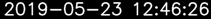
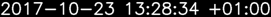
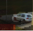
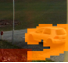
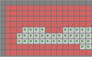
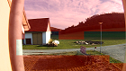
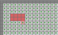
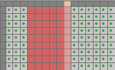

<!-- title: proDAD Forensic Plugins -->
<!-- author: Holger Burkarth -->

# proDAD Forensic Plugins

## 1. Einleitung

Die **proDAD Forensic Plugins** unterstützen die strukturierte
Auswertung von Videoaufnahmen, insbesondere von Überwachungs- und
Beweismaterial. Sie wurden dafür entwickelt, wichtige Informationen in
langen oder schwer überschaubaren Videoaufnahmen schneller auffindbar
und nachvollziehbar darstellbar zu machen.

Die beiden Plugins verfolgen dabei unterschiedliche, sich ergänzende
Aufgaben:

-   **TimeCode Plugin:** Das Plugin liest die im Videomaterial
    enthaltenen Zeit- und Datumsinformationen aus und blendet sie direkt
    in das Videobild ein. Dadurch lässt sich zu jeder Position im Video
    unmittelbar erkennen, welcher Aufnahmezeitpunkt dieser Bildposition
    zugeordnet ist. Gerade bei der Auswertung zahlreicher
    Überwachungsvideos erleichtert dies die zeitliche Orientierung
    erheblich.
-   **Event Detection Plugin:** Das Plugin analysiert Videomaterial
    automatisiert auf Bewegungen und andere Bildveränderungen. Es
    erstellt eine chronologische Liste erkannter Ereignisse. Dadurch
    können auch sehr lange Überwachungsaufnahmen schnell durchsucht
    werden, ohne das gesamte Material kontinuierlich ansehen zu müssen.
    Die erkannten Stellen lassen sich anschließend gezielt anspringen
    und näher untersuchen.

Damit können die Plugins insbesondere bei der **Sichtung, zeitlichen
Einordnung und Vorauswahl von Überwachungsaufnahmen** unterstützen. Sie
sind als Werkzeuge zur technischen Videoauswertung gedacht und ersetzen
nicht die fachliche Bewertung des zugrunde liegenden Materials.

> **Wichtiger forensischer Hinweis:** Die von einem Plugin ausgelesenen
> Zeitinformationen oder erkannten Ereignisse sind technische
> Auswertungsergebnisse. Sie sollten immer im Zusammenhang mit dem
> Originalmaterial und den bekannten Aufnahmebedingungen bewertet
> werden.

### 1.1 Typische Einsatzbereiche

Die Plugins können beispielsweise bei der Auswertung von

-   Überwachungskameras,
-   langen stationären Kameraaufnahmen,
-   mehreren zeitlich zusammenhängenden Videodateien,
-   Videoaufzeichnungen mit eingebetteten Datums- und Zeitinformationen

eingesetzt werden.

Das **TimeCode Plugin** unterstützt vor allem die zeitliche Orientierung
und Dokumentation. Das **Event Detection Plugin** unterstützt vor allem
die schnelle Suche nach relevanten Bewegungen oder Bildveränderungen.

### 1.2 Grundprinzip der Arbeitsweise

Beide Plugins arbeiten innerhalb des Videoschnittprogramms und beziehen
sich auf die aktuelle Position des Positionszeigers in der Zeitleiste.
Die Bedienung ist deshalb auch für Anwender nachvollziehbar, die nur
gelegentlich mit Videoschnitt oder Videobearbeitung arbeiten.

Die folgenden Kapitel beschreiben zunächst die allgemeinen
Voraussetzungen und anschließend beide Plugins nach einer einheitlichen
Struktur:

1.  Zweck und Einsatzgebiet
2.  Benutzeroberfläche und Einstieg
3.  Hauptfunktionen
4.  Bedienung und Navigation
5.  Einstellungen und praktische Hinweise
6.  Grenzen und wichtige Hinweise
7.  Technische Spezifikationen

## 2. Systemanforderungen

-   64-Bit Windows 10 oder 11
-   Mindestens 8 GB RAM
-   16 GB RAM empfohlen

## 3. TimeCode Plugin

### 3.1 Zweck und Einsatzgebiet

Das **proDAD TimeCode Plugin** liest die im Videomaterial enthaltenen
Zeit- und Datumsinformationen aus und stellt sie direkt im Videobild
dar. Die Anzeige folgt der aktuellen Bildposition: Wird das Video bewegt
oder Einzelbild für Einzelbild betrachtet, wird für die jeweilige
Position der zugehörige Zeitwert angezeigt.

Das ist besonders hilfreich bei der Auswertung von Überwachungsvideos.
Anstatt den Aufnahmezeitpunkt anhand der Dateinamen oder einer separaten
Dokumentation zu bestimmen, kann der Anwender die im Videomaterial
hinterlegte Zeitinformation direkt an der jeweiligen Bildposition
ablesen.

Das Plugin eignet sich damit unter anderem für:

-   die zeitliche Orientierung innerhalb langer Aufnahmen,
-   die Zuordnung einzelner Szenen zu einem Aufnahmezeitpunkt,
-   die Untersuchung von Ereignissen an einer bestimmten Position im
    Video,
-   die Dokumentation von Zeitwerten bei der Sichtung von Videomaterial.

Die Anzeige kann während der normalen Wiedergabe ebenso genutzt werden
wie bei einer Einzelbildanalyse.

### 3.2 Einstieg und Benutzeroberfläche

Nach dem Öffnen des Plugins werden die verfügbaren Zeitinformationen
zusammen mit den Anzeigeoptionen dargestellt. Die aktuelle Position in
der Zeitleiste des Schnittprogramms und die im Plugin angezeigten Werte
sind miteinander verknüpft.

Für eine erste Prüfung reicht es in der Regel aus, das Video abzuspielen
oder den Positionszeiger an eine gewünschte Stelle zu setzen. Das Plugin
zeigt daraufhin die für diese Bildposition ermittelten Zeitwerte an.

#### Übersicht und Schulungsmaterial

-   [Tutorial-Video auf YouTube ansehen](https://youtu.be/fvvaZdaAZwM)
-   [EDIUS Demo-Projekt
    herunterladen](https://my.hidrive.com/lnk/gOgMQsvQ) (ca. 100 MB)

### 3.3 Hauptfunktionen

#### 3.3.1 Zeit- und Datumsanzeige

Das Plugin blendet das im Videomaterial enthaltene Aufnahme-Datum[^1]
und den Timecode[^2] direkt in das Videobild ein.

Die Anzeige wird dynamisch an die aktuelle Bildposition angepasst.
Dadurch wird immer der Zeitwert angezeigt, der dem aktuell sichtbaren
Einzelbild zugeordnet ist.

#### 3.3.2 Anzeigeformate

Datum und Zeit können in unterschiedlichen Formaten dargestellt werden:

-   `YYYY-MM-DD` -- Datum im Format Jahr-Monat-Tag.
-   `HH:MM:SS` -- Uhrzeit im Format Stunde:Minute:Sekunde.
-   `TC` -- klassischer Timecode im Format
    Stunden:Minuten:Sekunden:Frames.

Bei NTSC-Videomaterial kann zwischen **Drop Frame** und **Non-Drop
Frame** gewählt werden.

Position und Größe der Texteinblendung können an das Videobild angepasst
werden.

#### 3.3.3 Absolute Zeit bezogen auf das Video

Im Bereich **„Absolute Zeit bezogen auf das Video"** werden die
Zeitwerte der aktuell angezeigten Bildposition dargestellt.

Die auf der rechten Seite des Plugin-Fensters angezeigten Werte können
markiert und über die Zwischenablage in andere Anwendungen übernommen
werden.

### 3.4 Bedienung und Navigation

#### 3.4.1 Synchronisation mit der Zeitleiste

Wenn sich der Positionszeiger (Needle)[^3] innerhalb des
Wirkungsbereichs des Plugins befindet, aktualisiert das Plugin die
angezeigten Zeitwerte entsprechend der aktuellen Position.

Beim Abspielen, Verschieben oder Einzelbild-Navigieren durch das Video
verändert sich die Anzeige entsprechend.

#### 3.4.2 Direkte Eingabe eines Timecodes

Im hell hinterlegten Timecode-Eingabefeld kann ein Zeitwert direkt
eingegeben werden. Nach dem Drücken der
<kbd>Enter</kbd>-Taste springt die Wiedergabe zur
entsprechenden Bildposition.

Solange der Cursor im Timecode-Eingabefeld aktiv ist, kann mit den
Pfeiltasten <kbd>Hoch</kbd> und
<kbd>Runter</kbd> auch Einzelbild für Einzelbild durch
das Video navigiert werden.

> **Hinweis zu Rundungsabweichungen:** Wenn die im Schnittprogramm
> verwendete Bildrate nicht exakt der Bildrate des Originalmaterials
> entspricht, können geringfügige Abweichungen zwischen eingegebenem
> Timecode und angezeigter Bildposition auftreten. Diese Abweichungen
> entstehen durch die Umrechnung der Bildpositionen.

### 3.5 Interpretation von Datum und Uhrzeit

Die Uhrzeit wird standardmäßig im 24-Stunden-Format angezeigt. Für eine
forensische Bewertung ist entscheidend, dass die aus dem Video
ausgelesene Zeitinformation nicht automatisch beweist, dass die Kamera
zum betreffenden Zeitpunkt tatsächlich diese Uhrzeit hatte.

#### 3.5.1 Kameras ohne Zeitzoneninformation

Viele Kameras speichern lediglich Datum und lokale Uhrzeit, ohne eine
Zeitzoneninformation abzulegen.

Ein Wert wie `12:46:26` kann abhängig vom Kamerasystem und dessen
Konfiguration beispielsweise eine

1.  lokale Ortszeit,
2.  UTC-/GMT-/Zulu-Zeit oder
3.  eine seit dem Einschalten der Kamera vergangene Betriebszeit

darstellen.

Welche Bedeutung der Wert tatsächlich besitzt, hängt von der Kamera,
ihrer Konfiguration und dem verwendeten Aufzeichnungsformat ab.

#### 3.5.2 Kameras mit Zeitzoneninformation

Moderne Kameras können zusätzlich die Abweichung von der Weltzeit
speichern. In diesem Fall kann die Datums- und Zeitangabe um eine
Zeitzoneninformation ergänzt sein.

Beispiel:

`2017-10-23 13:28:34 +01:00`

-   `13:28:34` -- lokale Uhrzeit.
-   `+01:00` -- Zeitverschiebung gegenüber UTC; dies entspricht in
    Deutschland der Mitteleuropäischen Zeit (MEZ).
-   `+02:00` -- entspricht in Deutschland der Mitteleuropäischen
    Sommerzeit (MESZ).
-   `+/-HH:MM` -- Stunden und Minuten der Zeitverschiebung gegenüber
    UTC.

### 3.6 Grenzen und wichtige Hinweise

Die vom TimeCode Plugin angezeigten Zeitwerte stammen aus den
Zeitinformationen des Videomaterials. **Das Plugin kann nicht
feststellen, ob die Uhr der Kamera zum Zeitpunkt der Aufnahme korrekt
eingestellt war.**

Ein Zeitstempel kann beispielsweise falsch sein, wenn

-   Datum oder Uhrzeit der Kamera falsch eingestellt waren,
-   die Kamera nach einem Stromausfall eine falsche Zeit übernommen hat,
-   die Zeitzone oder Sommer-/Winterzeit falsch konfiguriert war,
-   die Kamera oder das Aufzeichnungssystem manipuliert oder
    nachträglich verändert wurde.

Die Anzeige des Plugins ist daher als **aus dem Videomaterial
ausgelesene Zeitinformation** zu verstehen. Für eine belastbare
zeitliche Einordnung sollte sie, soweit möglich, mit weiteren
Informationen abgeglichen werden, beispielsweise mit bekannten
Ereigniszeiten, anderen Kameras oder technischen Aufzeichnungsdaten.

> **Forensischer Hinweis:** Eine im Video angezeigte oder im Dateiformat
> gespeicherte Zeitangabe ist nicht automatisch ein unabhängiger
> Nachweis der tatsächlichen Uhrzeit.

### 3.7 Technische Spezifikationen

Das Plugin unterstützt folgende EDIUS-Farbformate:

-   YUV422 (8-Bit)
-   YUV422 (10-Bit)
-   RGB

## 4. Event Detection Plugin

### 4.1 Zweck und Einsatzgebiet

Das **proDAD Event Detection Plugin** unterstützt die automatisierte
Sichtung von Überwachungsvideos. Es durchsucht das Videomaterial nach
Bewegungen und anderen relevanten Bildveränderungen und führt die
erkannten Ereignisse in einer chronologischen Liste zusammen.

Der wesentliche Vorteil zeigt sich bei langen Aufnahmen: Statt
beispielsweise mehrere Stunden Videomaterial vollständig ansehen zu
müssen, kann der Anwender zunächst automatisch nach Bildveränderungen
suchen lassen und anschließend gezielt zu den gefundenen Zeitpunkten
springen.

Das Plugin eignet sich insbesondere für die schnelle Vorauswahl von
Stellen, an denen beispielsweise

-   Personen,
-   Fahrzeuge,
-   Tiere oder
-   andere sichtbare Bewegungen

auftreten können.

Darüber hinaus können auch andere Bildveränderungen erkannt werden, etwa
Reflexionen, Lichtveränderungen oder andere Veränderungen im Bild. Ein
erkanntes Event ist daher nicht automatisch ein relevantes Ereignis im
fachlichen oder forensischen Sinn.

**Wichtige Voraussetzung:** Das Plugin ist für Aufnahmen von
**stationären Kameras** vorgesehen. Die Kamera muss während der Aufnahme
grundsätzlich unverändert positioniert bleiben. Eine Veränderung der
Kameraposition kann als großflächige Bildbewegung erkannt werden und
dadurch einen Fehlalarm erzeugen.

### 4.2 Einstieg und Benutzeroberfläche

Nach dem Start des Plugins kann die automatische Analyse des
Videomaterials durchgeführt werden. Während der Analyse werden erkannte
Ereignisse fortlaufend in der Ereignisliste ergänzt.

Die Analyse kann auch bei sehr langen Aufnahmen sinnvoll eingesetzt
werden. Bereits gefundene Ereignisse können während eines laufenden
Suchvorgangs betrachtet werden.

#### Übersicht und Schulungsmaterial

-   [Tutorial-Video auf YouTube ansehen](https://youtu.be/SWdAlltyCBM)
-   [EDIUS Demo-Projekt
    herunterladen](https://my.hidrive.com/lnk/2UAsQov6) (ca. 7 GB)

### 4.3 Hauptfunktionen

#### 4.3.1 Automatische Ereigniserkennung

Das Plugin durchsucht das Videomaterial selbstständig nach Bewegungen
und anderen Bildveränderungen. Die erkannten Ereignisse werden als
Events[^4] bezeichnet.

Die automatische Analyse ermöglicht insbesondere bei stundenlangen
Überwachungsaufnahmen eine erhebliche Zeitersparnis bei der ersten
Sichtung.

#### 4.3.2 Fortsetzen einer Analyse

Die Analyse kann unterbrochen und später fortgesetzt werden. Der
bisherige Analysestand bleibt auch beim Schließen des Plugin-Fensters
erhalten.

#### 4.3.3 Arbeiten während der Analyse

Bereits erkannte Ereignisse können während des laufenden Analysevorgangs
betrachtet und ausgewertet werden.

Die Analyse läuft im Hintergrund. Währenddessen kann im Schnittprogramm
weiterhin durch die Zeitleiste navigiert werden. Auch
Plugin-Einstellungen können angepasst werden, ohne den laufenden
Suchvorgang grundsätzlich zu unterbrechen.

### 4.4 Bedienung und Navigation

#### 4.4.1 Ereignisliste

Im Bereich **„Ereignisse"** werden die bisher erkannten Bewegungen und
Bildveränderungen chronologisch aufgeführt.

Wenn der Positionszeiger (Needle)[^5] auf der Zeitleiste bewegt wird,
wird das zugehörige Ereignis in der Liste automatisch hervorgehoben.

#### 4.4.2 Zu einem Ereignis springen

Durch Auswahl eines Eintrags in der Ereignisliste springt die Wiedergabe
zur markanten Stelle[^6] des jeweiligen Ereignisses.

Ein **Doppelklick** auf ein Ereignis führt zum zentralen Zeitpunkt des
erkannten Bewegungsablaufs.

Die Ereignisliste dient damit als schnelle Navigation durch längere
Aufnahmen.

### 4.5 Video-Overlay und Darstellung der Ereignisse

Das Plugin kann Analyseinformationen direkt im Videobild darstellen.

#### 4.5.1 Intelligente Zeitleiste

Am Bildrand kann eine gewölbte Zeitleiste eingeblendet werden. Dadurch
können mehrere Ereignisse gleichzeitig sichtbar gemacht werden, während
der Bereich um die aktuelle Abspielposition detaillierter dargestellt
wird.

Die Ereignisse werden entsprechend ihrer erkannten Bewegungsintensität
farblich unterschieden:

-   **Blau:** kleinere flächenmäßige Bewegung oder Bildveränderung
-   **Rot:** größere flächenmäßige Bewegung oder Bildveränderung

Die Farbdarstellung beschreibt die erkannte Veränderung im Bild und ist
nicht mit einer fachlichen Bewertung des Ereignisses gleichzusetzen.

#### 4.5.2 Ereignisse im Videobild hervorheben

In den Optionen kann festgelegt werden, wie erkannte Ereignisse im
Videobild sichtbar gemacht werden.

**Hervorheben:** Das Videobild wird leicht abgedunkelt. Der erkannte
Ereignisbereich bleibt hell sichtbar.

**Einfärben:** Der erkannte Objekt- bzw. Bewegungsbereich wird mit einer
Signalfarbe maskiert.

### 4.6 Analysebereich und Filter

Bei einer automatischen Bewegungserkennung können auch Bildbereiche zu
Events führen, die für die eigentliche Untersuchung nicht relevant sind.
Typische Beispiele sind Bäume im Wind, fliegende Insekten, Regen oder
Veränderungen durch Licht und Reflexionen.

Um solche Fehlalarme zu reduzieren, können sensible Bildbereiche
festgelegt werden.

#### 4.6.1 Sensible Bereiche definieren

Über das Kachelraster **„Sensible Bereiche"** wird festgelegt, welche
Bereiche des Bildes in die Bewegungserkennung einbezogen werden.

-   **Aktive Kacheln:** Die Bereiche werden auf Bewegungen überwacht.
-   **Inaktive Kacheln:** Die Bereiche werden bei der Erkennung ignoriert. (rot)

| Kachel-Auswahl im Plugin | Optische Wirkung im Videobild |
| :--- | :--- |
|  |  |

Dadurch kann beispielsweise ein dauerhaft störender Bildbereich aus der
Analyse ausgeschlossen werden, während der für die Untersuchung
relevante Bereich weiterhin überwacht wird.

#### 4.6.2 Kacheln bearbeiten

Eine einzelne Kachel kann durch einen einfachen Klick aktiviert bzw.
deaktiviert werden.

Zusammenhängende Bereiche können durch Klicken und Ziehen mit der Maus
bearbeitet werden.

Über die Randbereiche des Rasters können ganze Zeilen oder Spalten
aktiviert bzw. deaktiviert werden.

#### 4.6.3 Filter „Sehr kurze Ereignisse"

Sehr kurze Bildveränderungen können beispielsweise durch Regentropfen,
Insekten oder Bildrauschen entstehen.

Ist die Option **„Sehr kurze Ereignisse"** deaktiviert, werden sehr
kurze Störungen mit einer Dauer von weniger als 3 Frames automatisch
herausgefiltert.

Soll auch nach extrem kurzen Bildveränderungen gesucht werden, kann die
Option **„Sehr kurze Ereignisse"** aktiviert werden.

### 4.7 Zeitwerte und manuelle Navigation

Wie beim TimeCode Plugin können die unter **„Absolute Zeit bezogen auf
das Video"** angezeigten Zeitwerte für die aktuelle Bildposition
ausgelesen werden.

Über das Kontextmenü können die angezeigten Werte kopiert werden.

Über das obere Timecode-Eingabefeld kann ein Ziel-Timecode direkt
eingegeben werden. Mit den Pfeiltasten <kbd>Hoch</kbd>
und <kbd>Runter</kbd> kann außerdem Einzelbild für
Einzelbild navigiert werden.

### 4.8 Grenzen und wichtige Hinweise

Die Event Detection arbeitet anhand von Veränderungen im Videobild. Ein
erkanntes Event bedeutet daher zunächst nur, dass das Plugin eine
relevante Bildveränderung festgestellt hat.

Ein Event kann beispielsweise durch

-   eine Person,
-   ein Fahrzeug,
-   ein Tier,
-   eine andere Bewegung,
-   eine Reflexion,
-   einen Lichtwechsel,
-   einen Blitz,
-   Regen oder Insekten,
-   eine andere Bildveränderung

verursacht werden.

#### 4.8.1 Voraussetzung: stationäre Kamera

Die Analyse setzt voraus, dass die Kamera während der gesamten Aufnahme
grundsätzlich **stationär** bleibt.

Wird die Kamera während der Aufnahme umpositioniert oder verändert, kann
diese Veränderung als großflächige Bewegung erkannt werden. Dadurch kann
an dieser Zeitposition ein **Fehlalarm (False Positive)** entstehen.

Eine solche Kamerabewegung beeinträchtigt die weitere Analyse
grundsätzlich nicht: Nach dem Ende der Positionsänderung kann das Plugin
die anschließend wieder stationäre Szene weiter analysieren.
Entscheidend ist daher, bei der späteren Auswertung zu berücksichtigen,
dass ein Event durch die Änderung der Kameraposition und nicht durch
eine Bewegung innerhalb der überwachten Szene ausgelöst worden sein
kann.

#### 4.8.2 Erkannte Events sind keine fachliche Bewertung

Die automatische Erkennung dient der Unterstützung bei der Sichtung. Sie
entscheidet nicht darüber, ob eine erkannte Bewegung für einen konkreten
Fall relevant ist.

Die Ereignisliste sollte deshalb als **Such- und Navigationshilfe**
verstanden werden. Die eigentliche Bewertung des Videoinhalts erfolgt
durch den Anwender.

### 4.9 Technische Spezifikationen

-   Unterstützte EDIUS-Farbformate:
    -   YUV422 (8-Bit)
    -   YUV422 (10-Bit)
    -   RGB
-   Die Analyse greift direkt auf das unveränderte
    Original-Videomaterial zu.
-   Einstellungen des Schnittprogramms, beispielsweise eine reduzierte
    Vorschauauflösung oder abweichende Darstellungseinstellungen,
    beeinträchtigen die Analyse des Originalmaterials nicht.

## 6. Support

Das Support-Protokoll erzeugt eine diagnostische Protokolldatei, die bei
der Fehleranalyse durch den proDAD-Support hilfreich sein kann.

### 6.1 Support-Protokoll erzeugen

1.  Halten Sie die <kbd>SHIFT</kbd>-Taste gedrückt,
    während Sie den Menüpunkt zum Öffnen des **„Über"**-Dialogs
    anklicken.
2.  Klicken Sie im angezeigten **„Über"**-Dialog auf
    **„Support-Protokoll"**.
3.  Speichern Sie die erzeugte Protokolldatei am gewünschten
    Speicherort.
4.  Fügen Sie die Protokolldatei Ihrer Support-Anfrage hinzu.

Die Protokolldatei enthält technische Informationen über den Betrieb der
Software und die Systemumgebung. Sie enthält grundsätzlich keine
Videodaten des untersuchten Materials.

> **Hinweis:** Wenn Sie den proDAD-Support wegen eines Problems
> kontaktieren, senden Sie nach Möglichkeit die erzeugte
> Support-Protokolldatei mit. Dadurch kann die Ursache eines technischen
> Problems häufig schneller eingegrenzt werden.

## 7. Über proDAD

proDAD ist ein renommiertes Unternehmen, das sich auf die Entwicklung
und den Vertrieb hochwertiger Video- und Bildbearbeitungssoftware
spezialisiert hat. Seit seiner Gründung im Jahr 1990 hat sich proDAD als
Anbieter innovativer Lösungen für die professionelle Videobearbeitung
etabliert.

Das Unternehmen verfügt über langjährige Expertise in den Bereichen
digitale Bild- und Videotechnik sowie Softwareentwicklung. Die Produkte
von proDAD bieten Werkzeuge zur Optimierung, Bearbeitung und
Verbesserung von Videos und Bildern und werden sowohl von Einsteigern
als auch von erfahrenen Anwendern eingesetzt.

Ein besonderer Schwerpunkt liegt auf der Videostabilisierung. proDAD hat
hierfür eigene Technologien entwickelt, mit denen Verwacklungen und
Jitter in Videomaterial reduziert werden können.

Die Softwareprodukte werden sowohl als eigenständige Anwendungen als
auch in Verbindung mit etablierten Videoschnittprogrammen eingesetzt.

## 8. Kontakt

Bei Fragen oder Problemen unterstützt Sie der proDAD-Kundensupport.

-   E-Mail: <support@prodad.com>
-   Telefon: +49 (0)7462 9459 0
-   Post: proDAD GmbH, Gauertstr. 2, 78194 Immendingen, Deutschland
-   Homepage: [www.proDAD.com](https://www.prodad.com)

Bei technischen Problemen senden Sie nach Möglichkeit die
Support-Protokolldatei mit.

## 9. Copyright und Lizenzbedingungen

Copyright proDAD GmbH. Alle Rechte vorbehalten.

### 9.1 Lizenzvereinbarung

Bitte lesen Sie die Lizenzvereinbarung sorgfältig durch, bevor Sie die
Software installieren.

Beim Start des Setups wird eine Lizenzvereinbarung angezeigt. Durch die
Installation der Software erklären Sie sich mit den darin enthaltenen
Copyright-Bedingungen, der Lizenzvereinbarung und dem
Lizenzierungsverfahren einverstanden.

### 9.2 Lizenzgarantie

Die proDAD GmbH gewährt dem Nutzer das Recht, dieses Produkt für den
vorgesehenen und zulässigen Zweck zu verwenden. Das Produkt darf nur auf
einem Computer installiert werden.

Die weiteren Rechte und Bedingungen ergeben sich aus der beim Setup
angezeigten Lizenzvereinbarung.

### 9.3 Markenhinweis

Alle im Zusammenhang mit diesem Produkt genannten Produkte und Marken
sind Marken ihrer jeweiligen Eigentümer. Die Verwendung von
Markenbezeichnungen erfolgt ohne Gewährleistung einer darüber
hinausgehenden Nutzungsberechtigung.

### 9.4 Haftungsbeschränkung

Der Umfang der Haftung für Ansprüche richtet sich nach den geltenden
Lizenz- und Garantiebedingungen. Die proDAD GmbH, ihre Vertriebspartner
und Lizenznehmer haften, soweit gesetzlich zulässig, nicht für Schäden
oder Folgeschäden, die aus der Unfähigkeit zur Nutzung des Produkts
entstehen.

Maßgeblich sind die vollständigen Bedingungen der jeweils gültigen
Lizenzvereinbarung.

### 9.5 Dokumentation

Diese Dokumentation wurde mit größter Sorgfalt erstellt. Fehler können
dennoch nicht vollständig ausgeschlossen werden.

Die proDAD GmbH übernimmt keine Verantwortung oder Haftung für Folgen,
die aus falschen Aussagen oder Informationen in der Dokumentation oder
Übersetzung entstehen. Technische und optische Änderungen bleiben
vorbehalten. Hinweise auf mögliche Ungenauigkeiten sind willkommen.

* **Softwareentwicker:** Holger Burkarth
* **Autor der Dokumentation:** Holger Burkarth

### 9.6 Copyright-Hinweis

Die Software und ihre Komponenten sind Eigentum der proDAD GmbH. Der
Lizenznehmer verpflichtet sich, eine unbefugte Nutzung und
Vervielfältigung zu unterlassen.

Die proDAD GmbH übernimmt keine Verantwortung für die Nutzung des
Programms sowie für die Veröffentlichung der mit dem Programm erstellten
Inhalte und Daten.

**proDAD GmbH**\
Gauertstr. 2\
78194 Immendingen\
Deutschland\
HRB 1077

## Fußnoten und Fachbegriffe

[^1]: **Scrubbing:** Das schnelle bzw. manuelle Bewegen des Positionszeigers durch die Zeitleiste, um unterschiedliche Stellen eines Videos unmittelbar anzusehen.

[^2]: **Needle / Positionszeiger:** Die vertikale Linie in der Zeitleiste, die die aktuell angezeigte zeitliche Position des Videos kennzeichnet.

[^3]: **Relativer Timecode:** Die Zeitposition innerhalb des Videos, ausgehend vom Beginn des jeweiligen Videos. Der Wert beschreibt den zeitlichen Abstand zum Videostart und nicht automatisch die tatsächliche Uhrzeit der Aufnahme.

[^4]: **Datum-Notation:** Das Datum wird nach der im Dokument verwendeten ISO-8601-Schreibweise `YYYY-MM-DD` dargestellt, also Jahr-Monat-Tag.

[^5]: **Timecode-Notation:** Ein klassischer SMPTE-Timecode wird als `HH:MM:SS:FF` dargestellt. Bei NTSC-Material kann zwischen Drop-Frame-Timecode (`HH:MM:SS;FF`) und Non-Drop-Frame-Timecode (`HH:MM:SS:FF`) unterschieden werden. `FF` bezeichnet dabei die laufende Frame-Nummer innerhalb der Sekunde.

[^6]: **Markante Stelle:** Eine vom Plugin bestimmte Bildposition innerhalb eines erkannten Events, an der die betreffende Bewegung oder Bildveränderung besonders gut sichtbar bzw. beurteilbar ist.

[^7]: **Event:** Ein vom Plugin erkanntes Ereignis bzw. eine erkannte Bildveränderung. Dazu können beispielsweise Bewegungen von Personen, Fahrzeugen oder Tieren gehören. Ebenso können Reflexionen, Lichtveränderungen, Blitze, Kamerabewegungen oder andere Veränderungen des Bildinhalts erkannt werden.

[^8]: **Reliabilität der Zeitwerte:** Die vom Plugin angezeigten Zeitwerte werden aus den im Videomaterial vorhandenen Zeitinformationen ermittelt. Das Plugin kann nicht überprüfen, ob die Uhr der Kamera korrekt eingestellt war. Falsch eingestellte Uhrzeit oder falsches Datum, eine falsche Zeitzone oder andere Fehler im Aufnahme- bzw. Kamerasystem können deshalb zu falschen Zeitangaben führen.

[^9]: **Ortszeit:** Die für den jeweiligen Aufnahmeort geltende lokale Uhrzeit. Sie berücksichtigt die am Ort verwendete Zeitzone und gegebenenfalls die Sommerzeit.

[^10]: **UTC / Zulu-Zeit:** UTC (Coordinated Universal Time) ist eine weltweit einheitliche Referenzzeit. „Zulu“ bzw. „Z“ ist eine in technischen und insbesondere luftfahrtbezogenen Zusammenhängen gebräuchliche Bezeichnung für UTC.

[^11]: **GMT:** Greenwich Mean Time bezeichnet die mittlere Sonnenzeit am Nullmeridian in Greenwich. Im alltäglichen Gebrauch wird GMT häufig gleichbedeutend mit UTC verwendet; technisch sind GMT und UTC jedoch nicht exakt dasselbe Zeitmaß. Für Zeitverschiebungen moderner digitaler Systeme ist UTC die präzisere Referenz.
