# proDAD Heroglyph V4

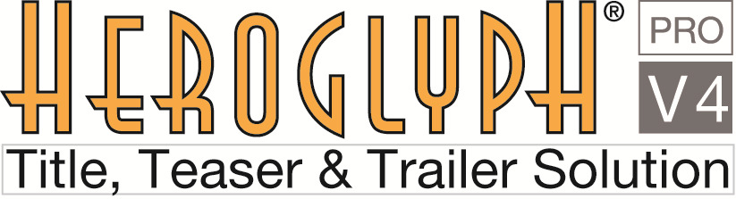

**proDAD Heroglyph V4**

© proDAD GmbH [– www.prodad.com](http://www.prodad.com)

Autor : Uwe Wenz

## Content

- [Welcome](#welcome)
  - [Copyright / legal Information](#copyright--legal-information)
  - [What is new in Heroglyph V4?](#what-is-new-in-heroglyph-v4)
  - [Further Info's](#further-infos)
- Installation, Registration, Help, Support and System requirements
  - [Installation and Registration](#installation-and-registration)
  - [Help](#help)
  - [Technical Support - Support](#technical-support---support)
  - [System requirements](#system-requirements)
- [Program start and Plug ins](#program-start-and-plug-ins)
  - [Heroglyph stand-alone](#heroglyph-stand-alone)
  - [Adobe After Effects](#adobe-after-effects)
  - [Adobe Premiere](#adobe-premiere)
  - [Adobe Premiere Elements](#adobe-premiere-elements)
  - [Avid Media Composer](#avid-media-composer)
  - [Avid Studio](#avid-studio)
  - [Corel](#corel)
  - [Grass Valley EDIUS/NEO](#grass-valley-ediusneo)
  - [MAGIX](#magix)
  - [Pinnacle Studio](#pinnacle-studio)
  - [Sony Vegas Pro](#sony-vegas-pro)
  - [Sony Movie Studio Platinum](#sony-movie-studio-platinum)
- [Workshops for familiarization](#workshops-for-familiarization)
  - [The Creation of a Slideshow](#the-creation-of-a-slideshow)
  - [Creation of a 3x3 Videowall with Effects and Design](#creation-of-a-3x3-videowall-with-effects-and-design)
  - [Creation of Routes with Object on own Map](#creation-of-routes-with-object-on-own-map)
  - [Animate a Title in a Skyline Image (Working in different Layers)](#animate-a-title-in-a-skyline-image-working-in-different-layers)
  - [Trailer - Combine Templates in the Timeline (e.g. Teaser/News + Videowall + Ticker)](#trailer---combine-templates-in-the-timeline-eg-teasernews--videowall--ticker)
  - [Create Scripts](#create-scripts)
  - [Working with Components (Text Crawl, Text Roll and more Text Animations)](#working-with-components-text-crawl-text-roll-and-more-text-animations)
  - [Create and Edit Lower-Third via Wizard](#create-and-edit-lower-third-via-wizard)
- [Heroglyph V4 Quick Start Wizard](#heroglyph-v4-quick-start-wizard)
  - [Overview](#overview)
  - [The options New project and Open project](#the-options-new-project-and-open-project)
  - [Video format settings](#video-format-settings)
  - [Life-Demo](#life-demo)
  - [The Wizards](#the-wizards)
    - [Templates](#templates)
      - [Choose Template](#choose-template)
      - [Overview - Templates, Preview, Text, Styles and effects](#overview---templates-preview-text-styles-and-effects)
    - [Route](#route)
      - [Import a map and draw a path](#import-a-map-and-draw-a-path)
      - [Path - Select a Style and Effects](#path---select-a-style-and-effects)
      - [Object - Edit Travel Object, Add Animation and Effects](#object---edit-travel-object-add-animation-and-effects)
      - [Timing - Pause route and Travel speed](#timing---pause-route-and-travel-speed)
    - [Videowall](#videowall)
      - [Choose Presets](#choose-presets)
      - [Texture - Add Image/Video](#texture---add-imagevideo)
      - [Style - Design options](#style---design-options)
      - [Animation - Duration and Effects](#animation---duration-and-effects)
    - [Slideshow](#slideshow)
      - [Add pictures/videos... and Timing options](#add-picturesvideos-and-timing-options)
      - [Set Picture Style](#set-picture-style)
      - [Titling options](#titling-options)
    - [Script](#script)
      - [Choose Template](#choose-template-1)
      - [Text Editing, Setting of Effects and Duration](#text-editing-setting-of-effects-and-duration)
- [Heroglyph V4](#heroglyph-v4)
  - [Overview](#overview-1)
  - [Basic functions](#basic-functions)
  - [Interactive preview](#interactive-preview)
  - [The Storyboard](#the-storyboard)
  - [The Timeline](#the-timeline)
  - [File](#file)
    - [New project / Open project / Save as](#new-project--open-project--save-as)
    - [Settings](#settings)
  - [Start](#start)
    - [Clipboard - Copy/Paste/Cut](#clipboard---copypastecut)
    - [Mode - Selector/Text/Path](#mode---selectortextpath)
    - [Font settings & symbols](#font-settings--symbols)
    - [Font - Advanced design options](#font---advanced-design-options)
    - [Paragraph - Align text](#paragraph---align-text)
  - [Insert](#insert)
    - [Insert Element](#insert-element)
    - [Templates](#templates-1)
    - [Component](#component)
    - [Script](#script-1)
    - [Slideshow](#slideshow-1)
    - [Videowall](#videowall-1)
    - [Route](#route-1)
    - [Timeline - Text layer](#timeline---text-layer)
    - [Timeline - Image layer](#timeline---image-layer)
    - [Graphics - Symbol](#graphics---symbol)
    - [Graphics - Insert graphic - Insert mask - Seperate elements](#graphics---insert-graphic---insert-mask---seperate-elements)
  - [Layout](#layout)
    - [Alignment - Align objects](#alignment---align-objects)
    - [Alignment - Align size and rotation](#alignment---align-size-and-rotation)
    - [Alignment - Align objects in layers](#alignment---align-objects-in-layers)
    - [Paragraph - Align text](#paragraph---align-text-1)
    - [Flip - Flip horizontal and Flip vertical](#flip---flip-horizontal-and-flip-vertical)
    - [Kerning - Align Text horiz. and vert. - Kerning/Selector](#kerning---align-text-horiz-and-vert---kerningselector)
    - [Metric](#metric)
    - [Metric - Advanced design options](#metric---advanced-design-options)
  - [Design](#design)
    - [Select presets](#select-presets)
    - [Presets - Advanced design options](#presets---advanced-design-options)
    - [Attributes - Opacity - Blur](#attributes---opacity---blur)
    - [Attributes - Bold - Italic - Tube](#attributes---bold---italic---tube)
    - [Options - Surface - Bevel - Outline](#options---surface---bevel---outline)
    - [Options - Glow - Shadow](#options---glow---shadow)
    - [Options - Depth - Halo](#options---depth---halo)
  - [Animation](#animation)
    - [Select effect presets- Select Fade-In/Continuous/Fade-Out-Effects and reset](#select-effect-presets--select-fade-incontinuousfade-out-effects-and-reset)
    - [Presets - Advanced effect options](#presets---advanced-effect-options)
    - [Speed and Timing](#speed-and-timing)
  - [View](#view)
    - [Background - Transparent background or video](#background---transparent-background-or-video)
    - [Settings](#settings-1)
    - [Border - Title safe area](#border---title-safe-area)
  - Route Options (only available when creating a Route/Path)
    - [Choose object- and style presets - Flip](#choose-object--and-style-presets---flip)
    - [Presets - Advanced design options](#presets---advanced-design-options-1)
    - [Edit - Path - Selector - Thickness of the route - Dotted - Animation style](#edit---path---selector---thickness-of-the-route---dotted---animation-style)
    - [Path - Smooth - Direction - Sync-Settings - Pause](#path---smooth---direction---sync-settings---pause)
  - Image Options (only available when using a graphic file)
    - [Choose graphic presets - Flip horizontal, vertical and Reset](#choose-graphic-presets---flip-horizontal-vertical-and-reset)
    - [Texture - Choose Style](#texture---choose-style)
    - [Texture - Remove - Open Texture - Flip horizontally and vertically](#texture---remove---open-texture---flip-horizontally-and-vertically)
    - [Texture - Advanced design options](#texture---advanced-design-options)
    - [Mask - Choose mask](#mask---choose-mask)
    - [Mask - Remove - Invert - Open mask - Flips horizontally and Flips vertically](#mask---remove---invert---open-mask---flips-horizontally-and-flips-vertically)
    - [Mask - Advanced design options](#mask---advanced-design-options)
  - [Export](#export)
    - [Export Frame(s)](#export-frames)
    - [Export as Animation file](#export-as-animation-file)

## Welcome

**Welcome to Heroglyph version 4!**

Congratulations on your purchase of this innovative software of characters and shapes. You now own THE solution for creating all types of video titles.

Until now you had to use different programs and, to some extent, complex key images to produce your trailers. Heroglyph now allows you to obtain the same results, but much easier. Heroglyph is also the number one choice for multimedia producers, video directors and aspiring professionals as far as output quality is concerned. The aim of this product is to perfect digital video editing in the form of perfect trailers and fade-ins. The path in attaining this aim is short due to the intuitive user interface that provides several innovative features and helps you produce perfect results.

We hope you enjoy Heroglyph version 4 and always produce results that are full of effects!

### Copyright / legal Information

Copyright proDAD GmbH. All rights reserved.

Licensing Conditions\
Please read these licensing conditions carefully before installing the software.

Licensing agreement\
When setup starts, a licensing agreement is shown, which you should read carefully.\
By installing the software, you stale that you accept the copyright conditions, the licensing agreement and the licensing procedure.

License Guarantee\
proDAD GmbH grants the user the right to use this product for its proper and permitted purpose. The present product may only be installed on one computer. proDAD hereby guarantees to provide a license key free of charge. By installing this product, the user acknowledges and accepts the license guarantee, the copyright terms, and the limitation of liability.

Trademarks\
All products and trademarks mentioned in association with this product are trademarks that belong to the respective owners. All trademarks are used without any guarantee that they may be used freely, and they may be registered trademarks.

Limitation of Liability\
The extent of liability for any one claim is limited to a replacement of the product. This applies to proDAD GmbH, all licensees and retailers. Claims shall only be recognized if the software is returned in an orderly manner, together with the returned goods number that has to be previously arranged with proDAD GmbH. The goods must also be accompanied by proof of purchase. This guarantee becomes void if a malfunction of this product is due to improper use, mistreatment, an accident or improper handling. proDAD GmbH, its sales partners and licensees, shall not be held liable for damages or subsequent damages arising from the impossible usage of this product. Liability is limited in all cases to the purchase price of the product.

Documentation\
The greatest of care has been taken in compiling and translating the handbook. However, the possibility of errors cannot be fully excluded. proDAD GmbH shall assume no responsibility or liability whatsoever for the consequences of any incorrect statements or information which the documentation or translation may contain. Subject to technical and optical modifications. Information regarding any inaccuracies is always welcome.

Copyright\
The software and the individual components of this product are the property of proDAD GmbH. By installing this product, the licensee agrees to refrain from unauthorized use and duplication.

proDAD GmbH does not accept any responsibility for the usage of this program and the publication of its contents and data that has been created with this program.

proDAD GmbH \* Gauertstr. 2 \* 78194 Immendingen \* Deutschland \* HRB 1077

### What is new in Heroglyph V4?

**Super easy to use! Extremely versatile and with amazing new features.**\
Huge array of FastStart templates for common titling needs. Professional grade quality!

- Due to the fact that there are many new features, the user interface has been given a completely new layout.
- Quickly & easily create a wide array of titles, lower-thirds, credits, subtitles, and more with unlimited combinations of text, images, effects, and animations;
- New FastStart templates let you fully customize commonly used title projects with so many creative possibilities it’s impossible to list them all;
- Exclusive live preview of the project while making changes, no need to render to see what your changes will look like;
- Powerful yet easy TravelRoute animator lets you import a map image and with a few mouse clicks you can create complete route animations with lots of creative options;
- Create amazing 3D Video Walls with tons of creative layouts & options;
- New automated Handscript animation tool lets you create fully automated handscript text and symbols by simply typing what you want to see and plenty of customization options for styles, colors, and effects;
- Use as a plug-in for popular NLEs or as a stand-alone app, 64bit also!

**For pros:** Save time while creating elaborate result

**For sophisticated hobbyists:** Easy to use while creating professional-quality results

**For everyone:** Unique combination of different components for maximum creativity

### Further Info's

**FURTHER INFORMATION ABOUT Heroglyph**

Workshops and FAQs : **www.prodad.com**\
Training and Learning-products : **www.prodad.com**

## Installation, Registration, Help, Support

## and System requirements

### Installation and Registration

1. **Installation**

To start the installation, double-click the setup file. By installing the program, you agree to the terms and conditions in the legal notice section and to the license terms. If you have downloaded Heroglyph, the archive file will first be decompressed and then the installation will start. Select the target folder where Heroglyph should be installed. Now follow the installation instructions. During installation, you are prompted to enter a license key (serial number). If you have received the software via download, this license key was included with the e-mail sent to you providing download instructions. If you have received the software on DVD, you will find the license key in the box.

Please make sure that your Plug-in is correctly installed.

32bit-Installation 64bit-Installation

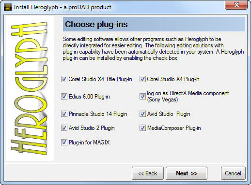

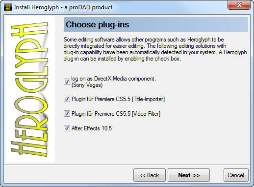

After installing Heroglyph, you can either use it as a stand-alone version or as a Plug-in (effect) in different video editing software programs.

2. **Registering Heroglyph**

Please register your proDAD Heroglyph at **http://www.prodad.com/home/community_login/register,l-us.xhtml**.

### Help

Questions will always arise while working with programs. In Vitascene, you can get the answers quickly and easily. The key is the integral program help, which is always available, easily found and quickly leads you to a result. Simply open the menu Help.

Here, you also find an index for quick reference in a modern electronic form.

The manual supplied with the program (with the exception of OEM versions and demo versions) as well as downloads or CD versions of this product) is actually only intended to be an introduction to the program. The primary source of information and assistance, together with a full overview of the software, can be found in the program's online help.\
This manual shows you how to use the software and provides you with diverse systematic information. For in-depth detailed information, you should refer to the aforementioned online help.

***Further Info's :***

If you require further information about the program, visit the Website www.prodad.com.

Here you will find :

- Workshops
- Supplementary instructions
- Tutorials
- Information about new plug-ins (that have been created after this manual had been compiled)
- Other information about proDAD

### Technical Support - Support

**proDAD Support**

We at proDAD are happy to answer any questions you may have about our program.

Simply contact us\
· by email at support@prodad.com\
· by telephone: +49 (0)7462 9459 0\
· by fax: +49 (0)7462 9459 79\
· by post: proDAD GmbH, Gauertstr. 2, 78194 Immendingen, Germany

Please provide us with the following information:\
· Version number and date of the program (menu **Help**)\
· Your operating system\
· Name and version number of your video editing program (if applicable)\
· Any program updates you have already installed (if applicable).

Ideally you will send us your request by menu **Help, in case of problems send an email....** Then the installation and user protocol is also sent to us automatically as a zip file.\
You do not need to do anything else. By the way, the transferred data does not include any personal information.

***Note:***\
*You get the latest* ***Service-Updates*** *on www.prodad.com* ***Heroglyph****-****Service****.* When installed, the latest version of Heroglyph offers enhancements and will solve possible problems.

### System requirements

System requirements:

**Minimum:**

- Windows XP SP2 with Microsoft-NET 2.0
- Windows Vista 32bit or 64bit SP1
- Windows 7 32bit or 64bit
- 2 Core CPU, 2GB RAM and 2GB disc space

**Recommendation:**

- Windows 7 32bit with 4GB RAM or Windows 7 64bit with 6GB RAM
- 4 Core CPU and 8GB disc space

## Program start and Plug ins

The following chapters contain information on the use of proDAD Heroglyph as a stand-alone version as well as for **plug-in operation** with the various video editing applications below.

**Important!**\
After inicializing Heroglyph as a plugin in an editing software, a new Register entry (e.g. Avid Studio) will appear in Heroglyph.\
Here you will find the following setting options:

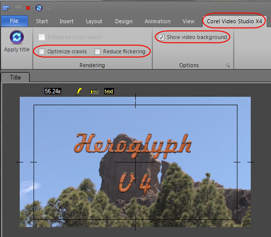

1. **Optimize Roller titles**, prevents unwanted flicker effects on the edges of Roller titles
2. Reduce **Flicker**, avoids stark contrasts and reduces flicker effects
3. **Video background** allows you to display the video/frame in the video editing software which hosts Heroglyph as a Plugin

***Please note:***\
*To check which version of your editing software is supported, refer to the Heroglyph section at* ***www.prodad.com****.*

For information purposes and for the sake of completeness, the following plug-in descriptions include all potentially available plug-ins. Your licence may not include the use of a particular plug-in, in which case you will not be able to use that plug-in.\
Even if the description refers to use of the standalone version, this does not mean that the plug-in is covered by your licence.

### Heroglyph stand-alone

Starting the independent version of the program:

Click on the **Heroglyph icon** on your **desktop** by double-clicking

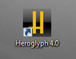

or via the Windows **start menu / Programs / proDAD / Heroglyph 4.0**

Heroglyph now initializes the Wizard (Quickstart Assistent).

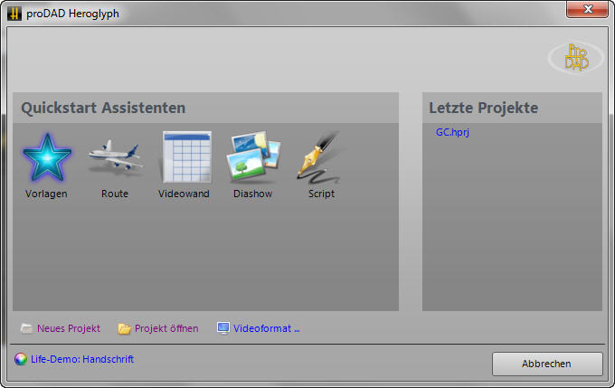

### Adobe After Effects

**This is what you do:**

1. Go to the **Effects and Presets**.
2. Click the **proDAD** directory to open it.
3. Click the item **Heroglyph Filter** and drag it onto the required clip in the timeline.

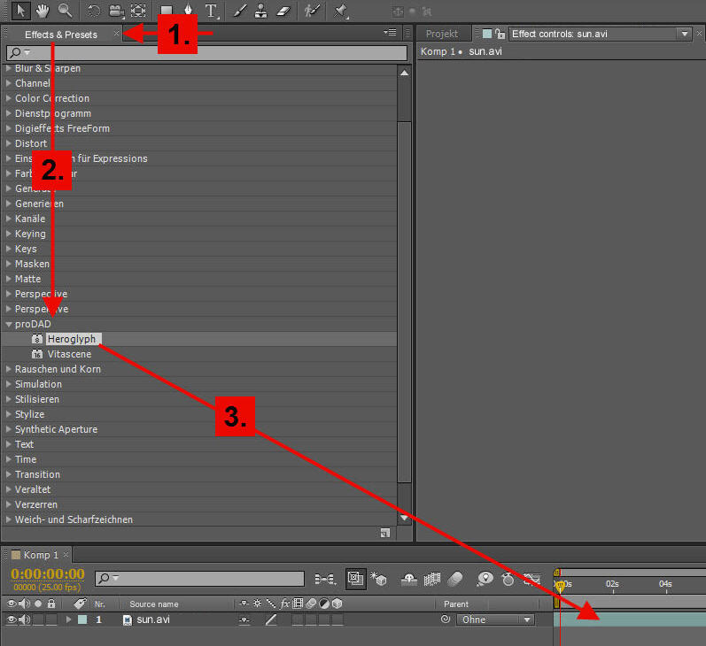

4. The Heroglyph Wizard starts. Now you can create a project in Heroglyph V4.
5. Once the project has been edited and completed in Heroglyph, simply press the **F12 key** to return to After Effects. Or use the **Heroglyph Title** option.

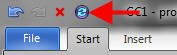

This will automatically save the Heroglyph project.

6. To reinitialize Heroglyph, click on the **Edit Effect...** entry in **After Effects-settings**.

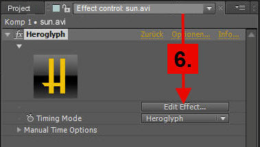

### Adobe Premiere

Heroglyph is available as **Filter** and **Title-Plugin**.

1. **This is what you do (using as filter):**
1. Go to the **Effects**.
2. Go to the **video filters**.
3. Click the **proDAD** directory to open it. Click the item **Heroglyph Filter** and drag it onto the required clip in the timeline.

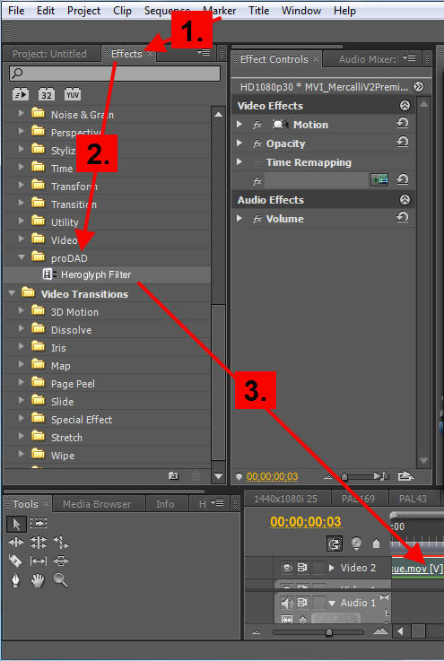

4. The Heroglyph Wizard starts. Now you can create a project in Heroglyph V4.
5. Once the project has been edited and completed in Heroglyph, simply press the **F12 key** to return to Premiere. Or use the **Heroglyph Title** option.

This will automatically save the Heroglyph project.

6. If you want to start **Heroglyph Filter** again, go to the **Effect Controls/Heroglyph Filter r**egister and click the **Setup-Button**.

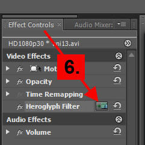

2. **This is what you do (using as titler):**
1. Go to the **File/New**.
2. Click the item **Heroglyph Title...**.

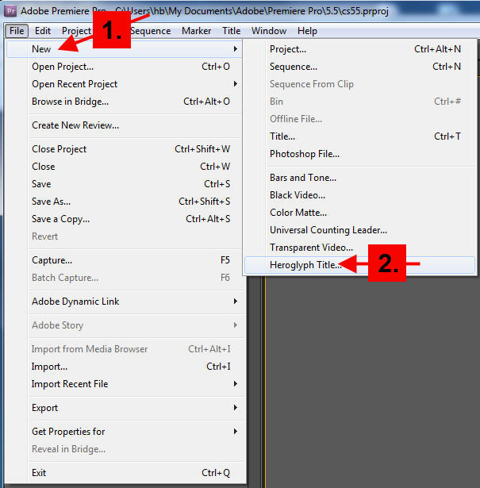

3. The Heroglyph Wizard starts. Create a project in Heroglyph V4.
4. Once the project has been edited and completed in Heroglyph, simply press the **F12 key** to return to Premiere. Or use the **Heroglyph Title** option.

This will automatically save the Heroglyph project.

### Adobe Premiere Elements

**This is what you do:**

1. Locate the **Effects**.
2. Select the **proDAD** directory.
3. Click the item **Heroglyph Filter** and drag it onto the required clip in the timeline.

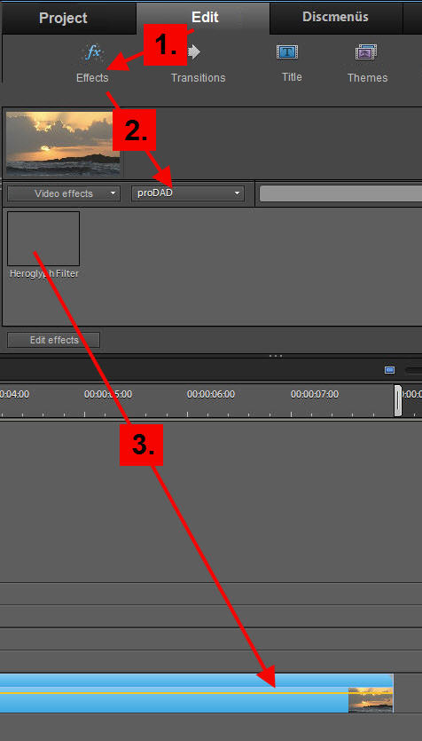

4. The Heroglyph Wizard starts. Now you can create a project in Heroglyph V4.
5. Once the project has been edited and completed in Heroglyph, simply press the **F12 key** to return to Premiere Elements. Or use the **Heroglyph Title** option.

This will automatically save the Heroglyph project.

***Note:***\
*If you want to delete the Heroglyph effect, right-click* ***Heroglyph Filter*** *and choose the* ***Delete*** *option.*

### Avid Media Composer

1. Start **Media Composer**. Open the **proDAD** directory which you will find in the Media Composer effect dialog.
2. Now drag and drop the **Heroglyph Filter** into the Timeline

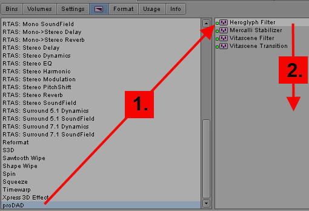

and click on the **Edit Effect** option (**Effect Editor / Heroglyph Filter**).

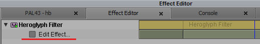

3. The Heroglyph Wizard starts. Now you can create a project in Heroglyph V4.
4. Once the project has been edited and completed in Heroglyph, simply press the **F12 key** to return to Media Composer. Or use the **Heroglyph Title** option.

This will automatically save the Heroglyph project.

### Avid Studio

**This is what you do:**

1. Locate **Effects/proDAD** and there the **Heroglyph** directory, open it.
2. Hold down your left mouse button and drag the **Heroglyph** entry onto the selected videoclip in the timeline.
3. The effect will be depicted as a **magenta-colored line** in the clip. Double-click to open it.

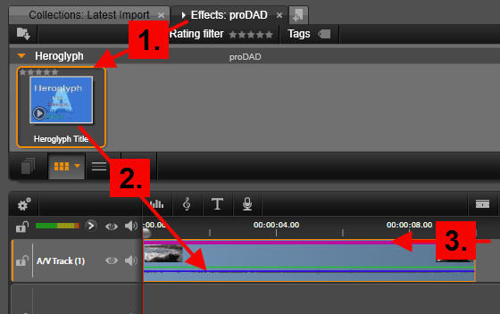

4. A new dialog opens with the **Effects** register activated.
5. On the right appears the selected **Heroglyph** effect, click on the **Edit** button.

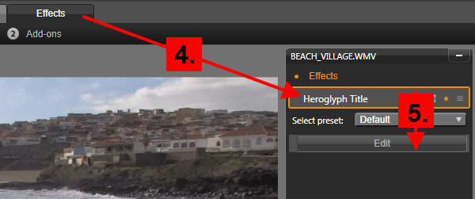

6. The Heroglyph Wizard starts. Now you can create a project in Heroglyph V4.
7. Once the project has been edited and completed in Heroglyph, simply press the **F12 key** to return to Avid Studio. Or use the **Heroglyph Title** option.

This will automatically save the Heroglyph project.

8. Click **OK** to confirm the Heroglyph effect in the **Effects** register. The effect will be applied in the timeline.

***Note:***\
*If you want to delete* ***Heroglyph*** *as an effect from the clip, right-click the* ***magenta-colored line*** in the clip and choose the ***Effect/Delete/Heroglyph*** option.

### Corel

**This is what you do:**

1. Locate the **FX**.
2. Activate your clip in the timeline by **double-clicking** it.
3. In FX, click **proDAD**.
4. Drag the **Heroglyph Title** entry to the selected video clip (via drag & drop) in the Corel Video Studio timeline.
5. Now click on the **Customize Filter** button.

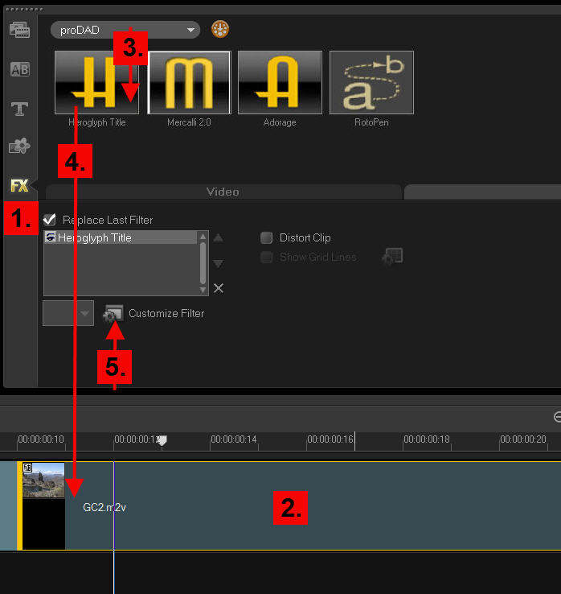

6. The Heroglyph Wizard starts. Now you can create a project in Heroglyph V4.
7. Once the project has been edited and completed in Heroglyph, simply press the **F12 key** to return to Corel. Or use the **Heroglyph Title** option

This will automatically save the Heroglyph project.

8. If you want to start **Heroglyph Title** again, activate the clip again (double-click), go to **FX / proDAD / Heroglyph Title** and click the **Customize Filter** button.

***Note:***\
*If you want to delete the Heroglyph title from the clip, go to* ***FX / proDAD / Heroglyph Title*** *and click the button* ***Delete filter (X)****.*

### Grass Valley EDIUS/NEO

Heroglyph is available as **Filter** and **Title-Plugin**.

1. **This is what you do (using as filter):**
1. Go to the **video filters (Effects)**.
2. Click on the **proDAD** folder.
3. Click the item **Heroglyph Filter** in the folder and drag it onto the required clip in the EDIUS/NEO timeline.
4. To start **Heroglyph**, double-click the item **Heroglyph Filter** in the **information panel**.

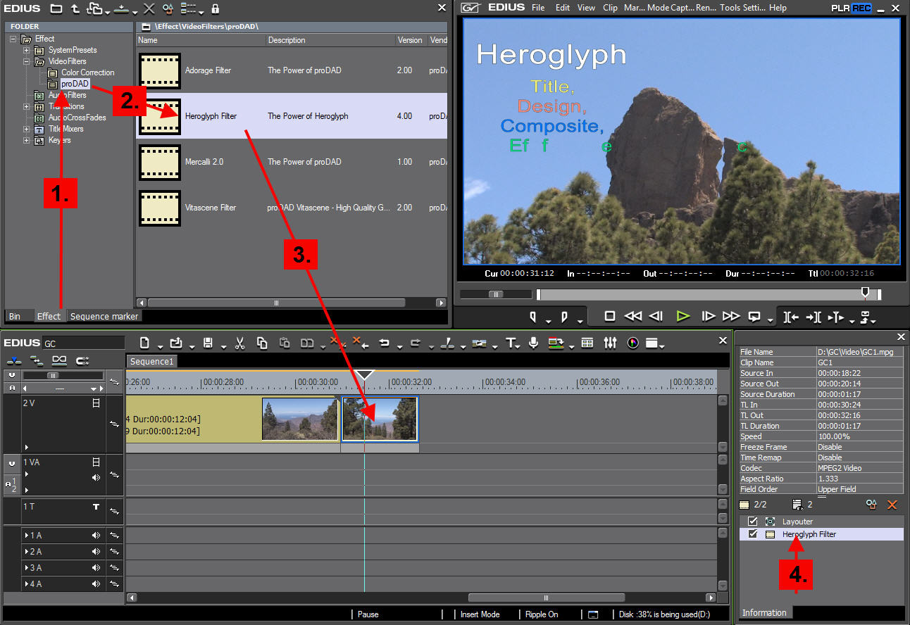

5. The Heroglyph Wizard starts. Now you can create a project in Heroglyph V4.
6. Once the project has been edited and completed in Heroglyph, simply press the **F12 key** to return to EDIUS/NEO. Or use the **Heroglyph Title** option

This will automatically save the Heroglyph project.

2. **This is what you do (using as titler):**
1. Locate the **T-Symbol** above the timeline and click on it.
2. Click on the **Heroglyph Titler** option .

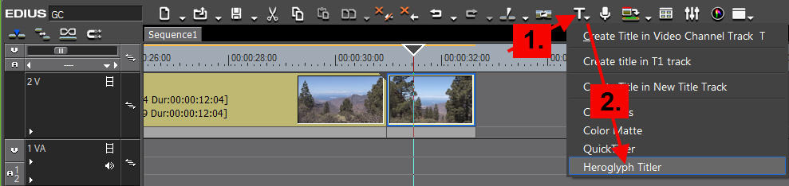

3. The Heroglyph Wizard starts. Now you can create a project in Heroglyph V4.
4. Once the project has been edited and completed in Heroglyph, simply press the **F12 key** to return to EDIUS/NEO. Or use the **Heroglyph Title** option

This will automatically save the Heroglyph project.

### MAGIX

**This is what you do:**

1. Start **MAGIX Movie Edit Pro** and go to the **Title** register.
2. After opening the **Title** register, you will find the **proDAD Heroglyph**. Click on **proDAD Heroglyph**.

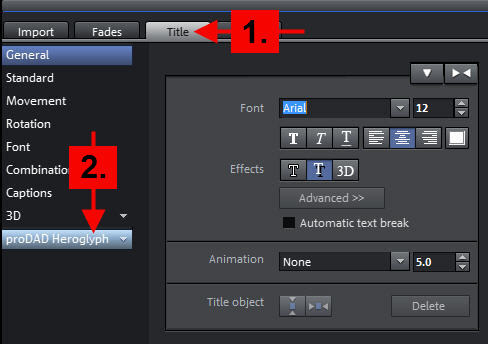

3. The Heroglyph Wizard starts. Now you can create a project in Heroglyph V4.
4. Once the project has been edited and completed in Heroglyph, simply press the **F12 key** to return to MAGIX. Or use the **Heroglyph Title** option.

This will automatically save the Heroglyph project.

### Pinnacle Studio

**This is what you do:**

1. Open the **video toolbox** in Studio.
2. Open the list of **video effects**.
3. Click the item **proDAD**.
4. Click **Heroglyph**.
5. To assign the plug-in, click **OK**. The following button appears:

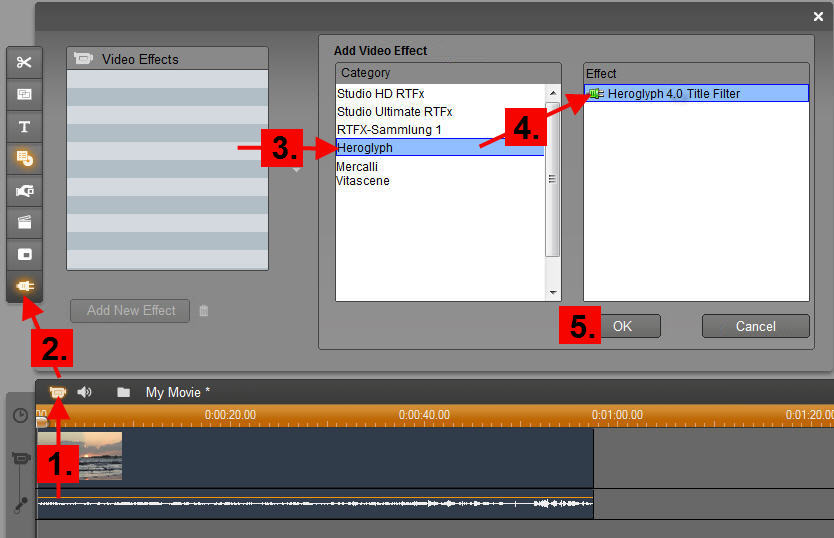

To start Heroglyph, click **Edit Heroglyph filter**.

6. The Heroglyph Wizard starts. Now you can create a project in Heroglyph V4.
7. Once the project has been edited and completed in Heroglyph, simply press the **F12 key** to return to Pinnacle Studio. Or use the **Heroglyph Title** option.

This will automatically save the Heroglyph project.

### Sony Vegas Pro

**This is what you do:**

1. Go to the library **Media Generators** (folder 3rd party).
2. Click the item **proDAD Heroglyph Titler** and drag it onto the required clip in the timeline.
3. Now **proDAD Heroglyph** will be inserted in the **Media Generators** dialog as well as in the **timeline object**.
4. Click the **Edit ...** button.

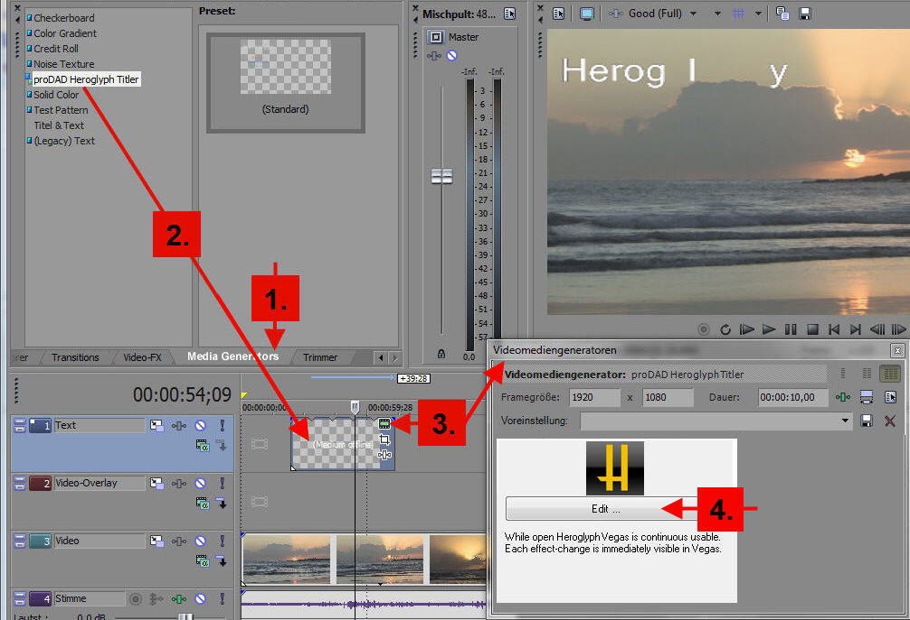

5. The Heroglyph Wizard starts. Now you can create a project in Heroglyph V4.
6. Once the project has been edited and completed in Heroglyph, simply press the **F12 key** to return to Vegas. Or use the **Heroglyph Title** option

This will automatically save the Heroglyph project.

### Sony Movie Studio Platinum

**This is what you do:**

1. Go to the library **Media Generators**.
2. Click the item **proDAD Heroglyph Titler** and drag it onto the required clip in the timeline.
3. **proDAD Heroglyph will be inserted** in the **Media Generators** dialog as well as in the **Timeline object**.
4. Click the **Edit ...** button.

5. The Heroglyph Wizard starts. Now you can create a project in Heroglyph V4.
6. Once the project has been edited and completed in Heroglyph, simply press the **F12 key** to return to Vegas. Or use the **Heroglyph Title** option.

This will automatically save the Heroglyph project.

## Workshops for familiarization

Here you can find some applications in a step-by-step guide.\
Working through these examples takes approx. 60 minutes. Afterwards, you will know how to carry out projects with Heroglyph and realize your own ideas. If you work through the examples you will save time later when *exploring* the logic and application.

**Have fun getting to know the program!**

### The Creation of a Slideshow

In this **Workshop** we explain how to create a **Slideshow** and to realize some modifications, such as the insertion of a **Background image**, replacing the **Mask** of picture elements and changing the Text of the image title.

Start Heroglyph. The **Wizard** appears.

Click the **Slideshow** option in the wizard to start the **Arrange pictures and videos** dialog.

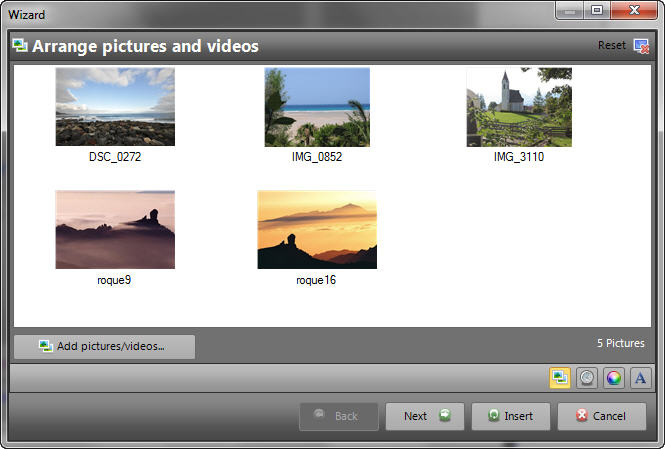

For further details on Creation of a slideshow in the **Wizard** click here.\
After finishing the creation, the slideshow starts in the Heroglyph user interface. The **Slideshow** (duration: 29 Seconds) will be inserted in the preview. The project will be inserted in the Timeline.

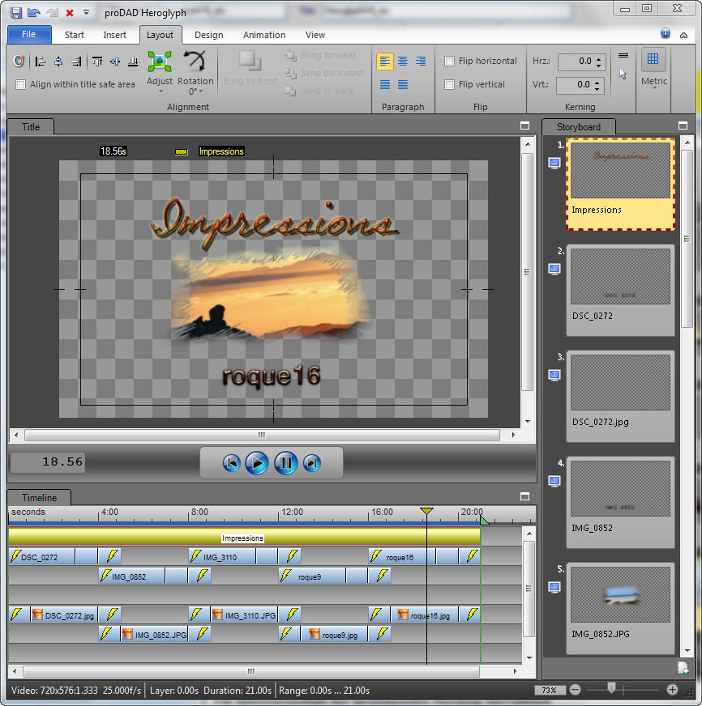

1. **Insert a Backgroundimage in an existing Slideshow**

***Note:***\
*In case that you are using Heroglyph as a Plugin in a video or an image in a Video-editing* *software, there is already a background available.*

Firstly, add a new **Timeline object** to the Timeline via right-click on **New/New Timeline object**.\
Then adapt the Timeline object to the **duration** of the project. In order to do so, go to the **Animation/Duration** register

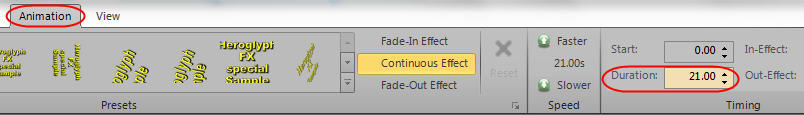

and shift the new Timeline object to the lowermost track in the Timeline.

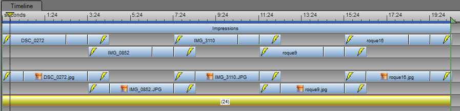

***Note:***\
*Make sure that the new Timeline object is selected (yellow).*

Now insert an **image**, open **My Computer** and adopt the image **via Drag & Drop** in the preview. Then adjust the **Size** of the image in the preview.

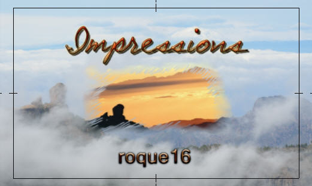

The basic background setting is finished. Now you can add a **Continuous Effect** to the image. If you use a **Zoom effect**, for instance, you will achieve a slow movement of the background image which will make it appear more dynamic.

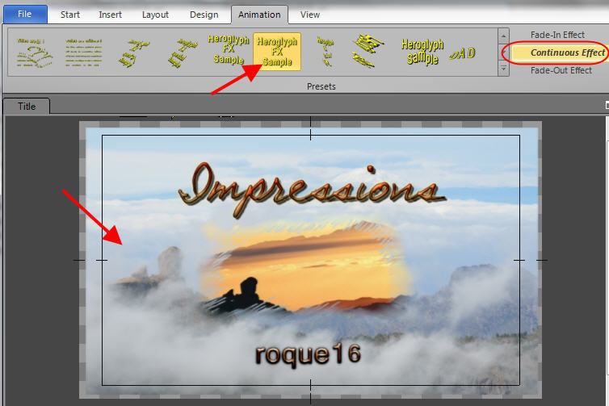

2. **Replace Mask and Image element** in your slideshow (it turns yellow in the Timeline). Then go to the **Graphic options** register. Here you can choose a **Preset (1.)**, a **Mask preview (2.)** will be seen. You will also see the new mask in the **Heroglyph preview (3.)**. It will be adopted via a mouseclick. You can add more masks to the selected image via the **Mask (4.)** option.

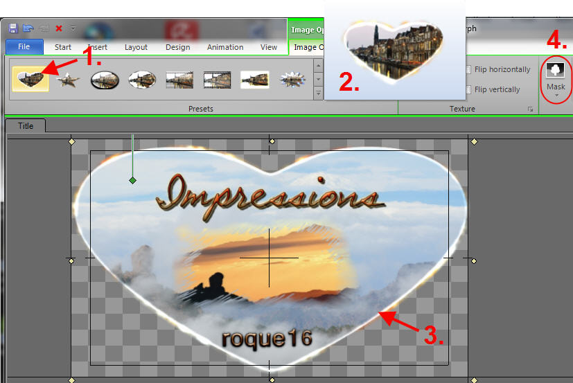

The **Style** option allows you to set a new **Mask** design.

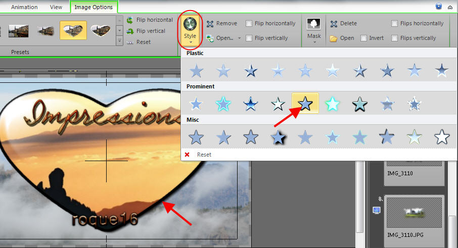

3. **Replace the Text of an Image Title**\
  If you would like to modify the text of a displayed image, select the **Text element** of the image in the Timeline, select it via double-click on the text in the preview and enter the new text via keyboard.

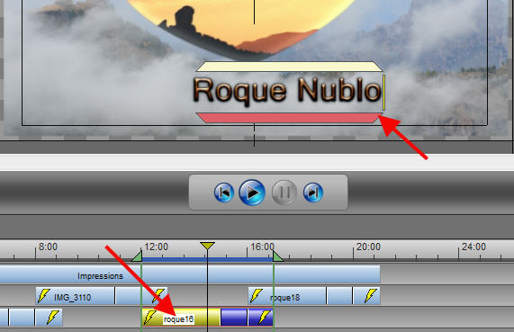

You can change the name of images afterwards, if necessary. A further option is the replacement of available **Effects** (In/Continuous/Out-Effect) of pictures and texts of available Slideshow elements. The effects will be replaced in the **Animation** register.

***Note:***\
*It is essential to select the part/sequence you would like to modify in the picture or in the text in* *the Timeline.*

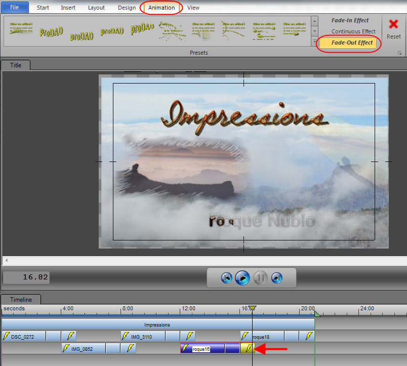

You can also modify the position of the **Title of the Slideshow**. In order to do so, select the **Text element** in the Timeline, click on the text in the **preview** to select it, then shift it to a new position.

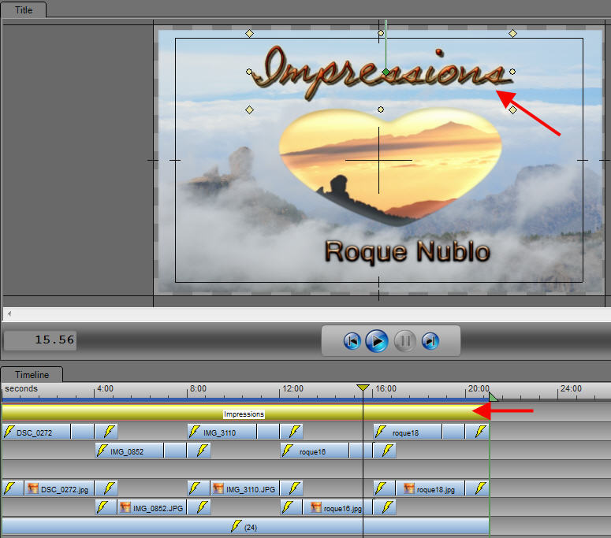

Now start the **Playback** in the Preview.

### Creation of a 3x3 Videowall with Effects and Design

In this **Workshop** we explain how to create a **3x3 Videowall** with effects and an own design. Then we add a Title in automatic Script and a new background.

Click on the **Videowall** option in the Wizard.

The **Presets** dialog starts. Choose, for instance, the **Hearths 3:3** preset in the **Stocks** category.

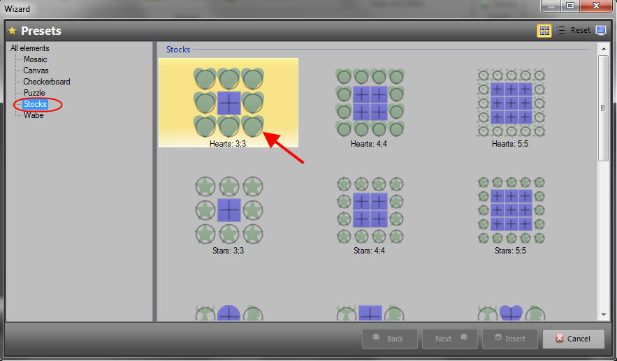

Click here for more details on the **Creation of a Videowall in the Wizard**.\
When the creation is completed, the **Videowall** starts in the Heroglyph user interface. The **Videowall** (duration: 10 Seconds) will be inserted in the preview. The project will be inserted in the Timeline.

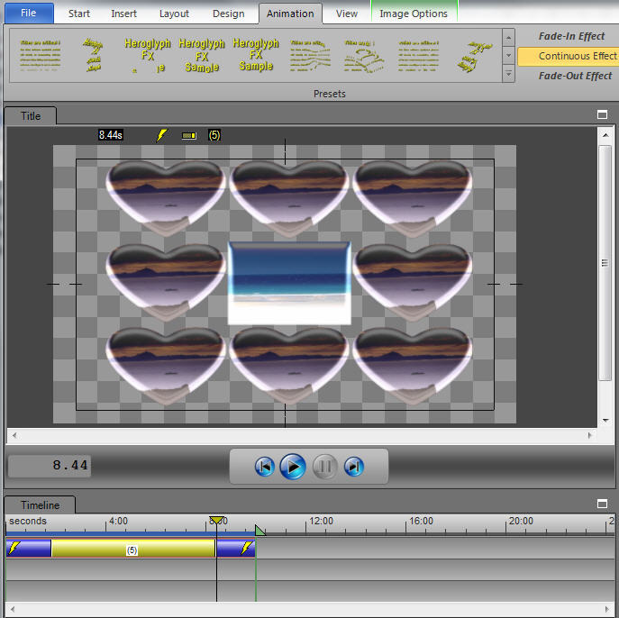

1. **How to add a Background image to the existing Videowall**

***Note:***\
*In case that you are using Heroglyph as a Plugin in a video or an image in a Video-editing* *software, there is already a background available.*

Firstly, add a new **Timeline object** to the Timeline. In order to do so, go to the **Insert** register and click on **Insert element**.\
The **Choose Template** dialog starts. Select the **Graphics layer** option in the **Timeline** area.

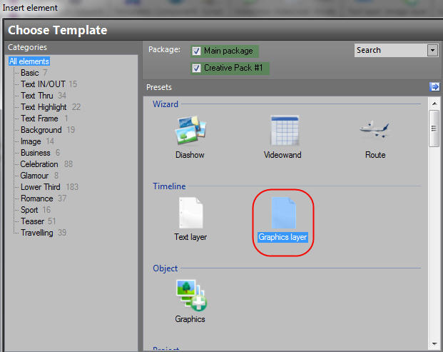

A Timeline object will be inserted. Adapt it to the **Duration** of the project. In order to do so, go to the **Animation/Duration** register

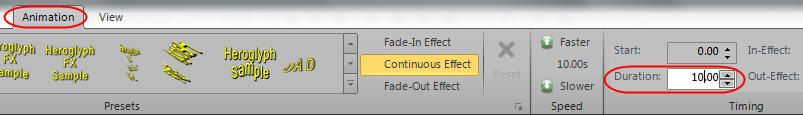

and shift the new Timeline object to the lowermost track in the Timeline. Leave one track blank for the following text.

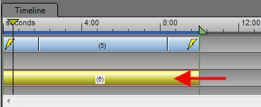

***Note:***\
*Make sure that the new Timeline object is selected (yellow).*

Now insert an **image**, open **My Computer** and adopt it **via Drag & Drop** in the preview. Then adapt the **Size** of the image in the preview.

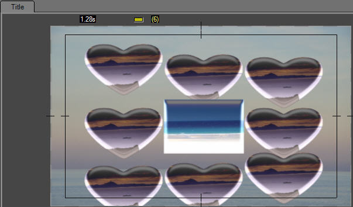

The creation of the background is completed.

2. **Minimization and Positioning of the Videowall in the Preview**\
  Select the Timeline object in the Timeline and click on the Videowall in the preview to select it. Go to the **Layout (1.)** register Now move the cursor to a **corner (2.)** and minimize the videowall with the left mouse button pressed. Then position the videowall in the center via **Aligns objects to center** option **(3.)**.

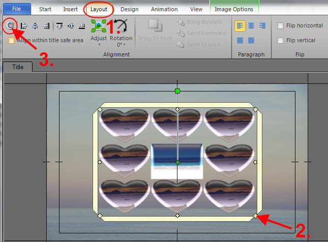

3. **Insert Text with Script**\
  First of all, go to the **Insert** register and click on the **Component** option. The **Choose Template** dialog starts. Click on the **Script IN/OUT (1.)** option. Select a Script template of **your choice (2.)** on the right.

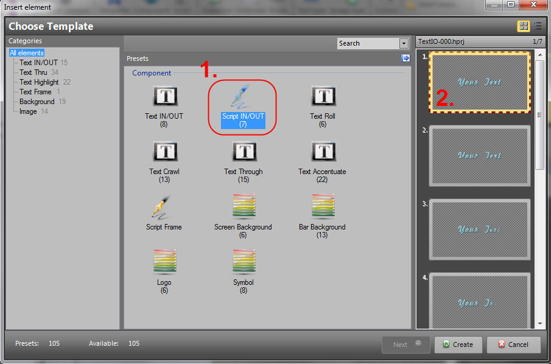

Click on **Create**. The dialog **Script IN/OUT** appears. Firstly, enter a **Text (1.)**, then set a **Style (2.)** and define the **Text size (3.)**. The **Duration (4.)** should be inaccordance with thee duration of the project (choose, for instance, 10 Seconds). Then start a **Playback (5.)**. The automatic Script contains a **Script effect**, i.e. the text appears as if it were handwritten.

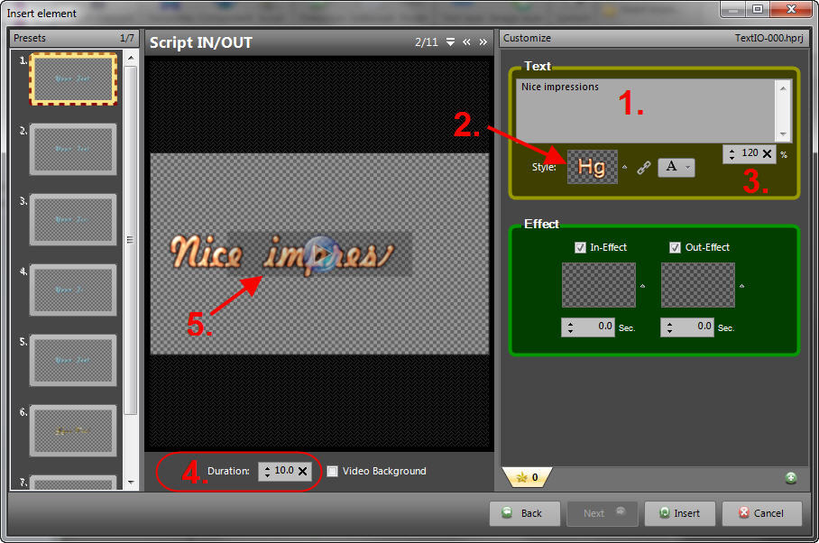

Click on **Insert** to adopt the Script.\
Now the Timeline needs to be rearranged, i.e. the plane containing the **Script** ought to be arrange on top of the other planes. This is done in the **Storyboard**. Before you do that, place the new Timeline object with the Script between the two existing Timeline objects. Then shift the Timeline objects in the **Storyboard/Layers** in the following manner. The new arrangement appears immediately in the preview.

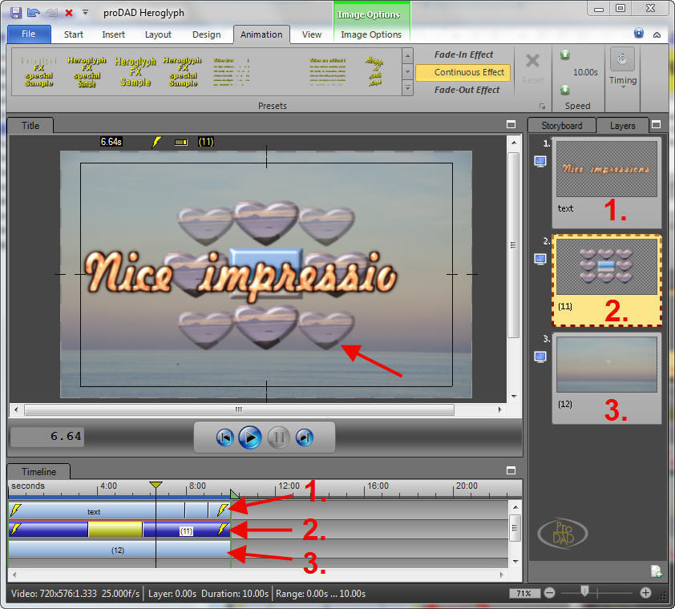

Now it is necessary to position the **Script** at the top edge of the screen. Maybe it is necessary to shift the **Videowall** downward.

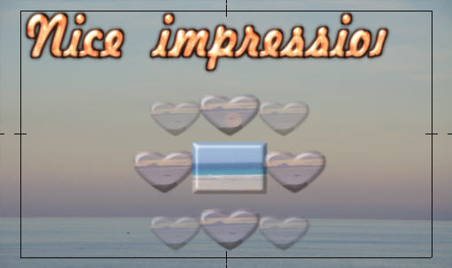

Finally add a **Continuous Effect** to the Videowall. Currently, there is only a IN/OUT-Effect available in the Videowall. Select the centre **Part (1.) of the Videowall** (Timeline object) in the Timeline. Then go to the **Animation (2.)** register and choose a **Continuous Effect (3.)**. The effect appears immediately in the **Preview (4.)**.

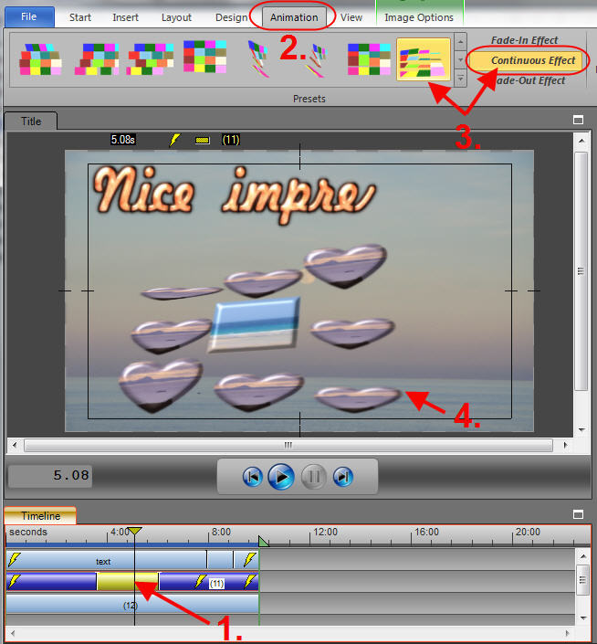

Now start the **Playback** in the Preview.

### Creation of Routes with Object on own Map

In this **Workshop** we explain how to create a **Route animation with 2 Routes**, both including an **Object** on a map. 2 images (or clips) will be inserted in the route. Finally. we will apply effects on the route.

The **Route** Wizard allows you to create an animated Route (or several routes) on a map. Click on the **Route** Option in the **Wizard**.

The **Insert map** dialog starts.\
First of all, import a map (e.g. from Google Maps) via the **Open Background Image**.

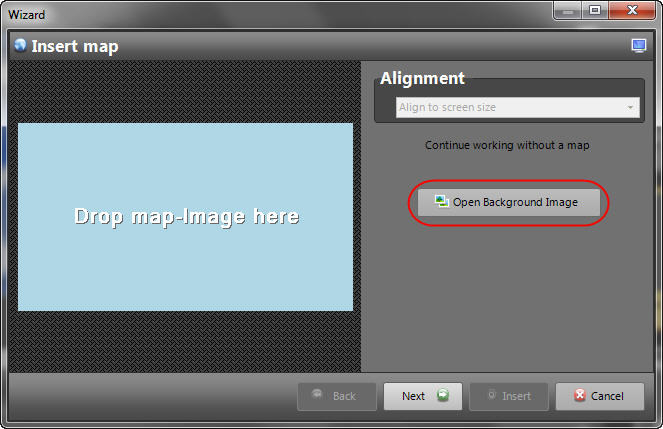

***Note:***\
*As an alternative, you can adopt a map directly from the* ***My Computer*** *via Drag & Drop.*

The map will be inserted.

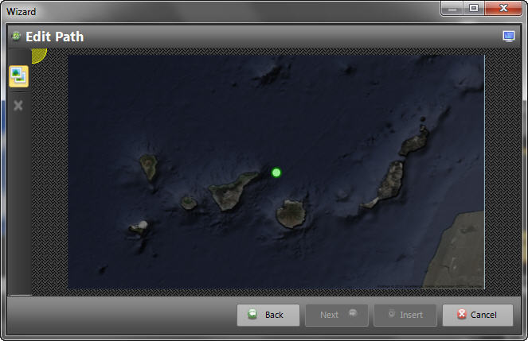

Now draw a route. Move the cursor to the position where you would like to start the route. Then draw the **Route Path (1)**. The **button (2.)** allows you to switch on the **Live Preview (3.).**

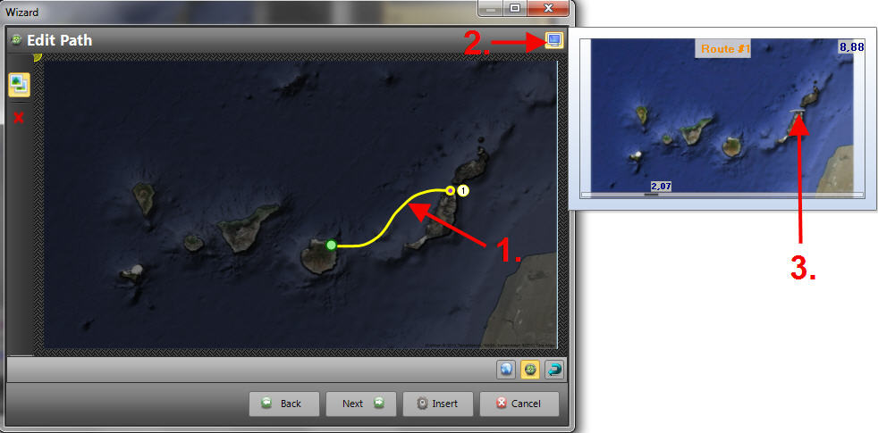

Now insert **another Route**. In order to do so, move the cursor with the **yellow point** to a new Starting position and draw the second Route.

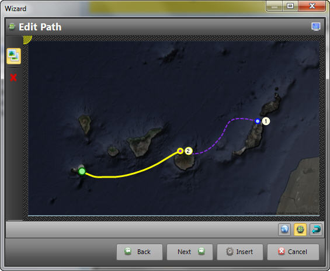

The creation of the paths is completed. Now click on the **Next** option so as to add **objects**, a design as well as **effects** to the route.\
Click here to find out how to do that.

After the creation of the route is completed, the Heroglyph user interface starts. The **Route** (duration: 11 Seconds) will be inserted in the preview. The project will be inserted in the Timeline.

Perhaps it is necessary to smooth or round **the two paths**. Thus the object moves more smoothly on the designed path. The corresponding adjustments are set in the route options register. Open the **Smooth** option and choose **Path rounding** or **Path smoothing**. Before doing so, make sure that the right path is selected in the Timeline.

Now we emphasize the **Thickness of the Paths**. In order to do so, select the **Thickness (1.)** option and choose **5.0**. In the second path we choose addionally a **dotted Design (2.)**. The change appears immediately in the **preview (3.)**.

Now insert another **Timeline object** in the Timeline. In order to do so, go to the **Insert** register and click on the **Insert element** option to start the **Choose Template** dialog. Select the **Graphics layer** option in the **Timeline** area.

***Note:***\
*Make sure that the new Timeline object is selected (yellow).*

Now insert an **Image**, open **My Computer** and apply it **via Drag & Drop** in the Preview. Now align the **Size, Position** and the **Timing** in the **Path**.

Now add a **Fade-In and a Fade-Out effect**. In order to do so, go to the **Animation** register. Here you'll find **In-Effects** and **Out-Effects**. Choose an appropriate transition in the template dialog. The set the duration of the transition (**Fade-In and Fade-Out**) in the Timeline. Currently we can see the **Out-effect** in the preview.

Now add **another image** with effects to the second path. The procedure is the same.

Now add a **Shadow** to the Route objects as well as to the two images of the path. Select the objects in the timeline one by one and go to the **Design** register to choose a **Shadow preset** in the **Shadow** option. The **shadow** will be added to the image in the preview.

Now we can see a **Shadow** on every object and on every image.

Now insert a **title** in the **route**.\
Click on the **Component** option in the **Insert** register. The **Choose Template** dialog appears. Choose a **Preset**.

Click on **Create**. Firstly, enter a **Text (1.)**, then set **Style (2.)** and **Text Size (3.)**. The **Duration (4.)** should be in accordance with the duration of the project. Choose, for instance, 11 Seconds.

To apply the title click the **Insert** option.\
Now arrange the order of planes in the **Storyboard/Layers**, i.e. the title should be superimposed on the background (the map).\
Now align **Position** and **Size** of the title to avoid overlapping of elements in the Preview.

Finally, you can add more **In-/Out effects** to the title in the **Animation** register.\
Now start the **Playback** in Preview.

### Animate a Title in a Skyline Image (Working in different Layers)

In this **Workshop** we explain how to create an animtion on a Title (Scrolling Tex) in a skyline (working in different layers).

***Note:***\
*Use an appropriate Background image and cut out previously a skyscraper using a Editing* *Software (such as Adobe Photoshop or Gimp (free)). Make sure that the background of this* *graphic is transparent (save it as \*.tif-file with an Alpha-Key). In the workshop, the background* *(the complete skyline) merges with the graphic (skyscraper) and a scrolling text which will be* *animated and will be covered by the skyscraper.*

Create a new project in Heroglyph V4.\
First of all, import a background image including the complete skyline.\
Open **My Computer** and adopt it **via Drag & Drop** in Preview. Then adjust the **Size** of the image in the Preview.

Now insert a further **Timeline object** in the Timeline via right click **New/New Timeline object**. Open again **My Computer** and adopt the image including the cut-out skyscraper **via Drag & Drop** in the preview. Then adapt the **size** of the image to the preview.

Now arrange the order of the layers in the **Storyboard/Layers** to achieve that the cut-out skyscraper is superimposed on the background (skyline).\
Just interchange the layers in the **Storyboard**.

Then adjust the Timeline object in the Timeline - leave one track between the Timeline objects blank .

This is where you insert the title which is to be animated within the skyline. Click on the **Component** option in the **Insert** register. The **Choose Template** dialog appears. Select a **template** of your choice.

Click on **Create**. Firstly, enter a **Text (1.)**, Then establish a **Style (2.)** and set **Text size (3.)**. The **Duration (4.)** should be in accordance with the duration of the project (e.g. 5 Seconds).

Click the **Insert** option to adopt the title. Then shift the Timeline object including the new title between the two other Timeline objects in the Timeline. The title appears in the Preview. It is partly covered by the cut-out skyscraper.

Now start the **Playback** in the preview.\
If you like, you can add a new Total effect to the **title** in the **Animation** register.\
In order to do so, select the Timeline object in the Timeline and delete the available **In- / Out effect** via the **Reset** option. Then choose a new **Continuous effect** and magnify the Text in Preview.

Now start the **Playback** in the preview again. The title has a new route now.

Finally you can optimize (subsequently) the **Design of the Title surface**. Go to the **Design** register, choose a new Design as well as the effect **Glow**. The change appears immediately in the preview.

Now start the **Playback** in the preview.

### Trailer - Combine Templates in the Timeline (e.g. Teaser/News + Videowall + Ticker)

In this **Workshop** we explain how to create a **Trailer**. We will create a **News** Teaser template with as animated **Videowall** and a **Ticker**. By doing this, we combine 3 different templates in the Timeline.

Start Heroglyph and the **Wizard** appears.

Click the **Templates** option to start the **Choose Template** dialog. Choose, for instance, the **Teaser/News/1** template.

Click on **Create** to start the dialog which allows you to adjust the animation. Firstly, enter a **Text (1.)**. In this case, we don´t carry out modifications in the **Decoration (2.)** area. We will modify the settings afterwards directly in Heroglyph. All we will do here is change the **Duration (3.)** to 10 Seconds.

When the Animation is completed, click on **Insert** and it starts in the Heroglyph user interface. The **Animation** (duration: 10 Seconds) will be inserted in the preview. The project will be inserted in the Timeline.

Now add a new effect to the Text **Today**. In order to do so, go to the **Animation (1.)** register and delete the **Continuous Effect** which is currently available via **Reset**. Then add a new **Fade-In and Fade-Out effect (2.)**. Finally set the duration of the **effects** in the Timeline object **Text (3.)**, directly in the Timeline. Thus the modification of the **Text Animation** is completed.

Start the **Playback** in the preview.\
Now insert a Videowall in this Animation. In order to do so, go to the **Insert** register and select the **Videowall** option.

The **Presets** dialog starts. Choose, for instance, the **Classic 2:2** preset from the **Mosaic** category.

You can insert images images into the Videowall now. To do so, open **My Computer**, navigate to a directory where you have stored images and drag them one by one into the 4 tiles of the Videowall (via Drag & Drop).

Now go to the **Style (1.)** register to choose a **Videowall Design**.\
Then click on the **Box (2.)** to select a **Design** (Style). A menu containing a range of **Design templates (3.)** opens. Apply a Design via a simple mouseclick.

To determine the Animation go to the **Animation (1.)** register.\
Set the **Duration (2.)** of the Videowall Animation (e.g. 10 seconds.). Select also the **Without effect (3.)** option.

You will find further details about the **Creation of a Videowall in the Wizard** here. After the creation of the of the videowall click on **Insert** to start the videowall in the Heroglyph user interface. The **Videowall** (duration 10 seconds) will be inserted in the preview and the project will be inserted in the timeline.

The Videowall is situated outside the previously created Animation. Therefore it needs to be placed accurately in the **Image layer arrangement**.\
Shift the Timeline object **Videowall** underneath the existing Animation before you arrange the layers via **Storyboard/Layers (1.)**, in a way that the **Videowall (2.)** of the world map (background) will be superimposed. After that, minimize the Videowall in the **preview (3.)**.

Now go to the **Animation (1.)** register and add an **Fade-In- and Fade-Out effect (2.)** to the Videowall. Finally set the duration of the **Effects** in the Timeline object **Text (3.)**, directly in the Timeline.

Now start the **Playback** in the preview.\
Now insert a **Newsticker** into the Animation. In order to do so, go to the **Insert** register and choose the **Insert element** option to open the **Choose Template** dialog. Select a template here, e.g. **Lower Third/Ticker/1**.

Click on **Create** to open the dialog that allows you to set the **Ticker**. Firstly, enter a **Text (1.)**. Then change the **Duration (2.)** to 10 Seconds. The **Newsticker background** is to persist during the whole animation, therefore no **effect** will be used.

After completing the creation click on **Insert** and the Animation will be inserted into the Timeline, albeit behind the reviously created project.

Shift the Timeline object **Ticker** (consisting of 3 elements) underneath the existing Animation before you arrange the layers via **Storyboard/Layers**, in a way that the Ticker of the world map (background) will be superimposed.

***Note:***\
*Possibly it is necessary to add more tracks in the Timeline via* ***Rightclick*** *and* ***New/Insert*** ***empty timeline track****.*

Now start the **Playback** in the preview.

### Create Scripts

In this **Workshop** we explain how to create a **Script**. You will also learn how to insert a **Text background (Video)**, **position the Text** in the Preview and replace the **Text design**.

***Note:***\
*Bear in mind that you can only use proDAD Fonts for the creation of Scripts.*

Start Heroglyph. The **Wizard** appears.

Click on the **Script** option in the Wizard to start the **Choose Template** dialog. Select, for instance, the **Script IN/OUT/1** template.

Click on **Create**. The **Script** dialog appears. Firstly, enter a **Text (1.)**, Then determine a **Style**

**(2.)** and set **Text Size (3.)**. Set the **Duration (3.)** of 8 seconds.

After completing the creation, the script starts in the Heroglyph user interface. The **Script** (duration: 8 Seconds) will be inserted in the preview. The project will be inserted in the Timeline.

If you would like to modify the Script afterwards, go to the **Start/Line Script** register. Here you will find various **proDAD Fonts and Ornaments**.

1. **Add a Background Video**

***Note:***\
*In case that you are using Heroglyph as a Plugin in a video or an image in a Video-editing* *software, there is already a background available.*

Firstly, add a new **Timeline object** to the Timeline. In order to do so, go to the **Insert** register and click on the **Insert element** option to start the **Presets** dialog where you select the **Graphics layer** option in the **Timeline** area.

A Timeline object will be inserted, adapt it to the **duration** of your project. To do so, go to the **Animation/Timing** register and shift the new Timeline object to the lowermost track in the timeline.

***Note:***\
*Make sure that the new Timeline object is selected (yellow).*

Now insert a **Video** (e.g. in WMV Format), open **My Computer** and adopt it **via Drag & Drop** in the preview. Then adjust the **Size** of the Video in the preview.

The setting of the background is completed. You can now modify the position of the **Script**. Select the **Text element** in the Timeline, click the Text in the **preview** to select it and shift it to a new position. Finally, minimize the text slightly, move the cursor to corner marker and drag it with the left mouse button pressed until the text appears in the size of your choice.

You can also modify the **Text design**, if necessary. In order to do so, go to the **Design** register to select a new **design**

as well as a **Halo** effect. The change can be seen immediately in the preview.

Now start the **Playback** in the preview.

### Working with Components (Text Crawl, Text Roll and more Text Animations)

In this **Workshop** we explain how to create **different Text animations** (Components).

Text animations are often needed in a project, for instance as a **Text Crawl** in a Ticker, as **Text Roll** at the end of a film, **Scripts** or just as usual **animated Texts**. Heroglyph V4 offers a great number of templates. The use is very simple: Just select a **template**, enter a **Text** and choose a **Design**. The **Text animation** is already present in the templates.

1. **Choose and edit a Text Crawl template**

Start a new project in Heroglyph V4 and open the **Insert** register. Then click on the **Component** option to open the **Choose Template** dialog. Choose, for instance, the template **Text Crawl/8**.

and click on **Create**. Firstly, enter a **Text (1.)**, then set a **Style (2.)** and determine **Text Size (3.)**. Choose a **Duration (4.)** of 10 seconds. An **effect** (Continuous effect - Text as Crawling text) is already available in the Preset.

To adopt the template, click on the **Insert** option. The Crawl text appears in the Heroglyph preview and as Timeline object in the Timeline.

Now you can continue with the edition of the text, you can modify **Font** and **Size**, for instance. In order to do so, go to the **Start** register. You can see the change immediately in the **preview**.

Now start the **Playback** in the preview.

2. **Choose and edit a Text Roll template**

Start a new project in Heroglyph V4 and open the **Insert** register. Then click on the **Component** option to open the **Choose Template** dialog. Choose, for instance, the template **Text Roll/2**.

and click on **Create**. Firstly, enter a **Text (1.)**, then set a **Style (2.)** and determine **Text Size (3.)**. Choose a **Duration (4.)** of 10 seconds. An **effect** (Continuous effect - Text as rolling text) is already available in the Preset.

To adopt the template, click on the **Insert** option. The rolling text appears in the Heroglyph preview and as Timeline object in the Timeline.

Now you can continue with the edition of the text, you can, for instance, add a **Bevel** effect to the text **Design**. In order to do so, go to the **Design** register, click on the Bevel option and choose a template via mouseclick. You can see the change immediately in the **preview**.

Now start the **Playback** in the preview.

3. **Choose and edit a Script template**
4. **Choose and edit a usual animated text template**

Start a new project in Heroglyph V4 and open the **Insert** register. Then click on the **Component** option to open the **Choose Template** dialog. Choose, for instance, the template **Text Through/12**.

and click on **Create**. Firstly, enter a **Text (1.)**, then set a **Style (2.)** and determine **Text Size (3.)**. Choose a **Duration (4.)** of 10 seconds. An **effect** (Continuous effect) is already available in the Preset.

To adopt the template, click on the **Insert** option. The **Text Through effect** appears in the Heroglyph preview and as Timeline object in the Timeline.

Now you can continue with the edition of the text, you can, for instance, add an **Outline** to the **Design**. In order to do so, go to the **Design** register, click on the **Outline** option and select an appropriate template. You can see the change immediately in the **preview**.

Now start the **Playback** in the preview.

### Create and Edit Lower-Third via Wizard

In this **Workshop** we explain how to use and edit a **Lower Third**. Afterwards we'll insert a **Background image with Effect**.

Click the **Templates** option in the Wizard.

The **Templates** dialog starts. Choose, for instance, the **Ticker + Subline + Frame** template in the **Lower Third** Category. Click on the **Design** of your choice on the right.

Click on **Create**. This opens the dialog which allows you to set **Lower Thirds**. Firstly, enter a Text in the **Headline Text (1.)** area (bigger Crawl Text on the top). After that, you can either choose the preset **Text design** or choose, for instance a new Surface color via **Color (2.)** option. The **Continuous Effect (3.)** is already preset, the text runs through the screen from the right to the left. Then enter a **second Text (4.)** for the Subline (the text on the bottom). Here you can also choose a new **Surface color (5.)** if you would like to. The **Continuous Effect (6.)** is already preset, the text runs through the screen from the right to the left.

Finally you can determine whether the **Background (Bar)** of the Crawl Text is faded in or faded out. You can also adjust the **Duration** of the transition.

Click on **Insert** to apply the animation in the Heroglyph user interface.

First of all, insert a **new Timeline object** in the Timeline via rightclick on **New/New timeline object** and shift the new Timeline object to the lowermost track in the Timeline.

***Note:***\
*Make sure that the new Timeline object is selected (yellow).*

Now insert an **Image**, open **My Computer** and adopt it **via Drag & Drop** in the Preview. Then align the **Size** of the image in the Preview.

Now you can add a **Continuous Effect** (in the **Animation** register) to the image. If you use a **Zoom Effect**, for instance, the background image will be slightly animated and appears less static.

Now start the **Playback** in the Preview.

## Heroglyph V4 Quick Start Wizard

### Overview

After Heroglyph V4 is initialized, the **Quickstart-Start Wizard** appears.\
Here you decide which kind of project you would like to create.

- Templates (Title & Trailer)
- Route
- Videowall
- Slideshow
- Script

### The options New project and Open project

You can either create **new projects** or **open projects** that have been created earlier and carry on editing these projects.

**Recent Projects** will be displayed. You can start them directly.

### Video format settings

Click on the **Video format** option ...

to modify **Video format** settings.

***Note:***\
*Please check the format of the video material you are about to use or which you are about to* *export (after creating an animation). You can then select the format from the list on the left. You* *can compare the selected format with the other available formats in the display on the right.*

### Life-Demo

Click on the **Life-Handscript-Demo** option to start a demo project.

### The Wizards

After starting the software, Heroglyph provides various **Wizards**:

#### Templates

The Wizards (Assistant) **Templates** facilitate the creation of titles or trailers.

##### Choose Template

Click on the **Templates** option in the Assistant to start the **Insert element** dialog.

This dialog is divided into 4 areas:

1. Categories of templates (presets)
2. Presets
3. Preview of the different types of presets
4. Live-preview of the selected presets

Select, for instance in the Categorie **Teaser (1.)** the preset **Simple Frame (2.)**. The preset will be displayed on the right **(3.)** with **Live preview (4.)**. Then click **Create (5.)** to adopt the template.

Edit the preset...

##### Overview - Templates, Preview, Text, Styles and effects

Now you can edit the selected preset **Simple Frame**.

***Note:***\
*You will find the same setting options, whichever templates (presets) you select.*

1. **Display of available templates (Presets)** from the previously selected categorie
2. **Preview** of the preset with play function
3. You can enter a **text** in the **Customize** area, establish a **Text design**, select a **Text color** as well as **size** and **Effects (IN/OUT)** and **transition time**.
4. Establish **Duration** of the Animation and the use of **Video background** (on/off)
5. Insert **more Texts**

Select **Enter Text, Size and Style**

First of all, enter the text (e.g. Webshop) in the **Customize** area, then click on the **Box (1.)** to select a **Style**. A preview with a great number of **Style templates (2.)** opens. You can activate **more categories (3.)** of Style presets in the upper area. A **preview (4.)** of the selected Style appears.

In our example you can see presets from the category **Classic**. You adopt the Style by a simple mouseclick. It appears immediately in the Preview. You can also select a **Text size**.

You can also select a **color**.

**Add Fade In and Fade Out effect to the text and establish transition time**

First of all, establish the **Fade In time (1.)** in the **Customize** area. Then click on the **Box (2.)** to select an **IN effect**. A menu containing numerous **Effect templates (3.)** opens. Activate **more categories (4.)** of effect templates. In the screenshot below you can see presets from the category **Characters**. Adopt a templates via a simple mouseclick.

The same procedure allows you to establish the **Fade out time** and the **OUT Effect**.

***Note:***\
*It is not necessary to insert a transition. You can just as well create text animations without* *transitions. In this case it is not necessary to select an effect and transition time.*

**Insert more Texts**

Click the **+** option **(1.)** to insert another **Register (2.)**. If this register is activated, a new **Text (3.)** and Style can be inserted.

When you have finished, click on **Insert** to start the Heroglyph user interface.

#### Route

The **Route** wizard helps you create an animated route on a map.

##### Import a map and draw a path

Click on the wizard in the **Route** option to start the Open Background dialog.\
Here you can import a map (e.g. from Google Maps) via the **Open Background Image** option.

***Note:***\
*You can also apply a map from My computer via Drag & Drop.*

The map will be inserted.

Now you can draw a route. Move the cursor to a position from which you would like start the route. Then draw the **route (1)** with the left mouse button pressed. Then you can switch on a **Live preview (3.)** via the indicated **button (2.).**

Click on Next.

##### Path - Select a Style and Effects

The **Path** register opens, allowing you setting the **Style of the route** and **Effect settings**.

Click on the **Box (1.)** in the **Style** area to open the **Style** dialog which offers you many **Route-Style presets (2.)**. Just click on a style to apply it. It will be displayed immediately in the preview.

The **Auto Animate Path** option determines that the route is automatically drawn and animated. In case that this feature is activated, there will be no **Fade-IN** or **Fade-OUT effect** of the route adjustable.

Deactivate the **Auto Animate Path** option to select another **Fade-IN** and **Fade-OUT effect** with an adjustable **transition time**.

Now go to the Object register.

##### Object - Edit Travel Object, Add Animation and Effects

Click the **Box (1.)** in the **Edit travel object** area to select an object from the **Object presets (2.)** menu. There are **more categories (3.)** of object presets in the upper area. You can apply an object via a simple mouseclick. It will be displayed immediately in the preview.

You can also import your own **Objects (1.)**. Just select an object and set its **Size (2.)**.

In the **Travel object animation** area you can determine the movement of an object (e.g. on the route). Click the **Box (1.)** to select the Object-Animation. You will see a list with various **Animation presets (2.)**. If you move the cursor on a preset you will see a **Preview (3.)**, the preset will be applied on the object via a simple mouseclick.

Firstly. activate the **Use effect** option. Then you can select a **Fade-IN Effect and Fade-OUT Effect** for the travel object and adjust the **transition time**. Click on the **Box (1.)** in the **Fade-IN Effect** area to select the Fade-In effct. You will see a list with various **Effect presets (2.)**. Finally, choose a **Fade-In time (3.)**. The transition of your choice will be applied via a simple mouseclick. It will be immediately displayed in the preview.

Do the same for the application of the Fade-Out effect in the **Fade-Out Effect** area **(4.)**.

Now go to the Timing register.

##### Timing - Pause route and Travel speed

In the **Timing** register you define the time settings of the route.

For instance, you can determine a delay at start and hold at end in the route. You can also determine the travel speed of the route.

The Wizard has finished the creation of the **route**, the Heroglyph user interface starts.

#### Videowall

The **Videowall** wizard helps you create an animated Videowall from photographs/videos.

##### Choose Presets

Click the **Videowall** option in the Wizard. The **Presets** dialog starts.

This dialog is divided into 2 areas:

1. Presets
2. Videowall presets

Select, for instance, the **Classic 2:2 (2.)** preset in the **Mosaic (1.)** category.

Click on Next...

##### Texture - Add Image/Video

The **Video Wall options** dialog opens - the **Texture** register is activated.\
Now you can insert images in the Video Wall. To do so, open **My computer**, navigate to a directory where your images are stored and drag them one by one into the 4 tiles of the Videowall (via Drag & Drop).

You can also click on the **Add Image/Video** option .\
**Select a tile (1.)** in the Videowall. This allows you to set the Alignment (Tile, Block, Row and Column) of the images. In our example we use the **Tile (2)** alignment. The images are displayed completely in the Videowall. A **Live-Preview (3.**) is activated automatically after setting the alignment. The activated **Visible** option displays the selected image within the tile.

You can also adjust the **Alignment** of the Videowall here. Click on one of the options to activate a preview. Then you can set the Videowall alignment of your choice.

The activation of the **Align within title safe area** option allows you to position the Videowall within the title safe area in the preview.

Now go to the Style register.

##### Style - Design options

Go to the **Style (1.)** register to select a **Videowall Styles** (Design).\
Then click on the **Box (2.)** to select a **Style** from **Style presets (3.)** list.

The design will be applied via a simple mouseclick and will be displayed immediately in the **Live Preview**.

Now go to the Animation register.

##### Animation - Duration and Effects

In order to set the Animation, go to the **Animation (1.)** register.\
Fistly set the **Duration (2.)** for the Videowall Animation (e.g. 10 Seconds). In case that the **Without Effect (3.)** option is activated in the **Effect** area, no effect can be added to the Videowall.

Now you have **2 Video Wall Options** to add effects to the Videowall.

1. **Continuous effect (1.)**\
  Activate the Continuous effect via a mouseclick, then click on the **Box (2.)** to open the list with various **Effect presets (3.)**. Apply the effect of your choice via a simple mouseclick.

2. **Fade-In** and **Fade-Out effects**\
  Activate the IN/OUT effects via a mouseclick, then click on the **Fade-In** and **Fade-Out effects Box** to open the list with various **Effect presets**. Apply the effect of your choice via a simple mouseclick.

Finally you can set the **Transition time** (for the Fade-In and Fade-Out effect).

After you finish click on **Insert**. The Heroglyph user interface starts.

#### Slideshow

The **Slideshow** wizard allows you to create an animation based on image files.

##### Add pictures/videos... and Timing options

Click the **Slideshow** option in the Wizard to start the **Arrange pictures and videos** dialog.

Click on the **Add pictures/videos...** option to open My computer. Navigate to your images files and select those you would like to adopt in the Slideshow. To adopt the images, just click on **Open**.

***Note:***\
*You can also open* ***My computer****, then navigate to a directory where you have stored your* *images. Select the images (using the Ctrl button) and drag them into the Editor (via Drag &* *Drop).*

Now click the option **Next**.\
The **Timing options** dialog opens. Here you can set the **Duration to show picture** as well as **Picture transition**.

Now click the option Next...

##### Set Picture Style

The **Set Picture Style** dialog opens.

First, click on the **Picture border (1.)** Box to set a border for the images. The box offers you various **Mask presets (2.)**. Apply a style via a simple mouseclick.

You can also set a **Picture effect**. In order to do so, click on the **Picture effect (1.)** Box which offers you various **Effect presets (2.)**. Apply an effect via a simple mouseclick.

The **Adjust picture by** option allows you to minimize (images in high size) or enlarge the images. You can also adjust the **Size** of the images.

Now click on Next...

##### Titling options

The **Titling options** dialog opens.\
Activate, for instance, the **Slideshow title (1.)** option, enter a **Text (2.)**, select a **Text Style (3.)**, set a **Text Size (4.)** and check the text in the **Live Preview (5.)**.

Then edit the **Photo Text**. You can turn this option off, if necessary. Then there won't be any Photo Text on display.

***Note:***\
*The Photo Text refers to the image file title*.

Activate the **Picture titles (1.)** option, select a **Text Style (2.)**, set a **Text-Size (3.)** and check the edited text in the **Live Preview (4.)**.

The **Use text layer (1.)** option determines that the image and the text objects will be adopted separately in Heroglyph.\
If necessary, select an **Effect (2.)** to create an animation of the photo text and then set the **Duration (3.)** of the effect. You can see the photo text with the effect in the **Live Preview (4.)**.

After you finish click on **Insert**. The Heroglyph user interface starts.

#### Script

The **Script** wizard helps you create automatic Handwritings (Scripts).

##### Choose Template

Click on the **Script** option in the wizard to start the **Choose Template** dialog.

This dialog is divided into 4 areas:

1. Categories of templates (presets)
2. Presets
3. Preview of the different types of Presets
4. Live preview of the selected Presets

A Preset is applied via a simple mouseclick. To adopt the Template, click on Create.

##### Text Editing, Setting of Effects and Duration

Now you can edit the selected **Preset** in the **Insert element** dialog.

***Note:***\
*In case that you select another Preset, you will find the same setting options.*

1. **Display of the available Presets** from the previously selected category
2. **Preview** of the Preset with Play function
3. In the **Text** area, enter **Text**, set **Font Size** and select **Text Style**
4. In the **Effect** area you select **Effects (IN/OUT)** and set **Transition time**
5. Set **Duration** of the animation and use of **Video Background** (on/off)
6. Insert **More Texts**

First of all, enter the text (e.g. Heroglyph) in the **Customize/Text** area, then click on the **Box (1.)** to select a **Style.** This opens a register containing various **Style templates (2.)**. You can select **More Categories (3.)** of Style presets in the upper area. A **preview (4.)** of the selected Style appears.

In the example above, you can see Presets from the **Classic** Category. A **Style (1.)** is applied via a simple mouseclick. Now select a **Font Size (2.)**. It will be displayed immediately in the **Preview (3.)**. You can also select a **Color (4.)** as surface design.

**Add In-/Out effects to the Text and set Transition Time**

First of all, set Fade-In time in the **Effect** area **(1.)** (e.g. 1 Sec.), then click on the **Box (2.)** to select a **Fade-IN Effect**. This opens a **register** containing various **Effect presets (3.)**. You can open **more Categories (4.)** of Effect presets in the upper area. Currently you can see Presets from the **Characters** category. Adopt the effect via a simple mouseclick.

Follow the same steps to set **Fade-Out Time** and **Fade-OUT Effect**.

***Note:***\
*It is not necessary to insert a transition. You can just as well create text animations without* *transitions. In this case, it is not necessary to select an effect or a transition time.*

**Insert more Texts**

To do so, click on the **+ (1.)** option - a further **Register (2.)** will be inserted. Activate this register to add a new **Text (3.)** with design.

After you finish click on **Insert**. The Heroglyph user interface starts.

## Heroglyph V4

### Overview

1. Basic functions
2. The editing menus of Heroglyph V4:
- File
- Start
- Insert
- Layout
- Design
- Animation
- View
- Route Options (only available when creating a route/path)
- Image Options (only available when using a graphic file)
3. The Storyboard
4. The preview
5. Minimize/Maximize preview
6. Preview control
7. The Timeline

### Basic functions

On the upper left you will find the following **Basic functions** of Heroglyph V4:

1. Save current project
2. Undo last change
3. Redo last change
4. Delete selected objects
5. Customize Quick Access Toolbar

1. Save
2. Undo
3. Redo
4. Delete
5. Apply title (as Plugin only)
6. Show Below the Ribbon
7. Minimize the Ribbon

### Interactive preview

In the centre of **Heroglyph V4** you find the interactive **Preview (1.**). Any modification of the project will be displayed immediately. Heed the **Position indicator (2.)** in the Timeline. In the **Preview Control (3.)** you'll find options (Back to start, Play, Pause and to End).\
On the lower right in Heroglyph V4 you will find the slide control button which allows you to adjust the **Preview size (4.)**. On the lower left to the Preview you will find the **Time indicator (5.)** of the Position indicator of the project.

### The Storyboard

The Heroglyph V4 **Storyboard** is to the right of the **Preview**. All the timeline objects being used in the project are available there. Currently there are 2 objects.

The Storyboard is divided into 2 registers.

1. **Storyboard**\
  Here you arrange the Timeline objects in the Timeline in chronological order.
2. **Layer**\
  Via **Drag/Drop** (holding the right mouse button on an object) you can re-arrange the objects in the **storyboard**. At the same time the order of the objects in the timeline changes.

***Note:***\
*Heed the order of the timeline objects to avoid concealing objects unwantedly.*

You can **fade in/out** objects in the **Storyboard (1.)**. You can also **maximize the storyboard (2.).** The preview will then be hidden.

A right click on an object in the storyboard allows you to **delete** the object.

### The Timeline

In the lower area of Heroglyph V4 you will find the timeline. Here you arrange the timeline objects.

The **Position indicator (1.)** determines the current position in the project. The indicator can be shifted with the mouse. The preview will be automatically updated by shifting the indicator. There is also a **timeline (2.)** at your disposal (the duration of the current project is 8 seconds). The **blue line (which defines the work area)** is adjustable and serves for the selection of the duration of a project or a determined section of a project. Currently there are 3 **Timeline objects (3.)** available in the Timeline. The number of Timeline objects varies depending on the number of tracks you use in a project.

***Note:***\
*Heed the order of the timeline objects. The first timeline track (from above) constitutes the first* *plane in the editing order (e.g. a text object overlaying a background image in an underlying* *timeline track).*

You can change the order of the available timeline objects in the Storyboard via Drag & Drop.

The following **timeline options** are available via click on the **right mouse button within the timeline (void area)**:

1. **New/New timeline object**
2. **New/Duplicate (timeline object)**
3. **New/Insert empty timeline track**
4. **Paste (timeline object)**, available when an object has been copied previously
5. **Append project...**, insert a previously created and saved Heroglyph project behind the current object in the timeline
6. **Next** (go to the next timeline object)
7. **Previous** (go to the previous timeline object)
8. **Arrangement** (select compact timeline tracks and a timeline object per track)

More Timeline options **via right mouseclick on a Timeline object**:

1. **Cut**, cuts the currently selected Timeline-Object
2. **Copy**, copies the currently selected Timeline-Object
3. **Delete**, deletes the currently selected Timeline-Object
4. **Playback**, starts a Playback in the Preview
5. **Rename**, renames the currently selected Timeline-Object
5. **Show/hide**, shows/hides the currently selected Timeline-Object in the Preview
6. **Adjust locator**
7. **Effects** add, edit and deletes
8. **Arrangement**
9. **Move**, arranges Timeline objects in the order of priority

Details about the selected Videoformat and about the **Object-** and **Project duration** will be indicated underneath the Timeline.

### File

The **File** register is in the **Heroglyph V4** menu list.

#### New project / Open project / Save as...

The **File** register offers you the following options:

1. **New project**
2. **Open project...**
3. **Save as...** (saves or exports the current project as images file(s) or animation)
4. **About...** (Informations about Heroglyph)

#### Settings

The **Settings** dialog is started via the **Settings** option.

It offers you the following **Basic settings**:

1. **Customize view**, which allows you to adjust the user interface according to your preferences and to the caracteristics of your monitor.\
  First of all, the user can select between 3 pre-defined patterns and one free setting:
- **Automatic**: neutral editing area with slightly darkened borders and outer areas.
- **Black:** dark editing area with lighter borders and outer areas.
- **White:** light editing area with darker borders and outer areas.
- **freely configurable:** this is where the individual color adjustments can be carried out according to personal taste.

*This is what the different elements mean:*

- **Show overscan** indicates the title save area in the preview (when activated)
- **Background as Pattern** displays transparent areas as checkerboard pattern in the preview
2. **Format** indicates all the available Video formats. Select the Video format of your choice.

3. **Program/Search Path**\
  The global search paths are defined here. When loading a project the corresponding components, such as graphics or animations are searched for.\
  In principle, these components are not embedded in a project file. This has the advantage that the project file can be kept much more compact.

However, the disadvantage that comes up is that an uploaded graphic must always be stored in the location that is pointed at. This can create problems if you want to transfer the project to another PC, for example. However, this parameter eliminates the problem:

If a project is opened on another PC that has a different drive environment, the components only have to be located in one of the search paths selected here in order to be found.

You can create a search path by clicking **New**.

***Please note:*** *No sub-folders will be searched.*

4. **Program/Undo Historie**

Here you establish the number of tasks that you can **undo**.

5. **Program/Language**

Here you can define the user interface's language. The selected language is used while the program is running. It is not necessary to restart the software.

6. **Program/Backup**\
  Here you can define the **Number of backup generation** as well as the intervals of automatic **Recovery Save every** during your Heroglyph sessions.

### Start

The **Start** register is in the **Heroglyph V4** menu list. Here you will find the basic text editing functions.

#### Clipboard - Copy/Paste/Cut

Firstly, select a timeline object (yellow) and then choose the **Copy** option to copy the object in the timeline. Now the **Paste** option is also at your disposal. The **Cut** option deletes the selected timeline object.

***Note:***\
*No object can be inserted if there isn´t an object copied in the clipboard.*

#### Mode - Selector/Text/Path

1. **Mode - Selector**

In case that a **timeline object (1.)** is selected **in the timeline**, a click on the **Selector (2.)** option in the **Mode** area allows the selection of the **timeline-object (3.)** in the preview. The **object** can now be shifted in the preview or you can change its size.

2. **Modus - Text**

If there is a **text object (1.)** available in the timeline and selected, a click on the **Text** option **(2.)** in the **Mode** area selects the titeltext in the **preview (3.)**. Now you can edit the text.

3. **Mode - Path**

If there is a **text object (1.)** available in the timeline and selected, a click on the **Path** option **(2.)** in the **Mode** area establishes a keyframe in the **preview (3.)**. Now you can design a route from this point, holding the left mouse button pressed. The selected timeline object can be moved on this route. The **Starting point** can be shifted in the timeline.

#### Font settings & symbols

First select an object, e.g. a **text object** (yellow) in the timeline via mouseclick. The text will be selected in the **Preview**.

The following text editing options will be available in **Script**:

1. Select a font
2. Enlarge font size
3. Reduce font size
4. Format marked text **bold, Italic, with no fill**
5. Select a font colour
6. Removes design attributes only

**Select proDAD Symbol via Keystroke combinations**

You can insert **proDAD Fonts** and **Symbols/Ornaments**, which will be automatically designed. First of all, select **proDAD Ornaments**.

You can insert in your project the **proDAD Symbols/Ornaments** listed below via the following **Assignments of Keys**.

#### Font - Advanced design options

Click on ...

to open the **Advanced design options** dialog. Here you will find more **detail settings** on the **Bold** option.

#### Paragraph - Align text

The **Align Text** options allow you to **align text** when you use extented texts. The formats are known from word processors, such as Word.

1. Align text left
2. Center text
3. Align text right
4. Justify characters
5. Justify words

### Insert

The **Insert** register is in the **Heroglyph V4** menu list. You can enhance an existing project via the following options in the Heroglyph timeline.

#### Insert Element

Click the **Insert Element** option to start the **Choose Template** dialog. Here you will find various Templates to choose from.

This dialog is divided into four areas:

1. Categories of Templates
2. Choose Template
3. Display of **Templates Packages** as well as the **Search** option
4. Preview of the Templates, Display only after selecting a template

#### Templates

Click the **Templates** option to start the **Choose Template** dialog. Here you will find various Animation Templates to choose from.

This dialog is divided into four areas:

1. Categories of Templates
2. Choose Template
3. Selection of **Templates Package** as well as the **Search** option
4. Preview of the Templates

#### Component

Click the **Component** option to start the **Choose Template** dialog. Here you will find various Text Templates to choose from.

This dialog is divided into four areas:

1. Categories of Templates
2. Choose Template
3. Preview of the different types of Templates
4. Live Preview of a selected Text Template

#### Script

Click the **Script** option to start the **Choose Template** dialog. Here you will find various Script Templates to choose from.

This dialog is divided into four areas:

1. Categories of templates
2. Choose Template
3. Preview of the different types of Templates
4. Live Preview of a selected Template

#### Slideshow

Click the **Slideshow** option to start the **Arrange pictures and videos** dialog.

Click the **Add pictures/videos** option to open My Computer. Navigate to your images and select those you would like to place in the Slideshow. Click **Open** to adopt the images.

#### Videowall

Click the **Videowall** option to start the **Presets** dialog.

This dialog is divided into two areas:

1. Categories of presets
2. Videowall presets

Choose, for example, the template **Classic 2:2 (2.)** from the Categorie **Mosaic (1.)**.

#### Route

Click the **Route** option to start the **Insert map** dialog.

First of all, import a map of your choice (e.g. from Google Maps) by using the **Open Background Image** option.

The map will be inserted.

Further details on how to create a Route....

#### Timeline - Text layer

Click the **Text layer (1.)** option to insert a new text in the **Preview (2.)** as well as in the **Timeline (3.).**

The **Text** is at your disposal as a template (Text (2)), that is, without your own text, style and effect.

#### Timeline - Image layer

Click the **Image layer (1.)** option to start **My Computer**. Navigate to an image and open it. The image will then be inserted in the **Preview (2.)** as well as in the **Timeline (3.)**.

The image will appear in the center and can be edited. You can change, for instance, **Size** and **Position**.

#### Graphics - Symbol

Click **Symbol (1.)** option to start the dialog to choose different **Symbol-Forms (2.)**. You can select **more categories (3.)** of Symbol templates in the upper area.

The symbol appears in the **Preview (4.)**.

***Note:***\
*When you are inserting a* ***Symbol****, it is essential to select the Timeline Object in the Timeline* *(yellow), to make sure it will be inserted at the right place. If you want to insert only the symbol,* *click with the right mouse button in the Preview and select the* ***New/New Timeline-Object*** *option. The Symbol will be inserted in this new Timeline Object.*

You can also select **Symbols** that will be drawn automatically (like an automatic script).

#### Graphics - Insert graphic - Insert mask - Seperate elements

Click the **Insert graphic** option to start **My Computer**. Navigate to an image and open it. The photo will be inserted in the **Preview**.

Click the **Insert mask** option to start **My Computer**. Navigate to a mask file and open it. The mask will be inserted in the **Preview**.

***Note:***\
*When you are inserting a* ***Graphic/Mask****, it is essential to select the Timeline Object in the* *Timeline (yellow), to make sure it will be inserted at the right place. If you want to insert only the* *Graphic/Mask, click with the right mouse button in the Preview and select the* ***New/New*** ***Timeline-Object*** *option. The Graphik/Mask will be inserted in this new Timeline Object.*

**Seperate Elements**: Insert any content as seperate elements

### Layout

The **Layout** register is in the Menu list of **Heroglyph V4**. It lets you edit objects in the timeline and provides the following options.

#### Alignment - Align objects

When using the following **Alignment options**, make sure that a Timeline object (e.g. a text) is selected in the **Timeline** as well as in the **Preview**.

The first option lets you align a selected **Timeline object in the center** (Aligns objects to center).

It provides further **Alignment options**:

1. Align selected objects left 2. Horizontally aligns objects to center

3. Align selected objects tight 4. Align selected objects left on top

5. Vertically aligns objects to center 6. Align selected objects left on bottom border

The **Align within title safe area** option positions the text along the border.

#### Alignment - Align size and rotation

The **Adjust** option determines the **Size** of a selected object.

1. Scale to screen size

2. Scale to screen width

3. Scale to screen height

o\
The **Align within title safe area** option positions the text along the border. The **Maintain proportionality** option leaves the selected object in its original proportions.

The **Rotation** option lets you rotate the selected Timeline object. Move the mouse within the **Rotation Dialog** on the indicated **R** or use the available **Adjuster** to select the grade of rotation of the object. The modification will be shown immediately in the **Preview**.

#### Alignment - Align objects in layers

If the **timeline object** consists of a **text** and a **photograph**, the order of the elements can be determined by using the **Align Objects in Layers** option. This allows you to place the element or object of your choice in the foreground.

#### Paragraph - Align text

The **Align Text** options allow you to **align text** when you use extented texts. The formats are known from word processors, such as Word.

1. Align text left
2. Center text
3. Align text right
4. Justify characters
5. Justify words

#### Flip - Flip horizontal and Flip vertical

The **Flip** option lets you flip timeline objects (e.g. a text) in a **horizontal** and in a **vertical** sense.

1. flip horizontal 2. flip vertical

#### Kerning - Align Text horiz. and vert. - Kerning/Selector

You can adjust the Kerning in a horizontal and in a vertical sense by activating the **Selector (1.)**. It allows you to modify the **horizontal Kerning** and the space between the lines (**vertical Kerning**).

If you set a negative **Kerning Hrz. (2.)** value, the **horizontal Kerning (3.)** in the Preview will be reduced. If you set a positive value, the character spacing will increase.

If you set a negative **Kerning Vrt. (4.)** value, the **line spacing (5.)** in the Preview will be reduced. If you set a positive value, the line spacing will increase.

By activating the **Kerning (1.)** option, you can modify the character spacing of each character individually in a horizontal direction. All you need to do to move the charactars manually is drag the **blue vertical line (2.)**. You can adjust the lines manually in a vertical direction by moving the **horizontal blue line (3.)**.

#### Metric

In the **Metric** you can determine the following options for the selected timeline object:

1. Left/Right - Shift in the Preview
2. Setting of the Width
3. Top/Down - Shift in the Preview
4. Setting of the Height

#### Metric - Advanced design options

Click on ...

to open the **Advanced design options** dialog. Here you will find further **Metric** detail settings.

### Design

The **Design** register is in the **Heroglyph V4** menu list, offering the the following **Style** options for the timeline object.

The following options require that the **Timeline Object** is selected in the **Timeline** and in the **Preview**.

#### Select presets

Click the **Option (1.)** and various **Design presets (2.)** will be displayed. In the upper area you can activate more preset **categories (3.)**. The selected design will be applied on an object of your choice, e.g. a text or a route by a simple mouse click.

#### Presets - Advanced design options

Click ...

to open the **Advanced design options** dialog. Here you will find further **Detail settings** which are related to the **Surface** options.

#### Attributes - Opacity - Blur

The **Opacity** option allows you to apply transparency to an object (e.g. a **text)**. Move the mouse inside the **Opacity dialog** to one of the templates **B** or use the adjuster to select an opacity effect for your object. The change appears immediately in the **Preview**. In the screenshot below, the text appears more transparent.

The **Blur** option allows you to blur a selected object (e.g. a text). Move the mouse inside the **Blur dialog** to one of the templates **R** or use the adjuster to select a blur effect for your object. The change appears immediately in the **Preview**. In the screenshot below, the text appears blurred.

#### Attributes - Bold - Italic - Tube

The **Bold** option allows you to depict an object (e.g. a **text**) more bold. Move the mouse inside the **Bold dialog** on the templates **B** or use the adjuster to select a suitable Boldness for your object. The change appears immediately in the **Preview**. In the screenshot below, the text appears more bold.

The **Italic** option allows you to make a **Text** appear in italics. Move the mouse inside the **Italic dialog** on the templates **I** or use the adjuster to select a suitable Italics depiction for your text. The change appears immediately in the **Preview**. In the screenshot below, the text appears in italics.

The **Tube** option allows you to make a **Text** appear hollow. Move the mouse inside the **Tube dialog** on the templates **Q** or use the adjuster to select a suitable Tube depiction for your text. The change appears immediately in the **Preview**. In the screenshot below, the text appears hollow.

#### Options - Surface - Bevel - Outline

The following options allow you to modify the **Surface (design)** of a text or of a route.

1. **Color setting**\
  The **Surface** option allows you to modify the color of objects, e.g. the **text**. Move the mouse inside the **Surface dialog** to select a color for your object. The change appears immediately in the **Preview**. In the screenshot below, the text appears in blue.

You can also import pre-installed **Textures** or **Gradients** via the **Surface dialog**.\
By clicking **Reset** you can delete the selected **Color setting**.

You will get more **Color options** via **More options...**.

You can also import your own **graphics** via (load graphic...) and use them to create a new design.

2. **Bevel**\
  The **Bevel** option allows you to modify the design of objects, e.g. the **Text surface**. Move the mouse inside the **Bevel dialog** to select a template. The change appears immediately in the **Preview**.

By clicking **Reset** you can delete the selected **Bevel setting**. You will get more **Bevel options** via **More options...**.

3. **Outline**\
  The **Outline** option allows you to modify the design of objects, e.g. the **Text surface**. Move the mouse inside the **Outline dialog** to select a template. The change appears immediately in the **Preview**.

The **Color** option allows you to select a new Outline color. By clicking **Reset** you can delete the selected **Outline setting**.\
You will get more **Outline options** via **More options...**.

#### Options - Glow - Shadow

The following options allow you to redesign the **Surface (design)** of a text or of a route.

1. **Glow**\
  The **Glow** option allows you to give your **Text** a new layout. Move the mouse inside the **Glow dialog** on the templates to select a suitable Glow for your text. The change appears immediately in the **Preview**.

The **Glow** option allows you to give the **Text surface** a new layout. Move the mouse inside the **Glow dialog** on the templates. The change appears immediately in the **Preview**.

2. **Shadow**\
  The **Shadow** option allows you to give the **Text surface** a new layout. Move the mouse inside the **Shadow dialog** on the templates. The change appears immediately in the **Preview**.

By clicking **Reset** you can delete the selected **Shadow setting**. You will find more **Shadow options** via **More options...**.

#### Options - Depth - Halo

The following options allow you to modify the **Surface (design)** of a text or of a route.

1. **Depth**\
  The **Depth** option allows you to give the **Text surface** a new layout. Move the mouse inside the **Depth dialog** on the templates. The change appears immediately in the **Preview**.

The **Color** option allows you to select a new **Depth color**. By clicking **Reset** you can delete the selected **Depth setting**.\
You will get more **Depth options** via **More options...**.

1. **Halo**\
  The **Halo** option allows you to give an object (e.g. a **text surface**) a new layout. Move the mouse inside the **Halo dialog** on the templates. The change appears immediately in the **Preview**.

The **Color** option allows you to select a new **Halo color**. By clicking **Reset** you can delete the selected **setting**.\
You will get more **Halo options** via **More options...**.

### Animation

The **Animation** register is in the **Heroglyph V4** menu list, providing the following Animation options.

When using these options, please make sure that the **timeline object** is selected in the **Timeline** as well as in the **Preview**.

#### Select effect presets- Select Fade-In/Continuous/Fade-Out-Effects and reset

The effect presets are applied to the timeline object in **3 sections**.

1. Fade-In Effect
2. Continuous Effect
3. Fade Out Effect

Firstly, select the **Fade-In effect** option. Then click the **option (1.)** Various **Effect presets (2.)** will be displayed. You can open **more Categories (3.)** of effect presets in the upper area.

Move the cursor on an effect preset to activate the **Preview**.

The **Fade-In effect** will be applied to an object, e.g. a text, by a simple mouse click. It will also be applied to the timeline object in the **timeline**.

To establish the **Duration** of the **Fade-In effect,** move the mouse (holding the left button) to the end of the **Fade-In effect** in the timeline.

Do the same to apply the **Continuous- and Fade-Out effect**.

The **Reset** option allows you to delete the effect from the timeline object. Make sure that you select the section you want to delete in the timeline object.

#### Presets - Advanced effect options

Click on ...

to open the **Advanced effects options** dialog. Here you will find further **Detail settings** to regulate **Movement**.

#### Speed and Timing

In the **Speed** area you determine the **transition speed**. Firstly, select the **Transition area in the timeline object** in the timeline that you would like to modify (the In-, Continuous- or Out-Effect). Then click **Faster** to accelerate the transition, or **Slower** to reduce the transition speed. The change will be depicted in the selected timeline object in the timeline.

You will find the following options in the **Timing** area:

1. **Start** allows you to change the starting point of a selected timeline object in the timeline.
2. **Duration** determines the length of the selected timeline object.
3. **Fade-In Effect** sets the duration of the fade-in of the effect in the timeline object.
4. **Fade-Out Effect** sets the duration of the fade-out of the effect in the timeline object.

Click ...

to open the **Advanced effects options** dialog. Here you will find further detailled **settings** to regulate the timing.

### View

The **View** register is in the **Heroglyph V4** menu list.

#### Background - Transparent background or video

The **Transparent background** option depicts transparent areas in a checkerboard pattern in the Preview. In case that there is a **Video background** or a photograph available, it will be depicted as background.

After deactivating the **Transparent background** option, there will be a grey background in the Preview.

#### Settings

Click ...

to open the **Settings** dialog.

#### Border - Title safe area

The **Title safe area** displays the Title safe area in the preview (when activated). The animation should be placed within the border of this frame.

## Route Options (only available when

## creating a Route/Path)

The register **Route options** is in the **Heroglyph V4** menu list (only available when creating a Route/Path). Here you can edit the **Route** that you have created in **Wizard**.

#### Choose object- and style presets - Flip

First select the timeline object with the **Route object (1.)** in the **Wizard**. Click the **option (2.)**. Various **Object presets (3.)** will be displayed. You can open **more Categories (4.)** of object presets in the upper area. Route objects are replaced by a simple mouse click.

The **Flip** option allows you to flip the selected new **object**.

First select the timeline object with the **Route (1.)** in the **Wizard**. Click the **option (2.)**. Various **Style presets (3.)** will be displayed. **Style** objects are replaced by a simple mouse click.

#### Presets - Advanced design options

Click on ...

to open the **Advanced design options** dialog. Here you will find further **Detail settings** for **Surface**.

#### Edit - Path - Selector - Thickness of the route - Dotted - Animation style

You will find the following options in the **Edit** area:

1. **Path** allows you to change existing paths or establish new ones.
2. **Selector** allows you to select objects and change their position.
3. The **Thickness** option is only activated when a path (timeline object) is selected. You can then adjust the **Thickness** of the **Route**. Move the cursor within the **Thickness dialog** on the indicated **/** or use the **adjuster** to select the path thickness of your choice. The change will be displayed immediately in the **Preview**.

4. The **Dotted** option is only activated when a path (timeline object) is selected. You can adjust the **dotted path**. Move the cursor within the **Dotted dialog** on the indicated **dotted symbols** or use the **adjuster** to select the dotted path of your choice. The change will be displayed immediately in the **Preview**.

5. The **Animation style** (Route effect) option is only activated when a timeline object is selected. You can then adjust the **Animation style** of the **Route object**. Move the mouse within the **Animation style dialog** on the indicated **Animation style (1.)**. The selected effect will be applied in the preview by a simple mouse click. The change will be displayed immediately in the **Preview**.

The **Reset** option deletes the Animation style (Effect).

#### Path - Smooth - Direction - Sync-Settings - Pause

You will find the following options in the **Path** and **Pause** area:

1. The **Smooth** option allows you to **smoothen** the route as well as to **round out** and to **level** it. Thus it helps you optimize the route considering the caracteristics of the object.
2. The **Direction** option allows you to modify settings, such as **horizontal** and **vertical flipping** or **rotation**, depending on the selection of the timeline object (**Route** or **Object).**
3. The **Sync** option synchronizes the project settings.
4. Click on the **Pause** option to start the **Advanced effect options** dialog which allows you to set the **Timing** of the route and its object.

Here you establish the **Starting point of the route** as well as the **Total duration**. You can also determine the timing of the **Fade-IN effect** and the **Fade-OUT effect**. If there are more routes available in the project, the **Align adjacent objects** option should remain activated to avoid timing shifts.

## Image Options (only available when using a

## graphic file)

The register **Image Options** is in the **Heroglyph V4** menu list. This register is only available when a timeline object with a graphic file is available and selected in timeline.

#### Choose graphic presets - Flip horizontal, vertical and Reset

Click the **option (1.)** to open the **Mask presets (2.)** dialog.

Then click on the mask of your choice to adopt it on a photograph.

You can then flip the graphic file (mask) as well as the selected timeline object.

1. **Flip horizontal**
2. **Flip vertical**

3. **Reset** deletes the the previously set option (e.g. flip vertical).

#### Texture - Choose Style

The **Style** option allows you to **adopt** a new style on the selected mask. Click on **Style (1.)** option to open the **Style presets (2.)** dialog. Move the cursor to a preset. The Styles preset will then be displayed in the **Preview (3.)** on the right. You can adopt the style in the **Preview (4.)** via a simple mouseclick on the mask.

#### Texture - Remove - Open Texture - Flip horizontally and vertically

The **Texture** area offers you the following options:

1. It allows you to **delete** the **frame attributes** of a selected graphic file.
2. **Texture** allows you to adopt the texture of an own file. Import an **own graphic file (as a texture)** via My computer.
3. Flip horizontally
4. Flip vertically

#### Texture - Advanced design options

Click ...

to open the **Advanced design options** dialog. Here you will find more **detail settings** on **Texture-Surface**.

#### Mask - Choose mask

The **Mask** option allows you to **adopt** a new form on the selected mask. Click on the **Mask (1.)** option to open the **mask presets (2.)** dialog. You can open **more categories (3.)** in the upper area. Move the cursor to a preset. The Form preset will then be displayed in the **Preview (4.)** on the right. You can adopt the form in the **Preview (5.)** via a simple mouseclick on the mask.

#### Mask - Remove - Invert - Open mask - Flips horizontally and Flips vertically

In the **Mask** area you find the following options:

1. It allows you to **delete** a selectad mask file from a timeline object.
2. It allows you to adopt a **Mask** from an own file. My computer starts. You can now import an **own graphic file (as a mask)**.
3. **Invert** allows you to reverse the relation of the image file and the mask.

without Invert with Invert

4. Flips horizontally
5. Flips vertically

#### Mask - Advanced design options

Click on ...

to open the **Advanced design options** dialog. Here you will find more **Detail settings** on the **Shape** of the mask.

### Export

In Heroglyph V4, you can export a project as **Frame(s)** or **Animation**.

#### Export Frame(s)

Select **File/Save as.../Export Frame(s)** to start the **Export graphic file** dialog.

**Time period**\
This is where the temporal data for the active timeline can be entered using the keyboard.

**Rate**\
This is where the number of frames per second is set. Presettings for PAL and NTSC playback are available for easy access.

**Quality**\
This is where the quality level is defined:

- **high quality:** best possible preview quality, soft glyphs and sharp textures. A inteference reducing device is additionally used in case of small contours.
- **good:** best possible display of glyphs, but only crude display of graphics/animations
- **slow - fast:** produces the fastest, but qualitatively poorest results when working, i.e. for previews, ideal for low-performance computers or when using complicated animations in objects

**Frame type**\
Here you can set the half or full frame parameters.

If you want to export a result, but either the editing software's project settings or the video hardware requires a change to the half frame sequence, this can be adjusted easily.\
**Full frames** is especially required for web animations or results that are to be used elsewhere other than in the video application. If a comb effect is evident in the rendered result, this probably means that the incorrect half frame type is selected. If the result is slightly jerky, it may be necessary to change the settings from "Full frame" to "Half frame"

In some parameters these half-frame settings have a different name:

- Fields - upper first
- Fields - lower first

**optimize for video**\
This filter should always be selected if the final result is to be used for video output. Advantages: less picture interference, optimized color spectrum.\
Although deactivating this filter will increase the rendering speed by approx. 20%, this will diminish the quality when using the result for video productions.

**Rendering**\
This is where the format that is used for the single frame sequence (TIF, JPG, PNG, TGA, PPM, SGI) is defined and also how the alpha channels are to be\
controlled.

- Calculation RGB+alpha (in one graphic) : 24 bit RGB color data as well as 8Bit alpha channel data is saved in a file. However, the data can be opened separately and is not yet rendered.
- RGB + alpha (as two images): 24-bit RGB color data and 8-bit alpha channel data are stored in two files.
- RGB rendered with alpha: rendered 24-bit RGB color data and 8-bit alpha channel data are stored in a single file.
- only RGB (ignore alpha): 24-bit RGB color data is stored.
- only alpha (ignore RGB): 8-bit alpha channel data is saved.

**Export RGB as**\
this is where the single frame display format is defined. The following are available: tiff, jpg, tga, png, ppm, sgi

**Folder**\
this is where the path and the target folder are defined in which the single frame sequence is distributed.

Button By clicking on this button the export process starts.

#### Export as Animation file

Select **File/Save as.../Export Animation** to start the **Export Animation** dialog.

**Time period**\
This is where you can adjust the temporal data for the active timeline object using the keyboard.

**Rate**\
This is where the frames per second are modified. Pre-selections for PAL and NTSC are available for easy access.

**Quality**\
This is where the quality level is chosen:

- **high quality:** best possible preview quality, soft glyphs and sharp textures. A inteference reducing device is additionally used in case of small contours.
- **good:** best possible display of glyphs, but only crude display of graphics/animations
- **slow - fast**: produces the fastest, but qualitatively poorest results when working, i.e. for previews, ideal for low-performance computers or when using complicated animations in objects

This setting requires the most rendering time, especially if animations are used.

**Frame type**\
Here you can set the half or full frame parameters.

If you want to export a result, but either the editing software's project settings or the video hardware requires a change to the half frame sequence, this can be adjusted easily.

**Full frames** is especially required for web animations or results that are to be used elsewhere other than in the video application. If a comb effect is evident in the rendered result, this probably means that the incorrect half frame type is selected. If the result is slightly jerky, it may be necessary to change the settings from "Full frame" to "Half frame"

In some parameters these half-frame settings have a different name:

- Fields - upper first
- Fields - lower first

**optimize for video**\
This filter should always be selected if the end result is designed for video output. Advantage: less picture interference, optimized colour spectrum. When the filter is switched off there is a speed advantage in calculating of about 20%, but with this it brings a lower quality during video usage.

**Rendering**

- Calculation RGB + alpha (in one image) : 24 bit RGB color data as well as 8Bit alpha channel data is saved in a file. However, the data can be opened separately and is not yet rendered.
- RGB offset with alpha: rendered 24-bit RGB color data and 8-bit alpha channel data are stored in a single file.

**Export RGB steam as**\
Here you determine the Animation-Output format (AVI).

**Codec**\
the codecs available are already checked on selection. Why? Some codecs do not register correctly in the system. If the export process is then started, a system error appears that looks as though Heroglyph could not export with this codec. The real reason, however, is usually an insufficient system integration of the codec - or of course a different alignment to other media (e.g. special media players, etc.). If error checking brings up results these will be shown in the codec's info window (**codec does not support format**, etc.)\
Important: as some codecs transmit a default error code in this checking the real cause for error can not always be determined correctly. Even an incorrect data path can cause an export process to fail. Therefore, please always check the export path's validity (especially if removable media, RAM discs, etc. are used).

***Important Note:***\
*Raw format : ideal for uncompressed animation files (AV) for usage in studios without possible* *plug-ins. Supports RGB-A (inclusive of alpha channel!)*

**Driver**\
This is where you get **Information** about the selected Codec as well as **Setting Options**.

**Quality**\
Here you select the Quality of the file.

**File**\
Here you determine the Path and the Export folder in which the Sequence will be exported.

By clicking this button the animation rendering will start.

- The codecs registered in the system that allow data to be written are always offered for export.
- without applying the scaling option the format of animations is always equal to the format in export/format
- AVI animations cannot contain an alpha channel and are therefore not to be used, if in the final usage the Keying per alpha channel is possible. The possibility of single frame sequence export via TIFF or TGA 32 can be applied here.

© proDAD GmbH

www.prodad.com
