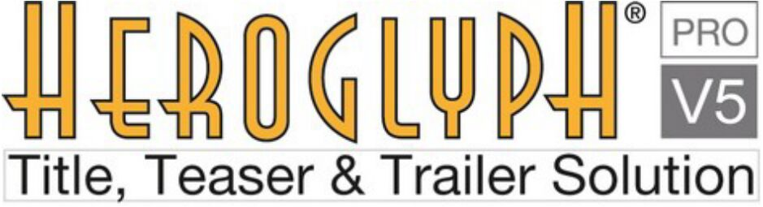

# Anleitung 

Autor der Anleitung: Uwe Wenz Software-Entwickler: Holger Burkarth 

## **Inhaltsverzeichnis** 

|**Willkommen**|**5**|
|---|---|
|Copyright-Bestimmungen / Rechtliches|5|
|Weitere Informationen|6|
|**Installation, Registrierung, Hilfe, Support und System-Voraussetzungen**|**6**|
|Installation und Registrierung|6|
|Hilfe|7|
|Technische Unterstützung - Support|7|
|System-Voraussetzungen|8|
|**Programmstart und Plugins**|**8**|
|Heroglyph stand-alone (eigenständig)|8|
|Adobe After Effects|9|
|Adobe Premiere|10|
|Adobe Premiere Elements|13|
|Avid Media Composer|14|
|Pinnacle Studio|15|
|Corel|16|
|Grass Valley EDIUS/NEO|18|
|MAGIX|19|
|Vegas Pro|20|
|Movie Studio Platinum|21|
|**Workshops zum Kennenlernen**|**23**|
|Erstellen einer Diashow|23|
|3x3 Videowand erstellen mit Effekten und Design|29|
|Routen mit Objekt auf eigener Landkarte erstellen|37|
|Titel in einem Skyline-Bild animieren (Arbeiten in Ebenen)|46|
|Trailer - Vorlagen in der Timeline kombinieren (Bsp. Teaser/News + Videowand)|51|
|Automatische Schreibschrift erstellen|61|
|Arbeiten mit Komponenten (Abspänne, Lauftexte und andere Textanimationen)|66|
|Lower-Third über den Wizard erstellen und weiter bearbeiten|73|
|**Der Heroglyph Quick Start Wizard**|**78**|
|Überblick|78|
|Die Optionen Neues Projekt und Projekt öffnen|78|
|Einstellungen zum Videoformat|79|
|Produktdemo|80|
|**Die Wizards (Assistenten)**|**80**|
|**Titel & Trailer erstellen**|**80**|
|Vorlage auswählen|80|
|Überblick - Vorlagen, Vorschau, Texteingabe, Design und Effekt-Auswahl|81|
|**Route erstellen**|**85**|
|Bild/Map importieren und Route zeichnen|85|
|Pfad - Routen-Stil sowie Einblende- und Ausblendeffekt auswählen|87|
|Objekt - Routenobjekt bearbeiten, Animation sowie Effekte hinzufügen|89|
|Zeitsteuerung - Routen-Pause und Reisegeschwindigkeit einstellen|91|
|**Videowand erstellen**|**92**|
|Vorlage auswählen|92|
|Textur - Bilder importieren|93|
|Stil - Design festlegen|95|
|Animation - Laufzeit festlegen sowie Effekte hinzufügen|96|
|**Diashow einfügen**|**98**|
|Bilder importieren und Zeiteinstellungen|99|
|Fotostil festlegen|100|

|Texte festlegen|102|
|---|---|
|**Schreibschrift**|**104**|
|Vorlage wählen|104|
|Weitere Bearbeitung des Textes, Effekte und Laufzeit einstellen|105|
|**Heroglyph**|**108**|
|Überblick|108|
|Grundfunktionen|109|
|Die interaktive Vorschau|110|
|Das Storyboard|111|
|Die Timeline|112|
|**Datei**|**114**|
|Neues Projekt / Projekt öffnen / Projekt speichern|114|
|Einstellungen|115|
|**Start**|**118**|
|Zwischenablage - Kopieren/Einfügen/Ausschneiden|118|
|Modus -  Selektor/Text/Pfad|119|
|Schrift - Schriftart & Symbole|122|
|Schrift - Erweiterte Design Optionen|124|
|Paragraph - Text ausrichten|125|
|**Einfügen**|**125**|
|Element einfügen|125|
|Vorlagen|126|
|Komponente|127|
|Schreibschrift|127|
|Diashow|128|
|Videowand|129|
|Route|129|
|Timeline - Text Folie|131|
|Timeline - Grafik Folie|132|
|Grafiken - Symbol|134|
|Grafiken - Grafik einfügen - Masken einfügen - Neue Objekte|136|
|**Layout**|**136**|
|Ausrichtung - Objekte ausrichten|136|
|Ausrichtung - Anpassen der Objektgröße und Rotation|138|
|Ausrichtung - Objekte in Ebenen anordnen|140|
|Paragraph - Text ausrichten|140|
|Spiegeln - Horizontal und Vertikal spiegeln|141|
|Kerning - Text horizontal und vertikal ausrichten - Kerning/Selector|141|
|Metrik|142|
|Metrik - Erweiterte Design Optionen|143|
|**Gestaltung**|**143**|
|Designvorlagen auswählen|143|
|Vorlagen - Erweiterte Design Optionen|144|
|Attribute - Deckung - Weichzeichner|145|
|Attribute - Fett - Kursiv - Hohl|146|
|Optionen - Front - Bevel - Umriss|147|
|Optionen - Glühen - Schatten|151|
|Optionen - Tiefe - Schein|153|
|**Animation**|**154**|
|Effektvorlagen auswählen - IN/Total/OUT-Effekte auswählen/zurücksetzen|155|
|Vorlagen - Erweiterte Effekt Optionen|157|
|Geschwindigkeitseinstellungen und Zeitsteuerung|157|
|**Ansicht**|**158**|
|Hintergrund - Transparent oder Video|158|
|Einstellungen|159|

|Rahmen - Sicherer Textbereich|160|
|---|---|
|**Route-Optionen (nur bei Erstellung einer Route/Pfad verfügbar)**|**160**|
|Objekt- und Routen-designvorlagen auswählen - Spiegeln|160|
|Vorlagen - Erweiterte Design Optionen|162|
|Edit - Pfad - Selektor - Stärke der Route - Gepunktet - Animationsstil|162|
|Pfad - Weich - Richtung - Sync-Einstellungen - Pause|164|
|**Grafik-Optionen (nur verfügbar bei Verwendung einer Grafik)**|**165**|
|Grafikvorlagen auswählen - Spiegeln horizontal, vertikal und zurücksetzen|165|
|Textur - Stil auswählen|166|
|Textur - Entfernen - Laden - Horizontal und vertikal spiegeln|167|
|Textur - Erweiterte Design Optionen|167|
|Maske - Maske auswählen|168|
|Maske - Entfernen - Invertieren - Laden - Horizontal und vertikal spiegeln|168|
|Maske - Erweiterte Design Optionen|169|
|**Export**|**169**|
|Bilder exportieren|170|
|Animation exportieren (als AVI, H264 und ProRes)|172|

## **Willkommen** 

### **Copyright-Bestimmungen / Rechtliches** 

Copyright proDAD GmbH. Alle Rechte vorbehalten. 

#### Lizenzbestimmungen 

Bitte lesen Sie vor der Installation die folgenden Lizenzbestimmungen sorgfältig durch.

#### Lizenzvertrag 

Beim Start des Setups wird ein Lizenzvertrag angezeigt, den Sie bitte sorgfältig durchlesen. Mit der Installation erkennen Sie diese Copyright-Bestimmungen, den Lizenzvertrag und das Lizenzierungsverfahren an. 

#### Lizenzgewähr 

proDAD GmbH räumt den bestimmungsgemäßen und erlaubten Gebrauch des vorliegenden Produkts ein. Das vorliegende Produkt kann nur auf einem Arbeitsplatz eingesetzt werden. Weder die Software, noch die Anleitung darf, auch in Teilen, reproduziert werden, es sei denn, es liegt eine schriftliche Genehmigung der proDAD GmbH vor. Mit Installation des Produkts gilt die Lizenzgewähr, die Urheberrechtsbestimmung, sowie die Haftungsbegrenzung als anerkannt. 

#### Warenzeichen 

Alle Produkt- und Warenzeichen, die in diesem Produkt erwähnt wurden, sind Warenzeichen der jeweiligen Eigentümer. Alle Warenzeichen werden ohne Gewährleistung der freien Verwendbarkeit benutzt und sind eventuell eingetragene Warenzeichen. 

#### Haftungsbegrenzung 

Der gesamte Haftungsumfang besteht im alleinigen Anspruch auf Ersatz des Produkts. Dies gilt für proDAD GmbH, Lizenznehmer und evtl. Vertreiber. Anspruch besteht nur bei korrekter Rückgabe der Software unter Angabe einer Warenrücksendenummer, die zuvor mit proDAD GmbH vereinbart werden muss. Ferner muss der Rückgabe ein Kaufbeleg beiliegen. Ist eine Fehlfunktion des vorliegenden Produkts auf eine fehlerhafte Anwendung, Missbrauch, Unfall oder unsachgemäße Handhabung zurückzuführen, gilt die Garantie nicht. proDAD GmbH, deren Vertriebspartner und Lizenznehmer haften nicht für Schäden und Folgeschäden, die aufgrund der unmöglichen Nutzung des vorliegenden Produkts entstehen. In jedem Fall ist der Haftungsbetrag auf den Kaufpreis des Produkts beschränkt. 

#### Dokumentationen 

Die Produktion und Übersetzung der Handbücher wurde mit größter Sorgfalt durchgeführt. Fehler können jedoch nicht hundertprozentig ausgeschlossen werden. proDAD GmbH übernimmt keinerlei Verantwortung oder Haftung für Folgen eventuell fehlerhaft gebliebener Aussagen oder Angaben. Technische und optische Änderungen vorbehalten. Hinweise sind stets willkommen. 

#### Urheberrecht 

Die Software sowie die Einzelkomponenten dieses Produkts sind Eigentum der proDAD GmbH. Mit der Installation des vorliegenden Produkts stimmt der Lizenznehmer zu, unautorisierten Gebrauch und Duplizierung zu vermeiden. 

proDAD GmbH übernimmt keinerlei Verantwortung für die Anwendung des Programms und die Veröffentlichung von Inhalten und Daten, die mit diesem Programm erzeugt wurden. 

ProDAD GmbH * Gauertstr. 2 * 78194 Immendingen * Deutschland * HRB 1077 

### **Weitere Informationen** 

#### **WEITERE INFORMATIONEN ZU HEROGLYPH** 

Workshops und FAQs: www.prodad.com Schulungen und Lern-Medien: www.prodad.com 

## **Installation, Registrierung, Hilfe, Support und System-Voraussetzungen** 

### **Installation und Registrierung** 

#### **1. Installation** 

Starten Sie entweder die * **.exe** Datei Ihres Downloads oder die Setup-Datei Ihrer CD. Folgen Sie nun den Installationsanweisungen. 

Wenn Sie bei der Installation zur Eingabe eines **Aktivierungscodes** (Seriennummer) aufgefordert werden, geben Sie den Code ein, den Sie bei elektronischer Lieferung mit der Download-Instructions-E-Mail erhalten haben, oder falls Sie eine physische Lieferung (auf DVD) erhalten haben, innerhalb der Box vorfinden. 

Beachten Sie bei der Installation, dass Ihr Plugin auch installiert wird. 

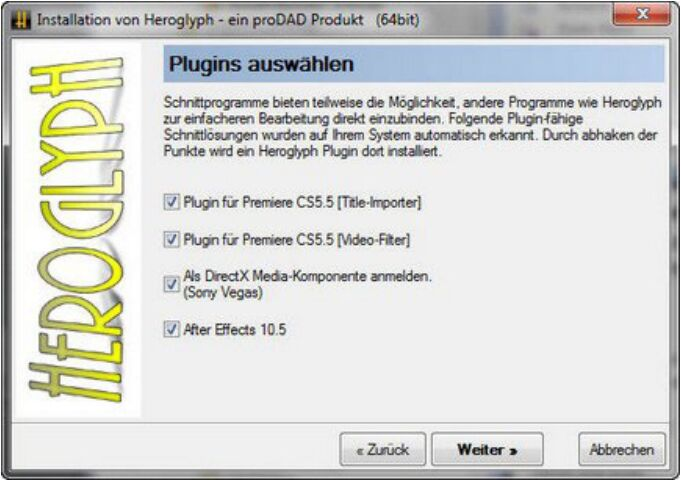

**Heroglyph** können Sie nach der Installation als eigenständige Software starten, aber auch in verschiedenen Schnittprogrammen als Plug-in einsetzen. 

#### **2. Registrierung von Heroglyph** 

Bitte registrieren Sie Ihr proDAD Heroglyph unter <u>http://www.prodad.com/home/community_login/register.xhtml.</u> 

### **Hilfe** 

Bei jedem Programm tauchen während der Arbeit Fragen auf. Bei Fragen zu Heroglyph erhalten Sie schnell und einfach Antworten. Die im Programm integrierte Hilfe ist über das Menü „?“ jederzeit erreichbar und führt Sie direkt zum gewünschten Ergebnis. 

Hier finden Sie auch einen Index zum einfacheren Nachschlagen - in zeitgemäßer elektronischer Form. 

Die primäre Hilfe, der Ratgeber, die Komplettübersicht zur Software ist die Online-Hilfe im Programm. 

Diese Anleitung bietet Ihnen eine Einführung sowie systematische Informationen. Die tiefgreifenden Detailinformationen erhalten Sie dann in erwähnter Online-Hilfe. 

#### **Weitere Informationen:** 

Die Anlaufstation für weitere Informationen ist die Webseite www.prodad.com. 

Hier finden Sie : 

- Workshops 

- Ergänzende Anleitungen 

- Tutorials 

- 

- Infos über neue Plugins (die nach der Erstellung dieser Anleitung entstanden sind) 

### **Technische Unterstützung - Support** 

#### **proDAD Support** 

Wir, proDAD, stehen gerne für Sie bereit, wenn es um Fragen zum Programm geht. 

Kontaktieren Sie uns einfach 

- per E-Mail an **customerservice@prodad.com** 

- per Telefon: ++49 (0)7462 9459 0 

- per Post: proDAD GmbH, Gauertstr. 2, 78194 Immendingen, Deutschland 

Halten Sie auf jeden Fall folgende Informationen für uns bereit: 

- Versionsnummer und Datum des Programms (über "i") 

- Ihr verwendetes Betriebssystem 

- Ggf. Name und die Versionsnummer des verwendeten Videoschnitt-Programms 

- Ggf. welche Updates vom Programm bereits installiert wurden 

- Ggf. die Protokoll-Datei, weitere Infos zur Erstellung erhalten Sie hier: www.prodad.com 

#### **_Hinweis :_** 

_Aktuelle_ **_Service-Updates_** _erhalten Sie auf der_ **_Heroglyph_** _-_ **_Service_** _Seite auf www.prodad.com. Nach der Installation der neuesten Version von Heroglyph stehen Neuerungen zur Verfügung bzw. wurden mögliche Probleme beseitigt._ 

### **System-Voraussetzungen** 

Beachten Sie folgende Systemvoraussetzungen: 

- Min. 8GB Hauptspeicher (RAM), 8GB Festplatte 

## **Programmstart und Plugins** 

### **Heroglyph stand-alone (eigenständig)** 

Sie können **Heroglyph** direkt vom Desktop aus per Doppelklick auf das **Heroglyph Ikon** 

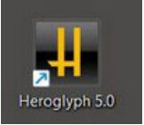

oder über das **Windows-Startmenü** starten : **Start** /Alle Programme/proDAD/ **Heroglyph starten** 

Heroglyph startet nun mit dem Wizard (QuickStart Assistenten). 

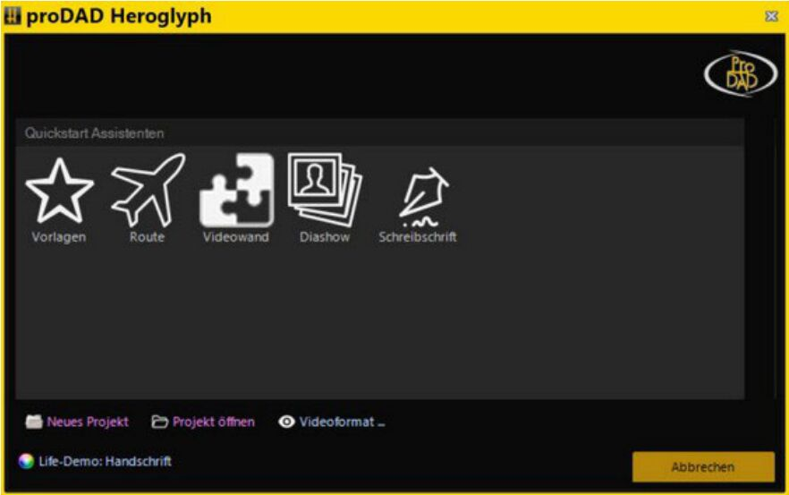

### **Adobe After Effects** 

Mit der Installation von **Heroglyph** wird das **After Effects-Plugin** automatisch mitinstalliert. Innerhalb After Effects ist das Plugin dann in den Effekten & Presets zu finden: 

#### **Vorgehensweise :** 

1. Lokalisieren Sie die **Effekte & Vorgaben** . 

2. Wählen Sie hier das Verzeichnis **proDAD** . 

3. Ziehen Sie den Eintrag **Heroglyph** mit gehaltener linker Maustaste auf den gewünschten Videoclip in der Timeline. 

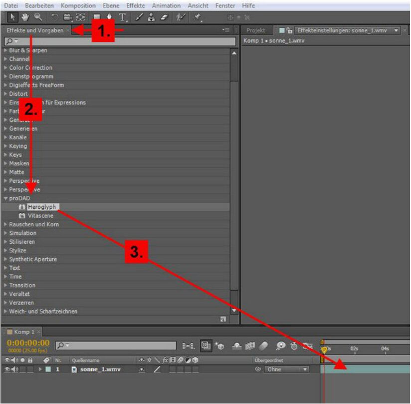

4. Der Heroglyph Assistent startet. Erstellen Sie ein Projekt in Heroglyph. 

5. Ist in Heroglyph das Projekt bearbeitet und fertiggestellt, kehren Sie einfach per **F12-Taste** zurück zu After Effects. Oder nutzen Sie die Option **Titel übernehmen** . 

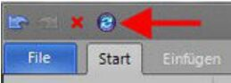

Hierbei wird das Heroglyph-Projekt automatisch abgespeichert. 

6. Klicken Sie auf den Eintrag **Edit Effect** in den **After Effects-Effekteinstellungen** um Heroglyph erneut zu starten. 

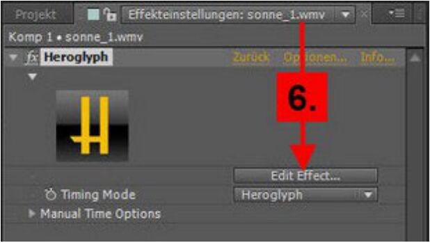

Weitere Infos zur Nutzung finden Sie in den folgenden Kapiteln zu Heroglyph. 

### **Adobe Premiere** 

Mit der Installation von **Heroglyph** wird das **Premiere-Plugin** automatisch mitinstalliert. Heroglyph ist als **Filter** und **Titel-Plugin** verfügbar. 

#### **1. Innerhalb Premiere ist das Plugin in den Videofiltern zu finden:** 

#### **Vorgehensweise :** 

1. Lokalisieren Sie die **Effekte** . 

2. Öffnen Sie das Verzeichnis **Videoeffekte** . 

3. Wählen Sie hier das Verzeichnis **proDAD** , öffnen Sie dieses. 

4. Ziehen Sie den Eintrag **Heroglyph Filter** (via drag & drop) auf den gewünschten Videoclip in der Timeline. 

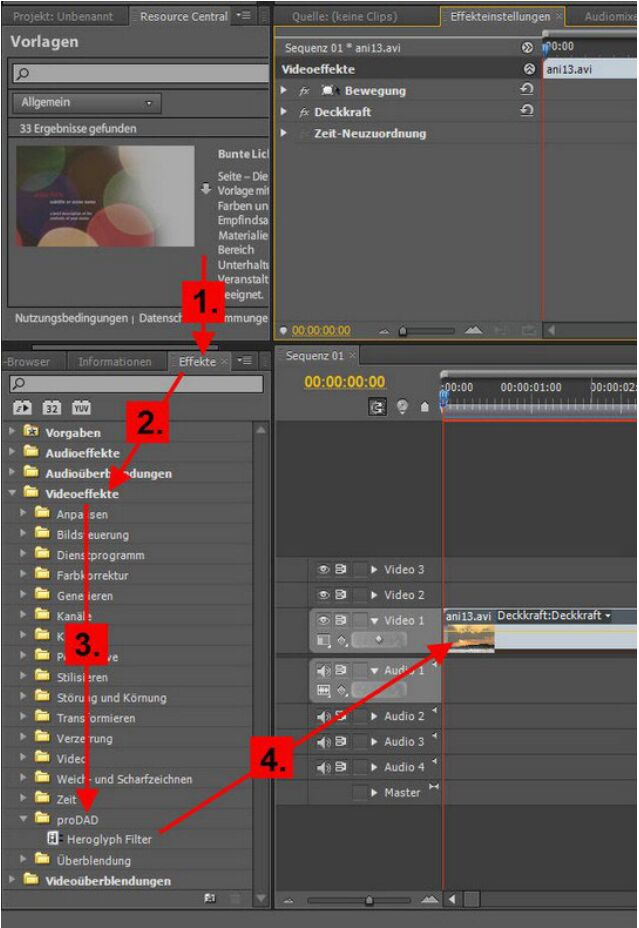

5. Der Heroglyph Assistent startet. Erstellen Sie ein Projekt in Heroglyph. 

6. Ist in Heroglyph das Projekt bearbeitet und fertiggestellt, kehren Sie einfach per **F12-Taste** zurück zu Premiere. Oder nutzen Sie die Option **Titel übernehmen** . 

Hierbei wird das Heroglyph-Projekt automatisch abgespeichert. 

7. Möchten Sie **Heroglyph Filter** erneut starten, so wechseln Sie in das Register **Effekteinstellungen/Heroglyph Filter** und klicken auf den **Setup-Button** . 

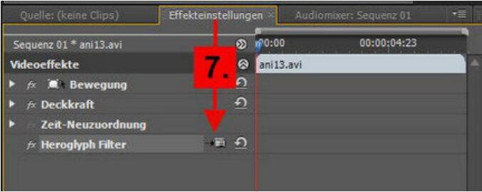

#### **2. Innerhalb Premiere ist das Plugin als Titler zu finden:** 

#### **Vorgehensweise :** 

#### 1. Klicken Sie auf **Datei/Neu** . 

2. Im Menü klicken Sie dann auf die Option **Heroglpyh Title...** . 

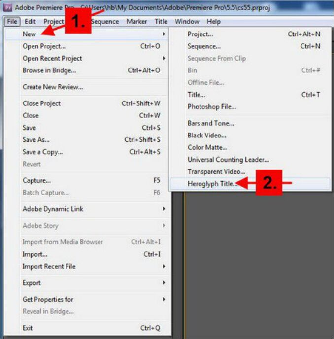

3. Der Heroglyph Assistent startet. Erstellen Sie ein Projekt in Heroglyph. 

4. Ist in Heroglyph das Projekt bearbeitet und fertiggestellt, kehren Sie einfach per **F12-Taste** zurück zu Premiere. Oder nutzen Sie die Option **Titel übernehmen** . 

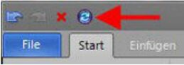

Hierbei wird das Heroglyph-Projekt automatisch abgespeichert. 

### **Adobe Premiere Elements** 

Mit der Installation von **Heroglyph** wird das **Premiere Elements-Plugin** automatisch mitinstalliert. Innerhalb Premiere Elements ist das Plugin dann in den **Effekten** zu finden: 

#### **Vorgehensweise :** 

1. Lokalisieren Sie die **Effekte** (im Register **Bearbeiten** ) 

2. Wählen Sie hier das Verzeichnis **proDAD** . 

3. Ziehen Sie den Eintrag **Heroglyph Filter** (via drag & drop) auf den gewünschten Videoclip in der Timeline. 

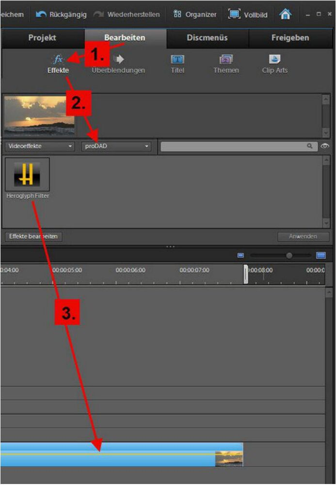

4. Der Heroglyph Assistent startet. Erstellen Sie ein Projekt in Heroglyph. 

5. Ist in Heroglyph das Projekt bearbeitet und fertiggestellt, kehren Sie einfach per **F12-Taste** zurück zu Elements. Oder nutzen Sie die Option **Titel übernehmen** . 

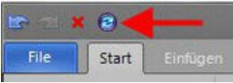

Hierbei wird das Heroglyph-Projekt automatisch abgespeichert. 

#### **_Hinweis:_** 

_Möchten Sie den Effekt Heroglyph löschen, so klicken Sie auf_ **_Heroglyph Filter_** _mit der rechten Maustaste und wählen die Option_ **_Löschen_** _aus._ 

Weitere Infos zur Nutzung finden Sie in den folgenden Kapiteln zu Heroglyph. 

### **Avid Media Composer** 

Mit der Installation von **Heroglyph** wird das **Media Composer-Plugin** automatisch mitinstalliert. 

1. Starten Sie **Media Composer** . Im Effekt-Dialog von Media Composer ist das Verzeichnis 

- **proDAD** , öffnen Sie dieses. 

2. Ziehen Sie nun via Drag and Drop das **Heroglyph Filter** in die Timeline 

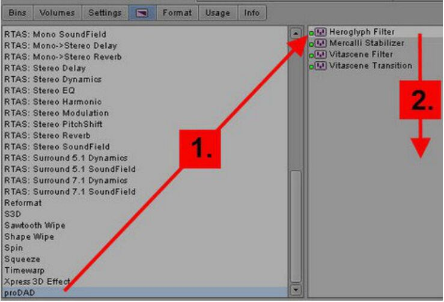

und klicken im **Effect Editor / Heroglyph Filter** auf die Option **Edit Effect** . 

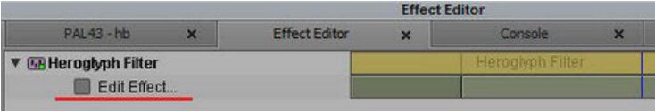

3. Der Heroglyph Assistent startet. Erstellen Sie ein Projekt in Heroglyph. 

4. Ist in Heroglyph das Projekt bearbeitet und fertiggestellt, kehren Sie einfach per **F12-Taste** zurück zu Media Composer. Oder nutzen Sie die Option **Titel übernehmen** . 

Hierbei wird das Heroglyph-Projekt automatisch abgespeichert. 

Weitere Infos zur Nutzung finden Sie in den folgenden Kapiteln zu Heroglyph. 

### **Pinnacle Studio** 

Mit der Installation von **Heroglyph** wird das **Pinnacle Studio-Plugin** automatisch mitinstalliert. 

#### **Vorgehensweise :** 

1. Lokalisieren Sie die **Effekte/proDAD** und dort das Verzeichnis **Heroglyph** , öffnen Sie dieses. 2. Ziehen Sie den Eintrag **Heroglyph Effect** mit gehaltener linker Maustaste auf den markierten Videoclip in der Timeline. 

3. Der Effekt wird durch eine **_magentafarbene Linie_** im Clip dargestellt. Klicken Sie darauf doppelt. 

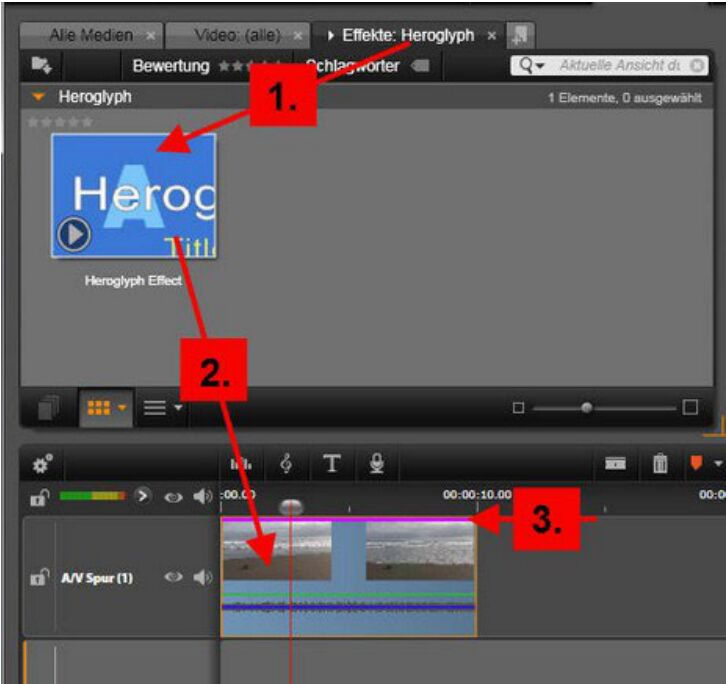

4. Es öffnet ein neuer Dialog mit aktivem Register **Effekte** . 

5. Rechts erscheint der ausgewählte **Heroglyph Effect** , klicken Sie hier auf den Button **Bearbeiten** . 

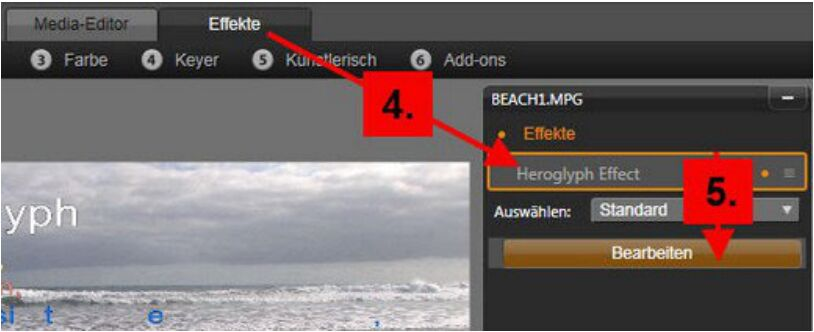

6. Der Heroglyph Assistent startet. Erstellen Sie ein Projekt in Heroglyph. 

7. Ist in Heroglyph das Projekt bearbeitet und fertiggestellt, kehren Sie einfach per **F12-Taste** zurück zu Avid Studio. Oder nutzen Sie die Option **Titel übernehmen** . 

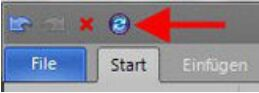

Hierbei wird das Heroglyph-Projekt automatisch abgespeichert. 

8. Bestätigen Sie nun den Heroglyph-Effekt im Register **Effekte** mit **OK** . Der Effekt wird in die Timeline übernommen. 

#### **_Hinweis:_** 

_Möchten Sie_ **_Heroglyph_** _vom Clip als Effekt entfernen, so klicken Sie mit der rechten Maustaste auf die_ **_magentafarbene Linie_** im Clip und wählen die Option **_Effekt/Löschen/Heroglyph_** aus. 

Weitere Infos zur Nutzung finden Sie in den folgenden Kapiteln zu Heroglyph. 

### **Corel** 

Mit der Installation von **Heroglyph** wird das **Corel-Plugin** automatisch mitinstalliert. 

#### **Vorgehensweise :** 

1. Lokalisieren Sie **FX** . 

2. Aktivieren Sie nun Ihren Clip in der Timeline durch **Doppelklick** . 

3. Klicken Sie dann in **FX** auf **proDAD** . 

4. Den darin enthaltenen Eintrag **Heroglyph Title** ziehen Sie nun auf den markierten Videoclip (via drag & drop) in der Timeline von Corel. 

5. Klicken Sie jetzt auf den Button **Filter anpassen** . 

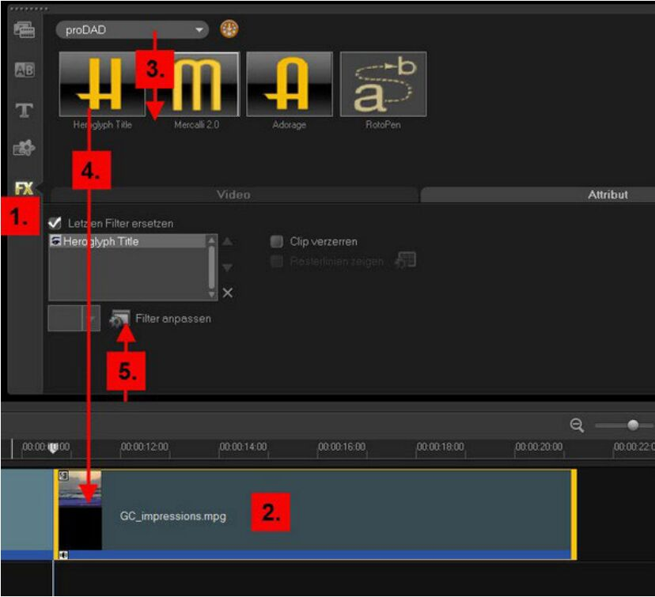

6. Der Heroglyph Assistent startet. Erstellen Sie ein Projekt in Heroglyph. 

7. Ist in Heroglyph das Projekt bearbeitet und fertiggestellt, kehren Sie einfach per **F12-Taste** zurück zu Corel. Oder nutzen Sie die Option **Titel übernehmen** . 

Hierbei wird das Heroglyph-Projekt automatisch abgespeichert. 

8. Möchten Sie Heroglyph erneut starten, so aktivieren Sie den Clip in der Timeline erneut durch Doppelklick, wechseln in **FX / proDAD / Heroglyph** und klicken auf den Button **Filter anpassen** . 

#### **_Hinweis:_** 

_Möchten Sie Heroglyph vom Clip als Effekt entfernen, so wechseln Sie in_ **_FX / proDAD / Heroglyph_** _und klicken auf den Button_ **_Filter löschen (X)_** _._ 

Weitere Infos zur Nutzung finden Sie in den folgenden Kapiteln zu Heroglyph. 

### **Grass Valley EDIUS/NEO** 

Mit der Installation von **Heroglyph** wird das **EDIUS/NEO-Plugin** automatisch im System installiert. 

Heroglyph ist als **Filter** und **Titel-Plugin** verfügbar. 

#### **1. Innerhalb EDIUS/NEO ist das Plugin in den Videofiltern zu finden:** 

#### **Vorgehensweise :** 

1. Lokalisieren Sie die **Videofilter** (im Register **Effekt** ). 

2. Klicken Sie auf den darin enthaltenen Ordner **proDAD** . 

3. Den darin enthaltenen Eintrag **Heroglyph Filter** ziehen Sie nun auf den markierten Videoclip (via drag & drop) in der EDIUS/NEO Timeline. 

4. In der **Informationspalette** klicken Sie doppelt auf den Eintrag **Heroglyph Filter** . 

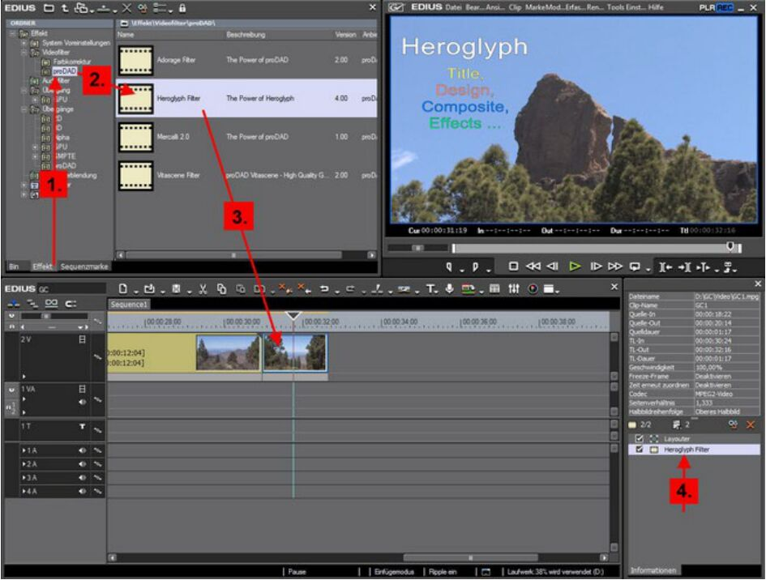

5. Der Heroglyph Assistent startet. Erstellen Sie ein Projekt in Heroglyph. 

6. Ist in Heroglyph das Projekt bearbeitet und fertiggestellt, kehren Sie einfach per **F12-Taste** zurück zu EDIUS/NEO. Oder nutzen Sie die Option **Titel übernehmen** . 

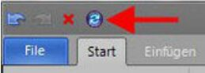

Hierbei wird das Heroglyph-Projekt automatisch abgespeichert. 

#### **2. Innerhalb EDIUS/NEO ist das Plugin als Titler zu finden:** 

#### **Vorgehensweise :** 

1. Lokalisieren Sie das **T-Symbol** oberhalb der Timeline und klicken darauf. 

2. Klicken Sie auf die Option **Heroglyph Titler** . 

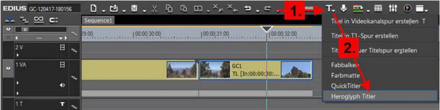

3. Der Heroglyph Assistent startet. Erstellen Sie ein Projekt in Heroglyph. 

4. Ist in Heroglyph das Projekt bearbeitet und fertiggestellt, kehren Sie einfach per **F12-Taste** zurück zu EDIUS/NEO. Oder nutzen Sie die Option **Titel übernehmen** . 

Hierbei wird das Heroglyph-Projekt automatisch abgespeichert. 

Weitere Infos zur Nutzung finden Sie in den folgenden Kapiteln zu Heroglyph. 

### **MAGIX** 

Mit der Installation von **Heroglyph** wird das **MAGIX-Plugin** automatisch mitinstalliert. 

#### **Vorgehensweise :** 

1. Starten Sie **MAGIX Video deluxe** und wechseln in das Register **Titel** . 

2. Nach dem Öffnen des Registers **Titel** finden Sie hier **proDAD Heroglyph** , klicken Sie darauf. 

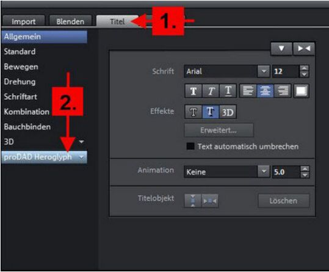

3. Der Heroglyph Assistent startet. Erstellen Sie ein Projekt in Heroglyph. 

4. Ist in Heroglyph das Projekt bearbeitet und fertiggestellt, kehren Sie einfach per **F12-Taste** zurück zu MAGIX. Oder nutzen Sie die Option **Titel übernehmen** . 

Hierbei wird das Heroglyph-Projekt automatisch abgespeichert. 

Weitere Infos zur Nutzung finden Sie in den folgenden Kapiteln zu Heroglyph. 

### **Vegas Pro** 

Mit der Installation von **Heroglyph** wird das **Vegas-Plugin** automatisch mitinstalliert. Innerhalb Vegas ist das Plugin **Heroglyph** dann im Register **Mediengeneratoren** zu finden: 

#### **Vorgehensweise :** 

1. Lokalisieren Sie das Register **Mediengeneratoren** (Ordner Drittanbieter). 

2. Ziehen Sie den Eintrag **proDAD Heroglyph Titler** mit gehaltener linker Maustaste in die Timeline. 

3. Nun wird **proDAD Heroglyph** im Dialog **Videomediengeneratoren** sowie im **TimelineObjekt** eingefügt. 

4. Klicken Sie hier auf den Button **Filter bearbeiten** . 

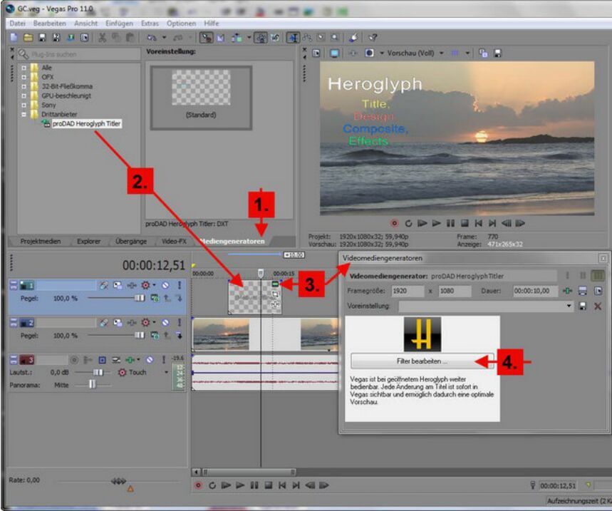

5. Der Heroglyph Assistent startet. Erstellen Sie ein Projekt in Heroglyph. 

6. Ist in Heroglyph das Projekt bearbeitet und fertiggestellt, kehren Sie einfach per **F12-Taste** zurück zu Vegas. Oder nutzen Sie die Option **Titel übernehmen** . 

Hierbei wird das Heroglyph-Projekt automatisch abgespeichert. 

7. Möchten Sie **Heroglyph** erneut öffnen, dann klicken Sie im Timeline-Objekt (mit HeroglyphEffekt) in der Timeline auf den Button **Generierte Medien...** (grün gekennzeichnet). 

8. Über den Dialog **Videomediengeneratoren/Filter bearbeiten** können Sie Heroglyph erneut öffnen. 

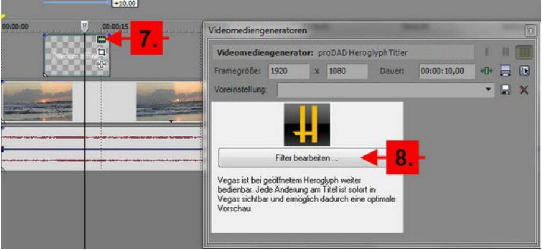

Weitere Infos zur Nutzung finden Sie in den folgenden Kapiteln zu Heroglyph. 

### **Movie Studio Platinum** 

Mit der Installation von **Heroglyph** wird das **Movie Studio-Plugin** automatisch mitinstalliert. Innerhalb Movie Studio ist das Plugin **Heroglyph** dann im Register **Mediengeneratoren** zu finden: 

#### **Vorgehensweise :** 

1. Lokalisieren Sie das Register **Mediengeneratoren** . 

2. Ziehen Sie den Eintrag **proDAD Heroglyph Titler** mit gehaltener linker Maustaste in die Timeline. 

3. Nun wird **proDAD Heroglyph** im Dialog **Videomediengeneratoren** sowie im **TimelineObjekt** eingefügt. 

4. Klicken Sie hier auf den Button **Filter bearbeiten** . 

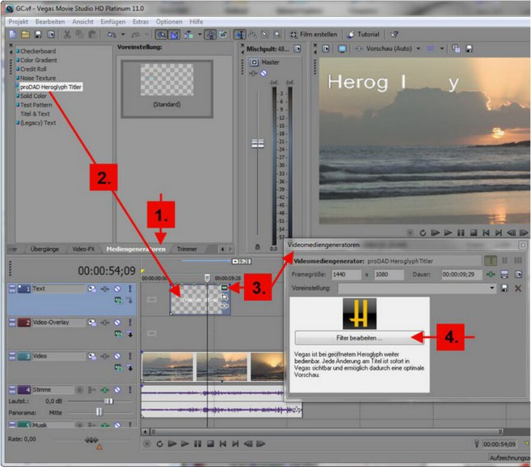

5. Der Heroglyph Assistent startet. Erstellen Sie ein Projekt in Heroglyph. 

6. Ist in Heroglyph das Projekt bearbeitet und fertiggestellt, kehren Sie einfach per **F12-Taste** zurück zu Vegas. Oder nutzen Sie die Option **Titel übernehmen** . 

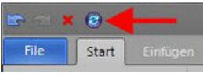

Hierbei wird das Heroglyph-Projekt automatisch abgespeichert. 

7. Möchten Sie **Heroglyph** erneut öffnen, dann klicken Sie im Timeline-Objekt (mit HeroglyphEffekt) in der Timeline auf den Button **Generierte Medien...** (grün gekennzeichnet). 

8. Über den Dialog **Videomediengeneratoren/Filter bearbeiten** können Sie Heroglyph erneut öffnen. 

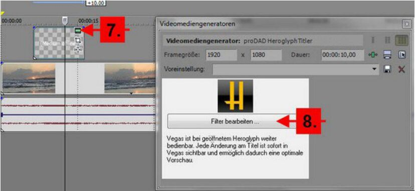

Weitere Infos zur Nutzung finden Sie in den folgenden Kapiteln zu Heroglyph. 

## **Workshops zum Kennenlernen** 

### **Erstellen einer Diashow** 

In diesem **Workshop** steht die Erstellung einer **Diashow** im Vordergrund. Es sollen nachträglich ein **Hintergrundbild** eingefügt, sowie die **Maske** einzelner Bildelemente ausgetauscht werden. Auch der Text der Bildtitel soll verändert werden. 

Starten Sie Heroglyph, es erscheint der **Assistent** . 

Klicken Sie im Assistenten auf die Option **Diashow** . Es startet der Dialog **Fotos zusammenstellen** . 

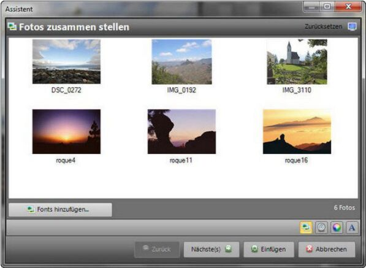

Weitere Details zur **Erstellung der Diashow im Assistenten** finden Sie hier. Nach der Fertigstellung startet die erstellte Diashow in der Heroglyph-Arbeitsoberfläche. Die **Diashow** (29 Sekunden lang) wird in der Vorschau und das Projekt in der Timeline eingefügt. 

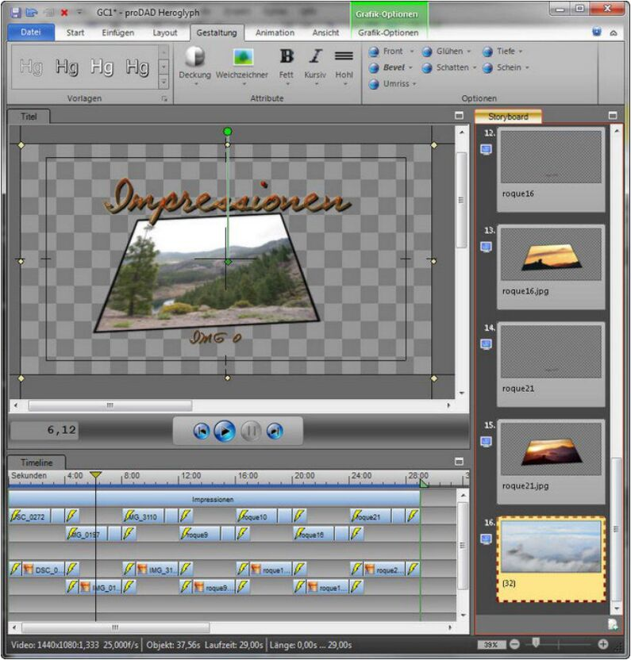

#### **1. Ein Hintergrundbild der bestehenden Diashow hinzufügen** 

#### **_Hinweis:_** 

_Sollten Sie Heroglyph als Plugin auf einen Video oder Bild in einer Schnittsoftware einsetzen, dann ist bereits ein Hintergrund verfügbar._ 

Fügen Sie zuerst per Rechtsklick über „Neu / Neues Timeline-Objekt“ ein weiteres Objekt in die Timeline ein und passen Sie dessen Laufzeit an das Projekt an.

Danach passen Sie das Timeline-Objekt der **Laufzeit** des Projektes an. Wechseln Sie dazu in das Register **Animation/Zeitsteuerung** 

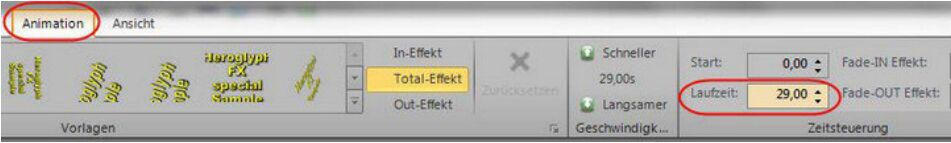

und verschieben das neue Timeline-Objekt in die unterste Spur in der Timeline. 

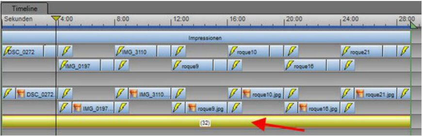

#### **_Hinweis:_** 

_Beachten Sie, dass das neue Timeline-Objekt markiert (gelb) ist._ 

Nun fügen Sie ein **Bild** ein, öffnen den **Arbeitsplatz** und übernehmen es **via Drag & Drop** in die Vorschau. Passen Sie danach die **Größe** des Bildes in der Vorschau an. 

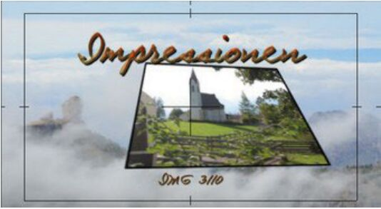

Damit ist der Hintergrund festgelegt. Jetzt kann bei Bedarf dem Bild ein **Total-Effekt** hinzugefügt werden. Verwenden Sie z.B. einen leichten **Zoom-Effekt** , so wird das Hintergrundbild über die Laufzeit langsam gezoomt (bewegt). So wirkt der Hintergrund nicht statisch. 

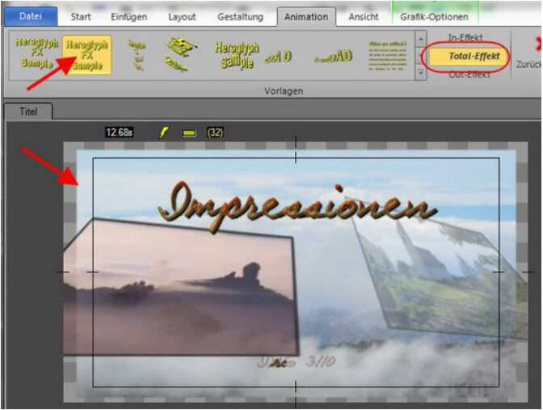

#### **2. Maske austauschen und Stil hinzufügen** 

Jetzt markieren Sie ein **Bildelement** Ihrer Diashow (wird gelb in der Timeline). Dann wechseln Sie in das Register **Grafik-Optionen** . Hier wählen Sie eine geeignete **Vorlage (1.)** aus, parallel wird eine **Masken-Vorschau (2.)** sichtbar. Auch in der **Heroglyph-Vorschau (3.)** wird die neue Maske sichtbar und durch Mausklick übernommen. Über die Option **Maske (4.)** können weitere Masken dem markierten Bild zugewiesen werden. 

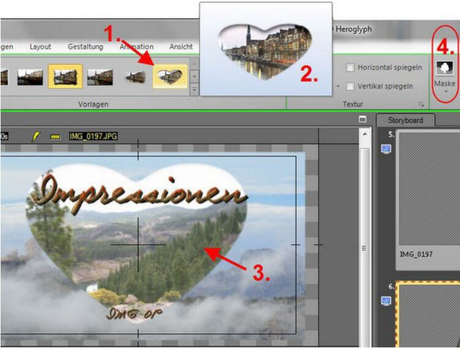

Über die Option **Stil** weisen Sie der neuen **Maske** ein neues Design hinzu. 

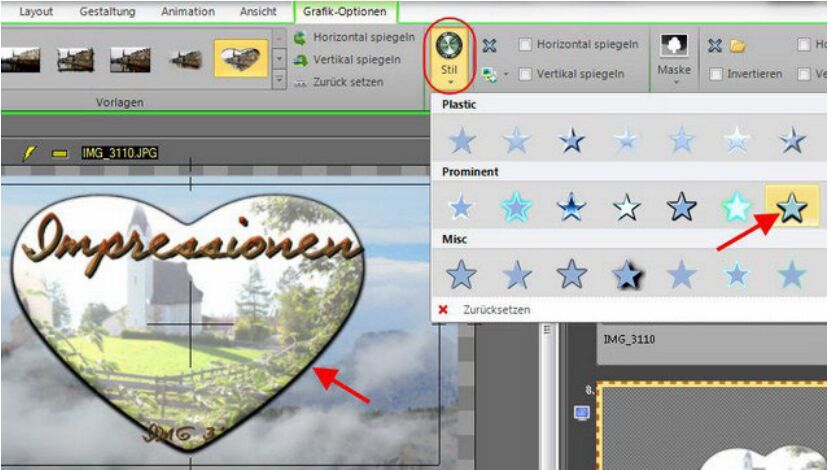

#### **3. Text eines Bildtitels austauschen** 

Möchten Sie z.B. den Text eines eingeblendeten Bildes verändern, so markieren Sie das **Textelement** zugehörig zum Bild in der Timeline, klicken Sie in der Vorschau doppelt auf den Text, sodass dieser markiert wird, und tragen via Tastatur den neuen Text ein. 

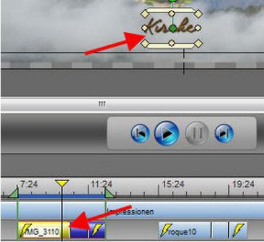

So können Sie nachträglich nicht korrekt benannte Bilder, umbenennen. Es besteht auch die Möglichkeit verfügbare **Effekte** (In/Total/Out-Effekt) zu Bildern und Texten der verfügbaren Diashow-Elemente auszutauschen. Die Effekte werden im Register **Animation** ausgetauscht. 

#### **_Hinweis:_** 

_Wichtig ist auch hier die Markierung des jeweilig zu verändernden Effektabschnittes im Bild oder Text in der Timeline._ 

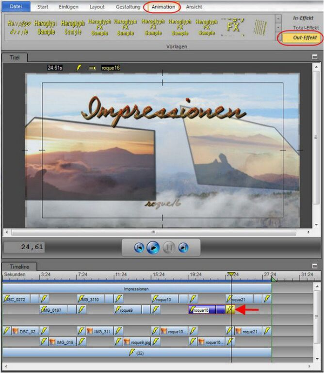

Bei Bedarf kann auch noch der **Titel der Diashow** neu positioniert werden. Markieren Sie das **Textelement** in der Timeline, klicken in der **Vorschau** auf den Text, sodass dieser markiert ist, dann verschieben Sie ihn an eine neue Position. 

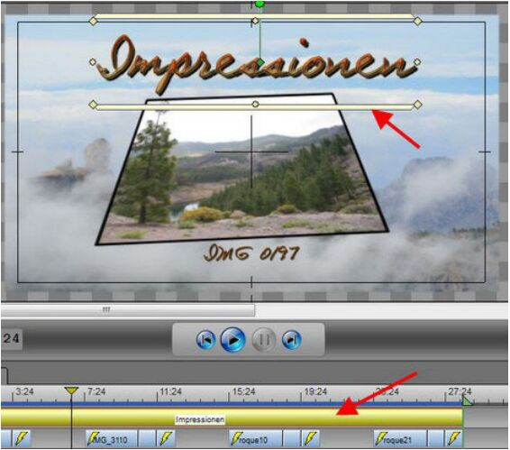

Starten Sie jetzt das **Playback** in der Vorschau. 

### **3x3 Videowand erstellen mit Effekten und Design** 

In diesem **Workshop** soll eine **3x3 Videowand** mit Effekten und eigenem Design erstellt werden. Danach soll ein Titel in automatischer Schreibschrift und ein neuer Hintergrund hinzugefügt werden. 

Klicken Sie im Assistenten auf die Option **Videowand** . 

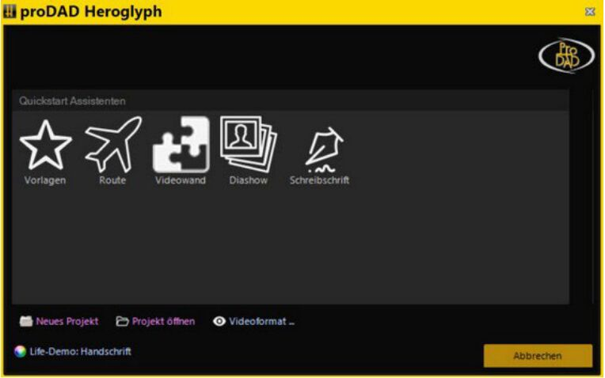

Es startet der Dialog **Vorlagen** . Wählen Sie z.B. in der Kategorie **Formen** die Vorlage **Herzen 3:3** . 

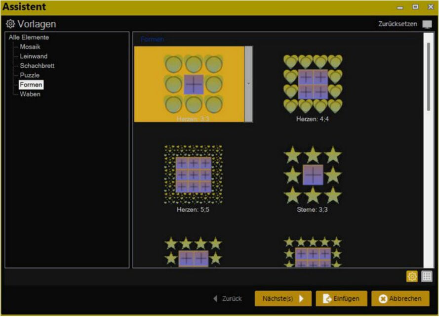

Weitere Details zur **Erstellung der Videowand im Assistenten** finden Sie hier. Nach der Fertigstellung startet die erstellte Videowand in der Heroglyph-Arbeitsoberfläche. Die **Videowand** (10 Sekunden lang) wird in der Vorschau und das Projekt in der Timeline eingefügt. 

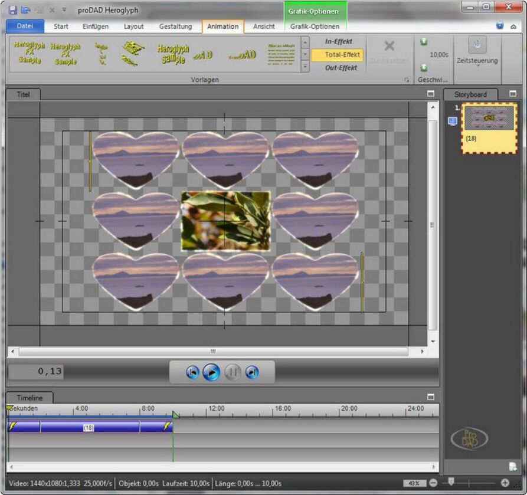

#### **1. Ein Hintergrundbild der bestehenden Videowand hinzufügen** 

#### **_Hinweis:_** 

_Sollten Sie Heroglyph als Plug-in bei einem Video oder Bild in einer Schnittsoftware einsetzen, dann ist bereits ein Hintergrund verfügbar._ 

Zuerst fügen Sie **ein weiteres Timeline-Objekt** in die Timeline. Wechseln Sie dazu in das Register **Einfügen** und klicken auf die Option **Element einfügen** . Es startet der Dialog **Vorlagen** , hier wählen Sie im Bereich **Timeline** die Option **Grafikfolie** aus. 

Ein Timeline-Objekt wird eingefügt, passen Sie es nun der **Laufzeit** des Projektes an. Wechseln Sie dazu in das Register **Animation/Zeitsteuerung** 

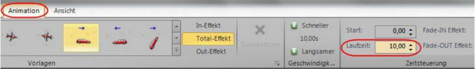

und verschieben das neue Timeline-Objekt in die unterste Spur in der Timeline. Lassen Sie eine Spur frei für den noch folgenden Text. 

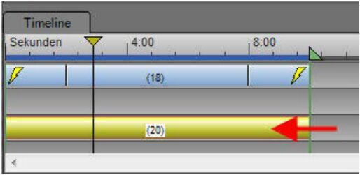

#### **_Hinweis:_** 

_Beachten Sie, dass das neue Timeline-Objekt markiert (gelb) ist._ 

Nun fügen Sie ein **Bild** ein, öffnen den **Arbeitsplatz** und übernehmen es **via Drag & Drop** in die Vorschau. Passen Sie danach die **Größe** des Bildes in der Vorschau an. 

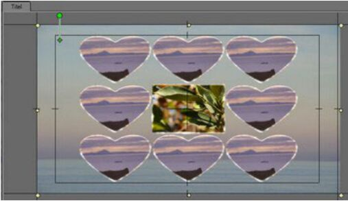

Damit ist der Hintergrund festgelegt. 

#### **2. Verkleinerung und Positionierung der Videowand in der Vorschau** 

Markieren Sie das Timeline-Objekt in der Timeline und klicken in der Vorschau auf die Videowand, sodass diese markiert ist. Wechseln Sie in das Register **Layout (1.)** . Nun bewegen Sie die Maus auf eine **Ecke (2.)** und verkleinern mit gedrückter linker Maustaste die Videowand. Danach positionieren Sie diese mittig mit Hilfe der Option **Ausgewählte Objekte mittig ausrichten (3.)** . 

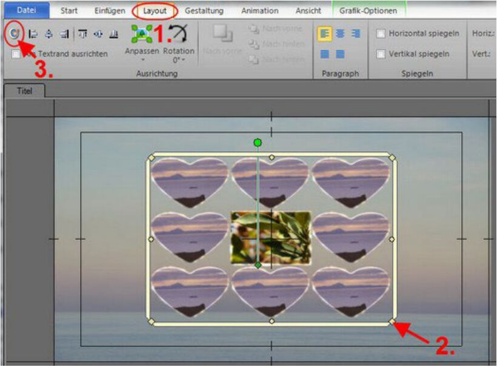

#### **3. Text mit automatischer Schreibschrift einfügen** 

Wechseln Sie zuerst in das Register **Einfügen** und klicken auf die Option **Komponente** . Es startet der Dialog **Vorlagen wählen** . Klicken Sie hier auf die Option **Script IN/OUT (1.)** . markieren Sie rechts daneben eine **geeignete Vorlage (2.)** für eine automatische Schreibschrift. 

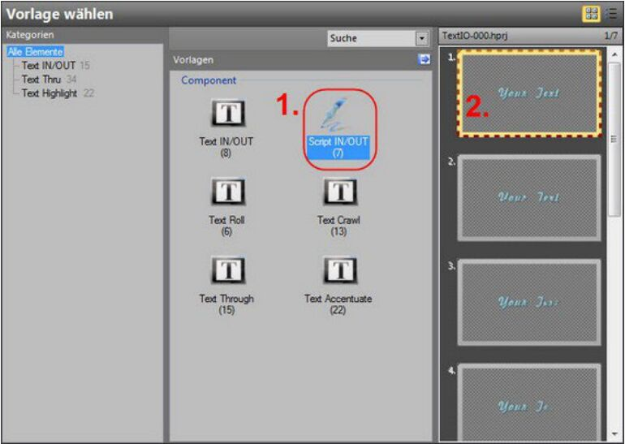

Klicken Sie auf **Erstellen** , es erscheint der Dialog zur Gestaltung der automatischen Schreibschrift. Zuerst geben Sie eine **Text (1.)** ein, dann legen Sie ein **Stil (2.)** fest und bestimmen die **Textgröße (3.)** . Die **Laufzeit (4.)** sollte mit der Projektlänge übereinstimmen, wählen Sie z.B. 10 Sekunden aus. Dann starten Sie ein **Playback (5.)** . Die  automatische Schreibschrift beinhaltet einen **Schreibeffekt** , d.h. der Text wird  wie von Hand geschrieben. 

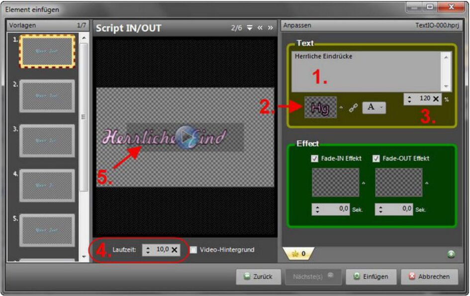

Zur Übernahme der automatischen Schreibschrift klicken Sie auf **Einfügen** . Jetzt muß die Timeline neu organisiert werden, d.h. die Ebenen müssen so angeordnet werden, dass die **automatische Schreibschrift** oben liegt. Das können Sie im **Storyboard** erledigen. 

Zuvor muß noch das neue Timeline-Objekt mit der automatischen Schreibschrift zwischen die beiden bestehenden Timeline-Objekte platziert werden. Dann verschieben Sie die TimelineObjekte im **Storyboard/Ebenen** wie folgt. In der Vorschau wird die neue Anordnung sofort angezeigt. 

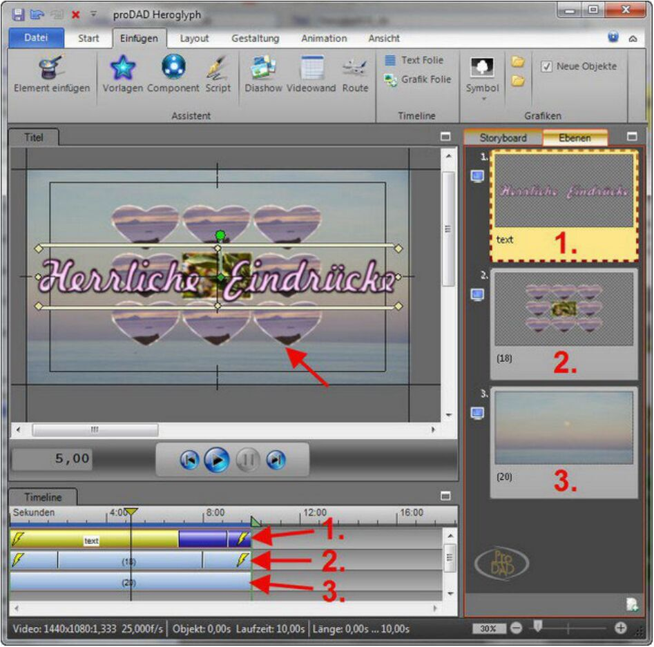

Jetzt muß die **automatische Schreibschrift** noch neu am oberen Bildrand positioniert werden. Evt. sollte die **Videowand** etwas nach unten verschoben werden. 

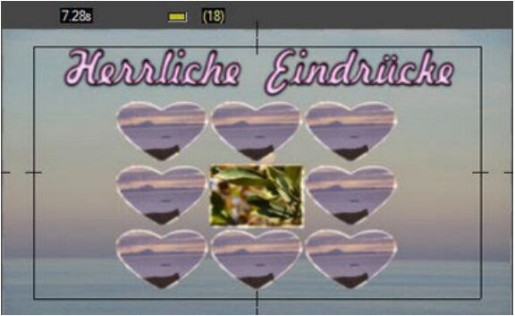

Abschließend fügen Sie nun noch einen **Total-Effekt** der Videowand hinzu. Aktuell ist in der Videowand nur ein IN/OUT-Effekt verfügbar. Markieren Sie den mittleren **Abschnitt (1.) der Videowand** (Timeline-Objekt) in der Timeline. dann wechseln Sie in das Register **Animation (2.)** und wählen einen **Total-Effekt (3.)** aus. In der **Vorschau (4.)** ist der Effekt sofort sichtbar. 

Starten Sie jetzt das **Playback** in der Vorschau. 

### **Routen mit Objekt auf eigener Landkarte erstellen** 

In diesem **Workshop** wird eine **Routenanimation mit 2 Routen** , jeweils mit **Objekt** auf einer eigenen Landkarte (mit Pausen) erstellt. Dann werden 2 Bilder (oder Clips) im Routenverlauf hinzugefügt und mit Effekten geblendet. 

Mit Hilfe des Assistenten **Route** können Sie eine animierte Route (oder mehrere) auf einer Landkarte erstellen. Klicken Sie im **Assistenten** auf die Option **Route** . 

Es startet der Dialog **Hintergrund - Landkarte** . 

Hier importieren Sie zuerst über die Option **Hintergrundbild laden** eine gewünschte Landkarte (z.B. aus Google Maps). 

#### **_Hinweis:_** 

_Alternativ können Sie auch direkt vom Arbeitsplatz eine Landkarte via Drag & Drop übernehmen._ 

Die Landkarte wird eingefügt. 

Jetzt zeichnen Sie eine Route. Bewegen Sie die Maus an eine Position, an der die Route starten soll. Dann zeichnen Sie mit gedrückter linker Maustaste den **Routenverlauf (1)** . Danach können über eine **Schaltfläche (2.)** eine **Live-Vorschau (3.)** einschalten 

Fügen Sie jetzt eine **weitere Route** hinzu. Bewegen Sie dazu die Maus mit dem **gelben Punkt** an eine neue Startposition und zeichnen die zweite Route der Reise. 

Die Pfade sind nun erstellt, klicken Sie jetzt auf die Option **Nächste** , um der Route **Objekte** , ein 

Design sowie **Effekte** hinzufügen. Wie das gemacht wird, finden Sie hier. 

Nach Erstellung der Route mit den Objekten startet die Heroglyph-Arbeitsoberfläche. Die **Route** (ca. 22 Sekunden lang) wird in der Vorschau und das Projekt in der Timeline eingefügt. 

Zuerst ist es evt. notwendig **die beiden gezeichneten Pfade** zu glätten bzw. abzurunden. Dann wandert das Objekt weicher über den gezeichneten Pfad. Die Einstellungen nehmen Sie im Register Route-Optionen vor. Öffnen Sie hier die Option **Weich** und wählen **abrunden** bzw. **glätten** aus. Zuvor sollte jedoch der richtige Pfad in der Timeline markiert werden. 

Danach heben wir die **Stärke der Pfade** hervor. Nutzen Sie dazu die Option **Stärke (1.)** und wählen die **5.0** aus. Im zweiten Pfad wird zusätzlich ein **gepunktetes Design (2.)** ausgewählt. In der **Vorschau (3.)** ist sofort die Veränderung sichtbar. 

Jetzt fügen Sie **ein weiteres Timeline-Objekt** in die Timeline ein. Wechseln Sie dazu in das Register **Einfügen** und klicken auf die Option **Element einfügen** . Es startet der Dialog **Vorlagen** , hier wählen Sie im Bereich **Timeline** die Option **Grafikfolie** aus. 

**_Hinweis:_** _Beachten Sie, dass das neue Timeline-Objekt markiert (gelb) ist._ 

Nun fügen Sie ein **Bild** ein, öffnen den **Arbeitsplatz** und übernehmen es **via Drag & Drop** in die Vorschau. Passen Sie das Bild nun in der **Größe, Position** und zeitlich im **Pfadverlauf** an. 

Jetzt fügen Sie einen **Einblende- und Ausblendeffekt** hinzu. Wechseln Sie dazu in das Register **Animation** . Hier finden Sie **In-Effekte** und **Out-Effekte** . Wählen Sie in den Vorlagen eine geeignete Blendenart aus. Danach bestimmen Sie mit der Maus die Blendenlänge der **Ein- und Ausblendung** in der Timeline. In der **Vorschau** ist aktuell die Ausblendung zu sehen. 

Danach fügen Sie **ein weiteres Bild** mit Effekten für den 2. Pfad ein, gehen Sie hier genauso vor. 

Jetzt fügen Sie den verwendeten Routenobjekten sowie den beiden Bildern im Routenverlauf einen **Schatten** hinzu. Markieren Sie in der Timeline die einzelnen Objekte der Reihe nach und wechseln in das Register **Gestaltung** und wählen die Option **Schatten** mit einer **Schattenvorlage** aus. Der Schatten wird in der **Vorschau** im Bild eingefügt. 

Danach hat jedes Objekt und Bild einen **Schatten** erhalten. 

Jetzt fügen Sie noch einen **Titel** in der **Route** ein. Klicken Sie im Register **Einfügen** auf die Option **Komponente** . Es erscheint der Dialog **Vorlage wählen** . Legen Sie hier ein **Vorlage** fest. 

Klicken Sie auf **Erstellen** . Zuerst geben Sie eine **Text (1.)** ein, dann legen Sie ein **Stil (2.)** fest und bestimmen die **Textgröße (3.)** . Die **Laufzeit (4.)** sollte in etwa mit der Projektlänge übereinstimmen, wählen Sie z.B. 18 Sekunden aus. 

Klicken zur Übernahme des Titels auf die Option **Einfügen** . Organisieren Sie jetzt im **Storyboard/Ebenen** die Reihenfolge der Ebenen, d.h. der Titel soll dem Hintergrund (Landkarte) überlagert werden. 

Passen Sie den Titel noch in der **Position** und **Größe** , sodass sich keine Elemente in der **Vorschau** überschneiden. 

Bei Bedarf können Sie abschließend dem **Titel** im Register **Animation** weitere **Ein- und Ausblendeffekte** hinzufügen. 

Starten Sie jetzt das **Playback** in der Vorschau. 

### **Titel in einem Skyline-Bild animieren (Arbeiten in Ebenen)** 

In diesem **Workshop** soll ein Titel (Lauftext) in einer Skyline animiert werden (Arbeiten in Ebenen). 

#### **_Hinweis:_** 

_Verwenden Sie z.B. ein geeignetes Hintergrundbild und schneiden zuvor in einem Bildbearbeitungsprogramm (wie z.B. in Adobe Photoshop oder Gimp (kostenlos)) ein Hochhaus aus. Beachten Sie dabei, dass der Hintergrund in dieser Grafik transparent ist (als *.tif-Datei mit Alpha-Key gespeichert). Der Hintergrund (komplette Skyline) verschmilzt in dieser Lektion mit der Grafik (Einzelnes Hochhaus) und einem Lauftext, der bewegt wird und hinter dem einzelnen Hochhaus verschwinden soll._ 

Erstellen Sie ein neues Projekt in Heroglyph. 

Zuerst importieren Sie ein Hintergrundbild mit der kompletten Skyline. Öffnen Sie den **Arbeitsplatz** und übernehmen es **via Drag & Drop** in die Vorschau. Passen Sie danach die **Größe** des Bildes in der Vorschau an. 

Jetzt fügen Sie **ein weiteres Timeline-Objekt** in die Timeline via Rechtsklick **Neu/Neues Timeline-Objekt** ein. Öffnen Sie erneut den **Arbeitsplatz** und übernehmen das Bild mit dem ausgeschnittenen Hochhaus **via Drag & Drop** in die Vorschau. Passen Sie danach die **Größe** des Bildes in der Vorschau an. 

Organisieren Sie jetzt im **Storyboard/Ebenen** die Reihenfolge der Ebenen, d.h. das ausgeschnittene Hochhaus soll den Hintergrund (Skyline) überlagern. Tauschen Sie einfach die Ebenen im **Storyboard** aus. 

Danach passen Sie das Timeline-Objekt in der Timeline an und lassen eine Spur zwischen den Timeline-Objekten frei. 

Hier wird nun der Titel eingefügt, der innerhalb der Skyline animiert werden soll. Klicken Sie im Register **Einfügen** auf die Option **Komponente** . Es erscheint der Dialog **Vorlage wählen** . Legen Sie hier ein **Vorlage** fest. 

Klicken Sie auf **Erstellen** . Zuerst geben Sie eine **Text (1.)** ein, dann legen Sie ein **Stil (2.)** fest und bestimmen die **Textgröße (3.)** . Die **Laufzeit (4.)** sollte mit der Projektlänge übereinstimmen, wählen Sie z.B. 5 Sekunden aus. 

Klicken zur Übernahme des Titels auf die Option **Einfügen** . Verschieben Sie das Timeline-Objekt mit dem neuen Titel zwischen die beiden anderen Timeline-Objekte in der Timeline. In der Vorschau wird der Titel angezeigt, er ist teilweise vom ausgeschnittenen Hochhaus abgedeckt. 

Starten Sie jetzt das **Playback** in der Vorschau. Bei Bedarf können Sie dem **Titel** im Register **Animation** einen neuen Total-Effekt hinzufügen. 

Markieren Sie dazu das Timeline-Objekt in der Timeline und entfernen den verfügbaren **Ein- und Ausblendeffekt** über die Option **Zurücksetzen** . Dann wählen Sie einen neuen **Total-Effekt** (Dauereffekt) aus und vergrößern den Text in der Vorschau. 

Starten Sie jetzt das **Playback** in der Vorschau erneut. Der Titel hat einen neuen Verlauf erhalten. 

Abschließend können Sie nachträglich das **Design der Titeloberfläche** optimieren. Wechseln Sie in das Register **Gestaltung** , wählen ein neues Design sowie einen zusätzlichen Effekt **Glühen** aus. In der Vorschau wird die Änderung sofort angezeigt. 

Starten Sie jetzt das **Playback** in der Vorschau. 

### **Trailer - Vorlagen in der Timeline kombinieren (Bsp. Teaser/News + Videowand + Ticker)** 

In diesem **Workshop** steht die Erstellung eines **Trailers** im Vordergrund. Es wird eine TeaserVorlage **News** mit einer zusätzlichen animierten **Videowand** und einem **Ticker** erstellt. Somit werden 3 verschiedene Vorlagen in der Timeline kombiniert. 

Starten Sie Heroglyph, es erscheint der **Assistent** . 

Klicken Sie im Assistenten auf die Option **Vorlagen** . Es startet der Dialog **Vorlage wählen** . Wählen Sie z.B. die Vorlage **News / 1** . 

Klicken Sie auf **Erstellen** , es erscheint der Dialog zum Einstellen der Animation. Geben Sie zuerst 

einen **Text (1.)** ein. Im Bereich **Decoration  (2.)** belassen Sie in diesem Fall die Einstellungen. Hier werden wir nachträglich Änderungen direkt in Heroglyph vornehmen. Verändern Sie jedoch die **Laufzeit (3.)** auf 10 Sekunden. 

Nach der Fertigstellung klicken Sie auf **Einfügen** und die erstellte Animation erscheint in der Heroglyph-Arbeitsoberfläche. Die **Animation** (10 Sekunden lang) wird in der Vorschau und das Projekt in der Timeline eingefügt. 

Jetzt fügen Sie dem Text **Heute** neue Effekte hinzu. Wechseln Sie dazu in das Register **Animation (1.)** und entfernen zuerst, den bereits verfügbaren **Total-Effekt** mit **Zurücksetzen** . Dann fügen Sie einen neuen **Einblende- und Ausblendeffekt (2.)** hinzu. Abschließend bestimmen Sie die Länge der **Effekte** im Timeline-Objekt **Text (3.)** , direkt in der Timeline. Damit haben Sie die **Animation des Textes** verändert. 

Starten Sie jetzt das **Playback** in der Vorschau. Jetzt fügen Sie eine Videowand in diese Animation ein, wechseln Sie dazu in das Register **Einfügen** und wählen die Option **Videowand** . 

Es startet der Dialog **Vorlagen** . Wählen Sie z.B. in der Kategorie **Mosaik** die Vorlage **Klassisch 2:2** . 

Sie können nun Bilder in die Videowand einfügen, öffnen Sie dazu den **Arbeitsplatz** , navigieren in ein Verzeichnis, wo Bilder liegen und ziehen diese nacheinander in die 4 Kacheln der Videowand (per Drag & Drop). 

Wechseln Sie zur Auswahl eines **Videowand-Designs** in das Register **Stil (1.)** . Danach klicken Sie zur Auswahl eines **Designs** (Stil) auf die **Box (2.)** , dann öffnet eine Ansicht mit zahlreichen **Designvorlagen (3.)** . Ein einfacher Mausklick übernimmt ein Design. 

Wechseln Sie zur Festlegung der Animation auf das Register **Animation (1.)** . Legen Sie hier die **Laufzeit (2.)** der Videowand-Animation (z.B. 10 Sek.) fest. Wählen Sie auch die Option **Kein Effekt (3.)** aus. 

Weitere Details zur **Erstellung der Videowand im Assistenten** finden Sie hier. Nach der Fertigstellung klicken Sie auf **Einfügen** , es startet die erstellte Videowand in der HeroglyphArbeitsoberfläche. Die **Videowand** (10 Sekunden lang) wird in der Vorschau und das Projekt in der Timeline eingefügt. 

Die Videowand liegt jedoch außerhalb der zuvor erstellten Animation, dies muß nun in der **Ebenenanordnung** exakt platziert werden. Verschieben Sie das Timeline-Objekt **Videowand** unter die bestehende Animation und dann ordnen via **Storyboard/Ebenen (1.)** die Ebenen so, daß die **Videowand  (2.)** der Weltkarte (Hintergrund) überlagert wird. Verkleinern Sie danach die Videowand in der **Vorschau (3.)** . 

Wechseln Sie jetzt in das Register **Animation (1.)** und fügen einen **Einblende- und Ausblendeffekt (2.)** der Videowand hinzu. Abschließend bestimmen Sie die Länge der **Effekte** im Timeline-Objekt **Text (3.)** , direkt in der Timeline. 

Starten Sie jetzt das **Playback** in der Vorschau. Jetzt fügen Sie einen **News-Ticker** in diese Animation ein, wechseln Sie dazu in das Register **Einfügen** und wählen die Option **Vorlagen** . Es öffnet der Dialog **Vorlage wählen** . Entscheiden Sie sich hier für ein Vorlage, z.B. **Lower Third/Ticker/1** . 

Klicken Sie auf **Erstellen** , es erscheint der Dialog zum Einstellen des **Tickers** . Geben Sie zuerst einen **Text (1.)** ein. Verändern Sie dann noch die **Laufzeit (2.)** auf 10 Sekunden. Der **News-Ticker-Hintergrund** soll über die Laufzeit bestehen bleiben, also wird kein **Effekt** verwendet. 

Nach der Fertigstellung klicken Sie auf **Einfügen** und die erstellte Animation wird in der Timeline eingefügt, allerdings hinter dem zuvor erstellten Projekt. 

Verschieben Sie das Timeline-Objekt **Ticker** (bestehend aus 3 Elementen) unter die bestehende Animation und dann ordnen via **Storyboard/Ebenen (1.)** die Ebenen so, daß der Ticker **(2.)** der Weltkarte (Hintergrund) überlagert wird. 

#### **_Hinweis:_** 

_Evt. müssen weitere Spuren in der Timeline via_ **_Rechtsklick_** _und_ **_Neu/Leere Timeline-Spur einfügen_** _hinzugefügt werden._ 

Starten Sie jetzt das **Playback** in der Vorschau. 

### **Automatische Schreibschrift erstellen** 

In diesem **Workshop** steht die Erstellung einer **automatischen Schreibschrift** im Vordergrund. Nachträglich fügen Sie einen **Texthintergrund (Video)** ein, **positionieren den Text** in der Vorschau neu und ersetzen das **Textdesign** . 

#### **_Hinweis:_** 

_Beachten Sie bei der Erstellung von automatischen Schreibschriften, dass nur proDAD Fonts verwendet werden können._ 

Starten Sie Heroglyph, es erscheint der **Assistent** . 

Klicken Sie im Assistenten auf die Option **Schreibschrift** . Es startet der Dialog **Vorlage wählen** . Wählen Sie hier z.B. die Vorlage **Handschrift IN/OUT/1** . 

Klicken Sie auf **Erstellen** , es erscheint der Dialog zum Einstellen der **automatischen Schreibschrift** . Geben Sie zuerst einen **Text (1.)** , dann legen Sie ein **Stil (2.)** fest und bestimmen die **Textgröße (3.)** . Verändern Sie noch die **Laufzeit (3.)** auf 8 Sekunden. 

Nach der Fertigstellung startet die erstellte Schreibschrift in der Heroglyph-Arbeitsoberfläche. Die Schreibschrift (8 Sekunden lang) wird in der Vorschau und das Projekt in der Timeline eingefügt. 

Möchten Sie die automatische Schriftart nachträglich ändern, so wechseln Sie in das Register **Start/Schriftartenauswahl** . Hier finden Sie diverse **proDAD Schreibschriften und Ornamente** . 

#### **1. Ein Hintergrundvideo hinzufügen** 

#### **_Hinweis:_** 

_Sollten Sie Heroglyph als Plugin auf einen Video oder Bild in einer Schnittsoftware einsetzen, dann ist bereits ein Hintergrund verfügbar._ 

Zuerst fügen Sie **ein weiteres Timeline-Objekt** in die Timeline. Wechseln Sie dazu in das Register **Einfügen** und klicken auf die Option **Element einfügen** . Es startet der Dialog **Vorlagen** , hier wählen Sie im Bereich **Timeline** die Option **Grafikfolie** aus. 

Ein Timeline-Objekt wird eingefügt, passen Sie es nun der **Laufzeit** des Projektes an. Wechseln Sie dazu in das Register **Animation/Zeitsteuerung** und verschieben das neue Timeline-Objekt 

in die unterste Spur in der Timeline. 

#### **_Hinweis:_** 

_Beachten Sie, dass das neue Timeline-Objekt markiert (gelb) ist._ 

Nun fügen Sie ein **Video** (z.B. im WMV-Format) ein, öffnen den **Arbeitsplatz** und übernehmen es **via Drag & Drop** in die Vorschau. Passen Sie danach die **Größe** des Videos in der Vorschau an. 

Damit ist der Hintergrund festgelegt. Bei Bedarf kann auch noch die **Schreibschrift** neu positioniert werden. Markieren Sie das **Textelement** in der Timeline, klicken in der **Vorschau** auf den Text, sodass dieser markiert ist, dann verschieben Sie ihn an eine neue Position. Abschließend verkleinern Sie den Text noch etwas, bewegen Sie die Maus auf eine **Eckenmarkierung** und ziehen mit gedrückter linker Maustaste den Text in die gewünschte Größe. 

Bei Bedarf können Sie auch noch das **Textdesign** ändern. Wechseln Sie in das Register **Gestaltung** , wählen ein neues **Design** 

sowie einen zusätzlichen Effekt **Schein** aus. In der Vorschau wird die Änderung sofort angezeigt. 

Starten Sie jetzt das **Playback** in der Vorschau. 

Weitere Infos zum Thema **Schreibschrift** erhalten Sie hier. 

### **Arbeiten mit Komponenten (Abspänne, Lauftexte und andere Textanimationen)** 

In diesem **Workshop** steht die Erstellung **verschiedener Textanimationen** (Komponenten) im Vordergrund. 

Textanimationen werden häufig in einem Projekt benötigt, z.B. als **Laufschrift** in einem Ticker, als **Abspann** am Filmende, **automatische Schreibschriften** oder auch ganz **normal animierte Texte** . Heroglyph bietet hier zahlreiche Vorlagen an. Es brauch nur eine **Vorlage** gewählt, ein **Text** eingegeben und ein **Design** ausgesucht werden. Die **Animation des Textes** ist bereits in den Vorlagen vorhanden. 

#### **1. Eine Laufschrift-Vorlage auswählen und bearbeiten** 

Starten Sie ein neues Projekt in Heroglyph und öffnen das Register **Einfügen** . Klicken Sie dann auf die Option **Komponente** , es öffnet der Dialog **Vorlage wählen** . Wählen Sie z.B. die Vorlage **Kriechtitel/8** aus 

und klicken auf **Erstellen** . Zuerst geben Sie eine **Text (1.)** ein, dann legen Sie ein **Stil (2.)** fest und bestimmen die **Textgröße (3.)** . Als **Laufzeit (4.)** wählen Sie z.B. 10 Sekunden aus. Ein **Effekt** (Dauereffekt-Text als Laufschrift) ist bereits in der Vorlage verfügbar. 

Klicken zur Übernahme auf die Option **Einfügen** . Der Lauftext erscheint in der HeroglyphVorschau und als Timeline-Objekt in der Timeline. 

Jetzt kann der Text weiter bearbeitet werden, z.B. die **Schriftart** und **Größe** verändert werden. Wechseln Sie dazu in das Register **Start** . In der **Vorschau** wird sofort die Änderung angezeigt. 

Starten Sie jetzt das **Playback** in der Vorschau. 

#### **2. Eine Abspann-Vorlage auswählen und bearbeiten** 

Starten Sie ein neues Projekt in Heroglyph und öffnen das Register **Einfügen** . Klicken Sie dann auf die Option **Komponente** , es öffnet der Dialog **Vorlage wählen** . Wählen Sie z.B. die Vorlage **Text Roll/2** aus 

und klicken auf **Erstellen** . Zuerst geben Sie eine **Text (1.)** ein, dann legen Sie ein **Stil (2.)** fest und bestimmen die **Textgröße (3.)** . Als **Laufzeit (4.)** wählen Sie z.B. 10 Sekunden aus. Ein **Effekt** (Dauereffekt-Text als Rolltitel) ist bereits in der Vorlage verfügbar. 

Klicken zur Übernahme auf die Option **Einfügen** . Der Abspann erscheint in der Heroglyph- 

Vorschau und als Timeline-Objekt in der Timeline. 

Jetzt kann bei Bedarf der **Text** weiter bearbeitet werden. Es kann z.B. das **Design** des Textes mit einen zusätzlichen Effekt **Bevel** versehen werden. Wechseln Sie dazu in das Register **Gestaltung** , klicken auf die Option **Bevel** und wählen eine **geeignete Vorlage** durch Mausklick aus. Diese wird in der **Vorschau** angezeigt. 

Starten Sie jetzt das **Playback** in der Vorschau. 

#### **3. Eine automatische Schreibschrift-Vorlage (Script) auswählen und bearbeiten** 

Alle Informationen zur Erstellung einer automatische Schreibschrift erhalten Sie hier. 

#### **4. Normal animierte Textvorlagen auswählen und bearbeiten** 

Starten Sie ein neues Projekt in Heroglyph und öffnen das Register **Einfügen** . Klicken Sie dann auf die Option **Komponente** , es öffnet der Dialog **Vorlage wählen** . Wählen Sie z.B. die Vorlage **Text Through/12** aus 

und klicken auf **Erstellen** . Zuerst geben Sie eine **Text (1.)** ein, dann legen Sie ein **Stil (2.)** fest und bestimmen die **Textgröße (3.)** . Als **Laufzeit (4.)** wählen Sie z.B. 10 Sekunden aus. Ein **Effekt** (Dauereffekt) ist bereits in der Vorlage verfügbar. 

Klicken zur Übernahme auf die Option **Einfügen** . Der Abspann erscheint in der HeroglyphVorschau und als Timeline-Objekt in der Timeline. 

Jetzt kann bei Bedarf der **Text** weiter bearbeitet werden. Es kann z.B. das **Design** des Textes mit einen zusätzlichen Effekt **Umriss** versehen werden. Wechseln Sie dazu in das Register **Gestaltung** , klicken auf die Option **Umriss** und wählen eine **geeignete Vorlage** durch Mausklick aus. Diese wird in der **Vorschau** angezeigt. 

Starten Sie jetzt das **Playback** in der Vorschau. 

### **Lower-Third über den Wizard erstellen und weiter bearbeiten** 

In diesem **Workshop** steht die Verwendung und Bearbeitung eines **Lower Third** im Vordergrund. Es soll nachträglich noch ein **Hintergrundbild mit Effekt** eingefügt werden. 

**Lower Thirds** sind Bauchbinden (oder **News-Ticker**) mit integriertem Text, z.B. Laufschriften, bekannt zur Übermittlung von News bei Nachrichtensendern. 

Klicken Sie im Assistenten auf die Option **Vorlagen** . 

Es startet der Dialog **Vorlagen** . Wählen Sie z.B. in der Kategorie **Lower Third** die Vorlage **Ticker + Untertitel + Rahmen** aus. Rechts daneben klicken Sie auf das gewünschte **Design** . 

Klicken Sie auf **Erstellen** . Es erscheint der Dialog zur Einstellung des Lower Thirds. Tragen Sie zuerst einen Text im Bereich **Headline Text (1.)** ein (der obere größere Lauftext). Dann können Sie entweder das voreingestellte **Textdesign** belassen oder z.B. über die Option **Farbe (2.)** eine neue Oberflächenfarbe auswählen. Der **Dauereffekt (3.)** ist bereits voreingestellt, der Text läuft von rechts nach links durch das Bild. Danach geben Sie eine **zweiten Text (4.)** für die **Subline** ein (der untere Text). Auch hier kann bei Bedarf eine neue **Oberflächenfarbe (5.)** ausgewählt werden. Der **Dauereffekt (6.)** ist bereits voreingestellt, der Text läuft von rechts nach links durch das Bild. 

Sie können abschließend festlegen, ob der **Hintergrund (Bar)** des Lauftextes ein- und ausgeblendet werden soll. Auch die **Länge** der Blenden ist einstellbar. 

Klicken Sie auf **Einfügen** um die Animation in die Heroglyph-Arbeitsoberfläche zu übernehmen. 

Zuerst fügen Sie **ein weiteres Timeline-Objekt** in die Timeline via Rechtsklick **Neu/Neues Timeline-Objekt** ein und verschieben das neue Timeline-Objekt in die unterste Spur in der Timeline. 

#### **_Hinweis:_** 

_Beachten Sie, dass das neue Timeline-Objekt markiert (gelb) ist._ 

Nun fügen Sie ein **Bild** ein, öffnen den **Arbeitsplatz** und übernehmen es **via Drag & Drop** in die Vorschau. Passen Sie danach die **Größe** des Bildes in der Vorschau an. 

Jetzt kann bei Bedarf dem Bild ein **Total-Effekt** (im Register **Animation** ) hinzugefügt werden. Verwenden Sie z.B. einen leichten **Zoom-Effekt** , so wird das Hintergrundbild über die Laufzeit langsam gezoomt (bewegt). So wirkt der Hintergrund nicht statisch. 

Starten Sie jetzt das **Playback** in der Vorschau. 

## **Der Heroglyph Quick Start Wizard** 

### **Überblick** 

Nach dem Start von Heroglyph erscheint der **QuickStart-Assistent** (Wizard). Hier entscheiden Sie, welche Projektart Sie erstellen möchten. 

- 

   - Vorlagen (Titel & Trailer) 

- Route 

- Videowand 

- Diashow 

- Schreibschrift 

### **Die Optionen Neues Projekt und Projekt öffnen** 

Hier können Sie **neue Projekte** erstellen bzw. bereits verfügbare **Projekte öffnen** , um sie weiter bearbeiten zu können. 

Weiterhin werden die zuletzt **erstellten Projekte** angezeigt, die direkt gestartet werden können. 

### **Einstellungen zum Videoformat** 

Klicken Sie auf die Option **Videoformat** 

um Einstellungen zum **Videoformat** vorzunehmen. 

#### **_Hinweis:_** 

_Überprüfen Sie zuvor Ihr Videomaterial, was Sie verwenden möchten bzw. in welches Format die erstellte Animation exportiert werden soll. Wählen Sie dann das entsprechende Format auf der linken Seite aus. Rechts sehen Sie eine Vorschau des gewählten Formats im Verhältnis zu anderen verfügbaren Formaten._ 

### **Produktdemo** 

Klicken Sie auf die Option **Live-Demo** , so startet ein vorgefertigtes Projekt zur Ansicht. 

## **Die Wizards (Assistenten)** 

## **Titel & Trailer erstellen** 

### **Vorlage auswählen** 

Klicken Sie im Assistenten auf die Option **Vorlagen** . Es startet der Dialog **Element einfügen** . 

Dieser Dialog teilt sich in 4 Bereiche: 

1. Kategorien von Vorlagen 

2. Vorlagen 

3. Vorschau der verschiedenen Arten von Vorlagen 

4. Live-Vorschau der ausgewählten Vorlage 

Wählen Sie z.B. in der Kategorie **Intro (1)** die Vorlage **News (2)** . Rechts daneben wird die Vorlage markiert angezeigt **(3)** mit **Live-Vorschau (4)** . Danach klicken Sie zur Übernahme auf **Erstellen (5)** . 

Die Vorlage weiter bearbeiten... 

### **Überblick - Vorlagen, Vorschau, Texteingabe, Design und Effekt-Auswahl** 

Nun können Sie die gewählte Vorlage **News** weiter bearbeiten. 

#### **_Hinweis:_** 

_Bei Auswahl anderer Vorlagen finden Sie hier die gleichen Einstellungsmöglichkeiten vor._ 

1. **Anzeige der verfügbaren Vorlagen** aus der zuvor gewählten Kategorie 

2. **Vorschau** der Vorlage mit Play-Funktion 

3. Im Bereich **Anpassen** geben Sie einen **Text** ein, legen ein **Textdesign** fest, wählen eine **Textfarbe** , eine **Textgröße** und **Effekte (IN/OUT)** mit **Blendenzeit** aus. 

4. **Illustration** mit Einstellungen zum **Stil** und **Fade-In** sowie **Fade-Out.** 

5. **Laufzeit** der Animation festlegen und Verwendung von **Video-Hintergrund** (ja/nein) 

6. **Weitere Texte** einfügen 

#### **Texteingabe, Größe und Design auswählen** 

Im Bereich **Anpassen** geben Sie zuerst den Text (z.B. Heroglyph) ein, dann klicken Sie zur Auswahl eines **Designs** auf die **Box (1)** , dann öffnet eine Ansicht mit zahlreichen **Designvorlagen (2)** . Im oberen Bereich schalten Sie **weitere Kategorien (3)** von Designvorlagen hinzu. 

Aktuell werden Vorlagen aus der Kategorie **Classic** angezeigt. Ein einfacher Mausklick übernimmt ein Design, es wird sofort in der Vorschau angezeigt. Wählen Sie auch eine **Textgröße** (aktuell 100%) aus. 

Alternativ kann auch eine **Farbe** gewählt werden. 

#### **Illustration: Ein- und Ausblendeffekte dem Text hinzufügen und Blendenzeit festlegen** 

Im Bereich **Anpassen** geben Sie zuerst die **Einblendzeit (1)** aus (z.B. 1 Sek.), dann klicken Sie zur Auswahl eines **Einblende-Effektes** auf die **Box (2)** , dann öffnet eine Ansicht mit zahlreichen **Effektvorlagen (3)** . Im oberen Bereich schalten Sie **weitere Kategorien (4)** von Effektvorlagen hinzu. Aktuell werden Vorlagen aus der Kategorie **Zeichen** angezeigt. Ein einfacher Mausklick übernimmt den Effekt. 

Die **Ausblendezeit** und einen **Ausblende-Effekt** legen Sie genauso fest. 

#### **_Hinweis:_** 

_Das Einfügen von Blenden ist nicht zwingend erforderlich. Es können auch Animationen mit Texten ohne Blenden erstellt werden. Für diesen Fall muß kein Effekt und auch keine **Blendenzeit** ausgewählt werden._ 

#### **Weitere Texte einfügen** 

Klicken Sie dazu auf die Option **+ (1)** , es wird ein weiteres **Register (2)** eingefügt. Ist dieses aktiv, dann kann ein neuer **Text (3)** mit Design hinzugefügt werden. 

Nach Fertigstellung klicken Sie auf **Erstellen** . Die Arbeitsoberfläche von Heroglyph startet. 

Weitere Details... 

## **Route erstellen** 

### **Bild/Map importieren und Route zeichnen** 

Klicken Sie im Assistenten auf die Option **Route** . Es startet der Dialog **Hintergrund -Landkarte** . Hier importieren Sie zuerst über die Option **Hintergrundbild laden** eine gewünschte Landkarte (z.B. aus Google Maps). 

#### **_Hinweis:_** 

_Alternativ können Sie auch direkt vom Arbeitsplatz eine Landkarte via Drag & Drop übernehmen._ 

Die Landkarte wird eingefügt. 

Jetzt zeichnen Sie eine Route. Bewegen Sie die Maus an eine Position, an der die Route starten soll. Dann zeichnen Sie mit gedrückter linker Maustaste den **Routenverlauf (1)** . Danach können über eine **Schaltfläche (2)** eine **Live-Vorschau (3)** einschalten 

Klicken Sie auf Nächste. 

### **Pfad - Routen-Stil sowie Einblende- und Ausblendeffekt auswählen** 

Es öffnet das Register **Pfad** mit Einstellungen zum **Design des Routenverlaufs** und **Effekteinstellungen** . 

Im Bereich **Stil** klicken Sie zur Auswahl eines **Designs** (Stil) auf die **Box (1)** , dann öffnet eine Ansicht mit zahlreichen **Route-Designvorlagen (2)** . Ein einfacher Mausklick übernimmt ein Design, es wird sofort in der Vorschau angezeigt. 

Die Option **Auto-Animation** legt fest, dass die Route in Ihrem Verlauf gezeichnet und automatisch animiert wird. Ist diese Funktion aktiviert, so ist keine **Ein- und Ausblendung** der Route einstellbar. 

Deaktivieren Sie die Option **Auto-Animation** , dann können Sie einen anderen **Ein- und Ausblendeffekt** mit einer frei einstellbaren **Blendenzeit** auswählen. 

Wechseln Sie jetzt in das Register Objekt. 

### **Objekt - Routenobjekt bearbeiten, Animation sowie Effekte hinzufügen** 

Im Bereich **Reise-Objekt bearbeiten** klicken Sie zur Auswahl eines Objektes auf die **Box (1)** , dann öffnet eine Ansicht mit zahlreichen **Objektvorlagen (2)** . Im oberen Bereich schalten Sie **weitere Kategorien (3)** von Objektvorlagen hinzu. Ein einfacher Mausklick übernimmt ein Objekt, es wird sofort in der Vorschau angezeigt. 

Auch **eigene Objekte (1)** können importiert werden. Nach Auswahl des Objektes legen Sie 

dessen **Größe (2)** fest. 

Im Bereich **Reise-Objekt Animation** bestimmen Sie die Animationsart des Objektes (z.B. Bewegen auf der Route). Klicken Sie zur Auswahl eines Objekt-Animationsart auf die **Box (1)** , dann öffnet eine Ansicht mit zahlreichen **Animationsvorlagen (2)** . Eine Mausbewegung auf eine Vorlage zeigt eine **Vorschau (3)** an, ein Mausklick übernimmt die Vorlage auf das Objekt. 

Aktivieren Sie zuerst die Option **Effekt verwenden** . Abschließend können Sie einen anderen **Ein- und Ausblendeffekt** des Reise-Objektes mit einer frei einstellbaren **Blendenzeit** auswählen. Im Bereich **Fade-IN Effekt** klicken Sie zur Auswahl einer Einblendung auf die **Box (1)** , dann öffnet eine Ansicht mit zahlreichen **Blendenvorlagen (2)** . Danach wählen Sie eine **Einblendzeit (3)** von Designvorlagen hinzu. Ein einfacher Mausklick übernimmt ein Blende, sie wird sofort in der Vorschau angezeigt. 

Für die Übernahme eines Ausblendeffekts gehen Sie im **Fade-Out Effekt** -Bereich **(4)** genauso vor. 

Wechseln Sie jetzt in das Register Zeitsteuerung. 

### **Zeitsteuerung - Routen-Pause und Reisegeschwindigkeit einstellen** 

Im Register **Zeitsteuerung** legen Sie Zeiteinstellungen zur Route fest. 

Bestimmen Sie z.B. die Verzögerung am Beginn der Route und die Wartezeit am Ende der gezeichneten Route. Weiterhin passen Sie die Zeichengeschwindigkeit Ihrer Route an. 

Die Erstellung der **Route** mit dem Assistenten ist abgeschlossen, die Arbeitsoberfläche von Heroglyph startet. 

## **Videowand erstellen** 

### **Vorlage auswählen** 

Klicken Sie im Assistenten auf die Option **Videowand** . Es startet der Dialog **Vorlagen** . 

Dieser Dialog teilt sich in 2 Bereiche: 

1. Kategorien von Vorlagen 

2. Videowand-Vorlagen 

Wählen Sie z.B. in der Kategorie **Mosaik (1)** die Vorlage **Klassisch 2:2 (2)** . 

Klicken Sie auf Nächste... 

### **Textur - Bilder importieren** 

Es öffnet der Dialog **Videowand bestücken** mit aktiven Register **Textur** . Sie können nun Bilder in die Videowand einfügen, öffnen Sie dazu den **Arbeitsplatz** , navigieren in ein Verzeichnis, wo Bilder liegen und ziehen diese nacheinander in die 4 Kacheln der Videowand (per Drag & Drop). 

Oder Sie klicken alternativ auf die Option **Bild hinzufügen** . **Markieren Sie dann eine Kachel (1)** in der Videowand, dann können weitere Einstellungen zur Ausrichtung (Zelle, Block, Reihe und Spalte) der verwendeten Bilder getroffen werden. Im Beispiel wird die Ausrichtung **Zelle (2)** verwendet, die Bilder werden komplett in der Videowand angezeigt. Eine **Live-Vorschau (3** ) ist nach Veränderung der Einstellung sofort sichtbar. Die aktivierte Option **Sichtbar** zeigt das markierte Bild in der Kachel an. 

Weiterhin legen Sie hier das **Anzeigeverhältnis** der Videowand fest. Klicken Sie auf eine der Optionen, so wird eine Vorschau angezeigt. Danach können Sie dann die für Sie richtige Anzeige der Videowand festlegen. 

Mit der Aktivierung der Option **Am Textrand ausrichten** positionieren Sie die Videowand innerhalb des TV sichtbaren Rahmens in der Vorschau. 

Wechseln Sie jetzt in das Register Stil. 

### **Stil - Design festlegen** 

Wechseln Sie zur Auswahl eines **Videowand-Designs** in das Register **Stil (1)** . Danach klicken Sie zur Auswahl eines **Designs** (Stil) auf die **Box (2)** , dann öffnet eine Ansicht mit zahlreichen **Designvorlagen (3)** . 

Ein einfacher Mausklick übernimmt ein Design, es wird sofort in der **Live-Vorschau** angezeigt. 

Wechseln Sie jetzt in das Register Animation. 

### **Animation - Laufzeit festlegen sowie Effekte hinzufügen** 

Wechseln Sie zur Festlegung der Animation auf das Register **Animation (1)** . Zuerst legen Sie die **Laufzeit (2)** der Videowand-Animation (z.B. 10 Sek.) fest. Ist im Bereich **Effekt** die Option **ohne Effekt (3.)** aktiv, dann wird kein Effekt der Videowand hinzugefügt. 

Nun haben Sie weitere **2 Möglichkeiten** Effekte der Videowand hinzuzufügen. 

#### **1. Ein Effekt über die gesamte Laufzeit (1)** 

Ein Mausklick aktiviert den Dauereffekt, dann klicken Sie auf die **Box (2)** , dann öffnet eine Ansicht mit zahlreichen **Effektvorlagen (3)** . Ein einfacher Mausklick übernimmt ein Effekt. 

#### **2. IN/Out Effekte festlegen** 

Ein Mausklick aktiviert die IN/OUT Effekte, dann klicken Sie auf die **Box** für **Ein- und Ausblendeffekte** , dann öffnet sich jeweils eine Ansicht mit zahlreichen **Effektvorlagen** . Ein einfacher Mausklick übernimmt ein Effekt. 

Abschließend legen Sie noch die **Blendenzeit** fest (für IN und OUT-Effekt). 

Nach Fertigstellung klicken Sie auf **Einfügen** . Die Arbeitsoberfläche von Heroglyph startet. 

## **Diashow einfügen** 

### **Bilder importieren und Zeiteinstellungen** 

Klicken Sie im Assistenten auf die Option **Diashow** . Es startet der Dialog **Fotos zusammenstellen** . 

Klicken Sie auf die Option **Fotos hinzufügen** . Es öffnet der Arbeitsplatz, navigieren Sie jetzt zu Ihren Bildern und markieren die, die in die Diashow übernommen werden sollen. Zur Übernahme der Bilder klicken Sie auf **Öffnen** . 

#### **_Hinweis:_** 

_Alternativ öffnen Sie den_ **_Arbeitsplatz_** _, navigieren in ein Verzeichnis, wo Bilder liegen, markieren diese (mit Hilfe der **Strg-Taste**) und ziehen sie in den Editor (per Drag & Drop)._ 

Klicken Sie jetzt auf die Option **Nächste** . 

Es öffnet der Dialog **Zeitspanne festlegen** . Bestimmen Sie hier die **Anzeigedauer je Bild** sowie die **Überblendzeit** . 

Klicken Sie jetzt auf die Option Nächste... 

### **Fotostil festlegen** 

Es öffnet der Dialog **Fotostil festlegen** . 

Klicken Sie zuerst auf die Box **Foto-Rahmen (1)** , um eine Umrandung der Bilder festzulegen, dann öffnet eine Ansicht mit zahlreichen **Rahmenvorlagen (2)** . Ein einfacher Mausklick übernimmt ein Design. 

Anschließend legen Sie einen **Foto-Effekt** fest. Klicken Sie dazu auf die Box **Foto-Effekt (1)** , dann öffnet eine Ansicht mit zahlreichen **Effektvorlagen (2)** . Ein einfacher Mausklick übernimmt ein Effekt. 

Mit Hilfe der Option **Foto anpassen durch** verkleinern (Bilder in Hochformat) bzw. vergrößern Sie die verwendeten Bilder. Auch die **Größe** der Fotos ist einstellbar. 

Klicken Sie jetzt auf die Option Nächste... 

### **Texte festlegen** 

Es öffnet der Dialog **Texte festlegen** . Aktivieren Sie z.B. die Option **Überschrift (1)** , geben dann einen **Text (2)** ein, wählen ein **TextStil (3)** aus, bestimmen die **Text-Größe (4)** und betrachten den erstellten Text in der **LiveVorschau (5)** . 

Danach bearbeiten Sie den **Foto-Text** . Bei Bedarf kann diese Option auch abgeschaltet werden, dann wird kein Foto-Text angezeigt. 

#### **_Hinweis:_** 

_Der Foto-Text bezieht sich auf den Dateinamen des Fotos_ . 

Aktivieren Sie die Option **Foto-Text (1)** , wählen ein **Text-Stil (2)** aus, bestimmen die **TextGröße (3)** und betrachten den bearbeiteten Text in der **Live-Vorschau (4)** . 

Die Option **Textfolie verwenden (1)** legt fest und Text-Objekte getrennt voneinander in Heroglyph übernommen werden. 

Wählen Sie bei Bedarf auch einen **Effekt (2)** zur Animation des Foto-Textes aus und bestimmen anschließend die **Laufzeit (3)** des Effektes. In der **Live-Vorschau (4)** ist der Foto-Text mit Effekt sichtbar. 

Nach Fertigstellung klicken Sie auf **Einfügen** . Die Arbeitsoberfläche von Heroglyph startet. 

## **Schreibschrift** 

### **Vorlage wählen** 

Klicken Sie im Assistenten auf die Option **Schreibschrift** . Es startet der Dialog **Vorlage wählen** . 

Dieser Dialog teilt sich in 4 Bereiche: 

1. Kategorien von Vorlagen 

2. Vorlagen 

3. Vorschau der verschiedenen Arten von Vorlagen 

4. Live-Vorschau der ausgewählten Vorlage 

Ein einfacher Mausklick übernimmt eine Vorlage. Klicken Sie dann zur Übernahme der Vorlage auf Erstellen. 

### **Weitere Bearbeitung des Textes, Effekte und Laufzeit einstellen** 

Nun können Sie die gewählte **Vorlage** im Dialog **Element einfügen** weiter bearbeiten. 

#### **_Hinweis:_** 

_Bei Auswahl anderer Vorlagen finden Sie hier die gleichen Einstellungsmöglichkeiten vor._ 

1. **Anzeige der verfügbaren Vorlagen** aus der zuvor gewählten Kategorie 

2. **Vorschau** der Vorlage mit Play-Funktion 

3. Im Bereich **Text** geben Sie Text ein, legen die **Textgröße** fest und wählen das **Textdesign** 

- 4 **.** Im Bereich **Effekt** wählen Sie **Effekte (IN/OUT)** und legen die **Blendenzeit** fest 

5. **Laufzeit** der Animation festlegen und Verwendung von **Video-Hintergrund** (ja/nein) 

#### 6. **Weitere Texte** einfügen 

Hier gibt es auch ein Praxis-Workshop. 

#### **Texteingabe, Größe und Design auswählen** 

Im Bereich **Text** geben Sie zuerst den Text (z.B. Heroglyph) ein, dann klicken Sie zur Auswahl eines **Designs** auf die **Box (1)** , dann öffnet eine Ansicht mit zahlreichen **Designvorlagen (2)** . Im oberen Bereich schalten Sie **weitere Kategorien (3)** von Designvorlagen hinzu. 

Aktuell werden Vorlagen aus der Kategorie **Classic** angezeigt. Ein einfacher Mausklick übernimmt ein **Design (1)** . Wählen Sie auch eine **Textgröße (2)** aus. Es wird sofort in der **Vorschau (3)** angezeigt. Sie können alternativ auch eine **Farbe (4)** als Oberflächendesign auswählen. 

#### **Ein- und Ausblendeffekte dem Text hinzufügen und Blendenzeit festlegen** 

Im Bereich **Effekt** geben Sie zuerst die **Einblendzeit (1)** aus (z.B. 1 Sek.), dann klicken Sie zur Auswahl eines **Einblende-Effektes** auf die **Box (2)** , dann öffnet eine Ansicht mit zahlreichen **Effektvorlagen (3)** . Im oberen Bereich schalten Sie **weitere Kategorien (4)** von Effektvorlagen hinzu. Aktuell werden Vorlagen aus der Kategorie **Characters** angezeigt. Ein einfacher Mausklick übernimmt den Effekt. 

Die **Ausblendezeit** und einen **Ausblende-Effekt** legen Sie genauso fest. 

#### **_Hinweis:_** 

_Das Einfügen von Blenden ist nicht zwingend erforderlich. Es können auch Animationen mit Texten ohne Blenden erstellt werden. Für diesen Fall muß kein Effekt und auch keine **Blendenzeit** ausgewählt werden._ 

#### **Weitere Texte einfügen** 

Klicken Sie dazu auf die Option **+ (1)** , es wird ein weiteres **Register (2)** eingefügt. Ist dieses aktiv, dann kann ein neuer **Text (3)** mit Design hinzugefügt werden. 

Nach Fertigstellung klicken Sie auf **Erstellen** . Die Arbeitsoberfläche von Heroglyph startet. 

## **Heroglyph** 

### **Überblick** 

#### 1. Grundfunktionen 

#### 2. Die Bearbeitungs-Menüs von Heroglyph: 

- Datei 

- Start 

- Einfügen 

- Layout 

- Gestaltung 

- Animation 

- Ansicht 

- Route-Optionen (nur bei Erstellung einer Route/Pfad verfügbar) 

- • Grafik-Optionen 

3. Das Storyboard 

4. Die Vorschau 

5. Vergrößerung/Verkleinerung der Vorschau 

6. Steuerung der Vorschau 

7. Die Timeline 

### **Grundfunktionen** 

Oben links in Heroglyph finden Sie folgende **Grundfunktionen** : 

1. Aktuelles Projekt speichern 

2. Änderung rückgängig machen 

3. Änderung wiederherstellen 

4. Ausgewählte Objekte löschen 

5. Einstellungs-Menü starten 

1. Speichern 

2. Undo (rückgängig) 

3. Redo (wiederherstellen) 

4. Löschen 

5. Titel übernehmen (aus Plugin-Anwendung) 

6. Menü Grundfunktionen verschieben 

7. Menü minimieren 

### **Die interaktive Vorschau** 

Im Zentrum von **Heroglyph** finden Sie die interaktive **Vorschau (1)** . Jede Veränderung im Projekt wird sofort angezeigt. Beachten Sie hier den **Positionszeiger (2)** in der Timeline. In der **Steuerung (3) der Vorschau** finden Sie Optionen (Zurück an den Anfang, Play, Pause und an das Ende). 

Rechts unten in Heroglyph befindet sich der Regler zum Einstellen der **Vorschaugröße (4)** . Links unterhalb der Vorschau befindet sich die **Zeitanzeige (5)** des Positionszeigers im Projekt. 

### **Das Storyboard** 

Das **Storyboard** von Heroglyph befindet sich rechts neben der **Vorschau** . Hier sind alle TimelineObjekte, die im Projekt verwendet werden, verfügbar. Aktuell sind es 2 Objekte. 

Das Storyboard unterteilt sich in 2 Register. 

#### **1. Storyboard** 

Hier sortieren Sie die Timeline-Objekte in der zeitlichen Reihenfolge in der Timeline. 

#### **2. Ebenen** 

Via **Drag/Drop** (mit gedrückter linker Maustaste auf ein Timeline-Objekt) besteht die Möglichkeit die Objekte im Register **Ebenen** neu zu sortieren. Parallel verändert sich die Anordnung in der Timeline.) 

#### **_Hinweis:_** 

_Beachten Sie hier exakt die Reihenfolge der Timeline-Objekte, es kann so passieren, dass Sie Objekte eventuell abdecken (z.B. den Hintergrund einem Titel überlagern). Das wäre nicht erwünscht._ 

Sie können die Objekte im **Storyboard ein- bzw. ausblenden (1)** . Auch können Sie das **Storyboard maximieren (2)** , dann wird die Vorschau ausgeblendet. 

Ein Rechtsklick auf ein Objekt im Storyboard ermöglicht das **Löschen** des Objektes. 

### **Die Timeline** 

Im unteren Bereich von Heroglyph befindet sich die Timeline. Hier organisieren Sie die TimelineObjekte aus dem das Projekt besteht. 

In der Timeline bestimmt der **Positionszeiger (1)** die aktuelle Position im Projekt. Der Zeiger kann mit der Maus verschoben werden. Parallel wird die Vorschau aktualisiert. Weiterhin ist eine **Zeitleiste (2)** verfügbar (die aktuelle Projektlänge ist 5 Sekunden). Die **blaue Markierungslinie** ist variabel einstellbar und sollte die Projektlänge oder einen bestimmten Abschnitt im Projekt markieren. Aktuell sind 3 **Timeline-Objekte (3)** in der Timeline verfügbar. Das variiert natürlich von Projekt zu Projekt. 

#### **_Hinweis:_** 

_Beachten Sie unbedingt die Reihenfolge der Timeline-Objekte. Die erste Timeline-Spur (von oben) stellt die oberste Ebene dar. Ein Text-Objekt in dieser Spur überlagert beispielsweise das Hintergrundbild, welches sich in einer darunter liegenden Spur befindet._ 

Die Reihenfolge der verfügbaren Timeline-Objekte kann über das Storyboard via Drag & Drop verändert werden. 

Durch **Rechtsklick innerhalb der Timeline (leerer Bereich)** stehen folgende **TimelineOptionen** zur Verfügung: 

1. **Neu/Neues Timeline-Objekt** hinzufügen 

2. **Neu/Duplikat (Timeline-Objekt)** hinzufügen 

3. **Neu/Leere Timeline-Spur einfügen** 

4. **Einfügen (Timeline-Objekt)** , verfügbar wenn ein Objekt zuvor kopiert wurde 

5. **Projekt anhängen** , ein zuvor erstelltes und gespeichert Heroglyph-Projekt hinter das Aktuelle in der Timeline einfügen 

6. **Nachfolger** (zum nachfolgenden Timeline-Objekt wechseln) 

7. **Vorgänger** (zum vorherigen Timeline-Objekt wechseln) 

8. **Anordnen** (kompakte Timeline-Spuren und ein Timeline-Objekt pro Spur wählen) 

Weitere Timeline-Optionen durch **Rechtsklick auf ein Timeline-Objekt** : 

1. **Ausschneiden** , entfernt das aktuell markierte Timeline-Objekt 

2. **Kopieren** , kopiert das aktuelle markierte Timeline-Objekt 

3. **Löschen** , entfernt das aktuell markierte Timeline-Objekt 

4. **Abspielen** , startet ein Playback in der Vorschau 

5. **Umbenennen** , benennt das aktuell markierte Timeline-Objekt um 

5. **Anzeigen/Verbergen** , zeigt bzw. verbirgt das aktuell markierte Timeline-Objekt in der 

#### Vorschau 

#### 6. **Lokator anpassen** 

7. **Effekte** hinzufügen, bearbeiten und entfernen 

#### 8. **Anordnen** 

9. **Verschieben** , Timeline-Objekte in der Rangfolge anordnen 

Unterhalb der Timeline werden Details zum gewählten Videoformat und zur **Objekt-** und **Projektlänge** angezeigt. 

## **Datei** 

### **Neues Projekt / Projekt öffnen / Projekt speichern** 

Über das Register **Datei** bestehen folgende Möglichkeiten: 

1. **Neues Projekt** (Erstellung eines neuen Projektes) 

2. **Projekt öffnen** (ein bestehendes Projekt öffnen) 

3. **Projekt speichern als** (das aktuelle Projekt speichern bzw. als Bild(er) oder Animation exportieren) 

4. **Über** (Informationen über Heroglyph) 

### **Einstellungen** 

Über die Option **Einstellungen** startet der Dialog **Einstellungen** . 

Hier stehen **Grundeinstellungen** zur Verfügung: 

**1. Ansicht anpassen** , hier kann das Benutzeroberflächen-Design je nach Geschmack und verwendetem Monitortyp frei eingestellt werden. 

Zunächst kann zwischen 3 vordefinierten Schematiken und einer freien Einstellung ausgewählt werden: 

- **Automatisch** , neutraler Bearbeitungsbereich mit leicht abgedunkelten Abgrenzungen und Außenbereichen 

- **Schwarz** , dunkler Bearbeitungsbereich mit helleren Abgrenzungen und Außenbereichen 

- **Weiß** , heller Bearbeitungsbereich mit dunkleren Abgrenzungen und Außenbereichen 

- **frei konfigurierbar** , hier können die jeweiligen Farbanpassungen nach Geschmack vorgenommen werden 

Hier die Erklärung weiterer Elemente: 

- **Overscan-anzeigen** , zeigt den sicheren TV-Bereich in der Vorschau an (im aktivierten Zustand) 

- **Transparente Bereiche gerastert darstellen** , zeigt transparente Bereiche in der Vorschau als Schachbrettmuster an 

**2. Format** , Anzeige aller verfügbaren Videoformate. Wählen Sie hier Ihr Videoformat aus der Liste aus. 

#### **3. Programm/Suchpfade** 

Hier werden globale Suchpfade festgelegt, in denen beim Einladen eines Projekts nach den zugehörigen Komponenten, wie Grafiken oder Animationen gesucht wird. Prinzipiell sind diese Komponenten nicht in einer Projektdatei eingebettet. Dies hat den Vorteil, dass diese wesentlich kompakter gehalten werden kann. 

Eigentlich ergibt sich jedoch daraus der Nachteil, daß eine hinzugeladene Grafik immer an dem Platz stehen muß, auf welchen verwiesen wird. Wird ein Projekt nun weitergegeben, erschwert dies die Projektkompatibilität. Anders durch diesen Einsteller. 

Wenn ein Projekt auf einen anderen Rechner mit anderer Laufwerksumgebung portiert wird, so müssen die Komponenten einfach in einem der hier gewählten Suchpfade liegen, um gefunden zu werden. 

Per Klick auf **Neu** kann ein **Suchpfad hinzugefügt** werden. 

#### **_Hinweis:_** 

_Bitte beachten: Es werden keine Unterverzeichnisse durchsucht._ 

#### **4. Programm/Undo Historie** 

Hier legen Sie fest wie viele Arbeitsschritte Sie in Heroglyph **rückgängig** machen können. 

#### **5. Programm/Sprache** 

Definieren Sie hier die **Sprache der Benutzeroberfläche** . Ein Neustart der Software ist nicht notwendig. 

#### **6. Programm/Backup** 

Hier definieren Sie sowohl die **Anzahl** , als auch den Intervall automatischer **Dateisicherungen** während Heroglyph-Sitzungen. 

## **Start** 

### **Zwischenablage - Kopieren/Einfügen/Ausschneiden** 

Zuerst markieren Sie z.B. ein Timeline-Objekt (gelb), dann wählen Sie die Option **Kopieren** , um das Objekt in der Timeline zu kopieren. Nun steht auch die Option **Einfügen** zur Verfügung. Die Option **Ausschneiden** entfernt das markierte Timeline-Objekt. 

#### **_Hinweis:_** 

_Wurde kein Objekt kopiert (in die Zwischenablage), dann kann auch kein Objekt eingefügt werden._ 

### **Modus -  Selektor/Text/Pfad** 

#### **1. Modus - Selektor** 

Ist ein **Timeline-Objekt (1) in der Timeline** markiert, dann ermöglicht ein Klick auf die Option **Selektor (2)** im Bereich **Modus** die Markierung des gewählten **Timeline-Objekts (3)** in der Vorschau. Das **Objekt** kann nun in der Vorschau z.B. verschoben oder in der Größe verändert werden. 

#### **2. Modus - Text** 

Ist z.B. ein **Text-Objekt (1)** in der Timeline verfügbar und markiert, so wird durch ein Klick auf die Option **Text (2)** im Bereich **Modus** der Titeltext in der **Vorschau (3)** markiert. Der Text kann nun bearbeitet werden. 

#### **3. Modus - Pfad** 

Ist z.B. ein **Text-Objekt (1)** in der Timeline verfügbar und markiert, so wird durch ein Klick auf die Option **Pfad (2)** im Bereich **Modus** ein Animationspunkt in der **Vorschau (3)** eingefügt. Es kann nun von diesem Startpunkt aus (mit gedrückter linker Maustaste), eine Route gezeichnet werden, auf dem das markierte Timeline-Objekt (aktuell der Text) bewegt wird. Der **Startpunkt** kann in der Vorschau auch verschoben werden. 

### **Schrift - Schriftart & Symbole** 

Zuerst markieren Sie z.B. ein **Text-Objekt** (gelb) in der Timeline per Mausklick, in der **Vorschau** wird der Text markiert. 

Nun stehen folgende Optionen im Bereich **Schrift** zur Textbearbeitung zur Verfügung: 

1. Schriftart auswählen 

2. Schriftgröße einstellen 

3. Schriftgrad verkleinern/vergrößern 

4. Text Fett, Text Kursiv, Text hohl formatieren 

5. Schriftfarbe auswählen 

6. Designmerkmale löschen (entfernt das aktuelle Text-Design) 

#### **proDAD Symbole (Ornamente) per Tastenkombination auswählen** 

Sie können hier auch **proDAD Schriften (Fonts)** und **Symbole/Ornamente** einfügen, die automatisch gezeichnet werden können. Wählen Sie zunächst **proDAD Ornaments** aus. 

Dann können Sie mit folgenden **Tastenbelegungen** verschiedene **proDAD Symbole/Ornamente** auswählen und in Ihr Projekt einfügen. 

### **Schrift - Erweiterte Design Optionen** 

Klicken Sie auf ... 

dann öffnet der Dialog **Erweiterte Design Optionen** . Hier stehen weitere **Detaileinstellungen** zur Option **Fett** zur Verfügung. 

### **Paragraph - Text ausrichten** 

Verwenden Sie z.B. einen längeren Text als Timeline-Objekt, dann können Sie den **Text formatieren** . Die Optionen **Paragraph - Text ausrichten** sind bekannt aus verschiedenen Textbearbeitungsprogrammen (z.B. Word). 

1. Text linksbündig 

2. Text zentriert 

3. Text rechtsbündig 

4. Text als Blocksatz 

5. Text als Wortsatz 

## **Einfügen** 

### **Element einfügen** 

Klicken Sie auf die Option **Element einfügen** , so startet der Dialog **Vorlage wählen** . Hier stehen verschiedene Vorlagen zur Anwendung bereit. 

Dieser Dialog teilt sich in 4 Bereiche: 

1. Kategorien von Elementen 

2. Vorlagenart auswählen 

3. Vorschau der verschiedenen Arten von Vorlagen, Anzeige erst nach Auswahl einer Vorlage 

Weitere Details zur Verwendung von Elementen/Vorlagen... 

### **Vorlagen** 

Klicken Sie auf die Option **Element einfügen** , so startet der Dialog **Vorlage wählen** . Hier stehen verschiedene Animations-Vorlagen zur Anwendung bereit. 

Dieser Dialog teilt sich in 4 Bereiche: 

1. Kategorien von Vorlagen 

2. Vorlagenart auswählen 

3. Vorschau der verschiedenen Arten von Vorlagen 

### **Komponente** 

Klicken Sie auf die Option **Komponente** , so startet der Dialog **Vorlage wählen** . Hier stehen verschiedene Text-Vorlagen zur Anwendung bereit. 

Dieser Dialog teilt sich in 4 Bereiche: 

1. Kategorien von Text-Vorlagen 

2. Vorlagenart auswählen 

3. Vorschau der verschiedenen Arten von Vorlagen 

4. Live-Vorschau einer markierten Text-Vorlage 

Weitere Details zur Verwendung von Text-Vorlagen... 

### **Schreibschrift** 

Klicken Sie auf die Option **Schreibschrift** , so startet der Dialog **Vorlage wählen** . Hier stehen verschiedene Script-Vorlagen (automatische Schriften) zur Anwendung bereit. 

Dieser Dialog teilt sich in 4 Bereiche: 

1. Kategorien von Vorlagen 

2. Vorlagen 

3. Vorschau der verschiedenen Arten von Vorlagen 

4. Live-Vorschau der ausgewählten Vorlage 

Weitere Details zur Verwendung von Text-Vorlagen... 

### **Diashow** 

Klicken Sie auf die Option **Diashow** . Es startet der Dialog **Fotos zusammenstellen** . 

Klicken Sie auf die Option **Fotos hinzufügen** . Es öffnet der Arbeitsplatz, navigieren Sie zu Ihren Bildern und markieren die, die in die Diashow übernommen werden sollen. Zur Übernahme der Bilder klicken Sie auf **Öffnen** . 

### **Videowand** 

Klicken Sie auf die Option **Videowand** . Es startet der Dialog **Vorlagen** . 

Dieser Dialog teilt sich in 2 Bereiche: 

1. Kategorien von Vorlagen 

2. Videowand-Vorlagen 

Wählen Sie z.B. in der Kategorie **Mosaik (1.)** die Vorlage **Klassisch 2:2 (2.)** . 

### **Route** 

Klicken Sie auf die Option **Route** . Es startet der Dialog **Hintergrund-Landkarte** . Hier importieren Sie zuerst über die Option **Hintergrundbild laden** eine gewünschte Landkarte (z.B. aus Google Maps). 

Die Landkarte wird eingefügt. 

### **Timeline - Text Folie** 

Klicken Sie auf die Option **Text Folie (1)** . Es wird ein neuer Text in die **Vorschau (2)** sowie in die **Timeline (3)** eingefügt. 

Der Text befindet sich jedoch noch nicht in der richtigen Position in der Timeline. Verschieben Sie diesen nun an die gewünschte Position, damit der Text überlagernd auf dem Hintergrundbild angezeigt wird. 

Der **Text** ist als Vorlage (Text (10)) verfügbar, also ohne eigenen Text, Design und Effekt. 

### **Timeline - Grafik Folie** 

Klicken Sie auf die Option **Grafik Folie (1.)** . Es startet der **Arbeitsplatz** , navigieren Sie zu einem Foto und öffnen dieses. Nun wird das Foto in die **Vorschau (2.)** sowie in die **Timeline (3.)** eingefügt. 

Das Foto befindet sich jedoch noch nicht in der richtigen Position in der Timeline. Verschieben Sie dieses nun an die gewünschte Position, damit es überlagernd auf dem Hintergrundbild angezeigt wird. 

Das **Foto** ist in der Bildmitte verfügbar, nun kann es weiter bearbeitet, u.a. in der **Größe** und **Position** verändert werden. 

### **Grafiken - Symbol** 

Klicken Sie auf die Option **Symbol (1.)** . Es startet ein Dialog zur Auswahl verschiedener **SymbolVorlagen (2.)** .  Im oberen Bereich schalten Sie **weitere Kategorien (3.)** von Symbol-Vorlagen hinzu. 

Nach der Übernahme eines Symbols wird es in der Vorschau angezeigt. 

#### **_Hinweis:_** 

_Beachten Sie beim Einfügen eines_ **_Symbols_** _, welches Timeline-Objekt in der Timeline markiert (gelb) ist, hier wird es dann hinzugefügt. Soll das Symbol allein eingefügt werden, dann klicken Sie mit der rechten Maustaste in die Vorschau und wählen die Option_ **_Neu/Neues TimelineObjekt_** _aus. Dann wird das Symbol in dieses neue Timeline-Objekt eingefügt._ 

Sie können hier auch **proDAD Symbole** auswählen, die automatisch gezeichnet werden (vergleichbar mit der automatischen Schreibschrift). 

### **Grafiken - Grafik einfügen - Masken einfügen - Neue Objekte** 

Klicken Sie auf die Option **Grafik einfügen** . Es startet der **Arbeitsplatz** , navigieren Sie zu einem Foto und öffnen dieses. Nun wird das Foto in die **Vorschau** eingefügt. 

Klicken Sie auf die Option **Maske einfügen** . Es startet der **Arbeitsplatz** , navigieren Sie zu einer Masken-Datei und öffnen diese. Nun wird die Maske in die **Vorschau** eingefügt. 

#### **_Hinweis:_** 

_Beachten Sie beim Einfügen einer_ **_Grafik/Maske_** _, welches Timeline-Objekt in der Timeline markiert (gelb) ist, hier wird es dann hinzugefügt. Soll die Grafik/Maske allein eingefügt werden, dann klicken Sie mit der rechten Maustaste in die Vorschau und wählen die Option_ **_Neu/Neues Timeline-Objekt_** _aus. Dann wird die Grafik/Maske in dieses neue Timeline-Objekt eingefügt._ 

Die Option **Neue Objekte** ermöglicht die Erstellung eines neues Objektes für einfügbare Inhalte. 

## **Layout** 

### **Ausrichtung - Objekte ausrichten** 

Beachten Sie zur Anwendung der folgende **Optionen zur Ausrichtung** , daß ein Timeline-Objekt (z.B. ein Text) in der **Timeline** sowie in der **Vorschau** markiert ist. 

Mit der ersten Option können Sie ein markiertes **Timeline-Objekt mittig** ausrichten. 

Dann stehen weitere **Ausrichtungsoptionen** zur Verfügung: 

1. Ausgewählte Objekte an der linken Kante 2. Ausgewählte Objekte horizontal mittig ausrichten ausrichten 

3. Ausgewählte Objekte an der rechten Kante 4. Ausgewählte Objekte an der oberen Kante ausrichten ausrichten 

5. Ausgewählte Objekte vertikal mittig 6. Ausgewählte Objekte an der unteren Kante ausrichten ausrichten 

Die Option **Am Textrand ausrichten** positioniert den Text am Rand. 

### **Ausrichtung - Anpassen der Objektgröße und Rotation** 

Die Option **Anpassen** legt die **Größe** des markierten Objektes fest. 

1. Objektgröße an Bildschirm anpassen 

2. Breite am Bildschirm anpassen 

3. Höhe am Bildschirm anpassen 

Die Option **Am Textrand ausrichten** positioniert den Text am Rand. Die Option **Breite/Höhe Verhältnis beibehalten** belässt das gewählte Objekt im Original. 

Die Option **Rotation** ermöglicht eine Drehung des markierten Timeline-Objektes. Bewegen Sie die Maus innerhalb des **Rotations-Dialoges** auf die angezeigten **R** oder nutzen den verfügbaren **Einsteller** zur Auswahl der gewünschten Rotation des Objektes. In der **Vorschau** wird sofort eine Änderung angezeigt. 

### **Ausrichtung - Objekte in Ebenen anordnen** 

Besteht ein **Timeline-Objekt** aus einem **Text** sowie einem **Foto** , dann können Sie mit Hilfe der Option **Objekte in Ebenen anordnen** die Reihenfolge festlegen. Ziel ist das richtige Objekt in den Vordergrund zu setzen. 

### **Paragraph - Text ausrichten** 

Verwenden Sie z.B. einen längeren Text als Timeline-Objekt, dann können Sie den **Text formatieren** . Die Optionen **Paragraph - Text ausrichten** sind bekannt aus verschiedenen Textbearbeitungsprogrammen (z.B. Word). 

1. Text linksbündig 

2. Text zentriert 

3. Text rechtsbündig 

4. Text als Blocksatz 

5. Text als Wortsatz 

### **Spiegeln - Horizontal und Vertikal spiegeln** 

Die Option **Spiegeln** ermöglicht das **horizontale** und **vertikale Spiegeln** von Timeline-Objekten (z.B. Text). 

### **Kerning - Text horizontal und vertikal ausrichten - Kerning/Selector** 

Bei aktiviertem **Selektor (1.)** können Sie das Kerning in horizontale und vertikale Richtung anpassen. Damit verändern Sie den **Zeichenabstand** (horizontales Kerning) und den Abstand der Zeilen (vertikales Kerning). 

Wird ein negativer Wert für **horizontales Kerning (2.)** eingestellt, so wird der **Zeichenabstand (3.)** in der Vorschau geringer. Wählen Sie einen positiven Wert, so wächst der Zeichenabstand. 

Wird ein negativer Wert für **vertikales Kerning (4.)** eingestellt, so wird der **Zeilenabstand (5.)** in der Vorschau geringer. Wählen Sie einen positiven Wert, so wächst der Zeilenabstand. 

Aktivieren Sie die Option **Kerning (1.)** , dann besteht die Möglichkeit mittels einer **blauen vertikalen Linie (2.)** jeden Buchstaben im Abstand in horizontaler Richtung manuell zu verändern. 

### **Metrik** 

In der **Metrik** legen Sie folgende Optionen für das markierte Timeline-Objekt fest. 

1. Links/Rechts - Verschiebung in der Vorschau 

2. Einstellung der Breite 

3. Unten/Oben - Verschiebung in der Vorschau 

4. Einstellung der Höhe 

### **Metrik - Erweiterte Design Optionen** 

Klicken Sie auf ... 

dann öffnet der Dialog **Erweiterte Design Optionen** . Hier stehen weitere **Detaileinstellungen** zur **Metrik** zur Verfügung. 

## **Gestaltung** 

### **Designvorlagen auswählen** 

Klicken Sie auf die **Option (1.)** , es werden nun verschiedene **Designvorlagen (2.)** angezeigt. 

Im oberen Bereich schalten Sie **weitere Kategorien (3.)** von Designvorlagen hinzu. Durch einen einfachen Mausklick wird ein Design z.B. auf einen Text oder einen Routenverlauf übernommen. 

### **Vorlagen - Erweiterte Design Optionen** 

Klicken Sie auf ... 

dann öffnet der Dialog **Erweiterte Design Optionen** . Hier stehen weitere **Detaileinstellungen** zur Option **Oberfläche** zur Verfügung. 

### **Attribute - Deckung - Weichzeichner** 

Die Option **Deckung** ermöglicht z.B. einen **Text** transparenter zu gestalten. Bewegen Sie die Maus innerhalb des **Deckungs-Dialoges** auf die angezeigten **B** oder nutzen den verfügbaren **Einsteller** zur Auswahl der gewünschten Deckung des Objektes. In der **Vorschau** wird sofort eine Änderung angezeigt, aktuell wird der Text transparenter. 

Die Option **Weichzeichner** ermöglicht z.B. einen **Text** weich zu zeichnen (unschärfer) zu gestalten. Bewegen Sie die Maus innerhalb des **Weichzeichner-Dialoges** auf die angezeigten **R** oder nutzen den verfügbaren **Einsteller** zur Auswahl der gewünschten Unschärfe des Objektes. In der **Vorschau** wird sofort eine Änderung angezeigt, aktuell wird der Text unschärfer. 

### **Attribute - Fett - Kursiv - Hohl** 

Die Option **Fett** ermöglicht z.B. einen **Text** fetter zu gestalten. Bewegen Sie die Maus innerhalb des **Fett-Dialoges** auf die angezeigten **B** oder nutzen den verfügbaren **Einsteller** zur Auswahl der gewünschten Fett-Darstellung des Objektes. In der **Vorschau** wird sofort eine Änderung angezeigt, aktuell wird der Text fetter. 

Die Option **Kursiv** ermöglicht z.B. einen **Text** kursiv zu gestalten. Bewegen Sie die Maus innerhalb des **Kursiv-Dialoges** auf die angezeigten **I** oder nutzen den verfügbaren **Einsteller** zur Auswahl der gewünschten Kursiv-Darstellung des Objektes. In der **Vorschau** wird sofort eine 

Änderung angezeigt, aktuell wird der Text kursiv angezeigt. 

Die Option **Hohl** ermöglicht z.B. einen **Text** hohl zu gestalten. Bewegen Sie die Maus innerhalb des **Hohl-Dialoges** auf die angezeigten **Q** oder nutzen den verfügbaren **Einsteller** zur Auswahl der gewünschten Hohl-Darstellung des Objektes. In der **Vorschau** wird sofort eine Änderung angezeigt, aktuell wird der Text  hohl angezeigt. 

### **Optionen - Front - Bevel - Umriss** 

Mit den folgenden Optionen gestalten Sie z.B. die **Oberfläche (Design)** eines Textes oder Routenverlaufs neu. 

#### **1. Farbeinstellungen** 

Die Option **Farbe** ermöglicht z.B. einen **Text** farblich neu zu gestalten. Bewegen Sie die Maus innerhalb des **Farb-Dialoges** auf eine Farbe des Objektes. In der **Vorschau** wird sofort eine Änderung angezeigt, aktuell wird der Text blau. 

Weiterhin können Sie im **Farb-Dialog** vorinstallierte **Texturen** oder **Verläufe** importieren. **Zurücksetzen** entfernt die gewählte Farbeinstellung. 

Über **Mehr Optionen...** erhalten Sie weitere detaillierte **Farb-Einstellungsmöglichkeiten** zur Oberfläche. 

Auch eigene **Grafiken (Fotos)** können importiert (Grafik laden...) und als neues Design 

verwendet werden. 

#### **2. Bevel** 

Die Option **Bevel** ermöglicht z.B. eine **Textoberfläche** neu zu gestalten. Bewegen Sie die Maus innerhalb des **Bevel-Dialoges** auf die verschiedenen Vorlagen. In der **Vorschau** wird sofort eine Änderung angezeigt. 

**Zurücksetzen** entfernt die gewählte Bevel-Einstellungen. Über **Weitere Einstellungen** erhalten Sie zusätzliche **Bevel-Optionen** . 

#### **3. Umriss** 

Die Option **Umriss** ermöglicht z.B. eine **Textoberfläche** neu zu gestalten. Bewegen Sie die Maus innerhalb des **Umriss-Dialoges** auf die verschiedenen Vorlagen. In der **Vorschau** wird sofort eine Änderung angezeigt. 

Die Option **Farbe** ermöglicht die Auswahl eine neuen Umriss-Farbe. **Zurücksetzen** entfernt die gewählte Umriss-Einstellungen. 

Über **Weitere Einstellungen** erhalten Sie zusätzliche **Umriss-Optionen** . 

### **Optionen - Glühen - Schatten** 

Mit den folgenden Optionen gestalten Sie z.B. die **Oberfläche (Design)** eines Textes oder Routenverlaufs neu. 

#### **1. Glühen** 

Die Option **Glühen** ermöglicht z.B. eine **Textoberfläche** neu zu gestalten. Bewegen Sie die Maus innerhalb des **Glühen-Dialoges** auf die verschiedenen Vorlagen. In der **Vorschau** wird sofort eine Änderung angezeigt. 

**Zurücksetzen** entfernt die gewählte Glüheneinstellung. Über **Weitere Einstellungen** erhalten Sie zusätzliche **Glühen-Optionen** . 

#### **2. Schatten** 

Die Option **Schatten** ermöglicht z.B. eine **Textoberfläche** neu zu gestalten. Bewegen Sie die Maus innerhalb des **Schatten-Dialoges** auf die verschiedenen Vorlagen. In der **Vorschau** wird sofort eine Änderung angezeigt. 

**Zurücksetzen** entfernt die gewählte Schatteneinstellung. Über **Weitere Einstellungen** erhalten Sie zusätzliche **Schatten-Optionen** . 

### **Optionen - Tiefe - Schein** 

Mit den folgenden Optionen gestalten Sie z.B. die **Oberfläche (Design)** eines Textes oder Routenverlaufs neu. 

#### **1. Tiefe** 

Die Option **Tiefe** ermöglicht z.B. eine **Textoberfläche** neu zu gestalten. Bewegen Sie die Maus innerhalb des **Tiefe-Dialoges** auf die verschiedenen Vorlagen. In der **Vorschau** wird sofort eine Änderung angezeigt. 

Die Option **Farbe** ermöglicht die Auswahl eine neuen Tiefe-Farbe. **Zurücksetzen** entfernt die gewählte Tiefe-Einstellungen. 

Über **Weitere Einstellungen** erhalten Sie zusätzliche **Tiefe-Optionen** . 

#### **1. Schein** 

Die Option **Schein** ermöglicht z.B. eine **Textoberfläche** neu zu gestalten. Bewegen Sie die Maus 

innerhalb des **Schein-Dialoges** auf die verschiedenen Vorlagen. In der **Vorschau** wird sofort eine Änderung angezeigt. 

Die Option **Farbe** ermöglicht die Auswahl eine neuen Schein-Farbe. **Zurücksetzen** entfernt die gewählte Scheineinstellung. 

Über **Weitere Einstellungen** erhalten Sie zusätzliche **Schein-Optionen** . 

## **Animation** 

### **Effektvorlagen auswählen - IN/Total/OUT-Effekte auswählen und zurücksetzen** 

Die Effektvorlagen werden in **3 Abschnitte** im Timeline-Objekt angewendet. 

1. IN-Effekt (Einblende-Effekt) 

2. Total-Effekt (Dauer-Effekt) 

3. OUT-Effekt (Ausblende-Effekt) 

Markieren Sie zuerst die Option **In-Effekt** (Einblende-Effekt). Klicken Sie dann auf die **Option (1.)** , es werden nun verschiedene **Effektvorlagen (2.)** angezeigt. Im oberen Bereich schalten Sie **weitere Kategorien (3.)** von Effektvorlagen hinzu. 

Bewegen Sie die Maus auf eine Effekt-Vorlage, so wird eine **Vorschau** angezeigt. 

Durch einen einfachen Mausklick wird ein **In-Effekt** z.B. auf einen Text übernommen. Zusätzlich wird er auch im Timeline-Objekt in der **Timeline** hinzugefügt. 

Bewegen Sie z.B. die Maus an das Ende des **In-Effektes** in der Timeline, halten die linke Maustaste gedrückt, dann legen Sie damit die **Länge** des **In-Effektes** fest. 

Für die Anwendung von **Total- und OUT-Effekt** gehen Sie genauso vor. 

Mit der Option **Zurücksetzen** entfernen Sie einen zuvor gesetzten Effekt vom Timeline-Objekt. Beachten Sie, daß der entsprechende Abschnitt im Timeline-Objekt markiert ist. 

### **Vorlagen - Erweiterte Effekt Optionen** 

Klicken Sie auf ... 

dann öffnet der Dialog **Erweiterte Effekt Optionen** . Hier stehen weitere **Detaileinstellungen** zur **Bewegung** zur Verfügung. 

### **Geschwindigkeitseinstellungen und Zeitsteuerung** 

Im Bereich **Geschwindigkeit** legen Sie die **Blendengeschwindigkeit** fest. Markieren Sie zuerst den **Blendenbereich im Timeline-Objekt** in der Timeline, der verändert werden soll (den InTotal- oder Out-Effekt). Dann klicken Sie auf **Schneller** und die Blende läuft schneller, klicken Sie auf **Langsamer** , dann läuft die Blende langsamer ab. Die Veränderung wird im markierten Timeline-Objekt in der Timeline dargestellt. 

Im Bereich **Zeitsteuerung** stehen folgende Optionen zur Verfügung. 

1. **Start** ändert den Startpunkt des markierten Timeline-Objektes in der Timeline an. 

2. Die **Laufzeit** bestimmt die Dauer des markierten Timeline-Objektes. 

3. Der **Fade-IN Effekt** bestimmt die Dauer des IN-Effektes im Timeline-Objekt. 

4. Der **Fade-OUT Effekt** bestimmt die Dauer des OUT-Effektes im Timeline-Objekt. 

Klicken Sie auf ... 

dann öffnet der Dialog **Erweiterte Effekt Optionen** . Hier erhalten Sie weitere detaillierte **Einstellungsmöglichkeiten** zum Zeitverhalten. 

## **Ansicht** 

### **Hintergrund - Transparent oder Video** 

Die Option **Transparenz** , zeigt transparente Bereiche in der Vorschau als Schachbrettmuster an. Ist ein **Video-Hintergrund** oder ein Foto verfügbar, so wird dieser als Hintergrund angezeigt. 

Nach Deaktivierung der Option **Transparenz** ist ein grauer Hintergrund in der Vorschau verfügbar. 

### **Einstellungen** 

Klicken Sie auf ... 

dann öffnet der Dialog **Einstellungen** . 

### **Rahmen - Sicherer Textbereich** 

**Sicherer Textbereich** , zeigt den **sicheren TV-Bereich** in der Vorschau an (im aktivierten Zustand). 

Die Animation sollte im Inneren dieses Rahmens platziert werden. 

## **Route-Optionen (nur bei Erstellung einer Route/Pfad verfügbar)** 

### **Objekt- und Routen-designvorlagen auswählen - Spiegeln** 

Zuerst markieren Sie das bereits verfügbare Timeline-Objekt mit dem **Routenobjekt (1.)** aus dem **Assistenten** . Klicken Sie auf die **Option (2.)** , es werden nun verschiedene **Objektvorlagen (3.)** angezeigt. Im oberen Bereich schalten Sie **weitere Kategorien (4.)** von Objektvorlagen hinzu. Durch einen einfachen Mausklick wird ein Objekt im Routenverlauf ersetzt. 

Das gewählte neue **Objekt** kann mit der Option **Spiegeln** gespiegelt werden. 

Markieren Sie das bereits verfügbare Timeline-Objekt mit dem **Routenverlauf (1.)** aus dem **Assistenten** . Klicken Sie auf die **Option (2.)** , es werden nun verschiedene **Designvorlagen (3.)** angezeigt. Durch einen einfachen Mausklick wird ein neues Design im Routenverlauf ersetzt. 

### **Vorlagen - Erweiterte Design Optionen** 

Klicken Sie auf ... 

dann öffnet der Dialog **Erweiterte Design Optionen** . Hier stehen weitere **Detaileinstellungen** zur **Oberfläche** zur Verfügung. 

### **Edit - Pfad - Selektor - Stärke der Route - Gepunktet - Animationsstil** 

Im Bereich **Edit** stehen folgende Optionen zur Verfügung: 

1. Der **Pfad** ermöglicht Pfade einzugeben bzw. vorhandene Pfade zu verändern 

2. Der **Selektor** ermöglicht Objekte auszuwählen und neu anzuordnen. 

3. Die Option **Stärke** ist nur aktiv, wenn ein Routenverlauf (Timeline-Objekt) in der Timeline markiert wurde. Nun ist die Stärke der **Routenpfade** einstellbar. Bewegen Sie die Maus innerhalb des **Stärke-Dialoges** auf die angezeigten **/** oder nutzen den verfügbaren **Einsteller** zur Auswahl der gewünschten Stärke-Darstellung der Routenpfade. In der **Vorschau** wird sofort eine Änderung angezeigt. 

4. Die Option **Gepunktet** ist nur aktiv, wenn ein Routenverlauf (Timeline-Objekt) in der Timeline markiert wurde. Nun ist eine gepunktete **Routenpfade** einstellbar. Bewegen Sie die Maus innerhalb des **Gepunktet-Dialoges** auf die angezeigten **gepunkteten Symbole** oder nutzen den verfügbaren **Einsteller** zur Auswahl der gewünschten gepunkteten Darstellung der Routenpfade. In der **Vorschau** wird sofort eine Änderung angezeigt. 

5. Die Option **Animationsstil** (Routen-Effekt) ist nur aktiv, wenn ein Objekt (Timeline-Objekt) in der Timeline markiert wurde. Nun ist der **Animationsstil** der **Routenobjektes** einstellbar. Bewegen Sie die Maus innerhalb des **Animationsstil-Dialoges** auf die angezeigten **Animationsstile (1.)** , es wird eine kleine **Effektvorschau (2.)** angezeigt, ein einfacher Mausklick auf einen Effekt Ihrer Wahl übernimmt diesen in die Vorschau. In der **Vorschau** wird sofort eine Änderung angezeigt. 

Die Option **Zurücksetzen** entfernt den verwendeten Animationsstil (Effekt). 

### **Pfad - Weich - Richtung - Sync-Einstellungen - Pause** 

Im Bereich **Pfad** und **Pause** stehen folgende Optionen zur Verfügung: 

1. Die Option **Weich** ermöglicht die Route zu **glätten, abzurunden und einzuebnen** . Damit optimieren Sie den gezeichneten Routenverlauf mit dem verwendeten Objekt. 

2. Die Option **Richtung** ermöglicht, je nach Auswahl des Timeline-Objektes **Route** oder **Objekt** , Einstellungen zum **horizontalen** und **vertikalen Spiegelns** und **Umdrehens** . 

3. Die Option **Sync** synchronisiert die Einstellungen im Projekt. 

4. Klicken Sie auf die Option **Pause** , so startet der Dialog **Erweiterte Effekt Optionen** mit Einstellungen zum **Zeitverhalten** der Route mit Objekt. 

Hier bestimmen Sie den **Startpunkt der Route** sowie die **Gesamtdauer** . Weiterhin legen Sie die 

#### **Einblendung** und **Ausblendung** zeitlich fest. 

Die Option **Nachbarprojekte anpassen** sollte aktiviert bleiben, wenn weitere Routen im Projekt verfügbar sind, sodass es dort nicht zu Verschiebungen im Zeitverhalten kommt. 

## **Grafik-Optionen (nur verfügbar bei Verwendung einer Grafik)** 

### **Grafikvorlagen auswählen - Spiegeln horizontal, vertikal und zurücksetzen** 

Klicken Sie auf die **Option (1.)** , es werden nun verschiedene **Maskenvorlagen (2.)** angezeigt. 

Durch einen einfachen Mausklick wird eine Maske z.B. auf einen Foto übernommen. 

Dann besteht die Möglichkeit die Grafik-Datei (Maske) sowie das markierte Timeline-Objekt zu spiegeln 

#### 1. **Horizontal spiegeln** 

#### 2. **Vertikal spiegeln** 

3. **Zurücksetzen** , entfernt das zuvor eingestellte Attribut (z.B. Vertikal spiegeln). 

### **Textur - Stil auswählen** 

Mit Hilfe der Option **Stil** können Sie der gewählten Maske ein neues **Aussehen** hinzufügen. Klicken Sie auf die Option **Stil (1.)** , es öffnet ein Dialog mit verschiedenen **Stilvorlagen (2.)** . Bewegen Sie die Maus auf eine Vorlage, so wird rechts daneben eine **Vorschau (3.)** des Styles angezeigt. Durch einen einfachen Mausklick wird ein Stil z.B. auf die Maske in der **Vorschau (4.)** übernommen. 

### **Textur - Entfernen - Laden - Horizontal und Vertikal spiegeln** 

Im Bereich **Textur** stehen folgende Optionen zur Verfügung: 

1. Ermöglicht **Rahmen-Attribute** der ausgewählten Grafik-Datei zu **entfernen** . 

2. Ermöglicht eine **Textur** aus einer eigenen Datei laden, der Arbeitsplatz startet, importieren Sie nun eine **eigene Grafikdatei (als Textur)** . 

3. Die gewählte Textur horizontal spiegeln. 

4. Die gewählte Textur vertikal spiegeln. 

### **Textur - Erweiterte Design Optionen** 

Klicken Sie auf ... 

dann öffnet der Dialog **Erweiterte Design Optionen** . Hier stehen weitere **Detaileinstellungen** zur **Textur-Oberfläche** zur Verfügung. 

### **Maske - Maske auswählen** 

Mit Hilfe der Option **Maske** können Sie der gewählten Maske ein neues **Aussehen** hinzufügen. Klicken Sie auf die Option **Maske (1.)** , es öffnet ein Dialog mit verschiedenen **Maskenvorlagen (2.)** . Im oberen Bereich schalten Sie **weitere Kategorien (3.)** von Maskenvorlagen hinzu. Bewegen Sie die Maus auf eine Vorlage, so wird rechts daneben eine **Vorschau (4.)** der Maske angezeigt. Durch einen einfachen Mausklick wird eine Maske in der **Vorschau (5.)** übernommen. 

### **Maske - Entfernen - Invertieren - Laden - Horizontal und Vertikal spiegeln** 

Im Bereich **Maske** stehen folgende Optionen zur Verfügung: 

1. Ermöglicht eine ausgewählte Masken-Datei aus dem Timeline-Objekt zu **entfernen** . 

2. Ermöglicht eine **Maske** aus einer eigenen Datei laden, der Arbeitsplatz startet, importieren Sie nun eine **eigene Grafikdatei (als Maske)** . 

3. **Invertieren** , kehrt das Foto-Masken-Verhältnis inhaltlich um. 

4. Die gewählte Maske horizontal spiegeln. 

5. Die gewählte Maske vertikal spiegeln. 

### **Maske - Erweiterte Design Optionen** 

Klicken Sie auf ... 

dann öffnet der Dialog **Erweiterte Design Optionen** . Hier stehen weitere **Detaileinstellungen** zur **Formgebung** der Maske zur Verfügung. 

## **Export** 

### **Bilder exportieren** 

Wählen Sie die **Datei/Projekt speichern als.../Bilder exportieren** . Dann startet der Dialog **Export Grafik Datei** . 

#### **Zeitraum** 

Hier können die zeitlichen Daten für das aktive Timeline-Objekt per Tastatureingabe eingestellt werden. 

#### **Rate** 

Hier werden die Bilder pro Sekunde eingestellt. Voreinstellungen für PAL und NTSC stehen zur Schnellwahl zur Verfügung. 

#### **Qualität** 

Hier wird die Qualitätsstufe gewählt: 

- **hochwertig** : bestmögliche Vorschauqualität, weiche Glyphen und scharfe Texturen. Bei kleinen Konturen wird zusätzlich ein Rausch-Unterdrücker hinzugenommen. Diese Einstellung benötigt, insbesondere bei der Verwendung von Animationen die meiste Rechenzeit. 

- **gut** : Bestmögliche Darstellung der Glyphen, aber grobe Darstellung von Grafiken/Animationen 

- • **gering/schnell** : die schnellste, qualitativ aber schlechteste Darstellungsweise während der Arbeit, also in der Vorschau, ideal für langsame Rechner oder bei Verwendung umfangreicher Animationen in Objekten 

#### **Bildtyp** 

Hier werden die Halbbild- / Vollbild-Einstellungen vorgenommen 

Wenn ein Ergebnis exportiert werden soll und entweder die Projekteinstellung der Schnittsoftware oder die der Videohardware eine Änderung der Halbbild-Abfolge erfordern, ist dies hiermit problemlos anpassbar. 

**Vollbilder** werden insbesondere für Web-Animationen oder Ergebnisse, zur Verwendung außerhalb der Video-Anwendung, benötigt. Ist im berechneten Ergebnis eine Kamm-Wirkung zu beachten, so ist vermutlich der falsche Halbbild-Typ gewählt.Ist im berechneten Ergebnis ein leichtes Ruckeln bemerkbar, muss evtl. die Einstellung **Vollbilder** auf eine der **Halbbilder** Einstellungen geändert werden. 

In einigen Einstellern werden diese Halbbildbezeichnungen auch anders bezeichnet: 

- Halbbilder - Upper First 

- Halbbilder - Lower First 

#### **Optimieren für Video** 

Dieser Filter sollte immer dann aktiviert werden, wenn das Endergebnis für Videoausgabe gedacht ist. 

Vorteil: weniger Bildrauschen, optimiertes Farbspektrum. 

Das Ausschalten des Filters bringt einen Geschwindigkeitsvorteil in der Berechnung von ca. 20%, allerdings auch eine wesentlich geringere Qualität im Videoeinsatz. 

#### **Berechnung** 

Hier wird festgelegt, in welchem Format die Einzelbildabfolge verwendet wird (TIF, JPG, PNG, TGA, PPM, SGI) und wie die Alphakanal-Regelung erfolgen soll. 

- Berechnung RGB+Alpha (in einer Grafik) : 24 Bit RGB-Farbdaten sowie 8Bit Alphakanal Daten werden in einer Datei gespeichert. Die Daten sind jedoch separat abrufbar und noch nicht verrechnet. 

- RGB+Alpha (als zwei Grafiken) : 24 Bit RGB-Farbdaten sowie 8Bit Alphakanal Daten werden in zwei separaten Dateien gespeichert. 

- RGB mit Alpha verrechnet : 24 Bit RGB-Farbdaten sowie 8Bit Alphakanal Daten werden in einer Datei bereits verrechnet gespeichert. 

- nur RGB (Alpha ignorieren) : 24 Bit RGB-Farbdaten werden gespeichert. 

- nur Alpha (RGB ignorieren) : 8Bit Alphakanal Daten werden gespeichert. 

#### **RGB exportieren als** 

hier wird das Einzelbild-Ausgabeformat bestimmt. Folgende stehen zur Verfügung: TIFF, JPG, TGA, 

PNG, PPM und SGI. 

#### **Ordner** 

Hier wird der Pfad nebst Ausgabeordner bestimmt, in welchen die Einzelbildsequenz ausgegeben wird. 

Mit Klick auf die Option 

beginnt der Export. 

### **Animation exportieren** 

Wählen Sie die **Datei/Projekt speichern als.../Animation exportieren** . Dann startet der Dialog **Export Video Datei** . 

#### **Zeitraum** 

Hier können die zeitlichen Daten für das aktive Timeline-Objekt per Tastatureingabe eingestellt werden. 

#### **Rate** 

Hier werden die Bilder pro Sekunde eingestellt. Voreinstellungen für PAL und NTSC stehen zur Schnellwahl zur Verfügung. 

#### **Qualität** 

Hier wird die Qualitätsstufe gewählt: 

- **hochwertig** : bestmögliche Vorschauqualität, weiche Glyphen und scharfe Texturen. Bei kleinen Konturen wird zusätzlich ein Rausch-Unterdrücker hinzugenommen. Diese Einstellung benötigt, insbesondere bei der Verwendung von Animationen die meiste Rechenzeit. 

- **gut** : Bestmögliche Darstellung der Glyphen, aber grobe Darstellung von Grafiken/Animationen 

- • **gering/schnell** : die schnellste, qualitativ aber schlechteste Darstellungsweise während der Arbeit, also in der Vorschau, ideal für langsame Rechner oder bei Verwendung umfangreicher Animationen in Objekten 

#### **Skalierung** 

Dieser Einsteller dient zum schnellen halbieren der unter Format eingestellten Werte. Ideal auch, um eine Animationsberechnung zwar in höchster Qualität zu berechnen, aber durch eine Verkleinerung in ihrer Berechnungszeit zu reduzieren. 

#### **Bildtyp** 

Hier werden die Halbbild- / Vollbild-Einstellungen vorgenommen 

Wenn ein Ergebnis exportiert werden soll und entweder die Projekteinstellung der Schnittsoftware oder die der Videohardware eine Änderung der Halbbild-Abfolge erfordern, ist dies hiermit problemlos anpassbar. 

**Vollbilder** werden insbesondere für Web-Animationen oder Ergebnisse, zur Verwendung außerhalb der Video-Anwendung, benötigt. 

Ist im berechneten Ergebnis eine Kamm-Wirkung zu beachten, so ist vermutlich der falsche Halbbild-Typ gewählt. Ist im berechneten Ergebnis ein leichtes Ruckeln bemerkbar, muss evtl. die Einstellung **Vollbilder** auf eine der **Halbbilder** Einstellungen geändert werden. 

In einigen Einstellern anderer Schnittprodukte werden diese Halbbildbezeichnungen auch anders bezeichnet: 

- Halbbilder - Upper First 

- Halbbilder - Lower First 

#### **Optimieren für Video** 

Dieser Filter sollte immer dann aktiviert werden, wenn das Endergebnis für Videoausgabe gedacht ist. 

Vorteil: weniger Bildrauschen, optimiertes Farbspektrum. 

Das Ausschalten des Filters bringt einen Geschwindigkeitsvorteil in der Berechnung von ca. 20%, allerdings auch eine geringere Qualität im Videoeinsatz. 

#### **Berechnung** 

Hier wird festgelegt, in welchem Format die Animation verwendet wird (AVI) und wie die Alphakanal-Regelung erfolgen soll. 

- Berechnung RGB+Alpha (in einer Grafik): 24 Bit RGB-Farbdaten sowie 8Bit Alphakanal Daten werden in einer Datei gespeichert. Die Daten sind jedoch separat abrufbar und noch nicht verrechnet. 

- RGB mit Alpha verrechnet: 24 Bit RGB-Farbdaten sowie 8Bit Alphakanal Daten werden in einer Datei bereits verrechnet gespeichert. 

#### **RGB-Stream exportieren als** 

Hier wird das Animation-Ausgabeformat **AVI, H264 und ProRes** bestimmt. 

#### **Codec** 

die angebotenen Codecs werden bereits mit der Auswahl einer Kontrolle unterzogen. Warum? Manche Codecs melden sich im System nicht korrekt an. Wird dann der Export-Prozess begonnen, erscheint eine System-Fehlermeldung, die so aussieht, als könne Vitascene mit diesem Codec nicht exportieren. Der wahre Grund ist aber i. d. R. eine schlechte Systemeinbindung des Codecs - oder natürlich eine andere Ausrichtung auf andere Medien (z. B. spezielle Ausgabegeräte o. ä.) Ist bei der Fehlerprüfung eine Auffälligkeit festgestellt worden, wird diese im Codec-Infofenster angezeigt (Codec unterstützt Format nicht o. ä.) 

Wichtig: da manche Codecs bei dieser Überprüfung einen pauschalen Fehlercode übermitteln, ist die korrekte Fehlerursache nicht immer zu er- und vermitteln. So kann selbst ein nicht korrekter Dateipfad der Grund für das Misslingen eines Exports sein. Deshalb bitte den Export-Pfad auf Gültigkeit immer überprüfen (insbesondere wenn Wechseldatenträger, RAM-Disks o. ä. verwendet werden). 

#### **_Wichtiger Hinweis:_** 

_Raw-Format : ideal für unkomprimierte Animationsdateien (AV) für den Studioeinsatz ohne evtl. verfügbare Plugins. Unterstützt RGB-A (inklusive Alphakanal!)_ 

#### **Treiber** 

Hier erhalten Sie **Informationen** zum ausgewählten Codec sowie **Einstellungsmöglichkeiten** . 

#### **Qualität** 

Wählen Sie hier die Qualität der finalen Datei. 

#### **Datei** 

Hier wird der Pfad nebst Ausgabeordner bestimmt, in welchen die Sequenz ausgegeben wird. 

Ein Klick auf startet die Animations-Berechnung. 

- Es werden immer die im System angemeldeten Codecs zum Export angeboten, die das Schreiben von Daten zulassen. 

- das Format von Animationen ist, ohne die verwendete Skalierungsoption, immer dem Format in Exportieren/Format gleich 

- AVI-Animationen können keinen Alphakanal beinhalten und sind deshalb, wenn in der schlussendlichen Verwendung das Keying per Alphakanal möglich ist, nicht zu verwenden. Hier besteht die Möglichkeit über TIFF oder TGA 32 im Einzelbildsequenz-Export. 

© proDAD GmbH www.prodad.com 

