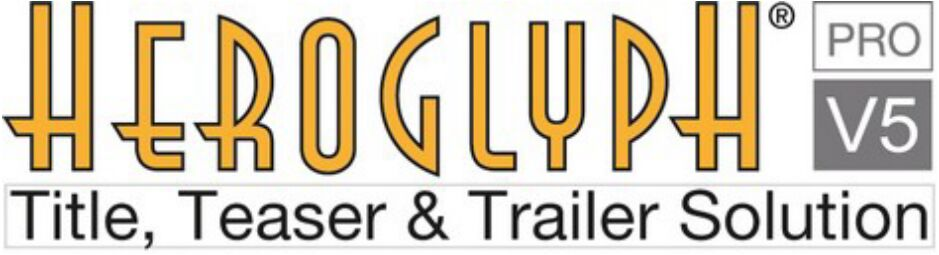

# Manuel d'utilisation 

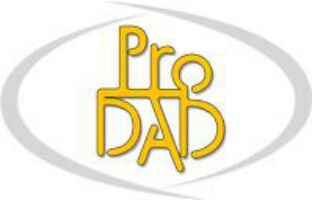

Auteur du manuel : Uwe Wenz  
Développeur logiciel : Holger Burkarth 

1 

## **Table des matières** 

|**Sommaire Bienvenue**|**5**|
|---|---|
|Dispositions relatives aux droits d'auteur / Mentions légales|5|
|Informations supplémentaires|6|
|**Installation, enregistrement, aide, support et configuration requise**|**6**|
|Installation et enregistrement|6|
|Aide|7|
|Assistance technique - Support|7|
|Configuration requise|8|
|**Lancement du programme et plugins**|**8**|
|Heroglyph stand-alone (autonome)|8|
|Adobe After Effects|9|
|Adobe Premiere|10|
|Adobe Premiere Elements|13|
|Avid Media Composer|14|
|Pinnacle Studio|15|
|Corel|16|
|Grass Valley EDIUS/NEO|18|
|MAGIX|19|
|Vegas Pro|20|
|Movie Studio Platinum|21|
|**Ateliers de découverte**|**23**|
|Création d'un diaporama|23|
|Créer un mur vidéo 3x3 avec effets et design|29|
|Créer des itinéraires avec un objet sur sa propre carte géographique|37|
|Animer un titre dans une image de panorama urbain (Travail avec les calques)|46|
|Combiner des modèles de bandes-annonces dans la timeline (Ex. Teaser/News + mur vidéo)|51|
|Créer une écriture manuscrite automatique|61|
|Travailler avec des composants (Génériques, textes défilants et autres animations de texte)|66|
|Créer un Lower-Third via l'assistant et le modifier ultérieurement|73|
|**L'assistant de démarrage rapide Heroglyph (Quick Start Wizard)**|**78**|
|Aperçu|78|
|Les options Nouveau projet et Ouvrir un projet|78|
|Paramètres du format vidéo|79|
|Démo du produit|80|
|**Les assistants (Wizards)**|**80**|
|**Créer un titre & une bande-annonce**|**80**|
|Sélectionner un modèle|80|
|Aperçu - Modèles, prévisualisation, saisie de texte, design et sélection d'effets|81|
|**Créer un itinéraire**|**85**|
|Importer une image/carte et tracer l'itinéraire|85|
|Chemin - Sélectionner le style d'itinéraire ainsi que l'effet d'apparition et de disparition|87|
|Objet - Modifier l'objet de l'itinéraire, ajouter une animation et des effets|89|
|Minutage - Définir la pause de l'itinéraire et la vitesse de déplacement|91|
|**Créer un mur vidéo**|**92**|
|Sélectionner un modèle|92|
|Texture - Importer des images|93|
|Style - Définir le design|95|
|Animation - Définir la durée et ajouter des effets|96|
|**Insérer un diaporama**|**98**|
|Importer des images et paramétrer le temps|99|
|Définir le style photo|100|

2 

|Définir les textes|102|
|---|---|
|**Écriture manuscrite**|**104**|
|Sélectionner un modèle|104|
|Modification ultérieure du texte, réglage des effets et de la durée|105|
|**Heroglyph**|**108**|
|Aperçu|108|
|Fonctions de base|109|
|La prévisualisation interactive|110|
|Le storyboard|111|
|La timeline|112|
|**Fichier**|**114**|
|Nouveau projet / Ouvrir un projet / Enregistrer le projet|114|
|Paramètres|115|
|**Démarrage**|**118**|
|Presse-papiers - Copier/Coller/Couper|118|
|Mode - Sélecteur/Texte/Chemin|119|
|Police - Police d'écriture & Symboles|122|
|Police - Options de design avancées|124|
|Paragraphe - Aligner le texte|125|
|**Insertion**|**125**|
|Insérer un élément|125|
|Modèles|126|
|Composant|127|
|Écriture manuscrite|127|
|Diaporama|128|
|Mur vidéo|129|
|Itinéraire|129|
|Timeline - Diapositive de texte|131|
|Timeline - Diapositive graphique|132|
|Graphiques - Symbole|134|
|Graphiques - Insérer un graphique - Insérer des masques - Nouveaux objets|136|
|**Mise en page**|**136**|
|Alignement - Aligner les objets|136|
|Alignement - Ajuster la taille de l'objet et la rotation|138|
|Alignement - Organiser les objets en calques|140|
|Paragraphe - Aligner le texte|140|
|Miroir - Miroir horizontal et vertical|141|
|Crénage - Aligner le texte horizontalement et verticalement - Crénage/Sélecteur|141|
|Métrique|142|
|Métrique - Options de design avancées|143|
|**Conception**|**143**|
|Sélectionner des modèles de design|143|
|Modèles - Options de design avancées|144|
|Attributs - Opacité - Flou|145|
|Attributs - Gras - Italique - Creux|146|
|Options - Avant - Biseau - Contour|147|
|Options - Lueur - Ombre|151|
|Options - Profondeur - Halo|153|
|**Animation**|**154**|
|Sélectionner des modèles d'effets - Sélectionner/réinitialiser les effets IN/Total/OUT|155|
|Modèles - Options d'effets avancées|157|
|Paramètres de vitesse et de minutage|157|
|**Affichage**|**158**|
|Arrière-plan - Transparent ou Vidéo|158|
|Paramètres|159|

3 

|Cadre - Zone de texte sécurisée|160|
|---|---|
|**Options d'itinéraire (uniquement disponible lors de la création d'un itinéraire/chemin)**|**160**|
|Sélectionner des modèles de design d'objet et d'itinéraire - Miroir|160|
|Modèles - Options de design avancées|162|
|Édition - Chemin - Sélecteur - Épaisseur de l'itinéraire - Pointillé - Style d'animation|162|
|Chemin - Adoucir - Direction - Paramètres de synchronisation - Pause|164|
|**Options graphiques (uniquement disponible lors de l'utilisation d'un graphique)**|**165**|
|Sélectionner des modèles graphiques - Miroir horizontal, vertical et réinitialiser|165|
|Texture - Sélectionner le style|166|
|Texture - Supprimer - Charger - Miroir horizontal et vertical|167|
|Texture - Options de design avancées|167|
|Masque - Sélectionner un masque|168|
|Masque - Supprimer - Inverser - Charger - Miroir horizontal et vertical|168|
|Masque - Options de design avancées|169|
|**Exportation**|**169**|
|Exporter des images|170|
|Exporter l'animation (en AVI, H264 et ProRes)|172|

4 

## **Bienvenue** 

### **Dispositions relatives aux droits d'auteur / Mentions légales** Copyright proDAD GmbH. Tous droits réservés. 

#### Conditions de licence 

Veuillez lire attentivement les conditions de licence suivantes avant l'installation.

#### Contrat de licence 

Lors du lancement de l'installation, un contrat de licence s'affiche ; veuillez le lire attentivement. En installant le logiciel, vous acceptez ces dispositions relatives aux droits d'auteur, le contrat de licence et la procédure d'octroi de licence. 

#### Garantie de licence 

proDAD GmbH accorde l'utilisation conforme et autorisée du présent produit. Le présent produit ne peut être utilisé que sur un seul poste de travail. Ni le logiciel ni le manuel ne peuvent être reproduits, même en partie, sans l'autorisation écrite de proDAD GmbH. L'installation du produit vaut acceptation de la garantie de licence, de la disposition sur les droits d'auteur, ainsi que de la limitation de responsabilité. 

#### Marques commerciales 

Tous les produits et marques commerciales mentionnés dans ce produit sont des marques commerciales de leurs propriétaires respectifs. Toutes les marques commerciales sont utilisées sans garantie de libre utilisation et peuvent être des marques déposées. 

#### Limitation de responsabilité 

L'étendue totale de la responsabilité consiste uniquement en la réclamation du remplacement du produit. Cela s'applique à proDAD GmbH, aux preneurs de licence et aux distributeurs éventuels. Une réclamation n'est valable qu'en cas de retour correct du logiciel en indiquant un numéro de retour de marchandise qui doit être convenu au préalable avec proDAD GmbH. De plus, une preuve d'achat doit être jointe au retour. Si un dysfonctionnement du présent produit est dû à une application défectueuse, un abus, un accident ou une manipulation incorrecte, la garantie ne s'applique pas. proDAD GmbH, ses partenaires commerciaux et preneurs de licence ne sont pas responsables des dommages et dommages consécutifs résultant de l'impossibilité d'utiliser le présent produit. Dans tous les cas, le montant de la responsabilité est limité au prix d'achat du produit. 

#### Documentations 

La production et la traduction des manuels ont été effectuées avec le plus grand soin. Cependant, des erreurs ne peuvent être totalement exclues. proDAD GmbH décline toute responsabilité pour les conséquences d'éventuelles déclarations ou informations erronées. Sous réserve de modifications techniques et visuelles. Les remarques sont toujours les bienvenues. 

#### Droit d'auteur 

Le logiciel ainsi que les composants individuels de ce produit sont la propriété de proDAD GmbH. En installant ce produit, le licencié accepte d'éviter toute utilisation et duplication non autorisées. 

proDAD GmbH décline toute responsabilité pour l'utilisation du programme et la publication de contenus et de données générés avec ce programme. 

proDAD GmbH * Gauertstr. 2 * 78194 Immendingen * Allemagne * HRB 1077 

5 

### **Informations supplémentaires** 

#### **INFORMATIONS SUPPLÉMENTAIRES SUR HEROGLYPH** Ateliers et FAQ : www.prodad.com Formations et médias d'apprentissage : www.prodad.com 

## **Installation, enregistrement, aide, support et configuration requise** 

### **Installation et enregistrement** 

#### **1. Installation** Lancez soit le fichier * **.exe** de votre téléchargement, soit le fichier de configuration (Setup) de votre CD. Suivez ensuite les instructions d'installation. 

Si vous êtes invité à saisir un **code d'activation** (numéro de série) lors de l'installation, saisissez le code que vous avez reçu avec l'e-mail d'instructions de téléchargement (pour une livraison électronique), ou que vous trouverez dans la boîte (si vous avez reçu une livraison physique sur DVD). 

Veuillez noter lors de l'installation que votre plugin sera également installé. 

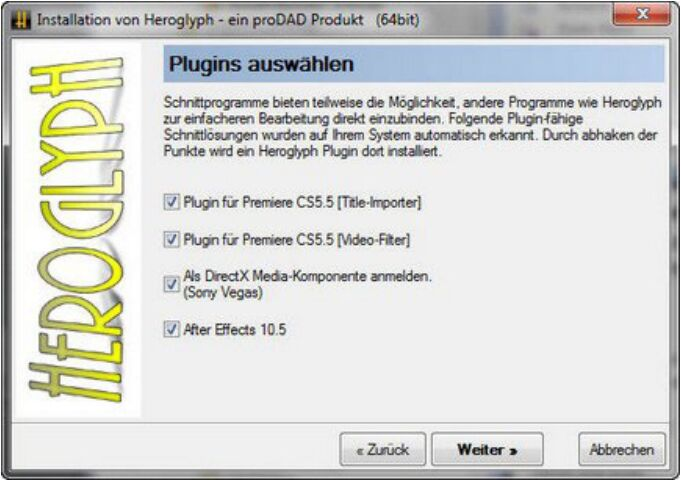

Après l'installation, vous pouvez lancer **Heroglyph** en tant que logiciel autonome ou l'utiliser comme plug-in dans divers programmes de montage. 

6 

#### **2. Enregistrement d'Heroglyph** Veuillez enregistrer votre proDAD Heroglyph sur <u>http://www.prodad.com/home/community_login/register.xhtml.</u> 

### **Aide** Des questions se posent lors de l'utilisation de tout programme. Si vous avez des questions sur Heroglyph, vous obtiendrez des réponses rapidement et facilement. L'aide intégrée au programme est accessible à tout moment via le menu « ? » et vous mène directement au résultat souhaité. 

Vous y trouverez également un index pour une consultation plus facile - sous forme électronique moderne. 

L'aide principale, le conseiller, l'aperçu complet du logiciel est l'aide en ligne du programme. 

Ce manuel vous propose une introduction ainsi que des informations systématiques. Vous trouverez des informations détaillées et approfondies dans l'aide en ligne mentionnée. 

#### **Informations supplémentaires :** Le point de contact pour plus d'informations est le site Web www.prodad.com. 

Vous y trouverez : 

- Des ateliers 

- Des manuels complémentaires 

- Des tutoriels 

- Des informations sur les nouveaux plugins (créés après la rédaction de ce manuel) 

### **Assistance technique - Support** 

#### **Support proDAD** Nous, proDAD, sommes à votre disposition pour toute question concernant le programme. 

Contactez-nous simplement 

- par e-mail à **customerservice@prodad.com** - par téléphone : ++49 (0)7462 9459 0 

- par courrier : proDAD GmbH, Gauertstr. 2, 78194 Immendingen, Allemagne 

Dans tous les cas, veuillez préparer les informations suivantes pour nous : 

- Numéro de version et date du programme (via "i") 

- Votre système d'exploitation utilisé 

- Le cas échéant, le nom et le numéro de version du programme de montage vidéo utilisé 

- Le cas échéant, quelles mises à jour du programme ont déjà été installées 

- Le cas échéant, le fichier journal ; vous obtiendrez plus d'informations sur sa création ici : www.prodad.com 

#### **_Remarque :_** _Vous obtiendrez les **mises à jour de service** actuelles sur la page de **Service Heroglyph** sur www.prodad.com. Après l'installation de la dernière version d'Heroglyph, de nouvelles fonctionnalités sont disponibles et les problèmes éventuels ont été résolus._ 

7 

### **Configuration requise** Veuillez noter la configuration système suivante : 

- Min. 8 Go de mémoire principale (RAM), 8 Go de disque dur 

## **Lancement du programme et plugins** 

### **Heroglyph stand-alone (autonome)** Vous pouvez lancer **Heroglyph** directement depuis le bureau en double-cliquant sur l'**icône Heroglyph** 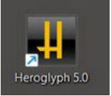

ou via le **menu Démarrer de Windows** : **Démarrer** /Tous les programmes/proDAD/ **Démarrer Heroglyph** Heroglyph démarre maintenant avec l'assistant (Assistant de démarrage rapide / QuickStart). 

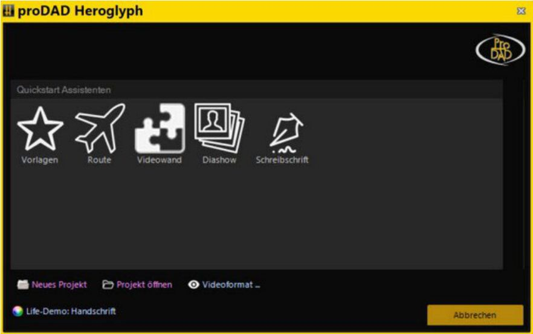

8 

### **Adobe After Effects** Avec l'installation de **Heroglyph**, le **plugin After Effects** est automatiquement installé. Dans After Effects, le plugin se trouve alors dans les Effets & Paramètres prédéfinis : 

#### **Procédure :** 1. Localisez les **Effets & Paramètres prédéfinis**. 

2. Sélectionnez ici le répertoire **proDAD**. 

3. Faites glisser l'entrée **Heroglyph** en maintenant le bouton gauche de la souris enfoncé sur le clip vidéo souhaité dans la timeline. 

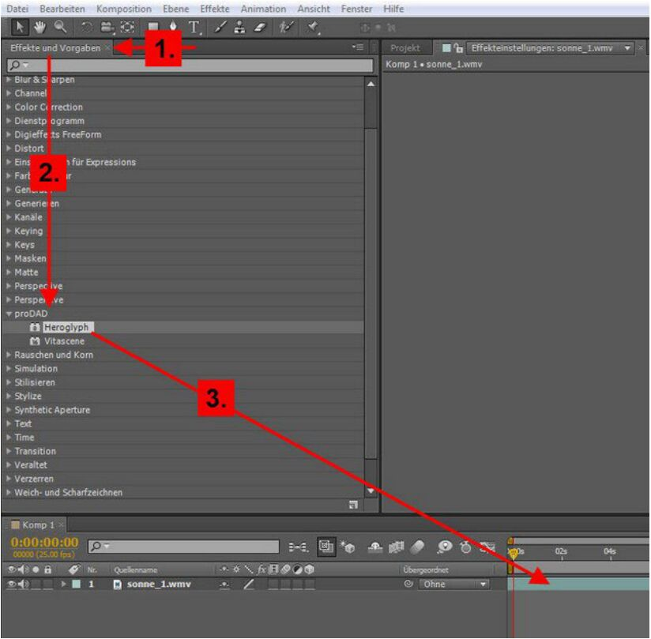

4. L'assistant Heroglyph démarre. Créez un projet dans Heroglyph. 

5. Une fois le projet modifié et terminé dans Heroglyph, retournez simplement à After Effects en appuyant sur la touche **F12**. Ou utilisez l'option **Appliquer le titre**. 

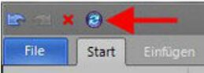

Ici, le projet Heroglyph est automatiquement enregistré. 

9 

6. Cliquez sur l'entrée **Edit Effect** (Modifier l'effet) dans les **Paramètres d'effet d'After Effects** pour redémarrer Heroglyph. 

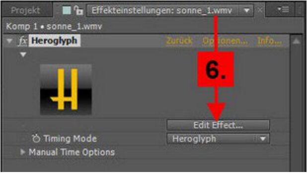

Vous trouverez plus d'informations sur l'utilisation dans les chapitres suivants sur Heroglyph. 

### **Adobe Premiere** Avec l'installation de **Heroglyph**, le **plugin Premiere** est automatiquement installé. Heroglyph est disponible en tant que **Filtre** et **Plugin de titrage**. 

#### **1. Dans Premiere, le plugin se trouve dans les filtres vidéo :** 

#### **Procédure :** 1. Localisez les **Effets**. 

2. Ouvrez le répertoire **Effets vidéo**. 

3. Sélectionnez ici le répertoire **proDAD**, et ouvrez-le. 

4. Faites glisser l'entrée **Heroglyph Filter** (via glisser-déposer) sur le clip vidéo souhaité dans la timeline. 

10 

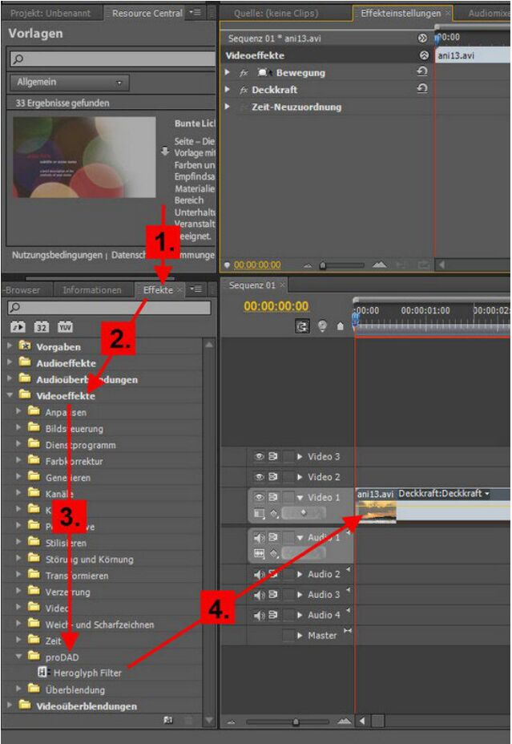

5. L'assistant Heroglyph démarre. Créez un projet dans Heroglyph. 

6. Une fois le projet modifié et terminé dans Heroglyph, retournez simplement à Premiere en appuyant sur la touche **F12**. Ou utilisez l'option **Appliquer le titre**. 

Ici, le projet Heroglyph est automatiquement enregistré. 

7. Si vous souhaitez redémarrer le **Filtre Heroglyph**, allez dans l'onglet **Options d'effet/Filtre Heroglyph** et cliquez sur le bouton **Configuration (Setup)**. 

11 

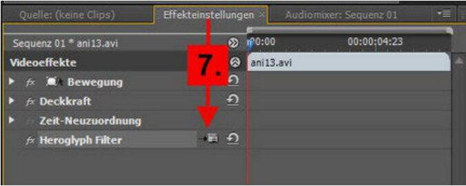

#### **2. Dans Premiere, le plugin se trouve en tant que Titreur :** 

#### **Procédure :** 

#### 1. Cliquez sur **Fichier/Nouveau**. 

2. Dans le menu, cliquez ensuite sur l'option **Heroglyph Title...**. 

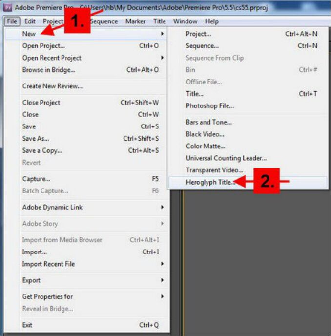

3. L'assistant Heroglyph démarre. Créez un projet dans Heroglyph. 

4. Une fois le projet modifié et terminé dans Heroglyph, retournez simplement à Premiere en appuyant sur la touche **F12**. Ou utilisez l'option **Appliquer le titre**. 

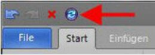

12 

Ici, le projet Heroglyph est automatiquement enregistré. 

### **Adobe Premiere Elements** Avec l'installation de **Heroglyph**, le **plugin Premiere Elements** est automatiquement installé. Dans Premiere Elements, le plugin se trouve alors dans les **Effets** : 

#### **Procédure :** 1. Localisez les **Effets** (dans l'onglet **Éditer**) 

2. Sélectionnez ici le répertoire **proDAD**. 

3. Faites glisser l'entrée **Heroglyph Filter** (via glisser-déposer) sur le clip vidéo souhaité dans la timeline. 

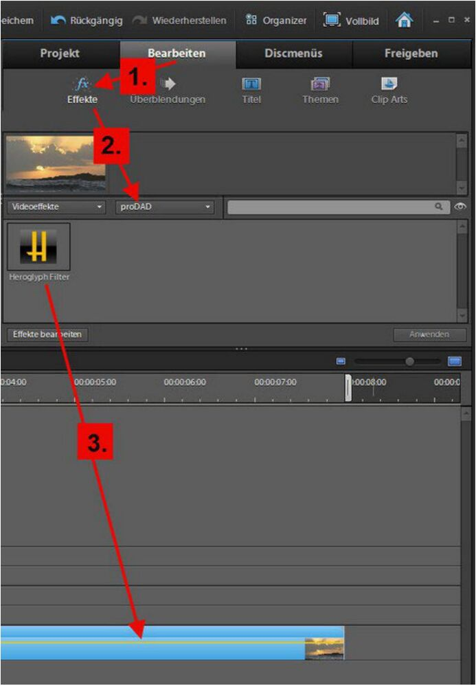

13 

4. L'assistant Heroglyph démarre. Créez un projet dans Heroglyph. 

5. Une fois le projet modifié et terminé dans Heroglyph, retournez simplement à Elements en appuyant sur la touche **F12**. Ou utilisez l'option **Appliquer le titre**. 

Ici, le projet Heroglyph est automatiquement enregistré. 

#### **_Remarque :_** _Si vous souhaitez supprimer l'effet Heroglyph, faites un clic droit sur le **Filtre Heroglyph** et sélectionnez l'option **Effacer**._ 

Vous trouverez plus d'informations sur l'utilisation dans les chapitres suivants sur Heroglyph. 

### **Avid Media Composer** Avec l'installation de **Heroglyph**, le **plugin Media Composer** est automatiquement installé. 

1. Démarrez **Media Composer**. Dans la boîte de dialogue des effets de Media Composer se trouve le répertoire 

- **proDAD**, ouvrez-le. 

2. Faites maintenant glisser via glisser-déposer le **Filtre Heroglyph** dans la timeline 

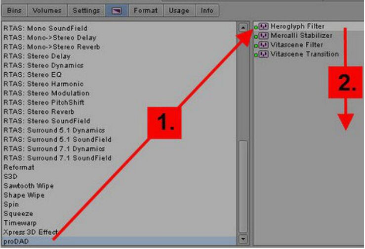

et cliquez dans l'**Éditeur d'effets / Filtre Heroglyph** sur l'option **Modifier l'effet (Edit Effect)**. 

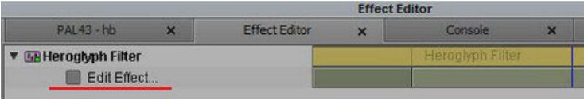

3. L'assistant Heroglyph démarre. Créez un projet dans Heroglyph. 

14 

4. Une fois le projet modifié et terminé dans Heroglyph, retournez simplement à Media Composer en appuyant sur la touche **F12**. Ou utilisez l'option **Appliquer le titre**. 

Ici, le projet Heroglyph est automatiquement enregistré. 

Vous trouverez plus d'informations sur l'utilisation dans les chapitres suivants sur Heroglyph. 

### **Pinnacle Studio** Avec l'installation de **Heroglyph**, le **plugin Pinnacle Studio** est automatiquement installé. 

#### **Procédure :** 1. Localisez les **Effets/proDAD** et là le répertoire **Heroglyph**, ouvrez-le. 
2. Faites glisser l'entrée **Heroglyph Effect** en maintenant le bouton gauche de la souris enfoncé sur le clip vidéo sélectionné dans la timeline. 

3. L'effet est représenté par une **_ligne magenta_** dans le clip. Double-cliquez dessus. 

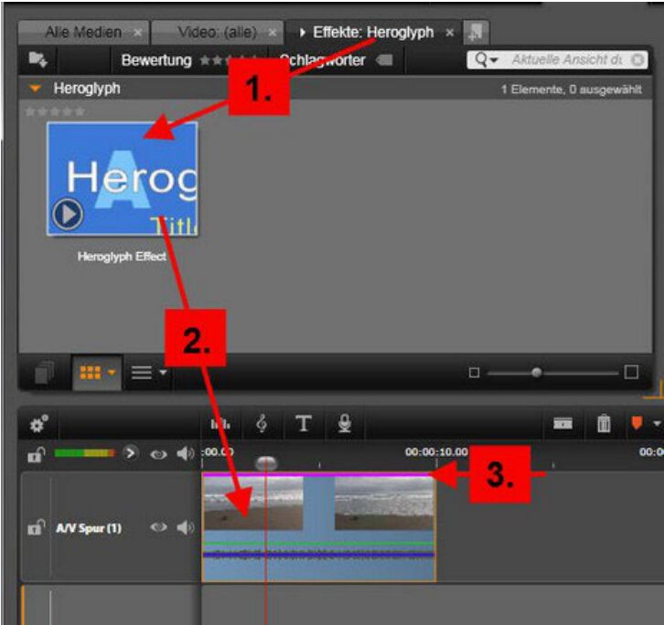

4. Une nouvelle boîte de dialogue s'ouvre avec l'onglet **Effets** actif. 

5. L'**Effet Heroglyph** sélectionné apparaît à droite, cliquez ici sur le bouton **Modifier**. 

15 

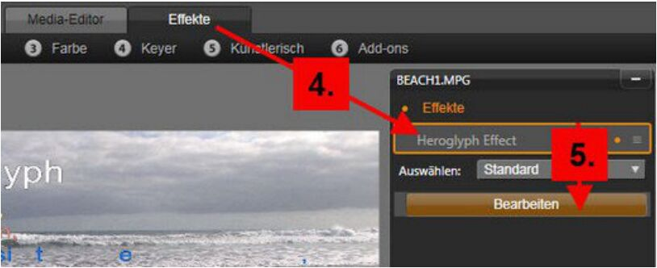

6. L'assistant Heroglyph démarre. Créez un projet dans Heroglyph. 

7. Une fois le projet modifié et terminé dans Heroglyph, retournez simplement à Avid Studio en appuyant sur la touche **F12**. Ou utilisez l'option **Appliquer le titre**. 

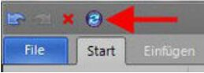

Ici, le projet Heroglyph est automatiquement enregistré. 

8. Confirmez maintenant l'effet Heroglyph dans l'onglet **Effets** avec **OK**. L'effet est appliqué dans la timeline. 

#### **_Remarque :_** _Si vous souhaitez supprimer **Heroglyph** du clip en tant qu'effet, faites un clic droit sur la **ligne magenta** dans le clip et sélectionnez l'option **Effet/Supprimer/Heroglyph**._ 

Vous trouverez plus d'informations sur l'utilisation dans les chapitres suivants sur Heroglyph. 

### **Corel** Avec l'installation de **Heroglyph**, le **plugin Corel** est automatiquement installé. 

#### **Procédure :** 1. Localisez **FX**. 

2. Activez maintenant votre clip dans la timeline par un **double-clic**. 

3. Cliquez ensuite dans **FX** sur **proDAD**. 

4. Faites glisser l'entrée **Heroglyph Title** qui s'y trouve sur le clip vidéo sélectionné (via glisser-déposer) dans la timeline de Corel. 

5. Cliquez maintenant sur le bouton **Personnaliser le filtre**. 

16 

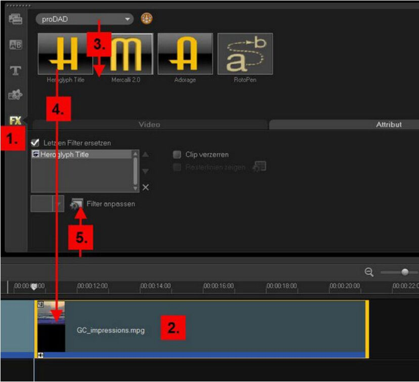

6. L'assistant Heroglyph démarre. Créez un projet dans Heroglyph. 

7. Une fois le projet modifié et terminé dans Heroglyph, retournez simplement à Corel en appuyant sur la touche **F12**. Ou utilisez l'option **Appliquer le titre**. 

Ici, le projet Heroglyph est automatiquement enregistré. 

8. Si vous souhaitez redémarrer Heroglyph, activez à nouveau le clip dans la timeline par un double-clic, allez dans **FX / proDAD / Heroglyph** et cliquez sur le bouton **Personnaliser le filtre**. 

#### **_Remarque :_** _Si vous souhaitez supprimer l'effet Heroglyph du clip, allez dans **FX / proDAD / Heroglyph** et cliquez sur le bouton **Supprimer le filtre (X)**._ 

Vous trouverez plus d'informations sur l'utilisation dans les chapitres suivants sur Heroglyph. 

17 

### **Grass Valley EDIUS/NEO** Avec l'installation de **Heroglyph**, le **plugin EDIUS/NEO** est automatiquement installé dans le système. 

Heroglyph est disponible en tant que **Filtre** et **Plugin de titrage**. 

#### **1. Dans EDIUS/NEO, le plugin se trouve dans les filtres vidéo :** 

#### **Procédure :** 1. Localisez les **Filtres vidéo** (dans l'onglet **Effet**). 

2. Cliquez sur le dossier **proDAD** qui s'y trouve. 

3. Faites glisser l'entrée **Heroglyph Filter** qui s'y trouve sur le clip vidéo sélectionné (via glisser-déposer) dans la timeline EDIUS/NEO. 

4. Dans la **palette d'informations**, double-cliquez sur l'entrée **Heroglyph Filter**. 

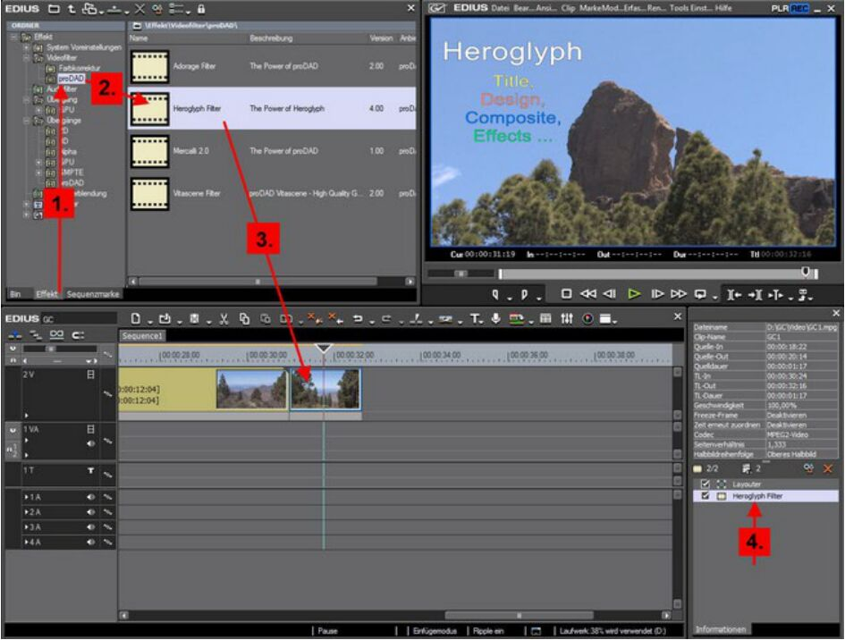

5. L'assistant Heroglyph démarre. Créez un projet dans Heroglyph. 

6. Une fois le projet modifié et terminé dans Heroglyph, retournez simplement à EDIUS/NEO en appuyant sur la touche **F12**. Ou utilisez l'option **Appliquer le titre**. 

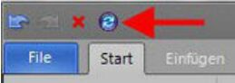

Ici, le projet Heroglyph est automatiquement enregistré. 

18 

#### **2. Dans EDIUS/NEO, le plugin se trouve en tant que Titreur :** 

#### **Procédure :** 1. Localisez le **symbole T** au-dessus de la timeline et cliquez dessus. 

2. Cliquez sur l'option **Heroglyph Titler**. 

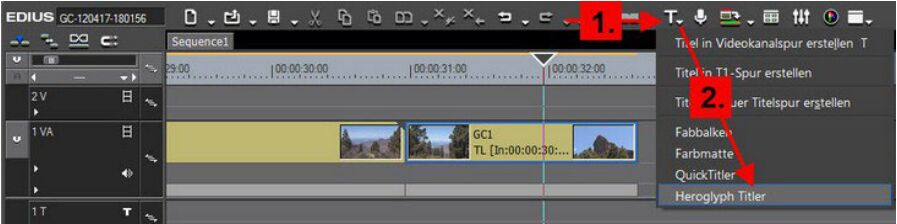

3. L'assistant Heroglyph démarre. Créez un projet dans Heroglyph. 

4. Une fois le projet modifié et terminé dans Heroglyph, retournez simplement à EDIUS/NEO en appuyant sur la touche **F12**. Ou utilisez l'option **Appliquer le titre**. 

Ici, le projet Heroglyph est automatiquement enregistré. 

Vous trouverez plus d'informations sur l'utilisation dans les chapitres suivants sur Heroglyph. 

### **MAGIX** Avec l'installation de **Heroglyph**, le **plugin MAGIX** est automatiquement installé. 

#### **Procédure :** 1. Démarrez **MAGIX Vidéo deluxe** et allez dans l'onglet **Titres**. 

2. Après avoir ouvert l'onglet **Titres**, vous trouverez ici **proDAD Heroglyph**, cliquez dessus. 

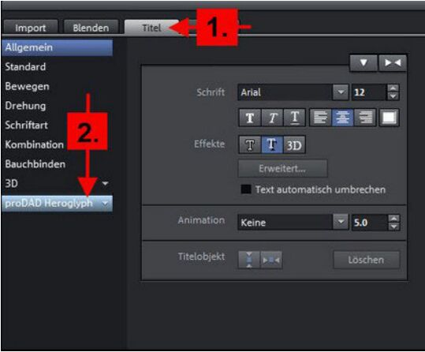

19 

3. L'assistant Heroglyph démarre. Créez un projet dans Heroglyph. 

4. Une fois le projet modifié et terminé dans Heroglyph, retournez simplement à MAGIX en appuyant sur la touche **F12**. Ou utilisez l'option **Appliquer le titre**. 

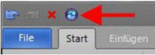

Ici, le projet Heroglyph est automatiquement enregistré. 

Vous trouverez plus d'informations sur l'utilisation dans les chapitres suivants sur Heroglyph. 

### **Vegas Pro** Avec l'installation de **Heroglyph**, le **plugin Vegas** est automatiquement installé. Dans Vegas, le plugin **Heroglyph** se trouve alors dans l'onglet **Générateurs de médias** : 

#### **Procédure :** 1. Localisez l'onglet **Générateurs de médias** (Dossier Tiers). 

2. Faites glisser l'entrée **proDAD Heroglyph Titler** en maintenant le bouton gauche de la souris enfoncé dans la timeline. 

3. **proDAD Heroglyph** est maintenant inséré dans la boîte de dialogue **Générateurs de médias vidéo** ainsi que dans l'**Objet Timeline**. 

4. Cliquez ici sur le bouton **Modifier le filtre**. 

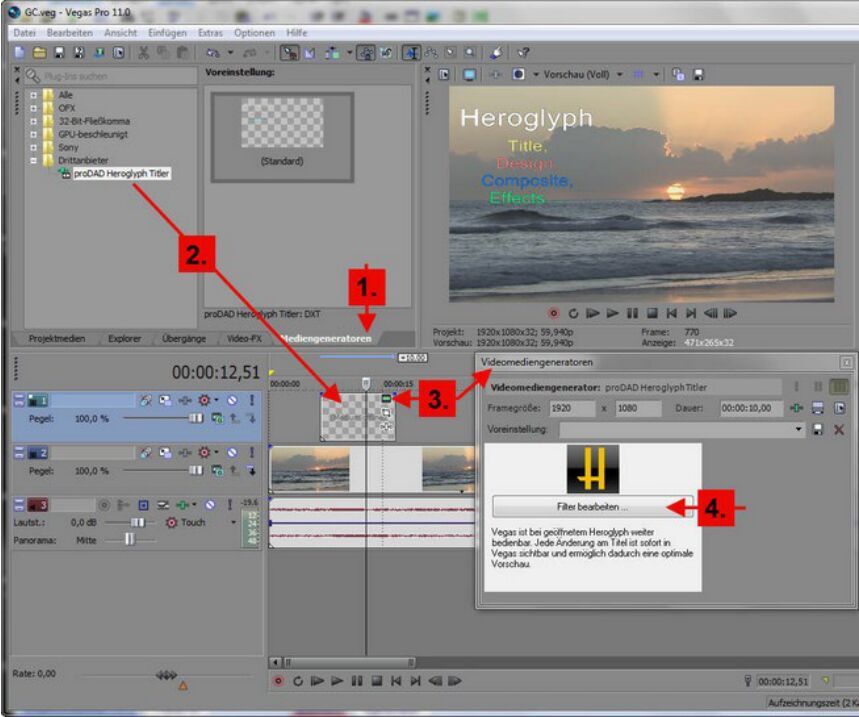

20 

5. L'assistant Heroglyph démarre. Créez un projet dans Heroglyph. 

6. Une fois le projet modifié et terminé dans Heroglyph, retournez simplement à Vegas en appuyant sur la touche **F12**. Ou utilisez l'option **Appliquer le titre**. 

Ici, le projet Heroglyph est automatiquement enregistré. 

7. Si vous souhaitez rouvrir **Heroglyph**, cliquez dans l'objet de la timeline (avec l'effet Heroglyph) dans la timeline sur le bouton **Médias générés...** (marqué en vert). 

8. Via la boîte de dialogue **Générateurs de médias vidéo/Modifier le filtre**, vous pouvez rouvrir Heroglyph. 

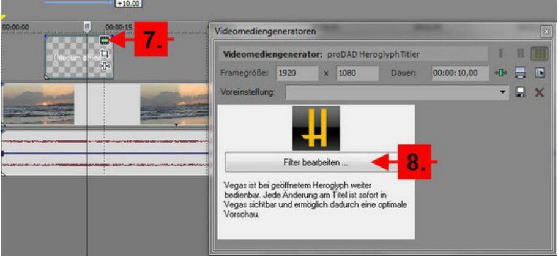

Vous trouverez plus d'informations sur l'utilisation dans les chapitres suivants sur Heroglyph. 

### **Movie Studio Platinum** Avec l'installation de **Heroglyph**, le **plugin Movie Studio** est automatiquement installé. Dans Movie Studio, le plugin **Heroglyph** se trouve alors dans l'onglet **Générateurs de médias** : 

#### **Procédure :** 1. Localisez l'onglet **Générateurs de médias**. 

2. Faites glisser l'entrée **proDAD Heroglyph Titler** en maintenant le bouton gauche de la souris enfoncé dans la timeline. 

3. **proDAD Heroglyph** est maintenant inséré dans la boîte de dialogue **Générateurs de médias vidéo** ainsi que dans l'**Objet Timeline**. 

4. Cliquez ici sur le bouton **Modifier le filtre**. 

21 

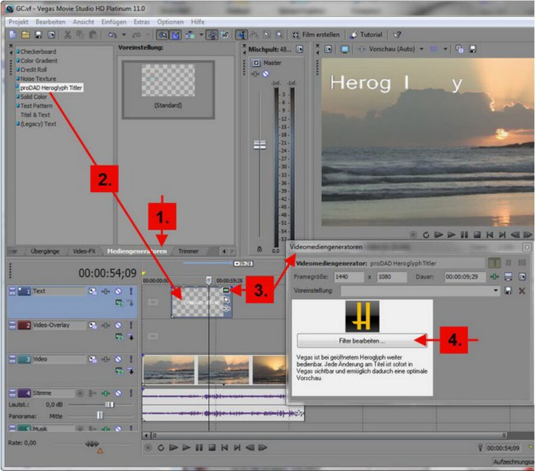

5. L'assistant Heroglyph démarre. Créez un projet dans Heroglyph. 

6. Une fois le projet modifié et terminé dans Heroglyph, retournez simplement à Vegas en appuyant sur la touche **F12**. Ou utilisez l'option **Appliquer le titre**. 

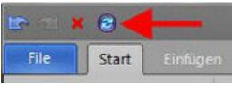

Ici, le projet Heroglyph est automatiquement enregistré. 

7. Si vous souhaitez rouvrir **Heroglyph**, cliquez dans l'objet de la timeline (avec l'effet Heroglyph) dans la timeline sur le bouton **Médias générés...** (marqué en vert). 

8. Via la boîte de dialogue **Générateurs de médias vidéo/Modifier le filtre**, vous pouvez rouvrir Heroglyph. 

22 

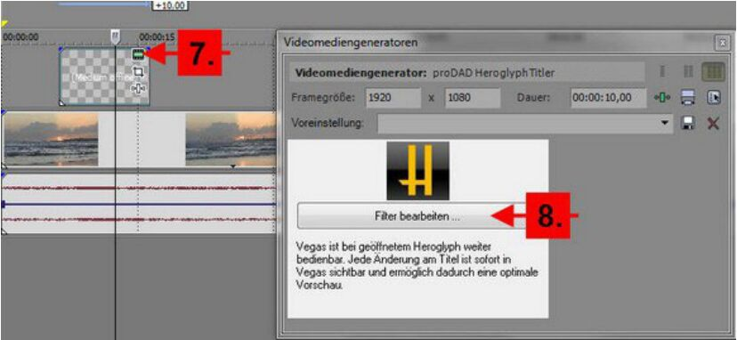

Vous trouverez plus d'informations sur l'utilisation dans les chapitres suivants sur Heroglyph. 

## **Ateliers de découverte** 

### **Création d'un diaporama** Dans cet **atelier**, l'accent est mis sur la création d'un **diaporama**. Il s'agit d'insérer ultérieurement une **image d'arrière-plan** et de remplacer le **masque** d'éléments d'image individuels. Le texte des titres d'image doit également être modifié. 

Démarrez Heroglyph, l'**assistant** apparaît. 

Cliquez dans l'assistant sur l'option **Diaporama**. La boîte de dialogue **Assembler les photos** démarre. 

23 

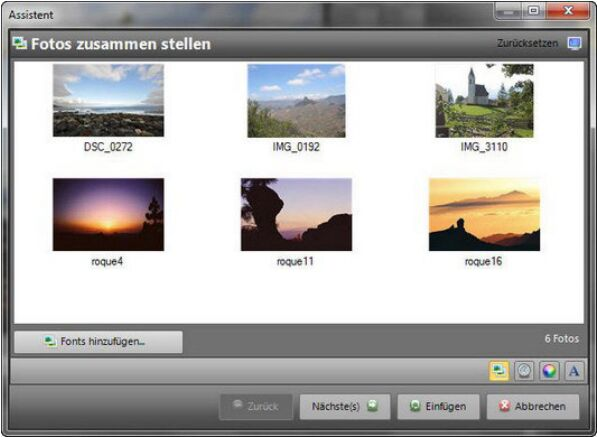

Vous trouverez d'autres détails sur la **création du diaporama dans l'assistant** ici. Une fois terminé, le diaporama créé démarre dans l'interface de travail de Heroglyph. Le **diaporama** (d'une durée de 29 secondes) est inséré dans l'aperçu et le projet dans la timeline. 

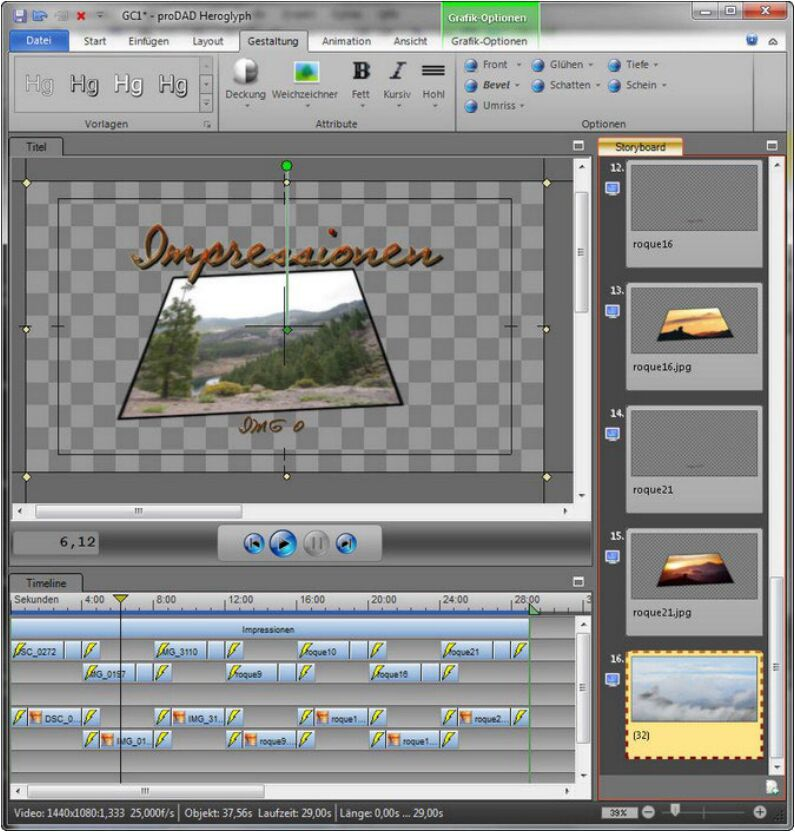

24 

#### **1. Ajouter une image d'arrière-plan au diaporama existant** 

#### **_Remarque :_** _Si vous utilisez Heroglyph comme plugin sur une vidéo ou une image dans un logiciel de montage, un arrière-plan est déjà disponible._ 

Insérez d'abord un autre objet dans la timeline par un clic droit via « Nouveau / Nouvel objet Timeline » et adaptez sa durée au projet.

Ensuite, ajustez l'objet timeline à la **durée** du projet. Pour ce faire, allez dans l'onglet **Animation/Minutage** 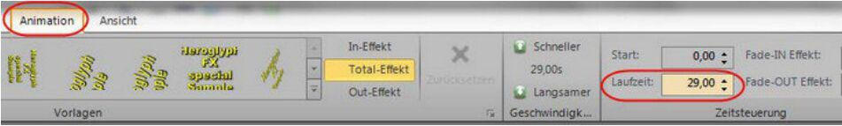

et déplacez le nouvel objet timeline dans la piste la plus basse de la timeline. 

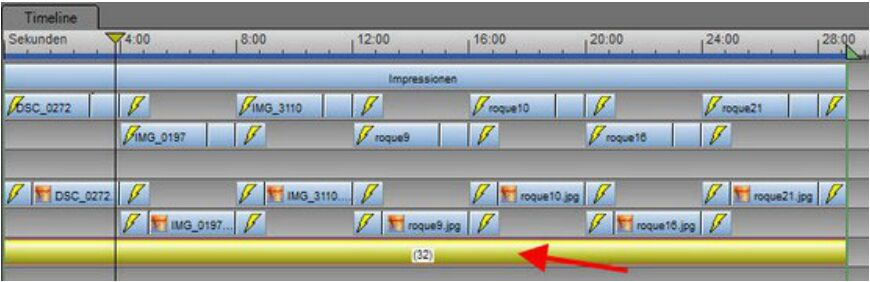

#### **_Remarque :_** _Veuillez noter que le nouvel objet timeline est sélectionné (en jaune)._ 

Insérez maintenant une **image**, ouvrez le **poste de travail** et transférez-la **via glisser-déposer** dans l'aperçu. Ajustez ensuite la **taille** de l'image dans l'aperçu. 

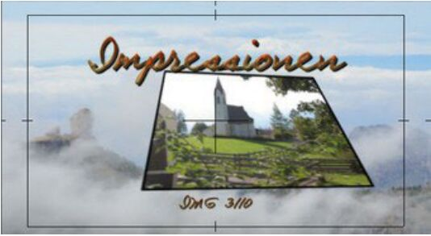

L'arrière-plan est ainsi défini. Maintenant, un **effet Total** peut être ajouté à l'image si nécessaire. Si vous utilisez par exemple un léger **effet de zoom**, l'image d'arrière-plan sera zoomée lentement (déplacée) sur toute sa durée. Ainsi, l'arrière-plan ne paraît pas statique. 

25 

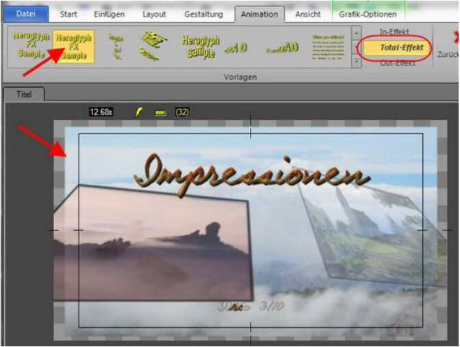

#### **2. Remplacer le masque et ajouter un style** Sélectionnez maintenant un **élément d'image** de votre diaporama (devient jaune dans la timeline). Ensuite, passez à l'onglet **Options graphiques**. Ici, sélectionnez un **modèle approprié (1.)**, en parallèle, un **aperçu du masque (2.)** devient visible. Le nouveau masque devient également visible dans l'**aperçu Heroglyph (3.)** et est appliqué par un clic de souris. Via l'option **Masque (4.)**, d'autres masques peuvent être assignés à l'image sélectionnée. 

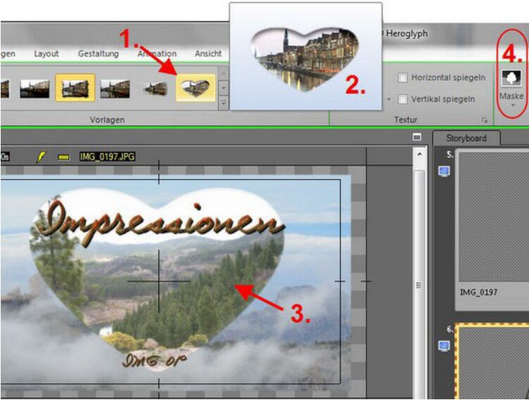

Via l'option **Style**, vous assignez un nouveau design au nouveau **masque**. 

26 

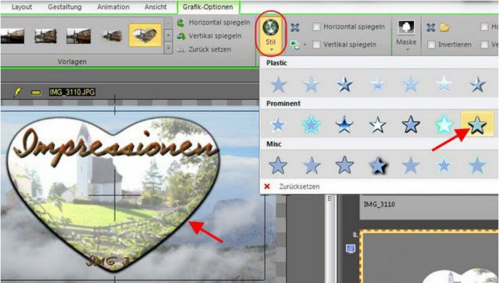

#### **3. Remplacer le texte d'un titre d'image** Si vous souhaitez modifier par exemple le texte d'une image affichée, sélectionnez l'**élément de texte** correspondant à l'image dans la timeline, double-cliquez sur le texte dans l'aperçu pour qu'il soit sélectionné, et saisissez le nouveau texte via le clavier. 

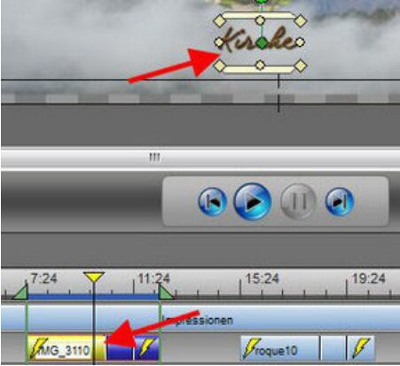

Vous pouvez ainsi renommer ultérieurement des images incorrectement nommées. Il est également possible d'échanger les **effets** disponibles (effet In/Total/Out) pour les images et les textes des éléments de diaporama disponibles. Les effets sont échangés dans l'onglet **Animation**. 

#### **_Remarque :_** _Ici aussi, il est important de sélectionner la section d'effet respective à modifier dans l'image ou le texte dans la timeline._ 

27 

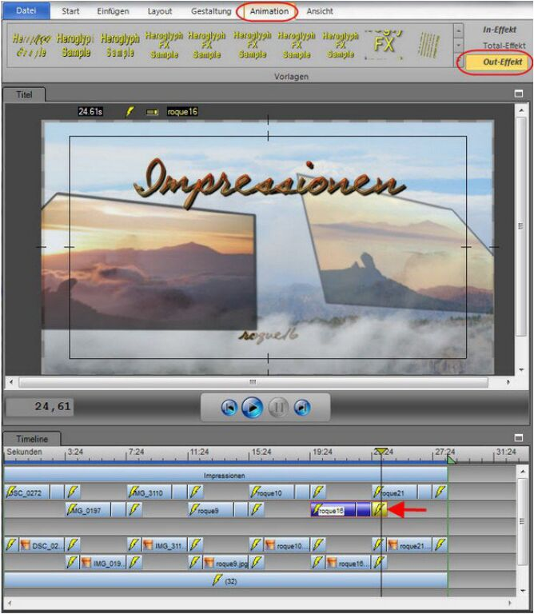

Si nécessaire, le **titre du diaporama** peut également être repositionné. Sélectionnez l'**élément de texte** dans la timeline, cliquez sur le texte dans l'**aperçu** pour qu'il soit sélectionné, puis déplacez-le à une nouvelle position. 

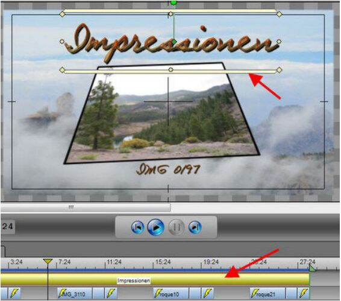

28 

Démarrez maintenant la **lecture (Playback)** dans l'aperçu. 

### **Créer un mur vidéo 3x3 avec effets et design** Dans cet **atelier**, il s'agit de créer un **mur vidéo 3x3** avec des effets et son propre design. Ensuite, un titre en écriture manuscrite automatique et un nouvel arrière-plan seront ajoutés. 

Cliquez dans l'assistant sur l'option **Videowand (Mur vidéo)**. 

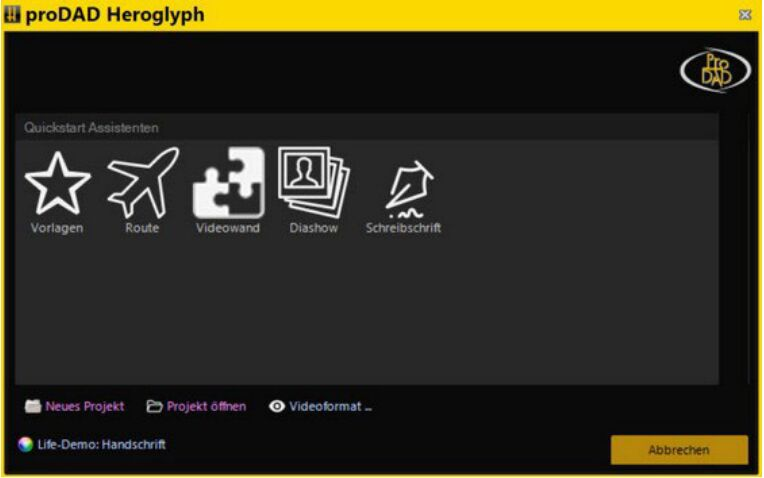

La boîte de dialogue **Vorlagen (Modèles)** démarre. Sélectionnez par exemple dans la catégorie **Formen (Formes)** le modèle **Herzen 3:3 (Cœurs 3:3)**. 

29 
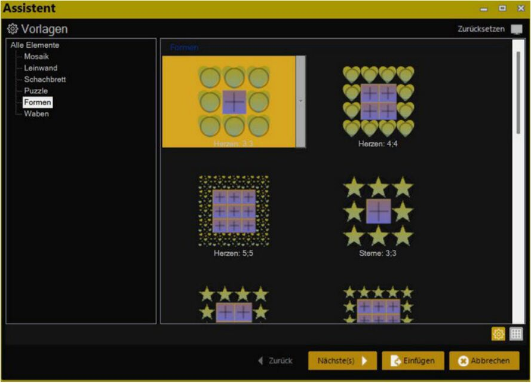

Vous trouverez d'autres détails sur la **création du mur vidéo dans l'assistant** ici. Une fois terminé, le mur vidéo créé démarre dans l'interface de travail de Heroglyph. Le **mur vidéo** (d'une durée de 10 secondes) est inséré dans l'aperçu et le projet dans la timeline. 

30 

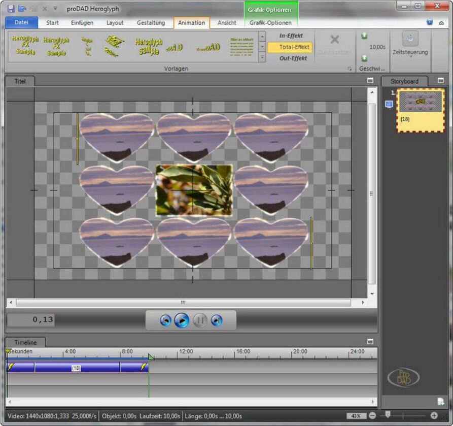

#### **1. Ajouter une image d'arrière-plan au mur vidéo existant** 

#### **_Remarque :_** _Si vous utilisez Heroglyph comme plug-in sur une vidéo ou une image dans un logiciel de montage, un arrière-plan est déjà disponible._ 

Tout d'abord, vous insérez **un autre objet de timeline** dans la timeline. Pour ce faire, allez dans l'onglet **Einfügen (Insertion)** et cliquez sur l'option **Element einfügen (Insérer un élément)**. La boîte de dialogue **Modèles** démarre, sélectionnez ici dans la zone **Timeline** l'option **Grafikfolie (Diapositive graphique)**. 

31 

Un objet timeline est inséré, ajustez-le maintenant à la **durée (Laufzeit)** du projet. Pour ce faire, allez dans l'onglet **Animation/Zeitsteuerung (Animation/Minutage)** 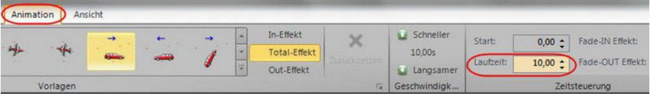

et déplacez le nouvel objet timeline dans la piste la plus basse de la timeline. Laissez une piste libre pour le texte qui suivra. 

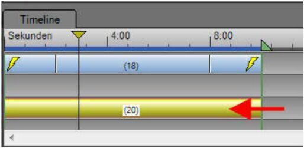

#### **_Remarque :_** _Veuillez noter que le nouvel objet timeline est sélectionné (en jaune)._ 

Insérez maintenant une **image**, ouvrez le **poste de travail** et transférez-la **via glisser-déposer** dans l'aperçu. Ajustez ensuite la **taille** de l'image dans l'aperçu. 

32 

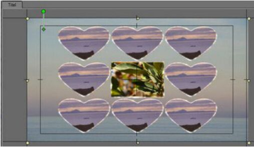

L'arrière-plan est ainsi défini. 

#### **2. Réduction et positionnement du mur vidéo dans l'aperçu** Sélectionnez l'objet timeline dans la timeline et cliquez dans l'aperçu sur le mur vidéo pour qu'il soit sélectionné. Allez dans l'onglet **Layout (1.)**. Déplacez maintenant la souris sur un **angle (2.)** et réduisez la taille du mur vidéo en maintenant le bouton gauche de la souris enfoncé. Positionnez-le ensuite au centre à l'aide de l'option **Ausgewählte Objekte mittig ausrichten (Aligner les objets sélectionnés au centre) (3.)**. 

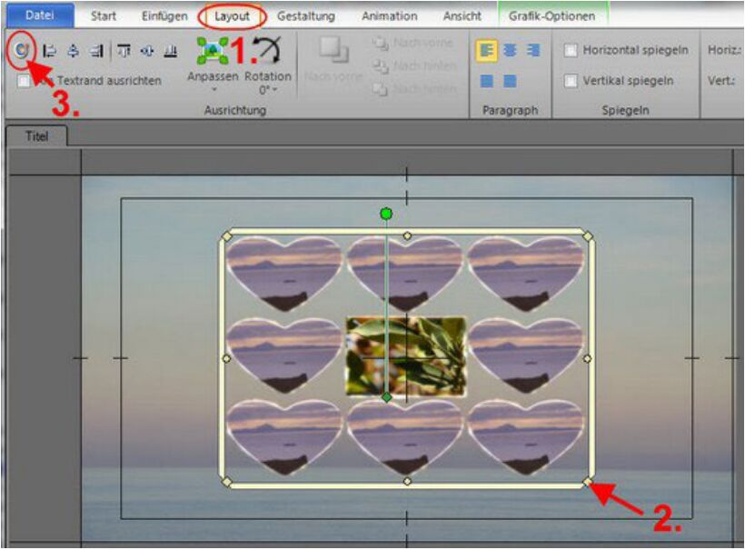

#### **3. Insérer du texte avec écriture manuscrite automatique** Allez d'abord dans l'onglet **Einfügen (Insertion)** et cliquez sur l'option **Komponente (Composant)**. La boîte de dialogue **Vorlagen wählen (Sélectionner un modèle)** démarre. Cliquez ici sur l'option **Script IN/OUT (1.)**, sélectionnez juste à droite un **modèle approprié (2.)** pour une écriture manuscrite automatique. 

33 
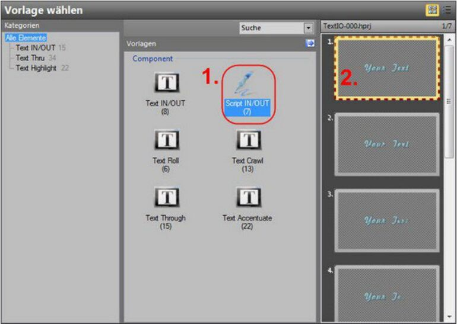

Cliquez sur **Erstellen (Créer)**, la boîte de dialogue pour la conception de l'écriture manuscrite automatique apparaît. Saisissez d'abord un **texte (1.)**, puis définissez un **style (2.)** et déterminez la **taille du texte (3.)**. La **durée (4.)** doit correspondre à la longueur du projet, choisissez par exemple 10 secondes. Démarrez ensuite la **lecture (5.)**. L'écriture manuscrite automatique comprend un **effet d'écriture**, c'est-à-dire que le texte s'affiche comme s'il était écrit à la main. 

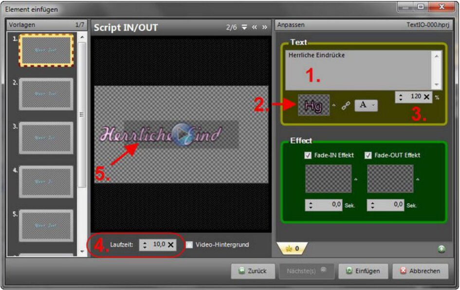

Pour appliquer l'écriture manuscrite automatique, cliquez sur **Einfügen (Insérer)**. Maintenant, la timeline doit être réorganisée, c'est-à-dire que les calques doivent être disposés de manière à ce que l'**écriture manuscrite automatique** se trouve au-dessus. Vous pouvez le faire dans le **Storyboard**. 

34 

Auparavant, le nouvel objet de timeline contenant l'écriture manuscrite automatique doit être placé entre les deux objets de timeline existants. Déplacez ensuite les objets de la timeline dans le **Storyboard/Ebenen (Storyboard/Calques)** comme suit. Dans l'aperçu, la nouvelle disposition s'affiche immédiatement. 

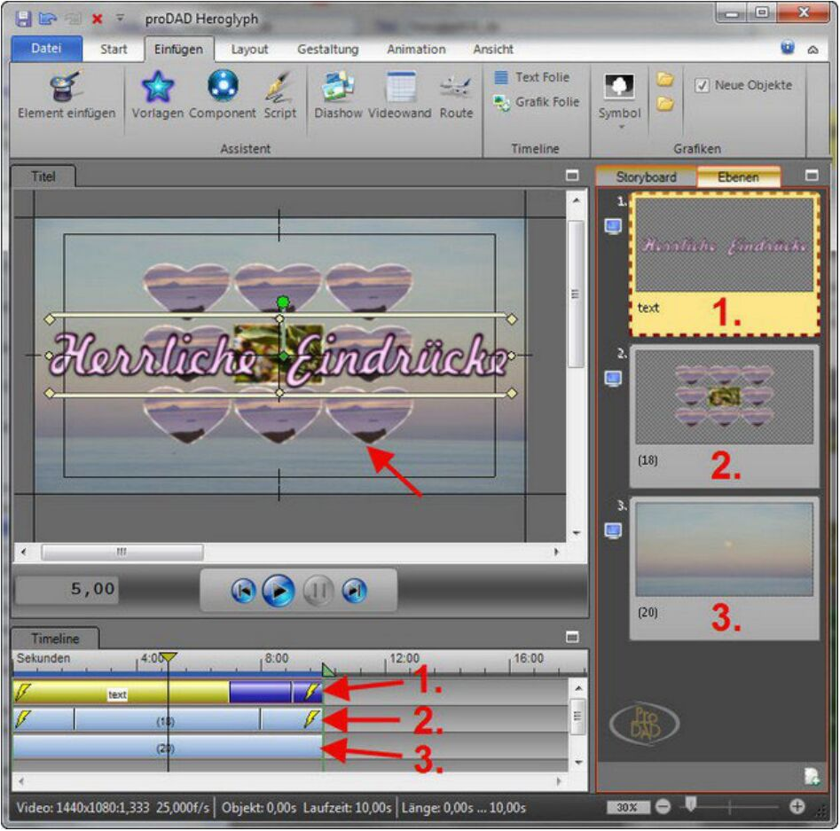

Maintenant, l'**écriture manuscrite automatique** doit encore être repositionnée sur le bord supérieur de l'image. Le cas échéant, le **mur vidéo** devrait être légèrement déplacé vers le bas. 

35 

Pour terminer, ajoutez un **effet Total** au mur vidéo. Actuellement, seul un effet IN/OUT est disponible dans le mur vidéo. Sélectionnez la **section centrale (1.) du mur vidéo** (objet de la timeline) dans la timeline. Allez ensuite dans l'onglet **Animation (2.)** et sélectionnez un **effet Total (3.)**. L'effet est immédiatement visible dans l'**aperçu (4.)**. 

Démarrez maintenant la **lecture** dans l'aperçu. 

36 

### **Créer des itinéraires mit objet sur sa propre carte géographique** Dans cet **atelier**, une **animation d'itinéraire avec 2 itinéraires** est créée, chacun avec un **objet** sur sa propre carte géographique (avec des pauses). Ensuite, 2 images (ou clips) sont ajoutées le long de l'itinéraire et enchaînées avec des effets de transition. 

À l'aide de l'assistant **Route**, vous pouvez créer un itinéraire animé (ou plusieurs) sur une carte géographique. Cliquez dans l'**assistant** sur l'option **Route**. 

La boîte de dialogue **Hintergrund - Landkarte (Arrière-plan - Carte)** démarre. 

Ici, vous importez d'abord une carte géographique souhaitée (par exemple depuis Google Maps) via l'option **Hintergrundbild laden (Charger l'image d'arrière-plan)**. 

#### **_Remarque :_** _Alternativement, vous pouvez également importer une carte géographique directement depuis le poste de travail via un glisser-déposer._ 

La carte géographique est insérée. 

37 

Tracez maintenant un itinéraire. Déplacez la souris à l'endroit où l'itinéraire doit commencer. Tracez ensuite le **tracé de l'itinéraire (1)** en maintenant le bouton gauche de la souris enfoncé. Vous pouvez ensuite activer un **aperçu en direct (3.)** via un **bouton (2.)**.

Ajoutez maintenant un **autre itinéraire**. Pour ce faire, déplacez la souris avec le **point jaune** vers une nouvelle position de départ et tracez le deuxième itinéraire du voyage. 

Les chemins sont maintenant créés, cliquez sur l'option **Nächste (Suivant)** pour ajouter des **objets**, un design ainsi que des **effets** à l'itinéraire.

Comment procéder est expliqué ici. 

Après avoir créé l'itinéraire avec les objets, l'interface de travail de Heroglyph démarre. L'**itinéraire** (environ 22 secondes) est inséré dans l'aperçu et le projet dans la timeline. 

Tout d'abord, il est peut-être nécessaire de **lisser ou d'arrondir les zwei chemins tracés**. L'objet se déplacera alors plus doucement le long du chemin tracé. Vous effectuez les réglages dans l'onglet Route-Optionen (Options d'itinéraire). Ouvrez ici l'option **Weich (Adoucir)** et sélectionnez **abrunden (arrondir)** ou **glätten (lisser)**. Auparavant, le bon chemin doit être sélectionné dans la timeline. 

Ensuite, nous mettons en valeur l'**épaisseur der chemins**. Utilisez pour cela l'option **Stärke (Épaisseur) (1.)** et choisissez **5.0**. Dans le deuxième chemin, un **design pointillé (2.)** est également sélectionné. La modification est immédiatement visible dans l'**aperçu (3.)**. 

39 

Maintenant, vous insérez **un autre objet de timeline** dans la timeline. Pour ce faire, allez dans l'onglet **Einfügen (Insertion)** et cliquez sur l'option **Element einfügen (Insérer un élément)**. La boîte de dialogue **Vorlagen (Modèles)** démarre, sélectionnez ici dans la zone **Timeline** l'option **Grafikfolie (Diapositive graphique)**. 

**_Remarque :_** _Veuillez noter que le nouvel objet de timeline est sélectionné (en jaune)._ 

40 

Insérez maintenant une **image**, ouvrez le **poste de travail** et transférez-la **via glisser-déposer** dans l'aperçu. Ajustez ensuite l'image en **taille, position** et temporellement dans le **déroulement du chemin**. 

Ajoutez maintenant un **effet d'apparition (Einblende) et de disparition (Ausblendeffekt)**. Pour ce faire, allez dans l'onglet **Animation**. Vous y trouverez les **In-Effekte (Effets d'entrée)** et les **Out-Effekte (Effets de sortie)**. Sélectionnez un type de fondu approprié dans les modèles. Déterminez ensuite à la souris la longueur du fondu d'**apparition et de disparition** dans la timeline. Dans l'**aperçu**, on peut voir actuellement l'effet de disparition. 

41 

Insérez ensuite une **autre image** avec des effets pour le 2ème chemin, procédez exactement de la même manière. 

42 

Ajoutez maintenant une **ombre (Schatten)** aux objets d'itinéraire utilisés ainsi qu'aux deux images le splinter de l'itinéraire. Sélectionnez successivement les différents objets dans la timeline, allez dans l'onglet **Gestaltung (Conception)**, choisissez l'option **Schatten (Ombre)** avec un **modèle d'ombre**. L'ombre est insérée sur l'image dans l'**aperçu**. 

43 

Après cela, chaque objet et image a reçu une **ombre**. 

Ajoutez maintenant un **titre** dans l'**itinéraire**. Dans l'onglet **Einfügen (Insertion)**, cliquez sur l'option **Komponente (Composant)**. La boîte de dialogue **Vorlage wählen (Sélectionner un modèle)** apparaît. Définissez-y un **modèle**. 

44 

Cliquez sur **Erstellen (Créer)**. Saisissez d'abord un **texte (1.)**, puis définissez un **style (2.)** et déterminez la **taille du texte (3.)**. La **durée (4.)** doit correspondre à peu près à la longueur du projet, choisissez par exemple 18 secondes. 

Cliquez sur l'option **Einfügen (Insérer)** pour appliquer le titre. Organisez maintenant l'ordre des calques dans el **Storyboard/Ebenen (Storyboard/Calques)**, c'est-à-dire que le titre doit être superposé à l'arrière-plan (carte géographique). 

Ajustez encore la **position** et la **taille** du titre afin qu'aucun élément ne se chevauche dans l'**aperçu**. 

45 

Si nécessaire, vous pouvez enfin ajouter d'autres **effets d'apparition et de disparition** au **titre** dans l'onglet **Animation**. 

Démarrez maintenant la **lecture** dans l'aperçu. 

### **Animer un titre dans une image de panorama urbain (Skyline) (Travail avec les calques)** Dans cet **atelier**, un titre (texte défilant) doit être animé dans un panorama urbain (travail avec les calques). 

#### **_Remarque :_** _Utilisez par exemple une image d'arrière-plan appropriée et découpez préalablement un gratte-ciel dans un programme de retouche d'images (comme Adobe Photoshop ou Gimp (gratuit)). Veillez à ce que l'arrière-plan de ce graphique soit transparent (enregistré en tant que fichier *.tif avec canal alpha). L'arrière-plan (panorama urbain complet) fusionne dans cette leçon avec le graphique (gratte-ciel individuel) et un texte défilant qui est déplacé et doit disparaître derrière le gratte-ciel._ 

Créez un nouveau projet dans Heroglyph. 

Importez d'abord une image d'arrière-plan avec le panorama urbain complet. Ouvrez le **poste de travail** et transférez-la **via glisser-déposer** dans l'aperçu. Ajustez ensuite la **taille** de l'image dans l'aperçu. 

46 

Insérez maintenant **un autre objet de timeline** dans la timeline via un clic droit **Neu/Neues Timeline-Objekt (Nouveau/Nouvel objet Timeline)**. Ouvrez à nouveau le **poste de travail** et importez l'image du gratte-ciel découpé **via glisser-déposer** dans l'aperçu. Ajustez ensuite la **taille** de l'image dans l'aperçu. 

Organisez maintenant l'ordre des calques dans le **Storyboard/Ebenen (Storyboard/Calques)**, c'est-à-dire que le gratte-ciel découpé doit se superposer à l'arrière-plan (Skyline). Échangez simplement les calques dans le **Storyboard**. 

47 

Ajustez ensuite l'objet timeline dans la timeline et laissez une piste libre entre les objets timeline. 

C'est ici que sera inséré le titre qui doit être animé au sein du panorama urbain. Dans l'onglet **Einfügen (Insertion)**, cliquez sur l'option **Komponente (Composant)**. La boîte de dialogue **Vorlage wählen (Sélectionner un modèle)** apparaît. Définissez-y un **modèle**. 

Cliquez sur **Erstellen (Créer)**. Saisissez d'abord un **texte (1.)**, puis définissez un **style (2.)** et déterminez la **taille du texte (3.)**. La **durée (4.)** doit correspondre à la longueur du projet, choisissez par exemple 5 secondes. 

48 

Cliquez sur l'option **Einfügen (Insérer)** pour appliquer le titre. Déplacez l'objet timeline avec le nouveau titre entre les deux autres objets timeline dans la timeline. Dans l'aperçu, le titre s'affiche, il est partiellement masqué par le gratte-ciel découpé. 

Démarrez maintenant la **lecture** dans l'aperçu. Si nécessaire, vous pouvez ajouter un nouvel effet Total au **titre** dans l'onglet **Animation**. 

49 

Pour ce faire, sélectionnez l'objet timeline dans la timeline et supprimez l'effet d'apparition et de disparition disponible via l'option **Zurücksetzen (Réinitialiser)**. Sélectionnez ensuite un nouvel **effet Total** (effet continu) et agrandissez le texte dans l'aperçu. 

Démarrez à nouveau la **lecture** dans l'aperçu. Le titre a reçu un nouveau déroulement. 

Pour finir, vous pouvez optimiser ultérieurement le **design de la surface du titre**. Allez dans l'onglet **Gestaltung (Conception)**, sélectionnez un nouveau design ainsi qu'un effet supplémentaire **Glühen (Lueur)**. La modification est immédiatement affichée dans l'aperçu. 

50 
Démarrez maintenant la **lecture** dans l'aperçu. 

### **Bande-annonce (Trailer) - Combiner des modèles dans la timeline (Ex. Teaser/News + Mur vidéo + News-Ticker)** Dans cet **atelier**, l'accent est mis sur la création d'une **bande-annonce (Trailer)**. Un modèle de teaser **News** sera créé avec un **mur vidéo** animé supplémentaire und un **News-Ticker**. Ainsi, 3 modèles différents sont combinés dans la timeline. 

Démarrez Heroglyph, l'**assistant (Assistent)** apparaît. 

Cliquez dans l'assistant sur l'option **Vorlagen (Modèles)**. La boîte de dialogue **Vorlage wählen (Sélectionner un modèle)** démarre. Sélectionnez par exemple le modèle **News / 1**. 

Cliquez sur **Erstellen (Créer)**, la boîte de dialogue pour le réglage de l'animation apparaît. Saisissez d'abord 

51 

un **texte (1.)**. Dans la zone **Decoration (2.)**, laissez les paramètres en l'état pour ce cas. Nous effectuerons des modifications ultérieures directement dans Heroglyph. Modifiez cependant la **durée (3.)** à 10 secondes. 

Une fois terminé, cliquez sur **Einfügen (Insérer)** et l'animation créée apparaît dans l'interface de travail de Heroglyph. L'**animation** (d'une durée de 10 secondes) est insérée dans l'aperçu et le projet dans la timeline. 

52 

Ajoutez maintenant de nouveaux effets au texte **Heute (Aujourd'hui)**. Pour ce faire, allez dans l'onglet **Animation (1.)** et supprimez d'abord l'effet **Total** déjà disponible avec **Zurücksetzen (Réinitialiser)**. Ajoutez ensuite un nouvel **effet d'apparition et de disparition (2.)**. Pour finir, déterminez la longueur des **effets** dans l'objet timeline **Text (3.)**, directement dans la timeline. Vous avez ainsi modifié l'**animation du texte**. 

53 

Démarrez maintenant la **lecture** dans l'aperçu. Ajoutez maintenant un mur vidéo dans cette animation, allez pour cela dans l'onglet **Einfügen (Insertion)** et sélectionnez l'option **Videowand (Mur vidéo)**. 

La boîte de dialogue **Vorlagen (Modèles)** démarre. Sélectionnez par exemple dans la catégorie **Mosaik (Mosaïque)** le modèle **Klassisch 2:2 (Classique 2:2)**. 

54 

Vous pouvez maintenant insérer des images dans le mur vidéo, ouvrez pour cela le **poste de travail**, naviguez vers un répertoire contenant des images et glissez-les l'une après l'autre dans les 4 cases du mur vidéo (par glisser-déposer). 

Pour sélectionner un **design de mur vidéo**, allez dans l'onglet **Stil (Style) (1.)**. Cliquez ensuite sur la **case (2.)** pour choisir un **design** (style), une vue s'ouvre alors avec de nombreux **modèles de design (3.)**. Un simple clic de souris applique un design. 

55 

Pour définir l'animation, allez dans l'onglet **Animation (1.)**. Définissez-y la **durée (2.)** de l'animation du mur vidéo (par exemple 10 sec.). Sélectionnez également l'option **Kein Effekt (Aucun effet) (3.)**. 

Vous trouverez d'autres détails sur la **création du mur vidéo dans l'assistant** ici. Une fois terminé, cliquez sur **Einfügen (Insérer)**, le mur vidéo créé démarre dans l'interface de travail de Heroglyph. Le **mur vidéo** (d'une durée de 10 secondes) est inséré dans l'aperçu et le projet dans la timeline. 

56 

Le mur vidéo se trouve cependant en dehors de l'animation créée précédemment, cela doit maintenant être positionné précisément dans la **disposition des calques**. Déplacez l'objet timeline **Videowand (Mur vidéo)** sous l'animation existante, puis organisez les calques via le **Storyboard/Ebenen (Storyboard/Calques) (1.)** de manière à ce que le **mur vidéo (2.)** se superpose à la carte du monde (arrière-plan). Réduisez ensuite la taille du mur vidéo dans l'**aperçu (3.)**. 

57 

Allez maintenant dans l'onglet **Animation (1.)** et ajoutez un **effet d'apparition et de disparition (2.)** au mur vidéo. Pour finir, déterminez la longueur des **effets** dans l'objet timeline **Text (3.)**, directement dans la timeline. 

Démarrez maintenant la **lecture** dans l'aperçu. Ajoutez maintenant un **News-Ticker** dans cette animation, allez pour cela dans l'onglet **Einfügen (Insertion)** et sélectionnez l'option **Vorlagen (Modèles)**. La boîte de dialogue **Vorlage wählen (Sélectionner un modèle)** s'ouvre. Optez pour un modèle, par exemple **Lower Third/Ticker/1**. 

58 

Cliquez sur **Erstellen (Créer)**, la boîte de dialogue pour le réglage du **Ticker** apparaît. Saisissez d'abord un **texte (1.)**. Modifiez ensuite la **durée (2.)** à 10 secondes. L'**arrière-plan du News-Ticker** doit subsister sur toute la durée, aucun **effet** n'est donc utilisé. 

Une fois terminé, cliquez sur **Einfügen (Insérer)** et l'animation créée est insérée dans la timeline, mais derrière le projet créé précédemment. 

59 

Déplacez l'objet timeline **Ticker** (composé de 3 éléments) sous l'animation existante, puis organisez les calques via le **Storyboard/Ebenen (Storyboard/Calques) (1.)** de manière à ce que le Ticker **(2.)** se superpose à la carte du monde (arrière-plan). 

#### **_Remarque :_** _Le cas échéant, d'autres pistes doivent être ajoutées dans la timeline via un **clic droit** und **Neu/Leere Timeline-Spur einfügen (Nouveau/Insérer une piste de timeline vide)**._ 

Démarrez maintenant la **lecture** dans l'aperçu. 

60 

### **Créer une écriture manuscrite automatique** Dans cet **atelier**, l'accent est mis sur la création d'une **écriture manuscrite automatique**. Vous insérerez ultérieurement un **arrière-plan de texte (vidéo)**, **repositionnerez le texte** dans l'aperçu et remplacerez le **design du texte**. 

#### **_Remarque :_** _Veuillez noter lors de la création d'écritures manuscrites automatiques que seules les polices proDAD (proDAD Fonts) peuvent être utilisées._ 

Démarrez Heroglyph, l'**assistant (Assistent)** apparaît. 

Cliquez dans l'assistant sur l'option **Schreibschrift (Écriture manuscrite)**. La boîte de dialogue **Vorlage wählen (Sélectionner un modèle)** démarre. Sélectionnez ici par exemple le modèle **Handschrift IN/OUT/1**. 

61 

Cliquez sur **Erstellen (Créer)**, la boîte de dialogue pour le réglage de l'**écriture manuscrite automatique** apparaît. Saisissez d'abord un **texte (1.)**, puis définissez un **style (2.)** et déterminez la **taille du texte (3.)**. Modifiez la **durée (3.)** à 8 secondes. 

Une fois terminé, l'écriture manuscrite créée démarre dans l'interface de travail de Heroglyph. L'écriture manuscrite (d'une durée de 8 secondes) est insérée dans l'aperçu et le projet dans la timeline. 

62 

Si vous souhaitez modifier ultérieurement la police automatique, allez dans l'onglet **Start/Schriftartenauswahl (Démarrage/Sélection de la police)**. Vous y trouverez diverses **écritures manuscrites et ornements proDAD**. 

#### **1. Ajouter une vidéo d'arrière-plan** 

#### **_Remarque :_** _Si vous utilisez Heroglyph comme plugin sur une vidéo ou une image dans un logiciel de montage, un arrière-plan est déjà disponible._ 

Tout d'abord, vous inserez **un autre objet de timeline** dans la timeline. Pour ce faire, allez dans l'onglet **Einfügen (Insertion)** et cliquez sur l'option **Element einfügen (Insérer un élément)**. La boîte de dialogue **Vorlagen (Modèles)** démarre, sélectionnez ici dans la zone **Timeline** l'option **Grafikfolie (Diapositive graphique)**. 

Un objet timeline est inséré, ajustez-le maintenant à la **durée (Laufzeit)** du projet. Allez dans l'onglet **Animation/Zeitsteuerung (Animation/Minutage)** et déplacez le nouvel objet timeline 

63 
dans la piste la plus basse de la timeline. 

#### **_Remarque :_** _Veuillez noter que le nouvel objet timeline est sélectionné (en jaune)._ 

Insérez maintenant une **vidéo** (par exemple au format WMV), ouvrez le **poste de travail** et importez-la **via glisser-déposer** dans l'aperçu. Ajustez ensuite la **taille** de la vidéo dans l'aperçu. 

64 

L'arrière-plan est ainsi défini. Si nécessaire, l'**écriture manuscrite** peut également être repositionnée. Sélectionnez l'**élément de texte** dans la timeline, cliquez sur le texte dans l'**aperçu** pour qu'il soit sélectionné, puis déplacez-le à une nouvelle position. Pour finir, réduisez un peu la taille du texte : déplacez la souris sur un **repère d'angle** et glissez pour donner au texte la taille souhaitée en maintenant le bouton gauche de la souris enfoncé. 

Si nécessaire, vous pouvez également modifier le **design du texte**. Allez dans l'onglet **Gestaltung (Conception)**, sélectionnez un nouveau **design** 

ainsi qu'un effet supplémentaire **Schein (Halo)**. La modification est immédiatement affichée dans l'aperçu. 

65 

Démarrez maintenant la **lecture** dans l'aperçu. 

Vous trouverez d'autres informations sur le thème **Schreibschrift (Écriture manuscrite)** ici. 

### **Trarailler avec des composants (Génériques, textes défilants et autres animations de texte)** Dans cet **atelier**, l'accent est mis sur la création de **différentes animations de texte** (composants). 

Les animations de texte sont fréquemment requises dans un projet, par exemple sous forme de **texte défilant horizontal (Laufschrift)** dans un Ticker, de **générique (Abspann)** à la fin d'un film, d'**écritures manuscrites automatiques** ou de **textes normalement animés**. Heroglyph propose ici de nombreux modèles. Il suffit de choisir un **modèle**, de saisir un **texte** et de sélectionner un **design**. L'**animation du texte** est déjà présente dans les modèles. 

#### **1. Sélectionner et modifier un modèle de texte défilant** Démarrez un nouveau projet dans Heroglyph et ouvrez l'onglet **Einfügen (Insertion)**. Cliquez ensuite sur l'option **Komponente (Composant)**, la boîte de dialogue **Vorlage wählen (Sélectionner un modèle)** s'ouvre. Sélectionnez par exemple le modèle **Kriechtitel/8 (Titre rampant/8)** 66 

et cliquez sur **Erstellen (Créer)**. Saisissez d'abord un **texte (1.)**, puis définissez un **style (2.)** et déterminez la **taille du texte (3.)**. Comme **durée (4.)**, choisissez par exemple 10 secondes. Un **effet** (effet continu - texte sous forme de texte défilant) est déjà disponible dans le modèle. 

Cliquez sur l'option **Einfügen (Insérer)** pour appliquer. Le texte défilant apparaît dans l'aperçu Heroglyph et en tant qu'objet timeline dans la timeline. 

67 

Le texte peut maintenant être modifié davantage, par exemple en changeant la **police** et la **taille**. Pour ce faire, allez dans l'onglet **Start (Démarrage)**. La modification est immédiatement affichée dans l'**aperçu**. 

Démarrez maintenant la **lecture** dans l'aperçu. 

68 

#### **2. Sélectionner et modifier un modèle de générique** Démarrez un nouveau projet dans Heroglyph et ouvrez l'onglet **Einfügen (Insertion)**. Cliquez ensuite sur l'option **Komponente (Composant)**, la boîte de dialogue **Vorlage wählen (Sélectionner un modèle)** s'ouvre. Sélectionnez par exemple le modèle **Text Roll/2** 

et cliquez sur **Erstellen (Créer)**. Saisissez d'abord un **texte (1.)**, puis définissez un **style (2.)** et déterminez la **taille du texte (3.)**. Comme **durée (4.)**, choisissez par exemple 10 secondes. Un **effet** (effet continu - texte sous forme de titre déroulant vertical) est déjà disponible dans le modèle. 

Cliquez sur l'option **Einfügen (Insérer)** pour appliquer. Le générique apparaît dans l'aperçu Heroglyph 

69 

et en tant qu'objet de timeline dans la timeline. 

Si nécessaire, le **texte** peut être modifié davantage. On peut par exemple doter le **design** du texte d'un effet supplémentaire **Bevel (Biseau)**. Pour ce faire, allez dans l'onglet **Gestaltung (Conception)**, cliquez sur l'option **Bevel** et sélectionnez un **modèle approprié** par un clic de souris. Celui-ci s'affiche dans l'**aperçu**. 

70 

Démarrez maintenant la **lecture** dans l'aperçu. 

#### **3. Sélectionner et modifier un modèle d'écriture manuscrite automatique (Script)** Toutes les informations sur la création d'une écriture manuscrite automatique sont disponibles ici. 

#### **4. Sélectionner et modifier des modèles de texte normalement animés** Démarrez un nouveau projet dans Heroglyph et ouvrez l'onglet **Einfügen (Insertion)**. Cliquez ensuite sur l'option **Komponente (Composant)**, la boîte de dialogue **Vorlage wählen (Sélectionner un modèle)** s'ouvre. Sélectionnez par exemple le modèle **Text Through/12** 

et cliquez sur **Erstellen (Créer)**. Saisissez d'abord un **texte (1.)**, puis définissez un **style (2.)** et déterminez la **taille du texte (3.)**. Comme **durée (4.)**, choisissez par exemple 10 secondes. Un **effet** (effet continu) est déjà disponible dans le modèle. 

71 

Cliquez sur l'option **Einfügen (Insérer)** pour appliquer. Le générique apparaît dans l'aperçu Heroglyph et en tant qu'objet de timeline dans la timeline. 

Si nécessaire, le **texte** peut être modifié davantage. On peut par exemple doter le **design** du texte d'un effet supplémentaire **Umriss (Contour)**. Pour ce faire, allez dans l'onglet **Gestaltung (Conception)**, cliquez sur l'option **Umriss** et sélectionnez un **modèle approprié** par un clic de souris. Celui-ci s'affiche dans l'**aperçu**. 

72 

Démarrez maintenant la **lecture** dans l'aperçu. 

### **Créer un Lower-Third via l'assistant und le modifier ultérieurement** Dans cet **atelier**, l'accent est mis sur l'utilisation et la modification d'un **Lower Third**. Un **image d'arrière-plan avec effet** sera également insérée ultérieurement. 

Les **Lower Thirds** sont des bandaux (ou **News-Ticker**) avec du texte intégré, par exemple des textes défilants, connus pour la transmission d'informations sur les chaînes d'actualités. 

Cliquez dans l'assistant sur l'option **Vorlagen (Modèles)**. 

73 

La boîte de dialogue **Vorlagen (Modèles)** démarre. Sélectionnez par exemple dans la catégorie **Lower Third** le modèle **Ticker + Untertitel + Rahmen (Ticker + Sous-titre + Cadre)**. Juste à droite, cliquez sur le **design** souhaité. 

Cliquez sur **Erstellen (Créer)**. La boîte de dialogue pour le réglage du Lower Third apparaît. Saisissez d'abord un texte dans la zone **Headline Text (1.)** (le texte défilant supérieur, plus grand). Vous pouvez ensuite soit laisser le **design de texte** prédéfini, soit choisir une nouvelle couleur de surface via l'option **Farbe (Couleur) (2.)**. L'**effet continu (3.)** est déjà prédéfini, le texte défile de droite à gauche à travers l'image. Saisissez ensuite un **deuxième texte (4.)** pour la **Subline (Sous-titre)**. Ici aussi, une nouvelle **couleur de surface (5.)** peut être choisie si nécessaire. L'**effet continu (6.)** est déjà prédéfini, le texte défile de droite à gauche à travers l'image. 

74 

Pour finir, vous pouvez déterminer si l'**arrière-plan (Bar)** du texte défilant doit apparaître et disparaître en fondu. La **longueur** des fondus est également réglable. 

Cliquez sur **Einfügen (Insérer)** pour appliquer l'animation dans l'interface de travail de Heroglyph. 

75 

Tout d'abord, vous insérez **un autre objet de timeline** dans la timeline via un clic droit **Neu/Neues Timeline-Objekt (Nouveau/Nouvel objet Timeline)** et vous déplacez le nouvel objet timeline dans la piste la plus basse de la timeline. 

76 

#### **_Remarque :_** _Veuillez noter que le nouvel objet timeline est sélectionné (en jaune)._ 

Insérez maintenant une **image**, ouvrez le **poste de travail** et importez-la **via glisser-déposer** dans l'aperçu. Ajustez ensuite la **taille** de l'image dans l'aperçu. 

Si nécessaire, un **effet Total** (dans l'onglet **Animation**) peut être ajouté à l'image. Si vous utilisez par exemple un léger **effet de zoom (Zoom-Effekt)**, l'image d'arrière-plan sera zoomée lentement (déplacée) sur toute sa durée. Ainsi, l'arrière-plan ne paraît pas statique. 

Démarrez maintenant la **lecture** dans l'aperçu. 

77 

## **L'assistant de démarrage rapide Heroglyph (Quick Start Wizard)** 

### **Aperçu** Après le démarrage de Heroglyph, l'**assistant de démarrage rapide** (Wizard) apparaît. Vous y décidez quel type de projet vous souhaitez créer : 

- Modèles (Titre & Bande-annonce / Titel & Trailer) 

- Itinéraire (Route) 

- Mur vidéo (Videowand) 

- Diaporama (Diashow) 

- Écriture manuscrite (Schreibschrift) 

### **Les options Nouveau projet et Ouvrir un projet** Ici, vous pouvez créer de **nouveaux projets** ou **ouvrir des projets** déjà disponibles afin de pouvoir continuer à les modifier. 

78 

De plus, les derniers **projets créés** s'affichent und peuvent être démarrés directement. 

### **Paramètres du format vidéo** Cliquez sur l'option **Videoformat (Format vidéo)** 

pour procéder aux réglages du **format vidéo**. 

79 
#### **_Remarque :_** _Vérifiez au préalable votre matériel vidéo que vous souhaitez utiliser ou dans quel format l'animation créée doit être exportée. Sélectionnez ensuite le format correspondant sur le côté gauche. À droite, vous voyez un aperçu du format choisi par rapport aux autres formats disponibles._ 

### **Démo du produit** Cliquez sur l'option **Live-Demo**, un projet préconçu démarre pour visualisation. 

## **Les assistants (Wizards)** ## **Créer un titre & une bande-annonce** 

### **Sélectionner un modèle** Cliquez dans l'assistant sur l'option **Vorlagen (Modèles)**. La boîte de dialogue **Element einfügen (Insérer un élément)** démarre. 

Cette boîte de dialogue se divise en 4 zones : 

1. Catégories de modèles 

2. Modèles 

3. Aperçu des différents types de modèles 

4. Aperçu en direct (Live) du modèle sélectionné 

Sélectionnez par exemple dans la catégorie **Intro (1)** le modèle **News (2)**. Juste à droite, le modèle s'affiche en surbrillance **(3)** avec un **aperçu en direct (4)**. Cliquez ensuite sur **Erstellen (Créer) (5)** pour appliquer. 

80 

Continuer à modifier le modèle... 

### **Aperçu - Modèles, prévisualisation, saisie de texte, design et sélection d'effets** Vous pouvez maintenant continuer à modifier le modèle choisi **News**. 

#### **_Remarque :_** _Lors de la sélection d'autres modèles, vous retrouverez les mêmes possibilités de réglage._ 

81 

1. **Affichage des modèles disponibles** de la catégorie choisie précédemment 

2. **Aperçu** du modèle avec fonction de lecture (Play) 

3. Dans la zone **Anpassen (Ajuster)**, vous saisissez un **texte**, définissez un **design de texte**, choisissez une **couleur de texte**, une **taille de texte** et des **effets (IN/OUT)** avec une **durée de fondu**. 

4. **Illustration** avec des réglages pour le **style** und le **Fade-In (ouverture en fondu)** ainsi que le **Fade-Out (fermeture en fondu).** 5. Définir la **durée (Laufzeit)** de l'animation et l'utilisation d'un **arrière-plan vidéo** (oui/non) 

6. Insérer d'**autres textes** 

#### **Saisie de texte, taille et sélection du design** Dans la zone **Anpassen (Ajuster)**, saisissez d'abord le texte (par exemple Heroglyph), puis cliquez sur la **case (1)** pour choisir un **design**, une vue s'ouvre alors avec de nombreux **modèles de design (2)**. Dans la zone supérieure, vous pouvez activer d'**autres catégories (3)** de modèles de design. 

Actuellement, des modèles de la catégorie **Classic** s'affichent. Un simple clic de souris applique un design, il s'affiche immédiatement dans l'aperçu. Choisissez également une **taille de texte** (actuellement 100%). 

82 

Alternativement, une **couleur** peut également être choisie. 

#### **Illustration : Ajouter des effets d'apparition et de disparition au texte et définir la durée du fondu** Dans la zone **Anpassen (Ajuster)**, indiquez d'abord la **durée d'apparition (1)** (par exemple 1 sec.), puis cliquez sur la **case (2)** pour choisir un **effet d'apparition (Einblende-Effekt)**, une vue s'ouvre alors avec de nombreux **modèles d'effets (3)**. Dans la zone supérieure, vous activez d'**autres catégories (4)** de modèles d'effets. Actuellement, des modèles de la catégorie **Zeichen (Caractères)** s'affichent. Un simple clic de souris applique l'effet. 

83 

Vous définissez la **durée de disparition** et un **effet de disparition** exactement de la même manière. 

#### **_Remarque :_** _L'insertion de fondus n'est pas obligatoirement requise. Des animations avec des textes sans fondus peuvent également être créées. Dans ce cas, aucun effet ni aucune **durée de fondu** ne doivent être sélectionnés._ 

#### **Insérer d'autres textes** Cliquez pour cela sur l'option **+ (1)**, un autre **onglet (2)** est inséré. Si celui-ci est actif, un nouveau **texte (3)** avec son design peut être ajouté. 

84 

Une fois terminé, cliquez sur **Erstellen (Créer)**. L'interface de travail de Heroglyph démarre. 

Autres détails... 

## **Créer un itinéraire** 

### **Importer une image/carte et tracer l'itinéraire** Cliquez dans l'assistant sur l'option **Route**. La boîte de dialogue **Hintergrund - Landkarte (Arrière-plan - Carte)** démarre. Ici, vous importez d'abord une carte géographique souhaitée (par exemple depuis Google Maps) via l'option **Hintergrundbild laden (Charger l'image d'arrière-plan)**. 

85 

#### **_Remarque :_** _Alternativement, vous pouvez également importer une carte géographique directement depuis le poste de travail via un glisser-déposer._ 

La carte géographique est insérée. 

Tracez maintenant un itinéraire. Déplacez la souris à l'endroit où l'itinéraire doit commencer. Tracez ensuite le **tracé de l'itinéraire (1)** en maintenant le bouton gauche de la souris enfoncé. Vous pouvez ensuite activer un **aperçu en direct (3)** via un **bouton (2)**.

Cliquez sur Nächste (Suivant). 

### **Chemin - Sélectionner le style d'itinéraire ainsi que l'effet d'apparition et de disparition** L'onglet **Pfad (Chemin)** s'ouvre avec des réglages pour el **design du déroulement de l'itinéraire** et les **paramètres d'effets**. 

Dans la zone **Stil (Style)**, cliquez sur la **case (1)** pour choisir un **design** (style), une vue s'ouvre alors avec de nombreux **modèles de design d'itinéraire (2)**. Un simple clic de souris applique un design, il s'affiche immédiatement dans l'aperçu. 

87 

L'option **Auto-Animation** stipule que l'itinéraire est dessiné et automatiquement animé au fil de son déroulement. Si cette fonction est activée, aucune **apparition/disparition** de l'itinéraire n'est réglable. 

Désactivez l'option **Auto-Animation**, vous pourrez alors sélectionner un autre **effet d'apparition et de disparition** avec une **durée de fondu** librement réglable. 

88 

Passez maintenant à l'onglet Objekt (Objet). 

### **Objet - Modifier l'objet de l'itinéraire, ajouter une animation et des effets** Dans la zone **Reise-Objekt bearbeiten (Modifier l'objet de voyage)**, cliquez sur la **case (1)** pour choisir un objet, une vue s'ouvre alors avec de nombreux **modèles d'objets (2)**. Dans la zone supérieure, vous activez d'**autres catégories (3)** de modèles d'objets. Un simple clic de souris applique un objet, il s'affiche immédiatement dans l'aperçu. 

Des **objets personnels (1)** peuvent également être importés. Après avoir sélectionné l'objet, définissez sa **taille (2)**. 

89 

Dans la zone **Reise-Objekt Animation (Animation de l'objet de voyage)**, vous déterminez le type d'animation de l'objet (par exemple, déplacement sur l'itinéraire). Cliquez sur la **case (1)** pour choisir un type d'animation d'objet, une vue s'ouvre alors avec de nombreux **modèles d'animation (2)**. Un mouvement de souris sur un modèle affiche un **aperçu (3)**, un clic de souris applique le modèle à l'objet. 

Activez d'abord l'option **Effekt verwenden (Utiliser l'effet)**. Pour finir, vous pouvez sélectionner un autre **effet d'apparition et de disparition** de l'objet de voyage avec une **durée de fondu** librement réglable. Dans la zone **Fade-IN Effekt**, cliquez sur la **case (1)** pour choisir une apparition, une vue s'ouvre alors avec de nombreux **modèles de fondus (2)**. Choisissez ensuite une **durée d'apparition (3)** parmi les modèles de design. Un simple clic de souris applique un fondu, il s'affiche immédiatement dans l'aperçu. 

90 

Pour appliquer un effet de disparition, procédez de la même manière dans la zone **Fade-Out Effekt (4)**. 

Passez maintenant à l'onglet Zeitsteuerung (Minutage). 

### **Minutage - Définir la pause de l'itinéraire et la vitesse de déplacement** Dans l'onglet **Zeitsteuerung (Minutage)**, vous déterminez les paramètres de temps relatifs à l'itinéraire. 

Déterminez par exemple le délai au début de l'itinéraire et le temps d'attente à la fin de l'itinéraire tracé. De plus, ajustez la vitesse de tracé de votre itinéraire. 

91 
La création de l'**itinéraire** avec l'assistant est terminée, l'interface de travail de Heroglyph démarre. 

## **Créer un mur vidéo** 

### **Sélectionner un modèle** Cliquez dans l'assistant sur l'option **Videowand (Mur vidéo)**. La boîte de dialogue **Vorlagen (Modèles)** démarre. 

Cette boîte de dialogue se divise en 2 zones : 

1. Catégories de modèles 

2. Modèles de mur vidéo 

Sélectionnez par exemple dans la catégorie **Mosaik (Mosaïque) (1)** le modèle **Klassisch 2:2 (Classique 2:2) (2)**. 

92 

Cliquez sur Nächste (Suivant)... 

### **Texture - Importer des images** La boîte de dialogue **Videowand bestücken (Garnir le mur vidéo)** s'ouvre avec l'onglet **Textur (Texture)** actif. Vous pouvez maintenant insérer des images dans le mur vidéo : ouvrez pour cela le **poste de travail**, naviguez vers un répertoire contenant des images et glissez-les l'une après l'autre dans les 4 cases du mur vidéo (par glisser-déposer). 

93 

Ou, alternativement, cliquez sur l'option **Bild hinzufügen (Ajouter une image)**. **Sélectionnez ensuite une case (1)** dans le mur vidéo, d'autres réglages concernant l'alignement (cellule, bloc, rangée et colonne) des images utilisées peuvent alors être effectués. Dans l'exemple, l'alignement **Zelle (Cellule) (2)** est utilisé, les images s'affichent entièrement dans le mur vidéo. Un **aperçu en direct (3)** est immédiatement visible après modification du paramètre. L'option activée **Sichtbar (Visible)** affiche l'image sélectionnée dans la case. 

De plus, vous définissez ici le **rapport d'affichage** du mur vidéo. Cliquez sur l'une des options pour afficher un aperçu. Vous pouvez ensuite définir l'affichage correct du mur vidéo pour vous. 

94 

En activant l'option **Am Textrand ausrichten (Aligner sur le bord du texte)**, vous positionnez le mur vidéo à l'intérieur du cadre visible sur le téléviseur dans l'aperçu. 

Passez maintenant à l'onglet Stil (Style). 

### **Style - Définir le design** Pour sélectionner un **design de mur vidéo**, passez à l'onglet **Stil (Style) (1)**. Cliquez ensuite sur la **case (2)** pour choisir un **design** (style), une vue s'ouvre alors avec de nombreux **modèles de design (3)**. 

Un simple clic de souris applique un design, il s'affiche immédiatement dans l'**aperçu en direct**. 

95 

Passez maintenant à l'onglet Animation. 

### **Animation - Définir la durée et ajouter des effets** Pour définir l'animation, passez à l'onglet **Animation (1)**. Tout d'abord, déterminez la **durée (Laufzeit) (2)** de l'animation du mur vidéo (par exemple 10 sec.). Si dans la zone **Effekt (Effet)**, l'option **ohne Effekt (sans effet) (3.)** est active, aucun effet n'est ajouté au mur vidéo. 

Vous avez maintenant **2 autres possibilités** pour ajouter des effets au mur vidéo. 

96 

#### **1. Un effet sur toute la durée (1)** Un clic de souris active l'effet continu, puis cliquez sur la **case (2)**, une vue s'ouvre alors avec de nombreux **modèles d'effets (3)**. Un simple clic de souris applique un effet. 

#### **2. Définir les effets IN/OUT** Un clic de souris active les effets IN/OUT, puis cliquez sur la **case** pour les **effets d'apparition et de disparition**, une vue s'ouvre alors respectivement avec de nombreux **modèles d'effets**. Un simple clic de souris applique un effet. 

Pour finir, déterminez la **durée du fondu** (pour l'effet IN et OUT). 

97 

Une fois terminé, cliquez sur **Einfügen (Insérer)**. L'interface de travail de Heroglyph démarre. 

98 

## **Insérer un diaporama** 

### **Bilder importieren und Zeiteinstellungen (Importer des images et paramétrer le temps)** Cliquez dans l'assistant sur l'option **Diashow (Diaporama)**. La boîte de dialogue **Fotos zusammenstellen (Assembler les photos)** démarre. 

Cliquez sur l'option **Fotos hinzufügen (Ajouter des photos)**. Le poste de travail s'ouvre, naviguez maintenant vers vos images et sélectionnez celles qui doivent être intégrées au diaporama. Cliquez sur **Öffnen (Ouvrir)** pour appliquer les images. 

#### **_Remarque :_** _Alternativement, ouvrez le **poste de travail**, naviguez vers un répertoire contenant des images, sélectionnez-les (à l'aide de la **touche Ctrl**) et glissez-les dans l'éditeur (par glisser-déposer)._ 

Cliquez maintenant sur l'option **Nächste (Suivant)**. 

La boîte de dialogue **Zeitspanne festlegen (Définir l'intervalle de temps)** s'ouvre. Déterminez ici la **durée d'affichage par image** ainsi que le **temps de transition**. 

99 

Cliquez maintenant sur l'option Nächste (Suivant)... 

### **Fotostil festlegen (Définir le style photo)** La boîte de dialogue **Fotostil festlegen (Définir le style photo)** s'ouvre. 

Cliquez d'abord sur la case **Foto-Rahmen (Cadre photo) (1)** pour définir une bordure aux images, une vue s'ouvre alors avec de nombreux **modèles de cadres (2)**. Un simple clic de souris applique un design. 

100 

Ensuite, définissez un **effet photo**. Pour ce faire, cliquez sur la case **Foto-Effekt (1)**, une vue s'ouvre alors avec de nombreux **modèles d'effets (2)**. Un simple clic de souris applique un effet. 

À l'aide de l'option **Foto anpassen durch (Ajuster la photo par)**, vous réduisez (images au format portrait) ou agrandissez die images utilisées. La **taille** des photos est également réglable. 

101 

Cliquez maintenant sur l'option Nächste (Suivant)... 

### **Texte festlegen (Définir les textes)** La boîte de dialogue **Texte festlegen (Définir les textes)** s'ouvre. Activez par exemple l'option **Überschrift (Titre) (1)**, saisissez ensuite un **texte (2)**, sélectionnez un **TextStil (Style de texte) (3)**, déterminez la **taille du texte (4)** et observez le texte créé dans l'**aperçu en direct (5)**. 

Ensuite, modifiez le **texte de la photo (Foto-Text)**. Si nécessaire, cette option peut également être désactivée, aucun texte de photo ne sera alors affiché. 

#### **_Remarque :_** _Le texte de la photo fait référence au nom de fichier de la photo._ 

Activez l'option **Foto-Text (1)**, sélectionnez un **Text-Stil (2)**, déterminez la **taille du texte (3)** et observez le texte modifié dans l'**aperçu en direct (4)**. 

102 

L'option **Textfolie verwenden (Utiliser une diapositive de texte) (1)** stipule que les objets de texte sont importés séparément les uns des autres dans Heroglyph. 

Sélectionnez si nécessaire un **effet (2)** pour l'animation du texte de la photo et déterminez ensuite la **durée (Laufzeit) (3)** de l'effet. Dans l'**aperçu en direct (4)**, le texte de la photo est visible avec l'effet. 

Une fois terminé, cliquez sur **Einfügen (Insérer)**. L'interface de travail de Heroglyph démarre. 

103 

## **Schreibschrift (Écriture manuscrite)** 

### **Vorlage wählen (Sélectionner un modèle)** Cliquez dans l'assistant sur l'option **Schreibschrift (Écriture manuscrite)**. La boîte de dialogue **Vorlage wählen (Sélectionner un modèle)** démarre. 

Cette boîte de dialogue se divise en 4 zones : 

1. Catégories de modèles 

2. Modèles 

3. Aperçu des différents types de modèles 

4. Aperçu en direct du modèle sélectionné 

104 

Un simple clic de souris applique un modèle. Cliquez ensuite sur Erstellen (Créer) pour valider le modèle. 

### **Weitere Bearbeitung des Textes, Effekte und Laufzeit einstellen (Modification ultérieure du texte, réglage des effets et de la durée)** Vous pouvez maintenant continuer à modifier le **modèle** choisi dans la boîte de dialogue **Element einfügen (Insérer un élément)**. 

#### **_Remarque :_** _Lors de la sélection d'autres modèles, vous retrouverez les mêmes possibilités de réglage._ 

1. **Affichage des modèles disponibles** de la catégorie choisie précédemment 

2. **Aperçu** du modèle avec fonction de lecture (Play) 

3. Dans la zone **Text (Texte)**, vous saisissez du texte, définissez la **taille du texte** et choisissez le **design du texte** - 4. Dans la zone **Effekt (Effet)**, vous sélectionnez les **effets (IN/OUT)** et déterminez la **durée du fondu** 105 

5. Définir la **durée (Laufzeit)** de l'animation et l'utilisation d'un **arrière-plan vidéo** (oui/non) 

#### 6. Insérer d'**autres textes** Il y a également un atelier pratique à ce sujet. 

#### **Saisie de texte, taille et sélection du design** Dans la zone **Text**, saisissez d'abord le texte (par exemple Heroglyph), puis cliquez sur la **case (1)** pour choisir un **design**, une vue s'ouvre alors avec de nombreux **modèles de design (2)**. Dans la zone supérieure, vous activez d'**autres catégories (3)** de modèles de design. 

Actuellement, des modèles de la catégorie **Classic** s'affichent. Un simple clic de souris applique un **design (1)**. Choisissez également une **taille de texte (2)**. Elle s'affiche immédiatement dans l'**aperçu (3)**. Alternativement, vous pouvez également choisir une **couleur (4)** comme design de surface. 

106 
#### **Ajouter des effets d'apparition et de disparition au texte et définir la durée du fondu** Dans la zone **Effekt (Effet)**, indiquez d'abord la **durée d'apparition (1)** (par exemple 1 sec.), puis cliquez sur la **case (2)** pour choisir un **effet d'apparition (Einblende-Effekt)**, une vue s'ouvre alors avec de nombreux **modèles d'effets (3)**. Dans la zone supérieure, vous activez d'**autres catégories (4)** de modèles d'effets. Actuellement, des modèles de la catégorie **Characters (Caractères)** s'affichent. Un simple clic de souris applique l'effet. 

Vous définissez la **durée de disparition** et un **effet de disparition** exactement de la même manière. 

#### **_Remarque :_** _L'insertion de fondus n'est pas obligatoirement requise. Des animations avec des textes sans fondus peuvent également être créées. Dans ce cas, aucun effet ni aucune **durée de fondu** ne doivent être sélectionnés._ 

#### **Insérer d'autres textes** Cliquez pour cela sur l'option **+ (1)**, un autre **onglet (2)** est inséré. Si celui-ci est actif, un nouveau **texte (3)** avec son design peut être ajouté. 

Une fois terminé, cliquez sur **Erstellen (Créer)**. L'interface de travail de Heroglyph démarre. 

## **Heroglyph** 

### **Aperçu** 

#### 1. Fonctions de base 

#### 2. Les menus d'édition de Heroglyph : 

- Fichier (Datei) 

- Démarrage (Start) 

- Insertion (Einfügen) 

- Mise en page (Layout) 

- Conception (Gestaltung) 

- Animation (Animation) 

- Affichage (Ansicht) 

- Options d'itinéraire (Route-Optionen) (uniquement disponible lors de la création d'un itinéraire/chemin) 

- Options graphiques (Grafik-Optionen) 

3. Le Storyboard 

4. L'aperçu (Vorschau) 

5. Agrandissement/Réduction de l'aperçu 

108 

6. Contrôle de l'aperçu 

7. La Timeline 

### **Fonctions de base** En haut à gauche dans Heroglyph, vous trouverez les **fonctions de base** suivantes : 

1. Enregistrer le projet actuel 

2. Annuler la modification (Undo) 

3. Rétablir la modification (Redo) 

109 
4. Supprimer les objets sélectionnés 

5. Lancer le menu des paramètres 

1. Enregistrer (Speichern) 

2. Undo (annuler) 

3. Redo (rétablir) 

4. Supprimer (Löschen) 

5. Appliquer le titre (Titel übernehmen) (depuis l'application du plugin) 

6. Déplacer le menu des fonctions de base 

7. Minimiser le menu 

### **La prévisualisation interactive** Au centre de **Heroglyph**, vous trouverez la **prévisualisation interactive (Vorschau) (1)**. Chaque modification du projet est immédiatement affichée. Notez ici le **curseur de position (2)** dans la timeline. Dans le **contrôle (3) de l'aperçu**, vous trouverez des options (Retour au début, Play, Pause und Fin). 

En bas à droite dans Heroglyph se trouve la molette de réglage de la **taille de l'aperçu (4)**. À gauche, sous l'aperçu, se trouve l'**affichage du temps (5)** du curseur de position dans le projet. 

110 

### **Le storyboard** Le **Storyboard** de Heroglyph se trouve à droite de l'**aperçu**. Tous les objets de la timeline utilisés dans le projet y sont disponibles. Actuellement, il y a 2 objets. 

111 

Le Storyboard se divise en 2 onglets. 

#### **1. Storyboard** Ici, vous triez les objets de la timeline dans l'ordre chronologique de la timeline. 

#### **2. Ebenen (Calques)** Via **glisser/déposer** (en maintenant le bouton gauche de la souris enfoncé auf un objet de la timeline), il est possible de trier à nouveau les objets dans l'onglet **Ebenen (Calques)**. En parallèle, la disposition dans la timeline se modifie.) 

#### **_Remarque :_** _Faites particulièrement attention à l'ordre des objets de la timeline, il peut arriver que vous masquiez des objets (par exemple, superposer l'arrière-plan à un titre). Ce ne serait pas souhaitable._ 

Vous pouvez **afficher ou masquer les objets dans le Storyboard (1)**. Vous pouvez également **maximiser le Storyboard (2)**, l'aperçu sera alors masqué. 

Un clic droit sur un objet du Storyboard permet de **supprimer** l'objet. 

### **La timeline** Dans la zone inférieure de Heroglyph se trouve la timeline. C'est ici que vous organisez les objets de la timeline qui composent le projet. 

Dans la timeline, le **curseur de position (1)** détermine la position actuelle dans le projet. Le curseur peut être déplacé à la souris. En parallèle, l'aperçu est mis à jour. De plus, une **barre temporelle (2)** est disponible (la durée actuelle du projet est de 5 secondes). La **ligne de repère bleue** est réglable de manière variable et doit marquer la durée du projet ou une section spécifique du projet. Actuellement, 3 **objets de timeline (3)** sont disponibles dans la timeline. Cela varie bien sûr d'un projet à l'autre. 

112 

#### **_Remarque :_** _Prenez impérativement en compte l'ordre des objets de la timeline. La première piste de la timeline (en partant du haut) représente le calque supérieur. Un objet de texte sur cette piste se superposera par exemple à l'image d'arrière-plan, qui se trouve sur une piste située en dessous._ 

L'ordre des objets disponibles de la timeline peut être modifié via le Storyboard par un glisser-déposer. 

Par un **clic droit à l'intérieur de la timeline (zone vide)**, les **options de la timeline** suivantes sont disponibles : 

1. **Neu/Neues Timeline-Objekt (Nouveau/Ajouter un nouvel objet Timeline)** 2. **Neu/Duplikat (Timeline-Objekt) (Nouveau/Ajouter un duplicata d'objet Timeline)** 3. **Neu/Leere Timeline-Spur einfügen (Nouveau/Insérer une piste de timeline vide)** 4. **Einfügen (Timeline-Objekt) (Coller l'objet Timeline)**, disponible si un objet a été préalablement copié 

5. **Projekt anhängen (Annexer un projet)**, insérer un projet Heroglyph préalablement créé et enregistré derrière le projet actuel dans la timeline 

6. **Nachfolger (Successeur)** (passer à l'objet de timeline suivant) 

7. **Vorgänger (Prédécesseur)** (passer à l'objet de timeline précédent) 

8. **Anordnen (Organiser)** (choisir des pistes de timeline compactes et un objet de timeline par piste) 

Autres options de la timeline par un **clic droit sur un objet de la timeline** : 

1. **Ausschneiden (Couper)**, supprime l'objet de la timeline actuellement sélectionné 

2. **Kopieren (Copier)**, copie l'objet de la timeline actuellement sélectionné 

3. **Löschen (Supprimer)**, supprime l'objet de la timeline actuellement sélectionné 

4. **Abspielen (Lire)**, démarre une lecture dans l'aperçu 

5. **Umbenennen (Renommer)**, renomme l'objet de la timeline actuellement sélectionné 

5. **Anzeigen/Verbergen (Afficher/Masquer)**, affiche ou masque l'objet de la timeline actuellement sélectionné dans l' 

113 

#### aperçu 

#### 6. **Ajuster le localisateur (Lokator anpassen)** 

7. Ajouter, modifier et supprimer des **effets** 

#### 8. **Anordnen (Organiser)** 9. **Verschieben (Déplacer)**, organiser les objets de la timeline dans l'ordre de priorité 

Sous la timeline, des détails sur le format vidéo sélectionné ainsi que sur la longueur de l'**objet** et du **projet** s'affichent. 

## **Fichier (Datei)** 

### **Nouveau projet / Ouvrir un projet / Enregistrer le projet** Via l'onglet **Datei (Fichier)**, les possibilités suivantes s'offrent à vous : 

1. **Neues Projekt (Nouveau projet)** (création d'un nouveau projet) 

2. **Projekt öffnen (Ouvrir un projet)** (ouvrir un projet existant) 

3. **Projekt speichern als (Enregistrer le projet sous)** (enregistrer le projet actuel ou l'exporter sous forme d'image(s) ou d'animation) 

4. **Über (À propos)** (informations sur Heroglyph) 

114 

### **Paramètres (Einstellungen)** Via l'option **Einstellungen (Paramètres)**, la boîte de dialogue **Einstellungen (Paramètres)** démarre. 

Ici, des **réglages de base** sont disponibles : 

**1. Ansicht anpassen (Ajuster l'affichage)**, le design de l'interface utilisateur peut ici être réglé librement selon les goûts und le type de moniteur utilisé. 

Tout d'abord, on peut choisir parmi 3 schémas prédéfinis und un réglage libre : 

- **Automatisch (Automatique)**, zone d'édition neutre avec des délimitations et zones externes légèrement assombries 

- **Schwarz (Noir)**, zone d'édition sombre avec des délimitations et zones externes plus claires 

- **Weiß (Blanc)**, zone d'édition claire avec des délimitations et zones externes plus sombres 

- **frei konfigurierbar (librement configurable)**, les ajustements de couleurs respectifs peuvent ici être effectués selon les goûts 

115 

Voici l'explication d'autres éléments : 

- **Overscan-anzeigen (Afficher l'Overscan)**, affiche la zone sécurisée pour le téléviseur dans l'aperçu (lorsqu'il est activé) 

- **Transparente Bereiche gerastert darstellen (Afficher les zones transparentes trâmées)**, affiche les zones transparentes sous forme de damier dans l'aperçu 

**2. Format**, affichage de tous les formats vidéo disponibles. Sélectionnez votre format vidéo dans la liste. 

#### **3. Programm/Suchpfade (Programme/Chemins de recherche)** Des chemins de recherche globaux sont définis ici, dans lesquels le système cherchera les composants associés, tels que les graphiques ou les animations, lors du chargement d'un projet. En principe, ces composants ne sont pas intégrés dans un fichier de projet. Cela présente l'avantage que celui-ci peut être conservé de manière beaucoup plus compacte. 

Cependant, cela entraîne l'inconvénient qu'un graphique ajouté doit toujours se trouver à l'emplacement auquel il est fait référence. Si un projet est alors transmis, cela complique la compatibilité du projet. Il en va autrement grâce à ce dispositif de réglage. 

Si un projet est transféré sur un autre ordinateur disposant d'un autre environnement de disques, les composants doivent simplement se trouver dans l'un des chemins de recherche choisis ici pour être trouvés. 

Un clic sur **Neu (Nouveau)** permet d'**ajouter un chemin de recherche**. 

#### **_Remarque :_** _Veuillez noter : Les sous-répertoires ne sont pas parcourus._ 

116 

#### **4. Programm/Undo Historie (Programme/Historique des annulations)** Ici, vous déterminez le nombre d'étapes de travail que vous pouvez **annuler** dans Heroglyph. 

#### **5. Programm/Sprache (Programme/Langue)** Définissez ici la **langue de l'interface utilisateur**. Un redémarrage du logiciel n'est pas nécessaire. 

117 

#### **6. Programm/Backup (Programme/Sauvegarde)** Ici, vous définissez à la fois le **nombre** et l'intervalle des **sauvegardes automatiques de fichiers** pendant les sessions Heroglyph. 

## **Démarrage (Start)** 

### **Presse-papiers - Copier/Coller/Couper** Tout d'abord, sélectionnez par exemple un objet de la timeline (en jaune), puis choisissez l'option **Kopieren (Copier)** pour copier l'objet dans la timeline. L'option **Einfügen (Coller)** est alors également disponible. L'option **Ausschneiden (Couper)** supprime l'objet sélectionné de la timeline. 

#### **_Remarque :_** _Si aucun objet n'a été copié (dans le presse-papiers), aucun objet ne pourra être collé._ 

118 

### **Mode - Sélecteur/Texte/Chemin** 

#### **1. Mode - Sélecteur** Si un **objet de la timeline (1) est sélectionné dans la timeline**, un clic sur l'option **Selektor (Sélecteur) (2)** dans la zone **Modus (Mode)** permet de mettre en évidence l'**objet de la timeline sélectionné (3)** dans l'aperçu. L'**objet** peut maintenant être par exemple déplacé ou modifié en taille dans l'aperçu. 

119 

#### **2. Mode - Texte** Si par exemple un **objet de texte (1)** est disponible et sélectionné dans la timeline, un clic sur l'option **Text (2)** dans la zone **Modus (Mode)** permet de mettre en évidence le texte du titre dans l'**aperçu (3)**. Le texte peut maintenant être modifié. 

120 

#### **3. Mode - Chemin** Si par exemple un **objet de texte (1)** est disponible et sélectionné dans la timeline, un clic sur l'option **Pfad (Chemin) (2)** dans la zone **Modus (Mode)** permet d'insérer un point d'animation dans l'**aperçu (3)**. Il est maintenant possible, à partir de ce point de départ (en maintenant le bouton gauche de la souris enfoncé), de tracer un itinéraire sur lequel l'objet sélectionné de la timeline (actuellement le texte) sera déplacé. Le **point de départ** peut également être déplacé dans l'aperçu. 

121 

### **Police - Police d'écriture & Symboles** Tout d'abord, sélectionnez par exemple un **objet de texte** (en jaune) dans la timeline par un clic de souris, le texte est alors mis en évidence dans l'**aperçu**. 

Les options suivantes sont désormais disponibles dans la zone **Schrift (Police)** pour l'édition de texte : 

1. Sélectionner la police d'écriture 

2. Régler la taille de la police 

3. Réduire/agrandir le corps de la police 

4. Formater le texte en Gras, texte en Italique, texte Creux 

5. Sélectionner la couleur de la police 

6. Supprimer les caractéristiques de design (supprime le design actuel du texte) 

122 

#### **Sélectionner les symboles proDAD (ornements) par combinaison de touches** Vous pouvez également insérer ici des **polices proDAD (proDAD Fonts)** et des **symboles/ornements** qui peuvent être dessinés automatiquement. Sélectionnez tout d'abord **proDAD Ornaments**. 

Vous pouvez ensuite choisir différents **symboles/ornements proDAD** à l'aide des **affectations de touches** suivantes und les insérer dans votre projet. 

123 

### **Police - Options de design avancées** Cliquez sur ... 

la boîte de dialogue **Erweiterte Design Optionen (Options de design avancées)** s'ouvre alors. D'autres **réglages détaillés** concernant l'option **Fett (Gras)** y sont disponibles. 

124 

### **Paragraphe - Aligner le texte** Si vous utilisez par exemple un texte plus long en tant qu'objet de timeline, vous pouvez alors **formater le texte**. Les options **Paragraph - Text ausrichten (Paragraphe - Aligner le texte)** sont bien connues dans les différents programmes de traitement de texte (par exemple Word). 

1. Texte aligné à gauche 

2. Texte centré 

3. Texte aligné à gauche (droite) 

4. Texte justifié (Blocksatz) 

5. Texte aligné par mot (Wortsatz) 

## **Insertion (Einfügen)** 

### **Insérer un élément** Cliquez sur l'option **Element einfügen (Insérer un élément)**, la boîte de dialogue **Vorlage wählen (Sélectionner un modèle)** démarre. Différents modèles sont prêts à être appliqués ici. 

Cette boîte de dialogue se divise en 4 zones : 

1. Catégories d'éléments 

2. Sélectionner le type de modèle 

3. Aperçu des différents types de modèles, affichage uniquement après la sélection d'un modèle 

125 

D'autres détails sur l'utilisation des éléments/modèles... 

### **Modèles** Cliquez sur l'option **Element einfügen (Insérer un élément)**, la boîte de dialogue **Vorlage wählen (Sélectionner un modèle)** démarre. Différents modèles d'animation sont prêts à être appliqués ici. 

Cette boîte de dialogue se divise en 4 zones : 

1. Catégories de modèles 

2. Sélectionner le type de modèle 

3. Aperçu des différents types de modèles 

126 

### **Composant** Cliquez sur l'option **Komponente (Composant)**, la boîte de dialogue **Vorlage wählen (Sélectionner un modèle)** démarre. Différents modèles de texte sont prêts à être appliqués ici. 

Cette boîte de dialogue se divise en 4 zones : 

1. Catégories de modèles de texte 

2. Sélectionner le type de modèle 

3. Aperçu des différents types de modèles 

4. Aperçu en direct d'un modèle de texte sélectionné 

D'autres détails sur l'utilisation des modèles de texte... 

### **Écriture manuscrite** Cliquez sur l'option **Schreibschrift (Écriture manuscrite)**, la boîte de dialogue **Vorlage wählen (Sélectionner un modèle)** démarre. Différents modèles de script (polices automatiques) sont prêts à être appliqués ici. 

Cette boîte de dialogue se divise en 4 zones : 

1. Catégories de modèles 

2. Modèles 

3. Aperçu des différents types de modèles 

4. Aperçu en direct du modèle sélectionné 

127 

D'autres détails sur l'utilisation des modèles de texte... 

### **Diaporama** Cliquez sur l'option **Diashow (Diaporama)**. La boîte de dialogue **Fotos zusammenstellen (Assembler les photos)** démarre. 

Cliquez sur l'option **Fotos hinzufügen (Ajouter des photos)**. Le poste de travail s'ouvre, naviguez vers vos images et sélectionnez celles qui doivent être intégrées au diaporama. Cliquez sur **Öffnen (Ouvrir)** pour appliquer les images. 

128 

### **Mur vidéo** Cliquez sur l'option **Videowand (Mur vidéo)**. La boîte de dialogue **Vorlagen (Modèles)** démarre. 

Cette boîte de dialogue se divise en 2 zones : 

1. Catégories de modèles 

2. Modèles de mur vidéo 

Sélectionnez par exemple dans la catégorie **Mosaik (Mosaïque) (1.)** le modèle **Klassisch 2:2 (Classique 2:2) (2.)**. 

### **Itinéraire** Cliquez sur l'option **Route**. La boîte de dialogue **Hintergrund-Landkarte (Arrière-plan-Carte)** démarre. Ici, vous importez d'abord une carte géographique souhaitée (par exemple depuis Google Maps) via l'option **Hintergrundbild laden (Charger l'image d'arrière-plan)**. 

129 

La carte géographique est insérée. 

130 

### **Timeline - Diapositive de texte** Cliquez sur l'option **Text Folie (Diapositive de texte) (1)**. Un nouveau texte est inséré dans l'**aves-en-vue (2)** ainsi que dans la **timeline (3)**. 

Le texte ne se trouve cependant pas encore à la bonne position dans la timeline. Déplacez-le à la position souhaitée afin que le texte s'affiche en superposition sur l'image d'arrière-plan. 

131 

Le **texte** est disponible en tant que modèle (Text (10)), donc sans texte propre, design ni effet. 

### **Timeline - Diapositive graphique** Cliquez sur l'option **Grafik Folie (Diapositive graphique) (1.)**. Le **poste de travail** démarre, naviguez vers une photo und ouvrez-la. Désormais, la photo est insérée dans l'**aperçu (2.)** ainsi que dans la **timeline (3.)**. 

132 

La photo ne se trouve cependant pas encore à la bonne position dans la timeline. Déplacez-la à la position souhaitée afin qu'elle s'affiche en superposition sur l'image d'arrière-plan. 

133 

La **photo** est disponible au centre de l'image, elle peut maintenant être modifiée davantage, notamment en **taille** et en **position**. 

### **Graphiques - Symbole** Cliquez sur l'option **Symbol (Symbole) (1.)**. Une boîte de dialogue démarre pour la sélection de différents **modèles de symboles (2.)**. Dans la zone supérieure, vous activez d'**autres catégories (3)** de modèles de symboles. 

134 

Après l'application d'un symbole, celui-ci s'affiche dans l'aperçu. 

#### **_Remarque :_** _Lors de l'insertion d'un **symbole**, veillez à repérer quel objet de la timeline est sélectionné (en jaune) dans la timeline, c'est là qu'il sera ajouté. Si le symbole doit être inséré seul, faites un clic droit dans l'aperçu et sélectionnez l'option **Neu/Neues Timeline-Objekt (Nouveau/Nouvel objet Timeline)**. Le symbole sera alors inséré dans ce nouvel objet de la timeline._ 

Vous pouvez également choisir ici des **symboles proDAD** qui se dessinent automatiquement (comparable à l'écriture manuscrite automatique). 

135 
### **Graphiques - Insérer un graphique - Insérer des masques - Nouveaux objets** Cliquez sur l'option **Grafik einfügen (Insérer un graphique)**. Le **poste de travail** démarre, naviguez vers une photo und ouvrez-la. Désormais, la photo est insérée dans l'**aperçu**. 

Cliquez sur l'option **Maske einfügen (Insérer un masque)**. Le **poste de travail** démarre, naviguez vers un fichier de masque und ouvrez-le. Désormais, le masque est inséré dans l'**aperçu**. 

#### **_Remarque :_** _Lors de l'insertion d'un **graphique/masque**, veillez à repérer quel objet de la timeline est sélectionné (en jaune) dans la timeline, c'est là qu'il sera ajouté. Si le graphique/masque doit être inséré seul, faites un clic droit dans l'aperçu et sélectionnez l'option **Neu/Neues Timeline-Objekt (Nouveau/Nouvel objet Timeline)**. Le graphique/masque sera alors inséré dans ce nouvel objet de la timeline._ 

L'option **Neue Objekte (Nouveaux objets)** permet la création d'un nouvel objet pour des contenus insérables. 

## **Mise en page (Layout)** 

### **Alignement - Aligner les objets** Pour l'application des **options d'alignement** suivantes, veillez à ce qu'un objet de la timeline (par exemple un texte) soit sélectionné dans la **timeline** ainsi que dans l'**aperçu**. 

Avec la première option, vous pouvez aligner un **objet sélectionné de la timeline au centre**. 

136 

D'autres **options d'alignement** sont ensuite disponibles : 

1. Aligner les objets sélectionnés sur le bord gauche 2. Aligner les objets sélectionnés horizontalement au centre

3. Aligner les objets sélectionnés sur le bord droit 4. Aligner les objets sélectionnés sur le bord supérieur

5. Aligner les objets sélectionnés verticalement au centre 6. Aligner les objets sélectionnés sur le bord inférieur

137 

L'option **Am Textrand ausrichten (Aligner sur le bord du texte)** positionne le texte sur le bord. 

### **Alignement - Ajuster la taille de l'objet et la rotation** L'option **Anpassen (Ajuster)** définit la **taille** de l'objet sélectionné. 

1. Ajuster la taille de l'objet à l'écran 

2. Ajuster la largeur à l'écran 

138 

3. Ajuster la hauteur à l'écran 

L'option **Am Textrand ausrichten (Aligner sur le bord du texte)** positionne le texte sur le bord. L'option **Breite/Höhe Verhältnis beibehalten (Conserver le rapport largeur/hauteur)** laisse l'objet sélectionné dans son état d'origine. 

L'option **Rotation** permet une rotation de l'objet sélectionné de la timeline. Déplacez la souris à l'intérieur de la **boîte de dialogue de rotation** sur les **R** affichés ou utilisez le **bouton de réglage** disponible pour choisir la rotation souhaitée de l'objet. Une modification s'affiche immédiatement dans l'**aperçu**. 

139 

### **Alignement - Organiser les objets en calques** Si un **objet de la timeline** se compose d'un **texte** ainsi que d'une **photo**, vous pouvez alors définir l'ordre à l'aide de l'option **Objekte in Ebenen anordnen (Organiser les objets en calques)**. L'objectif est de placer le bon objet au premier plan. 

### **Paragraphe - Aligner le texte** Si vous utilisez par exemple un texte plus long en tant qu'objet de timeline, vous pouvez alors **formater le texte**. Les options **Paragraph - Text ausrichten (Paragraphe - Aligner le texte)** sont bien connues dans les différents programmes de traitement de texte (par exemple Word). 

1. Texte aligné à gauche 

140 

2. Texte centré 

3. Texte aligné à droite 

4. Texte justifié (Blocksatz) 

5. Texte aligné par mot (Wortsatz) 

### **Miroir - Miroir horizontal et vertical** L'option **Spiegeln (Miroir)** permet le **miroir horizontal** et **vertical** d'objets de la timeline (par exemple du texte). 

### **Crénage - Aligner le texte horizontalement et verticalement - Crénage/Sélecteur** Lorsque le **sélecteur (1.)** est activé, vous pouvez ajuster le crénage dans le sens horizontal et vertical. Vous modifiez ainsi l'**espacement des caractères** (crénage horizontal) et l'espacement des lignes (crénage vertical). 

Si une valeur négative est définie pour le **crénage horizontal (2.)**, l'**espacement des caractères (3.)** diminue dans l'aperçu. Si vous choisissez une valeur positive, l'espacement des caractères augmente. 

141 

Si une valeur négative est définie pour le **crénage vertical (4.)**, l'**espacement des lignes (5.)** diminue dans l'aperçu. Si vous choisissez une valeur positive, l'espacement des lignes augmente. 

Activez l'option **Kerning (Crénage) (1.)**, il est alors possible de modifier manuellement l'espacement de chaque lettre dans le sens horizontal au moyen d'une **ligne verticale bleue (2.)**. 

### **Métrique** Dans la zone **Metrik (Métrique)**, vous définissez les options suivantes pour l'objet sélectionné de la timeline. 

1. Gauche/Droite - Déplacement dans l'aperçu 

142 

2. Réglage de la largeur 

3. Bas/Haut - Déplacement dans l'aperçu 

4. Réglage de la hauteur 

### **Métrique - Options de design avancées** Cliquez sur ... 

la boîte de dialogue **Erweiterte Design Optionen (Options de design avancées)** s'ouvre alors. D'autres **réglages détaillés** concernant la **métrique** y sont disponibles. 

## **Conception (Gestaltung)** 

### **Sélectionner des modèles de design** Cliquez sur l'**option (1.)**, différents **modèles de design (2.)** s'affichent alors. 

143 

Dans la zone supérieure, vous activez d'**autres catégories (3)** de modèles de design. Par un simple clic de souris, un design est appliqué par exemple à un texte ou à un tracé d'itinéraire. 

144 

### **Modèles - Options de design avancées** Cliquez sur ... 

la boîte de dialogue **Erweiterte Design Optionen (Options de design avancées)** s'ouvre alors. D'autres **réglages détaillés** concernant l'option **Oberfläche (Surface)** y sont disponibles. 

145 

### **Attributs - Opacité - Flou** L'option **Deckung (Opacité)** permet par exemple de rendre un **texte** plus transparent. Déplacez la souris à l'intérieur de la **boîte de dialogue d'opacité** sur les **B** affichés ou utilisez le **bouton de réglage** disponible pour choisir l'opacité souhaitée de l'objet. Une modification s'affiche immédiatement dans l'**aperçu**, le texte devenant actuellement plus transparent. 

145 

L'option **Weichzeichner (Flou)** permet par exemple de rendre un **texte** flou (moins net). Déplacez la souris à l'intérieur de la **boîte de dialogue de flou** sur les **R** affichés ou utilisez le **bouton de réglage** disponible pour choisir le flou souhaité de l'objet. Une modification s'affiche immédiatement dans l'**aperçu**, le texte devenant actuellement plus flou. 

146 

### **Attributs - Gras - Italique - Creux** L'option **Fett (Gras)** permet par exemple de rendre un **texte** plus gras. Déplacez la souris à l'intérieur de la **boîte de dialogue de graisse** sur les **B** affichés ou utilisez le **bouton de réglage** disponible pour choisir le rendu gras souhaité de l'objet. Une modification s'affiche immédiatement dans l'**aperçu**, le texte devenant actuellement plus gras. 

L'option **Kursiv (Italique)** permet par exemple de rendre un **texte** italique. Déplacez la souris à l'intérieur de la **boîte de dialogue d'italique** sur les **A (I)** affichés ou utilisez le **bouton de réglage** disponible pour choisir le rendu italique souhaité de l'objet. Une modification s'affiche immédiatement dans l' 

146 

aperçu, le texte s'affichant actuellement en italique. 

L'option **Hohl (Creux)** permet par exemple de rendre un **texte** creux. Déplacez la souris à l'intérieur de la **boîte de dialogue de texte creux** sur les **Q** affichés ou utilisez le **bouton de réglage** disponible pour choisir le rendu creux souhaité de l'objet. Une modification s'affiche immédiatement dans l'aperçu, le texte s'affichant actuellement en creux. 

### **Options - Avant - Biseau - Contour** Avec les options suivantes, vous concevez à nouveau par exemple la **surface (design)** d'un texte ou d'un tracé d'itinéraire. 

147 
#### **1. Paramètres de couleur** L'option **Farbe (Couleur)** permet par exemple de modifier la couleur d'un **texte**. Déplacez la souris à l'intérieur de la **boîte de dialogue de couleur** sur une couleur de l'objet. Une modification s'affiche immédiatement dans l'**aperçu**, le texte devenant actuellement bleu. 

De plus, vous pouvez importer des **textures** ou des **dégradés** préinstallés dans la **boîte de dialogue de couleur**. **Zurücksetzen (Réinitialiser)** supprime le réglage de couleur choisi. 

Via **Mehr Optionen... (Plus d'options...)**, vous obtenez d'autres **possibilités de réglage de couleur** détaillées concernant la surface. 

Des **graphiques personnels (photos)** peuvent également être importés (Grafik laden... / Charger le graphique) et 

148 

utilisés comme nouveau design. 

#### **2. Biseau (Bevel)** L'option **Bevel** permet par exemple de reconcevoir une **surface de texte**. Déplacez la souris à l'intérieur de la **boîte de dialogue de biseau** sur les différents modèles. Une modification s'affiche immédiatement dans l'**aperçu**. 

**Zurücksetzen (Réinitialiser)** supprime les réglages de biseau choisis. Via **Weitere Einstellungen (Autres paramètres)**, vous obtenez des **options de biseau** supplémentaires. 

149 

#### **3. Contour (Umriss)** L'option **Umriss (Contour)** permet par exemple de reconcevoir une **surface de texte**. Déplacez la souris à l'intérieur de la **boîte de dialogue de contour** sur les différents modèles. Une modification s'affiche immédiatement dans l'**aperçu**. 

L'option **Farbe (Couleur)** permet la sélection d'une nouvelle couleur de contour. **Zurücksetzen (Réinitialiser)** supprime les réglages de contour choisis. 

Via **Weitere Einstellungen (Autres paramètres)**, vous obtenez des **options de contour** supplémentaires. 

150 

### **Options - Lueur - Ombre** Avec les options suivantes, vous concevez à nouveau par exemple la **surface (design)** d'un texte ou d'un tracé d'itinéraire. 

#### **1. Lueur (Glühen)** L'option **Glühen (Lueur)** permet par exemple de reconcevoir une **surface de texte**. Déplacez la souris à l'intérieur de la **boîte de dialogue de lueur** sur les différents modèles. Une modification s'affiche immédiatement dans l'**aperçu**. 

**Zurücksetzen (Réinitialiser)** supprime le réglage de lueur choisi. Via **Weitere Einstellungen (Autres paramètres)**, vous obtenez des **options de lueur** supplémentaires. 

151 

#### **2. Ombre (Schatten)** L'option **Schatten (Ombre)** permet par exemple de reconcevoir une **surface de texte**. Déplacez la souris à l'intérieur de la **boîte de dialogue d'ombre** sur les différents modèles. Une modification s'affiche immédiatement dans l'**aperçu**. 

**Zurücksetzen (Réinitialiser)** supprime le réglage d'ombre choisi. Via **Weitere Einstellungen (Autres paramètres)**, vous obtenez des **options d'ombre** supplémentaires. 

152 

### **Options - Profondeur - Halo** Avec les options suivantes, vous concevez à nouveau par exemple la **surface (design)** d'un texte ou d'un tracé d'itinéraire. 

#### **1. Profondeur (Tiefe)** L'option **Tiefe (Profondeur)** permet par exemple de reconcevoir une **surface de texte**. Déplacez la souris à l'intérieur de la **boîte de dialogue de profondeur** sur les différents modèles. Une modification s'affiche immédiatement dans l'**aperçu**. 

L'option **Farbe (Couleur)** permet la sélection d'une nouvelle couleur de profondeur. **Zurücksetzen (Réinitialiser)** supprime les réglages de profondeur choisis. 

Via **Weitere Einstellungen (Autres paramètres)**, vous obtenez des **options de profondeur** supplémentaires. 

#### **1. Halo (Schein)** L'option **Schein (Halo)** permet par exemple de reconcevoir une **surface de texte**. Déplacez la souris 

153 

à l'intérieur de la **boîte de dialogue de halo** sur les différents modèles. Une modification s'affiche immédiatement dans l'**aperçu**. 

L'option **Farbe (Couleur)** permet la sélection d'une nouvelle couleur de halo. **Zurücksetzen (Réinitialiser)** supprime le réglage de halo choisi. 

Via **Weitere Einstellungen (Autres paramètres)**, vous obtenez des **options de halo** supplémentaires. 

154 

## **Animation** 

### **Effektvorlagen auswählen - IN/Total/OUT-Effekte auswählen und zurücksetzen (Sélectionner des modèles d'effets - Sélectionner/réinitialiser les effets IN/Total/OUT)** Les modèles d'effets sont appliqués dans **3 sections** de l'objet de la timeline : 

1. Effet IN (effet d'apparition / Einblende-Effekt) 

2. Effet Total (effet continu / Dauer-Effekt) 

3. Effet OUT (effet de disparition / Ausblende-Effekt) 

Sélectionnez d'abord l'option **In-Effekt** (effet d'apparition). Cliquez ensuite sur l'**option (1.)**, différents **modèles d'effets (2.)** s'affichent alors. Dans la zone supérieure, vous activez d'**autres catégories (3)** de modèles d'effets. 

155 

Déplacez la souris sur un modèle d'effet, un **aperçu** s'affiche alors. 

Par un simple clic de souris, un **effet IN** est appliqué par exemple à un texte. De plus, il est également ajouté dans l'objet de la timeline au sein de la **timeline**. 

156 

Déplacez par exemple la souris à la fin de l'**effet IN** dans la timeline, maintenez le bouton gauche de la souris enfoncé, vous définissez ainsi la **longueur** de l'**effet IN**. 

Pour l'application des effets **Total und OUT**, procédez exactement de la même manière. 

Avec l'option **Zurücksetzen (Réinitialiser)**, vous supprimez un effet précédemment défini de l'objet de la timeline. Veillez à ce que la section correspondante de l'objet de la timeline soit sélectionnée. 

### **Modèles - Options d'effets avancées** Cliquez sur ... 

la boîte de dialogue **Erweiterte Effekt Optionen (Options d'effets avancées)** s'ouvre alors. D'autres **réglages détaillés** concernant le **mouvement (Bewegung)** y sont disponibles. 

### **Paramètres de vitesse et de minutage** Dans la zone **Geschwindigkeit (Vitesse)**, vous définissez la **vitesse du fondu**. Sélectionnez d'abord la **zone de fondu dans l'objet de la timeline** au sein de la timeline qui doit être modifiée (l'effet In, Total ou Out). Cliquez ensuite sur **Schneller (Plus rapide)** und le fondu s'exécute plus rapidement ; cliquez sur **Langsamer (Plus lent)**, und el fondu s'écoule plus lentement. La modification est représentée dans l'objet sélectionné de la timeline au sein de la timeline. 

Dans la zone **Zeitsteuerung (Minutage)**, les options suivantes sont disponibles : 

1. **Start** indique le point de départ de l'objet sélectionné de la timeline dans la timeline. 

157 
2. La **Laufzeit (Durée)** détermine la durée de l'objet sélectionné de la timeline. 

3. Le **Fade-IN Effekt** détermine la durée de l'effet IN dans l'objet de la timeline. 

4. Le **Fade-OUT Effekt** détermine la durée de l'effet OUT dans l'objet de la timeline. 

Cliquez sur ... 

la boîte de dialogue **Erweiterte Effekt Optionen (Options d'effets avancées)** s'ouvre alors. Vous y obtenez d'autres **possibilités de réglage** détaillées concernant le comportement temporel. 

## **Affichage (Ansicht)** 

### **Arrière-plan - Transparent ou Vidéo** L'option **Transparenz (Transparence)** affiche les zones transparentes sous forme de damier dans l'aperçu. Si un **arrière-plan vidéo** ou une photo est disponible, il/elle s'affichera comme arrière-plan. 

158 

Après la désactivation de l'option **Transparenz (Transparence)**, un arrière-plan gris est disponible dans l'aperçu. 

### **Paramètres (Einstellungen)** Cliquez sur ... 

la boîte de dialogue **Einstellungen (Paramètres)** s'ouvre alors. 

159 

### **Cadre - Zone de texte sécurisée** **Sicherer Textbereich (Zone de texte sécurisée)** affiche la **zone TV sécurisée** dans l'aperçu (lorsqu'elle est activée). 

L'animation doit être placée à l'intérieur de ce cadre. 

160 

## **Options d'itinéraire (uniquement disponible lors de la création d'un itinéraire/chemin)** 

### **Sélectionner des modèles de design d'objet et d'itinéraire - Miroir** Tout d'abord, sélectionnez l'objet de la timeline déjà disponible contenant l'**objet d'itinéraire (1.)** issu de l'**assistant**. Cliquez sur l'**option (2.)**, différents **modèles d'objets (3.)** s'affichent alors. Dans la zone supérieure, vous activez d'**autres catégories (4)** de modèles d'objets. Par un simple clic de souris, un objet est remplacé au cours du déroulement de l'itinéraire. 

160 

L'**objet** choisi kann être inversé avec l'option **Spiegeln (Miroir)**. 

Sélectionnez l'objet de la timeline déjà disponible contenant le **tracé de l'itinéraire (1.)** issu de l'**assistant**. Cliquez sur l'**option (2.)**, différents **modèles de design (3.)** s'affichent alors. Par un simple clic de souris, un nouveau design est appliqué au tracé de l'itinéraire. 

161 

### **Modèles - Options de design avancées** Cliquez sur ... 

la boîte de dialogue **Erweiterte Design Optionen (Options de design avancées)** s'ouvre alors. D'autres **réglages détaillés** concernant l'option **Oberfläche (Surface)** y sont disponibles. 

162 

### **Édition - Chemin - Sélecteur - Épaisseur de l'itinéraire - Pointillé - Style d'animation** Dans la zone **Edit (Édition)**, les options suivantes sont disponibles : 

1. Le **Pfad (Chemin)** permet de saisir des chemins ou de modifier des chemins existants. 

2. Le **Selektor (Sélecteur)** permet de sélectionner des objets und de les réorganiser. 

3. L'option **Stärke (Épaisseur)** n'est active que si un tracé d'itinéraire (objet de la timeline) a été sélectionné dans la timeline. Désormais, l'épaisseur des **chemins d'itinéraire** est réglable. Déplacez la souris à l'intérieur de la **boîte de dialogue d'épaisseur** sur les **/** affichés ou utilisez le **bouton de réglage** disponible pour choisir l'épaisseur souhaitée des chemins d'itinéraire. Une modification s'affiche immédiatement dans l'**aperçu**. 

163 

4. L'option **Gepunktet (Pointillé)** n'est active que si un tracé d'itinéraire (objet de la timeline) a été sélectionné dans la timeline. Désormais, un tracé **pointillé** est réglable. Déplacez la souris à l'intérieur de la **boîte de dialogue de pointillé** sur les **symboles pointillés** affichés ou utilisez le **bouton de réglage** disponible pour choisir le rendu pointillé souhaité des chemins d'itinéraire. Une modification s'affiche immédiatement dans l'**aperçu**. 

5. L'option **Animationsstil (Style d'animation)** (effet d'itinéraire) n'est active que si un objet (objet de la timeline) a été sélectionné dans la timeline. Désormais, le **style d'animation** de l'**objet d'itinéraire** est réglable. Déplacez la souris à l'intérieur de la **boîte de dialogue de style d'animation** sur les **styles d'animation (1.)** affichés, un petit **aperçu de l'effet (2.)** s'affiche alors, un simple clic auf un effet de votre choix l'applique dans l'aperçu. Une modification s'affiche immédiatement dans l'**aperçu**. 

164 

L'option **Zurücksetzen (Réinitialiser)** supprime le style d'animation (effet) utilisé. 

### **Chemin - Adoucir - Direction - Paramètres de synchronisation - Pause** Dans la zone **Pfad (Chemin)** und **Pause**, les options suivantes sont disponibles : 

1. L'option **Weich (Adoucir)** permet de **lisser, d'arrondir und d'aplanir** l'itinéraire. Vous optimisez ainsi le tracé de l'itinéraire dessiné avec l'objet utilisé. 

2. L'option **Richtung (Direction)** permet, selon la sélection de l'objet de la timeline **Route (Itinéraire)** ou **Objekt (Objet)**, de procéder à des réglages de **miroir horizontal** und **vertical** ainsi que de **renversement**. 

3. L'option **Sync** synchronise les paramètres dans le projet. 

4. Cliquez sur l'option **Pause**, la boîte de dialogue **Erweiterte Effekt Optionen (Options d'effets avancées)** démarre avec des réglages concernant le **comportement temporel** de l'itinéraire avec l'objet. 

164 

Ici, vous déterminez le **point de départ de l'itinéraire** ainsi que la **durée totale**. De plus, vous fixez temporellement l'**apparition (Einblendung)** und la **disposition (Ausblendung)**. 

L'option **Nachbarprojekte anpassen (Ajuster les projets voisins)** devrait rester activée si d'autres itinéraires sont disponibles dans le projet, afin d'éviter des décalages dans le comportement temporel. 

## **Options graphiques (uniquement disponible lors de l'utilisation d'un graphique)** 

### **Sélectionner des modèles graphiques - Miroir horizontal, vertical et réinitialiser** Cliquez sur l'**option (1.)**, différents **modèles de masques (2.)** s'affichent alors. 

Par un simple clic de souris, un masque est appliqué par exemple à une photo. 

Il est ensuite possible d'inverser en miroir le fichier graphique (masque) ainsi que l'objet sélectionné de la timeline : 

#### 1. **Miroir horizontal** 

#### 2. **Miroir vertical** 165 

3. **Zurücksetzen (Réinitialiser)**, supprime l'attribut précédemment défini (par exemple Miroir vertical). 

### **Texture - Sélectionner le style** À l'aide de l'option **Stil (Style)**, vous pouvez ajouter une nouvelle **apparence** au masque choisi. Cliquez sur l'option **Stil (1.)**, une boîte de dialogue s'ouvre avec différents **modèles de styles (2.)**. Déplacez la souris sur un modèle, un **aperçu (3.)** du style s'affiche alors juste à droite. Par un simple clic de souris, un style est appliqué par exemple au masque dans l'**aperçu (4.)**. 

166 

### **Texture - Supprimer - Charger - Miroir horizontal et vertical** Dans la zone **Textur (Texture)**, les options suivantes sont disponibles : 

1. Permet de **supprimer** les **attributs de cadre** du fichier graphique sélectionné. 

2. Permet de charger une **texture** depuis un fichier personnel, el poste de travail démarre, importez alors un **fichier graphique personnel (en tant que texture)**. 

3. Inverser en miroir horizontal la texture choisie. 

4. Inverser en miroir vertical la texture choisie. 

### **Texture - Options de design avancées** Cliquez sur ... 

la boîte de dialogue **Erweiterte Design Optionen (Options de design avancées)** s'ouvre alors. D'autres **réglages détaillés** concernant la **surface de la texture** y sont disponibles. 

167 

### **Masque - Sélectionner un masque** À l'aide de l'option **Maske (Masque)**, vous pouvez ajouter une nouvelle **apparence** au masque choisi. Cliquez sur l'option **Maske (1.)**, une boîte de dialogue s'ouvre avec différents **modèles de masques (2.)**. Dans la zone supérieure, vous activez d'**autres catégories (3)** de modèles de masques. Déplacez la souris sur un modèle, un **aperçu (4.)** du masque s'affiche alors juste à droite. Par un simple clic de souris, un masque est appliqué dans l'**aperçu (5.)**. 

### **Masque - Supprimer - Inverser - Charger - Miroir horizontal et vertical** Dans la zone **Maske (Masque)**, les options suivantes sont disponibles : 

1. Permet de **supprimer** un fichier de masque sélectionné de l'objet de la timeline. 

2. Permet de charger un **masque** depuis un fichier personnel, el poste de travail démarre, importez alors un **fichier graphique personnel (en tant que masque)**. 

3. **Invertieren (Inverser)**, inverse le rapport contenu photo-masque. 

168 

4. Inverser en miroir horizontal le masque choisi. 

5. Inverser en miroir vertical le masque choisi. 

### **Masque - Options de design avancées** Cliquez sur ... 

la boîte de dialogue **Erweiterte Design Optionen (Options de design avancées)** s'ouvre alors. D'autres **réglages détaillés** concernant la **configuration de forme** du masque y sont disponibles. 

169 

## **Exportation (Export)** 

### **Exporter des images** Sélectionnez **Datei/Projekt speichern als.../Bilder exportieren (Fichier/Enregistrer le projet sous.../Exporter des images)**. La boîte de dialogue **Export Grafik Datei (Exporter le fichier graphique)** démarre alors. 

#### **Zeitraum (Période)** Ici, les données temporelles pour l'objet actif de la timeline peuvent être réglées par une saisie au clavier. 

#### **Rate (Taux)** Les images par seconde sont réglées ici. Des préréglages pour PAL und NTSC sont disponibles pour une sélection rapide. 

#### **Qualität (Qualité)** Le niveau de qualité est choisi ici : 

170 
- **hochwertig (haute qualité)** : la meilleure qualité d'aperçu possible, des glyphes doux und des textures nettes. Pour les petits contours, un suppresseur de bruit est également ajouté. Ce paramètre nécessite le plus de temps de calcul, en particulier lors de l'utilisation d'animations. 

- **gut (bonne)** : meilleure représentation possible des glyphes, mais représentation grossière des graphiques/animations 

- **gering/schnell (faible/rapide)** : le mode de représentation le plus rapide, mais de moins bonne qualité pendant le travail, c'est-à-dire dans l'aperçu, idéal pour les ordinateurs lents ou lors de l'utilisation d'animations volumineuses dans les objets 

#### **Bildtyp (Type d'image)** Les paramètres d'entrelacement (trames / images pleines) sont effectués ici. 

Si un résultat doit être exporté und que les paramètres de projet du logiciel de montage oder ceux du matériel vidéo nécessitent une modification de la séquence des trames, cela est facilement ajustable avec ceci. 

Les **images pleines (progressif)** sont particulièrement nécessaires pour les animations Web oder les résultats destinés à être utilisés en dehors de l'application vidéo. Si un effet de peigne est à noter dans le résultat calculé, c'est probablement le mauvais type de trame qui a été choisi. Si un léger tressautement est perceptible dans le résultat calculé, il faut éventuellement modifier le paramètre **Vollbilder (images pleines)** pour l'un des paramètres **Halbbilder (trames)**. 

Dans certains curseurs, ces désignations de trames sont également nommées différemment : 

- Trames - Upper First (Trame supérieure en premier) 

- Trames - Lower First (Trame inférieure en premier) 

#### **Optimieren für Video (Optimiser pour la vidéo)** Ce filtre devrait toujours être activé lorsque le résultat final est destiné à une sortie vidéo. 

Avantage : moins de bruit d'image, spectre de couleurs optimisé. 

La désactivation du filtre apporte un avantage de vitesse dans le calcul d'environ 20%, mais aussi une qualité nettement inférieure en utilisation vidéo. 

#### **Berechnung (Calcul)** Ici, il est déterminé dans quel format la séquence d'images individuelles sera utilisée (TIF, JPG, PNG, TGA, PPM, SGI) und comment la régulation du canal alpha doit s'effectuer. 

- Calcul RVB+Alpha (dans un graphique) : les données de couleur RVB 24 bits ainsi que les données de canal alpha 8 bits sont enregistrées dans un fichier. Les données können cependant être appelées séparément und ne sont pas encore fusionnées. 

- RVB+Alpha (sous forme de deux graphiques) : les données de couleur RVB 24 bits ainsi que les données de canal alpha 8 bits sont enregistrées dans deux fichiers séparés. 

- RVB fusionné avec Alpha : les données de couleur RVB 24 bits ainsi que les données de canal alpha 8 bits sont enregistrées déjà fusionnées dans un seul fichier. 

- RVB uniquement (ignorer l'Alpha) : les données de couleur RVB 24 bits sont enregistrées. 

- Alpha uniquement (ignorer le RVB) : les données de canal alpha 8 bits sont enregistrées. 

#### **RGB exportieren als (Exporter le RVB sous)** Le format de sortie de l'image individuelle est déterminé ici. Les formats suivants sont disponibles : TIFF, JPG, TGA, 

171 
PNG, PPM et SGI. 

#### **Ordner (Dossier)** Le chemin ainsi que le dossier de sortie dans lequel la séquence d'images individuelles sera émise sont déterminés ici. 

L'exportation commence par un clic sur l'option. 

### **Exporter l'animation** Sélectionnez **Datei/Projekt speichern als.../Animation exportieren (Fichier/Enregistrer le projet sous.../Exporter l'animation)**. La boîte de dialogue **Export Video Datei (Exporter le fichier vidéo)** démarre alors. 

172 

#### **Zeitraum (Période)** Ici, les données temporelles pour l'objet actif de la timeline peuvent être réglées par une saisie au clavier. 

#### **Rate (Taux)** Les images par seconde sont réglées ici. Des préréglages pour PAL und NTSC sont disponibles pour une sélection rapide. 

#### **Qualität (Qualité)** Le niveau de qualité est choisi ici : 

- **hochwertig (haute qualité)** : la meilleure qualité d'aperçu possible, des glyphes doux und des textures nettes. Pour les petits contours, un suppresseur de bruit est également ajouté. Ce paramètre nécessite le plus de temps de calcul, en particulier lors de l'utilisation d'animations. 

- **gut (bonne)** : meilleure représentation possible des glyphes, mais représentation grossière des graphiques/animations 

- **gering/schnell (faible/rapide)** : le mode de représentation le plus rapide, mais de moins bonne qualité pendant le travail, c'est-à-dire dans l'aperçu, idéal pour les ordinateurs lents ou lors de l'utilisation d'animations volumineuses dans les objets 

#### **Skalierung (Mise à l'échelle)** Ce curseur sert à diviser rapidement par deux les valeurs définies sous Format. Idéal également pour calculer un calcul d'animation en qualité maximale, mais pour réduire son temps de calcul par une réduction de taille. 

#### **Bildtyp (Type d'image)** Les paramètres d'entrelacement (trames / images pleines) sont effectués ici. 

173 
Si un résultat doit être exporté und que les paramètres de projet du logiciel de montage oder ceux du matériel vidéo nécessitent une modification de la séquence des trames, cela est facilement ajustable avec ceci. 

Les **images pleines (progressif)** sont particulièrement nécessaires pour les animations Web oder les résultats destinés à être utilisés en dehors de l'application vidéo. 

Si un effet de peigne est à noter dans le résultat calculé, c'est probablement le mauvais type de trame qui a été choisi. Si un léger tressautement est perceptible dans le résultat calculé, il faut éventuellement modifier le paramètre **Vollbilder (images pleines)** pour l'un des paramètres **Halbbilder (trames)**. 

Dans certains curseurs d'autres produits de montage, ces désignations de trames sont également nommées différemment : 

- Trames - Upper First 

- Trames - Lower First 

#### **Optimieren für Video (Optimiser pour la vidéo)** Ce filtre devrait toujours être activé lorsque le résultat final est destiné à une sortie vidéo. 

Avantage : moins de bruit d'image, spectre de couleurs optimisé. 

La désactivation du filtre apporte un avantage de vitesse dans le calcul d'environ 20%, mais aussi une qualité inférieure en utilisation vidéo. 

#### **Berechnung (Calcul)** Ici, il est déterminé dans quel format l'animation sera utilisée (AVI) und comment la régulation du canal alpha doit s'effectuer. 

- Calcul RVB+Alpha (dans un graphique) : les données de couleur RVB 24 bits ainsi que les données de canal alpha 8 bits sont enregistrées dans un fichier. Les données können cependant être appelées séparément und ne sont pas encore fusionnées. 

- RVB fusionné avec Alpha : les données de couleur RVB 24 bits ainsi que les données de canal alpha 8 bits sont enregistrées déjà fusionnées dans un seul fichier. 

#### **RGB-Stream exportieren als (Exporter le flux RVB sous)** Le format de sortie de l'animation **AVI, H264 und ProRes** est déterminé ici. 

#### **Codec** Les codecs proposés sont déjà soumis à un contrôle lors de la sélection. Pourquoi ? Certains codecs ne se déclarent pas correctement dans le système. Si le processus d'exportation est alors commencé, un message d'erreur système apparaît, indiquant que Vitascene ne peut pas exporter avec ce codec. La véritable raison est cependant généralement une mauvaise intégration système du codec - ou bien sûr une autre orientation vers d'autres médias (par exemple des périphériques de sortie spéciaux ou similaires). Si une anomalie a été constatée lors de la vérification des erreurs, elle est affichée dans la fenêtre d'informations sur le codec (le codec ne prend pas en charge le format, etc.). 

Important : comme certains codecs transmettent un code d'erreur global lors de cette vérification, la cause exacte de l'erreur n'est pas toujours facile à déterminer et à communiquer. Ainsi, même un chemin de fichier incorrect kann être la raison de l'échec d'une exportation. Par conséquent, veuillez toujours vérifier la validité du chemin d'exportation (en particulier si des supports de stockage amovibles, des RAM-disks ou similaires sont utilisés). 

#### **_Remarque importante :_** _Format Raw : idéal pour les fichiers d'animation non compressés (AV) pour une utilisation en studio sans plugins éventuellement disponibles. Prend en charge le RVB-A (y compris le canal alpha !)_ 

174 
#### **Treiber (Pilote)** Ici, vous obtenez des **informations** sur le codec sélectionné ainsi que des **possibilités de réglage**. 

#### **Qualität (Qualité)** Sélectionnez ici la qualité du fichier final. 

#### **Datei (Fichier)** Le chemin ainsi que le dossier de sortie dans lequel la séquence sera émise sont déterminés ici. 

Un clic démarre le calcul de l'animation. 

- Les codecs déclarés dans le système qui permettent l'écriture de données sont toujours proposés à l'exportation. 

- Le format des animations est, sans l'option de mise à l'échelle utilisée, toujours identique au format dans Exporter/Format. 

- Les animations AVI ne peuvent pas contenir de canal alpha et ne doivent donc pas être utilisées si l'incrustation (keying) par canal alpha est possible dans l'utilisation finale. Il est ici possible de passer par TIFF ou TGA 32 dans l'exportation de séquences d'images individuelles. 

175 

© proDAD GmbH www.prodad.com 

176 
