# **proDAD Heroglyph**

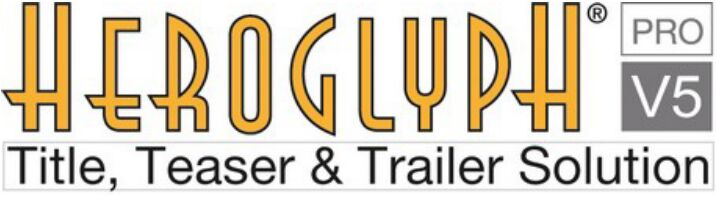

© proDAD GmbH – www.prodad.com

**マニュアル作成者：** Uwe Wenz  
**ソフトウェア開発者：** Holger Burkarth

---

## 目次

* [Welcome](#welcome)
    * [著作権 / 法律情報 (Legal)](#著作権--法律情報-legal)
* [インストール、ユーザー登録、システム要件](#インストールユーザー登録システム要件)
    * [インストールとユーザー登録](#インストールとユーザー登録)
    * [システム要件](#システム要件)
* [プログラムの開始とプラグイン](#プログラムの開始とプラグイン)
    * [Heroglyph スタンドアローン](#heroglyph-スタンドアローン)
* [基本操作を学ぶためのワークショップ](#基本操作を学ぶためのワークショップ)
* [Heroglyph クイックスタートウィザード](#heroglyph-クイックスタートウィザード)
    * [概要](#概要)
    * [ビデオ形式の設定](#ビデオ形式の設定)
* [ウィザード](#ウィザード)
* [テンプレート](#テンプレート)
    * [テンプレートを選択](#テンプレートを選択)
    * [概要 - テンプレート、プレビュー、テキスト、スタイル、エフェクト](#概要---テンプレートプレビューテキストスタイルエフェクト)
* [ルート](#ルート)
    * [地図のインポートとパス（道筋）の作成](#地図のインポートとパス道筋の作成)
    * [パス - スタイルとエフェクトの選択](#パス---スタイルとエフェクトの選択)
    * [オブジェクト – トラベルオブジェクトの編集、アニメーションとエフェクトの追加](#オブジェクト--トラベルオブジェクトの編集アニメーションとエフェクトの追加)
    * [タイミング - ルートの停止と走行速度](#タイミング---ルートの停止と走行速度)
* [ビデオウォール](#ビデオウォール)
    * [プリセットを選択](#プリセットを選択)
    * [テクスチャ - 画像/ビデオの追加](#テクスチャ---画像ビデオの追加)
    * [スタイル - デザインオプション](#スタイル---デザインオプション)
    * [アニメーション - 長さとエフェクト](#アニメーション---長さとエフェクト)
* [スライドショー](#スライドショー)
    * [画像/ビデオの追加... およびタイミングオプション](#画像ビデオの追加-およびタイミングオプション)
    * [ピクチャスタイルの設定](#ピクチャスタイルの設定)
    * [タイトルオプション](#タイトルオプション)
* [スクリプト](#スクリプト)
    * [テンプレートを選択](#テンプレートを選択-1)
    * [テキスト編集、エフェクトとデュレーションの設定](#テキスト編集エフェクトとデュレーションの設定)
* [Heroglyph](#heroglyph-1)
    * [概要](#概要-1)
    * [タイムライン](#タイムライン)
* [ファイル](#ファイル)
* [スタート](#スタート)
* [挿入](#挿入)
* [レイアウト](#レイアウト)
* [デザイン](#デザイン)
* [アニメーション](#アニメーション)
* [表示](#表示)
* [ルートオプション（ルート/パスを作成している場合のみ）](#ルートオプションルートパスを作成している場合のみ)
* [画像オプション（グラフィックファイルを使用している場合のみ）](#画像オプショングラフィックファイルを使用している場合のみ)
* [エクスポート](#エクスポート)
    * [フレームをエクスポート](#フレームをエクスポート)
    * [アニメーションファイルとしてエクスポート](#アニメーションファイルとしてエクスポート)

---

## Welcome

### Heroglyph へようこそ！

ご購入誠にありがとうございます。本製品は革新的なタイトルおよびアニメーション作成ソフトウェアであり、あらゆるビデオタイトルの作成に最適なソリューションです。

これまでは、魅力的なトレーラーを作成するために複数の異なるプログラムや複雑なキーフレーム設定を使用する必要があったことでしょう。Heroglyphを使用すれば、同じ高品質な結果をより簡単に得ることができます。Heroglyphは、マルチメディアプロデューサー、ビデオディレクター、そしてプロフェッショナルから第一に選ばれる製品です。本製品は、完璧なビデオ編集において、魅力的なトレーラーやタイトルアニメーションを直感的に作成できるように設計されています。革新的な機能と使いやすいユーザーインターフェースが、あなたの作品を最高の結果へと導きます。

Heroglyph をどうぞお楽しみください！

### 著作権 / 法律情報 (Legal)

Copyright proDAD GmbH. All rights reserved. （不許複製・禁無断転載）

#### ライセンス条件
ソフトウェアをインストールされる前に、本ライセンス条件をよくお読みください。

#### 使用許諾契約
セットアップが開始すると使用許諾契約が表示されますので、内容をよくお読みください。
ソフトウェアをインストールすることにより、著作権条件、使用許諾契約、および使用許諾手続きに同意したものとみなされます。

#### ライセンス保証
proDAD GmbHは、正規の目的で本製品を使用することを許諾します。
本製品は1台のコンピューターにのみインストールできます。本製品をインストールすることにより、ユーザーはライセンス保証、著作権条件、および責任制限に同意したものとみなされます。proDADは本契約に基づき、正当なライセンスキーを1つ提供します。

#### 登録商標
本マニュアル内で言及されているすべての製品名ならびに商標は、それぞれの所有者に帰属します。すべての商標は、自由に使用できるものであるか、登録商標であるかにかかわらず、その権利を尊重して使用されています。

#### 責任制限
損害賠償請求1件あたりの賠償責任の上限は、当該製品の交換に限定されます。これは、proDAD GmbH、すべてのライセンス取得者、および小売店に適用されます。損害賠償請求は、ソフトウェアが適切な手順で、proDAD GmbHとの事前合意に基づく返品番号と共に返品された場合にのみ受け付けられます。返品の際は購入証明の添付が必要です。製品の不調が不適切な使用、改造、事故、または不適切な取り扱いに起因する場合、この保証は無効となります。proDAD GmbH、販売店、およびライセンス供与者は、本製品の不適切な使用に起因する直接的および間接的な損害に対する責任を負いません。責任範囲はいかなる場合も製品の購入価格を上限とします。

#### ドキュメンテーション
本マニュアルの編集および翻訳には細心の注意を払っておりますが、誤りや不正確な記述が完全にないことを保証するものではありません。proDAD GmbHは、ドキュメンテーションや翻訳を含む情報の不正確さや誤りによって生じたいかなる損害についても責任を負いかねます。技術的な仕様変更の場合も同様です。本マニュアルに関して不正確な記述にお気づきの際は、弊社までご連絡ください。

#### 著作権
本ソフトウェアおよび本製品を構成する個々の要素は、proDAD GmbHが所有しています。本製品をインストールすることにより、使用者は不正使用や無断複製を行わないことに同意したものとみなされます。

proDAD GmbHは、本プログラムの利用、コンテンツを使用した制作物、および本プログラムで作成されたデータの使用に起因するいかなる損害についても責任を負いません。

proDAD GmbH * Gauertstr. 2 * 78194 Immendingen * Deutschland * HRB 1077

---

## インストール、ユーザー登録、システム要件

### インストールとユーザー登録

#### 1. インストール
インストールを開始するには、セットアップファイルをダブルクリックしてください。ソフトウェアのインストールが始まりましたら、「法律上の表示項」の契約条件とライセンス条項に同意してください。Heroglyphのダウンロードが完了すると、アーカイブファイルが解凍され、インストールが開始されます。Heroglyphをインストールするフォルダーを選択し、画面の指示に従ってインストールを進めてください。インストール中にライセンスキー（シリアルナンバー）が要求されます。ダウンロード版をご購入された場合、ライセンスキーは注文完了メールに記載されています。DVDパッケージ版をご購入された場合は、パッケージ内に同梱されています。

プラグインが正しくインストールされているか確認してください。
Heroglyphのインストールが完了すると、スタンドアローン版として、または対応する各種ビデオ編集ソフトのプラグイン（エフェクト）としてお使いいただけます。

#### 2. Heroglyph のユーザー登録
あなたのproDAD Heroglyphを以下のリンクからご登録ください：
[http://www.prodad.com/home/community_login/register.xhtml](http://www.prodad.com/home/community_login/register.xhtml)

### システム要件

**最小要件：**
* Windows 11
* 8GB RAM および 4GB のハードディスク空き容量

---

## プログラムの開始とプラグイン

以下のセクションでは、proDAD Heroglyphをスタンドアローン版として使用する方法だけでなく、様々なビデオ編集アプリケーションと連携する「プラグイン」として使用する方法についても説明します。

**重要！**
Heroglyphをビデオ編集ソフトのプラグインとして設定すると、Heroglyphに新しい設定オプション（例: Pinnacle Studio向けなど）が表示されます。
ここでは以下のオプション設定が可能です：

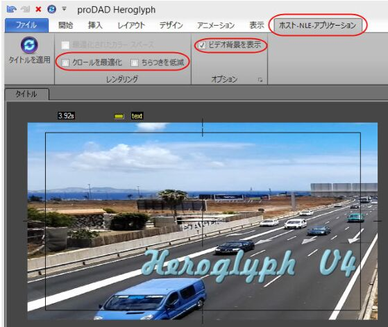

1. **ロールタイトルの最適化**: ロールタイトル（エンドロールなど）のエッジで発生する不要なフリッカー（ちらつき）を防ぎます。
2. **フリッカー軽減**: 強いコントラストを抑え、フリッカー効果を軽減します。
3. **ビデオ背景**: Heroglyphをプラグインとしてホストしているビデオ編集ソフトの映像やフレームを背景として表示します。

**注意：**
お使いのビデオ編集ソフトのバージョンがサポートされているかを確認するには、proDADウェブサイトのHeroglyphセクションをご覧ください： [www.prodad.com](http://www.prodad.com)

情報の網羅性を高めるため、以下のプラグインに関する説明は、将来利用可能になる可能性のあるすべてのプラグインを含んでいます。お持ちのライセンスによっては、特定のプラグインの使用が含まれていない場合があります。マニュアル内にスタンドアローン版の使用方法が記載されていても、お持ちのライセンスで必ずプラグインが使用できるとは限りません。

### Heroglyph スタンドアローン

スタンドアローン版プログラムの起動：
デスクトップの **Heroglyph** アイコンをダブルクリックします。

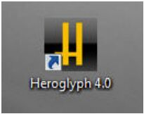

または、Windowsの `スタートメニュー / プログラム / proDAD / Heroglyph` を選択します。
Heroglyphはウィザード（クイックスタートアシスタント）とともに起動します。

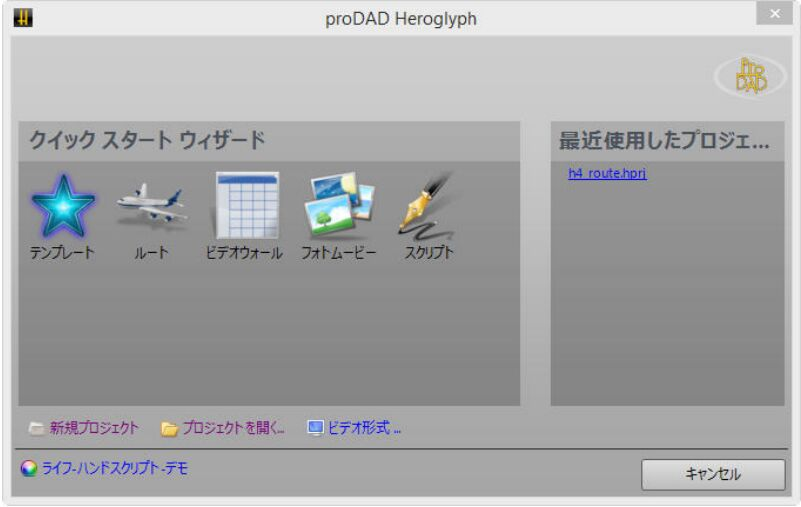

---

## 基本操作を学ぶためのワークショップ

ここでは、アプリケーションの基本操作をステップバイステップで学べるガイドを提供します。これらの実例は約60分でお試しいただけます。一通り操作を行うことで、Heroglyphを使ったプロジェクト作成の流れが理解でき、あなた自身のアイデアも浮かんでくることでしょう。これらの実例を事前にお試しいただくことで、後から各機能や論理についてマニュアルで調べる時間を大幅に節約できます。
プログラムの世界をどうぞお楽しみください！

---

## Heroglyph クイックスタートウィザード

### 概要
Heroglyphを起動すると、クイックスタートウィザードが表示されます。ここで、作成したいプロジェクトの種類を選択します。

* テンプレート（タイトル＆トレーラー）
* ルート（地図アニメーション）
* ビデオウォール
* フォトムービー（スライドショー）
* スクリプト（手書き風アニメーション）

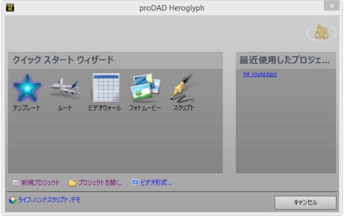

### ビデオ形式の設定
**ビデオ形式** オプションをクリックしてください。

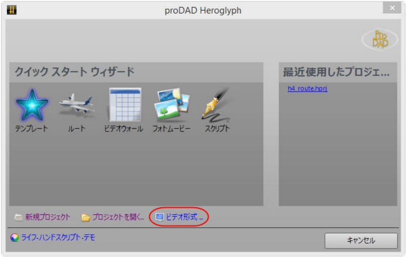

ここからプロジェクトのビデオ形式（解像度やアスペクト比など）を選択できます。

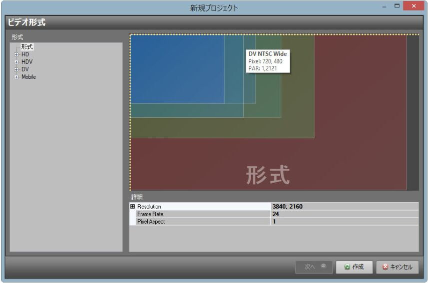

**注：** プロジェクトで使用する、または最終的にエクスポートする予定のビデオ素材の形式を事前に確認してください。その後、左のリストから適切な形式を選択します。右側のディスプレイで、選択した形式と他の可能な形式を比較・確認することができます。

---

## ウィザード

ソフトウェアを起動すると、Heroglyphは目的に合わせた様々なウィザードを提供します。

## テンプレート

ウィザードの **テンプレート** を使用すると、タイトルやトレーラーのアニメーションを簡単に作成できます。

### テンプレートを選択
作成を開始するには、ウィザードの **テンプレート** オプションをクリックしてください。

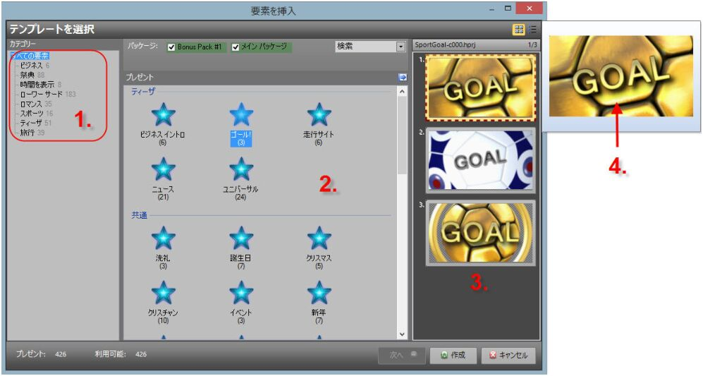

画面は以下の4つのエリアに分かれています：
1. テンプレート（プリセット）のカテゴリー
2. プリセット一覧
3. 選択したプリセットの様々なタイプのプレビュー
4. 選択したプリセットのライブプレビュー

例えば、カテゴリーから「ティーザー」**(1)** を選択し、プリセットから「ユニバーサル」**(2)** を選択します。プリセットは右のディスプレイ **(3)** に表示され、**(4)** でアニメーションのライブプレビューが確認できます。使用するテンプレートが決まったら、作成 **(5)** をクリックします。

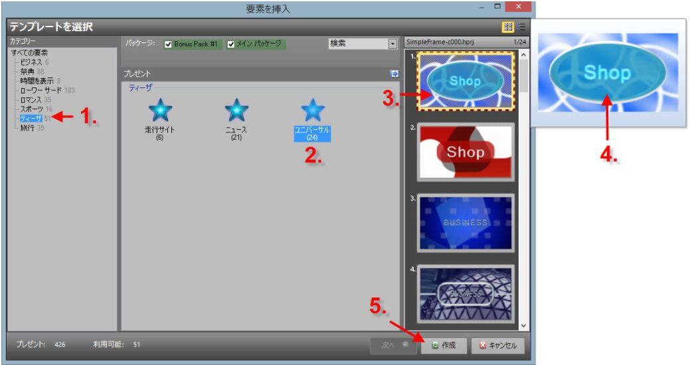

### 概要 - テンプレート、プレビュー、テキスト、スタイル、エフェクト
ここで、選択した「ユニバーサル」のプリセットを編集してカスタマイズできます。

**注：** どのテンプレート（プリセット）を選択した場合でも、ここで同様のオプション設定が可能です。

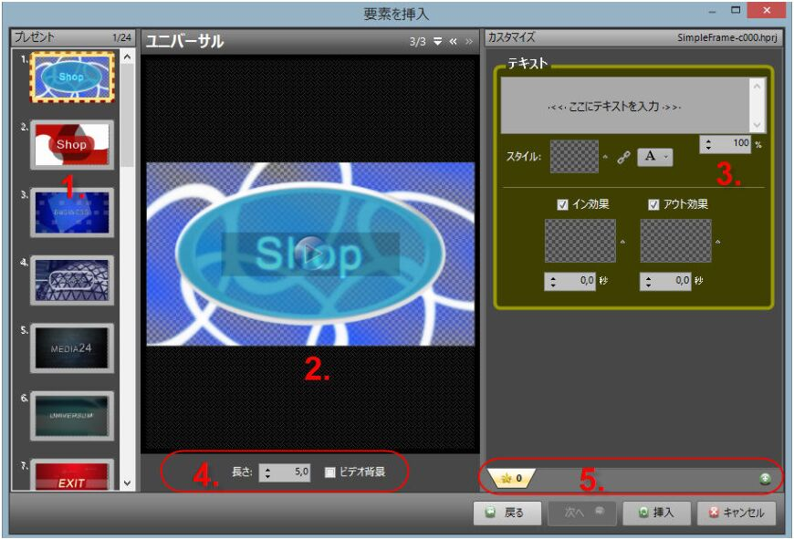

1. 前に選択したカテゴリーで利用可能なテンプレート（プリセット）の表示。
2. カスタマイズ中のプリセットのプレビュー。
3. カスタマイズエリア：ここでテキストの入力、デザインの変更、色やサイズの選択、エフェクト（イン/アウト）やトランジション時間の設定ができます。
4. アニメーション全体のデュレーション（長さ）、およびビデオ背景の表示（オン/オフ）が設定できます。
5. 追加のテキスト（タブ）を挿入します。

#### テキストを入力、サイズ、スタイルを選択
最初に、カスタマイズエリアにテキストを入力します（例: Webshop）。次に、ボックス **(1)** をクリックしてスタイルを選択します。プレビュー画面に多数のスタイルテンプレート **(2)** が表示されます。上部のスタイルプリセットエリアから、さらに多くのカテゴリー **(3)** を展開できます。選択したスタイルがプレビュー **(4)** に即座に反映されます。

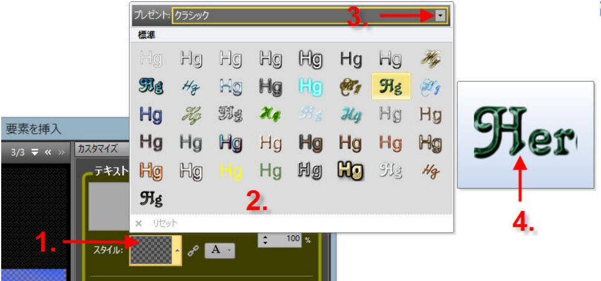

このサンプルでは、プリセットは「クラシック」カテゴリーから選択されています。スタイルはマウスクリックで簡単に選択でき、選択するとすぐにプレビューに反映されます。同時にテキストのサイズも調整できます。

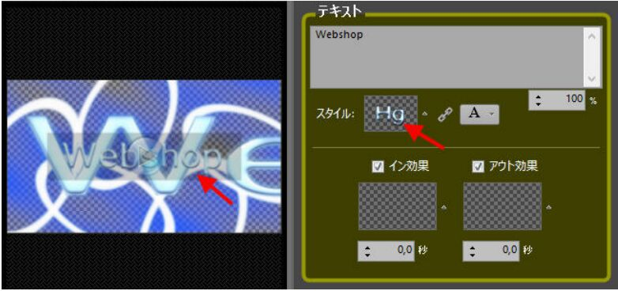

お好みの色に変更することも可能です。

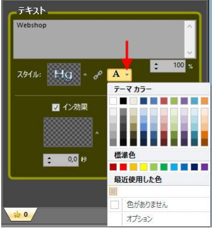

#### テキストにフェードイン・フェードアウト効果を追加し、トランジション時間を設定
まず、カスタマイズエリアでフェードイン時間 **(1)** を設定します。次に、ボックス **(2)** をクリックしてフェードイン効果を選択します。多数のエフェクトテンプレート **(3)** が開きます。カテゴリー **(4)** を切り替えることで、さらに多くのエフェクトテンプレートを利用できます。この例では「文字」カテゴリーのプリセットを使用しています。エフェクトはマウスでクリックするだけで適用されます。

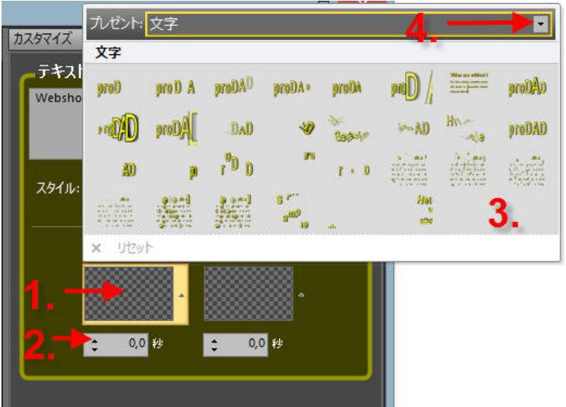

フェードアウトの時間やアウト効果も、同様の手順で選択・設定できます。
**注：** トランジション（フェード効果）は必ずしも必要ではありません。トランジションなしでもテキストアニメーションは作成可能です。その場合はエフェクトやトランジション時間を設定する必要はありません。

#### さらにテキストを追加する
`(1)` の `+`（追加）ボタンをクリックすると、新しいタブ **(2)** が追加されます。新しいタブがアクティブになったら、別のテキスト **(3)** を入力し、独自のスタイルを設定できるようになります。

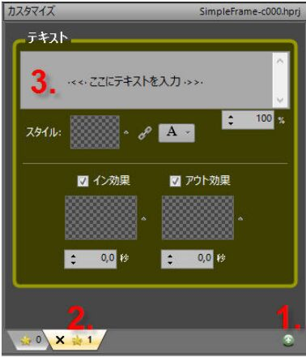

すべての設定が終わりましたら、「挿入」をクリックしてHeroglyphのメインユーザーインターフェースへ移行してください。

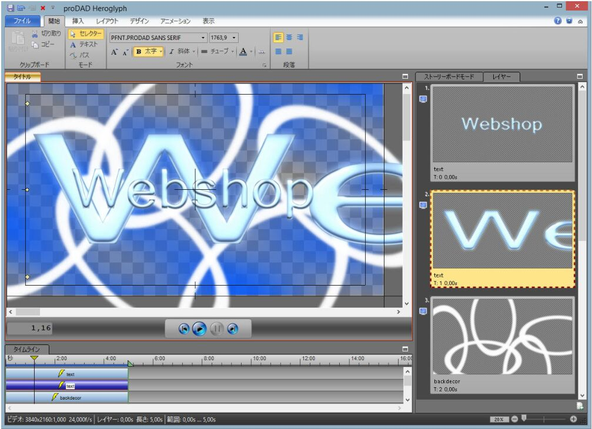

---

## ルート

ルートウィザードでは、地図上に動くアニメーションルート（パス）を簡単に作成することができます。

### 地図のインポートとパス（道筋）の作成
ウィザードから **ルート** をクリックし、背景設定ダイアログを開きます。
ここで、「背景画像を開く」オプションを選択し、地図画像（例: Googleマップのスクリーンショットなど）をインポートします。

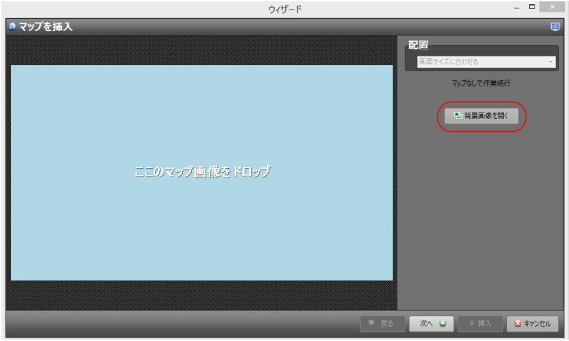

**注：** PC（エクスプローラー）から地図画像を直接ドラッグ＆ドロップして読み込むことも可能です。

地図が背景として挿入されます。

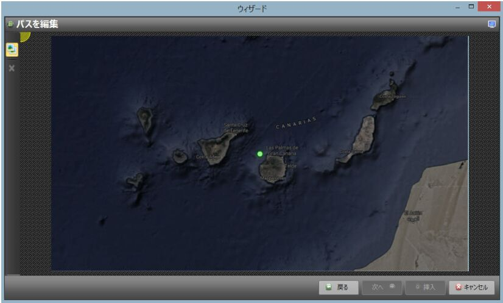

ここでルートのパスを描画します。ルートを開始したい位置にカーソルを合わせ、マウスの左ボタンを押しながらドラッグすることでパス **(1)** が描かれます。描画後、ボタン **(2)** をクリックすると、ライブプレビュー **(3)** に切り替えて動きを確認できます。

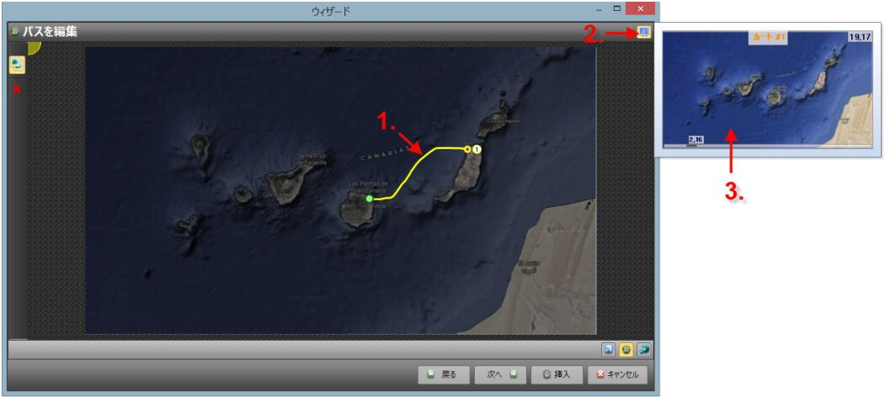

### パス - スタイルとエフェクトの選択
「道筋」タブでは、描いたルートのスタイルやエフェクトを設定できます。

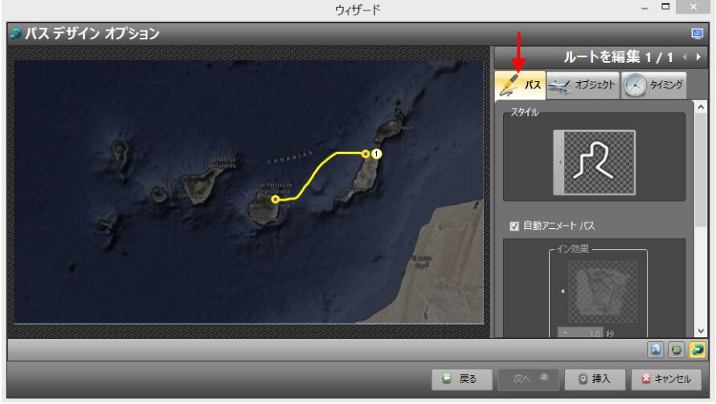

スタイルエリアのボックス **(1)** をクリックすると、様々なルートスタイルのプリセット **(2)** が表示されます。適用したいスタイルをクリックしてください。選択内容は即座にプレビューに反映されます。

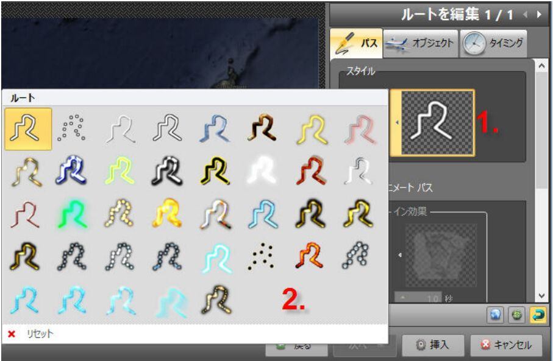

「自動アニメートパス」オプションを有効にすると、パスが自動的に描画されるアニメーションになります。この機能をアクティブにしている間は、ルート固有のイン効果やアウト効果は使用できなくなります。

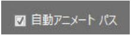

トランジション時間（フェード時間）を有効にし、カスタムのイン効果・アウト効果を選択したい場合は、「自動アニメートパス」オプションを無効にしてください。

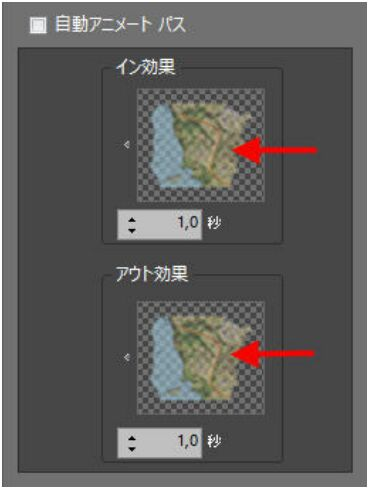

次に「オブジェクト」タブに進みます。

### オブジェクト – トラベルオブジェクトの編集、アニメーションとエフェクトの追加
「走行オブジェクトを編集」のボックス **(1)** をクリックし、オブジェクトプリセット **(2)** のメニューからルート上を移動するオブジェクト（車や飛行機など）を選択してください。上部のカテゴリー **(3)** を切り替えることで、さらに多くのオブジェクトを選択できます。オブジェクトはクリックするだけで設定され、すぐにプレビューに表示されます。

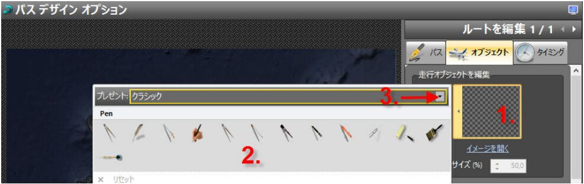

ご自身のオリジナルオブジェクト（画像） **(1)** をインポートして使用することも可能です。オブジェクトを選択したら、適切なサイズ **(2)** に調整してください。

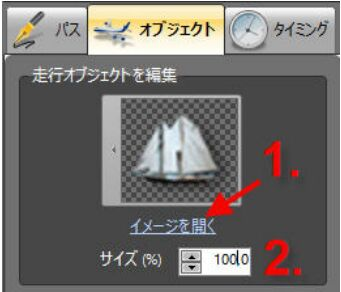

「走行オブジェクトのアニメーション」エリアでは、オブジェクトの動き（ルート上の軌道や揺れなど）を設定できます。ボックス **(1)** をクリックしてアニメーションを選択します。多数のアニメーションプリセット **(2)** が表示されます。プリセット上にカーソルを合わせるとプレビュー **(3)** で動きを確認でき、クリックで適用されます。

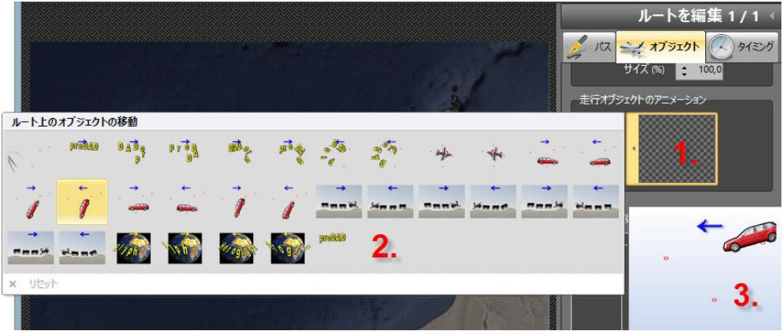

まず、「効果を使用」オプションをアクティブにします。これにより、トラベルオブジェクトのフェードイン効果、フェードアウト効果、およびトランジション時間の調整が可能になります。イン効果エリアのボックス **(1)** をクリックし、フェードイン効果を選択します。エフェクトプリセット **(2)** のリストから適用したい効果を選び、最後にフェードイン時間 **(3)** を設定してください。選択結果はすぐにプレビューに反映されます。

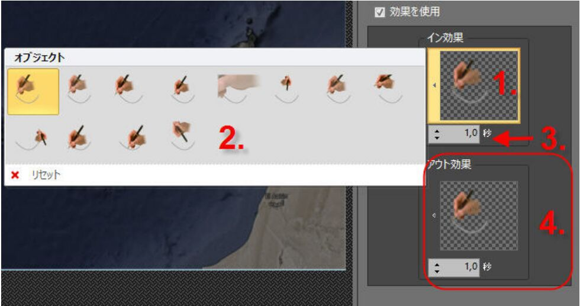

フェードアウト効果も同様に、アウト効果エリア **(4)** で設定してください。
次に「タイミング」タブへ進みます。

### タイミング - ルートの停止と走行速度
「タイミング」タブでは、ルートアニメーションの時間的な制御が可能です。

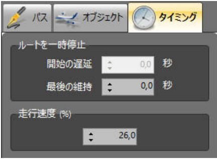

例えば、アニメーション開始前の遅延（ディレイ）や、終了後の維持（ホールド）時間を設定できます。また、ルート上をオブジェクトが移動する走行速度もここで調整できます。
ウィザードでのルート作成が完了しましたら、「挿入」をクリックしてHeroglyphメインユーザーインターフェースへ移行します。

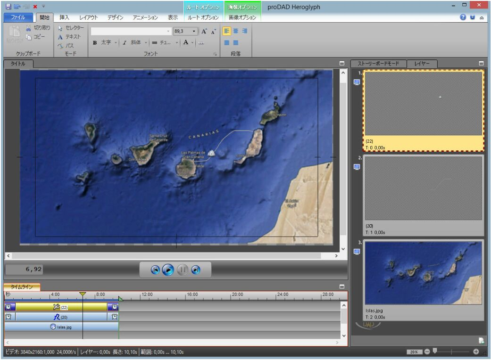

---

## ビデオウォール

ビデオウォールウィザードでは、複数の写真やビデオを並べたスタイリッシュなビデオウォールアニメーションを作成できます。

### プリセットを選択
ウィザードの **ビデオウォール** オプションをクリックしてください。プリセットダイアログが開きます。
ダイアログは以下の2つのエリアに分かれています：
1. プリセットカテゴリー
2. ビデオウォールプリセット一覧

例として、「モザイク」**(1)** カテゴリーから、「クラシック 2:2」**(2)** を選択します。

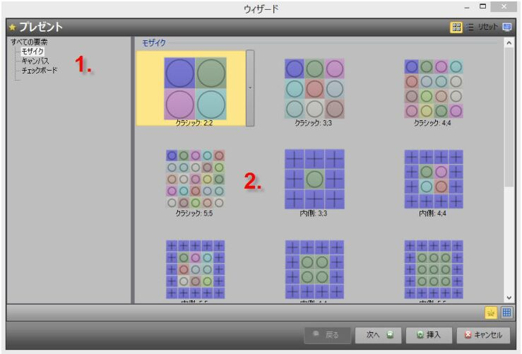

「次へ」をクリックします。

### テクスチャ - 画像/ビデオの追加
ビデオウォールの設定画面が開くと、自動的に **テクスチャ** タブがアクティブになります。
ここでビデオウォールに表示する画像を挿入します。PCのフォルダーを開き、使用したい画像やビデオが保存されているディレクトリから、ビデオウォールオプションの4つの枠へそれぞれドラッグ＆ドロップして配置します。

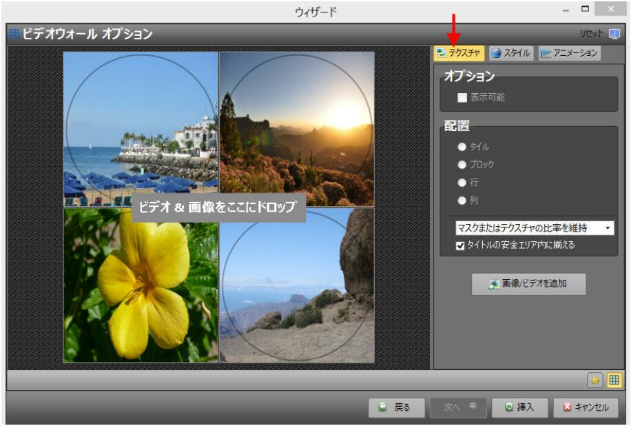

または、「画像/ビデオを追加」ボタンをクリックしてファイルを選択することもできます。
ビデオウォールのレイアウト **(1)** を選択します。ここで画像の配置モード（タイル、ブロック、行、列など）を設定できます。この例では「タイル」**(2)** 配置を使用しています。画像がビデオウォール全体に均等に表示されます。配置設定を行うと、ライブプレビュー **(3)** が自動的に更新されます。「表示可能」オプションをアクティブにすると、選択した画像がタイル上に反映されます。

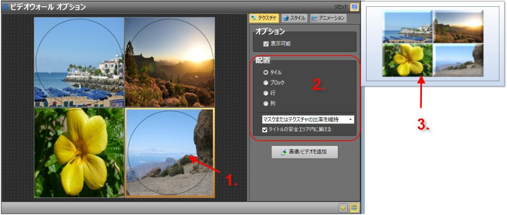

ここからさらにビデオウォールの配置を微調整できます。オプションをクリックしてプレビューをアクティブにし、お好みに合わせてビデオウォールの構成を設定してください。

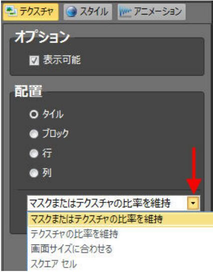

「タイトルのセーフエリア」オプションをアクティブにすると、ビデオウォール全体がTVモニター等のタイトルセーフエリア内に収まるように配置が調整されます。
次に「スタイル」タブへ進みます。

### スタイル - デザインオプション
**スタイル** **(1)** タブへ進み、ビデオウォールのデザインを選択します。ボックス **(2)** をクリックし、スタイルプリセット **(3)** からお好みのスタイルを選択してください。

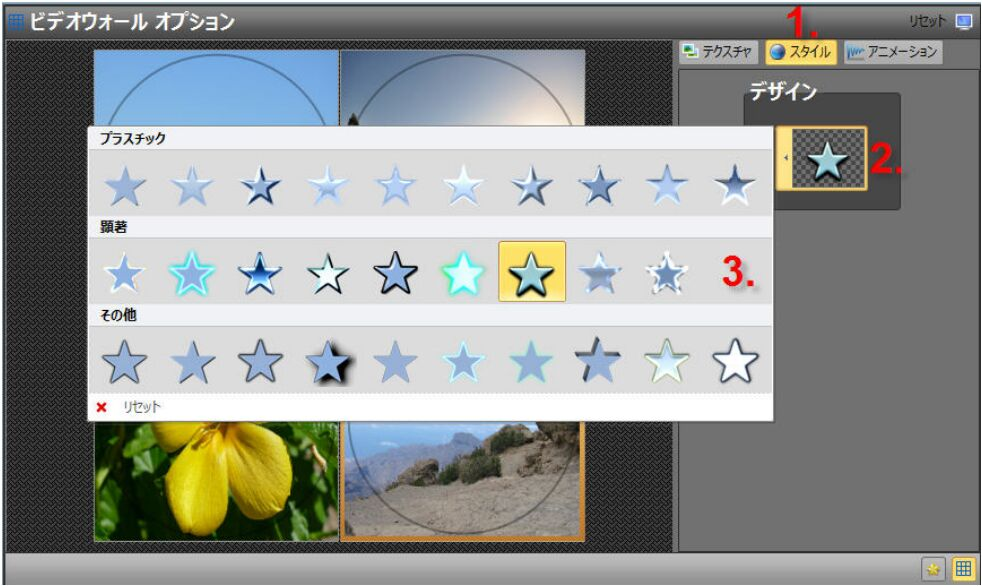

デザインはマウスクリックで簡単に選択でき、ライブプレビューに即座に反映されます。

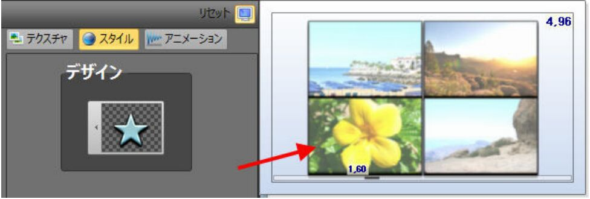

次に「アニメーション」タブへ進みます。

### アニメーション - 長さとエフェクト
アニメーションを設定するには、**アニメーション** **(1)** タブへ進んでください。
最初に、ビデオウォールアニメーションの全体の長さ **(2)** を設定します（例: 10秒）。エフェクトエリアで「効果なし」**(3)** オプションを選択すると、ビデオウォールにエフェクトは追加されません。

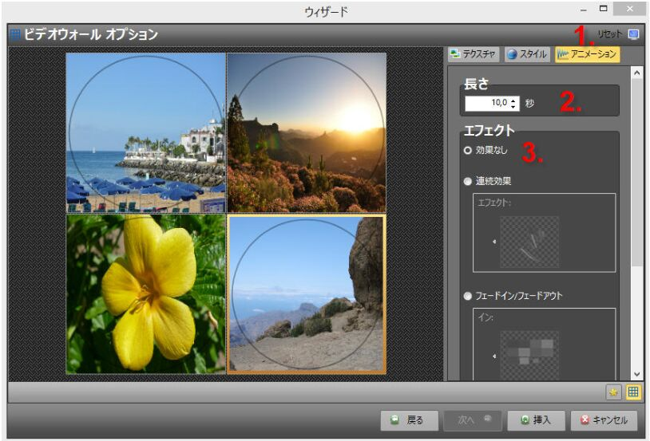

この画面では、ビデオウォールに主に2種類のアニメーション効果を追加することができます。

#### 1. 連続効果
「連続効果」**(1)** をクリックしてアクティブにし、ボックス **(2)** をクリックすると、エフェクトプリセット **(3)** のリストが表示されます。適用したいエフェクトをクリックして選択します。

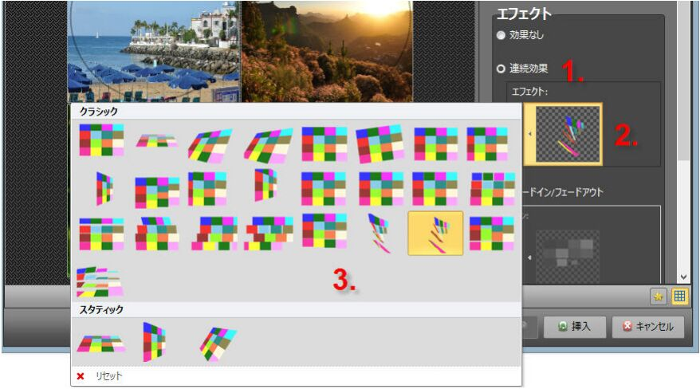

#### 2. フェードインとフェードアウト効果
フェードイン/アウト効果をアクティブにし、各ボックスをクリックすると、多数のエフェクトプリセットが表示されます。お好みのエフェクトをクリックして適用します。

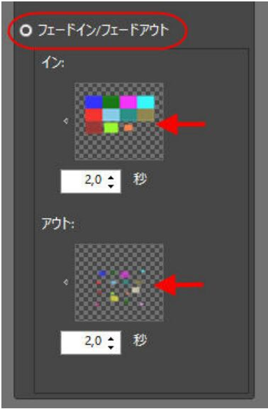

その後、フェードインおよびフェードアウト効果のトランジション時間を設定します。

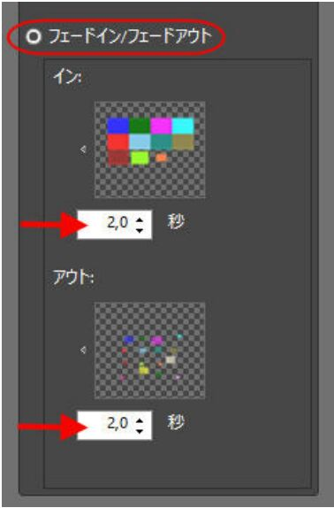

すべての設定が完了しましたら、「挿入」をクリックしてください。Heroglyphメインユーザーインターフェースへ移行します。

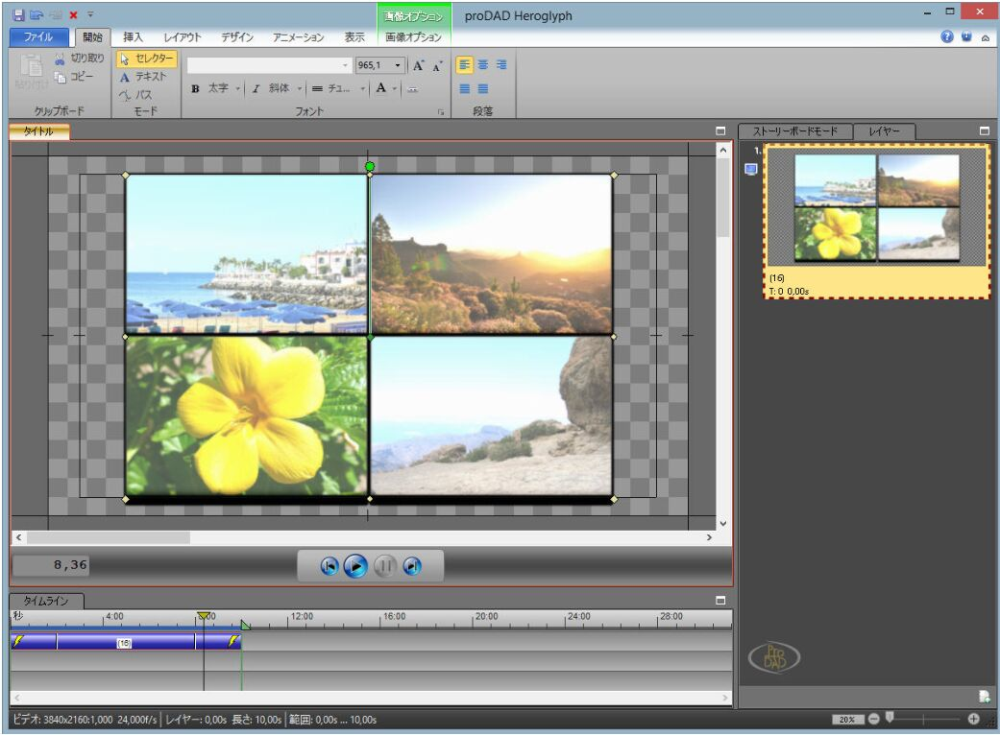

---

## スライドショー

スライドショーウィザードでは、複数の画像ファイルをもとに魅力的なアニメーション（フォトムービー）を作成できます。

### 画像 / ビデオの追加... およびタイミングオプション
ウィザードの **スライドショー** オプションをクリックし、「ピクチャとビデオを調整」ダイアログを開きます。

「ピクチャ/ビデオを追加…」オプションをクリックし、PCのフォルダーを開きます。スライドショーに使用する画像ファイルを選択し、「開く」をクリックして読み込みます。

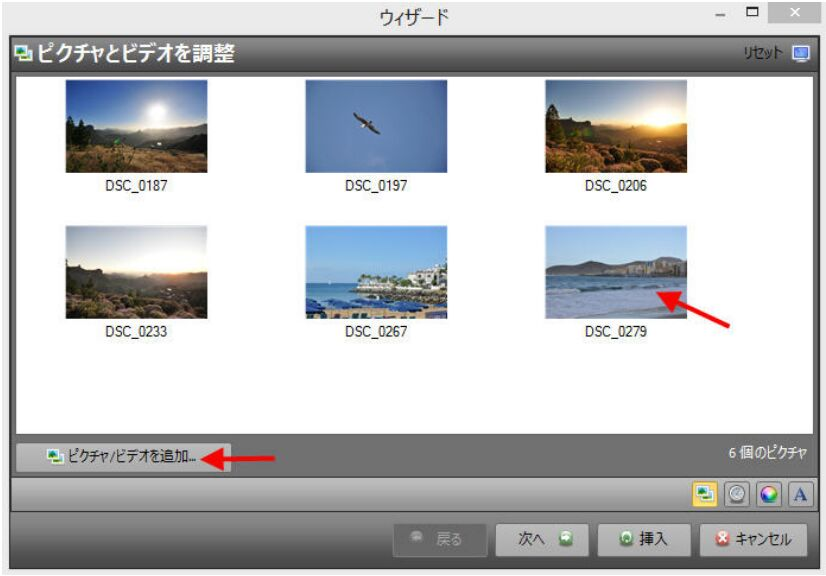

**注：** あらかじめPC（エクスプローラー）を開いておき、画像が保存されているフォルダーからファイルを選択して（Ctrlキーで複数選択可能）、直接エディターへドラッグ＆ドロップすることも可能です。

「次へ」をクリックします。
タイミングオプションが開きます。ここで各画像の表示時間や、画像間のトランジション（切り替え効果）を設定できます。

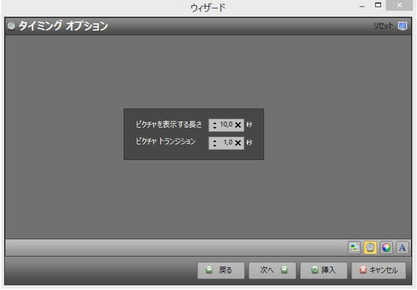

「次へ」をクリックします。

### ピクチャスタイルの設定
「ピクチャスタイルを設定」ダイアログが開きます。

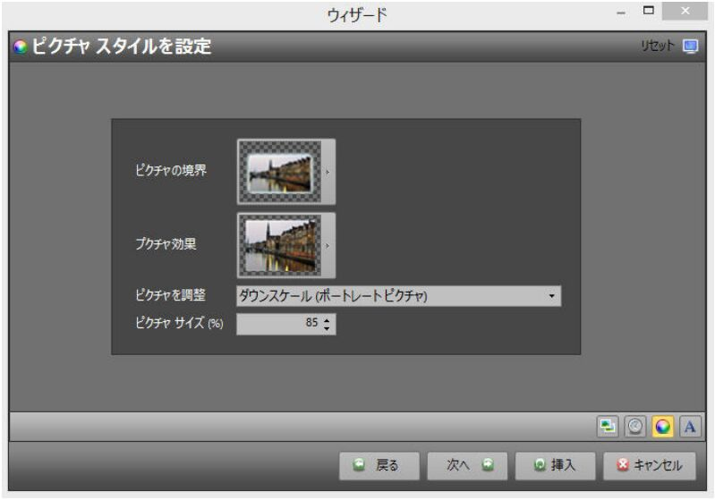

最初に、「ピクチャの境界」**(1)** ボックスをクリックして、画像のフレームや境界線のスタイルを設定します。ボックスには多数のマスクプリセット **(2)** が表示されます。マウスクリックでスタイルを適用してください。

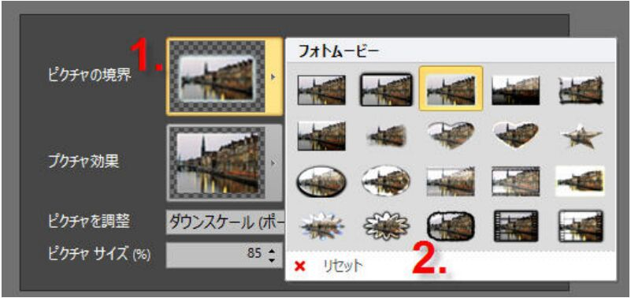

画像自体へのエフェクトも設定できます。設定するには、「ピクチャ効果」**(1)** をクリックしてください。ボックスから多数のエフェクトプリセット **(2)** が選択可能です。

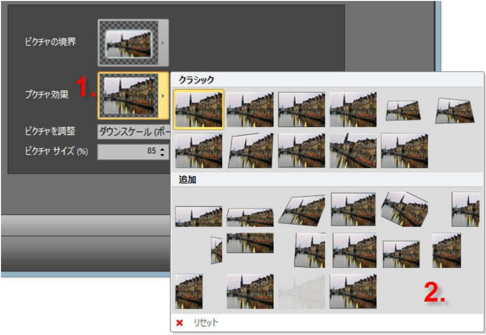

「ピクチャを調整」オプションでは、画像の拡大・縮小や、フレーム内でのサイズ調整を行うことができます。

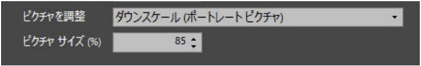

「次へ」をクリックします。

### タイトルオプション
「タイトルオプション」ダイアログが開きます。

例えば、スライドショー全体の「タイトル」**(1)** をアクティブにし、テキスト **(2)** を入力します。その後、テキストスタイル **(3)** を選択し、テキストサイズ **(4)** を設定します。入力したテキストはライブプレビュー **(5)** で確認できます。

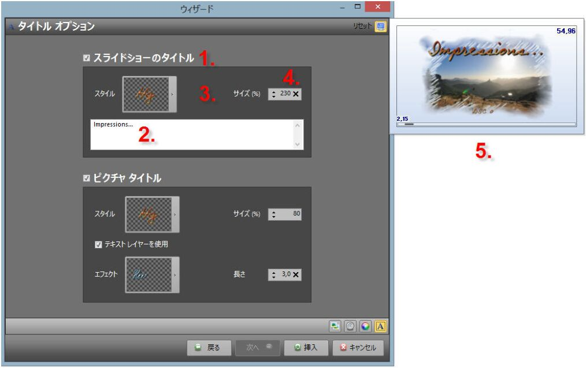

各画像ごとのテキスト（フォトテキスト）も編集できます。不要な場合は、このオプションをオフにしてください。オフにすると、画像ごとのテキストは表示されません。
**注：** デフォルトでは、フォトテキストとして画像ファイル名が参照されます。

「ピクチャタイトル」**(1)** オプションをアクティブにし、テキストスタイル **(2)** を選択した後、テキストサイズ **(3)** を設定します。ライブプレビュー **(4)** で編集結果を確認できます。

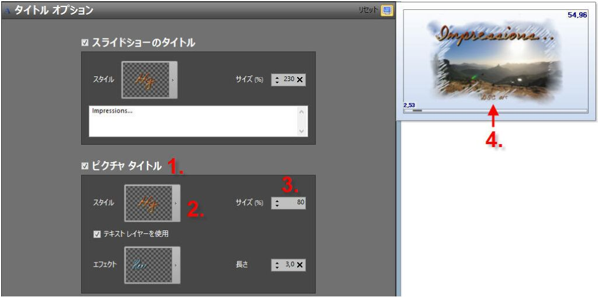

「テキストレイヤーを使用」**(1)** オプションを有効にすると、画像とテキストを別々のオブジェクトとしてHeroglyph内で扱うことができます。必要に応じてエフェクト **(2)** を選択してフォトテキストにアニメーションを追加し、エフェクトのデュレーション **(3)** を設定してください。ライブプレビュー **(4)** でアニメーション付きのテキストを確認できます。

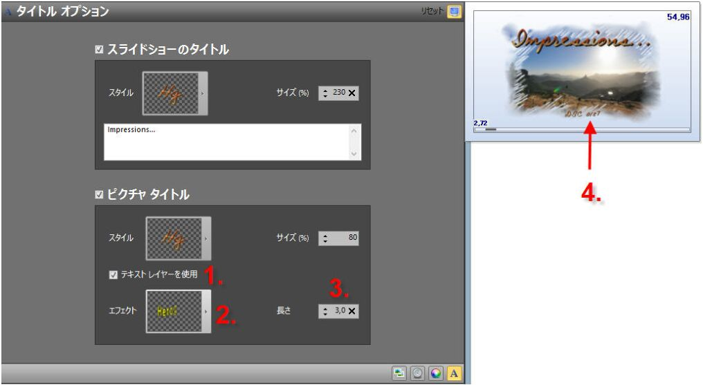

設定が完了しましたら、「挿入」をクリックしてください。Heroglyphメインユーザーインターフェースへ移行します。

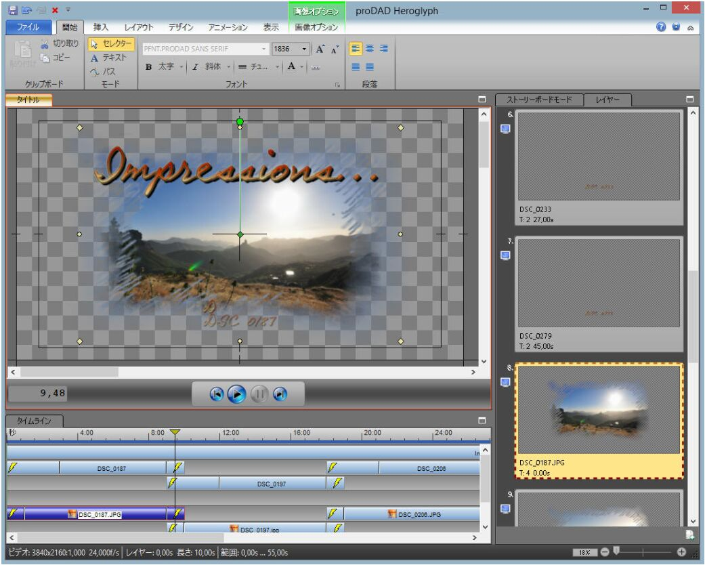

---

## スクリプト

スクリプトウィザードでは、テキストが手書きで書かれているようなアニメーションを作成できます。

### テンプレートを選択
ウィザードの **スクリプト** オプションをクリックし、「テンプレートを選択」ダイアログを開きます。
このダイアログは以下の4つのエリアに分かれています：
1. テンプレートのカテゴリー（プリセット）
2. プリセット一覧
3. 選択したプリセットの様々なタイプのプレビュー
4. 選択したプリセットのライブプレビュー

プリセットはクリックで適用されます。テンプレートを選択し、「作成」をクリックしてください。

### テキスト編集、エフェクトとデュレーションの設定
「要素を挿入」ダイアログで、選択したプリセットをカスタマイズできます。
**注：** 別のプリセットを選択した場合でも、同様の設定オプションが利用可能です。

1. 前に選択したカテゴリーで利用可能なプリセットの表示。
2. 再生機能を含むプリセットのプレビュー。
3. テキストエリア：テキストの入力、フォントサイズの設定、およびテキストスタイルの選択が可能です。
4. エフェクトエリア：エフェクト（イン/アウト）の選択と、トランジション時間の設定が可能です。
5. アニメーション全体のデュレーション設定、およびビデオ背景のオン/オフを切り替えます。
6. さらにテキスト（タブ）を追加する際に使用します。

最初に、テキストエリアに文字（例: Heroglyph）を入力し、ボックス **(1)** をクリックしてスタイルを選択します。多数のスタイルテンプレート **(2)** が開きます。上部エリアのカテゴリー **(3)** を切り替えることで、さらに多くのスタイルが選択できます。選択したスタイルのプレビュー **(4)** が表示されます。

上記の例では、「クラシック」カテゴリーのプリセットが選択されています。スタイル **(1)** はマウスクリックで簡単に適用できます。次にフォントサイズ **(2)** を調整します。変更はすぐにプレビュー **(3)** に反映されます。テキストの色 **(4)** も変更可能です。

#### テキストにイン/アウト効果を追加し、トランジション時間を設定
最初に、エフェクトエリア **(1)** でフェードイン時間（例: 1秒）を設定し、ボックス **(2)** をクリックしてフェードイン効果を選択します。ここでさらに多くのエフェクトプリセット **(3)** が選択できるようになります。カテゴリー **(4)** を開いて別のタイプのエフェクトを探すことも可能です（現在は「文字」カテゴリーが表示されています）。エフェクトはマウスクリックで適用されます。

フェードアウト時間とフェードアウト効果も同様の手順で設定できます。
**注：** トランジションの挿入は必ずしも必要ではありません。トランジションなしでもテキストアニメーションは作成可能です。その場合、エフェクトやトランジションの選択は不要です。

#### さらにテキストを追加する
`+`（追加）ボタン **(1)** をクリックすると、新しいタブ **(2)** が挿入されます。タブをアクティブにし、新しいテキスト **(3)** を入力してデザインを追加します。

完了しましたら、「挿入」をクリックしてください。Heroglyphメインユーザーインターフェースへ移行します。

---

## Heroglyph

### 概要
1. 基本機能ツールバー
2. Heroglyphのメインメニュー：
    * ファイル
    * スタート
    * 挿入
    * レイアウト
    * デザイン
    * アニメーション
    * 表示
    * ルートオプション（ルート/パスを作成している場合のみ）
    * 画像オプション（グラフィックファイルを使用している場合のみ）
3. ストーリーボード
4. プレビュー画面
5. プレビューの最小化/最大化
6. プレビューコントロール（再生・停止など）
7. タイムライン

### タイムライン
画面下部にタイムラインがあります。ここで各オブジェクトの表示タイミングや長さを細かく調整・アレンジできます。
詳細は各項目の説明をご参照ください。

## ファイル
ファイルの保存やプロジェクト管理に関するオプションは **ファイル** メニューにあります。

詳細はマニュアルの該当セクションをご参照ください。

## スタート
**スタート** メニューには、基本的なテキスト編集やフォーマット機能が集約されています。

詳細はマニュアルの該当セクションをご参照ください。

## 挿入
**挿入** メニューを使用すると、現在のプロジェクトに新しい要素（図形、テキスト、画像など）を追加して、さらにリッチなコンテンツを作成できます。

詳細はマニュアルの該当セクションをご参照ください。

## レイアウト
**レイアウト** メニューでは、タイムライン上のオブジェクトの整列や配置、その他の高度なレイアウトオプションを提供します。

詳細はマニュアルの該当セクションをご参照ください。

## デザイン
**デザイン** メニューは、タイムラインオブジェクトのビジュアルスタイル（色、枠線、シャドウなど）を詳細に設定するためのオプションです。

※このオプションを使用するには、タイムラインまたはプレビュー画面で対象のオブジェクトを選択しておく必要があります。
詳細はマニュアルの該当セクションをご参照ください。

## アニメーション
**アニメーション** メニューでは、オブジェクトに対する動きやエフェクトの詳細な設定が可能です。

※このオプションを使用するには、タイムラインまたはプレビュー画面で対象のオブジェクトを選択しておく必要があります。
詳細はマニュアルの該当セクションをご参照ください。

## 表示
**表示** メニューでは、プレビュー画面のガイド表示やズームレベルなど、インターフェースの表示設定を変更できます。

詳細はマニュアルの該当セクションをご参照ください。

## ルートオプション（ルート/パスを作成している場合のみ）
**ルートオプション** メニューは、ルートウィザード等で地図やパスを作成している場合にのみ有効です。描画したパスの詳細な編集が可能です。

詳細はマニュアルの該当セクションをご参照ください。

## 画像オプション（グラフィックファイルを使用している場合のみ）
**画像オプション** メニューは、タイムラインで画像（グラフィック）ファイルが選択されている場合のみ有効になる専用の設定メニューです。

詳細はマニュアルの該当セクションをご参照ください。

## エクスポート
Heroglyphでは、完成したプロジェクトを静止画（フレーム）または動画（アニメーション）としてエクスポートできます。

### フレームをエクスポート
`ファイル / 名前を付けて保存 / フレームをエクスポート` を選択し、静止画エクスポートのダイアログを開きます。

#### 期間
タイムライン上の出力したい範囲（開始・終了時間）をキーボードで直接入力して設定できます。

#### レート
フレーム/秒（FPS）の数値を設定できます。PALおよびNTSCの標準設定を簡単に選択できるプリセットが用意されています。

#### 品質
レンダリングの品質レベルを選択できます：

* **高品質:** 最高のプレビュー品質、滑らかな文字の輪郭、そしてシャープなテクスチャーを提供します。細かい曲線を使用する際のデバイスの干渉（ジャギーなど）を減少させます。
* **良い:** 文字の表示には適していますが、グラフィックやアニメーションの表示はやや粗くなります。
* **遅い－速い:** レンダリングは速いですが、品質は低くなります。例: パフォーマンスの低いコンピューターでのプレビューや、複雑なアニメーションの動きを素早く確認したい場合に便利です。

#### フレームタイプ
フィールド（インターレース）またはフルフレーム（プログレッシブ）のパラメーターを設定できます。

ビデオ編集ソフトのプロジェクト設定やビデオ再生ハードウェアがインターレース（フィールド）映像を要求する場合に、簡単にフォーマットを調整できます。
「フルフレーム（プログレッシブ）」は、ウェブ用のアニメーションを作成する場合や、結果をビデオアプリケーション以外（PCモニターなど）で再生する場合に必須です。レンダリング結果にコーミングノイズ（くし状のノイズ）が発生した場合、誤ったフィールドオーダーが選択されている可能性があります。また、動きに不自然なカクつきが見られる場合は、「フルフレーム」から「フィールド」に変更することで改善することがあります。

一部のシステムやソフトウェアでは、これらの設定が異なる名前で表記されていることがあります：
* トップフィールドファースト (Top Field First)
* ボトムフィールドファースト (Bottom Field First)

#### ビデオの最適化
最終的な出力結果をテレビ等のビデオモニターで再生する場合は、このフィルターを常に有効にしてください。
利点：画像アーティファクトの削減、およびビデオ向けの色スペクトル最適化。
このフィルターを無効にすると、レンダリング速度は約20％向上しますが、ビデオ作品としての最終的な画質が低下する恐れがあります。

#### レンダリング
連番画像出力 (TIF, JPG, PNG, TGA, PPM, SGI) が可能なフォーマットが使用され、アルファチャンネル（透過情報）の扱いを制御できます。

* **RGB+アルファ（1つのファイルを生成）:** 24-bit RGBカラーデータと8-bitアルファチャンネルデータが1つのファイル内に保存されますが、データは別々に保持され、合成はされません。
* **RGB +アルファ（2つの画像）:** 24-bit RGBカラーデータと8-bitアルファチャンネルデータが別々の2つのファイルとして保存されます。
* **RGBとアルファを合成してレンダリング:** 24-bit RGBカラーデータと8-bitアルファチャンネルデータが合成（プレマルチプライ）された状態で1つのファイルに保存されます。
* **RGBのみ（アルファを無視）:** 24-bit RGBカラーデータのみが保存されます（透過情報なし）。
* **アルファのみ（RGBを無視）:** 8-bitアルファチャンネルデータ（白黒のマスク情報）のみが保存されます。

#### 名前を付けて RGB を出力
静止画のエクスポートフォーマットを選択します。以下のフォーマットが利用可能です：tiff, jpg, tga, png, ppm, sgi

#### フォルダー
連番画像が出力される保存先のパス（ターゲットフォルダー）を指定します。

エクスポートボタンをクリックすると、画像の書き出しが開始されます。

### アニメーションファイルとしてエクスポート
`ファイル / 名前を付けて保存 / アニメーションをエクスポート` を選択し、動画エクスポートのダイアログを開きます。

#### 期間
タイムライン上の出力したい範囲をキーボードで調整できます。

#### レート
フレーム/秒（FPS）を変更できます。PALまたはNTSCのプリセットから簡単に選択可能です。

#### 品質
アニメーションの品質レベルを選択できます：

* **高品質:** 最高のプレビュー品質、滑らかな文字の輪郭、およびシャープなテクスチャーを提供します。
* **良い:** 文字の表示には適していますが、グラフィックやアニメーションの表示はやや粗くなります。
* **遅い－速い:** レンダリングは速いですが、品質は低くなります。テストプレビューなどに適しています。

最終的なアニメーションを書き出す際は、多少レンダリング時間がかかっても「高品質」を選択することをお勧めします。

#### フレームタイプ
フィールド（インターレース）またはフルフレーム（プログレッシブ）のパラメーターを設定できます。

エクスポート先のビデオ編集ソフトやハードウェアがインターレース映像を要求する場合に設定します。
「フルフレーム（プログレッシブ）」は、ウェブアニメーションやPC上での再生に最適です。レンダリング結果にコーミングノイズ（くし状のノイズ）が発生した場合は、誤ったフィールド設定が行われている可能性があります。また、動きがぎくしゃくする場合は、「フルフレーム」から「フィールド」に変更して試してください。

一部のシステムでは以下のように表記されることがあります：
* トップフィールドファースト (Top Field First)
* ボトムフィールドファースト (Bottom Field First)

#### ビデオの最適化
結果をビデオ出力として使用する場合は、このフィルターを常に有効にしてください。
利点：画像ノイズの低減、色スペクトルの最適化。
フィルターを無効にするとレンダリング速度は上がりますが、ビデオとしての品質は低下します。

#### レンダリング
* **RGB+アルファ（1つのファイル）を生成:** 24-bit RGBカラーデータと8-bitアルファチャンネルデータが1つのファイルに保存されます（非合成）。
* **RGBとアルファを合成してレンダリング:** 24-bit RGBカラーデータと8-bitアルファチャンネルデータが1つのファイルに合成されて保存されます。

#### RGB をエクスポート
アニメーションの出力フォーマット（例: AVI）を選択できます。

#### コーデック
利用可能なコーデックがリストに表示されます。一部のコーデックはシステムに正しく登録されていない場合があるため、エクスポートプロセスが正常に開始されない場合はエラーが表示され、Heroglyphからエクスポートできないことがあります。主な原因は、コーデックのシステムへの統合が不十分であるか、他のメディアプレーヤー等の独自設定による競合です。エラーが発生した場合は、コーデック情報ウィンドウ（「このコーデックはサポートされていません」など）が表示されます。

**重要：** 一部のコーデックは、確認プロセスでエラーコードを正しく返さないことがあります。また、無効な保存先パス（取り外し可能なメディアやRAMディスクなど）が指定されていると、エクスポートが失敗することがあります。エクスポート先のパスが有効であることを必ず確認してください。

**重要：**
非圧縮（Raw）フォーマット：圧縮されていないアニメーションファイル（AVI）の使用は、ビデオ編集ソフトにプラグインとして組み込んでいない場合（スタンドアローン使用時）に最適です。RGB-A（アルファチャンネルを含む透過動画）がサポートされています。

#### ドライバー
選択したコーデックのプロパティや詳細設定にアクセスできます。

#### 品質
圧縮ファイル（コーデック使用時）の画質を設定できます。

#### ファイル
ファイルの保存先パスとフォルダーを選択し、出力するファイル名を決定します。

このボタンをクリックすると、アニメーションのレンダリングが開始されます。

* お使いのシステムに正常に登録・設定されているコーデックのみがエクスポートに使用できます。
* アニメーションフォーマットのスケーリングオプションが適用されない場合、元のプロジェクト解像度とエクスポート解像度は同一になります。
* 技術的な理由により、一部のAVIコーデックはアルファチャンネル（透過）をサポートしていません。透過情報が必要な場合は、非圧縮AVIを使用するか、TIFFまたはTGA 32ビット形式を使用して「フレーム（連番画像）をエクスポート」機能を利用してください。