# proDAD Hide

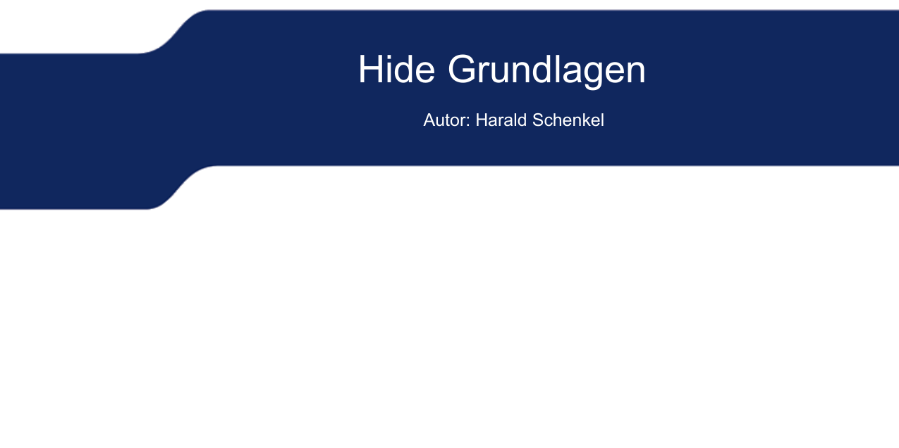

Hide Grundlagen

Autor: Harald Schenkel

## Inhaltsverzeichnis

- [1. Willkommen](#1-willkommen)
- [2. Copyright / Rechtliches](#2-copyright--rechtliches)
- [3. Was ist Hide?](#3-was-ist-hide)
- [4. Warum Hide?](#4-warum-hide)
- [5. Die Grenzen von Hide](#5-die-grenzen-von-hide)
- [6. Installation](#6-installation)
- [7. Registrierung von Hide](#7-registrierung-von-hide)
- [8. Die Oberfläche](#8-die-oberfläche)
- [9. Menüleiste](#9-menüleiste)
- [10. Vorschau](#10-vorschau)
- [11. Timeline](#11-timeline)
- [12. Einstellungen](#12-einstellungen)
- [12.1. Effekte](#121-effekte)
- [12.1.1. Attribute](#1211-attribute)
- [12.1.2. Füllung](#1212-füllung)
- [12.1.3. Maske](#1213-maske)
- [12.2. Information](#122-information)
- [12.3. Medienablage](#123-medienablage)
- [12.4. Ausgabe Medienablage](#124-ausgabe-medienablage)
- [13. Media Bin](#13-media-bin)
- [14. Statusleiste](#14-statusleiste)
- [15. Export](#15-export)
- [16. Arbeitsschritte in Hide](#16-arbeitsschritte-in-hide)
- [17. Tipps und Tricks](#17-tipps-und-tricks)
- [17.1. Maske ist zu groß und lässt sich nicht automatisch tracken](#171-maske-ist-zu-groß-und-lässt-sich-nicht-automatisch-tracken)

## 1. Willkommen

**Willkommen zu proDAD Hide !**

Hide dient der nachträglichen Entfernung von Objekten aus Videoaufnahmen und somit der qualitativen Aufwertung wichtiger Aufzeichnungen. Beim Filmen einer Sehenswürdigkeit ist es fast unmöglich, eine Aufnahme zu machen, ohne dass eine fremde Person durch das Bild läuft. Diese kann mit Hide entfernt und die Aufnahme somit aufgewertet werden.

Somit ist Hide ein äußerst wertvolles Tool zur Rettung und Optimierung der wertvollen Aufnahmen eines jeden Filmers.

Wir wünschen Ihnen viel Freude mit proDAD Hide und stets effektvolle Ergebnisse!

## 2. Copyright / Rechtliches

Rechtliches\
Copyright proDAD GmbH. Alle Rechte vorbehalten.

Lizenzbestimmungen\
Vor der Installation lesen Sie bitte folgende Lizenzbestimmungen sorgfältig durch.

Lizenzvertrag\
Beim Start des Setups wird ein Lizenzvertrag angezeigt, den Sie bitte sorgfältig durchlesen.\
Mit der Installation erkennen Sie diese Copyrightbestimmungen, den Lizenzvertrag und das Lizenzierungsverfahren an.

Lizenzgewähr\
proDAD GmbH räumt den bestimmungsgemäßen und erlaubten Gebrauch des vorliegenden Produkts ein. Das vorliegende Produkt kann nur auf einem Arbeitsplatz eingesetzt werden. Weder die Software, noch die Anleitung darf, auch in Teilen, reproduziert werden, es sei denn, es liegt eine schriftliche Genehmigung der proDAD GmbH vor. Mit Installation des Produkts gilt die Lizenzgewähr, die Urheberrechtsbestimmung, sowie die Haftungsbegrenzung als anerkannt.

Warenzeichen\
Alle Produkt- und Warenzeichen, die in diesem Produkt erwähnt wurden, sind Warenzeichen der jeweiligen Eigentümer. Alle Warenzeichen werden ohne Gewährleistung der freien Verwendbarkeit benutzt und sind eventuell eingetragene Warenzeichen.

Haftungsbegrenzung\
Der gesamte Haftungsumfang besteht im alleinigen Anspruch auf Ersatz des Produkts. Dies gilt für proDAD GmbH, Lizenznehmer und evtl. Vertreiber.

Anspruch besteht nur bei korrekter Rückgabe der Software unter Angabe einer Warenrücksendenummer, die zuvor mit proDAD GmbH vereinbart werden muss. Ferner muss bei der Rückgabe ein Kaufbeleg beiliegen. Ist eine Fehlfunktion des vorliegenden Produkts auf eine fehlerhafte Anwendung, Missbrauch, Unfall oder unsachgemäße Handhabung zurückzuführen, gilt die Garantie nicht. proDAD GmbH, deren Vertriebspartner und Lizenznehmer haften nicht für Schäden und Folgeschäden, die aufgrund der unmöglichen Nutzung des vorliegenden Produkts entstehen. In jedem Fall ist der Haftungsbetrag auf den Kaufpreis des Produkts beschränkt.

Dokumentationen\
Die Produktion und Übersetzung der Handbücher wurde mit größter Sorgfalt durchgeführt. Fehler können jedoch nicht hundertprozentig ausgeschlossen werden. proDAD GmbH übernimmt keinerlei Verantwortung oder Haftung für Folgen evtl. verbliebener fehlerhafter Aussagen oder Angaben. Technische und optische Änderungen vorbehalten. Hinweise sind stets willkommen.

Urheberrecht\
Die Software sowie die Einzelkomponenten dieses Produkts sind Eigentum der proDAD GmbH. Mit der Installation des vorliegenden Produkts stimmt der Lizenznehmer zu, unautorisierten Gebrauch und Duplizierung zu unterlassen.

proDAD GmbH übernimmt keinerlei Verantwortung für die Anwendung des Programms und die Veröffentlichung von Inhalten und Daten, die mit diesem Programm erzeugt wurden.

## 3. Was ist Hide?

Hide dient der nachträglichen Entfernung von Objekten aus Videoaufnahmen und somit der qualitativen Aufwertung wichtiger Aufzeichnungen. Beim Filmen passiert es häufig, dass Personen durch das Bild laufen die man eigentlich nicht haben möchte.

Originalaufnahme Mit Hide bearbeitet

Nicht immer hat man die Zeit oder das Budget zur Verfügung eine Aufnahme zu wiederholen. Manchmal fällt es auch erst beim Schnitt auf und man könnte verzweifeln.

Hier kommt Hide ins Spiel, denn Hide kann Objekte mit gewissen Voraussetzungen aus Videoaufnahmen entfernen und die Aufnahme somit retten bzw. aufwerten.

**Somit ist Hide ein äußerst wertvolles Tool zur Rettung und Optimierung der wertvollen Aufnahmen eines jeden Filmers.**

## 4. Warum Hide?

Aus einem Foto etwas zu entfernen ist mit einem Fotobearbeitungsprogramm kein großes Problem. Im Video sieht das schon anders aus, denn hier wird mit 25 Bildern pro Sekunde gearbeitet. Hier etwas zu entfernen ist sehr aufwendig.

Mit Hide ist wird es nun sehr einfach. Denn das störende Objekt wird mit einer Maske markiert. Hide erkennt dann die Bewegung und kann Maske automatisch mitführen. Dabei wird vor und nach dem Bild ein bestimmter Bereich analysiert und an der stelle wo das Objekt war eingesetzt.

Durch die Automatikfunktion geht das alles sehr schnell und auch längere Szenen können in kürzester Zeit bearbeitet werden.

## 5. Die Grenzen von Hide

Hide kann natürlich nicht zaubern. Es ist wichtig, dass es sich um ein bewegtes Objekt handelt. Denn Hide muss wissen, was an der Stelle wo ein Objekt entfernt wird, vorher war. Läuft eine Person von links nach rechts durchs Bild, ist das kein Problem. Denn Hide kann erkennen, wie die Szene ohne die Person aussieht. Läuft eine Person aber direkt auf die Kamera zu, ist es nicht möglich etwas zu ersetzen, da Hide nicht erkennen kann, was an Stelle der Person sein muss.

## 6. Installation

Um die Installation zu starten, klicken Sie bitte einfach doppelt auf die Setup-Datei. Bestätigen Sie das Willkommensfenster mit „Weiter“. Mit der Installation stimmen Sie den Bedingungen unter „2. Copyright / Rechtliches“ und den Lizenzbedingungen zu. Bestätigen Sie dies mit einem Klick auf „Ich bin mit diesen Lizenzbestimmungen einverstanden“. Wenn Sie Hide als Download bezogen haben, wird das Programmarchiv zunächst entpackt und die Installation gestartet. Wählen Sie dann das Zielverzeichnis in dem Hide installiert werden soll.

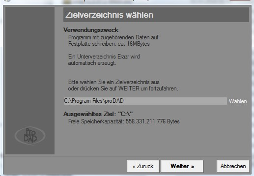

Folgen Sie nun den Installationsanweisungen.\
Hide kann danach per Shortcut auf dem Desktop

oder über „Start/Programme/proDAD/Hide 1.5 starten“ geöffnet werden.

Beim ersten Programmstart von Hide werden Sie zur Eingabe eines Aktivierungscodes (Seriennummer) aufgefordert, geben Sie den Code ein, den Sie bei elektronischer Lieferung mit der Download-Instructions-Email erhalten haben, oder falls Sie eine physische Lieferung (auf DVD) erhalten haben, innerhalb der Box vorfinden. Klicken Sie dann „Freischalten“.

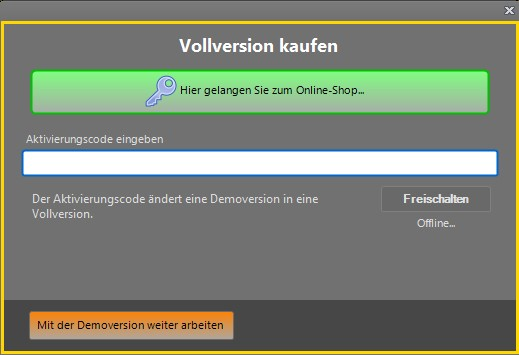

***WICHTIG:***\
*Beachten Sie, dass Ihr* *System im Moment der* *Aktivierung eine* *Internetverbindung benötigt,* *nur dann kann die* *Aktivierung erfolgreich* *durchgeführt werden. Sollte* *ein Problem bestehen, dann* *prüfen Sie die*

*Sicherheitseinstellungen*

*(Firewall etc.) im System und* *wiederholen die Aktivierung.*

Wenn Sie Hide im DEMO-Modus testen möchten, dann klicken Sie auf „Mit der Demoversion weiter arbeiten“. Die Demoversion ist solange aktiv, bis eine Seriennummerneingabe die Lizenz zur Vollversion wandelt.

Hide startet dann mit dem aktiven Register Start**.** Jetzt importieren Sie Ihr Videomaterial.

## 7. Registrierung von Hide

Sie möchten Updates und weitere Informationen über Hide erhalten, dann registrieren Sie Ihr proDAD Hide unte[r http://www.prodad.de/register.html](http://www.prodad.de/register.html)[**.**](http://www.prodad.de/register.html)

## 8. Die Oberfläche

Die Programme der Firma proDAD sind im Aufbau der Oberfläche alle ähnlich aufgebaut. Wer eines bedienen kann, kommt auch mit den anderen zurecht. Hier die wichtigsten Bereiche der Oberfläche.

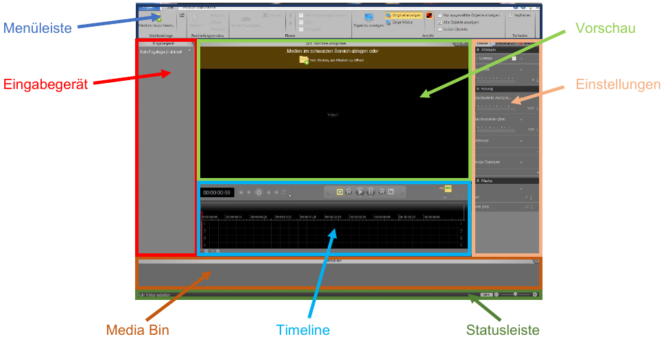

Menüleiste

Vorschau

Eingabegerät

Einstellungen

Media Bin

Timeline

Statusleiste

## 9. Menüleiste

Oben links haben Sie drei

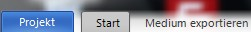

Auswahlmöglichkeiten. Projekt, Start und Medium exportieren. Nach dem Start der Software befinden Sie sich in der Karteikarte „Start“. Hier findet auch die eigentliche

Arbeit statt.

Im Bereich „Projekt“

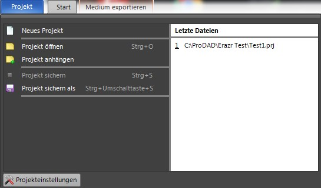

können Sie mit „Neues Projekt“ ein Projekt anlegen, unter „Projekt öffnen“ wird ein bestehendes Projekt geöffnet um damit weiter zu arbeiten. Mit „Projekt anhängen“ können Sie in das aktuelle Projekt ein anderes hinzufügen. Der Befehl „Projekt sichern“ speichert das Projekt unter dem aktuellen Projektnamen. Wurde noch kein Projektname vergeben ist diese Funktion nicht aktiv. Mit dem Befehl „Projekt sichern als“ können sie einen Projektnamen vergeben und den Speicherort festlegen. Im rechten Teil sehen Sie die zuletzt verwendeten Projekte. Um

ein Projekt aus der Liste zu öffnen einfach mit der linken Maustaste anklicken.

In den Projekteinstellungen unten links werden grundlegende Dinge eingestellt. Sie können hier z.B. festlegen, in welchen zeitlichen Abständen automatisch gespeichert werden soll, welche Fenster in der Oberfläche angezeigt werden.

Schauen wir uns nun die Funktionen der Karteikarte „Start“ an.

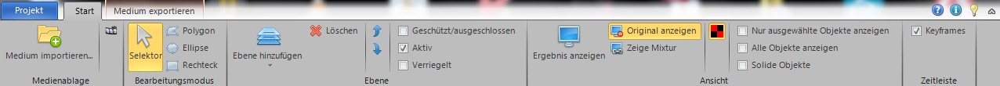

Ganz links befindet sich die Schaltfläche zum „Medium importieren“.

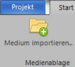

Wenn Sie mit der Maus auf diese Schaltfläche klicken, öffnet sich ein Fenster wie Sie es von vielen anderen Programmen sicherlich kennen. In diesem Fenster können Sie das Laufwerk und die gewünschte Datei auswählen und öffnen. Um eine Datei in Hide zu bearbeiten, können Sie diese aber auch direkt in das Vorschaufenster ziehen.

Das Symbol daneben müssen Sie anklicken, wenn das zu importierende Material

beim Import gleich in einzelne Szenen unterteilt werden soll. Sie öffnen also eine Datei, diese wird dann unterteilt und jede Szene wird mit einem Bild in der Medienablage angezeigt. Ist die Szenenerkennen aktiv, ist sie farbig hinterlegt.

Im Bereich Bearbeitungsmodus legen Sie fest mit welcher

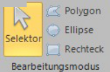

Maskenform Sie das Objekt maskieren möchten. Es steht Polygon, Ellipse und Rechteck zur Auswahl.

Der Selektor wird gelb, wenn eine Maske erstellt wurde. Dadurch kann man erkennen, dass Masken erstellt wurden, auch wenn diese in der Vorschau ausgeblendet sind.

Im nächsten Bereich

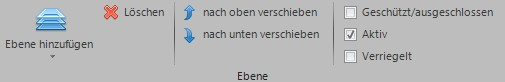

der Menüleiste können Sie Ebenen erstellen, die Reihenfolge tauschen und einstellen welche angezeigt werden soll. Die normalen Ebenen werden automatisch erzeugt. Also wenn Sie eine Maske erstellen, erhält diese automatisch auch eine Ebene. Aber es gibt auch geschützte Ebenen. Diese dienen dazu Bereiche, die von einer Maske berührt werden, nicht zu verändern. Wenn zum Beispiel eine zu entfernende Person hinter einem Baum vorbeiläuft. Hier soll ja dann nur die Person entfernt und der Baum erhalten bleiben. Um eine geschützte Ebene zu erstellen, klicken Sie in den unteren Teil des Buttons „Ebene hinzufügen“ und wählen „Schutz-/Ausschluss-Ebene“. Mit dem roten „X“ können Sie die im Moment aktive Ebene

löschen.

Hier können Sie auch Ebenen erzeugen, die nicht über die ganze Timeline gehen, sondern an der momentanen Cursor-Position beginnen.

Im Bereich Ansicht

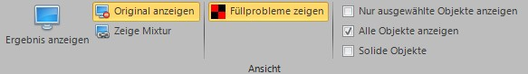

stellen Sie ein, was in der Vorschau zu sehen sein soll. Die jeweilige Auswahl ist Gelb markiert.

**Ergebnis anzeigen:** Zeigt in der Vorschau den Clip ohne das maskierte Objekt. Es wird auch keine Maske angezeigt.

**Original anzeigen:** Zeigt in der Vorschau den Original Clip mit der erstellten Maske.

**Zeige Mixtur:** Hier sehen Sie das Ergebnis mit der erstellten Maske.

**Füllprobleme zeigen:** Je nachdem, wie schnell sich das störende Objekt bewegt, und der Einstellung des Bereichs mit den Funktionen „Nachbarbild-Abstand“ und „Nachbarbilder (Sek)“ kann es zu Problemen mit der Füllung der Maske kommen. Das bedeutet, dass der Bereich der von Hide untersucht wird zu klein ist, und keine Bilder berechnet werden können. Mit dieser Funktion ist dies in der Vorschau deutlich zu erkennen. Sollte dieses Rot/Schwarze Muster in der Vorschau auftauchen, können Sie das Problem durch verstellen der Werte lösen.

Außerdem können Sie noch einstellen, ob nur die ausgewählte oder alle Masken angezeigt werden, und ob die Maske gefüllt (Solid Objekt) oder nur als Rahmen dargestellt wird.

Ganz rechts können Sie einstellen, ob Sie die Keyframes, die beim

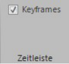

Tracking erzeugt wurden, in der Timeline sehen möchten oder nicht.

## 10. Vorschau

Im Vorschaufenster sehen Sie sofort die Veränderungen, die Sie vorgenommen haben. Dazu muss aber in der Menüleiste „Ergebnis anzeigen“ aktiviert sein. Je nach Einstellungen und verwendeter Hardware, kann es auch mal etwas dauern, bis die Vorschau aktualisiert ist. Solange sehen Sie dann unterhalb der Vorschau eine gestrichelte Linie. Über der Vorschau steht der Dateiname, damit Sie sehen ob dies auch der richtige Clip ist. Wenn Sie neben dem Dateinamen ganz rechts auf das Viereck klicken, wird die Vorschau vergrößert. Dadurch werden die anderen Fenster ausgeblendet. Das Viereck ändert sich zum doppelten Viereck. Ein Klick darauf wechselt zur ursprünglichen Ansicht.

Wenn Sie mit der rechten Maustaste in das Vorschaubild klicken, können Sie die Interlace und Wiedergabe Optionen ändern.\
Sie können also entscheiden, ob nur das obere, das untere oder beide Halbbilder angezeigt werden sollen. Ebenso können Sie noch Einstellungen für die Wiedergabe vornehmen.

Mit dem Mausrad können Sie die Vorschau in der Größe ändern. Aber Vorsicht: Sie müssen erst in die Vorschau klicken und dann erst das Mausrad bewegen.\
Sonst könnte es sein, dass Sie einen Wert verändern. Denn das Mausrad kann in verschiedenen Bereichen verwendet werden.

Sie können auch durch einfaches ziehen eines Clips aus dem Windows Explorer in die Vorschau ein Medium importieren.

In der rechten oberen Ecke sehen Sie einen Doppelpfeil der nach oben zeigt. Damit können Sie das Vorschaufenster aus der Oberfläche ausklinken und erhalten die Vorschau als separates Fenster. Das hat den Vorteil, dass zum einen die Vorschau auf einen zweiten Monitor verschoben und dort in voller Größe angezeigt werden kann und zum anderen der Platz für die Timeline größer wird. Die ist bei vielen Masken, also Spuren von Vorteil, da man nicht rauf und runter scrollen muss um alles zu sehen. Wenn Sie die Vorschau in der Größe verändern möchten, gehen Sie mit der Maus an eine Ecke, halten die linke Maustaste gedrückt und ziehen Sie das Fenster in die gewünschte Größe. Mit dem „X“ oben rechts schließen Sie dieses Fenster und die Vorschau ist wieder in der Oberfläche eingebunden. Die zuvor eingestellte Größe und Position wird gespeichert, sodass beim nächsten Abkoppeln die zuvor eingestellte Größe und Position eingenommen wird.

## 11. Timeline

Unter der Vorschau befindet sich die Timeline mit den Tasten zum Abspielen des Materials.

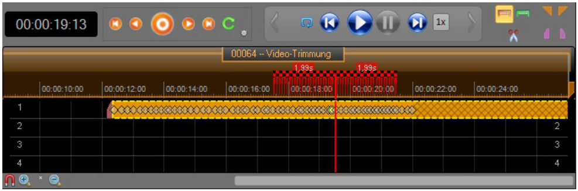

Ganz links sehen Sie die Timecodeanzeige. Es wird der Wert der momentanen Cursorposition (rote Linie) angezeigt. Daneben befinden sich die Buttons für das automatische Tracking. Sie können sich hier Bild für Bild vorwärts bzw. rückwärts bewegen oder automatisch bis zum Anfang bzw. zum Ende tracken lassen.\
Während des Trackens werden in der Timeline automatisch Keyframes gesetzt. Mit den Keyframes werden die Werte für Größe und Position der Maske an dieser Timelineposition gespeichert. Hide setzt die Keyframes in regelmäßigen Abständen. Wenn es sich bei der Bewegung des Objektes aber um eine gleichmäßige, also lineare Bewegung handelt, sind gar nicht so viele Keyframes notwendig. Deshalb können Sie mit dem grünen Pfeil die überflüssigen Keyframes aus der Spur löschen.

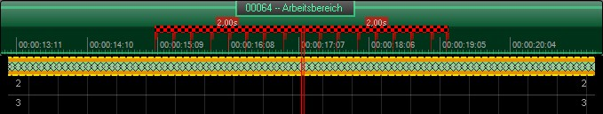

Timeline nach dem automatischen Tracking.

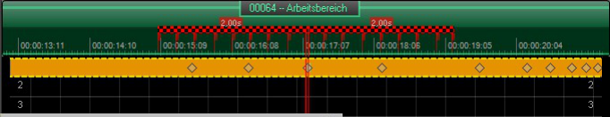

Timeline nach dem Löschen der nicht benötigten Keyframes.

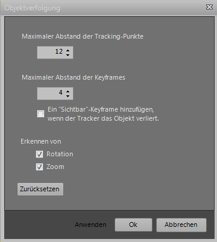

Dadurch haben Sie es einfacher, wenn Sie später die Werte noch anpassen möchten.

Rechts, neben dem grünen Pfeil, befindet sich noch ein kleines Zahnrad. Mit diesem kommen Sie zu den Einstellungen für die Objektverfolgung. Hier können Sie den maximalen Abstand der Tracking-Punkte und den maximalen Abstand der Keyframes einstellen. Außerdem können Sie festlegen, ob Rotation und Zoom erkannt werden soll

oder nicht.

In der Mitte befinden sich die Schaltflächen für die Wiedergabe.

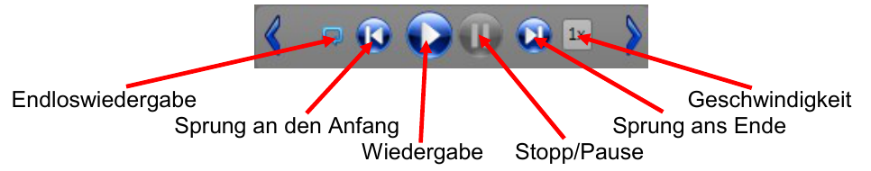

Endloswiedergabe

Geschwindigkeit

Sprung an den Anfang Sprung ans Ende Wiedergabe Stopp/Pause

Mit den Pfeilen rechts und links können Sie zwischen den Clips in der Medienablage unter der Timeline wechseln. Natürlich sind sie nur aktiv, wenn mehrere Clips vorhanden

sind.

Rechts können Sie zwischen dem Arbeits- und Trimmbereich wechseln. Im Trimmbereich (Braun) können Sie die Filmlänge verändern, also von dem Clip vorne und hinten etwas abschneiden. Dazu aktivieren Sie den Trimmbereich (linker brauner Button), fahren Sie den Cursor an die gewünschte Stelle und klicken auf das linke braune Dreieck für den Anfangspunkt und auf das rechte Dreieck, wenn Sie den Endpunkt verändern möchten. Mit der Schere können Sie den Clip an der Cursorposition durchschneiden. Es werden dann in der Medienablage beide

Teile angezeigt.

Wenn der Arbeitsbereich (Grün) aktiviert ist, können Sie den

Arbeitsbereich begrenzen. Dies ändert aber nichts an der Filmlänge. Aber die erstellte Maske wirkt sich nur im definierten Arbeitsbereich aus.

Für jede Maske wird in der Timeline eine Spur erstellt. Sollten bei mehreren Masken nicht alle im gesamten Arbeitsbereich angewendet werden, können Sie die Spur der betroffenen Maske mit den beiden Symbolen unten rechts begrenzen.

 Dazu mit dem Cursor zum Beispiel an die Anfangspostition fahren und auf das linke Symbol klicken. Für die Endposition verwenden Sie das rechte Symbol.

Links unter der Timeline können Sie mit den Lupensymbolen die Timeline auseinanderziehen bzw. zusammenschieben. Dies ändert nichts an der Filmlänge, sondern dient nur dazu die Keyframes in der Timeline besser zu sehen.\
Mit dem Mausrad können Sie sich in der Timeline vorwärts und rückwärts bewegen. Es muss aber zuerst die Timeline angeklickt werden. Sonst könnte es sein, dass Sie einen Wert verändern, da das Mausrad in verschiedenen Bereichen verwendet wird.

## 12. Einstellungen

Im Bereich der Einstellungen

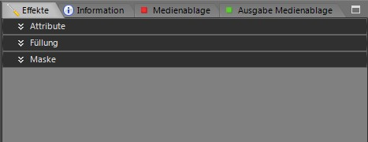

können Sie die Werte der Maske für die Bearbeitung einstellen. Der Einstellungsbereich unterteilt sich in „Effekte“, „Information“, „Medienablage“ und „Ausgabe-Medienablage“.

Mit dem Viereck ganz rechts können Sie die Vorschau vergrößern. Die anderen Fenster verschwinden. Das Viereck ändert sich zum doppelten Viereck. Ein Klick darauf wechselt zur ursprünglichen Ansicht.

### 12.1. Effekte

Um im Bereich Effekte die Werte einzustellen, müssen Sie den entsprechenden Bereich mit dem Doppelpfeil links neben der Bezeichnung öffnen.

Die Einstellungen erfolgen über den jeweiligen Schieberegler oder über das Zahlenfeld rechts. Hier können Sie entweder den Wert mit den Pfeiltasten rauf/runter, mit dem Mausrad oder über die Eingabe eines Wertes über die Tastatur verändern. Achtung, in der Grundeinstellung funktioniert es nur mit den Zahlen über den Buchstaben, der Zahlenblock rechts kann nicht verwendet werden. Dazu müsste in den Projekteinstellungen unter „Praktische Anpassungen bei „Medien-Navigation mittels des Ziffernblocks“ das Häkchen entfernt werden. Die Werte können auch mit Keyframes gesteuert werden. Um in die Keyframesteuerung zu kommen, klicken Sie auf die Uhr rechts von der Bezeichnung des Werkzeuges.

#### 12.1.1. Attribute

Im Bereich „Attribute“ können

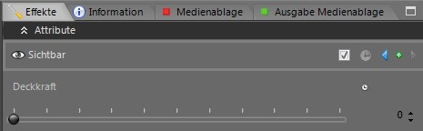

Sie unter „Sichtbar“ die Wirkung der Maske an einer bestimmten Stelle der Timeline abschalten und an anderer Stelle wieder einschalten. Sie müssen dazu nur mit dem Cursor an die Stelle der Timeline fahren und mit der Maus in den Bereich „Sichtbar“ klicken. Es wird automatisch ein Keyframe erzeugt und ab dieser Stelle wird die Spur in der Timeline schwarz. Außerdem ist die Keyframesteuerung ganz rechts aktiv. Sie können nun mit dem Cursor weiterfahren und an der gewünschten Position nochmal in den Bereich „Sichtbar“ klicken. Ab dieser Stelle wird die Spur wieder aktiviert. Es ist dann nur der Teil zwischen den Keyframes schwarz. Mit den Pfeiltasten oben rechts können Sie von einem Keyframe zum nächsten springen. Mit dem roten Minuszeichen zwischen den

Pfeilen können sie das Keyframe auf dem Sie sich gerade befinden löschen. Befinden Sie sich auf keinem Keyframe, so wird hier ein grünes Pluszeichen angezeigt. Damit können Sie an dieser Stelle ein zusätzliches Keyframe erstellen. Immer wenn ein Wert verändert wird, wird automatisch ein Keyframe gesetzt.

Mit der Deckkraft können Sie das maskierte Objekt transparent darstellen. Es wird also nicht ganz aus dem Bild entfernt. Natürlich ist es auch hier möglich, das Ganze mit Keyframes zu steuern.

Sobald Sie den Wert verändert haben, erscheint links von der Bezeichnung ein kleiner roter Punkt. Dies ist bei alles Werten so. Mit diesem Punkt können Sie die Grundeinstellung wiederherstellen. Vorhandene Keyframes werden dadurch gelöscht.

#### 12.1.2. Füllung

Der Bereich „Füllung“ ist der

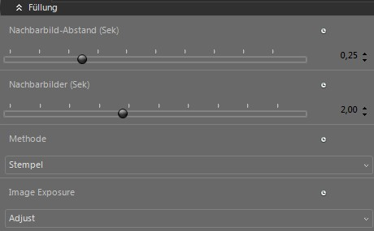

wichtigste in Hide. Denn hier werden die Einstellungen getroffen, wie die Maske das Objekt bearbeitet. Mit den ersten beiden Reglern legen Sie den Bereich und den Abstand, der zu untersuchenden Bildern, fest. Denn Hide untersucht in einem festgelegten Bereich das Material und prüft, was an der Stelle, an der sich das maskierte Objekt jetzt befindet, vorher war bzw. nachher ist. Und aus diesen Informationen wird dann der Bereich der Maske gefüllt. Der eingestellte Bereich ist in der Timeline rot gekennzeichnet. Unter „Methode“ können Sie zwischen „Pixelverfolgung (GPU)“, „Stempel“, Farbfüllung“ und „Edge fill-in“

wählen.\
Mit den ersten beiden wird das Bild mit tatsächlichen Bildinhalten aufgefüllt. Wobei „Pixelverfolgung (GPU)“ in meinen Tests das beste Ergebnis brachte. Aber es ist auch am langsamsten bei der Berechnung.

Mit den anderen beiden wird das Objekt nur unscharf dargestellt. Mit „Image Exposure“ können Sie wählen, ob die Bildbelichtung eingestellt (Adjust) oder beibehalten (Keep) wird. Standardeinstellung ist „Adjust“, dadurch werden die errechneten Pixel in der Belichtung angepasst und passen so besser ins Bild. Denn es könnte ja sein, dass der zu untersuchende Bereich weiter vorne etwas dunkler ist. Dann würde es auffallen, wenn diese dunkleren Stellen eingefügt werden.

#### 12.1.3. Maske

Im Bereich „Maske“ können Sie die

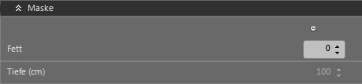

Maskengröße für die gesamte Spur ändern. Wenn Sie also nach dem

Erstellen der Maske und dem Tracking feststellen, dass die Maske etwas zu klein geraten ist, können Sie unter „Fett“ den Wert erhöhen. Diese Veränderung wird nicht auf ein Keyframe gesetzt, sondern gilt für die ganze Spur. Wenn die Veränderung nur an einer bestimmten Stelle sein soll, dann können Sie dies mit Keyframes steuern. Klicken Sie dazu auf die kleine Uhr über dem Zahlenwert.

### 12.2. Information

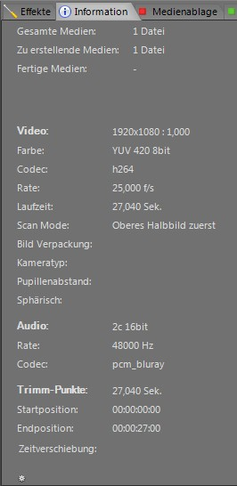

Unter “Information” können Sie die wichtigsten Daten des Videomaterials einsehen.

So sehen Sie hier die Auflösung, die Bildrate, den verwendeten Codec, die Länge und vieles mehr.

### 12.3. Medienablage

Im Bereich „Medienablage“ werden alle importierten Medien in Listenform angezeigt.

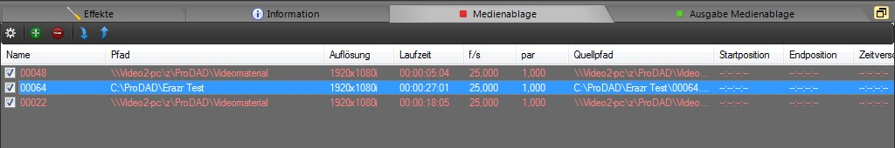

Sie erhalten Informationen zum Dateiname, Dateipfad, Auflösung, Laufzeit, Bilder/Sek (f/s), Pixelratio (par) sowie zum Quellpfad der importierten Videos.\
In der Medienablage können auch Medien hinzugefügt (+) oder entfernt (-) werden. Allerdings wird mit dem „+“ Symbol nur das ausgewählte kopiert. Um neue Dateien hinzuzufügen können Sie diese direkt per Drag and Drop in die Medienablage ziehen. Mit dem Zahnrad gelangen Sie zu den Einstellungen des jeweiligen Clips. Hier können Sie zum Beispiel die Start- und Endposition der Datei festlegen. Dies entspricht dem

Setzen des Start- und Endpunktes mit den Dreiecken im Trimmmodus. Außerdem können hier auch Einstellungen für 3D Aufnahmen gemacht werden.

Mit den Pfeilen können Sie die Position der Datei in der Liste verändern. Dies ist wichtig, wenn beim Export die Medien zusammengefügt werden.\
Wenn Sie in der Liste das Häkchen ganz links entfernen, wird diese Datei nicht exportiert.

Wenn Sie mit der rechten Maustaste auf einen Eintrag

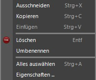

oder in den freien Bereich klicken, öffnet sich ein Menü. Hier können Sie den ausgewählten Eintrag „Ausschneiden“ und an einer anderen Position in die Liste wieder „Einfügen“. Soll ein Clip mehrfach ausgegeben werden, so können Sie diesen „Kopieren“. Außerdem können Sie hier den Dateinamen ändern oder alle Listeneinträge auswählen. Alles was Sie hier tun ändert auch die Anzeige im „Media Bin“ (untere Medienablage).

Mit „Eigenschaften“ kommen Sie wie mit dem Zahnrad oben links zu den Dateieigenschaften.

### 12.4. Ausgabe Medienablage

Haben Sie eine oder mehrere Dateien exportiert, erscheinen diese in der Karteikarte „Ausgabe Medienablage“. Allerdings nur, bis Sie das Programm schließen. Beim nächsten Start ist die „Ausgabe Medienablage“ wieder leer.

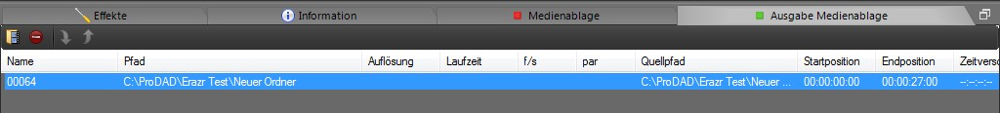

Mit dem Symbol in der linken oberen Ecke können Sie die angewählte Datei abspielen.

Es öffnet sich ein Fenster für

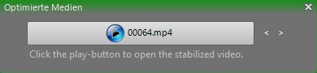

den Start. Mit den kleinen Pfeilen können Sie zwischen den Dateien wechseln und eine andere Datei abspielen.

Zum Entfernen aus der Liste, klicken Sie auf das rote Minuszeichen. Mit den Pfeiltasten können Sie die Reihenfolge in der Liste verändern. Wobei beim Abspielen immer nur eine Datei abgespielt wird. Von daher ist die Reihenfolge nicht relevant.

## 13. Media Bin

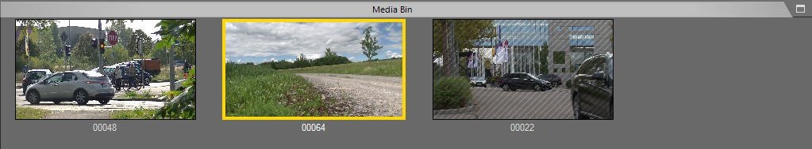

Im „Media Bin“ (untere Medienablage) sehen Sie alle importierten Medien in Form von Bildern.\
Dies entspricht der Karteikarte „Medienablage“. Auch hier im „Media Bin“ haben Sie die Möglichkeit Clips zu entfernen oder umzubenennen. Wenn Sie mit der rechten Maustaste auf ein Bild klicken gelangen Sie zum entsprechenden Menü. Alles was Sie hier tun wird identisch unter „Medienablage“ angezeigt. Sie können auch ein Medium aus dem Windows Explorer in die Medienablage ziehen, dadurch wird es importiert.

Zum Entfernen können Sie aber auch ganz einfach den aktuellen Eintrag, dieser ist in der Vorschau zu sehen und hat einen farbigen Rahmen, mit der „Entf-Taste“ der Tastatur entfernen.

Mit dem Viereck ganz rechts können Sie die Medienablage vergrößern. Die anderen Fenster verschwinden. Das Viereck ändert sich zum doppelten Viereck. Ein Klick darauf wechselt zur ursprünglichen Ansicht.

## 14. Statusleiste

In der Statusleiste ganz unten sehen Sie links verschiedene Dateiinformationen. Rechts können Sie mit dem Schieberegler die Größe der Vorschau verändern. Dies ist aber keine Einstellung für die Ausgabe. Sie dient nur dazu Details besser zu sehen.

## 15. Export

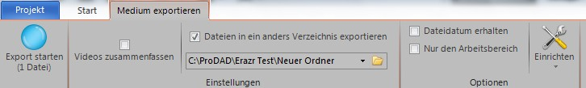

Um Ihre bearbeiteten Dateien auszugeben wählen Sie oben „Medium exportieren“. Es ändert sich nur oben die Menüleiste.

Wenn nur eine Datei, also ein Clip ausgegeben wird, und Sie den Speicherort nicht verändern, wird die Datei mit demselben Dateinamen mit der Erweiterung „-Hide“ am selben Ort wie das Ausgansmaterial gespeichert.

Haben Sie mehrere Dateien importiert und bearbeitet, so stehen ganz links bei „Export starten“ darunter die Anzahl der Dateien. Dies kann etwas verwirrend sein, da in der Medienablage ja nur ein Clip einen farbigen Rahmen hat.

Aber rechts in der Karteikarte „Medienablage (13.3.) haben automatisch alle ein Häkchen. Entfernen Sie das Häkchen von den Dateien, die nicht ausgegeben werden sollen, und die Anzeige unter „Export starten“ ändert sich entsprechend.

Haben Sie eine Datei aus der Liste (Medienablage) zur Ausgabe entfernt, wird diese im „Media Bin“ schraffiert dargestellt.

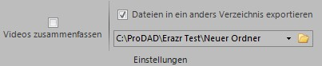

Alle ausgewählten Dateien werden als einzelne Dateien ausgegeben und gespeichert. Möchten Sie die Dateien als eine Datei ausgeben, müssen Sie bei „Videos zusammenfassen“ ein Häkchen setzen. Dadurch wird nur eine

Datei erzeugt. Daneben können Sie den Dateipfad für die Ausgabe festlegen.

Unter „Optionen“ können Sie noch ein Häkchen setzen,

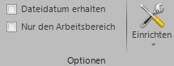

wenn Sie das Aufnahmedatum der Datei bei der Ausgabe erhalten möchten. Hier können Sie auch ein Häkchen setzen um nur den Arbeitsbereich als Datei auszugeben.

Mit „Einrichten“ können Sie das

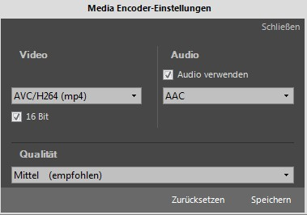

Ausgabeformat und die Qualität einstellen. Als Videoformat stehen Ihnen MP4, MOV und AVI zur Auswahl. Außerdem können Sie zwischen drei Qualitätsstufen wählen. Je besser die Qualität umso größer aber auch die Datei.

Die Qualitätsstufe Mittel ist in den meisten Fällen ausreichend.

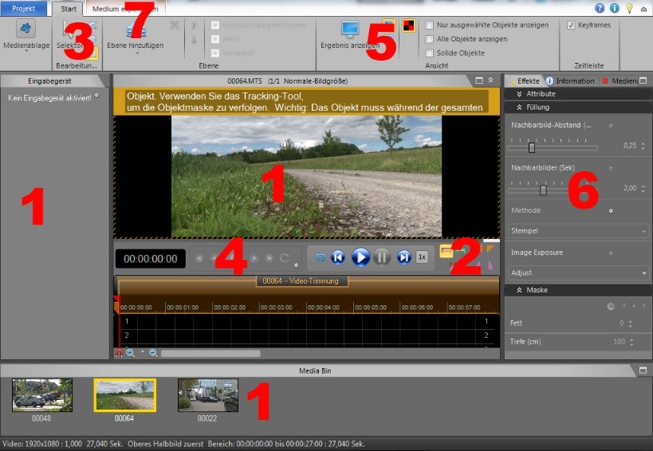

## 16. Arbeitsschritte in Hide

1. Medium über „Medium importieren“ oder durch ziehen in die Vorschau oder in die „Medienablage“ bzw. „Media Bin“ importieren. Bei längeren Clips kann die „Szenenerkennung“ aktiviert werden.
2. Clip bei Bedarf zuschneiden und wenn nötig Arbeitsbereich festlegen.
3. Maskenform wählen und Maske in der Vorschau erstellen.
4. Tracking automatisch oder manuell ausführen.
5. Ergebnis anzeigen auswählen und evtl. festlegen was in der Vorschau zu sehen sein soll.
6. Feineinstellung im Bereich Effekte.
7. Auf „Medium exportieren“ klicken.

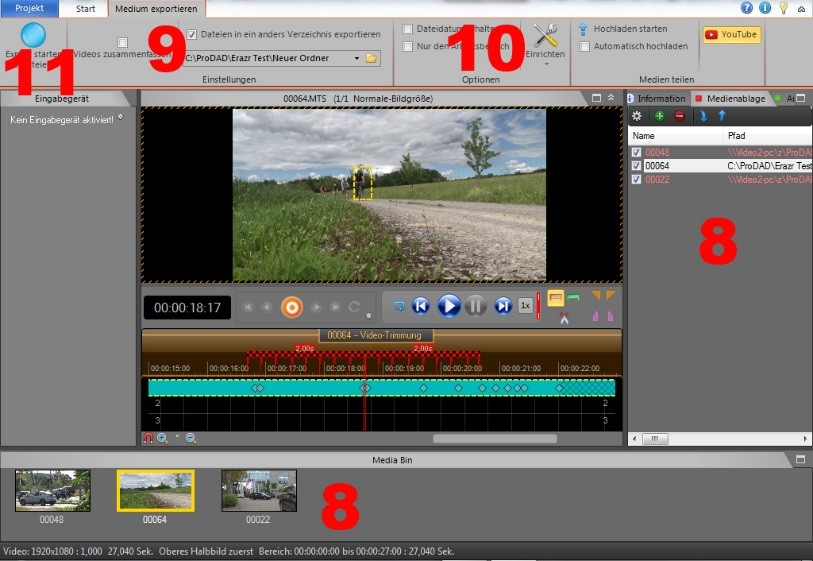

8. Datei für die Ausgabe unter “Medienablage“ oder im „Media Bin“ auswählen.
9. Wenn nötig Dateipfad auswählen und evtl. bei mehreren Dateien „Videos zusammenfassen“ aktivieren.
10. Ausgabeformat und Qualität einstellen.
11. Export starten.

Natürlich können Sie die Arbeitsschritte auch in anderer Reihenfolge ausführen und kommen auch zum Ziel. Es soll hier nur eine kleine Hilfe sein, dass Sie nichts vergessen.

## 17. Tipps und Tricks

### 17.1. Maske ist zu groß und lässt sich nicht automatisch tracken.

Bei Objekten wie in unserem Beispiel muss die Maske natürlich so groß sein, dass auch der Schatten des Rades mit maskiert ist.

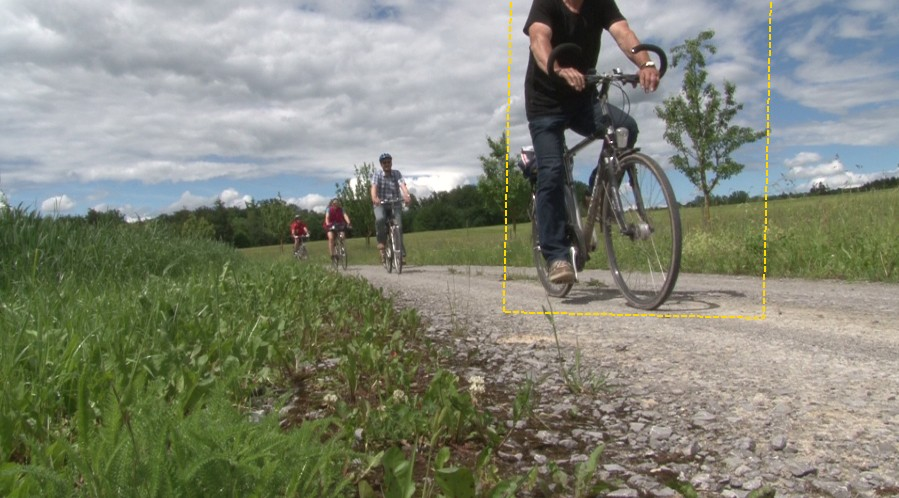

Das Problem ist dann aber, dass zu viele Trackpunkte außerhalb des eigentlichen Objektes liegen und das automatische Tracking nicht mehr funktioniert.

Ein solches Problem kann ganz einfach gelöst werden. Erstellen Sie zuerst eine kleine Maske. In unserem Beispiel nur auf der Brust des Radfahrers, denn diese ist während der ganzen Szene immer sichtbar. Nach erfolgreichem Tracking klicken Sie die Maske in der Vorschau an und löschen Sie mit der „Entf-Taste“ an der Tastatur. Es wird nun nur die Maske, nicht aber die erzeugten Keyframes gelöscht. Nun erstellen Sie eine neue Maske, die auch größer wie das Objekt sein darf. Die neue Maske wird mit den vorhanden Keyframes verknüpft und bewegt sich auf dem aufgezeichneten Bewegungspfad.
