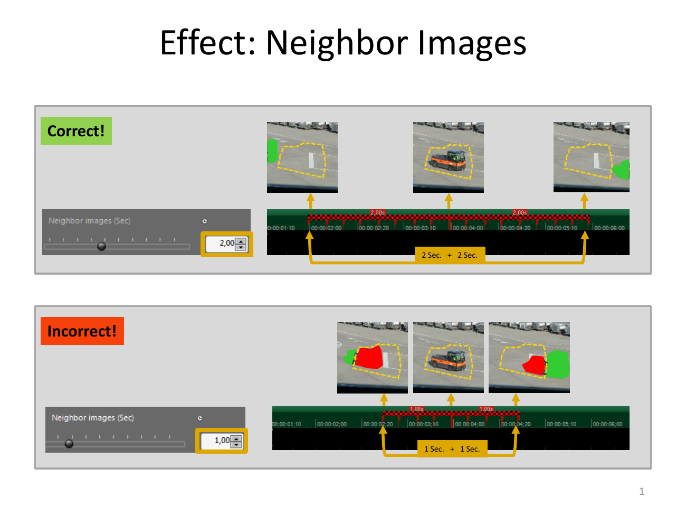
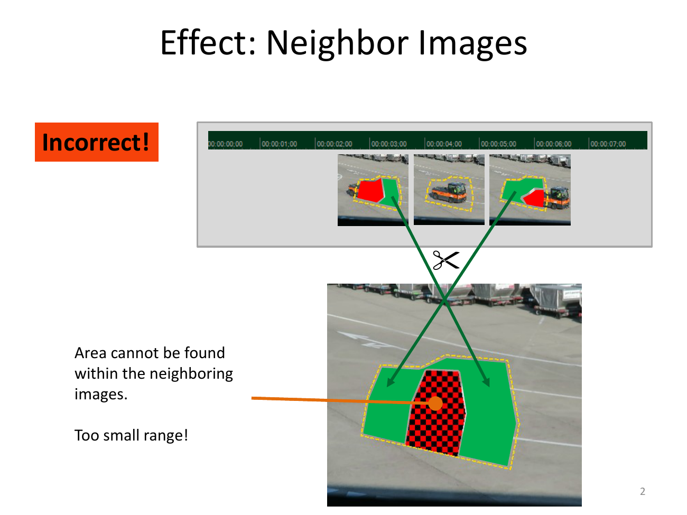
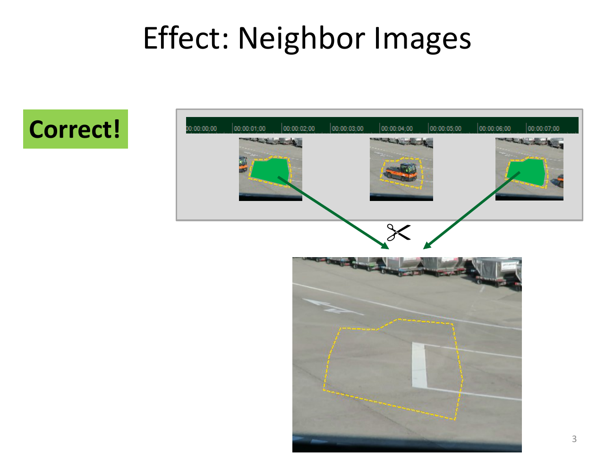

# proDAD FX: Neighbor Images

## Effect: Neighbor Images

- **Correct!**
- 2 Sec. + 2 Sec.
- **Incorrect!**
- 1 Sec. + 1 Sec.

## Effect: Neighbor Images

- **Incorrect!**
- ✂
- Area cannot be found
- within the neighboring
- images.
- Too small range!

## Effect: Neighbor Images

- **Correct!**
- ✂
