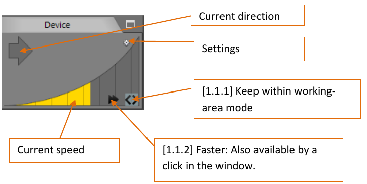
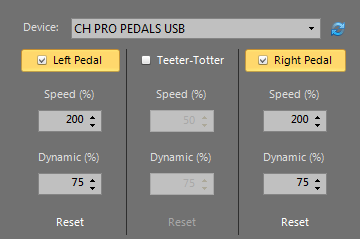
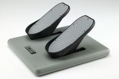
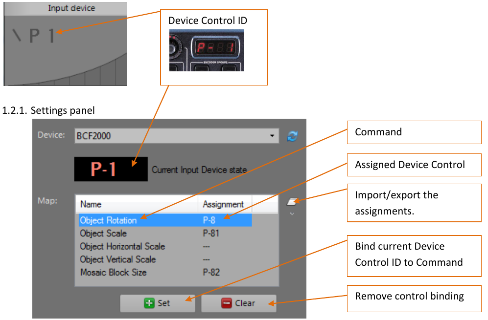
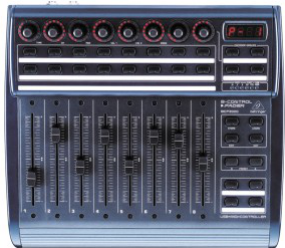

# proDAD: Input Devices

proDAD: Input Devices

1. Input Device\
  1.1. Pedals (Input Device)

Current direction

Settings

[1.1.1] Keep within working- area mode

Current speed

[1.1.2] Faster: Also available by a click in the window.

1.1.1. Keep within working-area:

When this mode is activated the time-cursor can only be moved within the working-area.

1.1.2. Faster: 4x faster than normal\
1.1.3. Settings panel

1.1.3.1. Device: Used input-device\
1.1.3.2. Left/Right pedal:\
1.1.3.3. Teeter-Totter: Linked pedal shifter\
1.1.3.4. Speed: Speed of the pedal presser\
1.1.3.5. Dynamic: Control of the acceleration.

1.1.4. Tested devices

1.1.4.1. CH Pro Pedals

http://www.chproducts.com/Pro-Pedals-v13-d-716.html

1.1.4.1.1. And all other Direct-Input gaming devices […]

1.2. MIDI (Input Device)

Device Control ID

1.2.1.Settings panel

Command

Assigned Device Control

Import/export the assignments.

Bind current Device Control ID to Command

Remove control binding

1.2.1.1. How to assign a command

1.2.1.1.1. Move a device slider or rotate a device knob. This selects the device-control for the assignment. 1.2.1.1.2. Select the command by clicking the command name.\
1.2.1.1.3. Press the “Set” button or double-click the command name. This binds the device-control to the

command.

1.2.1.1.4. Tip: First select an object and activate the Teach-In mode. Then open the settings panel. Now

you can see if the assigned commands are working.

1.2.1.2. Node: Some commands only work when a special mode is activated.

E.g.: The Object-Commands work only in “Teach-In” mode or during object-tracking.

1.2.2. Tested Devices

1.2.2.1. Behringer BCF2000

