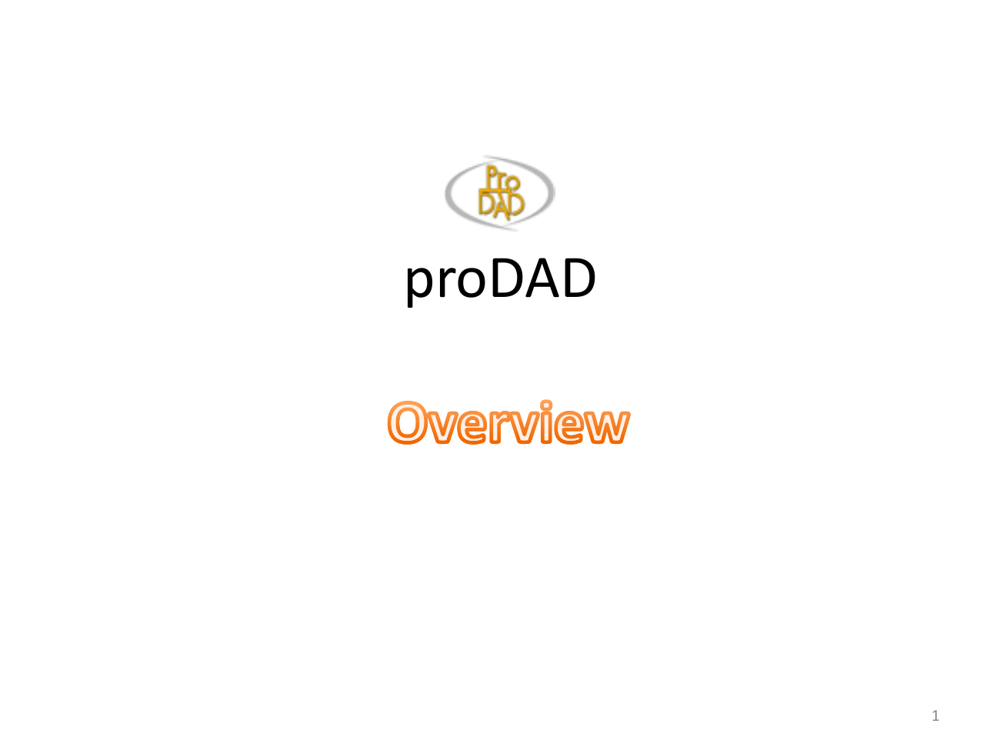
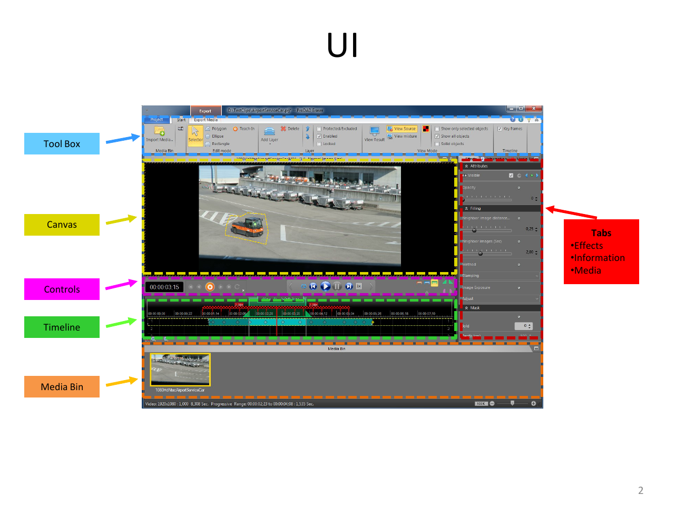
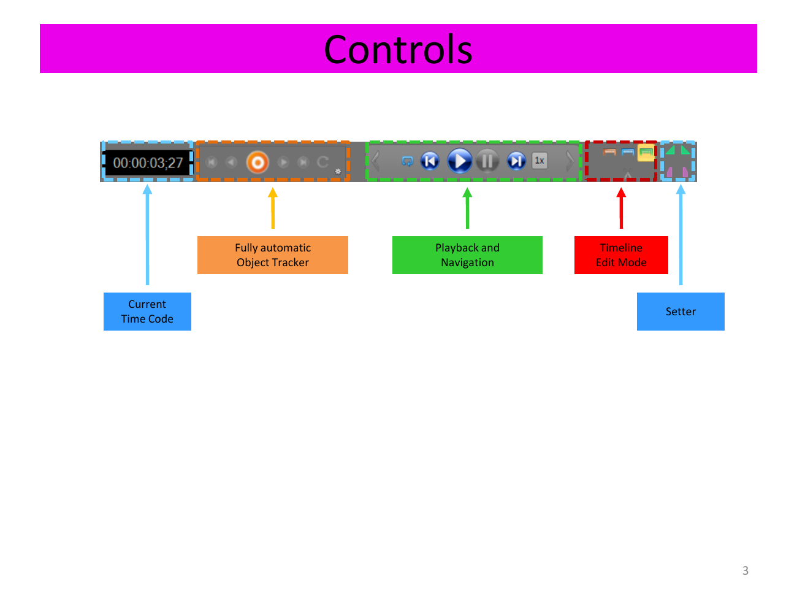
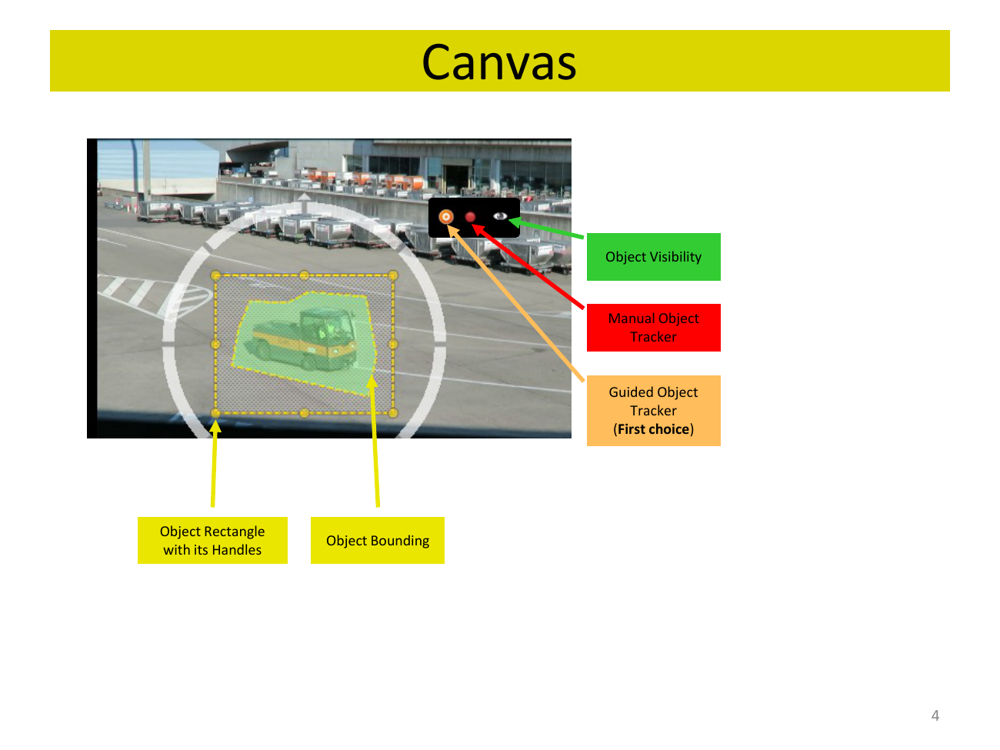
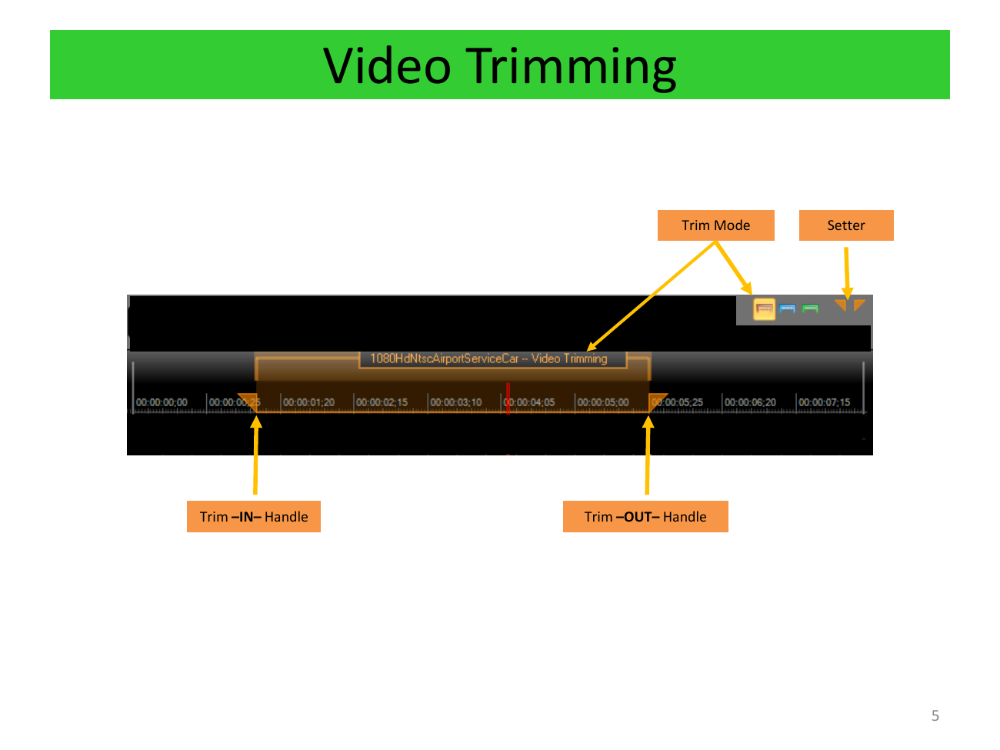
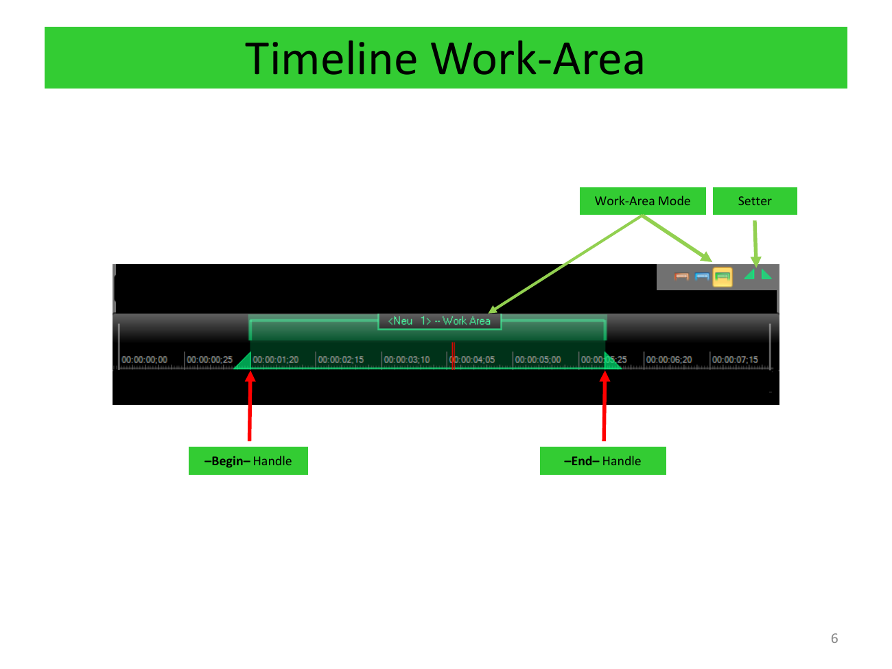
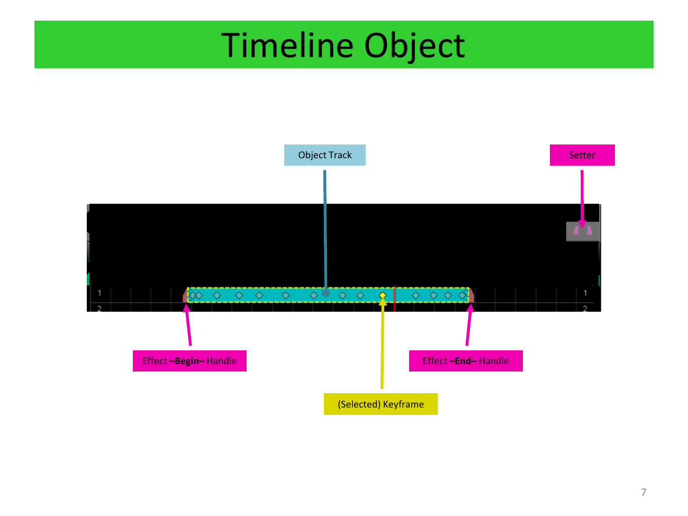

# proDAD Overview

## proDAD

## UI

- Tool Box
- Canvas
- **Tabs**
- Effects
- Information
- Media
- Controls
- Timeline
- Media Bin

## Controls

- Fully automatic Playback and Timeline
- Object Tracker Navigation Edit Mode
- Current
- Setter
- Time Code

## Canvas

- Object Visibility
- Manual Object
- Tracker
- Guided Object
- Tracker
- (**First choice**)
- Object Rectangle
- Object Bounding
- with its Handles

## Video Trimming

- Trim Mode Setter
- Trim **–IN–** Handle Trim **–OUT–** Handle

## Timeline Work-Area

- Work-Area Mode Setter
- **–Begin–** Handle **–End–** Handle

## Timeline Object

- Object Track Setter
- Effect **–Begin–** Handle Effect **–End–** Handle
- (Selected) Keyframe
