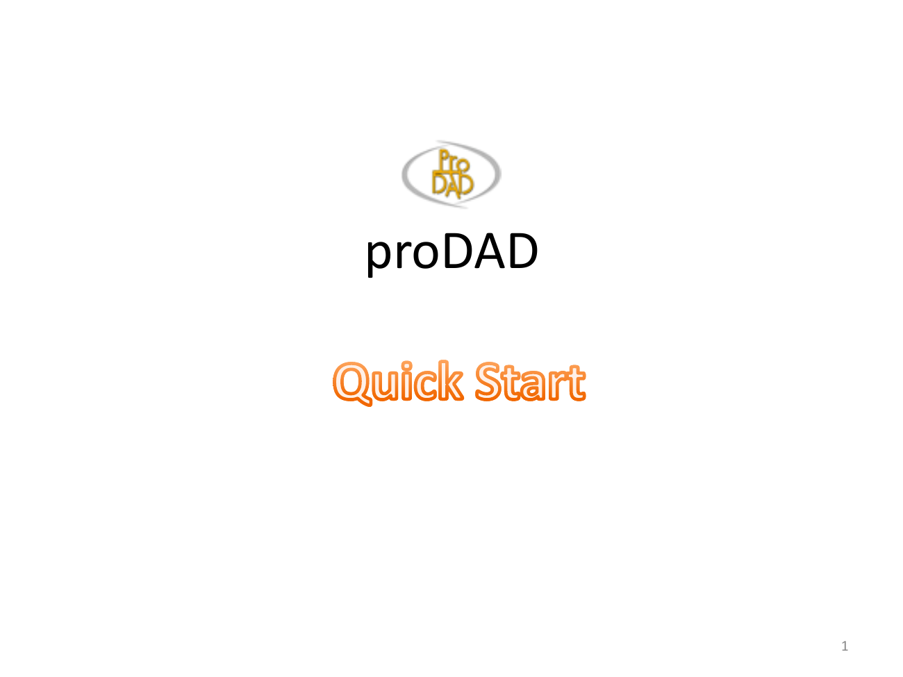
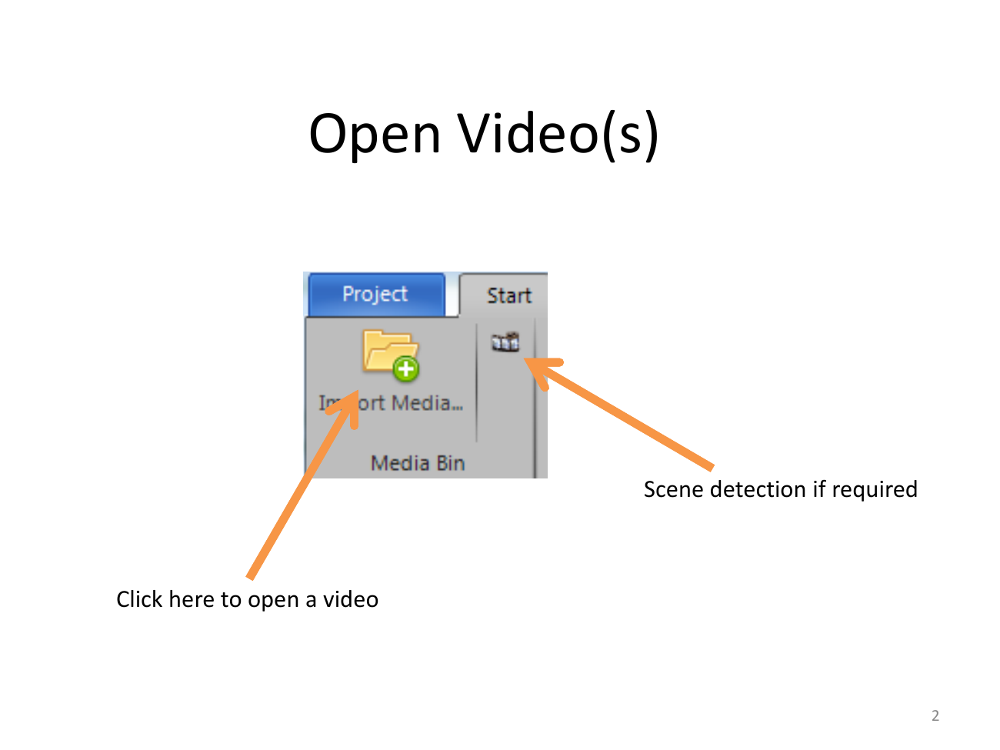
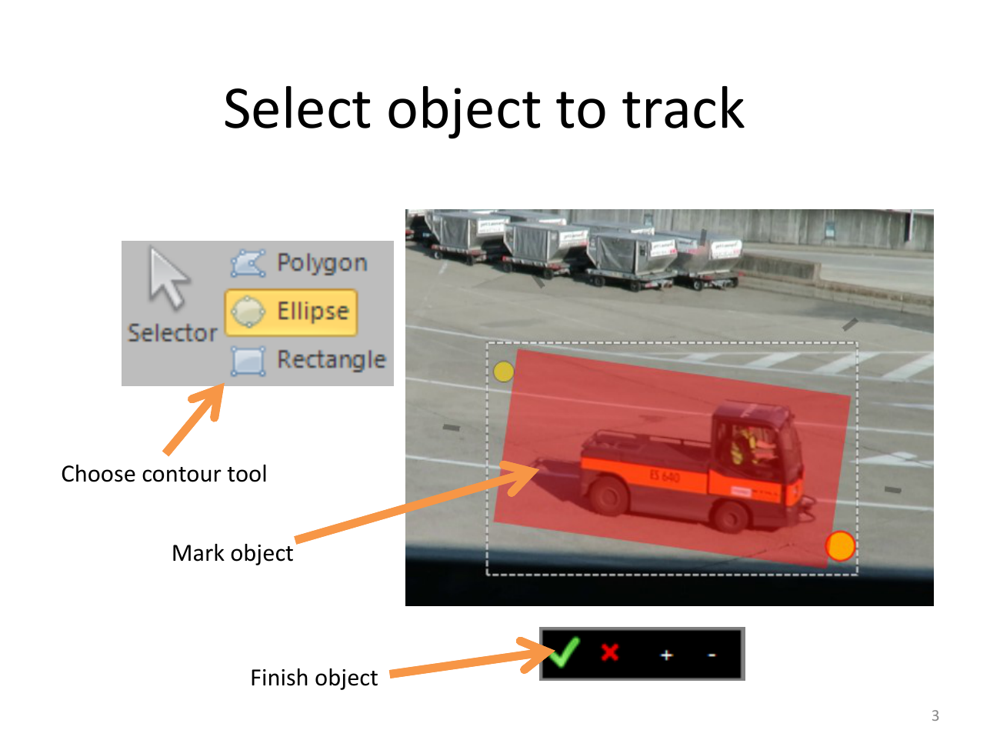
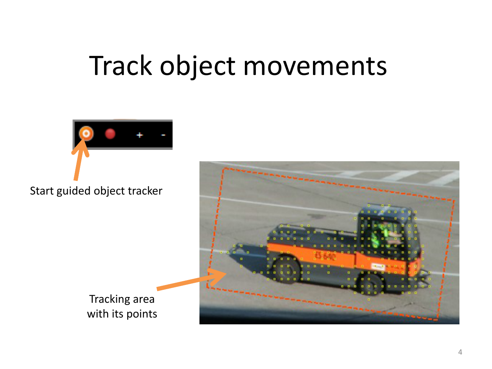
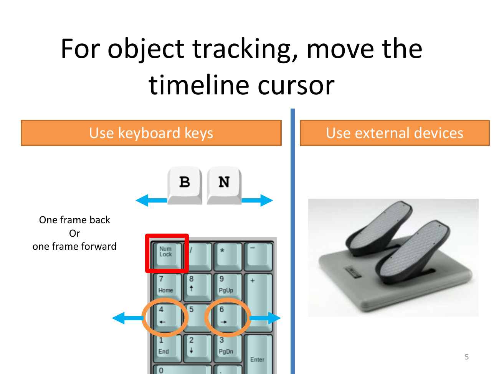
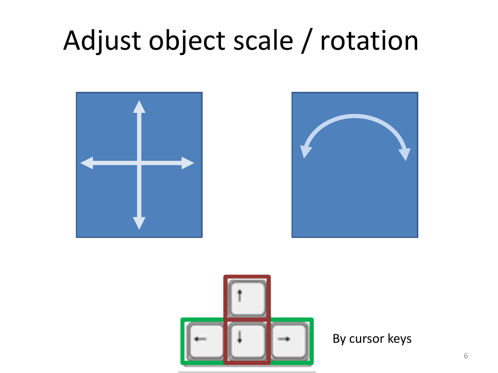
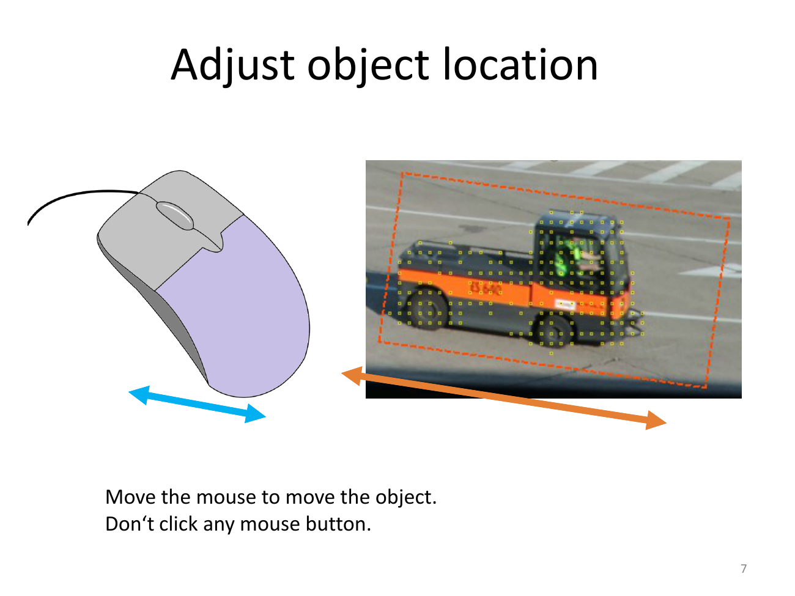
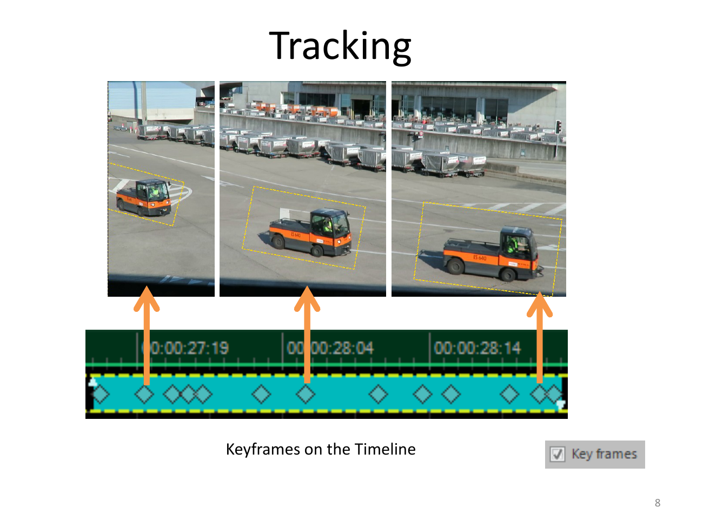
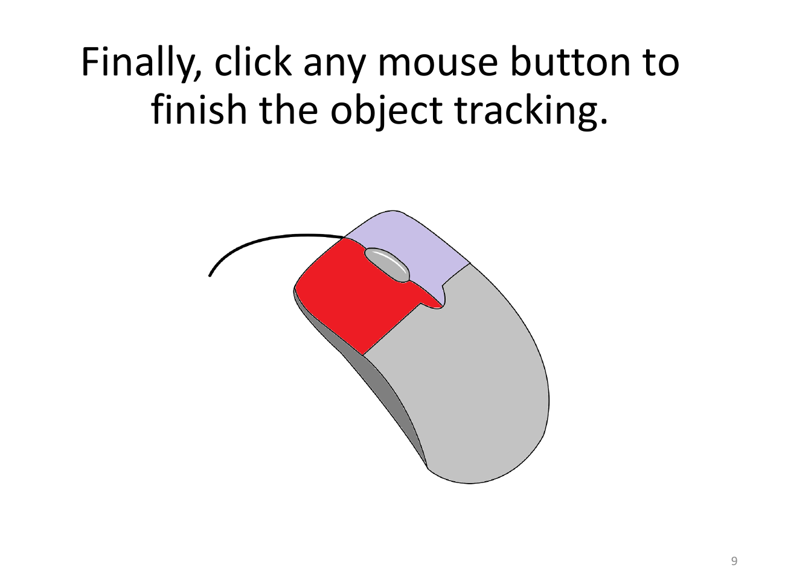
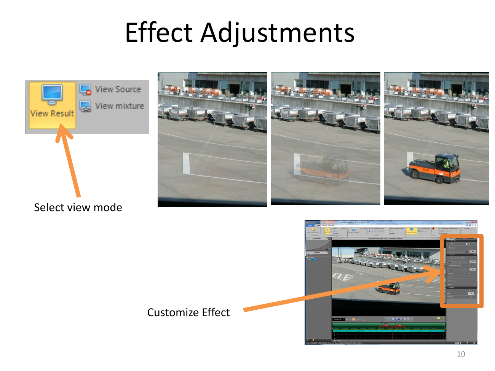

# proDAD Quick Start

## proDAD

## Open Video(s)

- Scene detection if required
- Click here to open a video

## Select object to track

- Choose contour tool
- Mark object
- Finish object

## Track object movements

- Start guided object tracker
- Tracking area
- with its points

## For object tracking, move the timeline cursor

- Use keyboard keys Use external devices
- One frame back
- Or
- one frame forward

## Adjust object scale / rotation

- By cursor keys

## Adjust object location

- Move the mouse to move the object.
- Don‘t click any mouse button.

## Tracking

- Keyframes on the Timeline

## Finally, click any mouse button to finish the object tracking.

## Effect Adjustments

- Select view mode
- Customize Effect
