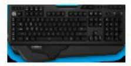
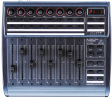

# proDAD: Short Cuts

proDAD: Short Cuts

1. Shortcuts\
  1.1. Global context-free Shortcuts\
  Works everywhere and overwrites context specified keys.\
  1.1.1. Toggle Playback: Ctrl+Space, Ctrl+Enter, MediaPlayPause-Key\
  1.1.2. Start Playback: MediaPlay-Key\
  1.1.3. Stop Playback: MediaStop-Key\
  1.1.4. Select prev. video: NumPad+8, MediaPrev-Key, BrowsePrevPage-Key\
  1.1.5. Select next video: NumPad+2, MediaNext-Key, BrowseNextPage-Key\
  1.1.6. Frame forward: NumPad+6\
  1.1.7. Frame backward: NumPad+4\
  1.1.8. Go to video start time/mark-in: NumPad+7\
  1.1.9. Go to video end time/mark-out: NumPad+1\
  1.1.10. Go to next timeline magnetic snap point: page-down or NumPad+3\
  1.1.11. Go to prev. timeline magnetic snap point: page-up or NumPad+9\
  1.2. Super Shortcuts\
  1.2.1. Super Shortcuts are context-free and works everywhere.\
  1.2.2. A Super Shortcut starts with: Ctrl#\
  Press and hold down the control-key. Press and release the # key. Don’t release the control-key. The follow key is the group-identifier. And after that the action-key follows.\
  The Shortcut ends by releasing the control-key.\
  1.2.2.1. A Super Shortcut can be activated by alternative keys:\
  1.2.2.1.1. Ctrl**Tab** ←Tabulator Key\
  1.2.2.1.2. Ctrl**#** ←# Key\
  1.2.2.2. Example: Zoom Timeline\
  Sequence: Ctrl#T+ or Ctrl#T-\
  - Press and hold down the control-key\
  - Press and release the # key\
  - Press and release the T key\
  - Press and release the + key ← Zoom-In will be executed\
  - Press and release the - key ← Zoom-Out will be executed\
  - Release the control-key to exit the Super Shortcut mode\
  1.2.2.3. Logitech Keyboards

http://gaming.logitech.com/en-us/gaming-keyboards

A profile with pre recorded macros is installed (see Phantom program folder)

1.2.2.4. MIDI Devices

Behringer BCF2000 B-Control Fader

1.2.3.Super Groups

1.2.3.1. Timeline (T)

1.2.3.1.1. Zoom In: Ctrl#T+ or Ctrl#TV\
1.2.3.1.2. Zoom Out: Ctrl#T- or Ctrl#TJ\
1.2.3.1.3. Zoom Measure (see 1.7.6): Ctrl#T0 or Ctrl#T1 or …

1.2.3.1.4. Set Trim Start: Ctrl#TS\
1.2.3.1.5. Set Trim End: Ctrl#TE\
1.2.3.1.6. Set Working-Area Start: Ctrl#TN\
1.2.3.1.7. Set Working-Area End: Ctrl#TM\
1.2.3.1.8. Set In-Point (Trim or working-area depending on Trim-Mode): Ctrl#TI 1.2.3.1.9. Set Out-Point (Trim or working-area depending on Trim-Mode): Ctrl#TO 1.2.3.1.10. Toggle Trim-Mode: Ctrl#TT\
1.2.3.1.11. Set Layer Start: Ctrl#TK\
1.2.3.1.12. Set Layer End: Ctrk#TL\
1.2.3.1.13. Forward Move: Ctrl#T Right\
1.2.3.1.14. Backward Move: Ctrl#T Left\
1.2.3.1.15. Go to Cut/Mark-In Point: Ctrl#T Home\
1.2.3.1.16. Go to Cut/Mark-Out Point: Ctrl#T End

1.2.3.2. Layer (L)

1.2.3.2.1. Clipboard Copy Layer: Ctrl#LC\
1.2.3.2.2. Clipboard Cut Layer: Ctrl#LX\
1.2.3.2.3. Clipboard Paste Layer: Ctrl#LV\
1.2.3.2.4. Add Effect-Layer: Ctrl#LE\
1.2.3.2.5. Add Protection-Layer: Ctrl#LP\
1.2.3.2.6. Delete selected Layer(s): Ctrl#L Delete\
1.2.3.2.7. Select next Layer: Ctrl#L Down\
1.2.3.2.8. Select prev. Layer: Ctrl#L Up\
1.2.3.2.9. Move Layer Up: Ctrl#LU\
1.2.3.2.10. Move Layer Down: Ctrl#LD\
1.2.3.2.11. Delete Keyframes from current time to end mark: Ctrl#LJ\
1.2.3.2.12. Clipboard Special Copy Layer: Ctrl#LK\
1.2.3.2.13. Clipboard Special Paste Layer: Ctrl#LF\
1.2.3.2.14. Set Work-Area to selected Layer(s): Ctrl#LW\
1.2.3.2.15. Select all Layers: Ctrl#LA

1.2.3.3. Modes (M)

1.2.3.3.1. Selector/Pointer: Ctrl#MT\
1.2.3.3.2. Polygon: Ctrl#MP\
1.2.3.3.3. Ellipse: Ctrl#ME\
1.2.3.3.4. Rectangle: Ctrl#MR\
1.2.3.3.5. Teach-In: Ctrl#MV

1.2.3.4. Tracker (K)

1.2.3.4.1. Toggle Tracker Record Mode: Ctrl#KR\
1.2.3.4.2. Track one frame forward: Ctrl#K Down\
1.2.3.4.3. Track one frame backward: Ctrl#K Up\
1.2.3.4.4. Track all frames forward: Ctrl#K End\
1.2.3.4.5. Track all frames backward: Ctrl#K Home (That’s the Pos1–Key)

1.2.3.5. Window (W)

1.2.3.5.1. Activate Canvas Window: Ctrl#WC\
1.2.3.5.2. Activate Timeline Window: Ctrl#WT

1.2.3.6. Canvas (C)

1.2.3.6.1. Scroll Left: Ctrl#C Left\
1.2.3.6.2. Scroll Right: Ctrl#C Right\
1.2.3.6.3. Scroll Up: Ctrl#C Up\
1.2.3.6.4. Scroll Down: Ctrl#C Down\
1.2.3.6.5. Add Display Zoom: Ctrl#C PageUp\
1.2.3.6.6. Sub Display Zoom: Ctrl#C PageDown\
1.2.3.6.7. Only Left-Eye Display: Ctrl#CL\
1.2.3.6.8. Only Right-Eye Display: Ctrl#CR

1.2.3.6.9. Anaglyph Display: Ctrl#CA\
1.2.3.6.10. Add Zero-Parallax Depth: Ctrl#CN\
1.2.3.6.11. Sub Zero-Parallax Depth: Ctrl#CM

1.3. Shortcut Info

1.3.1.Press the ALT key to show the ribbon shortcut keys

1.4. Common Shortcuts

1.4.1. Open Project [ Ctrl+O ]\
1.4.2. Save Project [ Ctrl+S ]\
1.4.3. Save Project As [Ctrl+Shift+S ]\
1.4.4. Import Video File(s) [ Ctrl+Shift+I ]\
1.4.5. Select “Selector” edit mode [Ctrl+Shift+T]\
1.4.6. Select “Polygon” edit mode [Ctrl+Shift+P]\
1.4.7. Select “Ellipse” edit mode [Ctrl+Shift+E]\
1.4.8. Select “Rectangle” edit mode [Ctrl+Shift+R]\
1.4.9. Open Add-Layer Menu [ Ctrl+Shift+L ]\
1.4.10. Select “Result” view mode [Ctrl+Shift+F]\
1.4.11. Select “Source” view mode [Ctrl+Shift+G ]\
1.4.12. Activate “Source View” [F5]\
1.4.13. Activate “Result View” [F6]\
1.4.14. Activate “Edit View” [F7]

1.5. Canvas + Timeline + Ruler Shortcuts

1.5.1. Also Move Forward/Backward [ Mouse Wheel ]\
1.5.2. Toggle Playback [ Space or Enter ]\
1.5.3. Toggle Playback [Media-Play/Pause key]\
1.5.4. Start Playback [Media-Play key]\
1.5.5. Stop Playback [Media-Stop key]\
1.5.6. Set Cut/Mark-In Point [ I ]\
1.5.7. Set Cut/Mark-Out Point [ O ]\
1.5.8. Go to Cut/Mark-In Point [ Home ]\
1.5.9. Go to Cut/Mark-Out Point [ End ]\
1.5.10. Select prev. video-clip [Media-Prev. key]\
1.5.11. Select next video-clip [Media-Next key]

1.6. Canvas Shortcuts

1.6.1. Delete selected shape [ Delete ]\
1.6.2. Teach In mode

1.6.2.1. Teach-In Off: Move selected shape edit-knob left/right/up/down [ Cursor ] 1.6.2.2. Teach-In On:\
1.6.2.3. Activate manual tracking mode edit [Click left+right]

1.6.3. Creating new masks (Ellipse, Rectangle, etc.)

1.6.3.1. Apply [ Enter key] or [Double-click]\
1.6.3.2. Cancel [Esc key]\
1.6.3.3. Resize [ + - key]\
1.6.3.4. Teach-In shortcuts

1.6.4. Shift+Ctrl+Click to scroll/move the view\
1.6.5. Mouse-wheel to zoom\
1.6.6. Increase/decrease Mosaic Block-Size [+ / - key]\
1.6.7. Select Mask with Shift-key allow multi-select\
1.6.8.Click Mask with Ctrl-key toggle mask selection\
1.6.9.Toggle Mask Visible [ H ]\
1.6.10. Toggle Tracker On/Off [ T ]\
1.6.11. Toggle visibility of the tracking points On/Off [ F ]. (Only during tracking available.) 1.6.12. Activate taped edit with tracker [Double-click]

1.7. Timeline + Ruler Shortcuts

1.7.1.Forward Move [ Cursor right ]\
1.7.2.Backward Move [ Cursor left ]\
1.7.3.Go to Cut/Mark-In Point [ Ctrl + Cursor left]\
1.7.4.Go to Cut/Mark-Out Point [Ctrl + Cursor right]\
1.7.5.Move time-cursor by mouse, press ALT-key for swapping the snap-mode\
1.7.6. Timeline-Measure

1.7.6.1. Ctrl+0 →Auto: the whole video-clip is fitted to timeline\
1.7.6.2. Ctrl+1 →Frames: Zoom is set to show single frame\
1.7.6.3. Ctrl+2 →Seconds: Zoom is set to show single seconds\
1.7.6.4. Ctrl+3 → Minutes: Zoom is set to show single minutes\
1.7.6.5. Ctrl+4 → Hours: Zoom is set to show single hours

1.7.7. Delete keyframes from current to end [Shift + Delete]

1.8. Timeline Shortcuts

1.8.1. Delete selected Track [Delete]\
1.8.2. Select next track [Cursor down]\
1.8.3. Select prev. track [Cursor up]\
1.8.4. Keyframes

1.8.4.1. Double click to set the cursor to the keyframe\
1.8.4.2. Click with shift select the range\
1.8.4.3. Click with ctrl toggles the select state\
1.8.4.4. Delete selected keyframes [ Delete ]\
1.8.4.5. Select All [Ctrl + A]

1.9. Effect-Settings Shortcuts

1.9.1. Space or Enter to toggle Playback when the numeric-control is focused.

1.10. Media-Bin Shortcuts

1.10.1. Toggle Playback [ Space ]\
1.10.2. Toggle Playback [Media-Play/Pause key]\
1.10.3. Start Playback [Media-Play key]\
1.10.4. Stop Playback [Media-Stop key]\
1.10.5. Toggle checked-state [ Enter ]\
1.10.6. Select next clip [ Cursor Up/Down ]\
1.10.7. Select more clips [Shift + Cursor Up/Down ]\
1.10.8. Delete selected clip(s) [ Delete ]\
1.10.9. Copy selected clip(s) into the clipboard [Ctrl + C]\
1.10.10. Copy and delete selected clip(s) into the clipboard [Ctrl +X]\
1.10.11. Paste selected clip(s) from clipboard [Ctrl +V]\
1.10.12. Reorder Clips via Drag and Drop\
1.10.13. Open Context-menu by right-click or Windows-menu key
