# proDAD: Timeline and Mask

proDAD: Timeline and Mask

1. Canvas\
  1.1. Object editing

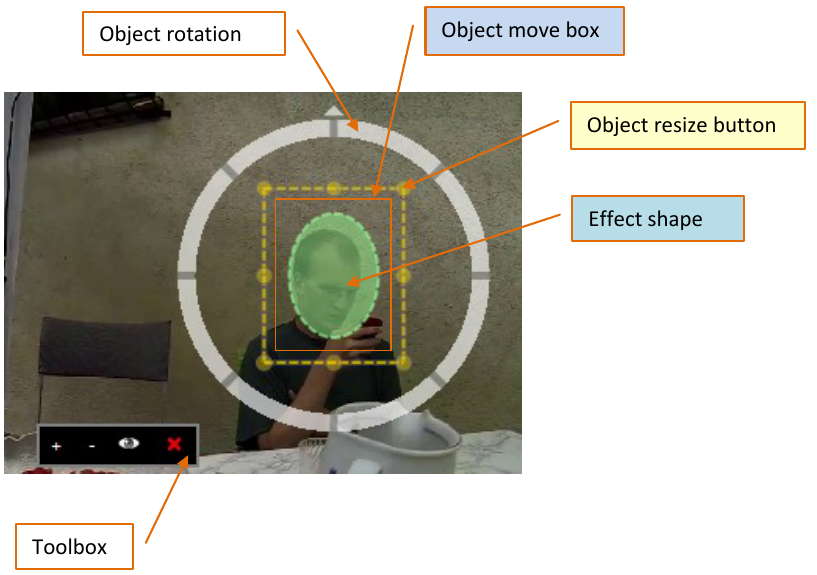

Object move box

Object rotation

Object resize button

Effect shape

Toolbox

1.2. Special edit modes

1.2.1. Click and move by mouse:

Depending on the clicked button the object is being moved, resized or rotated.

1.2.2. Object isn’t clicked by mouse:

Depending on the last button clicked ( 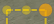 ) and the selected Teach-In mode, the object can be modified by pressing the cursor keys.

1.2.3. Keeps the mouse button pressed to rotate or scale the object using the cursor keys.

Cursor Up/Down: resize object\
Cursor Left/Right: rotate object

2. Timeline

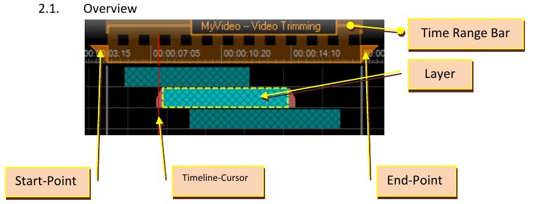

2.1.

Overview

Time Range Bar

Layer

Timeline-Cursor

Start-Point

End-Point

2.2. Timeline Display Modes

2.2.1. Video Trimming -- Mode

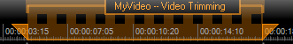

Edit the Video Trim-Points. This is also the export time-range.

2.2.2. Edit Timeline – Mode (only available in the extended license)

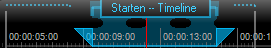

Edit Timeline Start-/Endpoint.

2.2.3. Edit Effects/Work-Area -- Mode

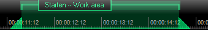

Edit Work-Area Start-/Endpoint. And edit effects like Mosaic within this mode.

2.3. Layer Display Options

2.3.1. Standard - Timeline

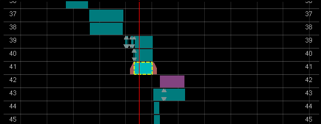

2.3.2.Condensed Timeline (only available in the extended license)

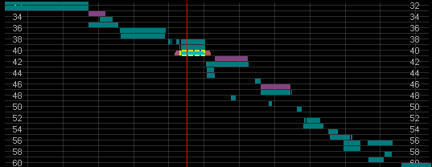

2.4. Cut Buttons

2.4.1. Sets the timeline start-/endpoint to the current timeline-cursor

2.4.2. Sets the layer start-/endpoint to the current timeline-cursor

2.5. Timeline Management

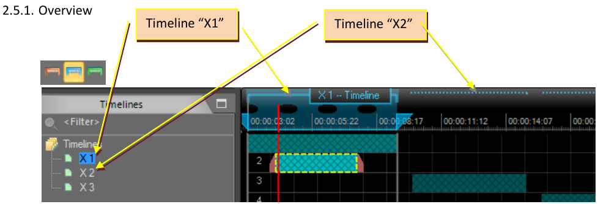

2.5.1.Overview

Timeline “X1”

Timeline “X2”

(Sample project with more than 4 layers separated into 3 timelines)

2.5.2. Edit “X1”-Timeline Effects

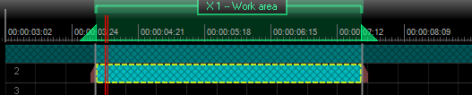

(Only the layers within the “X1”-timeline are visibly – 2 Layers in this sample)

2.5.3. Edit “X2”-Timeline Effects

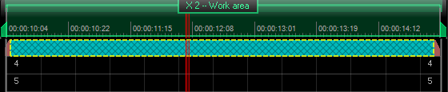

(Only the layers within the “X2”-timeline are visibly – 1 Layer in this sample)

2.5.4.Dividing an existing comprehensive timeline into a number of easier to handle timelines to improve editing.

2.5.4.1. Timeline prior to optimization

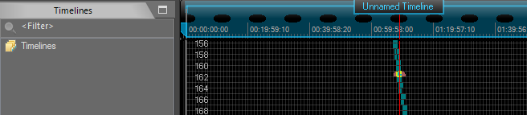

(Sample project with more as 300 layers)

2.5.4.2. Choose timeline context-menu for this arrangement (only available in the extended license)

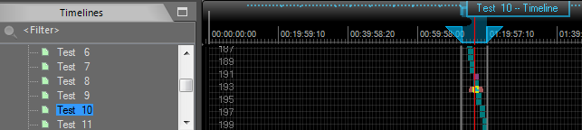

(The 300 layers are now divided into 20 timelines – Timeline “Test 10” is selected)

2.5.4.3. Each timeline includes fewer layers for a better overview and easier editing

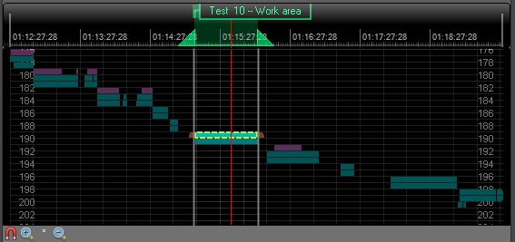

(Edit Effects of Timeline “Test 10” – less than 30 of the 300 layers are shown )

2.5.5.Compress timeline by moving layers vertically

2.5.5.1. Timeline prior to optimization

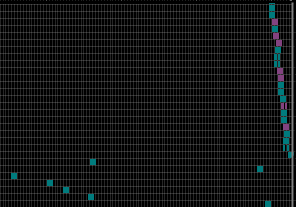

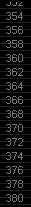

(Sample project with 381 layers and with some vertical unsorted layers)

2.5.5.2. Choose timeline context-menu for this arrangement

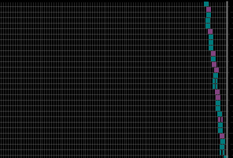

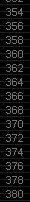

(The layers are vertical sorted)

2.5.6. Use the timeline context-menu to add a Timeline for the selected layers time-range

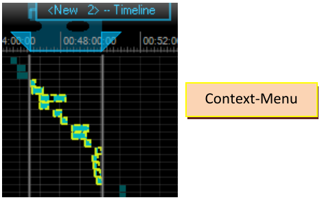

Context-Menu

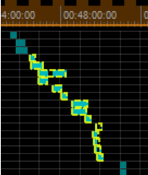

→

2.5.7.Adding Timelines (only available in the extended license)

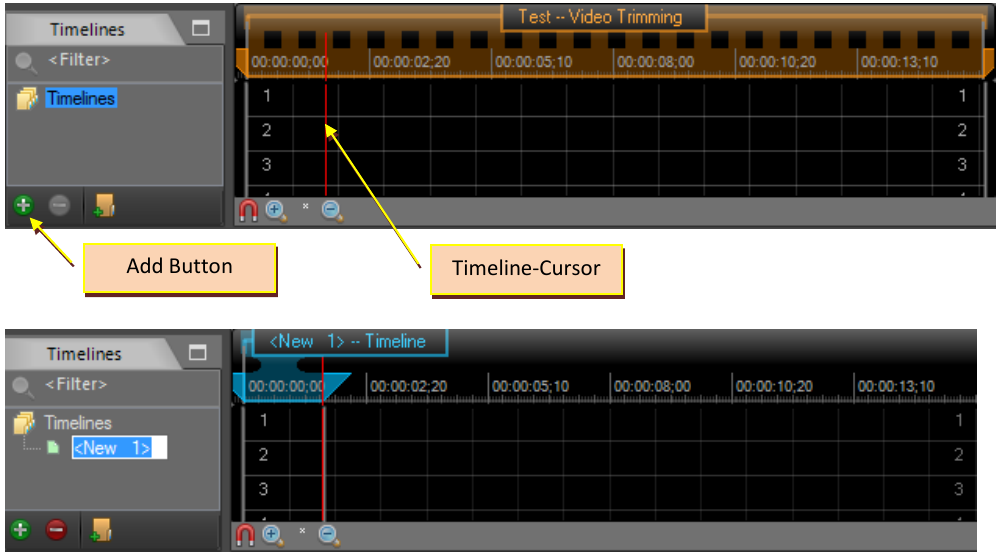

Add Button

Timeline-Cursor

After pressing the “Add” button.\
A new timeline “New 1” is added at the timeline-cursor position.

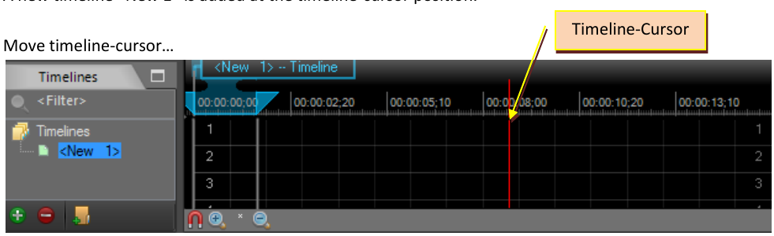

Timeline-Cursor

Move timeline-cursor…

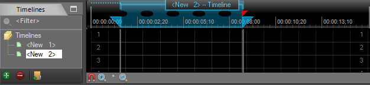

After pressing the “Add” button.\
Starting from the end of the predeceasing timeline to the current timeline-cursor position a new timeline “New 2” is being added.

2.6. Timeline Navigation (only available in the extended license)

2.6.1. Back/Next Buttons

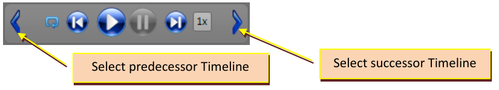

Select predecessor Timeline

Select successor Timeline

2.6.2.Range

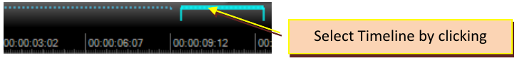

Select Timeline by clicking

2.7. Select Layer(s)

2.7.1. Multi select layers

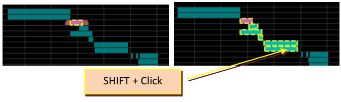

SHIFT + Click

2.7.2. Deselect one layer or select an additional layer

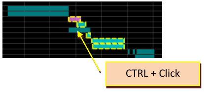

CTRL + Click

2.7.3. Select predecessor / successor Layer by Keyboard

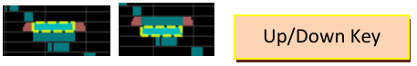

Up/Down Key

2.8. Work-Area (Effect Edit Mode)

2.8.1. Double-Click a layer to select as Work-Area

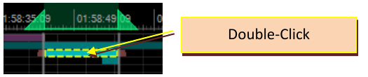

Double-Click

2.8.2. Use the timeline context-menu to set the Work-Area for all selected layers

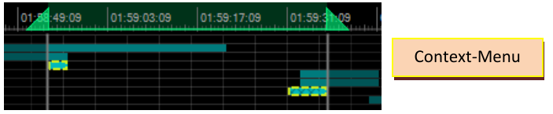

Context-Menu

2.9. Hidden Timeline tricks

2.9.1. Maximize range by double-clicking the time-range bar.

Or move the complete time-range by moving the mouse.

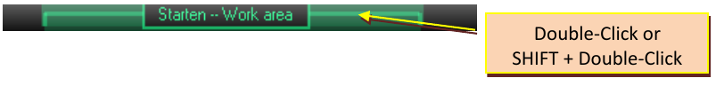

Double-Click or SHIFT + Double-Click

2.9.2.Maximize the start-/end-point by double-clicking.

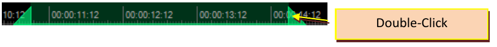

Double-Click

2.9.3.Hold down the SHIFT-key and the video frame will show the current position when the start- / end point is

moved.

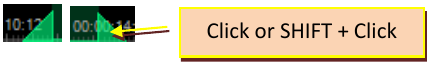

Click or SHIFT + Click

2.9.4. Double-click to jump to a special time position.

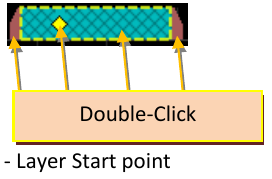

Double-Click

\- Layer Start point

\- Keyframe\
- Layer Body\
- Layer End point

2.10. Layers

2.10.1. Layer visibility

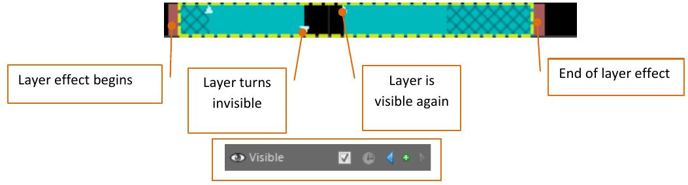

Layer effect begins

Layer turns invisible

Layer is visible again

End of layer effect

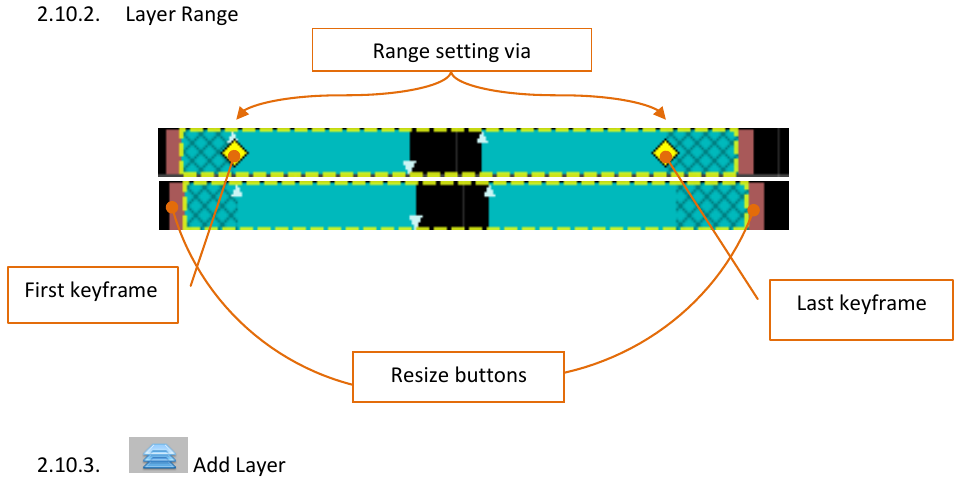

2.10.2.

Layer Range

Range setting via keyframes

First keyframe

Last keyframe

Resize buttons

2.10.3.

Add Layer

2.10.3.1. Start situation:

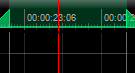

2.10.3.2. After layer being added (unchecked option)

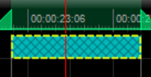

2.10.3.3. After layer being added (checked option)

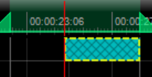

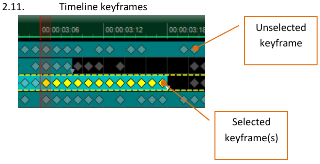

2.11.

Timeline keyframes

Unselected keyframe

Selected keyframe(s)

2.11.1. Keyframe selecting

Click by mouse: Select keyframe\
Shift+Click: select a range of keyframes\
Ctrl+Click: toggle keyframe selection\
Double-Click: sets the timeline-cursor to the time-position of the keyframe

2.11.2. Delete keyframe(s)

Press DEL key to delete all selected keyframes.

2.11.3. Delete keyframes from current position to end.

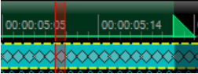

Press SHIFT+DEL (or by context-menu):

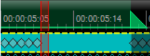

2.11.4. How to delete all keyframes?

- Show keyframes
- Select track
- Select all keyframes (press Ctrl+A or “Select All” by context menu)
- Delete all selected keyframes (press DEL key or “Delete” by context menu)

2.11.5. Timeline time-cursor styles:

The style can be chosen in the project settings.

2.11.5.1. With time span visualization

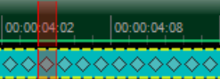

2.11.5.2. Simplified

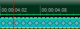

2.11.6. Start work-area time-position

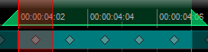

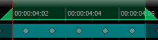

(time-span) (simplified)

This is the first timeline-position in the work-area. \
(State after the IO-button is pressed.)

2.11.7. Last work-area time-position

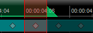

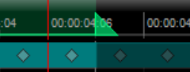

(time-span) (simplified)

This is the last timeline-position in the work-area. \
(State after the IO-button is pressed.)

2.11.8. Last visible time-position

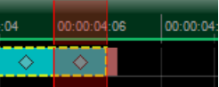

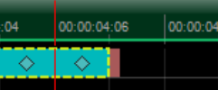

(time-span) (simplified)

This is the last visible layer-frame. \
(State after the IO-button is pressed.)

2.11.9. Invisible layer / Frame after layer

(time-span) (simplified)

This is also the state after the  cut-button is pressed.

3. Protected/Exclude Video\
  3.1. Merged objects\
  Timeline:

Canvas:

An effect modifies the video by a mosaic- or color effect.

3.2. Excluded object

Timeline:

An effect does not change the video. **The video is protected**.

Canvas:

An effect modifies the video by a mosaic- or color effect.

3.3. Exclude Sample

3.3.1.Objects

3.3.2. Overlapped

3.3.3. Layer order changed

4. Special Clipboard\
  4.1. At Timeline

4.1.1. Cut/Copy:

Takes the current selected layer(s) to the clipboard.

4.1.2. Paste:

Depending on the clipboard one or more layers are being inserted or effect key-frames are being replaced.

4.1.3. Special Copy:

Allows copying only selected options to the clipboard. Additionally the copied data can be stored as a template (5).

Corresponds with the effect parameters.

4.1.4. Special Paste:

Allow to paste only selected options. If the clipboard includes a layer then this menu extracts only the chosen option.

5. Templates (only available in the extended license)\
  Layers, effect-presets or templates for applying via double-click.

Those are only sample- names for this document.

(Sample screenshot)

5.1. How to create new templates

5.1.1. First copy the object to the clipboard. If only the effect-keyframes should be stored then use the “Filter-

Option” via the “Special Copy” menu (4.1.3)

5.1.2. Paste it to the presets tree.\
5.1.3. Rename the new item to your liking.

5.2. Applying templates

5.2.1. From layer (template is a layer)

5.2.1.1. A double-click adds the template layer(s) to the active media-bin clip.

5.2.2. From effect (template is an effect)

5.2.2.1. Select one or more layers in the timeline.\
5.2.2.2. The next double-click overwrites the effect-keyframes with those of the template.

5.3. How to create new effect presets

Press the “+” button to add a new effect-preset.

5.4. Applying effect presets:

A double-click sets the parameters. This has no effect to the keyframes.
