# proDAD: Tracking

proDAD: Tracking Objects

1. Tracking\
  1.1. Tracking Workflows\
  1.1.1. As the fastest and most efficient workflow we recommend the combination of tracking and manual control: Hide’s unique “**Automatic Tracking Guidance-Technology**”\
  1.1.1.1. Select object and start tracking by double-clicking or …

Press button to start.

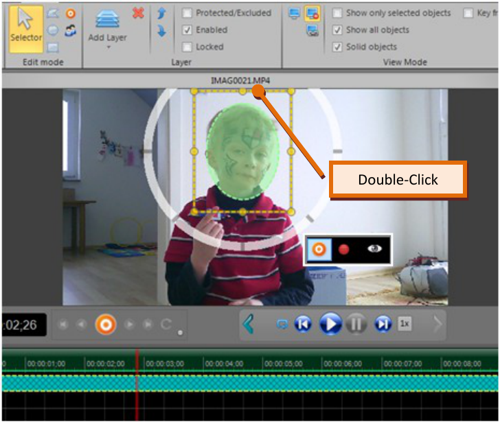

Double-Click

1.1.1.2. Tracker is started in guided tracking mode. Move frame forward or backward to track the object. Move

the mouse if the object’s position needs to be corrected. You may also correct rotation and size by short keys (e.g. Cursor-Keys).

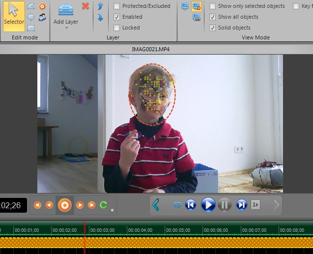

1.1.1.3. During tracking the tracker can temporarily be switched on/off by pressing the T-key.\
1.1.1.4. Tracking will stops at any mark.

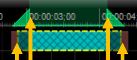

1.1.1.5. You may as well press any mouse key to stop tracking.

1.1.2. Auto tracking

1.1.2.1. Activate the tracker

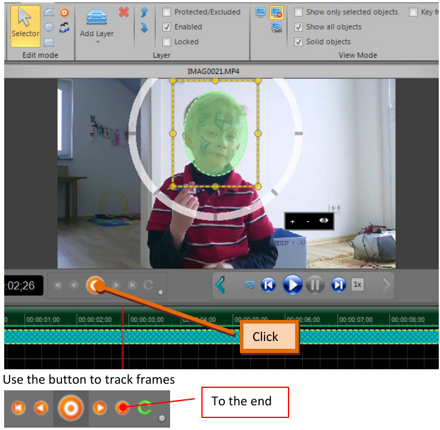

Click

Use the button to track frames

To the end

1.1.2.2.

(see also 1.2)

1.1.2.3. Auto controlling the object visibility by tracker if the option [1.4] is checked.

1.1.2.3.1. Activate tracking at the beginning of the clip (e.g. double-click the mask).\
1.1.2.3.2. Tracking forward by keyboard, input device or others

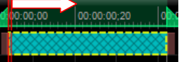

1.1.2.3.3. Whenever the tracked object moves out of view a keyframe for “invisible” is being added and

tracking stops.

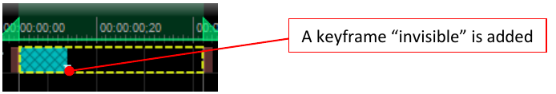

A keyframe “invisible” is added

1.1.2.3.4. Move forward until the object is visible again. Activate tracking again. Then track backwards.

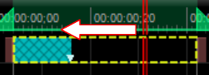

1.1.2.3.5. When tracking backwards the object moves out of view a “visible” keyframe is added.

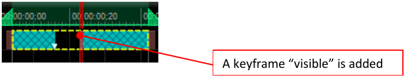

A keyframe “visible” is added

1.1.3. Manual input, without tracker

1.1.3.1. Activate “Teach-In” mode

Press button to start.

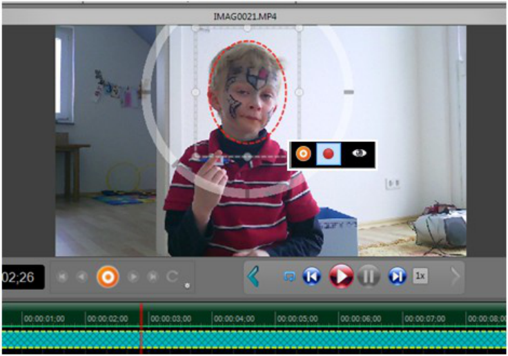

1.1.3.2. Hold the left mouse-button down and move forward or backward frame by frame. A keyframe is being

added for each change. Move the mouse if the object’s position needs to be corrected. You may also correct the rotation and size using short keys (e.g. Cursor-Keys).

1.1.3.3. You may as well activate the guided mode. Move forward or backward frame by frame. A keyframe is

being added for each change. Move the mouse if the object’s position needs to be corrected. You may also correct the rotation and size by short keys (e.g. Cursor-Keys). Press any mouse-button to leave the taped mode.

1.2. Tracking Controls

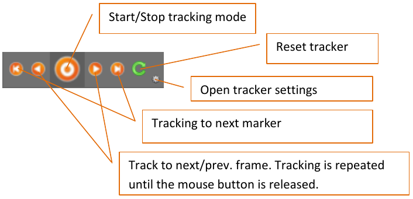

Start/Stop tracking mode

Reset tracker

Open tracker settings

Tracking to next marker

Track to next/prev. frame. Tracking is repeated until the mouse button is released.

1.3. Visual tracking signs

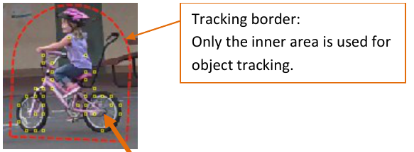

Tracking border: Only the inner area is used for object tracking.

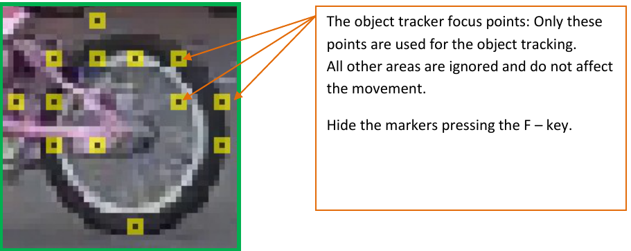

The object tracker focus points: Only these points are used for the object tracking. All other areas are ignored and do not affect the movement.

Hide the markers pressing the F – key.

1.4. Tracker settings

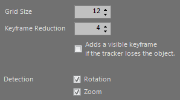

1.4.1. Grid Size: Higher values are faster, but the tracking might go wrong. Smaller values require more processing

power and result in slower tracking.

1.4.2. Keyframe Reduction

The Tracker adds a keyframe for each frame. This is also the case if the movement is achieved by keyframe Interpolation. “Reduction” removes unnecessary keyframes. Higher values remove more keyframes. However, the quality of object tracking is reduced.\
A good compromise is the value of 4.

1.4.2.1. Benefits:

1.4.2.1.1. Smaller project file size.\
1.4.2.1.2. Faster project saving and loading.\
1.4.2.1.3. Faster timeline refresh.

1.4.2.2. Example result of a reduction value (0)

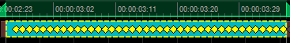

1.4.2.3. Example result of a reduction value (4)

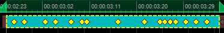

1.4.3.Detection of object movements

1.4.3.1. Rotation: detects object rotation\
1.4.3.2. Zoom: detects object zoom
