# proDAD Hide

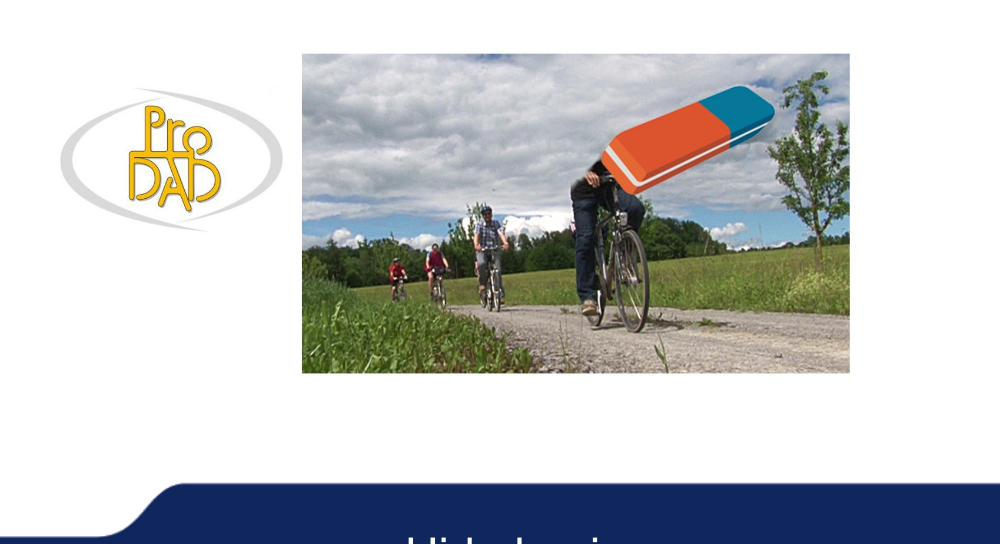

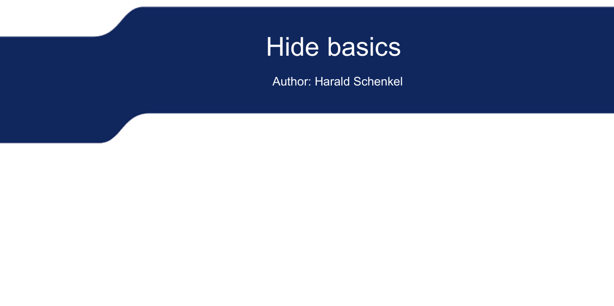

Hide basics

Author: Harald Schenkel

## Table of contents

- [1. Welcome](#1-welcome)
- [2. Copyright / Legal information](#2-copyright--legal-information)
- [3. What is Hide?](#3-what-is-hide)
- 4. Why Eazr?
- [5. The limits of Hide](#5-the-limits-of-hide)
- [6. Installation](#6-installation)
- [7. Registering Hide](#7-registering-hide)
- [8. The surface](#8-the-surface)
- [9. Menu bar](#9-menu-bar)
- 10. Preview
- [11. Timeline](#10-timeline)
- [12. Settings](#11-settings)
- [13.1. Effects](#131-effects)
- 13.1.1. Attributes
- [13.1.2. Filling](#1312-filling)
- 13.1.3. Mask
- [13.2. Information](#132-information)
- 13.3. Media storage
- [13.4. Output media storage](#134-output-media-bin)
- 14. Media Bin
- [15. Status bar](#15-status-bar)
- 16. Export
- [17. Work steps in Hide](#17-work-steps-in-hide)
- [18. Tips and tricks](#18-tips-and-tricks)
- [18.1. The mask is too large and cannot be tracked automatically](#181-the-mask-is-too-large-and-cannot-be-tracked-automatically)

## 1. Welcome

**Welcome to proDAD Hide!**

Hide is used for the retroactive removal of objects from video recordings and therefore represents a quality improvement. When filming an attraction, it is almost impossible to take a picture without a stranger walking through the picture. This can be removed with Hide and the recording can thus be upgraded.

This makes Hide a very valuable tool to rescue and optimize the precious recordings of any film maker.

We hope you enjoy using proDAD Hide and have always effective results!

## 2. Copyright / Legal information

Copyright proDAD GmbH. All rights reserved.

Licensing Conditions\
Please read these licensing conditions carefully before installing the software.

Licensing agreement\
When setup starts, a licensing agreement is shown, which you should read carefully. By installing the software, you state that you accept the copyright conditions, the licensing agreement and the licensing procedure.

License Guarantee\
proDAD GmbH grants the user the right to use this product for its proper and permitted purpose. The present product may only be installed on one computer. proDAD hereby guarantees to provide a license key free of charge. By installing this product, the user acknowledges and accepts the license guarantee, the copyright terms, and the limitation of liability.

Trademarks\
All products and trademarks mentioned in association with this product are trademarks that belong to the respective owners. All trademarks are used without any guarantee that they may be used freely, and they may be registered trademarks.

Limitation of Liability\
The extent of liability for any one claim is limited to a replacement of the product. This applies to proDAD GmbH, all licensees and retailers. Claims shall only be recognized if the software is returned in an orderly manner, together with the returned goods number that has to be previously arranged with proDAD GmbH. The goods must also be accompanied by proof of purchase. This guarantee becomes void if a malfunction of this product is due to improper use, mistreatment, an accident or improper handling.

proDAD GmbH, its sales partners and licensees, shall not be held liable for damages or subsequent damages arising from the impossible usage of this product. Liability is limited in all cases to the purchase price of the product.

Documentation\
The greatest of care has been taken in compiling and translating the handbook. However, the possibility of errors cannot be fully excluded. proDAD GmbH shall assume no responsibility or liability whatsoever for the consequences of any incorrect statements or information which the documentation or translation may contain. Subject to technical and optical modifications. Information regarding any inaccuracies is always welcome.

Copyright\
The software and the individual components of this product are the property of proDAD GmbH. By installing this product, the licensee agrees to refrain from unauthorized use and duplication.

proDAD GmbH does not accept any responsibility for the usage of this program and the publication of its contents and data that has been created with this program.

## 3. What is Hide?

Hide is used for the retroactive removal of objects from video recordings and therefore represents a quality improvement. When filming, it often happens that persons walk through the image, who you actually do not want to include.

Original recording Processed with Hide

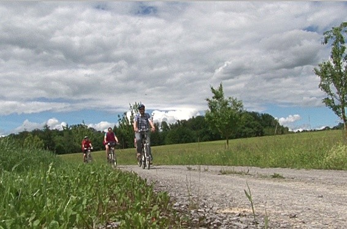

You do not always have the time or the budget to repeat a recording. Sometimes it is only noticed when cutting and you could despair.

This is where Hide comes into play, because Hide can remove objects with certain prerequisites from video recordings and thus save or enhance the recording.

**This makes Hide a very valuable tool to rescue and optimize the precious recordings of any film maker.**

## 4. Why Hide?

To remove something from a photo is not a big deal with a photo editing program. It is different with a video recording, as one works with it works with 25 frames per second here. It is very elaborate to remove something here.

With Hide it will now be very easy. Because the disturbing object is marked with a mask. Hide then recognizes the movement and can automatically carry along the mask. Thereby, a specific area is analyzed before and after the area and is inserted where the object was beforehand.

Thanks to the automatic function, this can be done very quickly and even longer scenes can be processed in the shortest possible time.

## 5. The limits of Hide

Hide can of course not do magic. It is important that it is a moving object. Because Hide must know what was at the point beforehand where an object is removed. If a person walks through the image from left to right, that's not a problem. Because Hide can see how the scene looks without the person. However, if a person walks straight toward the camera, it is not possible to replace anything because Hide cannot recognize what needs to be instead of the person.

## 6. Installation

In order to start the installation, please simply double click on the setup file. Confirm the welcome window with "Next". With the installation you agree to the conditions under "2. Copyright / Legal "and the license terms. Confirm this by clicking on "I agree with these license terms". If you have purchased Hide as a download, the program archive is first unpacked and the installation is started. Then select the destination directory where Hide should be installed.

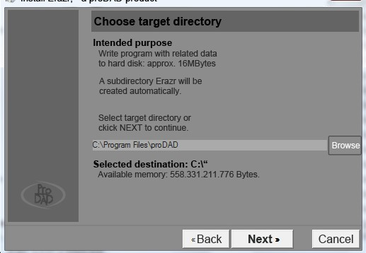

Now follow the installation instructions.\
You can now start Hide from a shortcut on your desktop

or by clicking Start/All Programs/proDAD/Hide Start.

When you start Hide for the first time, you will be asked to enter a Code (Serial Number) to activate the program. In case that you purchased the download version, enter the Code which you received along with the download instructions email. In case that you purchased the DVD version, you'll find the code inside the box. Click Unlock.

***IMPORTANT:***

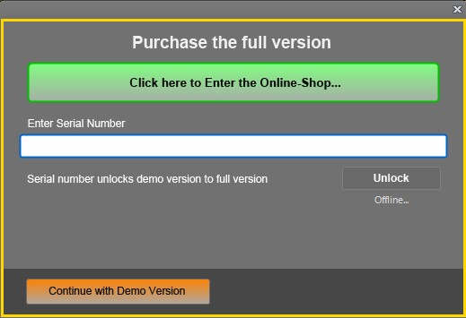

Please keep in mind that your system requires an Internet connection for you to activate it. This is the only way to successfully complete the activation. If you encounter problems, please check the security settings (Firewall, etc.) in the system and repeat the activation process.

If you want to test Hide in the DEMO-Mode, click Continue with Demo Version. The Demo version is activated until you enter the serial number. By entering the serial number you obtain the license that converts it into the full version.

Hide will then start with the active tab Start. Now you will import your video material.

## 7. Registering Hide

You would like to receive Updates and further information about Hide? Please register your proDAD Hide at http://www.prodad.de/register.html.

## 8. The surface

The programs of the company proDAD are all similar in the structure of the surface. If you can operate one, you can handle the others as well. Here are the main areas of the surface.

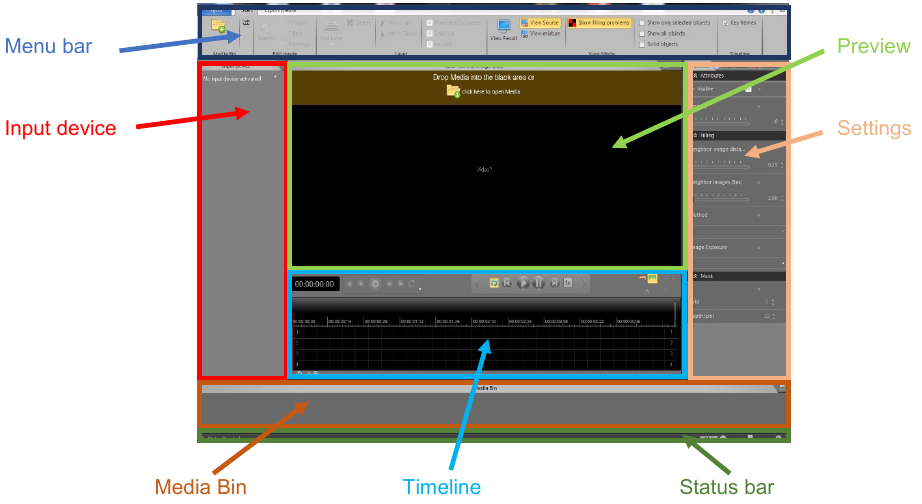

Menu bar

Preview

Input device

Settings

Media Bin

Timeline

Status bar

## 9. Menu bar

At the top left you have three choices. Export project, start and medium. After starting

the software you are in the tab "Start". This is

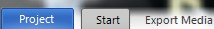

also where the actual work takes place.

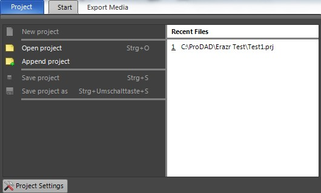

In the area "Project" you can create a project with "New project", under "Open project" an existing project will be opened in order to continue working. With "Attach Project" you can add another one to the current project. The command "Save project" saves the project under the current project name. If a project name has not yet been assigned, this function is not active. With the command "Save project as" you can issue a project name and define the storage location. In the right part you can see the last used projects. In

order to open a project from the list, simply click with the left mouse button.

In the project settings at the bottom left, basic things are set. You can e.g. define here in which time intervals it should be automatically stored, which windows are displayed in the surface.

Now let's look at the functions of the tab "Start".

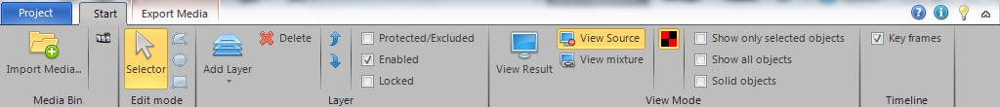

On the far left there is the button for "Import media". If you click on this button with the

mouse, a window opens as you will certainly know from many other

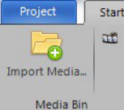

programs. In this window you can select and open the drive and the desired file. In order to process a file in Hide, you can also drag it directly into the preview window.

You must be click the symbol next to it, if the material to be imported shall be

divided into individual scenes during import. You thus open a file, this is then divided and each scene is displayed with an image in the media storage. If the scene recognition is active, it is highlighted in color.

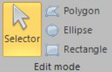

In the area processing mode, you specify the mask shape with which you want to mask the object. Polygon, ellipse and rectangle are available.

The selector turns yellow when a mask has been created. This shows that masks have been created, even if they are hidden in the preview.

In the next area of the menu bar you can

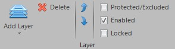

create layers, change the order and set which should be displayed. The normal layers are generated automatically. So when you create a mask, it automatically gets a layer as well. But there are also protected layers. These serve so as not to change areas that are touched by a mask. For example, if a person to be removed passes behind a tree. Only the person shall then be removed here and the tree shall be kept. In order to create a protected layer, click in the lower part of the button "Add layer" and select "Protection/Exclusion layer". With the

red "X" you can delete the currently active layer.

Here you can also create layers that do not go all the way through the timeline, but which start at the current cursor position.

In the area View,

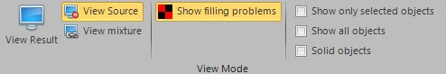

you can set what you want to see in the preview. The respective selection is marked in yellow.

**View result:** Shows the clip in the preview without the masked object. A mask is also not displayed.

**View Source:** Shows the original clip with the created mask in the preview.

**View Mixture:** Here, you see the result with the created mask.

**Show filling problems:** Depending on how fast the disturbing object is moving and the setting of the area with the functions "Neighbor image distance" and "Neighbor images (sec)", problems with the filling of the mask can occur. This means that the range examined by Hide is too small and no images can be calculated. This is clearly visible in the preview with this function. If this red/black pattern appears in the preview, you can solve the problem by adjusting the values.

You can also set whether only the selected or all masks are displayed, and whether the mask is displayed in a filled manner (solid object) or only as a frame.

On the far right, you can set whether or not you want to see the

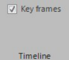

keyframes in the timeline that were generated during tracking.

In the preview window, you will immediately see the changes you have made. For this, however, "View result" must be activated in the menu bar. Depending on the settings and hardware used, it may take a while for the preview to be updated. Until then you see a dashed line below the preview. The file name is above the preview, so you can see if this is the right clip. If you click on the square next to the file name on the far right, the preview will be enlarged. The other windows are faded out thereby. The square changes to a double square. A click on it changes over to the original view.

If you right-click the preview image, you can change the interlace and playback options. You can thus decide if you want to display only the top, the bottom or both half images. You can also carry out settings for the playback.

You can change the size of the preview with the mouse wheel. But beware: You first have to click on the preview and only then move the mouse wheel first.

Otherwise you might change a value. Because the mouse wheel can be used in different areas.

You can also import a medium by simply dragging a clip from Windows Explorer into the preview.

In the upper right corner you will see a double arrow pointing upwards. Therewith, you can release the preview window from the surface and receive the preview as a separate window. This has the advantage that on the one hand the preview can be moved to a second monitor and be displayed there in full size, and on the other hand that the space for the timeline becomes larger. This is advantageous with many masks, thus tracks, as you do not have to scroll up and down to see everything. If you would like change the preview in its size, move the mouse to a corner, hold down the left mouse button and drag the window to the desired size. Close this window with the "X" in the top right and the preview is embedded again in the surface. The previously set size and position is saved, so that the previous set size and position is taken up when uncoupling next.

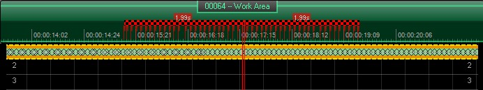

## 10. Timeline

Under the preview, the timeline is located with the buttons for playing

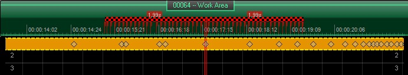

the material.

At the far left you can see the time code display. The value of the current cursor position (red line) is displayed. Next to it are the buttons for automatic tracking. You can move forward or backward image by image, or automatically track to the

beginning or the end.\
During tracking, keyframes are automatically set in the timeline. The keyframes store the values for the size and position of the mask at this timeline position. Hide sets the keyframes at regular intervals.\
But if the movement of the object is an even, that is, linear movement, not as many keyframes are needed. Therefore, you can delete the unnecessary keyframes from the track with the green arrow.

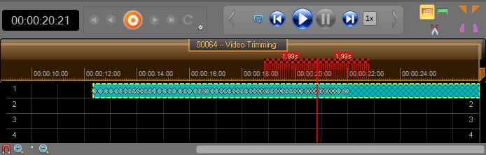

Timeline after automatic tracking.

Timeline after deleting the unnecessary keyframes.

This makes it easier for you to adjust the values later.

On the right, next to the green arrow, a small gear wheel is still located. This will take\
you to the settings for object tracking. Here you can set the maximum distance of the\
tracking points and the maximum distance of the keyframes. You can also specify\
whether rotation and zoom should be detected or not.

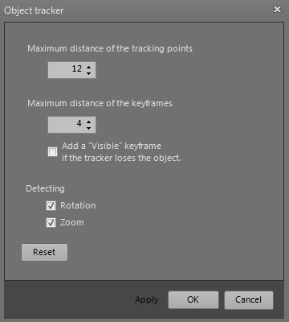

In the middle are the buttons for playback.

Endless playback

Speed

Jump to the start Jump to the end

Playback

Stop/pause

With the arrows on the right and left you can change

between clips in the media storage below the timeline. They are of course only active if\
multiple clips are present.

On the right you can switch between working and trim area. In the trim

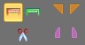

area (brown), you can change the film length, thus cut something off the\
clip at the front and back. For this, you activate the trim area (left brown\
button), move the cursor to the desired position and click on the left

brown triangle for the start point and on the right triangle if you want to change the end\
point. With the pair of scissors, you can cut the clip at the cursor position. Both parts will\
the be displayed in the media storage.

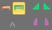

If the work area (green) is activated, you can limit the work area. This\
does not change the film length. But the created mask only has an\
impact in the defined work area.

For each mask, a track is created in the timeline. Should not all of the masks in the\
entire work area be applied with several masks, you can limit the track of the affected\
mask with the two symbols at the bottom right.

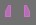 For this, move the cursor to the start position and click on the left symbol. Use\
the right symbol for the end position.

Left below the timeline, you can pull the timeline apart or push it together with the magnifying glass symbols. This does not change the film length, but only serves to

better see the keyframes in the

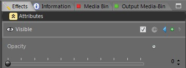

timeline.\
With the mouse wheel, you can move forward and backward in the timeline. But you have to click on the timeline first. Otherwise, you might change a value, as the mouse wheel is used in different areas.

## 11. Settings

In the area settings, you can set the values of the mask for processing. The settings area is divided into "Effects", "Information", "Media Bin" and "Output Media-Bin".

You can enlarge the preview with the square on the far right. The other windows

disappear. The square changes

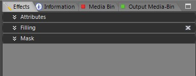

to a double square. A click on it changes over to the original view.

### 13.1. Effects

In order to set the values in the area Effects, you must open the corresponding area with the double arrow to the left of

the name.

The settings take place via the respective slider or via the number field on the right. Here you can either change the value with the arrow keys up/down, with the mouse wheel or by entering a value via the keyboard. Attention, in the default setting it only works with the numbers above the letters, the numeric keypad on the right cannot be used. For this, the check mark would have to be removed in the project settings under "Practical adjustments at “Media navigation using the numeric keypad ". The values can also be controlled with keyframes. In order to enter the keyframe control, click on the clock to the right of the name of the tool.

**13.1.1. Attributes**

In the area "Attributes", under "Visible", you can deactivate the effect of the mask at a certain point in the timeline and switch it on again at another point. For this, you only have to move the cursor to the point of the timeline and click with the mouse in the are "Visible". A keyframe will be generated automatically and from this point the track in the timeline will turn black. In addition, the keyframe control on the far right is active. You can now continue moving with the cursor and click again at the desired position in the "Visible" area. The track is reactivated from this point. Then ,only the part between the keyframes is black. With the arrow keys on the top right you can jump from one keyframe to the next. With the red minus sign between the arrows, you can delete the keyframe you are currently on. If you are not on any keyframe, a green plus sign will be displayed here. This allows you to create an additional keyframe at this point. Whenever a value is changed, a keyframe is set automatically.

With opacity, you can represent the masked object as transparent. It is thus not removed completely from the image. It is of course also possible to control the whole with

keyframes.

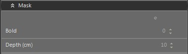

As soon as you have changed the value, a small red dot appears to the left of the name. This is the case with all values. With this item you can restore the default setting. Existing keyframes are deleted thereby.

#### 13.1.2. Filling

The area "Filling" is the most important in Hide. Because the settings are made here, how the mask processes the object. With the first two controls you define the area and the spacing of the images to be examined. As Hide examines the material in a defined area and checks what was previously at the point where the masked object is now or what will be there afterwards. And from this information, the area of the mask is then filled. The set area is marked red in the timeline. Under "Method" you can select between "Pixel tracking (GPU)", "Stamp", Color filling "and" Edge fill-in ".\
With the first two, the image is filled with actual image content. Whereby "Pixel tracking (GPU)” gave the best result in my tests. But it is also slowest in the calculation.

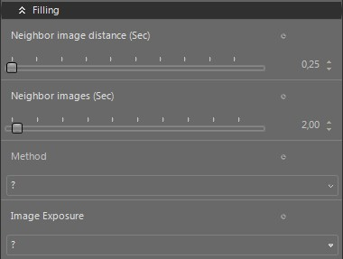

With the other two, the object is only represented in a blurred manner. With "Image Exposure" you can choose whether the image exposure is set (Adjust) or kept (Keep). The default setting is "Adjust", the calculated pixels in the exposure are adapted thereby and thus fit better into the image. As it is possible that the area to be examined is slightly darker at the front. Then it would be noticeable if these darker places are inserted.

**13.1.3. Mask**

In the area "Mask", you can change the mask size for the entire track. So if you find that the mask is a bit too small after creating the mask and tracking, you can increase the value under "Bold". This change is not set to a keyframe, but applies to the entire track. If you want the change to be only in a certain location, you can control this with keyframes. Click on the small

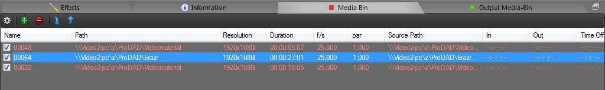

clock above the numerical value for this.

### 13.2. Information

Under "Information" you can see the most important data of the video material.

You can thus see the resolution here, the frame rate, the used codec, the length and much more.

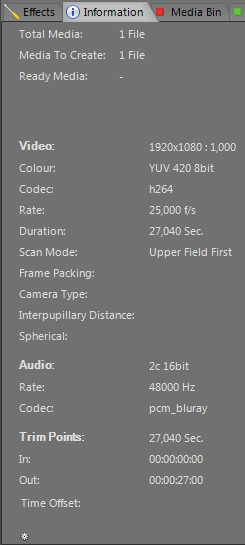

**13.3. Media storage**

In the area "Media Bin", all imported media are displayed in list form.

You will see information on the file name, file path, resolution, runtime, images/sec (f/s), pixel ratio (par) as well as about the source path of the imported videos. You can also add (+) or remove (-) media to and from the media bin. However, only the selected one is copied with the "+" symbol. In order to add new files, you can drag and drop them directly into the media storage.

With the gear wheel you will

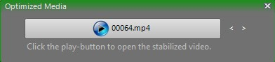

reach the settings of the respective clip. Here you can for example specify the start and end position of the file. This corresponds to setting the start and end points with the triangles in the trim mode. In addition, settings for 3D

images can also be made here.

With the arrows, you can change the position of the file in the list. This is important if the media are merged during export.\
If you remove the check mark on the left in the list, this file will not be exported.

If you right click on an entry or in the free area, a menu opens. Here you can "Cut" the selected entry and "paste" it into another position in the list. If a clip shall to be output several times, you can "Copy” this. You can also change the file name here or select all list entries. Everything you do here also changes the display in the "Media bin" (lower media storage).

With "Properties", you can get to the file properties as with the gear wheel on the top left.

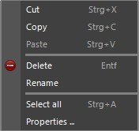

### 13.4. Output media-Bin

If you have exported one or more files, they will appear in the tab "Output media-Bin" tab. But only until you close the program. At the next start, the "Output media-Bin" is empty again.

With the symbol in the upper left corner you can play the selected file. A window for the start opens. With the small arrows you can switch between the files and play another file.

Click on the red minus sign to remove one from the list. You can change the order in the list with the arrow keys. Whereby only one file is played at a time during playback. Therefore, the order is not relevant.

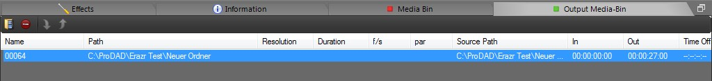

## 14. Media Bin

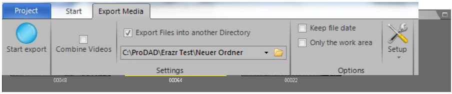

In the "Media bin" (lower media storage), you can see all imported media in the form of images.\
This corresponds to the tab "Media Bin". Again, in the "Media bin" you have the ability to remove or rename clips. If you right-click on an image, you will be taken to the corresponding menu. Everything you do here is displayed identically under "Media Bin". You can also drag a media from Windows Explorer to the media bin, it is imported thereby.

To remove it, you can also easily remove the current entry, this can be seen in the preview and has a colored frame, with the "Delete key" of the keyboard.

You can enlarge the media storage with the square on the far right. The other windows disappear. The square changes to a double square. A click on it changes over to the original view.

## 15. Status bar

In the status bar at the bottom you will see different file information on the left. On the right you can use the slider to change the size of the preview. But this is not a setting for the output. It only serves to see details better.

## 16. Export

To output your processed files, select "Export Media" above. But only the menu bar changes above.

If only one file, thus a clip, is output and you do not change the storage location, the file with the same file name is saved with the extension "-Hide" at the same location as the source material.

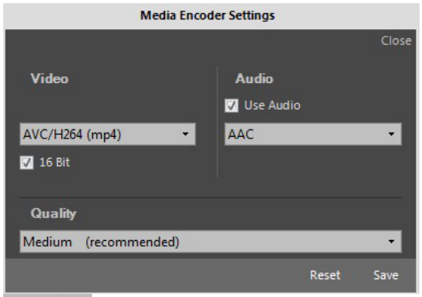

If you have imported and processed several files, the number of files will be at the bottom left at "Start export". This can be a bit confusing, as only one clip has a colored frame in the media storage.

But on the right side of the tab "Media Bin" (13.3.), all of them automatically have a check mark. Remove the check mark from the files that shall not be output, and the display under "Start

export" will change accordingly.

If you have removed a file from the list (media storage) for output, it will be displayed hatched in the "Media bin".

All selected files are output as individual files and saved. If you would like to output the files as one file, you must tick the box "Combine Videos". Thereby, only one file will be created. In addition, you can specify the file path for the output.

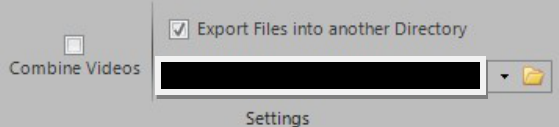

Under "Options" you can still set a check mark, if you want to save the recording date of the file during output. You can also set a check mark here in order check to only output the workspace as a file.

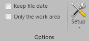

With "Setup" you can set the output format and the quality. As video format, MP4, MOV and AVI are available as a selection. You can also choose between three quality levels. The better the quality, the bigger the file.

The quality level Medium is sufficient in most cases.

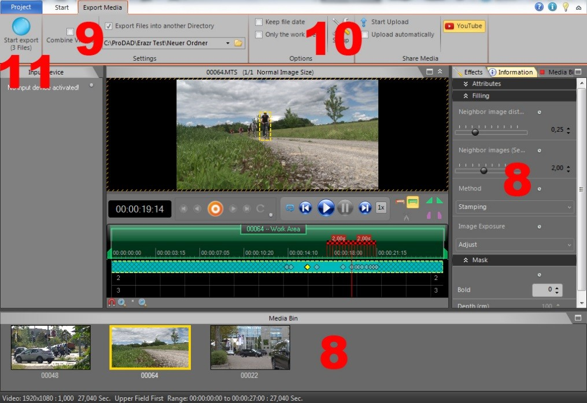

## 17. Work steps in Hide

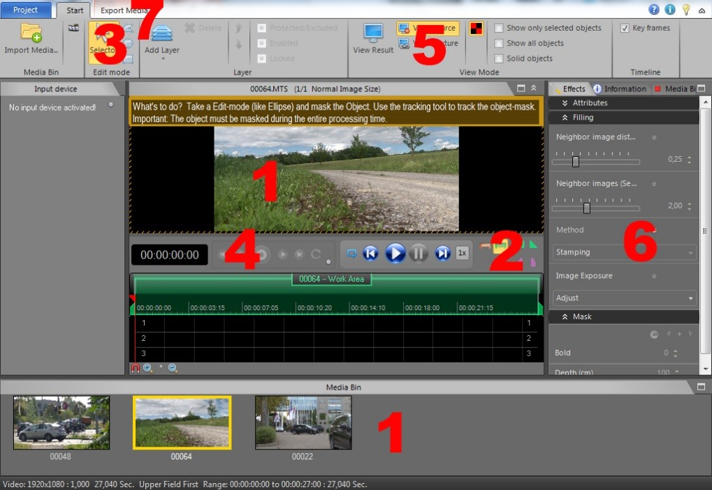

1. Import

media via "Import media" or by dragging into preview or into "Media storage" or "Media bin". "Scene detection" can be activated for longer clips.

2. Trim the clip

as needed and set the work area if necessary.

3. Select the mask shape and create the mask in the preview.
4. Carry out tracking automatically or manually.
5. Select show result and if necessary set what you want to see in the preview.
6. Fine adjustment in the area effects.
7. Click on "Export Media".
8. Select the file to be output under "Media storage" or in the "Media bin".
9. If necessary, select the file path and possibly activate "Combine videos" with several files.
10. Set the output format and quality.
11. Start the export.

Of course, you can also carry out the work steps in a different order and also reach your goal. It should only be a small help here that you do not forget anything.

## 18. Tips and tricks

### 18.1. The mask is too large and cannot be tracked automatically.

For objects like our example, the mask has of course to be so large that the shadow of the wheel is also masked.

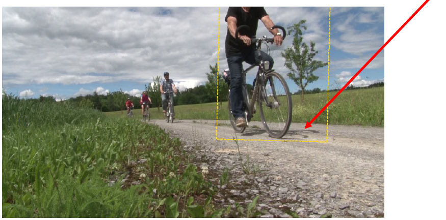

The problem is then however, that too many track points are outside the actual object and automatic tracking does no longer function.

Such a problem can be solved easily. First create a small mask. In our example, only on the cyclist's chest, because it is always visible throughout the whole scene. After successful tracking click on the mask in the preview and delete with the "Delete key" on the keyboard. Now only the mask but not the created keyframes are deleted. Now create a new mask, which may also be larger than the object. The new mask is linked to the existing keyframes and moves on the recorded movement path.
