# proDAD Erazr

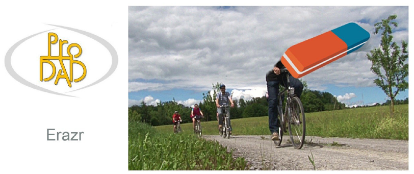

## 目次

- [1.ようこそ](#1ようこそ)
- [2.著作権／法的情報](#2著作権法的情報)
- [3.Erazr とは?](#3erazr-とは)
- [4.なぜ Erazr なのか?](#4なぜ-erazr-なのか)
- [5.Erazr ができないこと](#5erazr-ができないこと)
- [6.インストール](#6インストール)
- [7.Erazr の登録](#7erazr-の登録)
- [8.インターフェース](#8インターフェース)
- [9.メニューバー](#9メニューバー)
- [10.入力デバイス](#10入力デバイス)
- [11.プレビュー](#11プレビュー)
- [12.タイムライン](#12タイムライン)
- [13.設定](#13設定)
  - [13.1.効果](#131効果)
    - [13.1.1.アトリビュート](#1311アトリビュート)
    - [13.1.2.塗りつぶし](#1312塗りつぶし)
    - [13.1.3.マスク](#1313マスク)
  - [13.2.インフォメーション](#132インフォメーション)
  - [13.3.メディアストレージ](#133メディアストレージ)
  - [13.4.Media-Bin を出力](#134media-bin-を出力)
- [14.Media Bin](#14media-bin)
- [15.ステータスバー](#15ステータスバー)
- [16.エクスポート](#16エクスポート)
- [17.Erazr の作業ステップ](#17erazr-の作業ステップ)
- [18.より便利にお使いいただくためのヒント](#18より便利にお使いいただくためのヒント)
  - [18.1.マスクが大きすぎて自動追跡できない場合](#181マスクが大きすぎて自動追跡できない場合)

## 1.ようこそ

**proDAD Erazr へようこそ！**

Erazr は録画した動画から遡及的にオブジェクトを除去し、動画のクオリティを上げることのできるソフトウェアです。屋外での撮影において、画面を横切る通行人などを避けるのはほぼ不可能です。Erazr はこういったオブジェクトを除去し、動画の品質を向上させます。

Erazr は動画を撮影される皆様にとって大切な録画をより素晴らしいものとする、救世主となるツールです。

proDAD Erazr をぜひご活用いただき、素晴らしい出来上がりの動画をお楽しみください！

## 2.著作権／法的情報

**Copyright proDAD GmbH. All rights reserved.**

ライセンス条項ソフトウェアをインストールされる前に本ライセンス条項をよくお読みください。

使用許諾契約セットアップが開始すると使用許諾契約が表示されますので、よくお読みください。ソフトウェアのインストールをもって、著作権条件、使用許諾契約、使用許諾手続きに同意したものとみなされます。

ライセンス保証\
proDAD GmbH は正規の目的で本製品を使用することを許諾します。本製品は 1 台のコンピュータにのみインストールできます。proDAD は本契約によって無償でライセンスキーを 1 つ提供することを保証します。本製品をインストールすることにより、ユーザーはライセンス保証、著作権条件、責任制限に同意して承諾されたものとします。

登録商標同マニュアル内で言及されたすべての製品ならびに商標は、各所有者に帰属します。使用している全商標は自由な使用を保証するものではなく、登録商標である場合があります。

責任制限損害賠償請求 1 件あたりの賠償責任の上限は、本製品の交換までとします。これは proDAD GmbH、全ライセンス取得者、および小売店を対象に適用されます。損害賠償請求は、ソフトウェアが proDAD GmbH との事前合意に基づく返品番号と共に適切な手順で返品された場合にのみ受け付けます。また、製品の購入証明の添付が必要です。この保証は、製品の不具合が不適切な使用、酷使、事故、不適切な取り扱いに起因する場合、無効となります。

proDAD GmbH、販売店、およびライセンス供与者は、本製品の無理な使用に起因する損害および後発損害に対する責任を負いません。責任範囲はいかなる場合も製品の購入価格を上限とします。

本書の記述について当ハンドブックの編集と翻訳には細心の注意を払っていますが、不正確な記述の可能性を完全に排除するものではありません。proDAD GmbH は本書の記述や翻訳等に起因する不正確な記述や誤った情報により生じるいかなる損害について責任は一切負いかねます。技術的な変更の場合も同様です。本書に関して不正確な記述がございましたら弊社までご連絡ください。

著作権本ソフトウェアおよび本製品の個々の要素は proDAD GmbH が所有します。本製品をインストールすることによって、使用者は、不正使用と複製をしないことに同意したものとみなされます。

proDAD GmbH は本プログラム、コンテンツを使用した発行物、および本プログラムで作成したデータの使用に対する責任は一切負いかねます。

## 3.Erazr とは?

Erazr は録画映像から遡及的にオブジェクトを除去し、動画のクオリティを向上させるソフトウェアです。動画の撮影において、撮影者の意図に反して通行人が画面を横切るといったことは非常によくあります。

**オリジナルの録画　　　　　　　　　　　　　　Erazr で処理された録画**

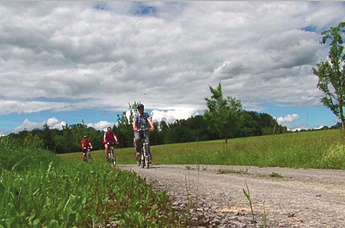

必ずしも撮影を繰り返す時間や予算があるわけではありませんし、後で見返して初めて気づいてがっかりすることもあります。

こんなとき、Erazr が活躍します。Erazr は撮影された動画から特定の前提条件を有するオブジェクトを除去して保存したり、品質を向上させたりできるソフトウェアです。

**Erazr は、動画を撮影される皆様にとって大切な録画の救世主となる、非常に便利なツールなので****す。**

## 4.なぜ Erazr なのか?

写真からのオブジェクトの除去は、写真編集プログラムを使えばたいしたことではありません。ですが 1 秒あたり 25 フレームが収められる録画において、オブジェクトを除去するのは大変複雑な作業です。

しかし Erazr を使用すれば、この作業も非常に簡単になります。Erazr は邪魔なオブジェクトをマスクでマークします。オブジェクトの動きを認識し、自動的にマスクに沿って動かすことが可能なのです。そして特定領域における前後を分析し、オブジェクトが除去された空間にその領域を挿入します。

Erazr はこの作業を高速で自動処理できるソフトウェアであり、長いシーンも非常に短時間で処理することが可能です。

## 5.Erazr ができないこと

いくら Erazr でも、知り得ない情報を見通すことはできません。Erazr は、オブジェクトが除去された空間に何があったかを把握している必要があります。対象が動いていることが重要なのです。たとえば人が左から右に歩いていく場合は問題なく動作します。その人がいない時にどう見えるかを、Erazr が確認できるからです。ですが、人がカメラに向かってまっすぐ歩いてくる場合、Erazr は人のかわりにその空間に何が必要かを認識できないため、オブジェクトを削除したあとを適切に置き換えることはできません。

## 6.インストール

インストールを開始するには、セットアップファイルをダブルクリックしてください。「次へ」をクリックして画面を確認します。インストールすると、「2. 著作権／法的情報」およびライセンス条項に同意したとみなされます。「これらのライセンス条項に同意します」をクリックして確認してください。Erazr をダウンロード購入した場合、プログラムのアーカイブがまず解凍され、そしてインストールが開始します。次に Erazr のインストール先のディレクトリを選択し、インストールを手順に従って進めます。

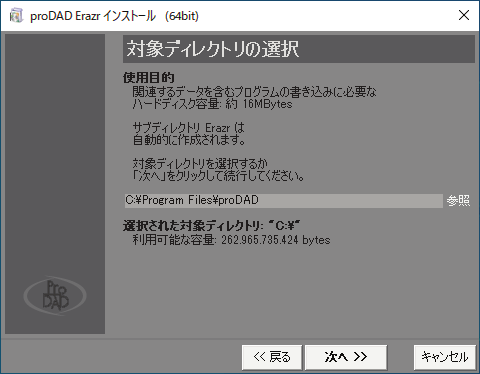

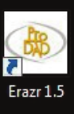

デスクトップ上のショートカットから Erazr を起動するか、またはスタートメニューから「proDAD」を開き、「Erazr Start」をクリックします。

Erazr の初回起動時は、プログラムのアクティベーションコード（シリアル番号）の入力を求められます。

重要：

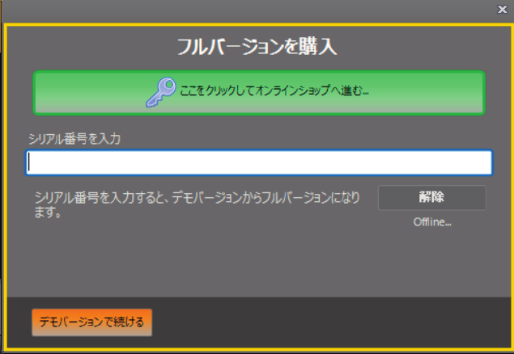

アクティベーションにはインターネット接続が必要です。アクティベーションはインターネットを介してのみ行うことができます。問題が発生した場合は、システムのセキュリティ設定（ファイアウォールなど）を確認し、アクティベーションの手順を再度実行してください。

デモモードで Erazr をテストする場合は、「デモバージョンを続行」をクリックします。シリアル番号を入力するまで、デモ版が作動します。シリアル番号を入力すると、正規版に移行するためのライセンスを取得できます。

Erazr を起動するとまず開始タブが開かれ、動画素材をインポートできるようになります。

## 7.Erazr の登録

ウェブサイトの以下のページから proDAD Erazr を登録することで、Erazr に関する更新情報と詳細情報を受け取ることができます。http://www.prodad.de/register.html

## 8.インターフェース

proDAD 社のプログラムはすべて、インターフェース構造が似た設計となっています。すでに proDAD 社のプログラムをお使いの方であれば、本ソフトの利用も容易でしょう。\
主な領域は以下の通りです。

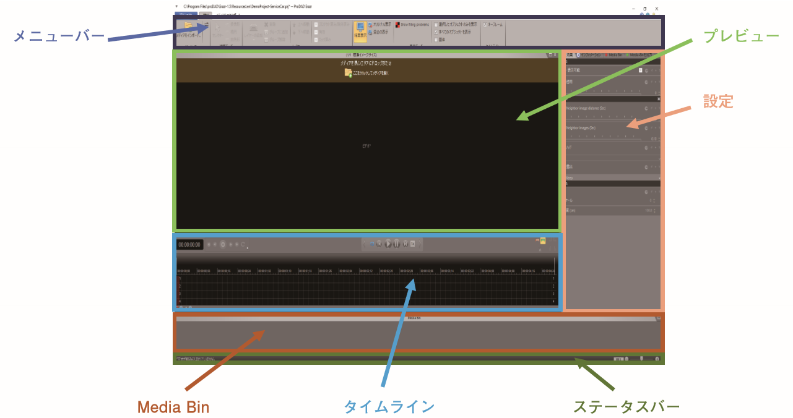

<!-- Ergänzt: aus dem Seitenbild abgetippt, Poppler kann diese Stelle nicht lesen -->
- メニューバー
- プレビュー
- 設定
- Media Bin
- タイムライン
- ステータスバー

## 9.メニューバー

左上に「プロジェクト」、「開始」、「メディアをエクスポート」

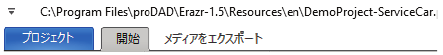

の 3 つの選択肢が表示されます。ソフトウェアを起動すると、「開始」タブに移動します。これは、実際の作業が行われる場所でもあります。

「プロジェクト」では、「新規プロジェクト」からプ

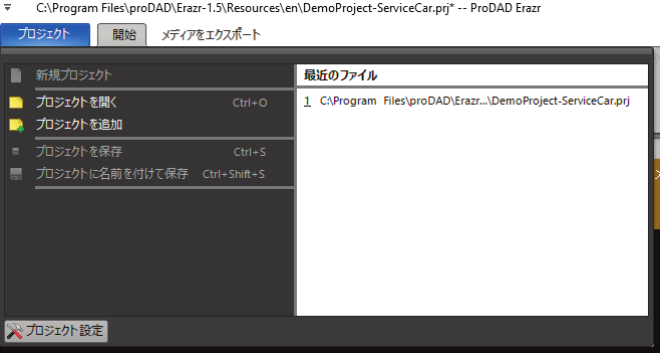

ロジェクトを作成できます。また以前の作業を続ける場合は、「プロジェクトを開く」で既存のプロジェクトを開きます。「プロジェクトを追加」では、現在のプロジェクトに別のプロジェクトの追加を行います。「プロジェクトの保存」は、現在のプロジェクト名でプロジェクトを保存します。プロジェクト名がまだ割り当てられていない場合、この機能はアクティブになりません。「プロジェクトに名前をつけて保存」は、プロジェクトに名前をつけ、保存場所を指定します。右側には最後に使用したプロジェクトが表示されています。一覧内のプロジェクトを左クリックすると、そのプロジェクトが開かれます。

左下のプロジェクト設定では、基本的な項目を設定します。たとえば、自動保存の時間間隔や、インターフェースに表示されるウィンドウをここで定義します。ペダルなどの追加ハードウェアの設定もここで実行できます。また、自動オブジェクトトラッカーのトラッキング設定を行うこともできます。

次に、「開始」タブの機能を見てみましょう。

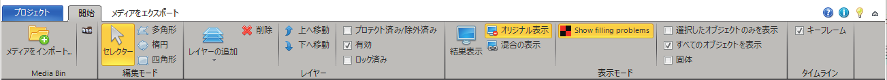

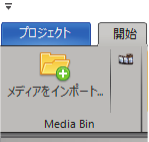

左端に「メディアをインポート」のボタンがあります。このボタンをクリックすると、他のプログラムと区別しやすいようにウィンドウが開きます。このウィンドウから、ドライブとファイルを選択して開きます。プレビューウィンドウに直接ドラッグして Erazr でファイルを処理することも可能です。

インポート対象がインポート中に個々のシーンに分割される場合は、その横の記号をクリックする必

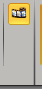

要があります。このようにファイルを開くと、ファイルが分割され、各シーンが画像とともにメディアストレージに表示されます。シーン認識が有効になっている場合は、色付きで強調表示されます。

編集モードでは、オブジェクトをマスクするマスク形状を指定します。マスク形状は多角

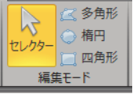

形、楕円形、四角形から選択可能です。\
マスクが作成されると、セレクターが黄色に変わります。これは、プレビューで非表示になっている場合でもマスクが作成されたことを示しています。

メニューバーの次の領域では、レイヤーを作成し、表示の

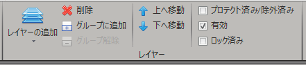

順序変更を設定できます。通常のレイヤーは自動生成されるため、マスクを作成するとレイヤーも自動取得されます。またレイヤーを保護し、マスクされた領域を変更しないよう設定することも可能です。これにより、たとえば除外したい人物が木の後ろを通り過ぎた場合に、その人だけを取り除き、木を保持することが可能です。保護レイヤーを作成するには、「レイヤーの追加」ボタンの下部をクリックし、「保護／除外レイヤー」を選択し

ます。赤い「X」を押すと現在アクティブなレイヤーが削除されます。

また、タイムライン全体を移動するのではなく、現在のカーソル位置から始まるレイヤーを作成することも可能です。

表示モードでは、プレビューにおける表示設定を

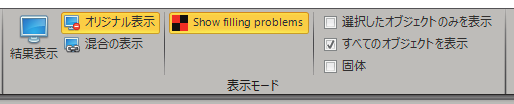

行います。それぞれ選択するとその項目は黄色に表示が変わります。

**結果表示：**マスクされたオブジェクトを除いた動画をプレビュー表示します。マスクも表示されません。

**オリジナル表示：**作成したマスクを含むオリジナルのクリップをプレビューに表示します。

**混合の表示：**結果表示に加え、作成したマスクを表示します。

**Show filling problems：**取り除きたいオブジェクトの移動速度と、「Neighbor image distance（隣接画像との距離）」および「Neighbor images （隣接画像）(sec)」関数機能の設定によっては、マスクに filling problems（塗りつぶしの問題）が発生することがあります。これは Erazr で調べた範囲が小さすぎて画像を計算できない場合に起きる問題であり、プレビュー上で赤と黒の模様とともに明示されます。この問題がプレビューに表示される場合は、値を調整することで解決できます。

選択したマスクのみの表示、全マスクの表示、マスクを塗りつぶしての表示（ソリッドオブジェクト）、フレームのみの表示を設定することも可能です。

一番右のオプションでは、トラッキング中に生成されたタイムラインのキーフレーム表示の

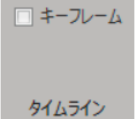

有無を設定します。

## 10.入力デバイス

Erazr は、より便利にお使いいただくためのハードウェアを追加できます。イン

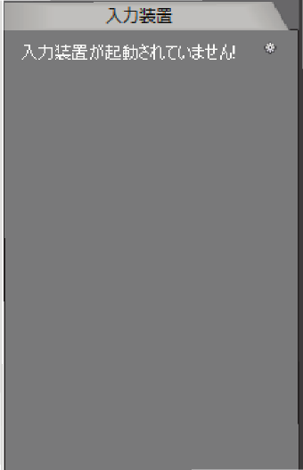

ストールされたハードウェアは、「入力装置」タブに表示されます。

例えば右のようなペダルを使用すると、

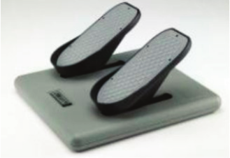

手やマウスを使うことなくプレビューを前後に動かして設定することができます。

※こちらは上位版のみの機能です。

## 11.プレビュー

メニューバーで「結果表示」をアクティブにすることで、プレビュー画面で変更をリアルタイムで反映表示させることが可能です。設定やハードウェアによっては、プレビューの更新に時間がかかる場合があります。その場合、プレビューの下に破線が表示されます。正しいファイルか確認できるように、ファイル名がプレビュー画面上部に表示されます。ファイル名の横の右端にある四角いアイコンをクリックすると、プレビューが拡大され、他のウィンドウがフェードアウトします。拡大中は四角いアイコンが二重四角形で表示されます。クリックすると元のビューに切り替わります。

プレビューを右クリックして、インターレースと再生に関するオプションを変更できます。動画の表示を上半分、下半分、全体について行うか決定できます。再生に関する設定も可能です。

プレビューのサイズはマウスホイールで変更できます。ですがこの際に、まずプレビューをクリックしてからマウスホイールを動かす必要がある点にご注意ください。

マウスホイールはさまざまな操作に使われるため、この手順で行わないと、値が意図せず変更される可能性があります。

Windows Explorer からプレビューにクリップをドラッグするだけで、メディアをインポートすることも可能です。

右上隅の上向きの二重矢印をクリックすると、プレビューを別画面で表示させることが可能です。これによりプレビューをセカンドモニターでフルサイズ表示させたり、タイムラインをより大きく表示させたりといったことが可能になります。全体の確認のために上下にスクロールする必要がないため、マスクや追跡において便利です。プレビューのサイズを変更する場合は、マウスを隅に移動し、左クリックでウィンドウを目的のサイズまでドラッグします。右上の「X」で画面を閉じると、プレビュー画面は再び統合されます。以前のサイズと位置が保存されるため、次に別画面表示させたときも同様のサイズと位置に配置されます。

## 12.タイムライン

プレビューの下には、動画再生のためのボタンを配置したタイムラインが表示されています。

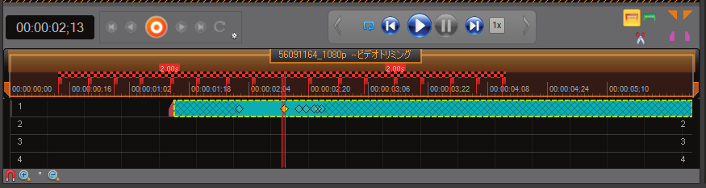

左端にはタイムコードが表示されます。これは現在置かれているカーソルの位置（赤い線）の値が表示されます。その隣には自動トラッキング用のボタンがあります。フレームごとに前後に移動したり、最初または最後まで自動的に追跡したりすることが可能です。トラッキング中のキーフレームはタイムラインに自動設定されます。キーフレームには、このタイムラインの位置におけるマスクのサイズと位置の値が保存されます。Erazr は定期的にキーフレームを設定します。\
ただしオブジェクトの動きが均一、つまり直線的な動きの場合、必要なキーフレームの数は少なくなります。その場合、緑色の矢印で不要なキーフレームを追跡から削除することが可能です。

自動トラッキング後のタイムライン

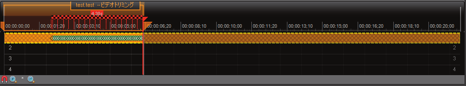

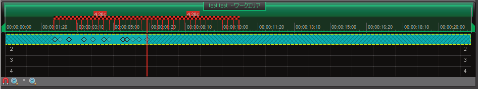

不要なキーフレームを削除した後のタイムライン

こうすることで、後から値を調整しやすくなります。

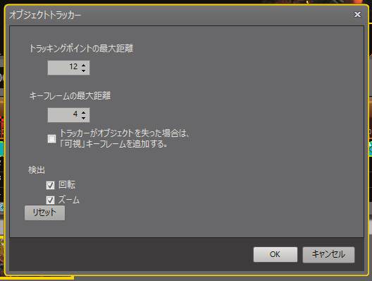

右側の緑の矢印の横には、小さな歯車があります。これをクリックするとオブジェクトトラッカーの設定に移動します。ここでは、トラッキングポイントの最大距離とキーフレームの最大距離の設定、回転とズームを検出するかどうかの指定を行います。

中央には再生用のボタンが表示されます。

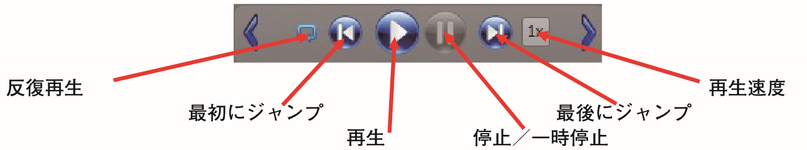

<!-- Ergänzt: aus dem Seitenbild abgetippt, Poppler kann diese Stelle nicht lesen -->
- 反復再生
- 最初にジャンプ
- 再生
- 停止／一時停止
- 最後にジャンプ
- 再生速度

左右矢印で、タイムラインの下のメディアストレージ内のクリップを切り替えることができます。当然ながら、これは複数のクリップが存在する場合にのみ有効です。

右側では、ワークエリアとトリムエリアを切り替えることができます。トリムエリア（茶

色）では、フィルムの長さを変更できるため、クリップ前後を切り取ることが可能です。切り取るにはトリムエリア（左茶色のボタン）をアクティブにし、カーソルを目的の位置に移動して始点として左茶色の三角形をクリックし、終点を変更する場合は右三角形をクリックします。

ハサミでクリップをカーソル位置でカットできます。分割された 2 つがメディアストレージに表示されます。

ワークエリア（緑）が有効化されている場合、ワークエリアを制限できます。ここではフィ

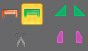

ルムの長さは変わらず、作成されたマスクは定義されたワークエリアにのみ影響を与えます。

マスクごとに、タイムラインにトラックが作成されます。ワークエリア全体のすべてのマスクに複数のマスクを適用する必要がない場合は、右下の 2 つの記号を使用して、影響を受けるマスクの追跡を制限できます。

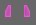 これを行うには、カーソルを開始位置に移動して、左側のアイコンをクリックします。終了位置は右のアイコンをクリックして設定します。

タイムライン左下の虫眼鏡のアイコンで、タイムラインを引き離したり近づけたりすることが可能です。これはフィルムの長さを変更することなく、タイムラインでキーフレームを見やすくするのに便利です。タイムラインをクリックしてからマウスホイールを使用することでタイムラインを前後に移動できます。タイムラインをクリックしてからでないと、マウスホイールが他のパラメーターで使用されて値が意図せず変更されるおそれがある点にご注意ください。

## 13.設定

エリア設定では、処理するマスクの値を設定できます。

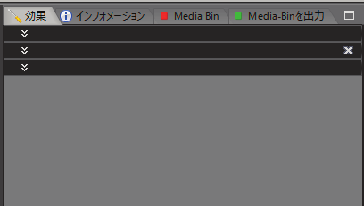

設定領域は、「効果」、「インフォメーション」、「Media\
Bin」、「Media-Bin を出力」に分かれています。

右端の四角いアイコンでプレビューを拡大できます。その場合、他のウィンドウが消え、四角形が二重四角形に変わります。クリックすると元のビューに切り替わります。

### 13.1.効果

効果エリアに値を設定するには、左側にある二重矢印で対応するエリアを開く必要があります。

設定は、それぞれのスライダーまたは右側の数値フィールドを介して行います。ここで、矢印キーの上下、マウスホイール、またはキーボードから値を入力して値を変更できます。初期設定では、文字の上の数字でのみ機能し、右側の数字キーパッドは使用できない点にご注意ください。使用するには、「テンキーを使用したメディアナビゲーション」での実際の調整の下のプロジェクト設定で、チェックマークを削除する必要があります。値はキーフレームで制御することも可能です。キーフレームコントロールに入るには、ツール名の右側にある時計をクリックします。

#### 13.1.1.アトリビュート

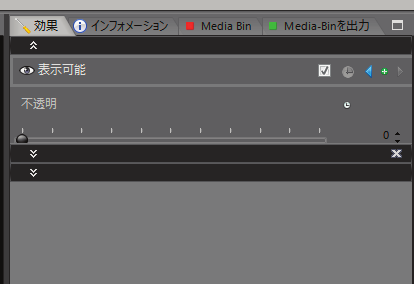

「アトリビュート」エリアの「表示可能」では、タイムラインの特定箇所でマスクの効果を無効化し、別の箇所で再び有効にする設定を行います。設定方法は、カーソルをタイムラインのある箇所に移動してマウスで「表示可能」をクリックするだけです。キーフレームが自動生成され、その時点からのタイムラインのトラックが黒くなります。また、右端のキーフレームコントロールがアクティブになります。カーソルで移動を続け、「表示可能」エリアの目的の位置でもう一度クリックします。この時点からトラックが再度アクティブになります。すると、キーフレーム間の部分のみ黒く表示されます。右上の矢印キーを使用すると、あるキーフレームから次のキーフレームにジャンプします。矢印の間の赤いマイナスアイコンで、現在使用しているキーフレームを削除できます。キーフレームを使用していない場合は、緑色のプラスアイコンが同じ箇所に表示されます。このアイコンをクリックすると、その箇所に追加のキーフレームが作成されます。キーフレームは値が変更されるたびに自動設定されます。

「不透明」を使用すると、マスクされたオブジェクトを透明なオブジェクトとして扱います。このオブジェクトは映像から完全に削除されるわけではありません。もちろん、キーフレームで全体を制御することも可能です。

値を変更すると、名前の左側に小さな赤い点が表示されます。これはどのような値でも表示され、クリックすると初期設定に戻ります。これにより、既存のキーフレームが削除されます。

#### 13.1.2.塗りつぶし

「塗りつぶし」は Erazr で最も重要な機能のひとつで、マ

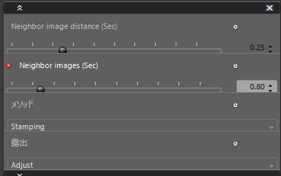

スクによるオブジェクト処理の方法はここで設定します。最初の 2 つのコントロールを使用して、検査する画像のエリアと間隔を定義します。定義された領域のマテリアルを Erazr が調査し、マスクされたオブジェクトがあったところに前後に何が存在しているかを確認します。そして、この情報をもとにマスク領域を塗りつぶします。設定された領域はタイムラインで赤くマークされます。

「メソッド」で、「Pixel tracking (GPU) （ピクセルトラッキング（GPU））」、「Stamping（スタンプ）」、「Color fill-in（色の塗りつぶし）」、「Simple color fill-in（単色の塗りつぶし）」から選択できます。

最初の 2 つでは、画像は実際の画像コンテンツで埋められます。テストでは「Pixel tracking (GPU)(ピクセルトラッキング（GPU）)」が最も良い結果となっていますが、計算は最も遅くなります。

他の 2 つでは、オブジェクトの表示はややぼやけます。「露出」では、画像露出を設定する「Adjust」か、保持する「Keep」を選択できます。初期設定は「Adjust」となっています。「Adjust」では、ピクセルが映像により溶け込むように計算して調整します。これは対象領域で正面側が少し暗く表示され、挿入すると目立つ場合があるためです。

#### 13.1.3.マスク

「マスク」領域では、追跡全体におけるマ

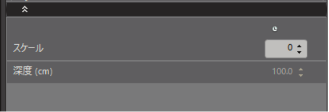

スクサイズを変更できます。例えばマスクを作成したが、追跡したところマスクが小さすぎることがわかった場合は、「スケール」からサイズを変更できます。この変更は追跡全体に適用されますが、キーフレームには設定されません。\
特定箇所だけ変更したい場合は、キーフレームから制御できます。数値の上に表示される小さな時計アイコンをクリックします。

### 13.2.インフォメーション

「インフォメーション」からは、動画素材の最も重要なデータとなる

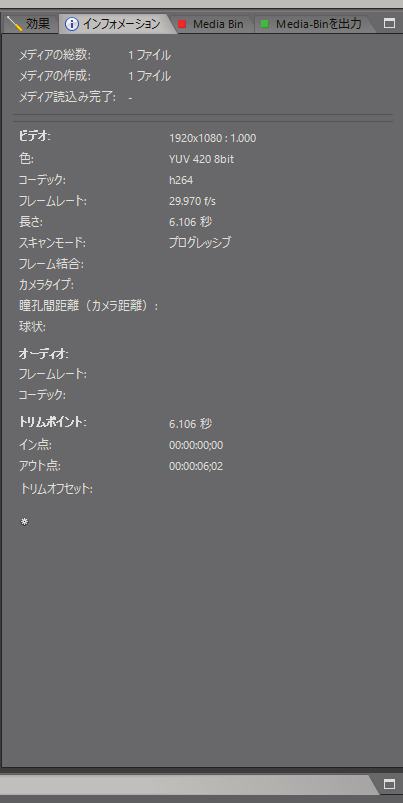

解像度、フレームレート、使用コーデック、長さなどを確認できます。

### 13.3.メディアストレージ

「Media Bin」エリアには、インポートされた全メディアが一覧形式で表示されます。

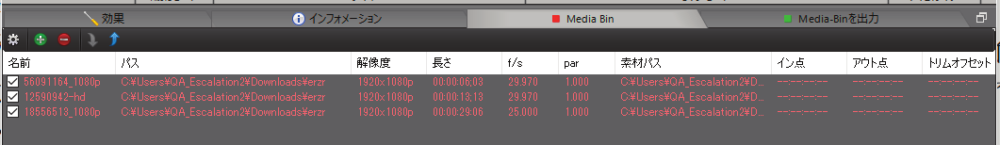

ファイル名、ファイルパス、解像度、長さ、画像／秒（f / s）、ピクセル比（par）、インポートした動画の素材パス情報が表示されます。\
またメディアの追加（+）と削除（-）も可能です。ただし「+」アイコンでは、選択したメディアのコピーのみ行います。ファイルを新規追加するには、メディアストレージに直接ドラッグアンドドロップします。\
歯車アイコンをクリックすると、各動画の設定に移行し、たとえばファイルの開始位置と終了位置の指定などを行うことができます。これは、トリムモードでの三角アイコンによる開始点と終了点の設定と同様です。また、3D 画像の設定もここで行えます。

矢印アイコンで、一覧内のファイルの位置を変更できます。これはエクスポート中にメディアがマージされた場合などに重要な機能です。\
リストの左側のチェックマークを外した場合、ファイルはエクスポートされません。

エントリまたは空き領域を右クリックすると、メニューが開きます。これによりエ

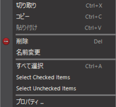

ントリを「切り取り」、一覧の別の箇所に「貼り付ける」ことができます。動画を複数回出力する必要がある場合は、「コピー」することも可能です。またファイル名の変更や一覧内の全エントリの選択も可能です。ここでの操作によって、「Media Bin」（下部のメディアストレージ）の表示も変更されます。「プロパティ」をクリックすると、左上の歯車アイコンと同様、ファイルのプロパティに移動します。

### 13.4.Media-Bin を出力

エクスポートしたファイルは「Media-Bin を出力」タブに表示されます。この表示はプログラムを閉じるまで持続し、次に立ち上げる際は「Media-Bin を出力」は再び空になります。

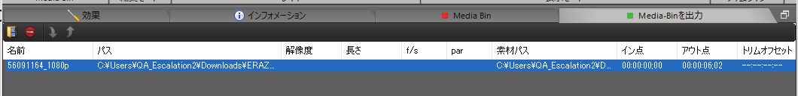

左上隅の記号で、選択したファイルを再生できます。

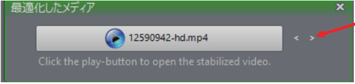

<!-- Ergänzt: aus dem Seitenbild abgetippt, Poppler kann diese Stelle nicht lesen -->
**スタート画面が開きます。小さな矢印を使用すると、ファイルを切り替えて別のファイルを再生できます。**

赤いマイナス記号をクリックして、リストから削除します。矢印キーでリスト内の順序を変更できます。これにより、再生中に一度に 1 つのファイルのみが再生されます。したがって、順序は関係ありません。

## 14.Media Bin

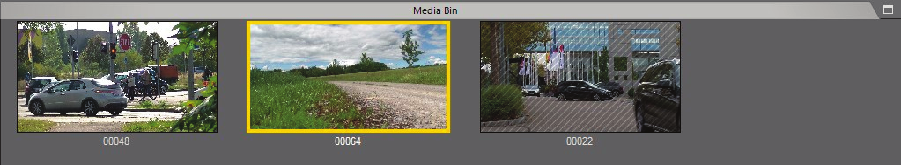

「Media Bin」（下部のメディアストレージ）では、インポートされた全メディアを画像形式で表示できます。\
この機能は「Media Bin」タブから利用できます。また「Media Bin」では、動画の削除や名前の変更が可能です。画像を右クリックするとメニューが表示されます。メニューでの操作はいずれも、「Media Bin」の下にも同様に表示されます。Media Bin は、Windows Explorer からメディアをドラッグし、インポートすることも可能です。

選択中のエントリの削除も簡単に行えます。選択中のエントリはプレビューに色付きのフレームで表示され、キーボードの「Delete キー」で削除できます。

右端の四角いアイコンでメディアストレージを拡大表示できます。他のウィンドウが消えます。四角いアイコンが二重四角で表示されます。再度クリックすると元のビューに戻ります。

## 15.ステータスバー

下部のステータスバーは、左側にさまざまなファイル情報が表示されます。右側にはスライダーが表示され、プレビューのサイズを変更できます。ただしこれは出力の設定ではなく、詳細の確認を行うためのものです。

## 16.エクスポート

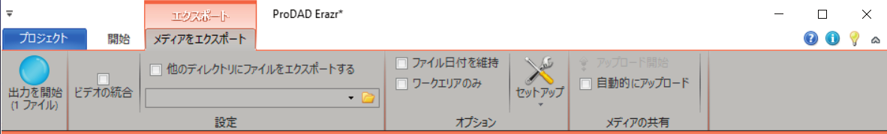

処理されたファイルを出力するには、「メディアをエクスポート」タブを選択します。上のメニューバーのみが変化します。

保存場所を変えずに 動画 1 ファイルのみを出力する場合、同名のファイルは、ソースマテリ

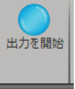

アルと同じフォルダに拡張子「-Erazr」で保存されます。

複数ファイルをインポートして処理した場合、ファイル数は左下の「出力を開始」に表示されます。このときでも、メディアストレージでは動画ファイルは 1 つだけで色付きフレームで表示されています。

ただし、「Media Bin」タブ（13.3.）の右側では、全項目に自動でチェックマークが付いています。出力しないファイルのチェックを外すと、「出力を開始」の表示が変わります。

出力ファイル一覧（メディアストレージ）からファイルを削除した場

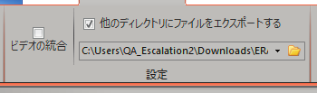

合、「Media Bin」に斜線で表示されます

選択した全ファイルは個別のファイルとして出力され、保存されます。単一のファイルとして出力する場合は、「ビデオの統合」チェックボックスをマークします。これによりファイルは 1 つのみ作成され、出力のファイルパスも指定できます。

出力でファイルの録画日時を残したい場合は、「オプション」のチェックマークで設

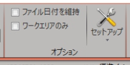

定できます。またファイルでワークエリアのみを出力するようチェックすることも可能です。

「メディアエンコーダー設定」では、出力の形式と品質

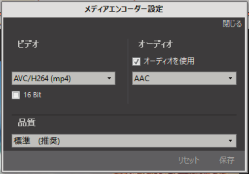

を設定できます。動画形式は MP4、MOV、AVI から選択できます。3 段階の品質レベルを選択することも可能です。品質が高いほど、ファイルサイズは大きくなります。

ほとんどのケースで、品質レベルは標準で十分です。

このオプションでは、修正したファイルを YouTube に直接アップロードで

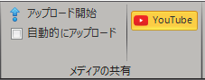

きます。もちろん、アップロードするには YouTube チャンネルが必要です。

※こちらは上位版のみの機能です。

## 17.Erazr の作業ステップ

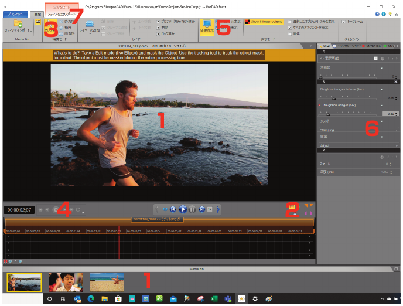

1.「メディアのインポート」を行うか、プレビュー、「メディアストレージ」、「Me

dia Bin」へのドラッグアンドドロップでメディアをインポートします。「シーン検出」は、長い動画に対して有効な機能です。

2.必要に応じて動画をトリミングし、ワークエリアを設定します。 3.マスクの形状を選択し、プレビューでマスクを作成します。 4.自動または手動での追跡を行います。 5.結果の表示を選択し、必要に応じてプレビューの表示内容を設定します。 6.領域効果を細かく調整します。\
7.「メディアをエクスポート」をクリックします。

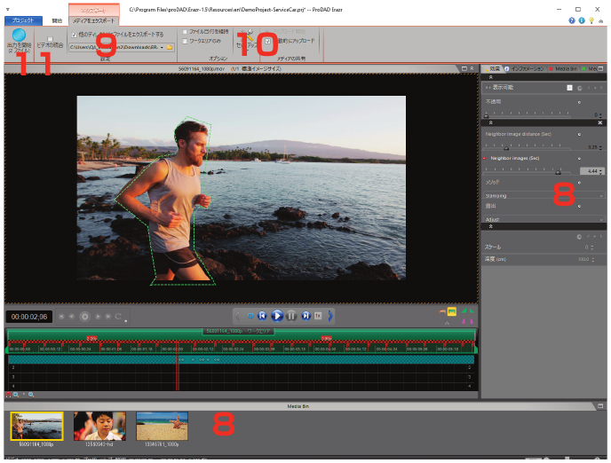

8.「メディアストレージ」または「Media Bin」で出力するファイルを選択します。 9.必要であればファイルパスを選択し、複数ファイルの「ビデオの統合」を有効に

します。

10.出力形式と品質を設定します。\
11.エクスポートを開始します。

もちろんこれ以外の順序で作業を行うことも可能であり、上記の手順は参考のための一例としてご紹介しています。

## 18.より便利にお使いいただくためのヒント

### 18.1.マスクが大きすぎて自動追跡できない場合

以下のようなオブジェクトでは、この車輪の影までマスクしなければならないので、マスクはかなり大きくなってしまいます。

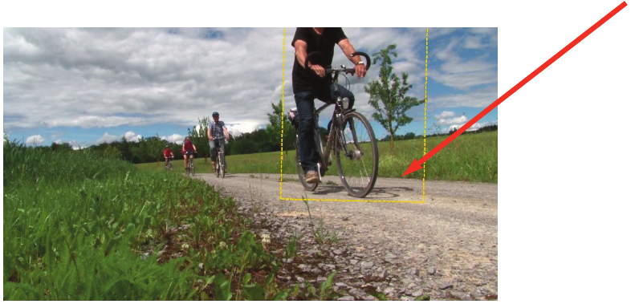

しかしこのケースでは、実際のオブジェクトの外側に追跡ポイントが多すぎるため、自動追跡が機能しなくなってしまいました。

こうした問題は簡単に解決できます。まず小さなマスクを作成します。上記の例では、自転車を漕いでいる人の胸のみを選択しました。胸を選んだのは、そこがシーン全体で常に表示されているためです。追跡に成功したら、プレビューでマスクをクリックし、キーボードの「Delete」キーで削除します。これによりマスクのみ削除され、作成したキーフレームは削除されません。次に、オブジェクトよりも大きいマスクを新規作成します。新規のマスクは既存のキーフレームに結び付けられ、記録した軌跡に沿って移動します。
