# proDAD Mercalli V6 Plug-ins

**Anleitung**

© proDAD GmbH

Autoren: Uwe Wenz & Holger Burkarth

## Inhaltsverzeichnis

- [Willkommen](#willkommen)
- [Vorwort](#1-vorwort)
  - [Was ist Mercalli?](#11-was-ist-mercalli)
  - [Copyright / Rechtliches](#12-copyright--rechtliches)
- [Systemanforderungen](#2-systemanforderungen)
  - [Allgemein](#21-allgemein)
  - Echtzeit Anwendung
- [Installation](#3-installation)
- [Produktaktivierung + Registrierung](#4-produktaktivierung--registrierung)
- [Unterstützte Videoprogramme](#5-unterstützte-videoprogramme)
  - [MAGIX](#51-magix)
  - [Adobe Premiere](#52-adobe-premiere)
  - [VEGAS Pro](#53-vegas-pro-ofx)
  - Davinc Resolve
  - [Corel Video Studio](#55-corel-video-studio)
- [Mercalli Pro](#6-mercalli-pro)
  - [Mercalli Pro Überblick](#61-mercalli-pro-überblick)
  - [Aufbau + Grundfunktionen](#62-aufbau--grundfunktionen)
  - [Kamera](#63-kamera)
  - [Rolling Shutter Kompensation](#64-rolling-shutter-kompensation)
  - [Kamera-Dynamik erhalten](#65-kamera-dynamik-erhalten)
  - Analyse
  - [Stabilität](#67-stabilität--)
  - [Ansicht](#68-ansicht)
  - [Diagramme](#69-diagramme)
    - [Schwenk](#691-schwenk)
    - [Rollen](#692-rollen)
    - [Zoom](#693-zoom)
    - CMOS
    - [X/Y-Achse](#695-xy-achse)
    - [Dynamische Skalierung](#696-dynamische-skalierung)
  - [Remap Modus](#610-remap-modus)
  - [Info-Text](#611-info-text)
  - [Erweiterte Einstellungen](#612-erweiterte-einstellungen)
    - [Bewegung](#6121-bewegung)
      - [Kameraschwenk glätten](#61211-kameraschwenk-glätten)
      - [Rollen-Ausgleichen](#61212-rollen-ausgleichen)
    - [Rand](#6122-rand)
      - [Rand](#61221-rand)
      - Mit Kantenfarben auffüllen
      - [Skalierung](#61223-skalierung)
      - [Dynamische Skalierung](#61224-dynamische-skalierung)
    - [Perspektive](#6123-perspektive)
      - [X/Y-Achse - Ausgleichen](#61231-xy-achse---ausgleichen)
      - [Zoom-Ausgleichen](#61232-zoom-ausgleichen)
    - [Grafik](#6124-grafik)
      - [Rotation](#61241-rotation)
      - [Skalierung](#61242-skalierung)
    - [Verwendete Kameraoptik](#6125-verwendete-kameraoptik)
    - [Video](#6126-video)
      - [Info zum Video](#61261-info-zum-video)
  - [Overlay Hinweise](#613-overlay-hinweise)
- [Mercalli RT](#7-mercalli-rt)
  - [Mercalli RT Überblick](#71-mercalli-rt-überblick)
  - Kamera (Staby Cam)
  - Score
  - Ansicht - Diagnose - Diagramme
  - [Remap Modus](#75-remap-modus)
  - [Rand](#76-rand)
  - [Skalierung](#77-skalierung)
  - [Rolling-Shutter Korrektur](#78-rolling-shutter-korrektur)
  - [Dynamische Skalierung](#79-dynamische-skalierung)
  - [Maximal akzeptierter Bildrand](#710-maximal-akzeptierter-bildrand)
  - [Inhalt bewusst füllen](#711-inhalt-bewusst-füllen)
- [CMOS Fixr](#8-cmos-fixr)
  - [CMOS Fixr Überblick](#81-cmos-fixr-überblick)
  - [Vorlagen](#82-vorlagen)
  - [Ansicht](#83-ansicht)
  - [Logo Ein/Aus](#84-logo-einaus)
  - Sensor-Geschwindigkeit
  - [Methode](#86-methode)
  - [Rand vermeiden](#87-rand-vermeiden)
  - [Remap Modus](#88-remap-modus)
  - [Overlay Hinweise](#89-overlay-hinweise)
- [Picture Enhanzr RT](#9-picture-enhanzr-rt)
  - [Picture Enhanzr RT Überblick](#91-picture-enhanzr-rt-überblick)
  - [Vorlagen](#92-vorlagen)
  - Ansicht / Logo
  - [Dynamik](#94-dynamik)
  - [Helligkeit](#95-helligkeit)
  - [Sättigung](#96-sättigung)
  - [Kacheln](#97-kacheln)
- [Über](#10-über)
  - [Info-Feld](#101-info-feld)
- [Leistungsanzeige](#11-leistungsanzeige)
  - [Decoder](#111-decoder)
  - [Plugin](#112-plugin)
  - [Gesamt](#113-gesamt)
- [Overlay-Hinweise](#12-overlay-hinweise)
  - [Mercalli Pro Overlay-Hinweise](#121-mercalli-pro-overlay-hinweise)
    - [Das Video wird analysiert](#1211-das-video-wird-analysiert)
    - [Gemischte Bildraten werden nicht unterstützt](#1212-gemischte-bildraten-werden-nicht-unterstützt)
    - [Erste Verwendung](#1213erste-verwendung--videoanalyse-erforderlich)
    - [Video-Clip ausgetauscht](#1214-video-clip-ausgetauscht--videoanalyse-erforderlich)
    - [Virtuelle Stabicam geändert](#1215-virtuelle-stabicam-geändert--videoanalyse-erforderlich)
    - [Kameraoptik geändert](#1216-kameraoptik-geändert--videoanalyse-erforderlich)
    - [Start/Ende geändert](#1217-startende-geändert--videoanalyse-erforderlich)
    - [Interlace/Progressiv geändert](#1218-interlaceprogressiv-geändert--videoanalyse-erforderlich)
    - [Fade-Bereich geändert](#1219-fade-bereich-geändert--videoanalyse-erforderlich)
  - [CMOS Fixr Overlay-Hinweise](#122-cmos-fixr-overlay-hinweise)
    - [Gemischte Bildraten werden nicht unterstützt](#1221-gemischte-bildraten-werden-nicht-unterstützt)
    - [GPU nicht verfügbar](#1222-gpu-nicht-verfügbar)
    - [Unterschiedliche Bildraten](#1223-unterschiedliche-bildraten)
    - [Vorschau nicht anzeigbar](#1224-vorschau-nicht-anzeigbar)
    - [Stereoskopische Videos werden nicht unterstützt](#1225-stereoskopische-videos-werden-nicht-unterstützt)
- [FAQ](#13-faq)
  - [Logo ist nicht abschaltbar](#131-logo-ist-nicht-abschaltbar)
  - Wie können problematische Videos stabilisiert werden?
- [Fehler](#14-fehler)
  - Produkt lässt sich nicht aktivieren
  - [Verbindung zu www.prodad.com nicht möglich](#142-verbindung-zu-wwwprodadcom-nicht-möglich)
  - [Hinweise im Video](#143-hinweise-im-video)
  - [GPU nicht verfügbar](#144-gpu-nicht-verfügbar)
- [Wichtige Infos](#15-wichtige-infos)
  - [CMOS Fixr im Latenz-Modus](#151-cmos-fixr-im-latenz-modus)
  - Kombination von CMOS Fixr + Mercalli Pro
- [Workshops](#16-workshops)
  - [Stabilisierung](#161-stabilisierung)
  - [Kamera-Optik](#162-kamera-optik)
- [Updates](#17-updates)
  - History
  - [Update installieren](#171-update-installieren)
- [Externe Links](#18-externe-links)
  - Video Wobbel
  - [CMOS Vibrationen](#182-cmos-vibrationen)
  - [Video Mercalli](#183-video-mercalli)
  - [Video MAGIX](#184-video-magix)

## Willkommen

Mercalli dient der nachträglichen Entfernung von Verwacklungen, Stößen, Zitter- und Vibrationseffekten aus Videoaufnahmen und somit der qualitativen Aufwertung wichtiger Aufzeichnungen. Auch ungleichmäßige Schwenks oder Zoom-Aufnahmen können mit Mercalli beruhigt und somit aufgewertet werden.

Somit ist Mercalli ein äußerst wertvolles Tool zur Rettung und Optimierung der wertvollen Aufnahmen eines jeden Filmers.

Wir wünschen Ihnen viel Freude mit proDAD Mercalli und stets effektvolle Ergebnisse!

## 1. Vorwort

### 1.1. Was ist Mercalli?

Mercalli dient der nachträglichen Entfernung von Erschütterungen, Verwacklungen, Verzerrungen, Wabbeln sowie Stauchungen aus Videoaufnahmen und somit der qualitativen Aufwertung wichtiger Aufzeichnungen. Auch ungleichmäßige Schwenks oder Zoom-Aufnahmen können mit Mercalli beruhigt und somit aufgewertet werden.

Unerwünschte Unruhe-Effekte bei der Aufzeichnung entstehen immer dann, wenn ein Stativ nicht zur Hand oder einfach unpraktisch ist. Meist auch dann, wenn überraschend etwas geschieht und schnell improvisierend gefilmt werden muss, um die Einzigartigkeit der Situation festzuhalten. Oder einfach immer dann, wenn durch Aspekte der Unhandlichkeit, die Videoausstattung deutlich eingeschränkt werden muss.

Sind solche Aufnahmen also prinzipiell gelungen aber zum Bedauern des Kameramanns verwackelt, und verfügen diese über eine gewisse inhaltliche Wertigkeit, kommt Mercalli ins Spiel. Mercalli kann diese Aufnahmen nun weitestgehend vollautomatisch retten und optimieren!

**Somit ist Mercalli ein äußerst wertvolles Tool zur Rettung und Optimierung der wertvollen Aufnahmen eines jeden Filmers.**

### 1.2. Copyright / Rechtliches

Rechtliches\
Copyright proDAD GmbH. Alle Rechte vorbehalten.

Lizenzbestimmungen\
Vor der Installation lesen Sie bitte folgende Lizenzbestimmungen sorgfältig durch.

Lizenzvertrag\
Beim Start des Setups wird ein Lizenzvertrag angezeigt, den Sie bitte sorgfältig durchlesen. Mit der Installation erkennen Sie diese Copyrightbestimmungen, den Lizenzvertrag und das Lizenzierungsverfahren an.

Lizenzgewähr\
proDAD GmbH räumt den bestimmungsgemäßen und erlaubten Gebrauch des vorliegenden

Produkts ein. Das vorliegende Produkt kann nur auf einem Arbeitsplatz eingesetzt werden. Weder die Software, noch die Anleitung darf, auch in Teilen, reproduziert werden, es sei denn, es liegt eine schriftliche Genehmigung der proDAD GmbH vor. Mit Installation des Produkts gilt die Lizenzgewähr, die Urheberrechtsbestimmung, sowie die Haftungsbegrenzung als anerkannt.

Warenzeichen\
Alle Produkt- und Warenzeichen, die in diesem Produkt erwähnt wurden, sind Warenzeichen der jeweiligen Eigentümer. Alle Warenzeichen werden ohne Gewährleistung der freien Verwendbarkeit benutzt und sind eventuell eingetragene Warenzeichen.

Haftungsbegrenzung\
Der gesamte Haftungsumfang besteht im alleinigen Anspruch auf Ersatz des Produkts. Dies gilt für proDAD GmbH, Lizenznehmer und evtl. Vertreiber. Anspruch besteht nur bei korrekter Rückgabe der Software unter Angabe einer Warenrücksendenummer, die zuvor mit proDAD GmbH vereinbart werden muss. Ferner muss bei der Rückgabe ein Kaufbelege beiliegen. Ist eine Fehlfunktion des vorliegenden Produkts auf eine fehlerhafte Anwendung, Missbrauch, Unfall oder unsachgemäße Handhabung zurückzuführen, gilt die Garantie nicht. proDAD GmbH, deren Vertriebspartner und Lizenznehmer haften nicht für Schäden und Folgeschäden, die aufgrund der unmöglichen Nutzung des vorliegenden Produkts entstehen. In jedem Fall ist der Haftungsbetrag auf den Kaufpreis des Produkts beschränkt.

Dokumentationen\
Die Produktion und Übersetzung der Handbücher wurde mit größter Sorgfalt durchgeführt. Fehler können jedoch nicht hundertprozentig ausgeschlossen werden. proDAD GmbH übernimmt keinerlei Verantwortung oder Haftung für Folgen evtl. verbliebener fehlerhafter Aussagen oder Angaben. Technische und optische Änderungen vorbehalten. Hinweise sind stets willkommen.

Urheberrecht\
Die Software sowie die Einzelkomponenten dieses Produkts sind Eigentum der proDAD GmbH. Mit der Installation des vorliegenden Produkts stimmt der Lizenznehmer zu, unautorisierten Gebrauch und Duplizierung zu vermeiden.

proDAD GmbH übernimmt keinerlei Verantwortung für die Anwendung des Programms und die Veröffentlichung von Inhalten und Daten, die mit diesem Programm erzeugt wurden.

ProDAD GmbH \* Gauertstr. 2 \* 78194 Immendingen \* Deutschland \* HRB 1077

## 2. Systemanforderungen

### 2.1. Allgemein

- Windows 64 Bit: **Win11, Win 10, Win8, Vista, Win7**
- 4GB-Hauptspeicher
- Grafikkarte mit 512MB und Shader 3.0

### 2.2. Realtime Anwendung

- Windows 64 Bit: **Win11, Win 10, Win8, Vista, Win7**
- 4GB-Hauptspeicher
- Für **CMOS Fixr** eine sehr gute Grafikkarte mit 1GB und Shader 3.0 mit super-schnellem Bus
- I7-CPU mit 3 GHz und 8 Cores

 Die Echtzeit-Funktionalität ist nicht in allen Videobearbeitungsprogrammen möglich, das

hängt vom Aufbau der Timeline, von der Video-Auflösung sowie vom verwendeten Codec ab.

## 3. Installation

**Die Installation von Mercalli (Mercalli Pro, CMOS Fixr, Mercalli RT und Picture Enhanzr RT):**

Um die Installation zu starten, klicken Sie bitte einfach doppelt auf die Setup-Datei. Mit der Installation stimmen Sie den Bedingungen unter Rechtliches und den Lizenzbedingungen zu. Wenn Sie Mercalli als Download bezogen haben, wird das Programmarchiv zunächst entpackt und die Installation gestartet. Wählen Sie dann das Zielverzeichnis in dem Mercalli installiert werden soll.

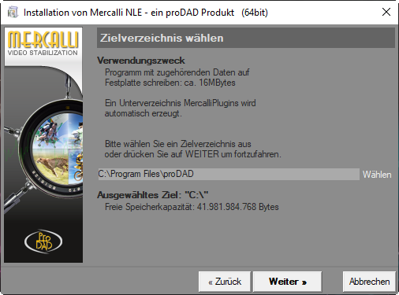

Im Plugin-Dialog müssen die Plugins für die unterstützen Videoberabeitungsprogramme markiert sein.

Folgen Sie nun den Installationsanweisungen. Nach Abschluß der Installation finden Sie **Mercalli Pro**, den **CMOS Fixr**, **Mercalli RT** und **Picture Enhanzr RT** als Plugin in Ihrem unterstützten Videobearbeitungsprogramm. Mercalli muss nun aktiviert werden, um es uneingeschränkt nutzen zu können.

## 4. Produktaktivierung + Registrierung

**Aktivierung Mercalli Pro, CMOS Fixr, Mercalli RT und Picture Enhanzr RT:**

Beim ersten Programmstart von Mercalli als Plugin in Ihrem Videobearbeitungsprogramm werden Sie zur Eingabe eines Aktivierungscodes (Seriennummer) aufgefordert, geben Sie den Code ein, den Sie bei elektronischer Lieferung mit der Download-Instructions-Email erhalten haben, oder falls Sie eine physische Lieferung (auf DVD) erhalten haben, innerhalb der Box vorfinden. Klicken Sie dann Unlock.

***WICHTIG:*** Beachten Sie das Ihr System im Moment der Aktivierung über eine Internetverbindung benötigt, nur dann kann die Aktivierung erfolgreich durchgeführt werden. Sollte ein Problem bestehen, dann prüfen Sie die Sicherheitseinstellungen (Firewall etc.) im System und wiederholen die Aktivierung.

Wenn Sie Mercalli im DEMO-Modus testen möchten, dann klicken Sie **Continue with Demo Version**. Die Demoversion ist solange aktiv, bis eine Seriennummerneingabe die Lizenz zur Vollversion wandelt.

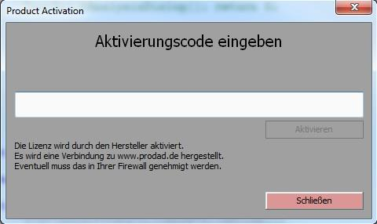

Siehe auch: 14.1. Produkt lässt sich nicht aktivieren

**Registrierung von Mercalli:**

Sie möchten Updates und weitere Informationen über Mercalli erhalten, dann registrieren Sie Ihr proDAD Mercalli unter http://www.prodad.de/register.html

## 5. Unterstützte Videoprogramme

Je nach erworbenem Paket unterstützt dies evtl. Videoschnittprogramme in Form von Plugins. Die Anwendung dieser Plugins sollen hier aufgezeigt werden.

 Die hier genannten Plugins stellen keinen Anspruch auf inhaltliche Vollständigkeit zum

installierten Mercalli-Produkt dar.

### 5.1. MAGIX

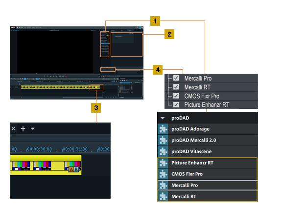

#### 5.1.1. Effekt anwenden:

Lokalisieren Sie die Videofilter  (im Register Effekt). Öffnen Sie den darin enthaltenen Ordner proDAD.

Wählen Sie den Video-Clip  in der Timeline aus und wenden den Effekt an.

#### 5.1.2. Anwendungsarten:

| Stabilisierung mit zuschaltbarer Rolling-Shutter Korrektur | CMOS Wobbel/Vibratio nen entfernen | Farbkorrektur mit Picture Enhanzr RT | Kombination von Effekten |
| --- | --- | --- | --- |
| Siehe: 6.1. Mercalli Pro Siehe: 7.1. Mercalli RT | Siehe: 8.1 CMOS Fixr | Siehe: 9.1. Picture Enhanzr RT | Siehe: z.B. 15.2. Kombination Mercalli Pro- CMOS Fixr |

#### 5.1.3. Mercalli Pro

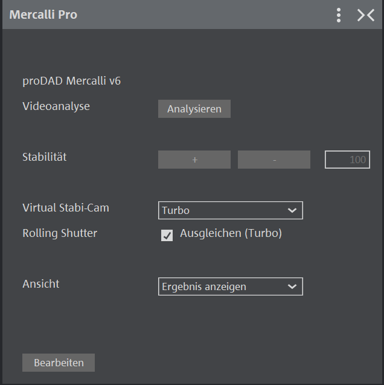

- Analysieren - Videoanalyse starten
- Stabilität + / -
- Virtual Stabi-Cam (Turbo, AI und AI+3D)
- Rolling Shutter / Ausgleichen (Turbo)
- Ansicht
- Bearbeiten - Erweiterte Einstellungen öffnen

#### 5.1.4. CMOS Fixr Pro

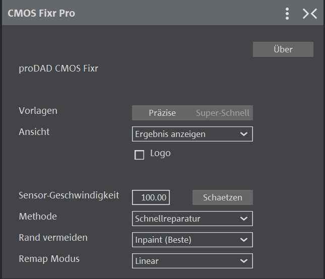

- Über
- Vorlagen
- Ansicht
- Logo
- Sensor-Geschwindigkeit
- Methode
- Rand vermeiden
- Remap Modus

#### 5.1.5. Mercalli RT

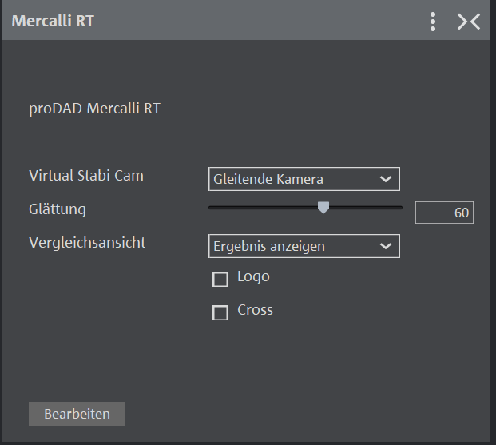

- Virtual Stabi-Cam
- Glättung
- Vergleichsansicht
- Logo
- Cross
- Bearbeiten - Erweiterte Einstellungen öffnen

#### 5.1.6. Picture Enhancr RT

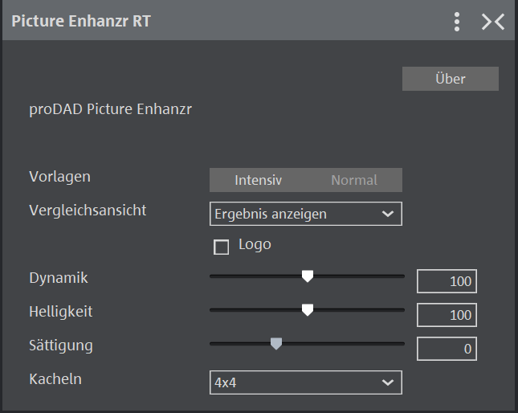

- Über
- Vorlagen
- Vergleichsansicht
- Logo
- Dynamik, Helligkeit und Sättigung
- Kacheln

#### 5.1.7. Wichtige Hinweise:

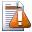 Mercalli Pro, Mercalli RT, CMOS Fixr und Pictur Enhancre RT unterstützen MAGIX Video

deluxe 2020 und MAGIX Video Pro X10 (und höher).

### 5.2. Adobe Premiere

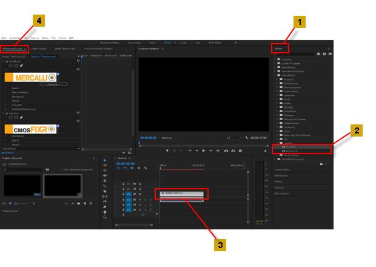

#### 5.2.1. Effekt anwenden:

 Lokalisieren Sie die Videoeffekte (im Register Effekte). Öffnen Sie den darin enthaltenen

Ordner proDAD.

 Ziehen Sie nun „Mercalli Pro“ oder „CMOS Fixr“ auf den oder die markierten Videoclips 

(via drag & drop).

#### 5.2.2. Anwendungsarten:

|  |  |
| --- | --- |
| Stabilisierung mit zuschaltbarer Rolling-Shutter Korrektur | 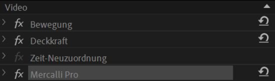 Siehe: 6.1. Mercalli Pro |
| CMOS Wobble/Vibrationen entfernen | 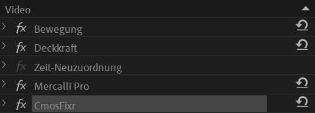 Siehe: 8.1. CMOS Fixr |
| Kombination beider Effekte |  Ist es notwendig den CMOS Fixr und Mercalli auf eine Szene anzuwenden, dann muss der CMOS Fixr zunächst auf das Video direkt angewendet werden. Anschließend erstellen Sie daraus eine Sequenz und auf diese Sequenz wenden Sie dann Mercalli an. 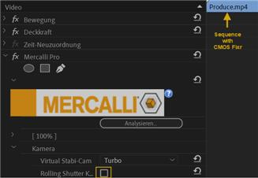 Siehe: 15.2. Kombination Mercalli Pro-CMOS Fixr |

#### 5.2.3. Effekt anpassen:

Selektieren Sie den Videoclip per Mausklick in der Timeline und wechseln in die

Effekteinstellungen  , hier finden Sie nun die Einstellungsmöglichkeiten für Mercalli und CMOS Fixr.

#### 5.2.4. CMOS Fixr – Einstellungen:

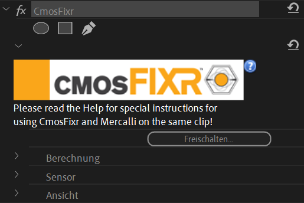

- Über: Information über das Plugin (siehe 10.)
- ?: Anleitung öffnen
- Freischalten: (siehe 4.)

##### 5.2.4.1. Berechnung:

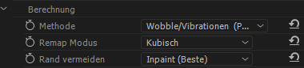

- Methode: (siehe 8.6.)
- Remap-Modus (siehe 8.8.)
- Rand vermeiden (siehe 8.7.)

##### 5.2.4.2. Sensor:

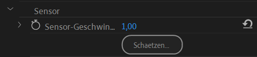

- Geschwindigkeit und Schätzen (siehe 8.5.)

##### 5.2.4.3. Ansicht:

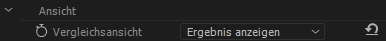

- Vergleichsansicht (siehe 8.3.)
- Logo (siehe 8.4.)

#### 5.2.5. Mercalli Pro – Einstellungen:

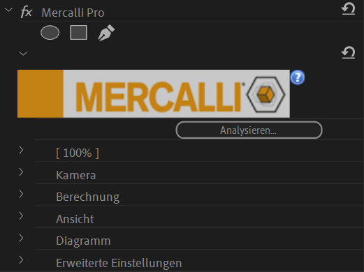

- Über: Information über das Plugin (siehe 10.)
- ?: Anleitung öffnen
- Freischalten: (siehe 4.)
- Analysieren: (siehe 6.6.)

##### 5.2.5.1. Stabilität:

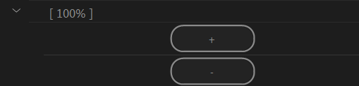

- Stabilität (siehe 6.7.)

##### 5.2.5.2. Kamera:

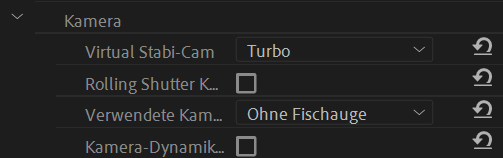

- Virtuelle Staby-Cam (siehe 6.3.)
- Rolling-Shutter Kompensation: (siehe 6.4.)
- Kameraoptik: (siehe 6.12.5.)
- Kamera-Dynamik erhalten: (siehe 6.5.)

##### 5.2.5.3. Berechnung:

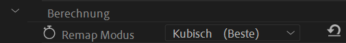

- Remap Modus: (siehe 6.10.)

##### 5.2.5.4. Ansicht:

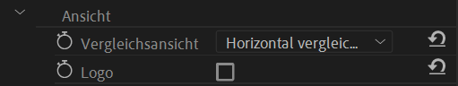

- Vergleichsansicht und Logo (siehe 6.8.)

##### 5.2.5.5. Diagramm:

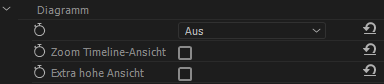

- Diagramm (siehe 6.9.)

##### 5.2.5.6. Erweiterte Einstellungen

- (siehe 6.12.)

###### 5.2.5.6.1. Bewegung:

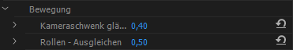

- (siehe 6.12.1.)

###### 5.2.5.6.2. Rand:

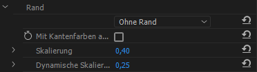

- (siehe 6.12.2.)

###### 5.2.5.6.3. Perspektive:

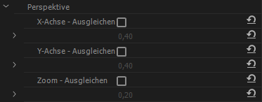

- (siehe 6.12.3.)

###### 5.2.5.6.4. Grafik:

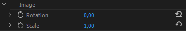

- (siehe 6.12.4.)

### 5.3. VEGAS Pro (OFX)

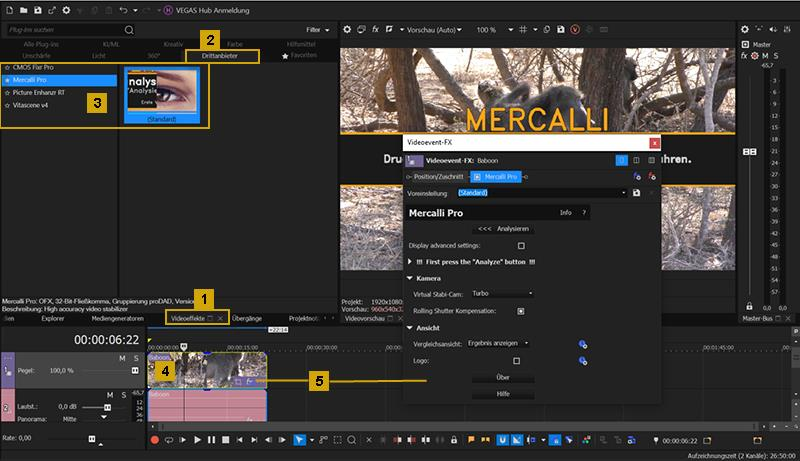

#### 5.3.1. Effekt anwenden:

 Lokalisieren Sie die Videoeffekte. Öffnen Sie dann den Ordner Drittanbieter  .

 Ziehen Sie nun **Mercalli Pro, CMOS Fixr Pro** oder **Picture Enhanzr RT** auf den oder die

markierten Videoclips  (via drag & drop).

#### 5.3.2. Anwendungsarten:

|  |  |
| --- | --- |
| Stabilisierung mit zuschaltbarer Rolling-Shutter Korrektur | 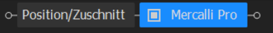 Siehe: 6.1. Mercalli Pro |
| CMOS Wobble/Vibrationen entfernen | 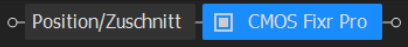 Siehe: 8.1. CMOS Fixr |
| Kombination beider Effekte | 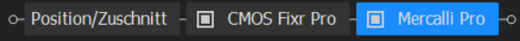 Siehe: 15.2. Kombination Mercalli Pro-CMOS Fixr |
| Farbverstärker | 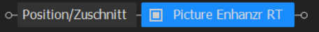 Siehe: 9.1. Picture Enhanzr RT |

#### 5.3.3. Effekt anpassen:

 Ein Klick auf das Symbol öffnet die Effekteinstellungen.

#### 5.3.4. CMOS Fixr – Einstellungen:

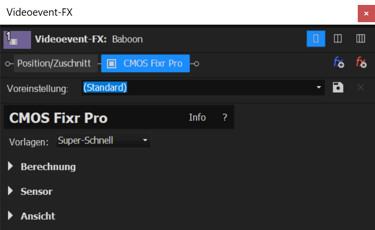

- Über: Information über das Plugin (Siehe 10.)
- ?: Anleitung öffnen
- Freischalten: (Siehe 4.)

##### 5.3.4.1. Vorlagen:

- Vorlagen: (Siehe 8.2.)

##### 5.3.4.2. Berechnung:

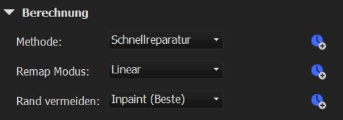

- Methode: (Siehe 8.6.)
- Remap-Modus (Siehe 8.8.)
- Rand vermeiden (Siehe 8.7.)

##### 5.3.4.3. Sensor:

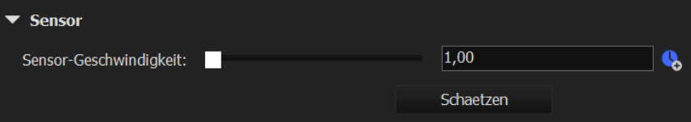

- Geschwindigkeit und Schätzen (Siehe 8.5.)

##### 5.3.4.4. Ansicht:

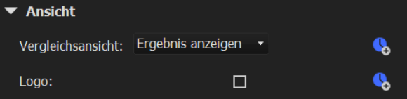

- Vergleichsansicht (Siehe 8.3.)
- Logo (Siehe 8.4.)

#### 5.3.5. Mercalli Pro – Einstellungen:

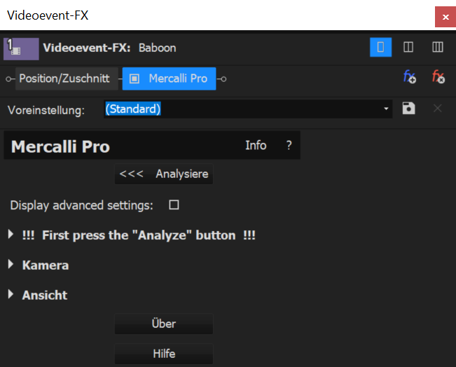

- Über: Information über das Plugin (Siehe 10.)
- ?: Anleitung öffnen
- Freischalten: (Siehe 4.)
- Analysieren: (Siehe 6.6.)

##### 5.3.5.1. Stabilität:

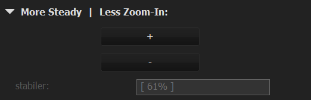

- Stabilität (Siehe 6.7.)

##### 5.3.5.2. Kamera:

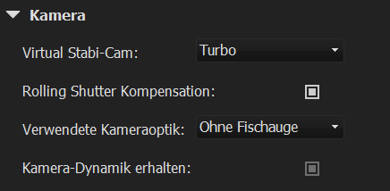

- Virtuelle Staby-Cam (siehe 6.3.)
- Rolling-Shutter Kompensation: (siehe 6.4.)
- Kameraoptik: (siehe 6.6.)
- Kamera-Dynamik erhalten: (siehe 6.5.)

##### 5.3.5.3. Ansicht:

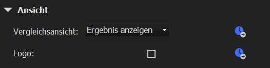

- Vergleichsansicht und Logo (Siehe 6.8.)

##### 5.3.5.4. Erweiterte Einstellungen

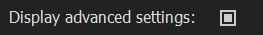

- (Siehe 6.12.)

###### 5.3.5.4.1. Kameraschwenk glätten:

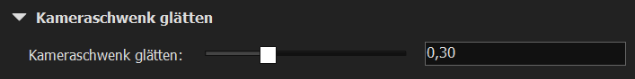

- Kameraschwenk glätten (Siehe 6.12.1.1.)

###### 5.3.5.4.2. Rollen Ausgleichen:

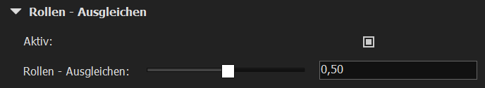

- Rollen Ausgleichen (Siehe 6.12.1.2.)

###### 5.3.5.4.3. Rand:

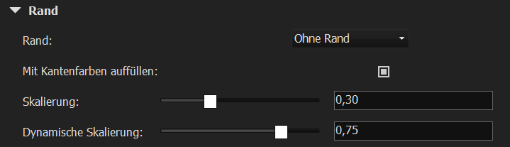

- Rand-Einstellungen (Siehe 6.12.2.)
- Mit Kantenfarben ausfüllen (Siehe 6.12.2.2.)
- Skalierung (Siehe 6.12.2.3.)
- Dynamische Skalierung (Siehe 6.12.2.4.)

###### 5.3.5.4.4. X/Y Achse Ausgleichen - Zoom Ausgleichen:

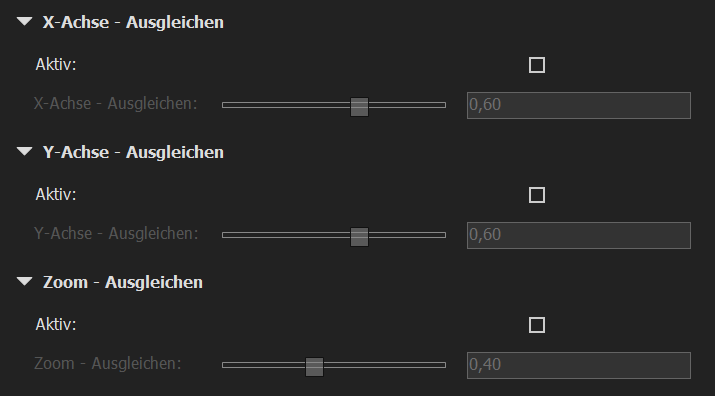

- X/Y Achse Ausgleichen und Zoom Ausgleichen (Siehe 6.12.3.)

###### 5.3.5.4.5. Berechnung:

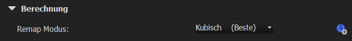

- Remap Modus: (Siehe 6.10.)

###### 5.3.5.4.6. Diagramm:

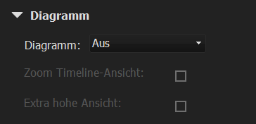

- Diagramme (Siehe 6.9.)

###### 5.3.5.4.7. Grafik:

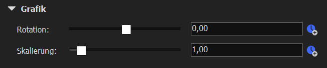

- Grafik (Siehe 6.12.4.)

###### 5.3.5.4.8. Video:

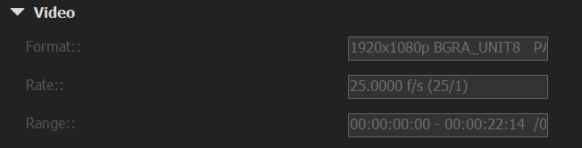

- Video (Siehe 6.12.6.)

#### 5.3.6. Picture Enhanzr RT– Einstellungen:

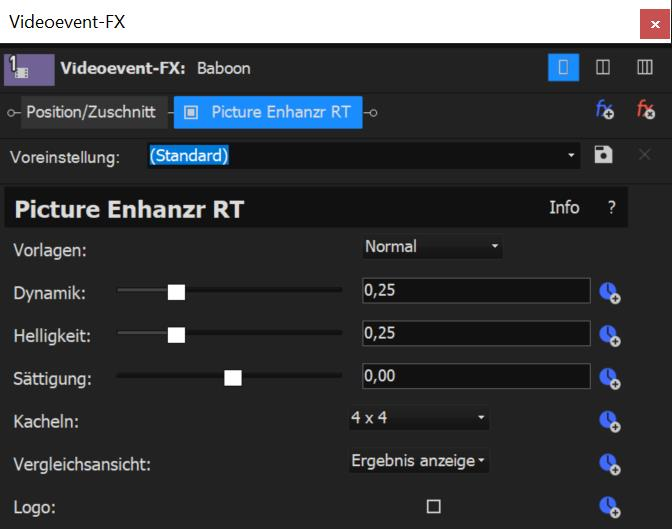

- Über: Information über das Plugin (Siehe 10.)
- ?: Anleitung öffnen
- Freischalten: (Siehe 4.)
- Siehe 9.1. Picture Enhanzr RT

### 5.4. Davinci Resolve (OFX)

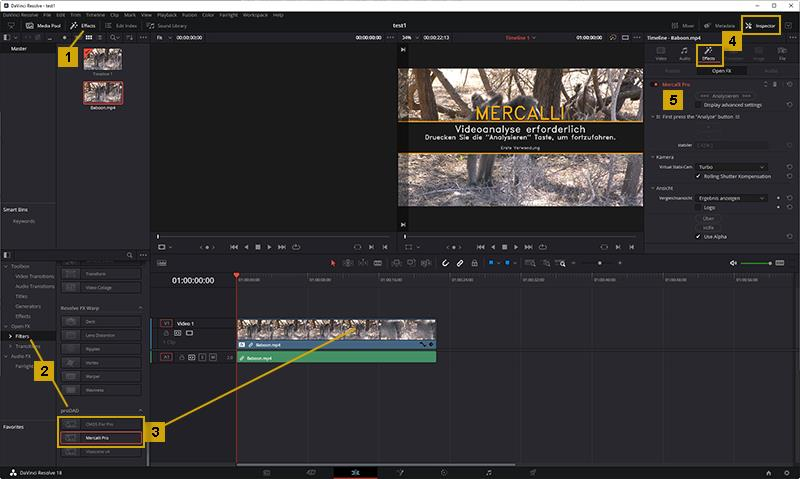

#### 5.4.1. Effekt anwenden:

Lokalisieren Sie **Effects**  . Klicken Sie dann in **Effects** auf **Filters**.

In **Filters** finden Sie den Ordner **proDAD**  .

Den darin enthaltenen Eintrag **Mercalli Pro** oder **CMOS Fixr**  ziehen Sie nun auf den markierten Videoclip (via drag & drop) in der Timeline von Davinci Resolve. Klicken Sie jetzt auf

**Inspector/Effects**  .

Hier wird der **Mercalli Pro** oder **CMOS Fixr Einstellungsdialog**  angezeigt. Treffen Sie nun Ihre Einstellungen.

#### 5.4.2. Anwendungsarten:

|  |  |
| --- | --- |
| Stabilisierung mit zuschaltbarer Rolling- Shutter Korrektur |  Siehe: 6.1. Mercalli Pro |
| CMOS Wobble/Vibrationen entfernen |  Siehe: 8.1. CMOS Fixr Pro |
| Kombination beider Effekte |  Siehe: 15.2. Kombination Mercalli Pro-CMOS Fixr Pro |

#### 5.4.3. CMOS Fixr Pro – Einstellungen:

- Anleitung öffnen
- Freischalten: (Siehe 4.)

##### 5.4.3.1. Vorlagen:

- Vorlagen: (Siehe 8.2.)

##### 5.4.3.2. Berechnung:

- Methode: (Siehe 8.6.)
- Remap-Modus (Siehe 8.8.)
- Rand vermeiden (Siehe 8.7.)

##### 5.4.3.3. Sensor:

- Sensor-Geschwindigkeit und Schätzen (Siehe 8.5.)

##### 5.4.3.4. Ansicht:

- Vergleichsansicht (Siehe 8.3.)
- Logo (Siehe 8.4.)

#### 5.4.4. Mercalli Pro – Einstellungen:

- Freischalten: (Siehe 4.)
- Analysieren: (Siehe 6.6.)
- Über: Information über das Plugin (Siehe 10.)
- Hilfe: Anleitung öffnen

##### 5.4.4.1. Stabilität:

- Stabilität: (Siehe 6.7.)

##### 5.4.4.2. Kamera:

- Virtuelle Staby-Cam (Siehe 6.3.)
- Rolling-Shutter Kompensation: (Siehe 6.4.)
- Verwendete Kameraoptik: (siehe 6.12.5.)
- Kamera-Dynamik erhalten: (siehe 6.5.)

##### 5.4.4.3. Ansicht:

- Vergleichsansicht und Logo (Siehe 6.8.)

##### 5.4.4.4. Erweiterte Einstellungen:

- Siehe 6.12.

###### 5.4.4.4.1. Kameraschwenk glätten

- Kameraschwenk glätten (Siehe 6.1.12.1.)

###### 5.4.4.4.2. Rollen - Ausgleichen:

- Rollen - Ausgleichen (Siehe 6.1.12.2.)

###### 5.4.4.4.3. Rand:

- Rand-Einstellungen (Siehe 6.12.2.)
- Mit Kantenfarben ausfüllen (Siehe 6.12.2.2.)
- Skalierung (Siehe 6.12.2.3.)
- Dynamische Skalierung (Siehe 6.12.2.4.)

###### 5.4.4.4.4. X/Y Achse - Ausgleichen und Zoom - Ausgleichen:

- X/Y Achse - Ausgleichen und Zoom - Ausgleichen (Siehe 6.12.3.)

###### 5.4.4.4.5. Berechnung:

- Remap Modus: (Siehe 6.10.)

###### 5.4.4.4.6. Diagramm:

- Diagramme (Siehe 6.9.)

###### 5.4.4.4.7. Grafik:

- Grafik (Siehe 6.12.4.)

###### 5.4.4.4.8. Video:

- Video (Siehe 6.12.6.)

### 5.5. Corel Video Studio

**Vorgehensweise:**

1. Lokalisieren Sie **FX**  .
2. Klicken Sie dann in **FX** auf **proDAD**  .
3. Den darin enthaltenen Eintrag **Mercalli Pro, Mercalli RT** oder **Picture Enhanzr RT**  ziehen Sie nun auf den Videoclip (via drag & drop) in der Timeline von Corel Video Studio.
4. Aktivieren Sie nun Ihren Clip in der Timeline durch **Doppelklick**  .

5. Im Tab **Effekt** erscheint der Button **Filter anpassen**  **,** klicken Sie auf diesen und der Mercalli Pro Einstellungsdialog startet, treffen Sie hier Ihre Einstellungen.

Siehe: 6.1 Mercalli Pro\
Siehe: 7.1 Mercalli RT\
Siehe: 9.1 Picture Enhanzr RT

## 6. Mercalli Pro

### 6.1. Mercalli Pro Überblick

einfacher Modus

erweiterter Modus

### 6.2. Aufbau + Grundfunktionen

**Zurücksetzen:**\
Stellt den Grundzustand her, in dem alle Optionen zurückgesetzt werden.\
Es werden die vom Hersteller festgelegten Werte verwendet, die als optimaler Kompromiss aus Rechenaufwand und Qualität festgelegt worden sind.

**Rückgängig**:\
Macht alle Änderungen bis zum Zeitpunkt des Öffnens des Fensters rückgängig.

### 6.3. Kamera

**Methoden zur Glättung der Kamerabewegungen** 

Mit Hilfe verschiedener Methoden zur Glättung der Kamerabewegungen können Sie Ihr verwackeltes Video analysieren und korrigieren lassen. Wählen Sie dazu eine geeignete **Methode** (voreingestellt ist die Methode **Turbo**) aus.

1. **Turbo**, diese Methode ermöglicht eine schnelle und sehr robuste Videoanalyse mit guten bis sehr guten Ergebnissen.
2. **AI** ermöglicht eine Videoanalyse, die von künstlicher Intelligenz unterstützt wird. Bei schwierigen Szenen/Videos werden so oft bessere Resultate erzielt.
3. **AI+3D**, hiermit wird zusätzlich auch das Kippen der Kamera analysiert, so werden störende perspektivische Effekte reduziert.

### 6.4. Rolling-Shutter Kompensation

**Aktivierung der Rolling-Shutter Kompensation**

Mit der Aktivierung der Option **Rolling-Shutter Korrektur**  wird eine mögliche Verzerrung (nur bei CMOS), die bei bewegten Bildern (Video) auftreten kann, ausgeglichen. Standardmäßig ist die Option **Rolling-Shutter Korrektur** aktiviert.

Der **Rolling-Shutter-Effekt** ist ein unerwünschter Nebeneffekt der sogenannten CMOS-Sensoren, die verstärkt in digitalen Spiegelreflexkameras (DSLRs), Pocket-Cams, Mobilfunkgeräten oder in Action-Cams im Einsatz sind.

Solange eine Aufnahme nicht stabilisiert wurde, ist der Rolling-Shutter-Effekt nicht oder nur dezent auffällig. Sobald aber eine Stabilisierung in der Post-Production erfolgreich war, verbleibt der Rolling-Shutter Effekt und wirkt nun dezent bis deutlich störend.\
Deshalb wirkt Mercalli Pro auch diesem unerwünschten Effekt auf Wunsch entgegen – denn eine stabilisierte Aufnahme bleibt erst einmal wertlos, wenn der unerwünschte Folgeeffekt das Ergebnis wiederum zunichte macht.

 Vibrationen/Wobbel benötigen eine erweiterte CMOS-Korrektur im CMOS Fixr.

Siehe auch: Kombination CMOS Fixr + Mercalli Pro

### 6.5. Kamera-Dynamik erhalten

Mit Hilfe der Option **Kamera-Dynamik erhalten**  soll die Lebendigkeit im Video beibehalten bleiben, d.h. evt. gewollte Kamerabewegungen des Filmers sollen nicht geglättet oder stabilisiert werden.

Sollte aus einer normal aus der Hand gefilmten verwackelten Kamera-Aufnahme diese als **Stativ-****Aufnahme** stabilisiert werden, dann sollte die Option **Kamera-Dynamik erhalten** deaktiviert werden.

### 6.6. Videoanalyse

Die **Videoanalyse**  ist für die Korrektur/Glättung der Kamerabewegungen notwendig. Nach Abschluss der Videoanalyse ist das Video stabilisiert, Sie können jedoch weitere Detaileinstellungen bzw. Optimierungen vornehmen.

### 6.7. Stabilität +/-

 Die Option **Stabilität +/-** kann durch stärkeres Heranzoomen die Stabilisierung verbessern.

 Verwendet die ausgewählte Stabilität ohne weitere Änderungen. Sämtliche manuell

durchgeführten Änderungen werden verworfen.

### 6.8. Ansicht

Es stehen im Menü **Ansicht**  verschiedene Optionen zur Darstellung der Videovorschau zur Verfügung.

1. Ergebnis anzeigen (zeigt das stabilisierte Video in der Vorschau an)
2. Horizontal vergleichen (Gegenüberstellung Original / Stabilisiert im horizontalen Splitscreen)
3. Vertikal vergleichen (Gegenüberstellung Original / Stabilisiert im vertikalen Splitscreen)
4. Original anzeigen (zeigt das Original-Video in der Vorschau an)

Es besteht auch die Möglickeit ein **Logo** im Video einzublenden, das eignet sich besonders bei einer Videogegeüberstellung Vorher/Nacher.

### 6.9. Diagramme

Mercalli Pro ermöglicht das **Hinzuschalten** von verschiedenen **Diagrammen**  , die die Stabilisierung symbolisieren. Das jeweilig gewünschte Diagramm wählen Sie im Menu Ansicht/Diagramme aus. Angezeigt werden die Diagramme in der Vorschau des jeweilig verwendeten Videobearbeitungsprogramms.

#### 6.9.1. Schwenk:

Im Diagramm **Schwenk** wird die Bewegung im Video bzgl. der Verschiebungen in **X-Y-Richtung** (horizontal/vertikal) angezeigt. Mit dem Schieber **Kameraschwenk glätten** gleichen Sie die Gesamtbewegungen im Video aus. Wird der Schieber weiter nach rechts verschoben,\
so stabilisiert Mercalli mehr, das Video wirkt ruhiger. Der Schieber **Kameraschwenk glätten** bewirkt die größte visuelle Veränderung (Glättung der Bewegungen im Video). Auch im Diagramm **Schwenk** sind Veränderungen in der Korrektur-Kurve sichtbar.

#### 6.9.2. Rollen:

Im Diagramm **Rollen** wird die Bewegung im Video bzgl. der Rotation um die **Z-Achse** angezeigt.

#### 6.9.3. Zoom:

Im Diagramm **Zoom** wird die Bewegung im Video bzgl. des **Zooms** angezeigt. Wird der Schieber **Zoom - Ausgleichen** weiter nach rechts verschoben, so wird der Zoom auf mehrere Bilder verteilt, es entsteht ein harmonischer Zoom.

#### 6.9.4. CMOS Sensor:

Die vollautomatische **CMOS-Korrektur** beseitigt CMOS-Sensor bedingte Schwächen im Nachhinein. Die grüne Kurve zeigt die Korrektur (Entgegenwirken) durch Mercalli an, die orange Kurve zeigt den Restfehler (nicht korrigierbar) an.

#### 6.9.5. X/Y-Achse:

Im Diagramm **X/Y-Achse** wird die Bewegung im Video bzgl. Kippen um die **X/Y-Achse** angezeigt. Die Korrektur und die Anzeige im Diagramm ist abhängig von der Position der Schieber **X/Y-Achse - Ausgleichen**. Verschieben Sie die Schieber **X/Y-Achse**, so wird die Korrektur bezogen auf die Rotation um die X/Y-Achse verändert. Im Diagramm wird die Veränderung in Kurvenform sichtbar.

#### 6.9.6. Dynamische Skalierung:

Ein hoher Dyn-Scale Wert (**Dynamische Skalierung** in den erweiterten Einstellungen **Rand**) reduziert Zoom-In-Bedarf. Das wird durch einen schnellen Wechsel des Zooms erzielt.

 Je nach Position des Schiebers **Dynamische Skalierung** variiert auch der Zoom-Bedarf pro

Zeitposition. Der Maximalwert ist immer konstant, der Minimalwert kann jedoch bei einer höheren Dynamik sinken (muss jedoch nicht).

### 6.10. Remap Modus

Unter **Remap Modus**  wird die Art der Pixelberechnung festgelegt:

- **Kubisch:** Ermöglicht eine höhere Qualität an Kanten und Ecken. Im Vergleich zu Linear behält das Bild seine Schärfe. Dieser Modus benötigt einen höheren Rechenauwand.
- **Linear:** Ist die normale Art und ein guter Mittelweg zwischen Qualität und Rechenaufwand.
- **Nächster:** Ist die schnellste Art, die jedoch keine Sub-Pixel berücksichtigt.

### 6.11. Info-Text

Hier wird der aktuelle Status  angezeigt.

### 6.12. Erweiterte Einstellungen

Im unteren Bereich des Mercalli Pro Dialoges steht Ihnen die Option  zum Öffnen der erweiterten Einstellungen  zur Verfügung.

#### 6.12.1. Bewegung

##### 6.12.1.1. Kameraschwenk glätten

Mit dem Schieber **Kameraschwenk glätten** gleichen Sie die Gesamtbewegungen im Video aus. Wird der Schieber weiter nach rechts bewegt, so stabilisiert Mercalli mehr, das Video wirkt ruhiger.

Der Schieber **Kameraschwenk glätten** bewirkt die größte visuelle Veränderung (Glättung der Bewegung im Video).\
Auch im Diagramm **Schwenk** sind Veränderungen in der Korrektur-Kurve sichtbar.

##### 6.12.1.2. Rollen-Ausgleichen

Der Schieber **Rollen - Ausgleichen** bewirkt eine Korrektur des Videos bzgl. der Bewegungen (Rotation) um die **Z-Achse**. Im Diagramm **Rollen** sind Veränderungen in der Korrektur-Kurve sichtbar.

Der Schieber **Rollen - Ausgleichen** kann auch deaktiviert werden, aber nur wenn zuvor der Schieber **Zoom glätten** deaktiviert wurde. Klicken Sie einfach auf das Häkchen, dann erfolgt im Video keine Korrektur der **Rollbewegung (Z-Achse)**.

Der Schieber **Rollen - Ausgleichen** wird z.B. deaktiviert, wenn Rollbewegungen von Mercalli nicht ausgewertet werden können, bzw. wenn nur Schwenks stabilisiert werden sollen.

#### 6.12.2. Rand

##### 6.12.2.1. Rand

Durch den **Ausgleich der Bewegungen** entstehen rechnerisch bedingte Ränder.

Erfolgt z.B. ein Ausgleich der Bewegung des Bildes um 10 Pixel nach Links, um eine ursprünglich nach rechts verursachte Verwacklung wieder auszugleichen, entsteht im Bild auf der rechten Seite ein Rand, oder genauer gesagt eine Lücke an Informationen. Dies ist üblicherweise als Leerinhalt, oder schwarze Bildbereiche zu erkennen. An dieser Stelle kann nun nach Wunsch des Anwenders entschieden werden, wie die Randberechnung zu erfolgen hat.

In Mercalli stehen verschiedene **Rand-Optionen** zur Verfügung.

**a.** Bei Auswahl der Option **Ohne Rand** erscheint im stabilisierten Video kein Rand. Der Rand wird eliminiert, indem in das Video rein gezoomt wird. Dies erfolgt in Abhängigkeit der Verwacklungen und der gewünschten Stärke der Korrektur und der damit verbunden Einstellung mit dem Schieber **Skalierung**.

Weitere Hinweise zum Thema **Ränder** (Randbearbeitung) können Sie in den FAQs im Supportbereich auf www.prodad.com finden.

**b.** Bei Auswahl der Option **Beste Stabilisierung** erscheint u.U. im stabilisierten Video ein schwarzer Rand. Dieser kann von Bild zu Bild unterschiedlich sein, je nach Stärke der Verwacklung in der aktuellen Situation.

Dieser Rand kann jedoch durch die Option **Mit Kantenfarben auffüllen** mit Bildinhalt aufgefüllt werden.

***Hinweis:***\
Sollten dadurch störende Seiteneffekte im mit Bildinhalt ersetzten Rand sichtbar werden (siehe am Tor links oben), dann deaktivieren Sie die Option **Mit Kantenfarben auffüllen** wieder.

Mit dem Schieber **Skalierung** kann in das Video gezoomt werden, der Rand wird weiter minimiert.\
Zu starker Zoom-In kann eine Unschärfe (Blur, grobkörniges Bild etc.) im Video auslösen.

**c.** In der **Forensische Ansicht** erfolgt die Anzeige in einem ausgezoomten Zustand und ohne Begrenzungen. Durch das rein zoomen in eine Szene kann die erfolgte Korrektur von Mercalli besser beurteilt werden. Der Schieber **Skalierung** unterstützt Sie beim Zoom IN/OUT.

##### 6.12.2.2. Mit Kantenfarbe ausfüllen

Mit der Option **Mit Kantenfarben auffüllen** weisen Sie einem vorhandenen schwarzen Rand im Video **Bildinhalt** hinzu.

 Sollten dadurch störende Seiteneffekte im mit Bildinhalt ersetzten Rand sichtbar werden (siehe am Tor links oben), dann deaktivieren Sie die Option **Mit Kantenfarben auffüllen** wieder.

Siehe auch: 16.1.10.

##### 6.12.2.3. Skalierung

Die Option **Skalierung** bewirkt eine Zoomfunktion im Video, um mögliche Ränder unsichtbar zu machen.

##### 6.12.2.4. Dynamische Skalierung

Die Cyan-farbige Linie zeigt den verwendeten Zoom-In an der entsprechenden Zeitposition im Diagramm.\
Ein hoher Dyn-Scale Wert (**Dynamische Skalierung**) reduziert den Zoom-In-Bedarf. Das wird durch einen schnellen Wechsel des Zooms erzielt.

 Je nach Position des Schiebers **Dynamische Skalierung** variiert auch der Zoom-Bedarf pro Zeitposition. Der Maximalwert ist immer konstant, der Minimalwert kann jedoch bei einer höheren

Dynamik sinken (muss jedoch nicht).

Siehe auch: 16.1.12.

#### 6.12.3. Perspektive

##### 6.12.3.1. X/Y-Achse - Ausgleichen

Der Schieber **X-Achse - Ausgleichen** bewirkt die Korrektur des Videos bzgl. der Bewegungen (Rotation) um die **X-Achse** (Neigebewegung der Kamera in X-Richtung). Im Diagramm **X/Y-****Achse** dargestellt durch die **cyan**-farbige Kurve. Verschieben Sie den Schieber **X-Achse - Ausgleichen**, so wird die Korrektur bezogen auf die Rotation um die **X-Achse** verändert. Im Diagramm wird die Veränderung in der **cyan**-farbigen Kurve sichtbar.

Der Schieber **Y-Achse - Ausgleichen** bewirkt die Korrektur des Videos bzgl. der Bewegungen (Rotation) um die **Y-Achse** (Neigebewegung der Kamera in Y-Richtung). Im Diagramm **X/Y-****Achse** dargestellt durch die **magenta**-farbige Kurve. Verschieben Sie den Schieber **Y-Achse - Ausgleichen**, so wird die Korrektur bezogen auf die Rotation um die **Y-Achse** verändert. Im Diagramm wird die Veränderung in der **magenta**-farbigen Kurve sichtbar.

Siehe auch: 16.1.17.

##### 6.12.3.2. Zoom-Ausgleichen

Mit dem Schieber **Zoom - Ausgleichen** erfolgt eine Glättung der **Zoom-Bewegung** im Video.

Verschieben Sie den Schieber weiter nach rechts, so führt das zu einer stärkeren Glättung von Zoom-Veränderungen. Vorhandene Verwacklungen im Zoom werden somit ausgeglichen. Im Diagramm **Zoom-Korrekturen** sind Veränderungen in der Zoom-Korrektur-Kurve sichtbar. Der Schieber **Zoom - Ausgleichen** kann auch deaktiviert werden. Klicken Sie einfach auf das Häkchen. Dann erfolgt im Video keine **Zoom-Korrektur**.

#### 6.12.4. Grafik

##### 6.12.4.1. Rotation

Der Schieber **Rotation** bewirkt die Drehung des Videos in Uhrzeigersinn und gegen den Uhrzeigersinn, diese Funktion ist nützlich wenn Sie die Kamera beim Filmen nicht exakt gerade gehalten haben und jetzt eine Korrektur vornehmen möchten.

##### 6.12.4.2. Skalierung

Der Schieber **Skalierung** ermöglicht eine Verkleinerung bzw. Vergrößerung des Bildauschnitts im Video.

#### 6.12.5. Verwendete Kameraoptik

Um die beste **Stabilisierungsqualität** zu erzielen, wählen Sie in diesem Menü Ihren **Kameratyp** aus. So erkennt der Mercalli Pro die **Kamera-Optik**.

Siehe auch: 16.2.

#### 6.12.6. Video

##### 6.12.6.1. Info zum Video

Hier werden Ihnen Informationen zum aktuellen Video (Format, Rate und Bereich) angezeigt.

### 6.13. Overlay Hinweise

Siehe 12. Overlay-Hinweise:

## 7. Mercalli RT

### 7.1. Mercalli RT Überblick

einfacher Modus

erweiterter Modus

### 7.2. Kamera (Stabi Cam) und Stabilisierungsfaktor einstellen

**Die Anwendung der virtuellen Kamera (Stabi-Cams)**

In **Mercalli RT** stehen Ihnen verschiedene Staby Cams im Menü **Kamera**  zur Anwendung bereit, die je nach Verwacklungserscheinung ihren Einsatz finden.

**Sportliche Kamera:**\
Die virtuelle Kamera folgt den schnellen Bewegungen der realen Kamera und entfernt bzw. reduziert ruckartige bzw. zitternde Bewegungen im Video, siehe auch Anmerkung (2)

**Gleitende Kamera:**\
Die virtuelle Kamera folgt **soft** den Bewegungen der realen Kamera und entfernt dabei ruckartige bzw. zitternde Bewegungen im Video, siehe auch Anmerkung (2)

**Schwebestativ:**\
Die virtuelle Kamera folgt **stark verzögert** den Bewegungen der realen Kamera, so dass nur die Bewegungsabsicht erhalten bleibt, siehe auch Anmerkung (1) und (2)

**Sci Kamera:**\
Vergleichbare Stabilisierung zur Staby Cam **Schwebestativ**, ohne Korrekturbegrenzung und ohne Rand-Füllung. Sie dient der aggressiven Stabilisierung ohne Begrenzungen und Einschränkungen.

**Fixierte Kamera:**\
Die virtuelle Kamera steht fest, **ohne** den Bewegungen der realen Kamera zu folgen. In einigen Fällen ist es ratsam den Schieber **Glättung** < 100% zu setzen, um ein „herauslaufen“ des Bildes zu verhindern, siehe auch Anmerkung: (1) und (2)

**Anmerkungen:**\
**(1)**: Die Option **Rolling-Shutter Korrektur** ist nicht wählbar, weil der Algorithmus immer wobbel-artige Bewegungen reduziert.

**(2)**: Die sichtbare Wirkung der Stabilisierung wird in Grenzsituationen durch definierbare Optionen begrenzt und somit geschwächt, siehe auch **Max. akzeptierter Bildrand** und **Skalierung** bzw. **dynamische Skalierung**.

Der Schieber **Glättung** bestimmt den Grad der Stabilisierung, bewegen Sie ihn nach rechts so erfolgt eine stärkere Stabilisierung, die aber auch einen höheren Zoom-In zur Folge haben kann.

### 7.3. Score - Stabilität und Echtzeitfähigkeit

Hier werden die Stabilität im Video sowie die Echtzeitfähigkeit bezgl. der vorgenommenen Einstellungen in Mercalli RT angezeigt.

### 7.4. Ansicht - Diagnose

Es stehen im Menü **Ansicht**  verschiedene Optionen zur Darstellung der Videovorschau zur Verfügung.

1. Ergebnis anzeigen (zeigt das stabilisierte Video in der Vorschau an)
2. Horizontal vergleichen (Gegenüberstellung Original / Stabilisiert im horizontalen Splitscreen)
3. Vertikal vergleichen (Gegenüberstellung Original / Stabilisiert im vertikalen Splitscreen)

Es besteht auch die Möglichkeit ein **Logo** im Video einzublenden, das eignet sich besonders bei einer Videogegenüberstellung Vorher/Nacher.

**Diagnose:**

Gescannte Kameraübergänge

Gescannte Kamerarotationen

Zoom-In (Skalierung)

\- gewünschter Zoom - verwendeter Zoom inkl. dynamischer Zoom

\- Horizontale Bewegung - Rotation - Vertikale Bewegung

Korrigierte Bildverschiebung

Korrigierte Rotation

Leistung

Scan-Genauigkeit

\- Rotation - Horizontale Bewegung - Nicht korrigierbare - Vertikale Bewegung Bildbewegung - Nicht korrigierbare Bildbewegung

\- Zeitlimit für Echtzeit - Analyseprozesszeit - Render-Prozesszeit

\- Gescannte Bildinformationen - Intensiv-/Tiefenscan - Interpretationsfehler

**Kreuz:** Rote Balken signalisieren nötige Korrekturen, die durch die aktuellen Einstellungen nicht erlaubt sind. Siehe auch: **Skalierung** und **Maximal akzeptierter Bildrand**.

**Grenzen:** Die aus den aktuellen Einstellungen resultierende maximal mögliche Bildverschiebung wird eingeblendet. Weiterhin werden die echten Bildränder eingeblendet, die ohne **Inhalt bewusst füllen** immer vorhanden sind. Mittels dieser Grenzen lassen sich synthetisch gefüllte Bildinhalte von echten Inhalten unterscheiden.

### 7.5. Remap Modus

Unter **Remap Modus**  wird die Art der Pixelberechnung festgelegt:

- **Kubisch:** Ermöglicht eine höhere Qualität an Kanten und Ecken. Im Vergleich zu Linear behält das Bild sein Schärfe. Dieser Modus benötigt einen höheren Rechenauwand.
- **Linear:** Ist die normale Art und ein guter Mittelweg zwischen Qualität und Rechenaufwand.
- **Nächster:** Ist die schnellste Art, die jedoch keine Sub-Pixel berücksichtigt.

### 7.6. Rand

Im Menü **Rand**  stehen Ihnen verschiedene Methoden zum Füllen von möglichen Rändern im Video zur Verfügung.

### 7.7. Skalierung

Mit dem Schieber **Skalierung**  legen Sie den Basis-Skalierungsgrad (Zoom-In) fest. Dieser gewählte Wert wird auch durch andere Einstellungen nie unterschritten. Höhere Werte verbessern die Stabilisierung.

### 7.8. Rolling-Shutter Korrektur

Mit der Aktivierung der Option **Rolling-Shutter Korrektur**  wird eine mögliche Verzerrung (nur bei CMOS), die bei bewegten Bildern (Video) auftreten kann, ausgeglichen. Der **Rolling-****Shutter-Effekt** ist ein unerwünschter Nebeneffekt der sogenannten CMOS-Sensoren, die verstärkt in digitalen Spiegelreflexkameras (DSLRs), Pocket-Cams, Mobilfunkgeräten oder in Action-Cams im Einsatz sind.

Standardmäßig ist die Option **Rolling-Shutter Korrektur** aktiviert. Dann werden Wobbel CMOS-Verzerrungen entfernt bzw. reduziert.

 Die **Sensor-Geschwindigkeit** muss zur eingesetzten Kamera oder Action-Cam passen.

Verwenden Sie eine Kamera ohne CMOS-Sensor, dann **MUSS** die Option **Rolling-Shutter Korrektur** deaktiviert werden.

Die **Sensor-Geschwindigkeit** ist wählbar zwischen 100% - 10000%, sie hängt aber ab vom CMOS-Sensor und der Frame-Rate. In der Regel arbeiten heutige Consumer-Kameras mit Werten zwischen 100% - 200%.

 **Mercalli RT** ermittelt diesen Wert vollautomatisch. Eventuell kann auch der CMOS Fixr zur Wertfindung eingesetzt werden.

 Vibrationen/Wobbel benötigen eine erweiterte CMOS-Korrektur im **CMOS Fixr**.

Siehe auch **Kombination CMOS Fixr + Mercalli Pro**

### 7.9. Dynamische Skalierung

Ist die **Dynamische Skalierung**  aktiviert, dann wird während der Stabilisierung die Stärke der Skalierung automatisch variiert. Bei stark verwackleten Videos wird stärker und bei eher ruhigen Videos weniger stark ins Bild gezoomt.

Die **Latenzzeit** legt die Trägheit für die **dynamische Skalierung** fest. Wählen Sie hier größere Werte aus, dann bedeutet das langsamere Änderungen der Skalisierung.

Die **Max. Skalierung** regelt die maximal zulässige Skalierung der Dynamik. Höhere Werte verbessern die Stabilisierung.

### 7.10. Maximal akzeptierter Bildrand

Hier wird in Bezug auf die Bildgröße festgelegt, wie groß mögliche Ränder  im bearbeiteten Video werden dürfen. Über das Menü **Rand** können verschiedene Füllmethoden für diese Bereiche ausgewählt werden. Höhere Einstellungswerte verbessern die Stabilisierung.

### 7.11. Inhalt bewusst füllen

Hier erfolgt die Steuerung des jeweiligen Füllverfahrens  aus dem Menü **Rand**.\
Durch die Korrektur der Stabilisierung resultieren eventuell nicht vorhandene Bildteile. Der Algorithmus versucht nun die Lücken durch passende Bildteile aus den Nachbarbildern zu füllen.

Die Option **Anzahl der vorherigen Bilder** legt fest, wie viel zeitlich zurückliegende Bilder berücksichtigt werden.

 Größere Werte erhöhen den Rechenaufwand und schwächen die Echtzeitfähigkeit.

Die Option **Anzahl der zukünftigen Bilder** legt fest, wie viel zeitliche zukünftige Bilder berücksichtigt werden.

 Größere Werte erhöhen auch hier den Rechenaufwand und schwächen die Echtzeitfähigkeit.

In Abhängigkeit zur Implementierung wird der Frame-Versatz erhöht, das kann u.U. zu einem zeitlichen Versatz zum Ton führen.

## 8. CMOS Fixr

### 8.1. CMOS Fixr Überblick

### 8.2. Vorlagen

Bereinigen Sie Ihre Filme zuerst von störenden CMOS-Effekten und danach erhalten Sie noch bessere Stabilisierungsergebnisse, denn zitter- und wabbelfreie Bilder sind die bessere Grundlage für eine darauf folgende Stabilisierung unerwünschter Kamerabewegungen!

Fast alle Actioncameras, DSLR Kameras sowie auch professionelle Video-Kameras verfügen über sogenannte CMOS-Sensoren. Sind diese Kameras z.B. Erschütterungen oder Vibrationen ausgesetzt, dann verläuft die Aufzeichnung einzelner Bildzeilen fehlerhaft und es kommt naturgemäß zu diesen Bildfehlern. Bereinigen Sie Ihre Videos zuerst von diesen störenden CMOS-Effekten. Das ist die optimale Grundlage für bessere Stabilisierungsergebnisse. Die folgende Stabilisierung unerwünschter Kamerabewegungen ist auf Basis von zitter- und wabbelfreien Bilder optimaler!

Der CMOS Fixr bietet dazu umfangreiche Anpassungsmöglichkeiten, die Anwendung des Programms ist jedoch einfach, da grundsätzlich die Stabilisierung und auch die CMOS-Korrektur vollautomatisch erfolgen. Die Feineinstellung ist natürlich zusätzlich gegeben – so haben Sie immer die Möglichkeit einzugreifen.

Möchten Sie die vollautomatische CMOS-Korrektur im Video starten, dann wählen Sie zunächst eine der Vorlagen **Präzise** oder **Super-Schnell** im Menü  aus, bis Sie die bestmögliche Optimierung erzielt haben.

Die Option **Präzise** legt automatisch die Methode **Wobbel/Vibrationen (Präzise/GPU)** fest. Es gibt Videos, da ist eine intensivere Korrektur (GPU wird genutzt) notwendig, diese Korrektur ist rechenintensiver und benötigt daher mehr Zeit.

Die Option **Super-Schnell** verwendet die Methode **Wobbel/Vibrationen (Schnell/GPU)**. Auch hier wird die GPU genutzt. Zusätzlich ist die Option **Schneller (Höhere Latenz)** aktiviert, dadurch erfolgt die Korrektur schneller.

### 8.3. Ansicht

Es stehen im Menü **Ansicht**  verschiedene Optionen zur Darstellung der Videovorschau zur Verfügung.

1. Ergebnis anzeigen (zeigt das stabilisierte Video in der Vorschau an)
2. Horizontal vergleichen (Gegenüberstellung Original / Stabilisiert im horizontalen Splitscreen)
3. Vertikal vergleichen (Gegenüberstellung Original / Stabilisiert im vertikalen Splitscreen)
4. Original anzeigen (zeigt das Original-Video in der Vorschau an)

Es besteht auch die Möglickeit ein **Logo** im Video einzublenden, das eignet sich besonders bei einer Videogegeüberstellung Vorher/Nacher.

### 8.4. Logo Ein/Aus

Hier können Sie das proDAD Logo anzeigenm lassen.

### 8.5. Sensor-Speed

Ein CMOS-Sensor  liest die Bilddaten in Abhängigkeit zur Bauart und Einsatzort mit unterschiedlicher Geschwindigkeit aus. Die von proDAD ermöglichte Korrektur der CMOS-Verzerrung arbeitet nur dann optimal, wenn diese Geschwindigkeit bekannt ist. Der Button **Schätzen** ermittelt einen wahrscheinlichen Geschwindigkeitswert.

 Werden falsche Geschwindigkeits-Werte verwendet, dann kann es zu einer Über- bzw.

Unterkorrektur kommen.

### 8.6. Methode

Weiterhin bietet der CMOS Fixr verschiedene CMOS-Korrekturmethoden zur Auswahl an, die im Video enthalten sein können, wie **Wobbel/Vibrationen (Schnell/GPU), Wobbel/Vibrationen (Präzise/GPU)** und **Schnellreparatur** die zur Gegenwirkung von Vibrationen und Wellen eingesetzt werden können. Möchten Sie die vollautomatische CMOS-Korrektur im Video weiter optimieren, dann wählen Sie eine der verfügbaren CMOS-Verzerrungsmethoden  im Menü aus, bis Sie die bestmögliche Optimierung erzielt haben.

### 8.7. Rand vermeiden

Die benötigten Korrekturen führen u.U. zu Bildrändern. Folgende Methoden zum **Rand vermeiden**  stehen zur Verfügung:

- **Inpaint:** Fehlende Bildteile aus Nachbarbildern hineinkopieren. Das ist die beste Methode, benötigt jedoch einen höheren Rechenaufwand im Vergleich zu den anderen Möglichkeiten.
- **Spiegeln:** Den Randbereich gespiegelt wiederholen.
- **Wiederholen:** Ränder mit Kantenfarbe füllen.
- **Aus:** Ränder als schwarze Fläche anzeigen.

### 8.8. Remap Modus

Unter Remap Modus  wird die Art der Pixelberechnung festgelegt:

- **Kubisch:** Ermöglicht eine höhere Qualität an Kanten und Ecken. Im Vergleich zu Linear behält das Bild seine Schärfe. Dieser Modus benötigt einen höheren Rechenauwand.
- **Linear:** Ist die normale Art und ein guter Mittelweg zwischen Qualität und Rechenaufwand.
- **Nächster:** Ist die schnellste Art, die jedoch keine Sub-Pixel berücksichtigt.

### 8.9. Overlay Hinweise

Siehe auch 12. Overlay-Hinweise:

## 9. Picture Enhanzr RT

### 9.1. Picture Enhanzr RT Überblick

Die **Picture Enhanzr RT** Korrektur korrigiert bzw. verbessert vollautomatisch den Kontrast und die Helligkeit innerhalb eines Videos.

### 9.2. Vorlagen

Das **Picture Enhanzr RT Plugin** bietet 2 Vorlagen (Voreinstellungen)  an, die durch einfachen Mausklick die Bildoptimierung umsetzt. Bei Nutzung der Vorlage **Intensiv** wird die Dynamik im Video erhöht, die Vorlage **Normal** versetzt das Video in einen ausgewogenen Zustand aus Helligkeit und Kontrast, bezogen auf das Ausgangsvideo.

### 9.3. Vergleichsansicht und Logo ein/ausblenden

Es stehen im Menü **Ansicht**  verschiedene Optionen zur Darstellung der Videovorschau zur Verfügung.

1. Ergebnis anzeigen (zeigt das bearbeitete Video in der Vorschau an)
2. Horizontal vergleichen (Gegenüberstellung Original / Bearbeitet im horizontalen Splitscreen)
3. Vertikal vergleichen (Gegenüberstellung Original / Bearbeitet im vertikalen Splitscreen)

Es besteht auch die Möglichkeit ein **Logo** im Video einzublenden, das eignet sich besonders bei einer Videogegenüberstellung Vorher/Nacher.

### 9.4. Dynamik

Mit dem Schieber **Dynamik**  verstärken Sie den Kontrast im Video.

### 9.5. Helligkeit

Mit dem Schieber **Helligkeit**  beeinfussen Sie die Helligkeit im Video.

### 9.6. Sättigung

Mit dem Schieber **Sättigung**  verstärken Sie die Farbintensität im Video oder schwächen sie ab.

### 9.7. Kacheln

Das Video wird je nach Auswahl der **Kachel-Auschnitts**  unterteilt analysiert und optimiert. So kann der Algorithmus unterschiedliche Bedingungen im Videobild besser erkennen, trennen und verarbeiten. Wählen Sie eine zu große Unterteilung aus, dann kann das jedoch auch zu einer Übersteuerung im Bild führen.

## 10. Über

### 10.1. Info-Feld

## 11. Leistungsanzeige

### 11.1. Decoder

Anstatt **Decoder** wird der Name des Videobearbeitungsprogramms angezeigt. Der Wert zeigt, wie schnell das Videobearbeitungsprogramm die Video-Bilder bereitstellen kann.

Bsp: 73546.9 f/s bedeutet, es können 73546.9 Bilder pro Sekunde bereitgestellt werden. Diesen hohen Wert erzielt Mercalli SAL.\
Durchschnittlich sind Werte zwischen 40 und 250 üblich.

### 11.2. Plugin

Anstatt **Plugin** wird **CMOS Fixr** oder **Mercalli** angezeigt. Der Wert zeigt, wie schnell das Plugin die Video-Bilder verarbeiten kann.

Bsp: 78.2 f/s bedeutet, es werden 78.2 Bilder pro Sekunde verarbeitet.\
Durchschnittlich sind Werte zwischen 50 und 500 für Mercalli Pro und zwischen 20 und 100 für den CMOS Fixr üblich.

### 11.3. Gesamt

Dieser Wert zeigt, wie schnell der gesamte Vorgang abläuft.

Bsp: 77.9 f/s bedeutet, es werden 77.9 Bilder pro Sekunde verarbeitet.

 Immer wenn der Wert zu **CMOS Fixr** bzw. **Mercalli** stark von **Gesamt** abweicht, dann kann

das Plugin nicht die volle Leistung erreichen.

## 12. Overlay-Hinweise

### 12.1. Mercalli Pro Overlay-Hinweise

#### 12.1.1. Das Video wird analysiert...

#### 12.1.2. Gemischte Bildraten werden nicht unterstützt

Der Videoclip ist mit einer zur Projekteinstellung festgelegten Bildrate nicht bearbeitbar.

#### 12.1.3.Erste Verwendung / Videoanalyse erforderlich

Mercalli Pro wurde neu auf einen Videoclip angewendet und die Videoanalyse wurde noch nicht durchgeführt.

#### 12.1.4. Video-Clip ausgetauscht / Videoanalyse erforderlich

Der zu stabilisierende Videoclip wurde ausgetaucht und die Videoanalyse wurde noch nicht durchgeführ.

#### 12.1.5. Virtuelle Stabicam geändert / Videoanalyse erforderlich

Die virtuelle StabiCam (Universal, etc.) wurde geändert und die Videoanalyse wurde noch nicht durchgeführt.

#### 12.1.6. Kameraoptik geändert / Videoanalyse erforderlich

Die Kameraoptik (Fisheye) wurde geändert und die Videoanalyse wurde noch nicht durchgeführt.

#### 12.1.7. Start/Ende geändert / Videoanalyse erforderlich

oder

Der stabilisierte Videoclip wurde neu getrimmt und die Videoanalyse wurde noch nicht durchgeführt.

#### 12.1.8. Interlace/Progressiv geändert / Videoanalyse erforderlich

Die Interlace-Verarbeitung wurde geändert und die Videoanalyse wurde noch nicht durchgeführt.

#### 12.1.9. Fade-Bereich geändert / Videoanalyse erforderlich

Ein oder mehrere Fade-Dauer Werte wurden geändert und die Videoanalyse wurde noch nicht durchgeführt.

### 12.2. CMOS Fixr Overlay-Hinweise

#### 12.2.1. Gemischte Bildraten werden nicht unterstützt

Der Videoclip ist mit einer zur Projekteinstellung festgelegten Bildrate nicht bearbeitbar.

#### 12.2.2. GPU nicht verfügbar

#### 12.2.3. Unterschiedliche Bildraten

Der Videoclip wird jetzt mit einer anderen Bildrate verwendet. Die Sensor-Geschwindigkeit muss angepasst werden.

#### 12.2.4. Vorschau nicht anzeigbar

Siehe: 15.1 CMOS Fixr Latenz-Modus

#### 12.2.5. Stereoskopische Videos werden nicht unterstützt

## 13. FAQ

### 13.1. Logo ist nicht abschaltbar

Das Produktlogo ist erst dann abschaltbar, wenn das Produkt freigeschaltet wurde. Siehe 4.

### 13.2. Wie können problematische Fehler stabilisiert werden?

Nutzen Sie in diesem Fall die eigenständige Version Mercalli SAL (www.prodad.com).

## 14. Fehler

### 14.1. PA nicht möglich

Der Aktivierungsschlüssel wurde u.U. nicht korrekt eingegeben.\
Zeichen wie „1“ und „I“, „8“ und „B“ oder auch „O“ und „0“ sind zu prüfen

### 14.2. Verbindung zu www.prodad.com nicht möglich

Sollte die Verbindung zu www.prodad.com fehlschlagen, dann prüfen Sie Ihre Internetverbindung, Netzwerkeinstellungen bzw. Sicherheitseinstellungen im System.

### 14.3. Hinweise im Video

Siehe 12. Overlay-Hinweise

### 14.4. GPU nicht verfügbar

Stellen Sie sicher, dass der Grafikkartentreiber bzw. das Windows/MAC-OSX nicht veraltet sind.

## 15. Wichtige Infos

### 15.1. CMOS Fixr im Latenz-Modus

 Aus technischen Gründen arbeitet der CMOS Fixr in EDIUS mit einem zeitlichen Versatz, der

Latenz.

Hierbei bewirkt CMOS Fixr einen 1-2 Bilderversatz zum Ton. Weiterhin arbeitet die Korrektur nur auf aufeinander folgende Bilder in Vorwärtsrichtung.

Beim zufälligen Durchschreiten der Timeline arbeitet die Korrektur nicht und es wird das unveränderte Video durchgeschliffen. Erst wenn der Cursor 3 bis 4 Bilder in Folge vorwärts bewegt wird, erfolgt die Korrekturfunktion. Bei geöffnetem Dialog zeigt der CMOS Fixr so lange eine Warnung an, bis die Korrekturfunktion wieder arbeiten kann.

### 15.2. Kombination von CMOS Fixr + Stabilisierung

Zur bestmöglichen Stabilisierung können der CMOS Fixr und Mercalli Pro gleichzeigt angewendet werden. Dabei wird das Video ohne einen weiteren Zwischenschritt CMOS-korrigiert und stabilisiert. Das liefert die besten Ergebnisse.

 Die Reihenfolge ist wichtig!

Der CMOS Fixr muss vor Mercalli Pro arbeiten.

## 16. Workshops

### 16.1. Stabilisierung

Folgende Abbildungen zeigen Details zur Stabilisierung (einige Abbildungen beziehen sich auf Mercalli SAL, sind jedoch auch in den Plugins verfügbar).

**16.1.1.**

**16.1.2.**

**16.1.3.**

**16.1.4.**

**16.1.5.**

**16.1.6.**

**16.1.7.**

**16.1.8.**

**16.1.9.**

**16.1.10.**

**16.1.11.**

**16.1.12.**

**16.1.13.**

**16.1.14.**

**16.1.15.**

**16.1.16.**

**16.1.17.**

**16.1.18.**

**16.1.19.**

**16.1.20.**

### 16.2. Kamera-Optik

Folgende Abbildungen zeigen Details zur Auswirkung der Kameraoptik (einige Abbildungen beziehen sich auf Mercalli SAL, sind jedoch auch in den Plugins verfügbar).

**16.2.1.**

**16.2.2.**

**16.2.3.**

**16.2.4.**

**16.2.5.**

## 17. Updates

### 17.1. Update installieren

 Alle laufenden Programme müssen vor dem Start der Installation geschlossen werden.

## 18. Externe Links

### 18. 1. Wobbel Video

- [Video](https://youtu.be/PSIOzJgSPqk)

### 18.2. CMOS Vibrationen

- [Video](https://youtu.be/OuNB4iIHJYA)

### 18.3. Video Mercalli

- [Video DE](https://youtu.be/m9kg6oA2lQI)\
  [Video EN](https://youtu.be/lZwL23W9GdM)\
  [Video JA](https://youtu.be/fwtiKb_7YLI)

### 18.4. Video MAGIX

- [Video DE](https://youtu.be/jDmS83sI6zk)

© proDAD GmbH

[www.prodad.com](http://www.prodad.com/)
