# proDAD Mercalli V6 Plug-ins

**Manual**

© proDAD GmbH

Authors: Uwe Wenz & Holger Burkarth

## Content

- Welcome
- [General information](#1-general-information)
  - [What is Mercalli?](#11-what-is-mercalli)
  - [Copyright / Legal information](#12-copyright--legal-information)
- [System requirements](#2-system-requirements)
  - [General Information](#21-general-information)
  - [Realtime application](#22-realtime-application)
- [Installation](#3-installation)
- [Product Activation + Registration](#4-product-activation--registration)
- [Supported video programs](#5-supported-video-programs)
  - [MAGIX](#51-magix)
  - [Adobe Premiere](#52-adobe-premiere)
  - [VEGAS Pro](#53-vegas-pro)
  - [Davinci Resolve](#54-davinci-resolve)
  - [Corel Video Studio](#55-corel-video-studio)
- [Mercalli Pro](#6-mercalli-pro)
  - [Mercalli Pro Overview](#61-mercalli-pro-overview)
  - [Structure + Basic Functions](#62-structure--basic-functions)
  - [Camera (Virtual Stabi-Cam)](#63-camera-virtual-stabi-cam)
  - [Rolling Shutter compensation](#64-rolling-shutter-compensation)
  - [Keep Camera Dynamic](#65-keep-camera-dynamic)
  - [Video Analysis](#66-video-analysis)
  - [Steadiness](#67-steadiness)
  - [View Mode](#68-view-mode)
  - [Charts](#69-charts)
    - [Pan](#691-pan)
    - [Roll](#692-roll)
    - [Zoom](#693-zoom)
    - [CMOS Sensor](#694-cmos-sensor)
    - [X/Y Axis](#695-xy-axis)
    - [Dynamic Scaling](#696-dynamic-scaling)
  - [Remap Mode](#610-remap-mode)
  - [Info text](#611-info-text)
  - [Advanced Settings](#612-advanced-settings)
    - [Movement](#6121-movement)
      - [Pan Shot Smoothing](#61211-pan-shot-smoothing)
      - [Roll - Compensate](#61212-roll---compensate)
    - [Border](#6122-border)
      - [Border](#61221-border)
      - [Video Color Filling](#61222-video-color-filling)
      - [Scale](#61223-scale)
      - [Dynamic Scale](#61224-dynamic-scale)
    - [Perspective](#6123-perspective)
      - [X/Y-Axis - Compensate](#61231-xy-axis---compensate)
      - [Zoom - Compensate](#61232-zoom---compensate)
    - [Image](#6124-image)
      - [Rotation](#61241-rotation)
      - [Scale](#61242-scale)
    - [Used Camera Optics](#6125-used-camera-optics)
    - [Video](#6126-video)
      - [About the video](#61261-about-the-video)
  - [Overlay notes](#613-overlay-notes)
- [Mercalli RT](#7-mercalli-rt)
  - [MercalliRT Overview](#71-mercalli-rt-overview)
  - Set Camera (Staby Cam) and stabilization factor
  - [Score – Steadiness – Real-time ability](#73-score---steadiness---real-time-ability)
  - [View - Diagnosis](#74-view---diagnosis)
  - [Remap Mode](#75-remap-mode)
  - [Border](#76-border)
  - [Scale](#77-scale)
  - Rolling Shutter Correction
  - [Dynamic scale](#79-dynamic-scale)
  - [Maximally acceptable image border](#710-maximally-acceptable-image-border)
  - [Content aware fill](#711-content-aware-fill)
- [CMOS Fixr](#8-cmos-fixr)
  - [CMOS Fixr Overview](#81-cmos-fixr-overview)
  - [Presets](#82-presets)
  - [View Mode](#83-view-mode)
  - [Logo On/Off](#84-logo-onoff)
  - [Sensor speed](#85-sensor-speed)
  - [Method](#86-method)
  - [Avoid Border](#87-avoid-border)
  - [Remap Mode](#88-remap-mode)
  - [Overlay notes](#89-overlay-notes)
- [Picture Enhanzr RT](#9-picture-enhanzr-rt)
  - [Picture Enhanzr RT Overview](#91-picture-enhanzr-rt-overview)
  - [Presets](#92-presets)
  - View
  - [Dynamics](#94-dynamics)
  - [Brightness](#95-brightness)
  - [Saturation](#96-saturation)
  - [Tiles](#97-tiles)
- [About](#10-about)
  - [Info field](#101-info-field)
- [Performance display](#11-performance-display)
  - [Decoder](#111-decoder)
  - [Plugin](#112-plugin)
  - [Total](#113-total)
- [Overlay notes](#12-overlay-notes)
  - [Mercalli Pro overlay notes](#121-mercalli-pro-overlay-notes)
    - [The video is being analyzed](#1211-the-video-is-being-analyzed)
    - [Mixtures frame rates are not supported](#1212-mixtures-frame-rates-are-not-supported)
    - First use
    - [Video-Clip exchanged](#1214-video-clip-exchanged--video-analysis-required)
    - [Virtual Stabicam Changed](#1215-virtual-stabicam-changed--video-analysis-required)
    - [Camera Optic changed](#1216-camera-optic-changed--video-analysis-required)
    - Changed start/end
    - [Interlace/Progressive changed](#1218-interlaceprogressive-changed--video-analysis-required)
    - [Face Range changed](#1219-face-range-changed--video-analysis-required)
  - Notes for CMOS Fixr overlay
    - [Mixtures frame rates are not supported](#1221-mixtures-frame-rates-are-not-supported)
    - [GPU not available](#1222-gpu-not-available)
    - [Various frame rates](#1223-various-frame-rates)
    - [Preview not available](#1224-preview-not-available)
    - [Stereoscopic Videos are not supported](#1225-stereoscopic-videos-are-not-supported)
- [FAQ](#13-faq)
  - [Logo cannot be switched off](#131-logo-cannot-be-switched-off)
  - How can difficult errors be stabilized?
- [Errors](#14-errors)
  - [Product cannot be activated](#141-product-cannot-be-activated)
  - [Connection to www.prodad.com cannot be established](#142-connection-to-wwwprodadcom-cannot-be-established)
  - [Notes in the video](#143-notes-in-the-video)
  - [GPU not available](#144-gpu-not-available)
- [Important information](#15-important-information)
  - [CMOS Fixr in latency mode](#151-cmos-fixr-in-latency-mode)
  - [Combination of CMOS Fixr + Mercalli Pro](#152-combination-of-cmos-fixr--mercalli-pro)
- [Workshops](#16-workshops)
  - [Stabilization](#161-stabilization)
  - [Camera optics](#162-camera-optics)
- [Updates](#17-updates)
  - Install Update
- [External Links](#18-external-links)
  - [Video Wobble](#181-video-wobble)
  - [Video Vibrations](#182-video-vibrations)
  - [Video Mercalli](#183-video-mercalli)
  - [Video MAGIX](#184-video-magix)

### Welcome to proDAD Mercalli Plugins !

Mercalli lets you remove the effects of camera shake, jolts and trembling from recorded video sequences, to enhance the quality of important footage. Mercalli also improves your material by smoothing irregular pan or zoom shots.

This makes Mercalli a highly valuable tool that'll rescue and optimize crucial video clips.

We hope you enjoy Mercalli and always produce results that are full of effects!

## 1. General information

### 1.1. What is Mercalli?

Mercalli is used for the retroactive removal of vibrations, shaking, distortions, wobbling as well as compression from video recordings and therefore represents a quality improvements. Also, uneven pans or zoom recordings can be calmed down in Mercalli and thus their quality can be improved as well.

Undesired disquiet effects during a recording always occur if a tripod is not available or simply impractical. It often occurs if there is a surprising event and it has to be filmed to capture the uniqueness of the situation. Or simply whenever the video equipment must be limited due to impracticality.

So, if such recordings are basically successful, but blurry to the dismay of the camera man, and if these have an important content, Mercalli comes into play. Mercalli can rescue and optimize these recordings mostly fully automatically!

**This makes Mercalli a very valuable tool to rescue and optimize the precious recordings of any film maker.**

### 1.2. Copyright / Legal information

Copyright proDAD GmbH. All rights reserved.

Licensing Conditions\
Please read these licensing conditions carefully before installing the software.

Licensing agreement\
When setup starts, a licensing agreement is shown, which you should read carefully.\
By installing the software, you state that you accept the copyright conditions, the licensing agreement and the licensing procedure.

License Guarantee\
proDAD GmbH grants the user the right to use this product for its proper and permitted purpose. The present product may only be installed on one computer. proDAD hereby guarantees to provide a license key free of charge. By installing this product, the user acknowledges and accepts the license guarantee, the copyright terms, and the limitation of liability.

Trademarks\
All products and trademarks mentioned in association with this product are trademarks that belong to the respective owners. All trademarks are used without any guarantee that they may be used freely, and they may be registered trademarks.

Limitation of Liability\
The extent of liability for any one claim is limited to a replacement of the product. This applies to proDAD GmbH, all licensees and retailers. Claims shall only be recognized if the software is returned in an orderly manner, together with the returned goods number that has to be previously arranged with proDAD GmbH. The goods must also be accompanied by proof of purchase. This guarantee becomes void if a malfunction of this product is due to improper use, mistreatment, an accident or improper handling. proDAD GmbH, its sales partners and licensees, shall not be held liable for damages or subsequent damages arising from the impossible usage of this product. Liability is limited in all cases to the purchase price of the product.

Documentation\
The greatest of care has been taken in compiling and translating the handbook. However, the possibility of errors cannot be fully excluded. proDAD GmbH shall assume no responsibility or liability whatsoever for the consequences of any incorrect statements or information which the documentation or translation may contain. Subject to technical and optical modifications. Information regarding any inaccuracies is always welcome.

Copyright\
The software and the individual components of this product are the property of proDAD GmbH. By installing this product, the licensee agrees to refrain from unauthorized use and duplication.

proDAD GmbH does not accept any responsibility for the usage of this program and the publication of its contents and data that has been created with this program.

ProDAD GmbH \* Gauertstr. 2 \* 78194 Immendingen \* Germany \* HRB 1077

## 2. System requirements

### 2.1 General Information

- Windows 64 Bit: Win11, Win10, Win8, Vista, Win7
- 4 GB main memory
- Graphic card with 512 MB and Shader 3.0

### 2.2. Realtime application

- Windows 64 Bit: Win11, Win10, Win8, Vista, Win7
- 4 GB main memory
- For **CmosFixr**: Very good graphic card with 1 GB and 3.0 with superfast bus
- I7 CPU with 3 GHz and 8 cores

 The realtime functionality is not available in all video editing programs; this depends on the

setup of the timeline, the video resolution and the codec used.

## 3. Installation

**Installing Mercalli (Mercalli Pro, CMOS Fixr, Mercalli RT and Picture Enhanzr RT):**

To start the installation, simply double-click on the setup file. By installing this software, you agree to the conditions under Legal as well as the license agreement. If you purchased Mercalli as a download, the program archive will be unzipped and the installation will be started. Select the file path where you would like to install Mercalli.

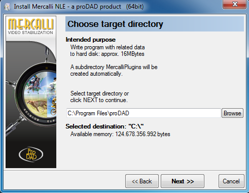

The plugins for the supported video editing programs must be checked in the plugin dialog.

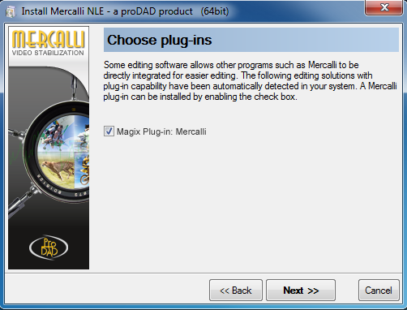

Now, follow the installation instructions. Upon completion of the installation, you will find **Mercalli Pro, CMOS Fixr, Mercalli RT and Picture Enhanzr RT** as plugins in your supported video editing program. Now you have to activate Mercalli to be able to use it in its entirety.

## 4. Product Activation + Registration

**Activating Mercalli (Mercalli Pro, CMOS Fixr, Mercalli RT and Picture Enhanzr RT):**

With the initial startup of Mercalli as a plugin in your video editing program you will be prompted to enter an activation code (serial number); enter the code you received with your electronic delivery with the download instructions e-mail or inside the package if you received a physical delivery of the software (on DVD). Now click on Unlock.

***IMPORTANT:*** Please keep in mind that your system requires an Internet connection for you to activate it. This is the only way to successfully complete the activation. If you encounter problems, please check the security settings (Firewall, etc.) in the system and repeat the activation process.

If you would like to test Mercalli in DEMO mode, click on **Continue with Demo Version**. The demo version will remain active until the input of the serial number converts it to a full version.

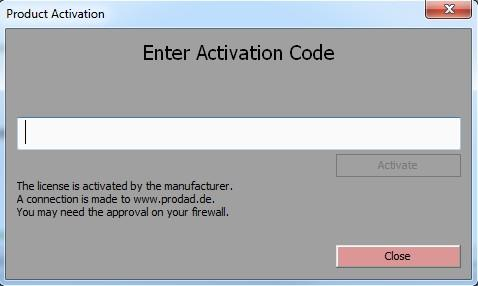

Also see: 14.1. Product cannot be activated

**Registering Mercalli:**

If you wish to receive updates and more information about Mercalli, register your proDAD Mercalli at **http://www.prodad.de/register.html.**

## 5. Supported video programs

Depending on the package you purchased, this may support the video editing programs as plugins. The application of these plugins is to be shown here.

 The plugins listed here do not make any claims regarding complete content for the installed

Mercalli product.

### 5.1. MAGIX

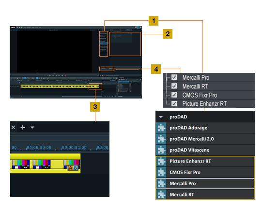

#### 5.1.1. Apply effect:

Find the video filter  (in the Effect tab). Open the contained folder proDAD.

Select the video clip 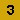 on the timeline and apply the effect.

#### 5.1.2 Types of application:

| Stabilization with switchable rolling shutter correction | Remove CMOS Wobble/vibrations | Color correction with Picture Enhanzr RT | Combination of both effects |
| --- | --- | --- | --- |
| See: 6.1. Mercalli Pro See: 7.1. Mercalli RT | See: 7.1 CMOS Fixr | See: 9.1 Picture Enhanzr RT | See: 14.2 Combination of CMOS Fixr + Mercalli Pro |

#### 5.1.3. Mercalli Pro

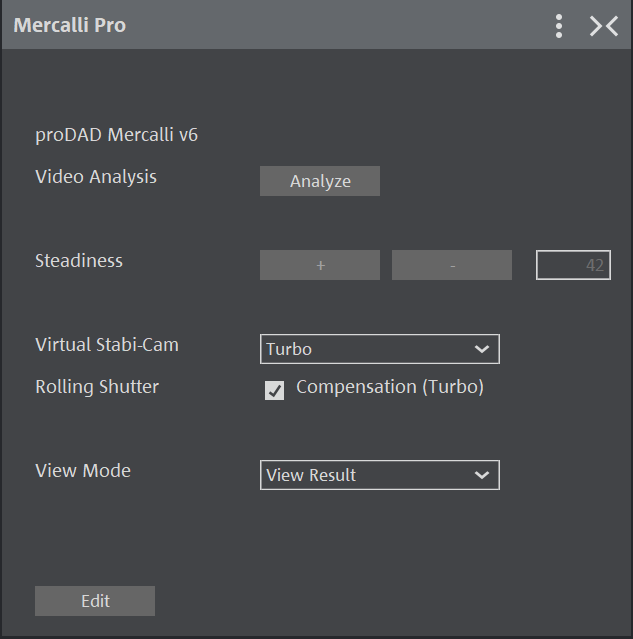

- Video Analysis - Start the video analysis
- Steadiness
- Virtual Stabi-Cam
- Rolling Shutter
- View
- Edit - Open Advanced settings

#### 5.1.4. CMOS Fixr Pro

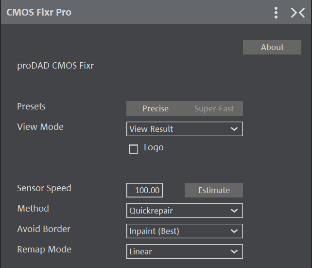

- About
- Presets
- View
- Logo
- Sensor speed
- Method
- Avoid Border
- Remap mode

#### 5.1.5. Mercalli RT

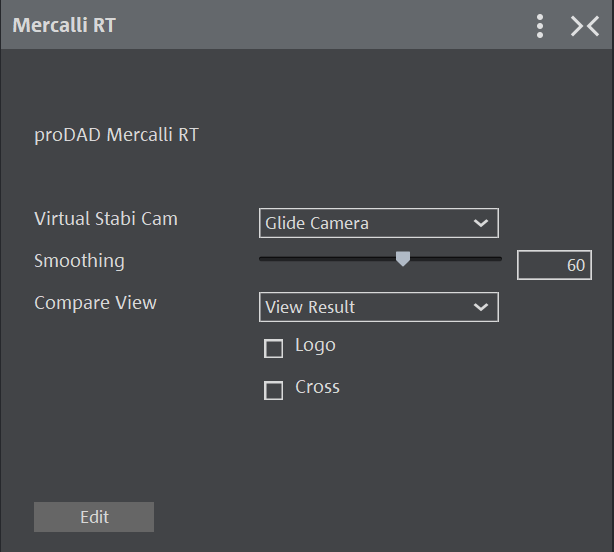

- Virtual Stabi Cam
- Smoothing
- Compare View
- Logo
- Cross
- Edit - Open Advanced settings

#### 5.1.6. Picture Enhancr RT

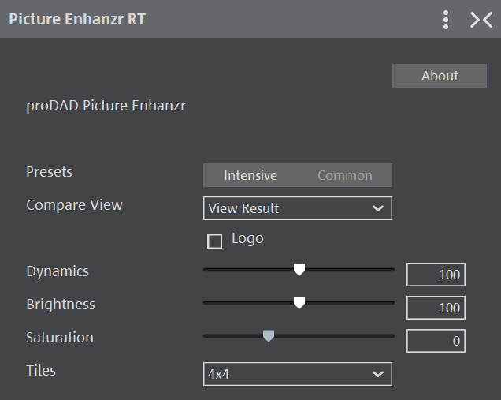

- About
- Presets
- Compare View
- Logo
- Dynamics, Brightness and Saturation
- Tiles

#### 5.1.7. Important tips:

 Mercalli (consisting of Mercalli Pro, Mercalli RT, CMOS Fixr and Picture Enhanzr RT) supports

MAGIX Video deluxe 2020 MAGIX ProX10 (and higher).

### 5.2. Adobe Premiere

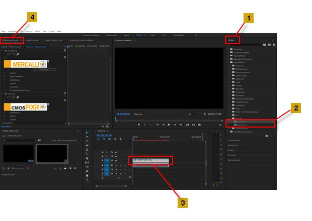

#### 5.2.1. Apply effect:

 Find the video effects (in the Effect tab). Open the contained folder proDAD.

 Now drag **Mercalli Pro** or **CMOS Fixr** to the marked video clip(s)  (via drag & drop).

#### 5.2.2. Types of application:

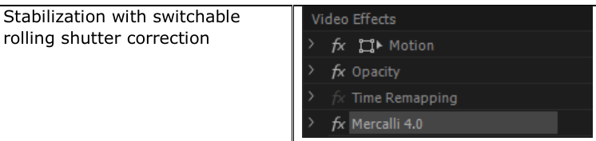

Stabilization with switchable rolling shutter correction

See: 6.1. Mercalli Pro

| Remove CMOS Wobble/vibrations | See: 8.1. CMOS Fixr |
| --- | --- |
| Combination of both effects | If it is necessary to apply the CMOS Fixr and Mercalli Pro to a scene, the CMOS Fixr must first be applied directly to the video. After that you will create a sequence from this and then you will apply Mercalli Pro. See: 15.2. Combination of Mercalli Pro + CMOS Fixr |

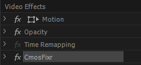

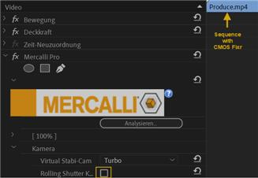

#### 5.2.3. Adapt effect:

Select the clip and choose **Effect Settings**  , where you will find menu options for **Mercalli Pro** and **CMOS Fixr**.

#### 5.2.4. CMOS Fixr – Settings:

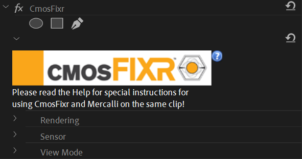

- About: Information about the Plugin (See 10.)
- ?: Manual
- Unlock: (See 4.)

##### 5.2.4.1. Rendering:

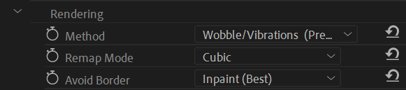

- Method: (See 8.6.)
- Remap Mode (See 8.8.)
- Avoid border (See 8.7.)

##### 5.2.4.2. Sensor:

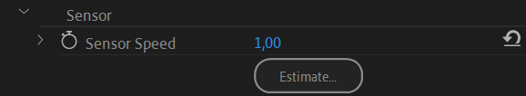

- Sensor Speed and Estimate (See 8.5.)

##### 5.2.4.3. View Mode:

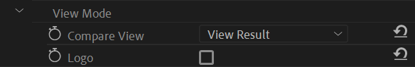

- Compare View (See 8.3.)
- Logo (See 8.4.)

#### 5.2.5. Mercalli Pro – Settings:

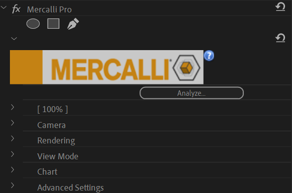

- About: Information about the Plugin (See 10.)
- ?: Manual
- Unlock: (See 4.)
- Analyze: (See 6.6.)

##### 5.2.5.1. Steadiness:

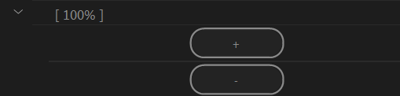

- Steadiness (See 6.7.)

##### 5.2.5.2. Camera:

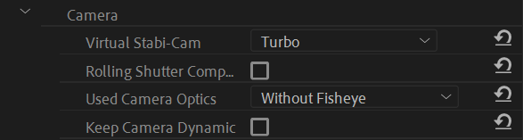

- Virtuelle Staby-Cam (See 6.3.)
- Rolling-Shutter Compensation: (See 6.4.)
- Use Camera Optics: (See 6.12.5.)
- Keep Kamera Dynamic: (See 6.5.)

##### 5.2.5.3. Rendering:

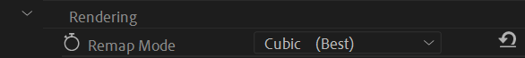

- Remap Mode: (See 6.10.)

##### 5.2.5.4. View Mode:

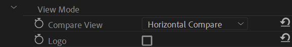

- Compare View and Logo (See 6.8.)

##### 5.2.5.5. Charts:

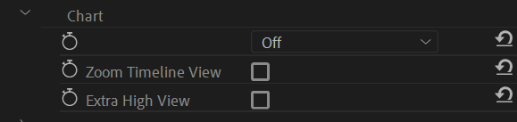

- Charts (See 6.9.)

##### 5.2.5.6. Advanced Settings:

- (See 6.12.)

###### 5.2.5.6.1. Movement:

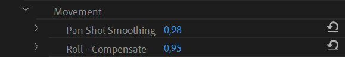

- (See 6.12.1.)

###### 5.2.5.6.2. Border:

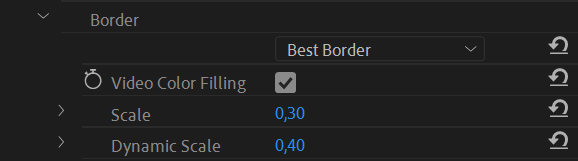

- (See 6.12.2.)

###### 5.2.5.6.3. Perspective:

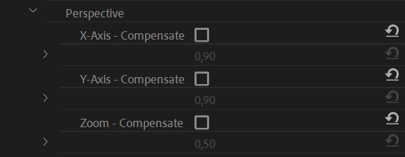

- (See 6.12.3.)

###### 5.2.5.6.4. Image:

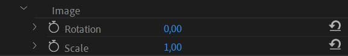

- (See 6.12.4.)

### 5.3. VEGAS Pro

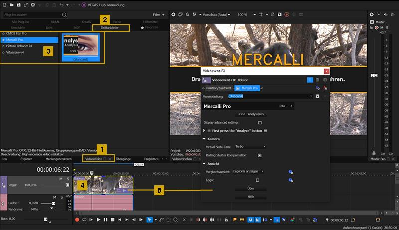

#### 5.3.1. Apply effect:

 Localize the video effects. Then open the Third Party folder 

 Now drag **Mercalli Pro, CMOS Fixr Pro** or **Picture Enhanzr RT** to the marked video clip(s)

 (via drag & drop).

#### 5.3.2. Types of application:

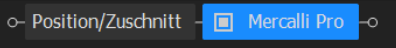

| Stabilization with switchable rolling shutter correction | See: 6.1. Mercalli Pro |
| --- | --- |
| Remove CMOS Wobble/vibrations | See: 8.1. CMOS Fixr |
| Combination of both effects | See: 15.2. Combination of Mercalli Pro + CMOS Fixr |
| Picture Enhanzr RT | See: 9.1. Picture Enhanzr RT |

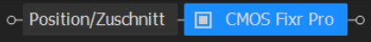

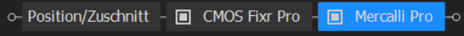

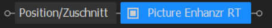

#### 5.3.3. Adapt effect:

Click on the symbol  opens the effect settings.

#### 5.3.4. CMOS Fixr – Settings:

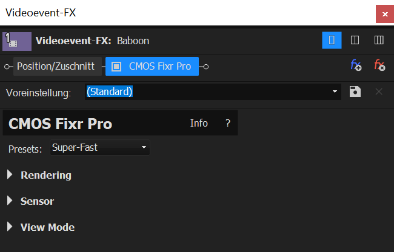

- About: Information about the Plugin (See 10.)
- ?: Manual
- Unlock: (See 4.)

##### 5.3.4.1. Presets:

- Presets: (See 8.2.)

##### 5.3.4.2. Rendering:

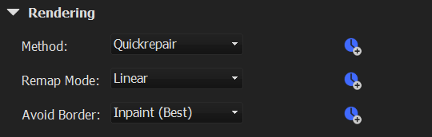

- Method: (See 8.6.)
- Remap Mode (See 8.8.)
- Avoid border (See 8.7.)

##### 5.3.4.3. Sensor:

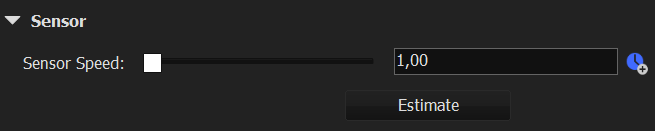

- Sensor Speed and Estimate (See 8.5.)

##### 5.3.4.4. View Mode:

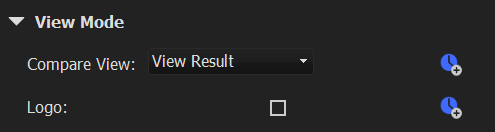

- Compare View (See 8.3.)
- Logo (See 8.4.)

#### 5.3.5. Mercalli Pro – Settings:

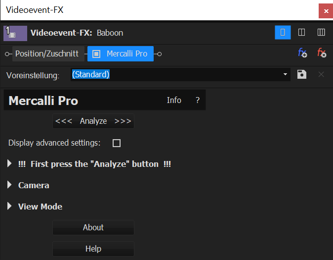

- About: Information about the Plugin (See 10.)
- ?: Manual
- Unlock: (See 4.)
- Analyze: (See 6.6.)

##### 5.3.5.1. Steadiness:

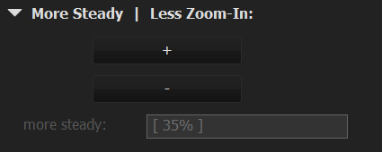

- Steadiness (See 6.7.)

##### 5.3.5.2. Camera:

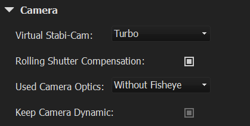

- Virtuelle Staby-Cam (See 6.3.)
- Rolling-Shutter Compensation: (See 6.4.)
- Use Camera Optics: (See 6.12.5.)
- Keep Kamera Dynamic: (See 6.5.)

##### 5.3.5.3. View Mode:

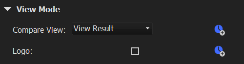

- Compare View (See 6.8.)

##### 5.3.5.4. Advanced Settings:

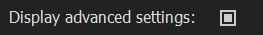

- (See 6.12.)

###### 5.3.5.4.1. Movement / Pan Shot Smothing:

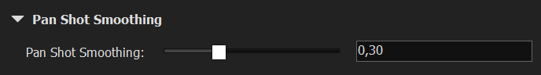

- (See 6.12.1.)

###### 5.3.5.4.2. Roll Compensate:

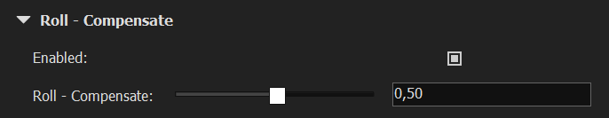

- (See 6.12.2.)

###### 5.3.5.4.3. Border:

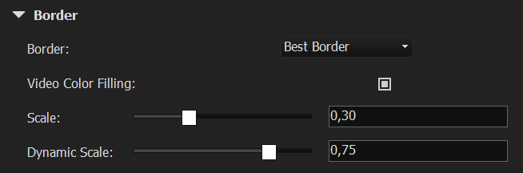

- Border (See 6.12.2.)
- Video Color Filling (See 6.12.2.2.)
- Scale (See 6.12.2.3.)
- Dynamic Scale (See 6.12.2.4.)

###### 5.3.5.4.4. X/Y-Axis - Compensate and Zoom - Compensate:

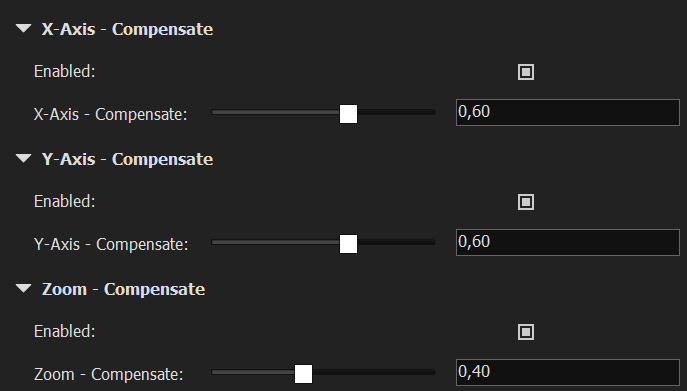

- Border (See 6.12.3.)

###### 5.3.5.4.5. Rendering:

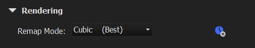

- Remap Mode (See 6.10.)

###### 5.3.5.4.6 Charts:

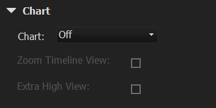

- (See 6.9.)

###### 5.3.5.4.7. Image:

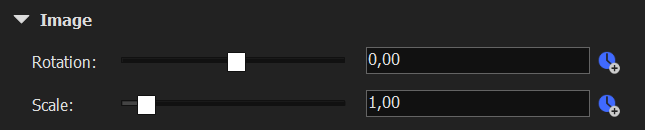

- (See 6.12.4.)

###### 5.3.5.4.8. Video:

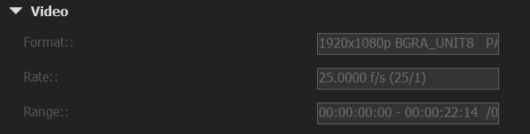

- (See 6.12.6.)

#### 5.3.6. Picture Enhanzr RT - Einstellungen:

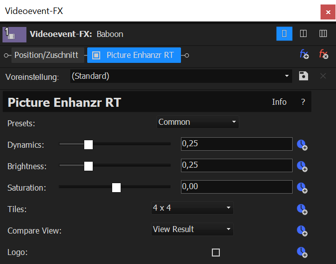

- About: Information about the Plugin (See 10.)
- ?: Manual
- Unlock: (See 4.)
- Picture Enhanzr RT: (See 9.1.)

### 5.4. Davinci Resolve

#### 5.4.1. Apply effect:

Locate **Effects**  . Then click **Filters** in **Effects**. In **Filters** you will find the **proDAD**  folder.

Now drag the **Mercalli Pro** or **CMOS Fixr**  entry contained in it onto the selected video clip (via drag & drop) in the Davinci Resolve timeline. Now click on **Inspector/Effects**  .

This will bring up the **Mercalli Pro** or **CMOS Fixr** settings dialog  . Now make your settings.

#### 5.4.2. Types of application:

Stabilization with switchable

rolling shutter correction

See: 6.1. Mercalli Pro

| Remove CMOS Wobble/vibrations | See: 8.1. CMOS Fixr Pro |
| --- | --- |
| Combination of both effects | Siehe: 15.2. Kombination Mercalli Pro-CMOS Fixr Pro |

#### 5.4.3. CMOS Fixr Pro – Settings:

- Manual
- Unlock: (See 4.)

##### 5.4.3.1. Presets:

- Presets: (See 8.2.)

##### 5.4.3.2. Rendering:

- Method: (See 8.6.)
- Remap-Mode (See 8.8.)
- Avoid Border (See 8.7.)

##### 5.4.3.3. Sensor:

- Sensor Speed and Estimate (See 8.5.)

##### 5.4.3.4. View Mode:

- Compare View and Logo (See 8.3.)

#### 5.4.4. Mercalli Pro – Settings:

- Unlock: (See 4.)
- Analyze: (See 6.6.)
- About: Informations (See 10.)
- Help: Start manual

##### 5.4.4.1. Steadiness:

- Steadiness: (See 6.7.)

##### 5.4.4.2. Camera:

- Virtual Staby-Cam (See 6.3.)
- Rolling Shutter Compensation: (See 6.4.)
- Used Camera Optics: (See 6.12.5.)
- Keep Camera Dynamic: (See 6.5.)

##### 5.4.4.3. View Mode:

- Compare View and Logo (See 6.8.)

##### 5.4.4.4. Advanced settings:

- See 6.12.

###### 5.4.4.4.1. Pan Shot Smoothing

- Pan Shot Smoothing (See 6.12.1.1.)

###### 5.4.4.4.2. Roll - Compensate:

- Roll - Compensate (See 6.12.1.2.)

###### 5.4.4.4.3. Border:

- Border settings (See 6.12.2.)
- Video Color Filling (See 6.12.2.2.)
- Scale (See 6.12.2.3.)
- Dynamic Scale (See 6.12.2.4.)

###### 5.4.4.4.4. X/Y-Axis - Compensate and Zoom - Zoom - Compensate:

- X/Y-Axis - Compensate and Zoom - Compensate (See 6.12.3.)

###### 5.4.4.4.5. Rendering:

- Remap Mode: (See 6.10.)

###### 5.4.4.4.6. Chart:

- Chart (See 6.9.)

###### 5.4.4.4.7. Image:

- Image (See 6.12.4.)

###### 5.4.4.4.8. Video:

- Video (See 6.12.6.)

### 5.5. Corel Video Studio

**How to proceed:**

1. Locate the **FX**  .
2. In **FX**, click **proDAD**  .
3. Drag the **Mercalli Pro, Mercalli RT** or **Picture Enhanzr RT**  entry to the selected video clip (via drag & drop) in the Corel Video Studio timeline.
4. Now activate your clip in the timeline by double-clicking it  .

5. In the **Effect** tab the **Customize Filter** button  appears, click on it and the Mercalli Pro settings dialog will start, make your settings here.

See: 6.1. Mercalli Pro\
See: 7.1. Mercalli RT\
See: 9.1. Picture Enhanzr RT

## 6. Mercalli Pro

### 6.1. Mercalli Pro Overview

simple mode extended mode

### 6.2. Structure + Basic Functions

**Reset:**\
Creates the basic condition by resetting all options.\
The values defined by the manufacturer are used, which were defined as optimized compromise from calculations and quality.

**Undo:**\
Reverses all changes made until the window was opened.

### 6.3. Camera (Virtual Stabi-Cam)

**Methods for smoothing the camera movements.** 

With the help of different methods for smoothing the camera movements, you can analyze and correct your shaky video. For this, select a suitable **method** (the method **Turbo** is preset).

1. **Turbo**, this method enables a fast and very robust video analysis with good to very good results.
2. **AI** enables a video analysis that is supported by artificial intelligence. Better results are often achieved with difficult scenes/videos.
3. **AI+3D**, this additionally analyzes the tilting of the camera, thus reducing disruptive perspective effects.

### 6.4. Rolling Shutter Compensation

**Activation of the rolling shutter compensation**

With the activation of the option **Rolling Shutter Compensation**  a possible distortion (only with CMOS), which can occur in moving pictures (video) can be compensated. This option **Rolling Shutter Compensation** is activated by default.

The **Rolling shutter effect** is an undesired side effect of the so-called CMOS sensors, which are widely used in digital reflex cameras (DSLRs), pocket cams, mobile radio devices or action cams.

As long as a recording has not been stabilized, the rolling shutter effect is either not or only slightly noticeable. But as soon as a successful stabilization has taken place during post production, the rolling shutter effect will remain and will now become slight to significantly annoying.\
Therefore, the Mercalli Pro counteracts this undesired effect on request - because a stabilized recording will remain worthless, if the undesired consequence effect destroys this result.

 Vibrations/Wobbles require an extended CMOS correction in CMOS Fixr.

Also see: Combination of CMOS Fixr + Mercalli Pro

### 6.5. Keep Camera Dynamic

The option **Keep Camera Dynamic**  is intended to maintain the vivacity in the video, i.e., deliberate camera movements of the person filming should neither be smoothed nor stabilized.

If you wish to stabilize a normal hand-filmed blurry camera shot into a **Tripod Recording**, you should deactivate the option **Keep Camera Dynamic**.

### 6.6. Video Analysis

Once the stabilization settings have been completely, you can start the necessary video analysis. 

### 6.7. Steadiness

 The Steadiness +/- option can improve stabilization by zooming in more.

 Uses the select Steadiness without further changes. All changes that were made manually will

be discarded.

### 6.8. View Mode

The menu **View Mode**  contains different options to display the video preview.

1. View Result (shows the stabilized video as a preview)
2. Horizontal Compare (Comparison of original/stabilized in a horizontal split screen)
3. Vertical Compare (Comparison of original/stabilized in a vertical split screen)
4. View Source (shows the original video as a preview)

There is also the option to display a **Logo** in the video; this is especially suitable for video comparisons before/after.

### 6.9. Charts

The Mercalli Pro allows **Adding** different **Chart** that symbolize the stabilization. The respective diagram can be selected in the menu View/Diagrams. The diagrams are displayed in the preview of the respective used video editing program.

#### 6.9.1. Pan:

In the **Pan** diagram, the movement in the video, such as sliding in the **X-Y direction** (horizontal/vertical) is displayed. With the slider **Pan shot smoothing** you balance the total movements in the video. If you move the slider further to the right, Mercalli increases the stabilization, the video appears quieter. The slider **Pan Shot Smoothing** causes the greatest visual change (smoothing of the movements in the video). Also, in the **Pan** diagram, you will see the changes in the correction curve.

#### 6.9.2. Roll:

In the **Roll** diagram, the movement in the video or the rotation around the **Z-Axis** is displayed.

#### 6.9.3. Zoom:

The **Zoom** diagram shows the movement in the video regarding **Zoom**. If the slider **Zoom - Balance** is moved further to the right, the zoom is applied to several images, a harmonic zoom is created.

#### 6.9.4. CMOS Sensor:

The fully automated **CMOS correction** removes CMOS-Sensor related weaknesses retroactively. The green curve shows the correction (counter-action) by Mercalli, the orange curve shows the residual error (incorrigible).

#### 6.9.5. X/Y Axis:

In the **X/Y axis** diagram, the movement in the video regarding the tilting around the **X/Y Axis** is displayed. The correction and the display in the diagram depends on the position of the slider **X/Y axis - Balance**. Move the slider **X/Y axis** - this will change the rotation correction around the X/Y axis. The diagram will display this change in a curve.

#### 6.9.6. Dynamic Scaling:

A high Dyn-Scale value (**Dynamic Scaling** in the extended settings **Border**) reduces the need to zoom in. This is achieved by a rapid change of the zoom.

 Depending on the position of the slider **Dynamic Scaling**, the zoom requirement will also vary by time position. The maximum value is always constant, the minimum value can sink with a higher

dynamic (but does not have to).

### 6.10. Remap Mode

Under **Remap mode**  the type of pixel calculation is defined:

- **Cubic:** Allows more quality along borders and corners. Compared to linear, the image will keep its sharpness. This mode requires a higher calculation effort.
- **Linear:** Is the normal way and a good compromise between quality and calculation effort.
- **Nearest:** Is the quickest way, but does not consider sub-pixels.

### 6.11. Info text

Here, the current status  is displayed.

### 6.12. Advanced Settings

In the lower area of the Mercalli Pro dialog, you can access the option  to open the extended settings  .

#### 6.12.1. Movement

##### 6.12.1.1. Pan Shot Smoothing

With the slider **Pan Shot Smoothing** you balance the total movements in the video. If you move the slider further to the right, Mercalli increases the stabilization, the video appears quieter.

The slider **Pan Shot Smoothing** causes the greatest visual change (smoothing of the movement in the video).\
Also, in the **Pan** diagram, you will see changes in the correction curve.

##### 6.12.1.2. Roll - Compensate

The slider **Roll - Compensate** effects a correction of the video regarding the movements (rotation) around the **Z-Axis**. Changes in the correction curve are also visible in the **Roll** diagram.

The slider **Roll - Compensate** can also be deactivated, but only if the slider **Zoom - Balance** has already been deactivated. Then, there will be no correction of the **Roll movement (Z-Axis)** in the video.

The slider **Roll - Compensate** will be deactivated if rolling movements cannot be evaluated by Mercalli, or if only pans are to be stabilized.

#### 6.12.2. Border

##### 6.12.2.1. Border

The **Balancing of Movements** creates calculation-related borders.

So, if you move the image 10 pixels to the left to compensate or balance an originally caused blur to the right, a border, or rather an information gap is created on the right side of the image. This can usually be seen as empty content or black image areas. At this point, the user can decide how to perform the border calculation.\
Mercalli offers various **Border Options**.

**a.** If you select the option **Best Border** there will be no border in the stabilized video. The border will be eliminated by zooming into the video. This is done in relation to the blurs and the desired extent of correction in connection with the setting process done with the **Scale** slider.

You can find more information on the subject of **Borders** (border editing) in the FAQs in the support area on www.prodad.com.

**b.** If you select the option **Best Stabilization** a black border may be displayed in the stabilized video. This can vary between images, depending on the extent of the blur in the current situation.

This border, however, can be filled in with image content by using the option **Video Color Filling**.

***Note:***\
If this displays interfering side effects in the border replaced by image content (see gate at top left), deactivate the option **Video Color Filling** once again.

You can zoom into the video with the slider **Scale**, the border will be minimized further.\
Too much Zoom In can cause blurs (grainy image) in the video.

**c.** In the **Forensic View** the display is zoomed out and has no limits. By zooming into a scene, the effected correction is easier to evaluate with Mercalli. The slider **Scale** will support you with Zoom IN/OUT.

##### 6.12.2.2. Video Color Filling

With the option **Video Color Filling** you allocate **Image Content** to an existing black border in the video.

 If this displays interfering side effects in the border replaced by image content (see gate at top left), deactivate the option **Video Color Filling** once again.

Also see: 16.1.10.

##### 6.12.2.3. Scale

The option **Scale** causes a zoom function in the video to make possible borders invisible.

##### 6.12.2.4. Dynamic Scale

The cyan colored line shows the Zoom In used in the corresponding time position in the diagram. A high Dyn-Scale value reduces the need for zoom-in. This is achieved by a rapid change of the zoom.

 Depending on the position of the slider **Dynamic Scale** the zoom requirement will also vary by time position. The maximum value is always constant, the minimum value can sink with a higher

dynamic (but does not have to).

Also see: 16.1.12.

#### 6.12.3. Perspective

##### 6.12.3.1. X/Y Axis - Compensate

The slider **X-Axis - Balance** effects a correction of the video regarding the movements (rotation) around the **Y-Axis** (tilting movement of the camera in the direction Y). Displayed in the **X/Y Axis** diagram by the **cyan**-colored curve. Move the slider **X-Axis - Balance** to change the correction respective to the rotation around the **X-Axis**. In the diagram, this change will be displayed in the **cyan**-colored curve.

The slider **Y-Axis - Balance** effects a correction of the video regarding the movements (rotation) around the **Y-Axis** (tilting movement of the camera in the direction Y). Displayed in the **X/Y Axis** diagram by the **magenta**-colored curve. Move the slider **Y-Axis - Balance** to change the correction respective to the rotation around the **Y-Axis**. In the diagram, this change will be displayed in the **magenta**-colored curve.

Also see: 16.1.17.

##### 6.12.3.2. Zoom - Compensate

With the slider **Zoom - Compensate**, you can smooth the **Zoom Movement** in the video.

Move the slider further to the right, this will effect a stronger smoothing of zoom changes. Existing blurring in the zoom is thus balanced. Changes in the **Zoom correction** curve are also visible in the zoom correction diagram. The slider **Zoom - Compensate** can also be deactivated. Simply click on the check box.\
Then, there will be no **Zoom Correction** in the video.

#### 6.12.4. Image

##### 6.12.4.1. Rotation

The **Rotation** slider causes the rotation of the video in a clockwise direction and counter-clockwise; this function is helpful if you did not hold the camera completely straight during filming and would like to make a correction at this time.

##### 6.12.4.2. Scale

The **Scale** slider allows a reduction or enlargement of the image cutout in the video.

#### 6.12.5. Used Camera Optics

In order to achieve the best possible **Stabilization quality** select your **camera type** in this menu. This way, the Mercalli Pro recognizes the **Camera optics**.

Also see: 16.2.

#### 6.12.6. Video

##### 6.12.6.1 About the video

Here, you will see information regarding the current video (format, rate and area).

### 6.13. Overlay notes

Continue reading here 12 (Overlay notes).

## 7. Mercalli RT

### 7.1. Mercalli RT Overview

simple mode

extended mode

### 7.2. Set camera (Stabi Cam) and stabilization factor

**The application of virtual stabi cams**

In **Mercalli RT,** various Staby Cams in the menu **Camera**  are available for use, which are used depending on the appearance of shaking.

**Sporty camera:**\
The virtual camera follows the fast movements of the real camera and removes or reduces jerky or trembling movements in the video, see also note (2)

**Glide camera:**\
The virtual camera **softly** follows the movements of the real camera and removes jerky or trembling movements in the video, see also note (2)

**Steady cam:**\
The virtual camera follows the movements of the real camera with a **great deal of delay**, so that only the intent to move remains, see also note (1) and (2)

**Sci Camera:**\
Comparable stabilization to the Staby Cam **Steady cam**, without correction limit and without border filling. It serves for aggressive stabilization without limits and restrictions.

**Fixed Camera:**\
The virtual camera stands firm **without** following the movements of the real camera. In some cases it is advisable to set the slider **smoothing** <100%, to prevent the image "running out", see also note: (1) and (2)

**Notes:**\
**(1)**: The option **Rolling Shutter Correction** cannot be selected because the algorithm always reduces wobble-like motion.

**(2)**: The visible effect of stabilization is limited in limit situations by definable options and thus weakened, see also “Max. acceptable image border” and “scaling” or “dynamic scaling”.

Furthermore, 4 settings for stabilization improvement are still available to you. After the stabilization has taken place through the selected Staby Cam (camera), the video can be optimized further.

The slider **smoothing** determines the degree of stabilization, moving it to the right increases stabilization, but which can also result in a higher zoom-in.

### 7.3. Score - Steadiness - Real-time ability

Here you can see the staediness of the video and the real-time ability of the settings made in Mercalli RT.

### 7.4. View - Diagnosis

In the menu **View**  , several options for presenting the video preview are available.

1. Display the result (shows the stabilized video in preview)
2. Compare horizontally (Comparison Original / Stabilized in horizontal split screen)
3. Compare vertically (comparison original / Stabilized in the vertical split screen)

It is also possible to show a **Logo** in the video, which is particularly suitable for a video comparison before/after.

**Diagnostics:**

Scanned camera transitions

Scanned camera rotations

Zoom-In (scaling)

\- desired zoom - used zoom incl. dynamic zoom

\- Horizontal movement - Rotation - Vertical movement

Corrected image shift

Corrected rotation

Performance

Scan accuracy

\- Horizontal movement - Vertical movement - Image movement that cannot be corrected

\- Rotation - Image movement that cannot be corrected

\- Time limit for real - Scanned image time information - Analysis process time - Intensive / depth scan - Render process time - Interpretation error

**Cross:** Red bars signal necessary corrections that are not allowed by the current settings.\
See also: **Scaling** and **maximally acceptable image border.**

**Bounds:** The maximum possible image shift resulting from the current settings is displayed. Furthermore, the real image borders are faded in, which are always available without **consciously fill the contents**. By means of these limits, synthetically filled image contents can be distinguished from real contents.

### 7.5. Remap Mode

Under **Remap Mode**  , the type of the pixel calculation is specified:

- **Cubic:** Enables higher quality at edges and corners. Compared to Linear, the picture retains its sharpness. This mode requires a higher computational effort.
- **Linear:** Is the normal way and a good middle course between quality and computational effort.
- **Nearest:** Is the fastest way, but does it not consider sub-pixels.

### 7.6. Border

In the menu **Border,**  various methods for filling possible borders in the video are available to you.

### 7.7. Scale

With the slider **Scale**  , you specify the basic scaling degree (Zoom-In). This selected value is never fallen below even by other settings. Higher values improve stabilization.

### 7.8. Rolling Shutter Compensation

With the activation of the option **Rolling-Shutter Correction**  , a possible distortion (only with CMOS) is compensated, which can occur with moving images (video). The **Rolling Shutter Effect** is an undesirable side effect of the so-called CMOS sensors, which are increasingly used in digital SLR (DSLRs), pocket cams, mobile phones or in action cams.

By default, **Rolling Shutter Correction** is activated. Then wobble CMOS distortions are removed or reduced.

 The sensor speed must match the camera or action cam used.

If you are using a camera without a CMOS sensor, then the option **Rolling Shutter Correction MUST** be deactivated.

The **sensor speed** can be selected between 100% - 10000%, but it depends on the CMOS sensor and the frame rate. Usually, today's consumer cameras work with values between 100% - 200%.

 **Mercalli RT** determines this value automatically. The CMOS Fixr can possibly also be used for value determination.

 Vibrations/wobbles require an expanded CMOS correction in the CMOS Fixr.

See also: Combination CMOS Fixr + Mercalli Pro Stabilizr

### 7.9. Dynamic Scale

If the **Dynamic Scale**  is activated, the strength of the scaling is varied automatically during the stabilization. With strongly blurred videos, the image is zoomed in more strongly and less in the image with rather quiet videos.

The **Latency time** sets the inertia for **dynamic scaling**. If you select larger values here, this means slower changes of the scaling.

The **max. scaling** regulates the maximum permissible scaling of the dynamics. Higher values improve stabilization.

### 7.10. Maximally acceptable image border

Here, it is specified with respect to the image size, how large possible borders  may be in the processed video. Via the menu **Border**, various fill methods can be selected for these areas. Higher setting values improve stabilization.

### 7.11. Content aware fill

Here, the control of the respective filling method  from the menu **Border** takes place. Correcting the stabilization possibly result in image parts that are not present. The algorithm now tries to fill the gaps with matching image parts from the neighbouring images.

The option **Number of Previous Images** specifies how many past images are taken into account.

 Larger values increase the computational effort and weaken the real-time capability.

The option **Number of Future Images** specifies how many temporally future images are taken into account.

 Larger values also increase the computational effort here and weaken the real-time

capability. Depending on the implementation, the frame offset is increased, which may possibly lead to a temporal offset with regard to the shade.

## 8. CMOS Fixr

### 8.1. CMOS Fixr Overview

### 8.2. Presets

First, you will need to remove undesired CMOS effects from your video and then you will get even better stabilization effects, because pictures that are free of shaking and wobbling are the better basis for the subsequent stabilization of undesired camera movements!

Almost all action cameras, DSLR cameras as well as professional video cameras have so-called CMOS sensors. If these cameras are exposed to vibrations or shaking, the recording of individual images becomes faulty and these image errors will show up naturally. First, remove undesired CMOS effects from your video. This is the best basis for better stabilization results. The subsequent stabilization of undesired camera movements is much more optimized on the basis of images that are free of vibrations and wobbling!

The CMOS Fixr offers extensive adaptation possibilities for this, however, the use of the program is very simple, as the stabilization as well as the CMOS correction take place fully automatically. Of course, there is additional fine adjustment - therefore, you will always have the opportunity to intervene.

If you wish to start the fully automatic CMOS correction in the video, first select one of the templates,

**Precise** or **Super fast** from the menu  until you have achieved the best possible optimization.

The **Precise** option automatically defines the method **Wobble/Vibrations (Precise/GPU)**. There are videos that require the use of a more intense correction (GPU is utilized); this correction uses more computer power and therefore requires more time.

The **Super fast** option uses the method **Wobble/Vibrations (Fast/GPU)**. Here, the GPU is used as well. In addition, the option **Faster (higher latency)** is activated, which speeds up the correction.

### 8.3. View Mode

The menu **View Mode**  contains different options to display the video preview.

1. View Result (shows the stabilized video as a preview)
2. Horizontal Compare (Comparison of original/stabilized in a horizontal split screen)
3. Vertical Compare (Comparison of original/stabilized in a vertical split screen)
4. View Source (shows the original video as a preview)

There is also the option to display a **Logo** in the video; this is especially suitable for video comparisons before/after.

### 8.4. Logo On/Off

Here you can display the proDAD logo.

### 8.5. Sensor speed

A CMOS sensor  reads the image data with reference to the model and location of use at different speeds. The correction of the CMOS distortion enabled by proDAD only works optimally if this speed is known. The **Estimate** button determines a probable speed value.

 If incorrect speed values are used, this could cause an over or under correction.

### 8.6. Method

Furthermore, the CMOS Fixr offers different CMOS correction methods to select from, which can be included in the video, such as **Wobble/Vibrations (Fast/GPU), Wobble/Vibrations (Precise/GPU)** and **Quickrepair**, which can be used to counteract the vibrations and waves. If you wish to further optimize the fully automatic CMOS correction in the video, select one of the available

CMOS distortion methods  from the menu until you have reached the best possible optimization.

### 8.7. Avoid Border

The required correction might lead to image borders. The following methods to **Avoid Border**  are available:

- **Inpaint:** Copy missing image portions from adjacent pictures. This is the best method, but requires a higher calculation effort compared to the other possibilities.
- **Reflect:** Repeat the mirrored border area.
- **Replicate:** Fill the borders with border color.
- **Off:** Show borders as black areas.

### 8.8. Remap Mode

Under Remap Mode  the type of pixel calculation is defined:

- **Cubic:** Allows more quality along borders and corners. Compared to linear, the image will keep its sharpness. This mode requires a higher calculation effort.
- **Linear:** Is the normal way and a good compromise between quality and calculation effort.
- **Nearest:** Is the quickest way, but does not consider sub-pixels.

### 8.9. Overlay notes

Continue reading here 12 (Overlay notes).

## 9. Picture Enhanzr RT

### 9.1. Picture Enhanzr RT Overview

The **Picture Enhanzr RT** Correction automatically corrects or improves the contrast and brightness within a video.

### 9.2. Presets

The **Picture Enhanzr RT Plugin** offers two templates (default settings)  , which implements the image optimization by a simple mouse click. When using the template **Intensive**, the dynamics in the video are increased and the template **Normal** places the video in a balanced state of brightness and contrast with regard to the original video.

### 9.3. View and Fading in/out the Logo

In the menu **View**  , several options for presenting the video preview are available.

1. Display the result (shows the processed video in preview)
2. Compare horizontally (Comparison original / Edited in horizontal split screen)
3. Compare vertically (Comparison original / Edited in vertical split screen)

It is also possible to show a **Logo** in the video, which is particularly suitable for a video comparison before/after.

### 9.4. Dynamics

With the slider **Dynamics**  you increase contrasts in the video.

### 9.5. Brightness

With the slider **Brightness**  you influence the brightness in the video.

### 9.6. Saturation

With the slider **Saturation**  you increase or decrease the colour intensity in the video.

### 9.7. Tiles

The video is divided, analysed and optimized depending on the selection of the **tile section**  . This allows the algorithm to better recognize, separate and process different conditions in the video image. If you select a subdivision which is too large, this can lead to an overload in the image.

## 10. About

### 10.1. Info field

## 11. Performance display

### 11.1. Decoder

Instead of **Decoder**, the name of the video editing program will be displayed. The value shows how fast the video editing program can provide the video frames.

Example: 73546.9 f/s means that 73546.9 frames/second can be provided. Mercalli SAL reaches this high value.\
The average values are between 40 and 250.

### 11.2. Plugin

Instead of **Plugin**, **CMOS Fixr** or **Mercalli** will be displayed. The value shows how fast the plugin can process the video frames.

Example: 78.2 f/s means that 78.2 frames per second are processed.\
The average values are between 50 and 500 for Mercalli (Mercalli Pro) and between 20 and 100 for the CMOS Fixr.

### 11.3. Total

This value shows how fast the entire process takes place.

Example: 77.9 f/s means that 77.9 frames per second are processed.

 Whenever the value for CMOS Fixr or Mercalli deviates a lot from the Total, the plugin cannot

reach its full performance.

## 12. Overlay notes

### 12.1. Mercalli Pro Overlay Notes

#### 12.1.1. The video is being analyzed...

#### 12.1.2. Mixtures frame rates are not supported

The video clip cannot be edited if the frame rate is fixed for a project setting.

#### 12.1.3. First use / Video analysis required

The Mercalli Pro was newly applied to a video clip and the video analysis has not yet been conducted.

#### 12.1.4. Video-Clip exchanged / video analysis required

The video clip to be stabilized was replaced and the video analysis was not yet conducted.

#### 12.1.5. Virtual Stabicam Changed / video analysis required

The virtual StabiCam (Universal, etc.) was changed and the video analysis was not yet conducted.

#### 12.1.6. Camera Optic changed / video analysis required

The camera optics (Fisheye) were changed and the video analysis has not yet been conducted.

#### 12.1.7. Start/End changed / video analysis required

or

The stabilized video clip was replaced and the video analysis was not yet conducted.

#### 12.1.8. Interlace/Progressive changed / video analysis required

The interlace processing was changed and the video analysis has not yet been conducted.

#### 12.1.9. Face Range changed / video analysis required

One or more fade duration values were changes and the video analysis has not yet been conducted.

### 12.2. CMOS Fixr overlay notes

#### 12.2.1. Mixtures frame rates are not supported

The video clip cannot be edited if the frame rate is fixed for a project setting.

#### 12.2.2. GPU not available

#### 12.2.3. Various frame rates

The video clip is now used with a different frame rate. The sensor speed must be adapted.

#### 12.2.4. Preview not available

See: 15.1 CMOS Fixr latency mode

#### 12.2.5. Stereoscopic Videos are not supported

## 13. FAQ

### 13.1. Logo cannot be switched off

The product logo cannot be switched off until the product has been released. See 4.

### 13.2. How can difficult videos be stabilized?

In this case, use the stand-alone version Mercalli SAL.

## 14. Errors

### 14.1. Product cannot be activated

The activation key may not have been entered correctly.\
Characters such as "1" and "I", "8" and "B" or "O" and "0" should be rechecked.

### 14.2. Connection to www.prodad.com cannot be established

If the connection to www.prodad.com should fail, check your Internet connection, network settings or security settings in the system.

### 14.3. Notes in the video

See 12. Overlay notes

### 14.4. GPU not available

Make sure that the graphic card driver or the Windows/MAC-OSX are not outdated.

## 15. Important information

### 15.1. CMOS Fixr in latency mode

 For technical reasons, the CMOS Fixr runs with a time delay in EDIUS, the latency.

Here, the CMOS Fixr causes a 1-2 frame shift to the sound. Furthermore, the correction only works on consecutive frames in the forward direction.

For the random scrolling of the timeline, the correction does not work and the unchanged video loops through. Only once the cursor is moved forward by 3 to 4 frames, will there be a correction function. With an open dialog window, the CMOS Fixr will show a warning until the correction function is able to work again.

### 15.2. Combination of CMOS Fixr + Mercalli Pro

The CMOS Fixr and the Mercalli Pro can be used simultaneously for the best possible stabilization. Here, the video is CMOS corrected and stabilized without another intermediate step. This yields the best results.

 The order is important!

The CMOS Fixr must be run before the Mercalli Pro.

## 16. Workshops

### 16.1. Stabilization

The following illustrations show details about stabilization (some of the illustrations refer to Mercalli SAL, but area also available in the plugins).

**16.1.1.**

**16.1.2.**

**16.1.3.**

**16.1.4.**

**16.1.5.**

**16.1.6.**

**16.1.7.**

**16.1.8.**

**16.1.9.**

**16.1.10.**

**16.1.11.**

**16.1.12.**

**16.1.13.**

**16.1.14.**

**16.1.15.**

**16.1.16.**

**16.1.17.**

**16.1.18.**

**16.1.19.**

**16.1.20.**

### 16.2. Camera Optics

The following illustrations show details about effects of camera optics (some of the illustrations refer to Mercalli SAL, but area also available in the plugins).

**16.2.1.**

**16.2.2.**

**16.2.3.**

**16.2.4.**

**16.2.5.**

## 17. Updates

### 17.1. Installation information

 All running programs must be closed prior to starting the installation.

## 18. External Links

### 18.1. Video Wobble

- [Video](https://youtu.be/PSIOzJgSPqk)

### 18.2. Video Vibrations

- [Video](https://youtu.be/OuNB4iIHJYA)

### 18.3. Video Mercalli

- [Video DE](https://youtu.be/m9kg6oA2lQI)\
  [Video EN](https://youtu.be/lZwL23W9GdM)\
  [Video JA](https://youtu.be/fwtiKb_7YLI)

### 18.4. Video MAGIX

- [Video DE](https://youtu.be/jDmS83sI6zk)

© proDAD GmbH

[www.prodad.com](http://www.prodad.com/)
