# proDAD Mercalli V6 SAL

**Anleitung**

© proDAD GmbH

Autor : Uwe Wenz

## Inhaltsverzeichnis

- [Willkommen](#willkommen)
- [Allgemeine Informationen](#1-allgemeine-informationen)
  - [Copyright / Rechtliches](#11-copyright--rechtliches)
  - [Was ist Mercalli?](#12-was-ist-mercalli)
  - [Warum Mercalli?](#13-warum-mercalli)
  - [Was ist Neu in Mercalli SAL?](#14-was-ist-neu-in-mercalli-sal)
  - [Installation, Aktivierung und Registrierung](#15-installation-aktivierung-und-registrierung)
  - [Systemvoraussetzungen](#16-systemvoraussetzungen)
  - [Programmhilfe](#17-programmhilfe)
  - [Shortcuts](#18-shortcuts)
- [Mercalli SAL im Detail](#2mercalli-sal-im-detail)
  - [Programmstart](#21-programmstart)
  - [Mercalli SAL in der Übersicht (eigenständige Version)](#22-mercalli-sal-in-der-übersicht-eigenständige-version)
  - [Ribbon](#23-ribbon)
    - [Projekt Tab - Projekt öffnen/speichern](#231-projekt-tab---projekt-öffnenspeichern)
    - [Veränderungen rückgängig/wiederherstellen](#veränderungen-rückgängigwiederherstellen)
    - [Start Tab](#232-start-tab)
      - [Medium importieren](#2321-medium-importieren)
      - [Export Medien](#2322-export-medien)
        - [Exporteinstellungen](#23221-exporteinstellungen)
        - [Format-Einstellungen bearbeiten](#23222-format-einstellungen-bearbeiten)
        - [Die Batchverarbeitung im Detail](#23223-die-batchverarbeitung-im-detail)
      - [Medienablage leeren - Szenenerkennung](#2323-medienablage-leeren---szenenerkennung)
      - [Stabilisierung - Videoanalyse starten](#2324-stabilisierung---videoanalyse-starten)
      - [Fischaugen-Optik korrigieren](#2325-fischaugen-optik-korrigieren)
      - [CMOS Korrektur (Turbo, Wobbeln entfernen + Intensive Reparatur)](#2326-cmos-korrektur-turbo-wobbeln-entfernen--intensive-reparatur)
      - [Farbverstärker](#2327-farbverstärker)
      - [Schnappschuss - Alle Medien analysieren - Lupe](#2328-schnappschuss---alle-medien-analysieren---lupe)
      - [Ansichten (Ergebnis + Vertikal/Horizontal + Original)](#2329-ansichten-ergebnis--vertikalhorizontal--original)
      - [Rotation einstellen](#23210-rotation-einstellen)
    - [UI Tab](#233-ui-tab)
    - [Armaturen Tab](#234-armaturen-tab)
  - [Timeline - Vorschau - Medienablage - Diagramme](#24-timeline---vorschau---medienablage---diagramme)
    - [Vorschau - Steuerungselemente](#241-vorschau---steuerungselemente)
    - [Timeline und Trimmbereich definieren](#242-timeline-und-trimmbereich-definieren)
    - [Medienablage](#243-medienablage)
    - [Diagramme](#244-diagramme)
      - [Kameraschwenk glätten (Verschiebung)](#2441-kameraschwenk-glätten)
      - [Z-Achse (Rollen mit Ein/Aus)](#2442-z-achse-rollen-mit-einaus)
      - [CMOS-Sensor (mit Ein/Aus)](#2443-cmos-sensor-mit-einaus)
      - [Zoom Glättung (mit Ein/Aus)](#2444-zoom-glättung-mit-einaus)
      - [X/Y - Achse Glättung (Schwenk + Neigung)](#2445-xy---achse-glättung-schwenk--neigung)
      - [Zoom-In - Dynamische Skalierung](#2446-zoom-in---dynamische-skalierung)
  - [Vorlagen](#25-vorlagen)
  - [Panel Tabs](#26-panel-tabs)
    - [Information](#261-information)
    - [Stabilisierung](#262-stabilisierung)
      - [Glättung - Kameraschwenk glätten](#2621-glättung---kameraschwenk-glätten)
      - [Glättung - Z-Achse Glättung](#2622-glättung---z-achse-glättung)
      - [Rand](#2623-rand)
      - [Dynamik](#2624-dynamik)
      - [Extras - Zoom Glättung - X/Y Glättung](#2625-extras---zoom-glättung---xy-glättung)
    - [Effekte](#263-effekte)
      - Histogramm
      - Keyframesteuerung
      - [Farbe](#2631-farbe)
        - [Verstärker](#26311-verstärker)
        - [Grundfarben](#26312-grundfarben)
          - [Weissabgleich](#263121-weissabgleich)
          - Belichtung
          - Kontrast
          - Helligkeit
          - Sättigung
        - [Stimmung](#26313-stimmung)
          - [Kalt/Warm](#263131-kaltwarm)
          - [Tönung](#263132-tönung)
          - [Farbverschiebung](#263133-farbverschiebung)
        - [Tonwertkurve](#26314-tonwertkurve-schwarze-tiefen-lichter-und-weiße)
          - Schwarze
          - Tiefen
          - Lichter
          - Weisse
        - [Geteilte Färbung](#26315-geteilte-färbung-tiefen-mitteltöne-und-lichter)
          - Tiefen
          - Mittelton
          - Lichter
        - [Kanal](#26316-kanal-belichtung-kontrast-und-sättigung)
          - Belichtung
          - Kontrast
          - Sättigung
        - Entauschen/Schärfen
      - [Layout](#2632layout)
      - [Vignette](#2633-vignette)
      - [Strahler](#2634-strahler)
        - [Grundwerte](#26341-grundwerte)
        - [Lage](#26342-lage)
        - [Tönung](#26343-tönung)
    - [Quell-Medium](#264-quell-medium)
    - [Ziel-Medium](#265-ziel-medium)

## Willkommen

Mercalli dient der nachträglichen Entfernung von Verwacklungen, Stößen, Zitter- und Vibrationseffekten aus Videoaufnahmen und somit der qualitativen Aufwertung wichtiger Aufzeichnungen. Auch ungleichmäßige Schwenks oder Zoom-Aufnahmen können mit Mercalli beruhigt und somit aufgewertet werden.

Somit ist Mercalli ein äußerst wertvolles Tool zur Rettung und Optimierung der wertvollen Aufnahmen eines jeden Filmers.

Wir wünschen Ihnen viel Freude mit proDAD Mercalli und stets effektvolle Ergebnisse !

## 1. Allgemeine Informationen

### 1.1. Copyright / Rechtliches

Rechtliches\
Copyright proDAD GmbH. Alle Rechte vorbehalten.

Lizenzbestimmungen\
Vor der Installation lesen Sie bitte folgende Lizenzbestimmungen sorgfältig durch.

Lizenzvertrag\
Beim Start des Setups wird ein Lizenzvertrag angezeigt, den Sie bitte sorgfältig durchlesen.\
Mit der Installation erkennen Sie diese Copyrightbestimmungen, den Lizenzvertrag und das Lizenzierungsverfahren an.

Lizenzgewähr\
proDAD GmbH räumt den bestimmungsgemäßen und erlaubten Gebrauch des vorliegenden Produkts ein. Das vorliegende Produkt kann nur auf einem Arbeitsplatz eingesetzt werden. Weder die Software, noch die Anleitung darf, auch in Teilen, reproduziert werden, es sei denn, es liegt eine schriftliche Genehmigung der proDAD GmbH vor. Mit Installation des Produkts gilt die Lizenzgewähr, die Urheberrechtsbestimmung, sowie die Haftungsbegrenzung als anerkannt.

Warenzeichen\
Alle Produkt- und Warenzeichen, die in diesem Produkt erwähnt wurden, sind Warenzeichen der jeweiligen Eigentümer. Alle Warenzeichen werden ohne Gewährleistung der freien Verwendbarkeit benutzt und sind eventuell eingetragene Warenzeichen.

Haftungsbegrenzung\
Der gesamte Haftungsumfang besteht im alleinigen Anspruch auf Ersatz des Produkts. Dies gilt für proDAD GmbH, Lizenznehmer und evtl. Vertreiber. Anspruch besteht nur bei korrekter Rückgabe der Software unter Angabe einer Warenrücksendenummer, die zuvor mit proDAD GmbH vereinbart werden muss. Ferner muss bei der Rückgabe ein Kaufbelege beiliegen. Ist eine Fehlfunktion des vorliegenden Produkts auf eine fehlerhafte Anwendung, Missbrauch, Unfall oder unsachgemäße Handhabung zurückzuführen, gilt die Garantie nicht. proDAD GmbH, deren Vertriebspartner und Lizenznehmer haften nicht für Schäden und Folgeschäden, die aufgrund der unmöglichen Nutzung des vorliegenden Produkts entstehen. In jedem Fall ist der Haftungsbetrag auf den Kaufpreis des Produkts beschränkt.

Dokumentationen\
Die Produktion und Übersetzung der Handbücher wurde mit größter Sorgfalt durchgeführt. Fehler können jedoch nicht hundertprozentig ausgeschlossen werden. proDAD GmbH übernimmt keinerlei Verantwortung oder Haftung für Folgen evtl. verbliebener fehlerhafter Aussagen oder

Angaben. Technische und optische Änderungen vorbehalten. Hinweise sind stets willkommen.

Urheberrecht\
Die Software sowie die Einzelkomponenten dieses Produkts sind Eigentum der proDAD GmbH. Mit der Installation des vorliegenden Produkts stimmt der Lizenznehmer zu, unautorisierten Gebrauch und Duplizierung zu vermeiden.

proDAD GmbH übernimmt keinerlei Verantwortung für die Anwendung des Programms und die Veröffentlichung von Inhalten und Daten, die mit diesem Programm erzeugt wurden.

ProDAD GmbH \* Gauertstr. 2 \* 78194 Immendingen \* Deutschland \* HRB 1077

### 1.2. Was ist Mercalli?

Mercalli dient der nachträglichen Entfernung von Erschütterungen, Verwacklungen, Verzerrungen, Wabbeln sowie Stauchungen aus Videoaufnahmen und somit der qualitativen Aufwertung wichtiger Aufzeichnungen. Auch ungleichmäßige Schwenks oder Zoom-Aufnahmen können mit Mercalli beruhigt und somit aufgewertet werden.

Unerwünschte Unruhe-Effekte bei der Aufzeichnung entstehen immer dann, wenn ein Stativ nicht zur Hand oder einfach unpraktisch ist. Meist auch dann, wenn überraschend etwas geschieht und schnell improvisierend gefilmt werden muss, um die Einzigartigkeit der Situation festzuhalten . Oder einfach immer dann, wenn durch Aspekte der Unhandlichkeit, die Videoausstattung deutlich eingeschränkt werden muss.

Sind solche Aufnahmen also prinzipiell gelungen aber zum Bedauern des Kameramanns verwackelt, und verfügen diese über eine gewisse inhaltliche Wertigkeit, kommt Mercalli ins Spiel. Mercalli kann diese Aufnahmen nun weitestgehend vollautomatisch retten und optimieren!

**Somit ist Mercalli ein äußerst wertvolles Tool zur Rettung und Optimierung der wertvollen Aufnahmen eines jeden Filmers.**

### 1.3. Warum Mercalli?

Der Neapolitaner Guiseppe Mercalli war Begründer der Mercalli-Skala zur Einstufung und Bestimmung von Erdbeben-Stärken. Die Stufen reichten von „unmerklich“ bis „große Katastrophe“. Mercalli erstellte diese Skala nach einer Einschätzung von Zerstörungs-Stufen im Zuge der erfolgten Erschütterungen.

Und hier beginnt auch schon die Gemeinsamkeit:\
Die Software Mercalli bearbeitet ebenfalls Erschütterungen, Verwacklungen, Verzerrungen, Wabbeln und Stauchungen. Die vollautomatische **CMOS-Korrektur**, entfernt hocheffizient Fehler, die gerne auch als Verwacklungen in Video wahrgenommen werden. Diese Fehler in Form von Wabbeln, Verzerrungen und Stauchungen werden üblicherweise “Jello, Wobble, Skew“ oder auch „Distortions“ genannt. Die Ursache liegt hier im CMOS-Sensor einer Kamera und entstehen durch motorbedingte Vibrationen und physikalischen Erschütterungen - selbst bei verwendeten Gimbals zur Reduktion von Verwacklungen. In den meisten Fällen hilft die CMOS-Korrektur allein, das Video bereits deutlich ruhiger und hochwertiger aussehen zu lassen.

Ein gravierender Vorteil dieser Art der Korrektur ist, dass diese absolut vollautomatisch erfolgt und darüber hinaus so gut wie keinen Zoom-In-Bedarf benötigt. Somit behalten wir bei deutlicher Verbesserung dennoch die maximale Auflösung bei! Sind dann noch „echte“ Verwacklungen im

Video enthalten, kann natürlich die bekannte Videostabilisierung hinzugefügt werden, die dann auf bereits CMOS-Fehler korrigiertes Material erneut präziser funktionieren kann. Diese einzigartige Form der Komplett-Korrektur ist schlicht das Beste, was Ihre(n) Videos passieren kann.

Im Video werden anhand hochkomplexer mathematischer Vorgänge Unregelmäßigkeiten erkannt und entfernt. Dabei muss in äußerst komplizierten Berechnungen eingeteilt werden, welche Bewegungen gewollt sind und welche eben unerwünscht sind. Letztere Schäden werden dann dem Anwender zur Entfernung angeboten.

Weitere Informationen und Infos zu enthaltenen Features erhalten Sie auf proDAD.com.

### 1.4. Was ist Neu in Mercalli SAL?

Die **Neuerungen** in Mercalli SAL auf einen Blick:

- eingebaute künstliche Intelligenz (AI), die Parameter werden automatisch angepasst, weitere manuelle Feineinstellungen sind weiterhin möglich
- komplett neues und modernes UI
- einfache Bedienung und schnellere Berechnung
- neue Bildoptimierungsmodi + Farbkorrektur
- Fish-eye Korrektur
- Projektspeicherung

### 1.5. Installation, Aktivierung und Registrierung

1. **Die Installation und Aktivierung von Mercalli SAL**

Um die Installation zu starten, klicken Sie bitte einfach doppelt auf die Setup-Datei. Mit der Installation stimmen Sie den Bedingungen unter Rechtliches und den Lizenzbedingungen zu. Wenn Sie Mercalli als Download bezogen haben, wird das Programmarchiv zunächst entpackt und die Installation gestartet. Wählen Sie dann das Zielverzeichnis in dem Mercalli installiert werden soll.

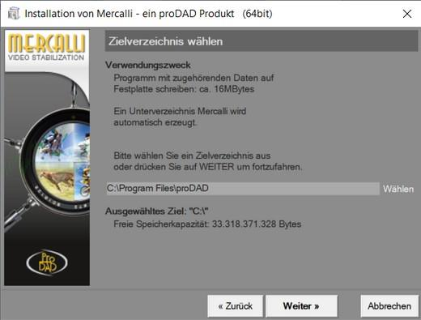

Folgen Sie nun den Installationsanweisungen.\
Mercalli kann danach per **Shortcut** auf dem Desktop

oder über **Start/Programme/proDAD/Mercalli SAL starten** geöffnet werden.

Beim **ersten** Programmstart von **Mercalli SAL** werden Sie zur Eingabe eines **Aktivierungscodes** (Seriennummer) aufgefordert, geben Sie den Code ein, den Sie bei elektronischer Lieferung mit der Download-Instructions-Email erhalten haben, oder falls Sie eine physische Lieferung (auf DVD) erhalten haben, innerhalb der Box vorfinden. Klicken Sie dann **Unlock**.

***WICHTIG:***\
*Beachten Sie das Ihr System im Moment der Aktivierung über eine Internetverbindung benötigt,* *nur dann kann die Aktivierung erfolgreich durchgeführt werden. Sollte ein Problem bestehen, dann* *prüfen Sie die Sicherheitseinstellungen (Firewall etc.) im System und wiederholen die Aktivierung.*

Wenn Sie Mercalli im **DEMO-Modus** testen möchten, dann klicken Sie **Continue with Demo Version**. Die Demoversion ist solange aktiv, bis eine Seriennummerneingabe die Lizenz zur Vollversion wandelt.

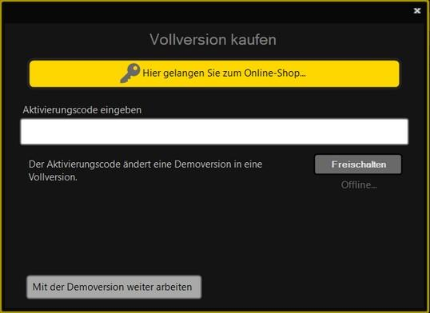

**Mercalli SAL** startet dann mit dem aktiven Register **Start**. Jetzt importieren Sie Ihr Videomaterial.

2. **Registrierung von Mercalli SAL**

Sie möchten Updates und weitere Informationen über Mercalli erhalten, dann registrieren Sie Ihr proDAD Mercalli unter http://www.prodad.de/register.html.

### 1.6. Systemvoraussetzungen

Mercalli SAL benötigt folgende Systemvoraussetzungen:

- 64bit Windows (Windows 7, 8, 10 oder 11)
- min. 8GB Hauptspeicher RAM, empfohlen sind 16GB RAM

### 1.7. Programmhilfe

Die **Programmhilfe** ist in Mercalli SAL oben rechts über das **?** erreichbar.

Die Anleitung in PDF-Form finden Sie auf der Produktseite (www.prodad.com).

Weiterhin werden verschiedene **Video-Workshops** zur Funktionalität von Mercalli SAL angeboten.

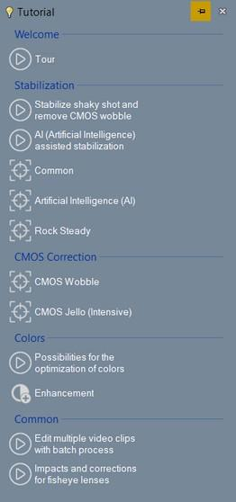

**Weitere Infoquellen au**[**f www.prodad.com:**](http://www.prodad.com/)

- FAQ
- Workshops
- Im Shop

### 1.8. Shortcuts

**Wichtige Shortcuts** zur Optimierung des Arbeitsablaufes in Mercalli SAL:

**Globale Shortcuts:**

| **Key** | **Funktion** |
| --- | --- |
| **Ctrl + O** | Projekt öffnen |
| **Ctrl + S** | Projekt sichern |
| **Ctrl + Shift + S** | Projekt unter neuem Namen sichern |
| **Ctrl + I** | Media-File importieren |
| **Ctrl + E** | Media-File(s) exportieren |
| **Ctrl + Z** | Undo Schritt durchführen |
| **Ctrl + Y** | Redo Schritt durchführen |
| **F7** | Analyse für alle Clips durchführen |
| **F8** | Lupe Ein/Aus |
| **F6** | Splitscreen Ein |
| **F5** | Splitscreen Aus |

**Nummern-Block (Ein) Shortcuts:**

| **Key** | **Funktion** |
| --- | --- |
| **Auf** | Vorheriges Video aktivieren (falls mehrere geladen sind) |
| **Ab** | Nächstes Video aktivieren (falls mehrere geladen sind) |
| **Rechts** | Nächstes Frame anzeigen |
| **Links** | Vorheriges Frame anzeigen |
| **Pos1** | Cursor to Cut-IN |
| **End** | Cursor to Cut-OUT |
| **Enter- oder Return-Taste** | Toggle playback |

**Timeline Shortcuts:**

| **Key** | **Funktion** |
| --- | --- |
| **Cursor rechts** | nächstes Frame anzeigen |
| **Cursor links** | Vorheriges Frame anzeigen |
| **I** | Cut-In setzen |
| **O** | Cut-Out setzen |
| **Space** | Wiedergabe starten |

## 2.Mercalli SAL im Detail

### 2.1. Programmstart

Mercalli SAL kann per **Shortcut** auf dem Desktop

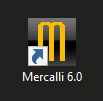

oder über **Start/Programme/proDAD/Mercalli SAL starten** geöffnet werden.

**Mercalli SAL** startet mit dem aktiven Register **Start**, hier treffen Sie nun alle Einstellungen zur Stabilisierung Ihres Videos.

### 2.2. Mercalli SAL in der Übersicht (eigenständige Version)

**Die Arbeitsoberfläche von Mercalli SAL (eigenständige Version) im Detail.**

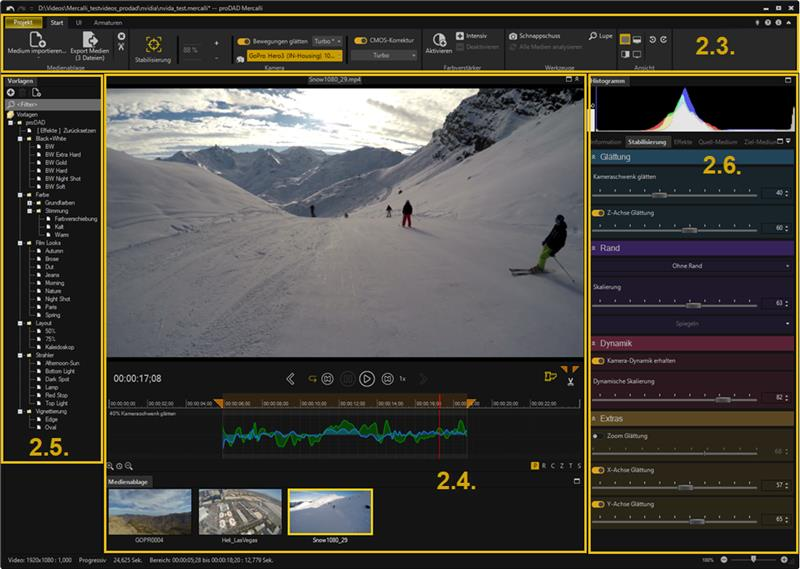

### 2.3. Ribbon

Das Ribbon unterteilt sich in die Tabs **Projekt**, **Start**, **UI** und **Armaturen**. Informationen zum **Export** bearbeiteter Videos finden Sie **hier**.

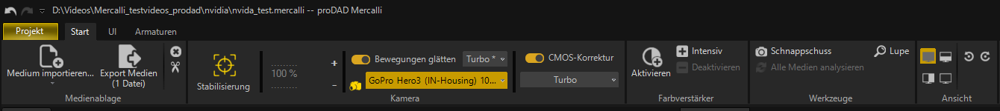

Im **Start** Tab finden Sie den Import/Export sowie alle Éinstellungen zur Stabilisierung, CMOS Korrektur, Fischaugen-Korrektur sowie zur Helligkeit- und Kontrastreinstellung (Dynamik).

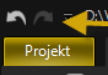

In jedem Programm ist die **Undo/Redo** Funktion sehr wichtig. Auch Mercalli SAL verfügt über die Möglichkeit Veränderungen rückgängig zu machen sowie wieder herzustellen.

#### 2.3.1. Projekt Tab - Projekt öffnen/speichern

In **Mercalli SAL** können jetzt alle durchgeführten Arbeiten in einem Projekt gespeichert werden, das Projekt können Sie jederzeit wieder laden und weiter bearbeiten. Das **Öffnen** eines Projekt, das **Anhängen** und **Sichern** ist direkt im Tab **Projekt** umsetzbar.

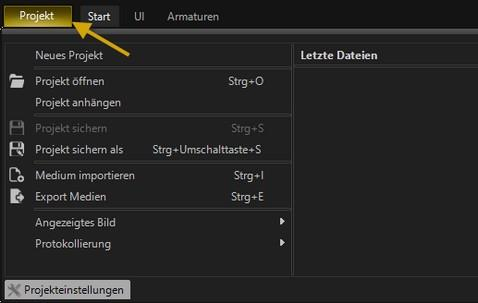

- Neues Projekt anlegen
- Projekt öffnen, lädt ein bestehendes Projekt
- Projekt anhängen, fügt ein weiteres Projekt dem aktuell bearbeiteten Projekt hinzu
- Projekt sichern als (Speichern mit Pfadangabe)

Zusätzlich können Sie hier **Medien importieren** und den **Export** von bereits bearbeiteten Medien starten. Ein **angezeigtes Bild** kann jetzt auch gedruckt bzw. eine Druckvorschau angezeigt werden. Mercalli SAL bietet auch das Speichern, Anzeigen und Drucken einer **Protokollierung**, die bei evt. verfügbaren Problemen für den den proDAD Support nützlich sein kann.

In den **Projekteinstellungen** sind grundlegende Einstellungen zum Mercalli-Projekt wählbar.

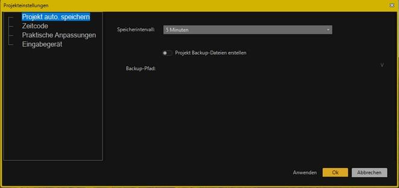

#### Veränderungen rückgängig/wiederherstellen

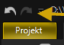

In jedem Programm ist die **Undo/Redo** Funktion sehr wichtig. Auch Mercalli SAL verfügt über die Möglichkeit Veränderungen rückgängig zu machen sowie wieder herzustellen.

#### 2.3.2. Start Tab

Im **Start** Tab finden Sie den Import/Export sowie alle Éinstellungen zur Stabilisierung, CMOS Korrektur, Fischaugen-Korrektur sowie zur Helligkeit- und Kontrastreinstellung (Dynamik im Farbverstärker).

##### 2.3.2.1. Medium importieren

Dann stehen Ihnen 4 Möglichkeiten zum **Import** von Videos zur Verfügung.

1. **Datei wählen** (zum Import von Videodateien)
2. **Ordner wählen** (zum Import von Bilddateien aus einem Ordner, Mercalli erzeugt daraus ein Video)
3. **Hier klicken, um Medien zu öffnen** (zum Import von Videodateien)
4. **Import von Videos via Drag & Drop** aus dem Arbeitsplatz, direkt in die Vorschau von Mercalli SAL

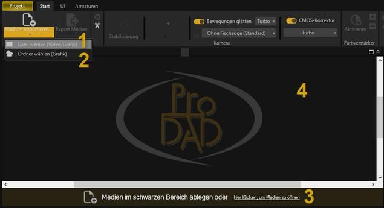

##### 2.3.2.2. Export Medien

**Mercalli SAL** bietet einen umfassenden Videoexport an. Sie können zahlreiche vorinstallierte Exportvorlagen auswählen aber auch individuell bearbeiten. Videos können einzeln exportiert bzw. mehrere Videos in eine Videodatei zusammengefasst werden.

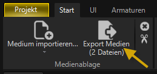

Natürlich ermöglicht Mercalli SAL auch das Analysieren und Exportieren mehrerer Videos in einem Arbeitsgang (Batchverarbeitung).

###### 2.3.2.2.1. Exporteinstellungen

Nach der Bearbeitung der Videos erfolgt zum Abschluss der finale Videoexport.\
Markieren Sie die bearbeiteten Videos im Tab Quell-Medium, die Sie exportieren möchten.

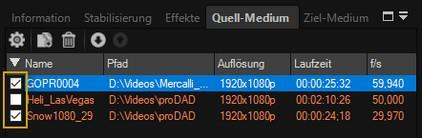

Die markierten Videos können dann exportiert werden. Hier wird Ihnen nochmal die Anzahl der zu exportierenden Videos (aus dem Tab **Quell-Medium**) angezeigt.

Klicken Sie dazu im Ribbon auf **Export Medien**. Es öffnet der Dialog **Medium exportieren**.

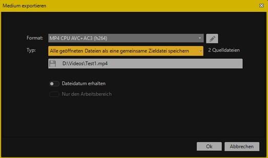

Sie können nun eine gewünschte **Export-Formatvorlage** wählen

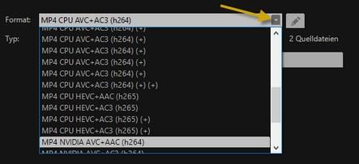

Es ist auch möglich eigene Export-Formateinstellungen vorzunehmen.

Nach der Auswahl der Formatvorlage erfolgt die Auswahl des Export-Typs.

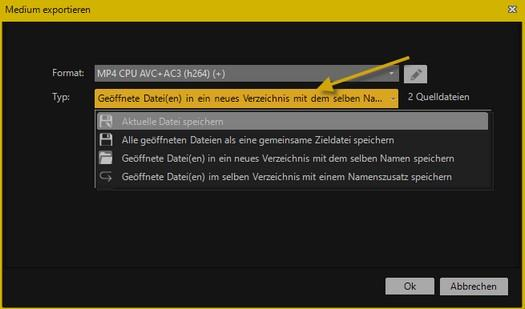

Es besteht die Möglichkeit die aktuelle Datei zu speichern, Alle geöffneten Dateien als eine gemeinsame Zieldatei zu speichern, Geöffnete Datei(en) in ein neues Verzeichnis mit dem selben Namen zu speichern sowie Geöffnete Datei(en) im selben Verzeichnis mit neuen Namenszusatz zu speichern.

Darunter wählen Sie dann den gewünschten **Exportpfad**.

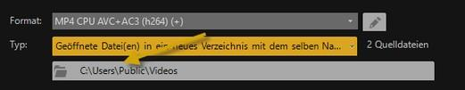

Weiterhin können Sie festlegen, ob das **Dateidatum erhalten** bleiben soll und ob nur der **gewählte Arbeitsbereich (Trimmbereich)** exportiert werden soll.

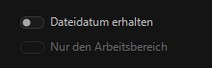

Starten Sie danach den Export durch Klick auf **OK**. Danach können Sie die Videos mit einem installierten Software-Player abspielen.

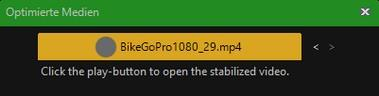

Des weiteren stehen die exportierten Videos im Tab **Ziel-Medium** zur Verfügung.

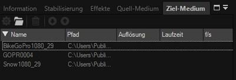

###### 2.3.2.2.2. Format-Einstellungen bearbeiten

Klicken Sie im **Ribbon** auf **Export Medien**. Es öffnet der Dialog **Medium exportieren**.

Sie können nun eine gewünschte **Export-Formatvorlage** wählen

und auch **eigene** Export-Detaileinstellungen vornehmen. Klicken Sie dazu auf die Option **Formateinstellungen bearbeiten**.

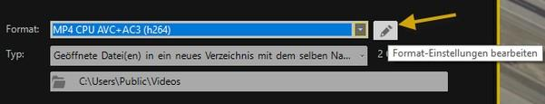

Im Dialog **Formateinstellungen bearbeiten** können Sie nun die **gewählte Vorlage bearbeiten**. Klicken Sie dazu auf das **(+)** Symbol, danach können Sie zuerst den **Vorlagen-****Namen** ändern, eine der **3 Qualitätsstufen** (Niedrig/Mittel/Hoch) auswählen und Einstellungen zum **Videocodec, Format und Größe** vornehmen. Die Einstellungen zum Video können auch ein- und ausgeschaltet werden.

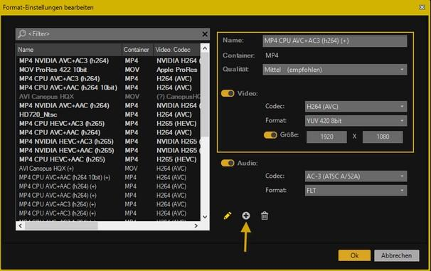

Weiterhin gibt es auch individuelle Einstellungen zum **Audio** bzgl. des **Codecs** und des **Formats**. Die Einstellungen zum Audio können auch ein- und ausgeschaltet werden.

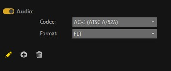

Formateinstellungen können auch hinzugefügt und gelöscht werden. Mit **OK** übernehmen Sie die Änderungen in den Formateinstellungen, eine neue **individuelle Formatvorlage** wird erstellt, sie kann nun zum Export genutzt werden.

###### 2.3.2.2.3. Die Batchverarbeitung im Detail

In **Mercalli** ist eine Batchverarbeitung von mehreren Videos als einzelne Videos bzw. als zusammengeführte Videos möglich.

Es gibt folgende Wege der **Batchverarbeitung**:

1. **Videoanalyse einzelner Videos mit Videoanalyse und anschließendem Export aller markierten Videos in eine gemeinsame Datei**

Importieren Sie **ein Video** in Mercalli, wählen z.B. die Stabilisierungseinstellungen und analysieren das Video. Importieren Sie weitere Videos und analysieren diese. Danach stehen diese im Tab **Quell-Medium** zur Verfügung. Sie können nun nachträglich verschiedene Einstellungen zur Stabilisierung ändern, markieren Sie dazu das entsprechende Video im im Tab **Quell-****Medium**.

Auch ein Playback vom jeweilig markierten Video kann in der Vorschau gestartet werden.

***Hinweis:***\
In der **Medienablage** unterhalb der Timeline können Sie jetzt die Videos per Drag & Drop sortieren, wenn Sie alle Videos in eine gemeinsame Datei zusammenfassen möchten.

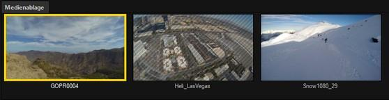

Sie können auch einzelne Videos in der Medienablage markieren und zusätzlich den Farbverstärker bzw. weitere Effekte anwenden.

Die markierten Videos können dann exportiert werden. Klicken Sie dazu im Ribbon auf **Export Medien**.

Hier wird Ihnen nochmal die Anzahl der zu exportierenden Videos (aus dem Tab **Quell-Medium**) angezeigt. Beachten Sie nun die Einstellungen zum Export.

Sie können nun eine gewünschte Export-Formatvorlage wählen, eigene Export-Detaileinstellungen, den Typ und den Exportpfad wählen. Starten Sie danach den Export durch Klick auf **OK**.

In diesem Beispiel wurde eine **gemeinsame Videodatei** (aus den 2 markierten Videos im Tab Quell-Medium) in einem selbstgewählten Verzeichnis (siehe Shot Medium exportieren) erstellt. Das Video wird nun im Tab **Ziel-Medium** angezeigt.

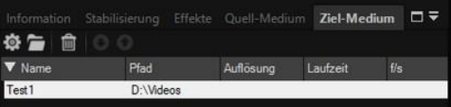

2. **Videoanalyse und Export zusammen in einem Vorgang**

Importieren Sie zuerst **mehrere Videos** in Mercalli und wählen für jedes Video z.B. die Stabilisierungseinstellungen aus. Dann markieren Sie im Tab **Quell-Medium** alle Videos die analysiert und exportiert werden sollen. Sie können auch einzelne Videos in der Medienablage markieren und den Farbverstärker bzw. weitere Effekte anwenden.

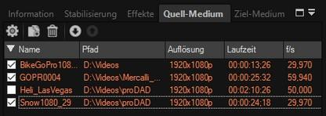

Klicken Sie zum Start der Videoanalyse und des Exports im Ribbon auf **Export Medium**. Hier wird Ihnen die Anzahl der zu analysierenden und exportierenden Videos angezeigt, beachten Sie nun die Einstellungen zum Export. Sie können nun eine gewünschte Export-Formatvorlage wählen, eigene Export-Detaileinstellungen, den Typ und den Exportpfad wählen. Starten Sie danach den Export durch Klick auf **OK**.

Die zum Export stehenden Videos werden nun automatisch nacheinander analysiert und exportiert.\
In diesem Beispiel wurden 3 markierte Videos im Tab Quell-Medium in ein selbstgewähltes Verzeichnis exportiert. Die Videos werden nun im Tab **Ziel-Medium** angezeigt.

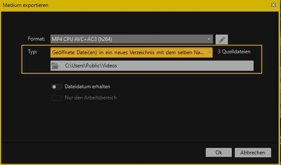

Danach können Sie die Videos mit einem installierten Software-Player abspielen.

Des weiteren stehen die exportierten Videos im Tab **Ziel-Medium** zur Verfügung.

***Hinweis:***\
*Nachträgliche Änderungen von Stabilisierungseinstellungen sind möglich, einfach das Video in der* ***Tab Quell-Medium*** *markieren, die neuen Einstellungen treffen und danach ohne weitere Analyse* *mit den neu gewählten Eigenschaften exportieren.*

Je nachdem, welches Export-Format Sie gewählt haben, steht Ihnen nun diese Datei (Ihr stabilisiertes Video) zur weiteren Verwendung (z.B. zum Brennen auf eine DVD oder Blu-ray) zur Verfügung. Sie können die Datei aber auch in eine Videoschnittsoftware importieren und dort weiter verarbeiten.

##### 2.3.2.3. Medienablage leeren - Szenenerkennung

Die Option **Medienablage leeren (1)** entfernt alle importierten Medien in Mercalli SAL.

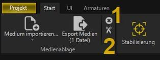

Aktivieren Sie zunächst die Option **Szenenerkennung (2)**, dann laden Sie ein Video über die Option **Medien importieren** und die Szenenerkennung startet automatisch. In der **Medienablage** werden die einzelnen Szenen als Thumbnail abgelegt und gekennzeichnet. Die Option **Medienablage leeren** entfernt alle Szenen aus der Medienablage.

##### 2.3.2.4. Stabilisierung - Videoanalyse starten

**Stabilisierung - Videoanalyse starten**

Nach dem Import eines Videos aktivieren Sie zuerst die **Stabilisierung (1)**

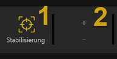

bzw. lösen die Videoanalyse aus.

Die **Videoanalyse** ist für die Korrektur/Glättung der Kamerabewegungen notwendig. Nach Abschluss der Videoanalyse ist das Video stabilisiert, Sie können jedoch weitere Detaileinstellungen bzw. Optimierungen vornehmen.

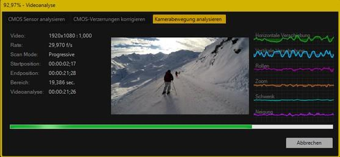

**Skalierung einstellen - Bewegung glätten**

Die Option **Skalierung +/- (2)** kann durch stärkeres Heranzoomen die Stabilsierung verbessern.

Die Option **Bewegung glätten** ermöglicht das Ein- bzw. Ausschalten der Stabilisierung eines Videos.

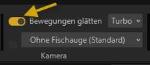

**Methoden zur Glättung der Kamerabewegungen**

Mit Hilfe verschiedener Methoden zur Glättung der Kamerabewegungen können Sie Ihr verwackeltes Video analysieren und korrigieren lassen. Wählen Sie dazu eine geeignete **Methode** (voreingestellt ist die Methode **Turbo**) aus.

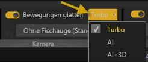

1. **Turbo**, diese Methode ermöglicht eine schnelle und sehr robuste Videoanalyse mit guten bis sehr guten Ergebnissen.
2. **AI** ermöglicht eine Videoanalyse, die von künstlicher Intelligenz unterstützt wird. Bei schwierigen Szenen/Videos werden so oft bessere Resultate erzielt.
3. **AI+3D**, hiermit wird zusätzlich auch das Kippen der Kamera analysiert, so werden störende perspektivische Effekte reduziert.

##### 2.3.2.5. Fischaugen-Optik korrigieren

Durch Auswahl der korrekten **Kameraoptik** kann ein möglicher Fischaugen-Effekt (bedingt durch die Linsenkrümmung) im Video/Foto entfernt werden.

Wenn in Ihrem Video **kein Fischaugen-Effekt** verfügbar ist, dann wählen Sie **Ohne Fischauge (Standard)** aus.

Ist in Ihrem Video ein **Fischaugen-Effekt** verfügbar, dann wählen Sie hier das zu Ihrer Kamera und Auflösung passende **Kameraprofil** aus.

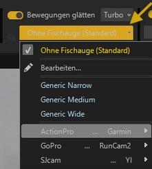

Klicken auf die Option **gewölbte Darstellung einer Fischaugen-Optik korrigieren und Linienzüge gerade richten**.

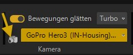

Danach wird das korrigierte Video sofort in der Vorschau angezeigt.\
Sollte Ihre Kamera nicht gelistet sein, dann probieren Sie die 3 Generic-Profile.

Über **Bearbeiten** gelangen Sie in die **intrinsischen Eigenschaften**:

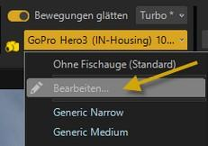

Zum Zeitpunkt des Öffnens werden die aktuellen **intrinsischen Eigenschaften** im Dialog dargestellt. Die im Dialog möglichen Werteänderungen sind vergleichbar mit der Auswahl eines der Profile. Die ersten zwei der drei Modi sind technische Methoden, deshalb ist rechts auch dazu nichts änderbar.

Ist **Fischauge entfernen** gewählt, so ist das gleichbedeutend mit dem Button im **Ribbon**. Nur bei **Anpassen** kann die rechte Seite variiert werden. Die Vorschau zeigt nach einer Werteänderung sofort die Wirkung. Ist kaum was sichtbar, dann ist vermutlich der resultierende optische Unterschied der linken zu den rechten Parametern nicht groß.

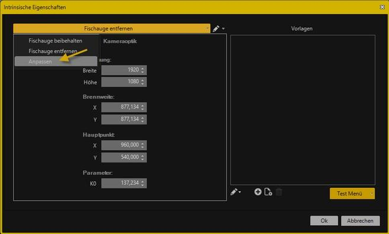

##### 2.3.2.6. CMOS Korrektur (Turbo, Wobbeln entfernen + Intensive Reparatur)

Bereinigen Sie Ihre Filme zuerst von störenden **CMOS-Effekten** und danach erhalten Sie noch bessere Stabilisierungsergebnisse, denn zitter- und wabbelfreie Bilder sind die bessere Grundlage für eine darauf folgende Stabilisierung unerwünschter Kamerabewegungen!

**Fast alle Actioncameras**, DSLR Kameras sowie auch professionelle Video-Kameras verfügen über sogenannte CMOS-Sensoren. Sind diese Kameras z.B. Erschütterungen oder Vibrationen ausgesetzt, dann verläuft die Aufzeichnung einzelner Bildzeilen fehlerhaft und es kommt naturgemäß zu diesen Bildfehlern. Bereinigen Sie Ihre Videos zuerst von diesen störenden CMOS-Effekten. Das ist die optimale Grundlage für bessere Stabilisierungsergebnisse. Die folgende Stabilisierung unerwünschter Kamerabewegungen ist auf Basis von zitter- und wabbelfreien Bilder optimaler!

Mercalli SAL bietet dazu umfangreiche Anpassungsmöglichkeiten, die Anwendung des Programms ist jedoch einfach, da grundsätzlich die Stabilisierung und auch die CMOS-Korrektur vollautomatisch erfolgen. Die Feineinstellung ist natürlich zusätzlich gegeben – so haben Sie immer die Möglichkeit einzugreifen.

**Aktivierung der CMOS-Korrektur** (Rolling-Shutter-Effekt)

Mit der Aktivierung der **CMOS-Korrektur** wird eine mögliche Verzerrung, die bei bewegten Bildern (Video) auftreten kann, ausgeglichen. Standardmäßig ist die Option **CMOS-Korrektur** aktiviert.

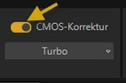

Solange eine Aufnahme nicht stabilisiert wurde, ist der Rolling-Shutter-Effekt nicht oder nur dezent auffällig. Sobald aber eine Stabilisierung in der Post-Production erfolgreich war, verbleibt der Rolling-Shutter Effekt und wirkt nun dezent bis deutlich störend.\
Deshalb wirkt Mercalli auch diesem unerwünschten Effekt auf Wunsch entgegen – denn eine stabilisierte Aufnahme bleibt erst einmal wertlos, wenn der unerwünschte Folgeeffekt das Ergebnis wiederum zunichte macht.\
Weiterhin bietet Mercalli SAL verschiedene **CMOS-Korrekturmethoden** zur Auswahl an, wie **Turbo**, **Wobbeln entfernen** sowie differenzierte Einstellungen (**Intensive Reparatur**) zur Gegenwirkung von **Vibrationen** und **Wellen**. Möchten Sie die **vollautomatische CMOS-****Korrektur** im Video weiter optimieren, dann wählen Sie eine der verfügbaren Methoden zur **Reduzierung von CMOS-Sensor Bildverzerrungen** im Menü aus, bis Sie die bestmögliche Optimierung erzielt haben.

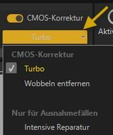

1. **Turbo**, ermöglicht eine extrem schnelle Korrektur der am häufigsten auftretenden CMOS Verzerrungen. Turbo arbeitet nur in Kombination mit der Glättung der Kamerabewegungen.
2. **Wobbeln entfernen**, beseitigt sehr störende puddingartige Verzerrungen im Video.
3. **Die Intensive Reparatur** beseitigt wellenförmige Bildverzerrungen durch eine rechenintensive Korrektur. Sie können verschiedene **Stufen** zur intensiven CMOS-Korrektur einstellen.

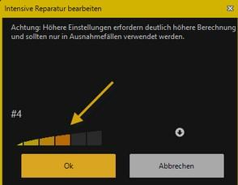

Weiterhin sind weitere Detaileinstellungen zur **intensive Reparatur** verfügbar.

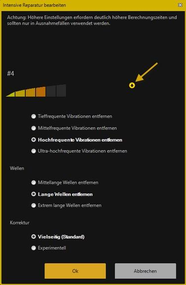

##### 2.3.2.7. Farbverstärker

In **Mercalli SAL** können Sie über den **Farbverstärker** automatisch **Helligkeits- und Kontrasteinstellungen** (Dynamik) im Video/Foto optimieren, die Dynamik-Einstellung kann per einfachen Mausklick eingeschaltet, verstärkt und ausgeschaltet werden.

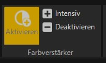

##### 2.3.2.8. Schnappschuss - Alle Medien analysieren - Lupe

Durch Mausklick kann ein **Schnappschuss** (Einzelbild) von der aktuellen Timiline-Cursor-Position erstellt und gespeichert werden.

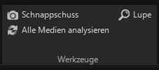

Die Option **Alle Medien analysieren** startet die Videoanalyse für alle importierten und markierten Videos im Projekt.

Die **Lupe** ermöglicht die vergrößerte Darstellung eines Bildbereiches im Vorschau-Monitor. Aktivieren Sie dazu die Lupe und bewegen die Maus in die Vorschau, nun wird ein selbst gewählter Ausschnitt im Video vergrößert dargestellt.

##### 2.3.2.9. Ansichten (Ergebnis + Vertikal/Horizontal + Original)

Mercalli SAL bietet **4** verschiedene Ansichten in der Vorschau an.

1. **Ergebnis anzeigen** (zeigt das stabilisierte Video in der Vorschau an)
2. **Horizontal vergleichen** (Gegenüberstellung Original / Stabilisiert im horizontalen Splitscreen)
3. **Vertikal vergleichen** (Gegenüberstellung Original / Stabilisiert im vertikalen Splitscreen)
4. **Original anzeigen** (zeigt das Original-Video in der Vorschau an)

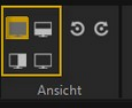

##### 2.3.2.10. Rotation einstellen

**Mercalli SAL** bietet oben rechts im Menü die Einstellungsmöglichkeit zur **Rotation** des Videos. Ein Klick auf die Option **Rotation um 90Grad gegen Uhrzeigersinn** bzw. **Rotation um 90Grad im Uhrzeigersinn** bewirkt eine Drehung des Videos in die jeweilige Richtung. Die Rotation um 90Grad ändert die Anzeige-Ausrichtung, aber nicht die Pixel. Weitere Einstellungsmöglichkeiten zur Rotation in Z-Richtung finden Sie unter Effekte/Layout/Rotation.

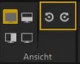

#### 2.3.3. UI Tab

Im **UI Tab** können Sie festlegen, was in der Mercalli SAL Arbeitsoberfläche angezeigt werden soll. Sie können die Medienablage, Vorlagen, Protokollierung, Histogramm und Eingabegerät zusätzlich ein- bzw.ausschalten.

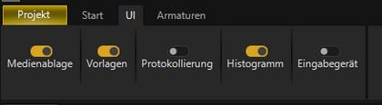

#### 2.3.4. Armaturen Tab

Klicken Sie auf das **Armaturen Tab**, dann werden Ihnen im oberen Bereich von Mercalli SAL verschiedene Anzeigeinstrumente abgebildet, die die vorgenommenen Einstellungen zur Stabilisierung und CMOS Korrektur symbolisieren.

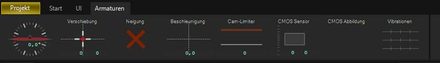

### 2.4. Timeline - Vorschau - Medienablage - Diagramme

Sie erhalten hier wichtige Informationen zu den Funktionen in der **Timeline (inkl. Trimmbereich festlegen)**, zur **Vorschau** mit den Steuerungselementen sowie zur unten verfügbaren **Medienablage**, wenn sie im Tab **UI** eingeschaltet wurde.

**Diagramme** bilden die graphische Darstellung der Korrektur der Kamerabewegungen (Stabilisierung Und CMOS Korrektur) ab. Mercalli SAL bietet Diagramme zur 1. Verschiebung, Rollen, CMOS-Sensor, Zoom, Neigung und Zoom-In Dynamische Skalierung an.

#### 2.4.1. Vorschau - Steuerungselemente

Nach dem Import kann das Video in der Mercalli-Vorschau via **Steuerung** = Steuerung des Playbacks wie **Play (6)** abgespielt werden. Ein Klick auf **Pause (5)** stoppt das Video.

Die **Zeitinformation (1)** des Videos (aktuell = 03 Sekunde / Bild 23) ist links unterhalb der Vorschau verfügbar. Sie können auch zwischen den importierten Videos in der Vorschau wechseln, **vorheriges Video (2)** und **nächstes Video (9)**. Auch eine **Wiederholung (3)** des Videos ist umsetzbar. Der **Schalter (4)** springt an den Videoanfang oder an den Anfang des Trimmbereiches, der **Schalter (7)** springt ans Videoende oder an das Ende des Trimmbereiches. Mit dem **Schalter (8)** verändern Sie durch mehrfachen Klick die Wiedergabegeschwindigkeit stufenweise. In der Timeline symbolisiert der rote **Abspielmarker (10)** die aktuelle Position im Video.

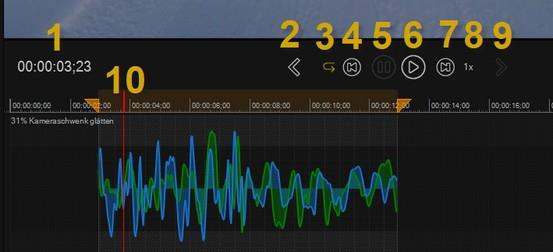

Die **Vorschaugröße** können Sie über den Schieber unten rechts im Programm anpassen.

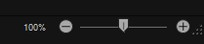

#### 2.4.2. Timeline und Trimmbereich definieren

Unterhalb der Vorschau befindet sich die **Timeline** von Mercalli SAL, hier können Sie einen **Trimmbereich** festlegen. Dann wird nur dieser Bereich bei der Stabilisierung und Export berücksichtigt.

Der rote **Abspielmarker (1)** zeigt die aktuelle Position im Video an. Setzen Sie jetzt über die orangen **In/Out Marker (2)** einen bestimmten **Trimmbereich (3)** im Video, dann wird nur dieser bearbeitet und beim Export des Videos berücksichtigt.

Das **Scheren-Symbol (4)** schneidet das Video an der aktuellen Position des Abspielmarkers, vorausgesetzt der Abspielmarker befindet sich im gewählten Trimmbereich.

Der **Trimm-Modus (5)** kann aktiviert und deaktiviert werden. Im aktivierten Zustand können die IN-und OUT-Punkte bearbeitet werden. Somit kann die Videoanalyse verändert werden. Im nicht aktivierten Zustand können die IN-und OUT Arbeitspunkte gewählt werden, die Videoanalyse ändert sich nicht. Zur besseren Übersicht wird die Timeline auf die festgelegten IN-und OUT-Punkte reduziert.

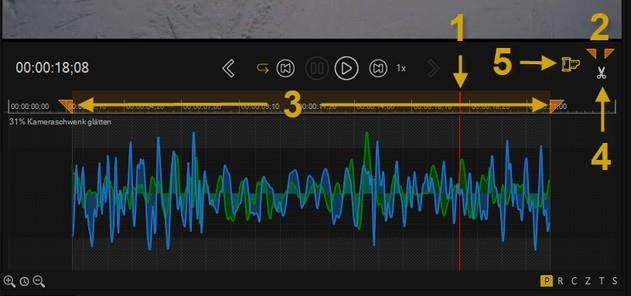

#### 2.4.3. Medienablage

Die **Medienablage** kann im UI Tab aktiviert werden, danach erscheint sie unterhalb der Timeline von Mercalli SAL.\
In der **Medienablage** werden importierte/bearbeitete Videos sowie erkannte Szenen als Thumbnail angezeigt und nacheinander aufgereiht. Sie können hier in der **Reihenfolge** per Drag & Drop verändert werden. Via Rechtsklick öffnet ein Menü mit Funktionen, wie Ausschneiden, Kopieren, Einfügen, Löschen, Umbenennen und Auswählen zur Verfügung stehen, auch Video-Eigenschaften können angezeigt werden.

***Hinweis:***\
*Die Clip-Reihenfolge ist wichtig, wenn alle Medien in eine Datei exportiert werden sollen.*

Die **Medienablage** verhält sich synchron mit dem Menü Quell-Medium.

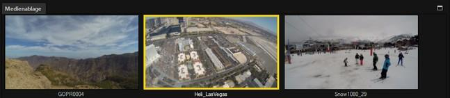

Wenn Sie im Tab **Quell-Medium** Videos/Szenen abwählen,

dann werden die Thumbnails in der **Medienablage** schraffiert dargestellt. Diese Videos/Szenen werden dann nicht exportiert.

#### 2.4.4. Diagramme

**Diagramme** bilden die graphische Darstellung der Korrektur der Kamerabewegungen (Stabilisierung und CMOS Korrektur) ab. Mercalli SAL verfügt über Diagramme zum Kameraschwenk glätten (Verschiebung), Z-Achse (Rollen), CMOS-Sensor, Zoom Glättung, X/Y-Achse Glättung und Zoom-In - Dynamische Skalierung an.

##### 2.4.4.1. Kameraschwenk glätten

Im Diagramm **Kameraschwenk glätten** wird die Bewegung im Video bzgl. der\
Verschiebungen in **X-Y-Richtung** (horizontal/vertikal) angezeigt.

Mit dem Schieber Kameraschwenk glätten im Tab **Stabilisierung/Glättung**

gleichen Sie die Gesamtbewegungen im Video aus. Wird der Schieber weiter nach rechts verschoben, so stabilisiert Mercalli mehr, das Video wirkt ruhiger. Der Schieber **Kameraschwenk glätten** bewirkt die größte visuelle Veränderung (Glättung der Bewegungen im Video). Auch im Diagramm **Kameraschwenk glätten (Verschiebung)** sind Veränderungen in der Korrektur-Kurve sichtbar.

Wenn Sie nahezu alle unerwünschten Bewegungen, die durch ein im Diagramm **Verschiebungen** signalisiert werden, entfernen möchten, dann bewegen Sie den Schieber **Skalierung** im Tab **Stabilisierung/Rand/ohne Rand**

nur soweit als nötig nach rechts (mehr Zoom IN), um die Original-Auflösung im stabilisierten Ergebnis weitestgehend zu erhalten. Wählen Sie **Beste Stabilisierung** im Tab im Tab **Stabilisierung/Rand** aus, dann zoomt Mercalli automatisch tiefer ins Video, es wird dann kein Rand angezeigt.

Die schaffrierte Markierung (oben / unten im Diagramm sichtbar), die die Begrenzung der max. Bewegungen im Video anzeigt, wird dementsprechend nach Veränderung des Schiebers **Skalierung** in der Höhe angepaßt.

##### 2.4.4.2. Z-Achse (Rollen mit Ein/Aus)

Im Diagramm **Rollen** wird die Bewegung im Video bzgl. Rotation um die **Z-Achse** angezeigt. Bewegen Sie die Maus direkt in das Diagramm, so werden auch Momentanwerte angezeigt.

Wenn kein Diagramm zum **Rollen** angezeigt wird, dann ist im Tab **Stablisierung/Glättung** der

Schieber **Z-Achse** deaktiviert, dann ist keine Korrektur und keine Anzeige der Stabilisierung um die Z-Achse verfügbar.

Die schaffrierte Markierung (oben / unten im Diagramm sichtbar), die die Begrenzung der max. Rotationsbewegung im Video anzeigt, wird dementsprechend nach Veränderung des Schiebers Skalierung in der Höhe angepaßt. Die unerwünschten Bewegungen, die durch ein

im Diagramm signalisiert werden, können damit beseitigt werden.

##### 2.4.4.3. CMOS-Sensor (mit Ein/Aus)

Die vollautomatische CMOS-Korrektur beseitigt CMOS-Sensor bedingte Schwächen im Nachhinein. Die grüne Kurve zeigt die Korrektur (Entgegenwirken) durch Mercalli an, die orange Kurve zeigt den Restfehler (nicht korrigierbar) an. Bewegen Sie die Maus direkt in das Diagramm, so werden auch Momentanwerte angezeigt.

Wenn kein Diagramm zur **CMOS-Korrektur** angezeigt wird, dann ist im Ribbon die CMOS-Korrektur deaktiviert.

##### 2.4.4.4. Zoom Glättung (mit Ein/Aus)

Im Diagramm **Zoom Glättung** wird die Bewegung im Video bzgl. des **Zooms** angezeigt.

Die Korrektur und die Anzeige im Diagramm ist abhängig von der Position des Schiebers **Zoom Glättung** im Tab **Stablisierung/Extras**. Wird der Schieber **Zoom Glättung** weiter nach rechts verschoben, so wird der Zoom auf mehrere Bilder verteilt, es entsteht ein harmonischer Zoom.

Wenn kein Diagramm zu den **Zoom-Korrekturen** angezeigt wird, dann ist im Tab **Stablisierung/Extras** der Schieber **Zoom Glättung** deaktiviert.

##### 2.4.4.5. X/Y - Achse Glättung (Schwenk + Neigung)

Im Diagramm **X/Y-Achse Glättung (Schwenk + Neigung)** wird die Bewegung im Video bzgl. Kippen um die **X/Y-Achse** angezeigt. Bewegen Sie die Maus direkt in das Diagramm so werden auch Momentanwerte angezeigt.

Die Korrektur und die Anzeige im Diagramm ist abhängig von der Position der Schieber **X-Achse Glättung (Schwenk)** und **Y-Achse Glättung (Neigung)** im Tab **Stabilisierung/Extras**. Verschieben Sie die Schieber **X/Y-Achse Glättung**, so wird die Korrektur bezogen auf die Rotation um die X/Y-Achse verändert. Im Diagramm wird die Veränderung in Kurvenform sichtbar.

Wenn kein Diagramm zur **X/Y-Achse Glättung** angezeigt wird, dann sind im Tab **Stablisierung/Extras** die Schieber **X/Y-Achse Glättung** deaktiviert.

##### 2.4.4.6. Zoom-In - Dynamische Skalierung

Die Cyan-farbige Linie zeigt den verwendeten Zoom-In an der entsprechenden Zeitposition im Diagramm.\
Ein hoher Dyn-Scale Wert (**Dynamische Skalierung** im Tab **Stabilisierung/Extras**) reduziert Zoom-In-Bedarf. Das wird durch einen schnellen Wechsel des Zooms erzielt.

***Hinweis:***\
*Je nach Position des Schiebers* ***Dynamische Skalierung*** *variiert auch der Zoom-Bedarf pro* *Zeitposition. Der Maximalwert ist immer konstant, der Minimalwert kann jedoch bei einer höheren* *Dynamik sinken (muss jedoch nicht).*

Minimal 106% und Maximal 110% - verwendeter Zoom-In

Minimal 103% und Maximal 111% - verwendeter Zoom-In

### 2.5. Vorlagen

Hier stehen Ihnen verschiedene voreingestellte Effekt-Vorlagen zur Anwendung bereit, die durch Doppelklick auf ein Video/Foto übernommen werden können. Sie können auch neue Vorlagen erstellen (+), Vorlagen löschen (-) und neue Effekt-Verzeichnisse anlegen. Nach Übernahme einer Vorlage können Sie in den Effekten weitere Feineinstellungen zum Effekt vornehmen oder den Effekt bzw. die Vorlage entfernen.

**Effekteinstellungen** können Sie auch als **neue Vorlage** speichern. Treffen Sie zunächst alle Einstellungen im Tab Effekte, dann klicken Sie oben im Tab **Vorlagen** auf das **(+)** oben links. Dann markieren Sie, welche Effekteinstellungen in der neuen Vorlage gespeichert werden sollen und übernehmen sie mit OK. Danach wird die neue Vorlage im Tab **Vorlagen** eingefügt.

### 2.6. Panel Tabs

In **Mercalli SAL** sind weitere **5 Tabs** verfügbar, in denen folgendes angezeigt bzw. eingestellt werden kann:

#### 2.6.1. Information

Im Tab **Information** werden Ihnen Informationen/Details zum aktuell ausgewählten Video angezeigt.

#### 2.6.2. Stabilisierung

Im Tab **Stabilisierung** befinden sich die detaillierten Einsteller zur Korrektur der Kamerabewegung.

##### 2.6.2.1. Glättung - Kameraschwenk glätten

Mit dem Schieber **Kameraschwenk glätten** gleichen Sie die Gesamtbewegungen im Video aus. Wird der Schieber weiter nach rechts verschoben, so stabilisiert Mercalli mehr, das Video wirkt ruhiger. Der Schieber **Kameraschwenk glätten** bewirkt die größte visuelle Veränderung (Glättung der Bewegungen im Video).

Auch im Diagramm Kameraschwenk glätten (Verschiebung) sind Veränderungen in der Korrektur-Kurve sichtbar.

##### 2.6.2.2. Glättung - Z-Achse Glättung

Der Schieber **Z-Achse Glättung** bewirkt eine Korrektur des Videos bzgl. der Bewegungen (Rotation) um die **Z-Achse**. Im Diagramm Rollen sind Veränderungen in der Korrektur-Kurve sichtbar.

Der Schieber **Z-Achse Glättung** kann auch deaktiviert werden, aber nur wenn zuvor der Schieber **Zoom Glättung** deaktiviert wurde. Klicken Sie einfach auf das Häkchen im Tab **Stabilisierung**. Dann erfolgt im Video keine Korrektur der **Rollbewegung (Z-Achse)**.

Der Schieber **Z-Achse Glättung** wird z.B. deaktiviert, wenn Rollbewegungen von Mercalli nicht ausgewertet werden können, bzw. wenn nur Schwenks stabilisiert werden sollen.

##### 2.6.2.3. Rand

**2.6.2.3.1.** Bei Auswahl der Option **Ohne Rand** erscheint im stabilisierten Video **kein Rand**. Der Rand wird eliminiert, indem in das Video rein gezoomt wird. Dies erfolgt in Abhängigkeit der Verwacklungen und der gewünschten Stärke der Korrektur und der damit verbunden Einstellung mit dem Schieber **Skalierung**.

Weitere Hinweise zum Thema **Ränder** (Randbearbeitung) können Sie in den FAQs im Supportbereich auf www.prodad.com finden.

**2.6.2.3.2.** Bei Auswahl der Option **Beste Stabilisierung** erscheint u.U. im stabilisierten Video ein schwarzer **Rand**. Dieser kann von Bild zu Bild unterschiedlich sein, je nach Stärke der Verwacklung in der aktuellen Situation.

Der sichtbare Rand kann durch **Solide (schwarz), Wiederholen und Spiegeln** ersetzt werden.

\- **Solide** = schwarz\
- **Spiegeln** und **Wiederholen** bedeuten, das vorhandenes Bildmaterial in die Ränder gerechnet wird, einmal durch spiegeln oder durch wiederholen.

Mit dem Schieber **Skalierung** kann in das Video gezoomt werden, der Rand wird weiter minimiert.\
Zu starker **Zoom-In** kann eine Unschärfe (Blur, grobkörniges Bild etc.) im Video auslösen.

**2.6.2.3.3.** In der **Forensische Ansicht** erfolgt die Anzeige in einem ausgezoomten Zustand und ohne Begrenzungen. Durch das rein zoomen in eine Szene kann die erfolgte Korrektur von Mercalli besser beurteilt werden. Der Schieber **Skalierung** unterstützt Sie beim Zoom IN/OUT.

##### 2.6.2.4. Dynamik

Mit Hilfe der Option **Kamera-Dynamik erhalten** soll die Lebendigkeit im Video beibehalten bleiben, d.h. evt. gewollte Kamerabewegungen des Filmers sollen nicht geglättet oder stabilisiert werden.

Sollte aus einer normal aus der Hand gefilmten verwackelten Kamera-Aufnahme diese als **Stativ-****Aufnahme** stabilisiert werden, dann sollte die Option **Kamera-Dynamik erhalten** deaktiviert werden.

Die **Dynamische Skalierung** ermöglicht, das während der Stabilisierung die Stärke der Skalierung automatisch variiert. Bei stark verwackleten Videos wird stärker und bei eher ruhigen Videos weniger stark ins Bild gezoomt.

Die Veränderungen sind im Diagramm Dynamische Skalierung sichtbar.

##### 2.6.2.5. Extras - Zoom Glättung - X/Y Glättung

**2.6.2.5.1.** Mit dem Schieber **Zoom Glättung** erfolgt eine Glättung der **Zoom-Bewegung** im Video.

Verschieben Sie den Schieber weiter nach rechts, so führt das zu einer stärkeren Glättung von Zoom-Veränderungen. Vorhandene Verwacklungen im Zoom werden somit ausgeglichen. Im Diagramm Zoom-Korrekturen sind Veränderungen in der Zoom-Korrektur-Kurve sichtbar. Der Schieber **Zoom Glättung** kann auch deaktiviert werden. Klicken Sie einfach auf den Schalter im Tab **Stabilisierung/Zoom Glättung**. Dann erfolgt im Video keine **Zoom-Korrektur**.

**2.6.2.5.2.** Der Schieber **X-Achse Glättung** bewirkt die Korrektur des Videos bzgl. der Bewegungen (Rotation) um die **X-Achse** (Neigebewegung der Kamera in X-Richtung). Im Diagramm X/Y-Achse (Schwenk + Neigung) (unterhalb der Vorschau) dargestellt durch die **cyan**-farbige Kurve.

Verschieben Sie den Schieber **X-Achse Glättung**, so wird die Korrektur bezogen auf die Rotation um die **X-Achse** verändert. Im Diagramm wird die Veränderung in der **cyan**-farbigen Kurve sichtbar. Der Schieber **X-Achse Glättung** kann auch deaktiviert werden. Klicken Sie einfach auf den Schalter im Tab **Stabilisierung/X-Achse Glättung**. Dann erfolgt im Video keine Korrektur um die X-Achse

**2.6.2.5.3.** Der Schieber **Y-Achse Glättung** bewirkt die Korrektur des Videos bzgl. der Bewegungen (Rotation) um die **Y-Achse** (Neigebewegung der Kamera in Y-Richtung). Im Diagramm X/Y-Achse (Schwenk + Neigung) (unterhalb der Vorschau) dargestellt durch die **magenta**-farbige Kurve.

Verschieben Sie den Schieber **Y-Achse Glättung**, so wird die Korrektur bezogen auf die Rotation um die **Y-Achse** verändert. Im Diagramm wird die Veränderung in der **magenta**-farbigen Kurve sichtbar. Der Schieber **Y-Achse Glättung** kann auch deaktiviert werden. Klicken Sie einfach auf den Schalter im Tab **Stabilisierung/Y-Achse Glättung**. Dann erfolgt im Video keine Korrektur um die Y-Achse.

#### 2.6.3. Effekte

Im Tab **Effekte** können Sie Detaileinstellungen zu verschiedenen Effekten vornehmen.

Das **Histogramm** kann in die Mercalli-Arbeitsoberfläche über das Tab **UI** (oben im Ribbon) hinzugeschaltet werden. Es zeigt eine graphische Darstellung der Farbtonwertverteilung in einem Video/Foto an.

Das Histogramm ist die graphische Darstellung der Tonwertverteilung eines Bildes, es wird daher auch als Tonwertkurve bezeichnet. Während des Abspielens eines Videos (Playback) ändern sich die Histogrammwerte ständig und geben auf diese Weise an, wie sich die Beleuchtung im Video ändert. Die X-Achse des Diagramms stellt den RGB-Farbtonwert dar, während die Y-Achse die Anzahl der Pixel in dem Video angibt, die diesen Wert haben. Das Histogramm wird mit den 3 RGB-Farbtonwerten (Rot/Grün/Blau) erstellt, die den einzelnen Pixeln im Video/Foto zugewiesen werden. Die grauen Teile geben an, wo die 3 Farben im Histogramm überlappen, während Gelb, Magenta und Zyan angezeigt werden, wenn 2 der Farben überlappen.

Alle Effekte bzw. Einstellungsmöglichkeiten können auch über **Keyframes** gesteuert werden. Bewegen Sie zuerst den Timeline-Cursor an eine gewünschte Position in der Zeitleiste. Klicken Sie nun in der gewünschten Effekteinstellung auf das **Uhr-Symbol** und verändern danach den Schieber, um den Effekt zu erzielen. Um ein weiteres Keyframe einzufügen, verschieben Sie erneut den Timeline-Cursor an eine neue Position in der Zeitleiste, klicken dann auf das **(+)** und verändern danach den gewünschten Schieber erneut, um den Effekt an der neuen Position im Video zu erzielen. Mit den **Pfeilen (links/rechts)** können Sie nun zwischen den Keyframes wechseln. Die Keyframes sind auch abschaltbar **(-)**. Der eingestellte Effekt kann über das **x** (z.B. im Effekt Verstärker) gelöscht werden.

Links in den **Vorlagen** finden Sie zahlreiche vorgefertigte Effekt-Vorlagen, die Sie im Menü **Effekte** weiterbearbeiten und optimieren können.

##### 2.6.3.1. Farbe

###### 2.6.3.1.1. Verstärker

**Dynamik:** Die Option **Dynamik** lässt die Farben des Videos/Fotos heller und lebhafter (dynamischer) wirken, mattere Farben werden optimiert.

**Helligkeitsausgleich:** Hiermit gleichen Sie Helligkeitsunterschiede im Video/Foto aus.

###### 2.6.3.1.2. Grundfarben

###### 2.6.3.1.2.1. Weissabgleich

Über den **Weisabgleich** entfernen Sie einen möglichen **Farbstich** im Video/Foto. Wählen Sie dazu mit der **Farbpipette** den Ton aus, der weiss werden soll. Danach wird der Bildinhalt automatisch angepasst, der Farbstich wurde entfernt. Auch die Auswahl einer **Farbe** in der Farbpallette ist möglich.

###### 2.6.3.1.2.2. Belichtung, Kontrast, Helligkeit und Sättigung

Hier passen Sie über- oder unterbelichtete Bereiche an und optimieren den Kontrast, die Helligkeit und die Sättigung im Video/Foto.

###### 2.6.3.1.3. Stimmung

###### 2.6.3.1.3.1. Kalt/Warm

Verwenden Sie diese Option, um die Farbtemperatur im Video/Foto anzupassen. Ein negativer Wert wendet eine kältere Farbtemperatur an, während ein positiver Wert das Video/Foto wärmer wirken lässt.

###### 2.6.3.1.3.2. Tönung

Verwenden Sie die Option **Farbton**, um den Farbton festzulegen, der für das Video/Foto verwendet werden soll. Verwenden Sie die Option **Sättigung**, um die Intensität der Tönung im Video/Foto zu optimieren.

###### 2.6.3.1.3.3. Farbverschiebung

Diese Option ermöglicht das Gegeneinander-Verschieben von Farben im Video/Foto.

###### 2.6.3.1.4. Tonwertkurve (Schwarze, Tiefen, Lichter und Weiße)

Das Histogramm ist die graphische Darstellung der Tonwertverteilung eines Bildes, es wird daher auch als Tonwertkurve bezeichnet. Mit den zur Verfügung stehenden Optionen bestimmen Sie die Belichtungsverhältrnisse in dunklen und hellen Bildbereichen im Video/Foto.

###### 2.6.3.1.5. Geteilte Färbung (Tiefen, Mitteltöne und Lichter)

Passen Sie jeweils mit dem Schieberegler den **Farbton** und die **Sättigung** der Tiefen, Mitteltöne und Lichter eines Videos/Fotos an. Verwenden Sie den Schieber **Farbton**, um den Farbton oder die Farbe der Tiefen im Video/Foto festzulegen. Sie können auch mit der **Farbpipette** die genaue Farbe (Farbton und Sättigung) auswählen oder nutzen eine Farbe aus der **Farbpalette**, die in den Tiefen, Mitteltönen und Lichtern verwendet werden soll. Legen Sie mit dem Schieberegler **Sättigung** die Stärke der verwendeten Farbe fest.

###### 2.6.3.1.6. Kanal (Belichtung, Kontrast und Sättigung)

Bestimmen Sie hier für die einzelnen Kanäle **Rot/Grün/Blau** die Belichtungs,- Kontrast- und Sättigungsverhältnisse im Video/Foto.

###### 2.6.3.1.7. Entrauschen/Schärfen

Hier schärfen Sie ein Video/Foto oder entfernen bzw. minimieren mögliches Rauschen (z.B. bei Aufnahmen im Dunkeln).

##### 2.6.3.2.Layout

**Skalierung:** Hier vergrößern oder verkleinern Sie den **Bildausschnitt** im Video/Foto.

**Rotation:** Rotieren Sie das Video/Foto in **X/Y/Z-Richtung**, jeweils in positive oder negative Richtung.

***Hinweis:***\
*Mit der Anzeige-Ausrichtung wird z.B. bei Smartphones eine 90Grad gedrehte Aufnahme* *(Hochkantaufnahme) wieder korrekt angezeigt, indem das Video z.B. als 1080x1920 dargestellt* *wird, ohne die Pixeldaten im Videostream zu verändern. Mit dem Schieber* ***Rotation Z*** *kann das* *Video pixelweise rotiert werden. Dabei können jedoch Ränder auftreten.*

**Verschiebung:** Verschieben Sie das Video/Foto in **X/Y-Richtung** (links oder rechts).

**Rand:** Nach Anwendung der **Skalierung** erscheint ein schwarzer Rand (**Solide**) um das Video/Foto. Durch Anwendung der Optionen **Wiederholen** und **Spiegeln** kann der **Rand** neu gestaltet werden, das Ergebnis hängt vom Bildinhalt ab.

**Solide Wiederholen Spiegeln**

##### 2.6.3.3. Vignette

Links in den **Vorlagen** finden Sie voreingestellte Vignetten-Effekte, übernehmen Sie z.B. den Effekt **Edge**, dann wird diese in der Vorschau angewendet. Jetzt können im Menü **Effekte** unter **Vignette** weitere Detaileinstellungen treffen, u.a. mit der Option **Winkel** die Dimension der Vignette einstellen sowie die **Schärfe** bzw. Unschärfe der Vignettenkante bestimmen. Die Option **Seitenverhältnis** bestimmt die Form der Vignette. Die Optionen Zentrum X/Y bestimmen die Lage/Position der Vignette in der Vorschau.

##### 2.6.3.4. Strahler

Links in den **Vorlagen** finden Sie voreingestellte Strahler-Effekte, die Sie durch Doppelklick übernehmen können. Die Feineinstellungen nehmen Sie dann im Effekt-Dialog **Strahler** vor.

###### 2.6.3.4.1. Grundwerte

Sie können mit der **Farbpipette** die genaue Farbe auswählen oder nutzen eine Farbe aus der **Farbpalette**, die für den Strahler-Effekt genutzt werden soll. Mit der Option **Luminanz** verändern Sie die Helligkeit des Lichtstrahls, mit der **Sättigung** die Farbintensität oder Sie wählen einen anderen Farbton für den Lichtstrahl aus. Mit der Option **Spot-Größe** skalieren Sie den Lichtstrahl, die **Diffusion** bestimmt die Ausbreitung des Lichtstrahls im verwendeten Video/Foto.

###### 2.6.3.4.2. Lage

Die Optionen **Zentrum X/Y** bestimmen die Lage/Position des Lichtstrahls in der Vorschau. Die Option **Seitenverhältnis** bestimmt die Form des Lichtstrahls.

###### 2.6.3.4.3. Tönung

Die Option **Verdunklung** dunkelt das Video/Foto ab, der Lichtstrahl bleibt jedoch erhalten. Die Optionen **Tiefen**, **Mittelton** und **Lichter** bestimmen die Tönungseigenschaften des Lichtstrahls in dunklen und hellen Bereichen sowie in den Mitteltönen.

#### 2.6.4. Quell-Medium

Im Tab **Quell-Medium** werden ihnen alle importierten Medien angezeigt.

Sie erhalten im Tab **Quell-Medium** auch Informationen zum Dateipfad, Auflösung, Laufzeit, Bilder/Sek (f/s), Pixelratio (par) sowie zum Quellpfad der importierten Videos. Sie können auch Medien hinzugefügten oder entfernen sowie über die Option Eigenschaften u.a. die Start- und Endposition definieren.

Das im Tab **Quell-Medium** ausgewählte Video wird durch einen Klick der **Pfeil-Hoch** Taste eine Position nach oben verschoben. Mit der **Pfeil-Runter** Taste wird es nach unten verschoben.

***Hinweis:***\
*Die Position ist wichtig, wenn alle Medien in eine* gemeinsame Ausgabedatei *exportiert werden.*

Vor dem Dateinamen **markieren** Sie die Videos, die für den Export nach erfolgter Stabilisierung/Korrektur vorgesehen sind.\
Es besteht auch die Möglichkeit ein importiertes Video im Tab **Quell-Medium** umzubenennen, der neue Dateiname wird dann beim **Export** berücksichtigt. Der Dateiname der Originaldatei bleibt jedoch erhalten.

#### 2.6.5. Ziel-Medium

In Mercalli SAL gibt es auch das Tab **Ziel-Medium**, hier werden alle exportierten Videos angezeigt.

© proDAD GmbH

[www.proDAD.com](http://www.proDAD.com)
