# proDAD Mercalli V6 SAL

**Manual**

© proDAD GmbH

Autor : Uwe Wenz

## Content

- Welcome
- [General information](#1-general-information)
  - [Copyright / Legal information](#11-copyright--legal-information)
  - [What is Mercalli?](#12-what-is-mercalli)
  - [Why the name Mercalli?](#13-why-the-name-mercalli)
  - [What is new in Mercalli SAL?](#14-what-is-new-in-mercalli-sal)
  - [Installation, activation and registration](#15-installation-activation-and-registration)
  - [System requirements](#16-system-requirements)
  - [Help function](#17-help-function)
  - [Shortcuts](#18-shortcuts)
- [Mercalli SAL in detail](#2-mercalli-sal-in-detail)
  - [Program Start](#21-program-start)
  - [Mercalli SAL overview](#22-mercalli-sal-overview)
  - [Ribbon](#23-ribbon)
    - [Project Tab - Open/Save project](#231-project-tab---opensave-project)
    - [Undo/redo changes](#undoredo-changes)
    - [Start Tab](#232-start-tab)
      - [Import media](#2321-import-media)
      - [Export media](#2322-export-media)
        - [Export settings](#23221-export-settings)
        - [Edit export settings](#23222-edit-export-settings)
        - [Batch processing](#23223-batch-processing)
      - [Empty media bin - Scene detection](#2323-empty-media-bin---scene-detection)
      - [Video stabilization - Start video analysis](#2324-video-stabilization---start-video-analysis)
      - [Fishe-eye correction](#2325-fishe-eye-correction)
      - [CMOS Correction (Turbo, Remove wobble + Intensive Repair)](#2326-cmos-correction-turbo-remove-wobble--intensive-repair)
      - [Color Enhancers](#2327-color-enhancers)
      - [Snapshot - Analyze all media - magnifying glass](#2328-snapshot---analyze-all-media---magnifying-glass)
      - [View Mode](#2329-view-mode)
      - [Set up rotation](#23210-set-up-rotation)
    - [UI Tab](#233-ui-tab)
    - [Armatures Tab](#234-armatures-tab)
  - [Timeline - Preview - Media Bin - Charts](#24-timeline---preview---media-bin---charts)
    - [Preview - Control elements](#241-preview---control-elements)
    - [Timeline and define trim area](#242-timeline-and-define-trim-area)
    - [Media Bin](#243-media-bin)
    - [Charts](#244-charts)
      - [Pan Shot Smoothing](#2441-pan-shot-smoothing)
      - [Z-Axis (Roll with On/Off)](#2442-z-axis-roll-with-onoff)
      - [CMOS-Sensor (with On/Off)](#2443-cmos-sensor-with-onoff)
      - [Zoom Smoothing (with On/Off)](#2444-zoom-smoothing-with-onoff)
      - [X/Y - Axis Smoothing](#2445-xy---axis-smoothing)
      - [Zoom-In - Dynamic Scaling](#2446-zoom-in---dynamic-scaling)
  - [Presets](#25-presets)
  - [Panel Tabs](#26-panel-tabs)
    - [Information](#261-information)
    - [Stabilization](#262-stabilization)
      - [Smoothing - Pan Shot Smoothing](#2621-smoothing---pan-shot-smoothing)
      - Smoothing - Z-Axix Smoothing
      - [Border](#2623-border)
      - [Dynamics](#2624-dynamics)
      - [Extras - Zoom Smoothing - X/Y Smoothing](#2625-extras---zoom-smoothing---xy-smoothing)
    - [Effects](#263-effects)
      - Histogram
      - [Keyframes](#keyframes)
      - [Color](#2631-color)
        - [Enhancer](#26311-enhancer)
        - [Basic colors](#26312-basic-colors)
          - [White Balance](#263121-white-balance)
          - Exposure
          - Contrast
          - Brightness
          - Saturation
        - [Tune](#26313-tune)
          - [Cold/Warm](#263131-coldwarm)
          - [Tint](#263132-tint)
          - [Color Shift](#263133-color-shift)
        - [Tone Curve](#26314-tone-curve-blacks-shadows-lights-and-whites)
          - Blacks
          - Shadows
          - Lights
          - Whites
        - [Split Toning](#26315-split-toning-shadows-midtone-and-lights)
          - Shadows
          - Midtone
          - Lights
        - [Channel](#26316-channel-exposure-contrast-and-saturation)
          - Exposure
          - Contrast
          - Saturation
        - [Denoise / Sharpen](#26317-denoise--sharpen)
      - [Layout](#2632-layout)
      - [Vignette](#2633-vignette)
      - [Spotlight](#2634-spotlight)
        - [Basics](#26341-basics)
        - [Location](#26342-location)
        - [Tint](#26343-tint)
    - [Source Media](#264-source-media)
    - [Target Media](#265-target-media)

### Welcome to proDAD Mercalli!

Mercalli lets you remove the effects of camera shake, jolts and trembling from recorded video sequences, to enhance the quality of important footage. Mercalli also improves your material by smoothing irregular pan or zoom shots.

This makes Mercalli a highly valuable tool that'll rescue and optimize crucial video clips.

We hope you enjoy Vitascene and always produce results that are full of effects!

## 1. General information

### 1.1. Copyright / Legal information

Copyright proDAD GmbH. All rights reserved.

Licensing Conditions\
Please read these licensing conditions carefully before installing the software.

Licensing agreement\
When setup starts, a licensing agreement is shown, which you should read carefully.\
By installing the software, you state that you accept the copyright conditions, the licensing agreement and the licensing procedure.

License Guarantee\
proDAD GmbH grants the user the right to use this product for its proper and permitted purpose. The present product may only be installed on one computer. proDAD hereby guarantees to provide a license key free of charge. By installing this product, the user acknowledges and accepts the license guarantee, the copyright terms, and the limitation of liability.

Trademarks\
All products and trademarks mentioned in association with this product are trademarks that belong to the respective owners. All trademarks are used without any guarantee that they may be used freely, and they may be registered trademarks.

Limitation of Liability\
The extent of liability for any one claim is limited to a replacement of the product. This applies to proDAD GmbH, all licensees and retailers. Claims shall only be recognized if the software is returned in an orderly manner, together with the returned goods number that has to be previously arranged with proDAD GmbH. The goods must also be accompanied by proof of purchase. This guarantee becomes void if a malfunction of this product is due to improper use, mistreatment, an accident or improper handling. proDAD GmbH, its sales partners and licensees, shall not be held liable for damages or subsequent damages arising from the impossible usage of this product. Liability is limited in all cases to the purchase price of the product.

Documentation\
The greatest of care has been taken in compiling and translating the handbook. However, the possibility of errors cannot be fully excluded. proDAD GmbH shall assume no responsibility or liability whatsoever for the consequences of any incorrect statements or information which the documentation or translation may contain. Subject to technical and optical modifications. Information regarding any inaccuracies is always welcome.

Copyright\
The software and the individual components of this product are the property of proDAD GmbH. By installing this product, the licensee agrees to refrain from unauthorized use and duplication.

proDAD GmbH does not accept any responsibility for the usage of this program and the publication of its contents and data that has been created with this program.

ProDAD GmbH \* Gauertstr. 2 \* 78194 Immendingen \* Deutschland \* HRB 1077

### 1.2. What is Mercalli?

Mercalli is used for the retroactive removal of vibrations, shaking, distortions, wobbling as well as compression from video recordings and therefore represents a quality improvements. Also, uneven pans or zoom recordings can be calmed down in Mercalli and thus their quality can be improved as well.

Undesired disquiet effects during a recording always occur if a tripod is not available or simply impractical. It often occurs if there is a surprising event and it has to be filmed to capture the uniqueness of the situation. Or simply whenever the video equipment must be limited due to impracticality.

So, if such recordings are basically successful, but blurry to the dismay of the camera man, and if these have an important content, Mercalli comes into play. Mercalli can rescue and optimize these recordings mostly fully automatically!

This makes Mercalli a very valuable tool to rescue and optimize the precious recordings of any film maker.

### 1.3. Why the name Mercalli?

The Italian volcanologist Giuseppe Mercalli created the Mercalli scale, which is used to assess and categorize\
the intensity of an earthquake, ranging from "instrumental" to "catastrophic". Mercalli created this scale based on an assessment of the degree of damage that results from a quake.

That's exactly what it has in common with our program Mercalli:\
The Mercalli software also edits vibrations, shaking, distortions, wobbling and compression.\
The fully automated **CMOS Correction** removes errors in a highly efficient manner, which are often seen as blurriness or shaking in a video. These errors, such as wobbling, distortions and compressions are often referred to as "Jello, Wobble, Skew" or "Distortions". The cause for this can be found in the CMOS-Sensor of a camera and they are caused by motor-related vibrations and physical vibrations - even if Gimbals are used to reduce blurriness or shaking. In most cases, CMOS-Correction can make the video look significantly calmer and better on its own.

A significant advantage of this type of correction is that it is fully automated and that there is essentially no need for zooming in. Thus, we can keep the maximum resolution in spite of the significant improvement! If there a "real" blurs left in the video, the well-known video stabilization feature can be added, which makes CMOS-corrected material function even more precisely. This unique type of complete correction is simply the best that can happen to your video(s). Irregularities are recognized and removed thanks to highly complex mathematical processes. Here, highly complicated calculations are performed to categorize which movements are desired and which ones are undesired. The latter damages are then offered to the user for removal.

More information and facts about the features within can be found on proDAD.com.

### 1.4. What is new in Mercalli SAL?

The **latest additions** to Mercalli SAL at a glance:

- built-in artificial intelligence (AI), parameters are adjusted automatically, further manual fine-tuning is still possible
- completely new and modern UI
- easy handling and fast rendering
- new image optimization modes + color correction
- fish-eye correction
- project saving

### 1.5. Installation, activation and registration

1. **Mercalli, installation and activation of the stand-alone version**

As of version 2, Mercalli can also be used as a **stand-alone** application (all details are in the section Mercalli as a stand-alone version).\
To start the installation, double-click the setup file. By installing the program, you agree to the terms of conditions in the legal notice section and to the license terms. If you have downloaded Mercalli, the archive file will first be decompressed and then the installation will start. Select the target folder where Mercalli should be installed.

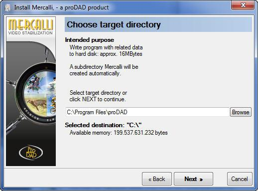

Now follow the installation instructions.\
You can now start **Mercalli** from a **shortcut** on your desktop

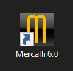

or by clicking **Start/All Programs/proDAD/Mercalli Start**.

When you start **Mercalli** for the first time, you will be asked to enter a **Code (Serial Number)** to activate the program. In case that you purchased the download version, enter the Code which you received along with the download instructions email. In case that you purchased the DVD version, you'll find the code inside the box. Click **Unlock**.

***IMPORTANT:***\
*Please keep in mind that your system requires an Internet connection for you to activate it. This is* *the only way to successfully complete the activation. If you encounter problems, please check the* *security settings (Firewall, etc.) in the system and repeat the activation process.*

If you want to test Mercalli in the **DEMO-Mode**, click **Continue with Demo Version**. The Demo version is activated until you enter the serial number. By entering the serial number you obtain the license that converts it into the full version.

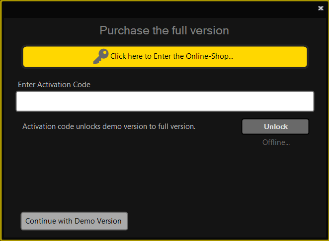

**Mercalli SAL** will then start with the active tab **Start**. Now you will import your video material.

2. **Registering Mercalli**

You would like to receive Updates and further information about Mercalli? Please register your proDAD Mercalli at *http://www.prodad.de/register.html*.

### 1.6. System requirements

Mercalli SAL requires the following system requirements:

- 64bit Windows (Windows 7, 8, 10 or 11)
- at least 8 GB main memory RAM, 16 GB RAM is recommended

### 1.7. Help function

The **program help** can be reached in Mercalli SAL at the top right via the **?**.

The instructions in PDF form can be found on the product page (www.prodad.com).

Furthermore, various **video workshops** are offered regarding the functionality of Mercalli SAL.

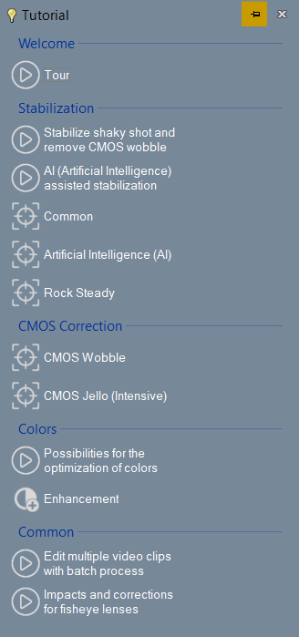

**Other information sources at** www.prodad.com **:**

- FAQ
- Workshops
- Online Shop

### 1.8. Shortcuts

Important shortcuts to optimize the workflow in Mercalli SAL:

**Global Shortcuts:**

| **Key** | **Function** |
| --- | --- |
| **Ctrl + O** | Open project |
| **Ctrl + S** | Save project |
| **Ctrl + Shift + S** | Save project under new name |
| **Ctrl + I** | Import media file |
| **Ctrl + E** | Export media file(s) |
| **Ctrl + Z** | Undo |
| **Ctrl + Y** | Redo |
| **F7** | Run analysis for all clips |
| **F8** | Magnifier On/Off |
| **F6** | Splitscreen On |
| **F5** | Splitscreen Off |

**Num-Block (On) Shortcuts:**

| **Key** | **Funktion** |
| --- | --- |
| **Up** | Activate previous video (if several are loaded) |
| **Down** | Activate next video (if several are loaded) |
| **Right** | Display next frame |
| **Left** | Display previous frame |
| **Pos1** | Cursor to Cut-IN |
| **End** | Cursor to Cut-OUT |
| **Enter- or Return-Key** | Toggle playback |

**Timeline Shortcuts:**

| **Key** | **Funktion** |
| --- | --- |
| **Cursor right** | Display next frame |
| **Cursor left** | Display previous frame |
| **I** | Set Cut-In |
| **O** | Set Cut-Out |
| **Space** | Toggle playback |

## 2. Mercalli SAL in detail

### 2.1. Program Start

You can start Mercalli from a **shortcut** on your desktop

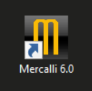

or by clicking **Start/Programs/proDAD/Mercalli**.

**Mercalli SAL** starts with the active register **Start**, here you make all settings for stabilizing your video.

### 2.2. Mercalli SAL overview

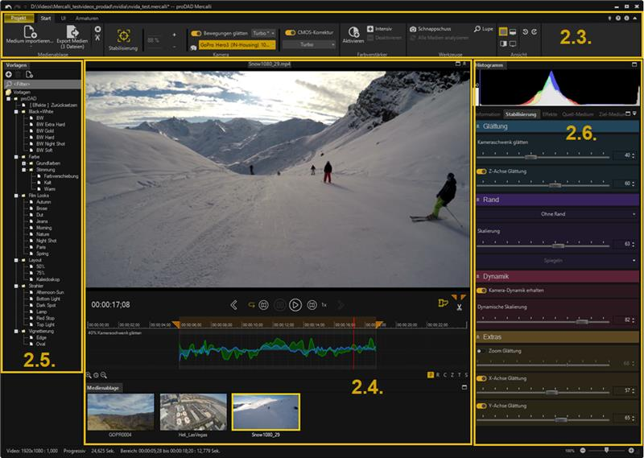

### 2.3. Ribbon

The **Ribbon** is divided in the tabs **Project**, **Start**, **UI** and **Armatures**. For information on **exporting edited videos**, click **here**.

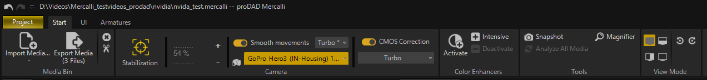

In the tab **Start**, you find the Import/Export and all settings for the stabilization, CMOS correction, fish-eye correction and for brightness- and contrast setting (Dynamics).

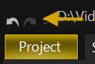

In each program, the **Undo/Redo** is very important. Also, Mercalli SAL has the option of undoing and restoring changes.

#### 2.3.1. Project Tab - Open/Save project

In **Mercalli SAL**, all work carried out can now be stored in a project, you can load the project again at any time and continue editing. **Opening** a project, **attaching** and **saving** can be implemented directly in the tab **Project**.

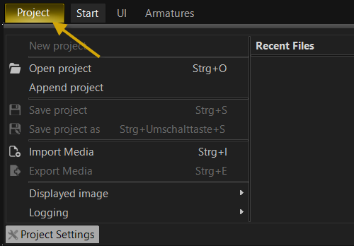

- Create new project
- Open project, invites an existing project
- Attach project, adds another project to the project currently being edited
- Save project as (save and enter new file path)

In addition, you can **import media** here and start the **export** of media that have already been edited. A **displayed image** can now also be printed or a print preview can be displayed. Mercalli SAL also offers the storing, display and printing of a **logging**, which can be useful for proDAD Support in the event of any problems that may arise.

Basic settings for the Mercalli project can be selected in the **project settings**.

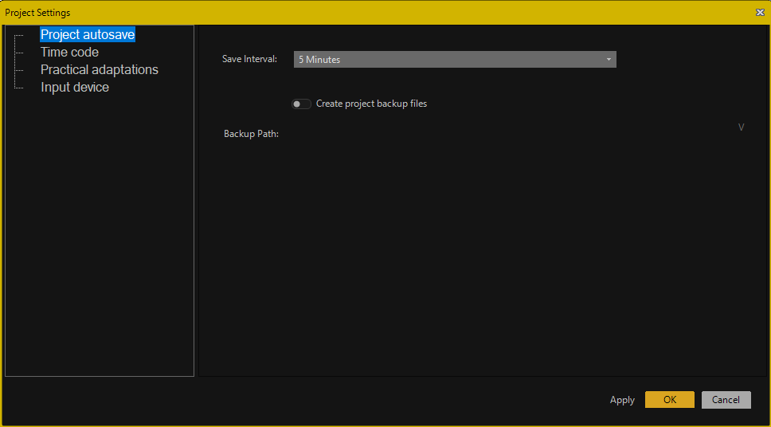

#### Undo/redo changes

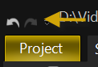

In each program, the **Undo/Redo** is very important. Also, Mercalli SAL has the option of undoing and restoring changes.

#### 2.3.2. Start Tab

In the tab **Start**, you find the Import/Export and all settings for the stabilization, CMOS correction, fish-eye correction and for brightness- and contrast setting (Dynamics).

##### 2.3.2.1. Import media

Then, you will have 4 options to **Import** videos.

1. **Select file** (to import video files)
2. **Select folder** (to import image files from a folder, Mercalli will convert these into a video)
3. **Click here to open Media** (to import video files)
4. **Import videos via Drag & Drop** from the desktop directly into the preview of Mercalli SAL

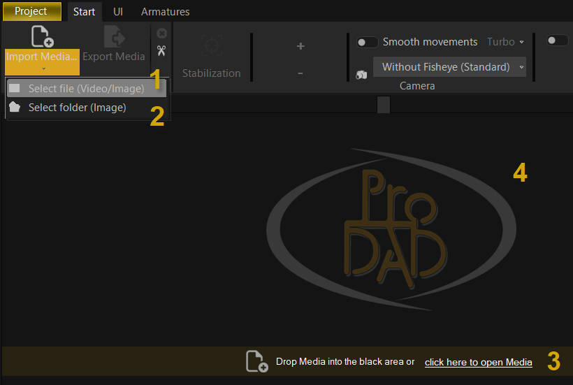

##### 2.3.2.2. Export media

**Mercalli SAL** offers a comprehensive video export. You can select numerous pre-installed export templates but you can also edit individually. Videos can be exported individually or several videos can be combined into one video file.

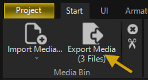

Of course, Mercalli SAL also allows analysis and export of several videos in one work process (batch editing).

###### 2.3.2.2.1. Export settings

After editing the videos, the final video export finally takes place.\
Highlight the edited videos in the tab **Source Media**, which you want to export.

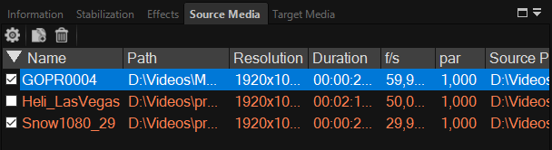

The highlighted videos can then be exported. The number of videos to be exported (from the tab **Source Media**) is displayed again here.

For this, click on **Export Media** in the ribbon. The dialog **Export Media** opens.

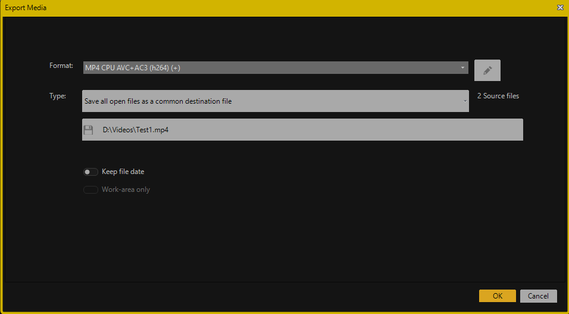

You can now select a desired **Export format template**

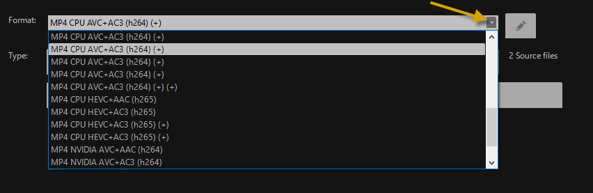

It is also possible to carry out your **own export format setting**.

After selecting the format template, the selection of export type takes place.

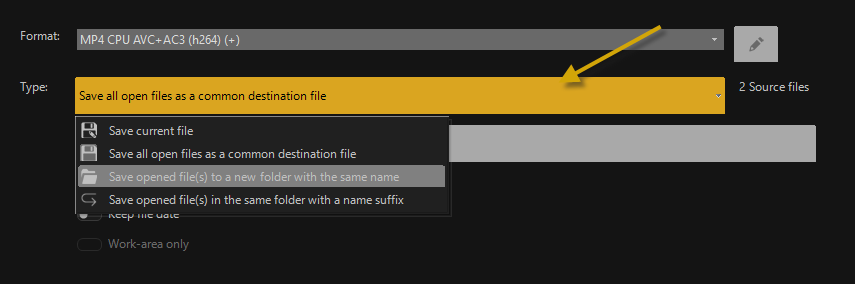

It is possible to store the current file, store all open files as a common target file, store open file(s) in a new directory with the same name, and save open file(s) in the same directory with a new name suffix.

Below, you then select the desired **export path**.

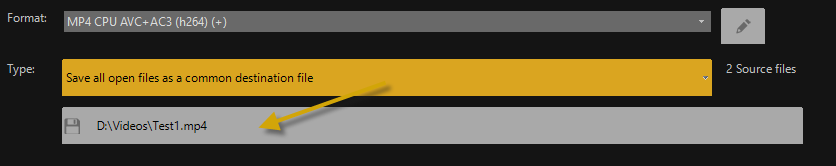

You can also specify whether the **file date shall be retained** and whether only the **selected work area (trimming area)** shall be exported.

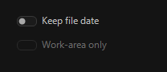

Then start the export by clicking on **OK**. Thereafter, you can play the videos with an installed software player.

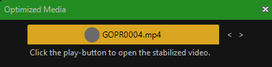

Furthermore, the exported videos are available in the tab **Target Media**.

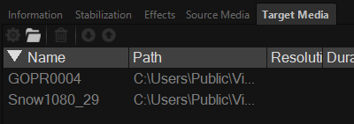

###### 2.3.2.2.2. Edit export settings

Click on **Export Media** in the **ribbon**. The dialog **Export media** opens.

You can now select a desired **Export format template**

and also carry out your **own** Export detail settings. For this, click on the option **Edit format settings**.

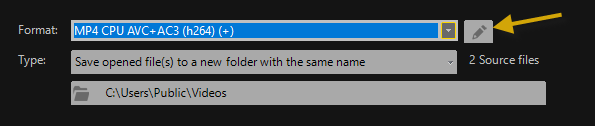

In the dialog **Edit format settings** you can now **edit the selected template**. For this, click on the (+) symbol, after which you can first change the **template name**, select one of the **3 quality levels** (low/medium/high) and carry out settings for the **video codec, format and size**. The settings for the video can also be switched on and off.

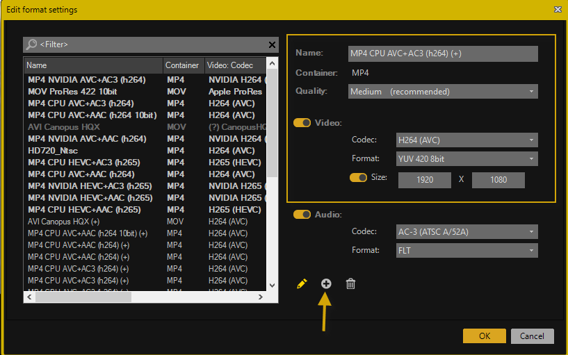

Furthermore, there are also individual settings for the **audio** regarding the **codec** and the **format**. The settings for the audio can also be switched on and off.

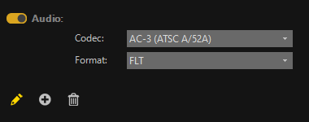

Format settings can also be added and deleted. With **OK** you accept the changes in the format settings, a new **individual format template** is created and can now be used for export.

###### 2.3.2.2.3. Batch processing

Batch editing of several videos as individual videos or as merged videos is possible in **Mercalli**.

The the following ways of **batch editing** exist:

1. **Video analysis of individual videos with video analysis and subsequent export of all highlighted videos to a common file**

Import **a video** in Mercalli, select e.g. the stabilization settings and analyze the video. Import further videos and analyze them. They are then available in the tab **Source Media**. You can now subsequently change various settings regarding stabilization, for this, highlight the corresponding video in the tab **Source Media**.

A playback of the respectively highlighted video can also be started in the preview.

***Note:***\
In the **Media Bin** below the timeline, you can now sort the videos via drag & drop if you want to combine all videos into one file.

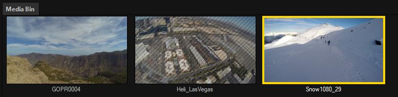

You can also highlight individual videos in the Media Bin and additionally apply the **Color enhancer** or further **effects**.

The highlighted videos can then be exported. For this, click on **Export Media** in the ribbon.

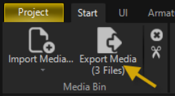

The number of videos to be exported (from the tab **Source Media**) is displayed again here. Now note the settings for the export.

You can now select a desired export format template, select your own detailed export settings, the type and the export path. Then start the export by clicking on **OK**.

In this example, a **common video file** (from the 2 highlighted videos in the tab Source Media) was created in a self-selected directory (see Export shot media). The video is now displayed in the tab **Target Media**.

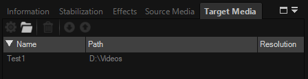

2. **Video analysis and Export in one process**

First import **several videos** into Mercalli and select e.g. the stabilization settings for each video. Then highlight all videos that should be analyzed and exported in the tab **Source Media**. You can also highlight individual videos in the Media Bin and apply the Color enhancer and further effects.

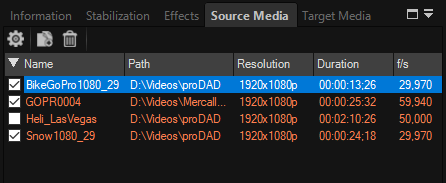

To start video analysis and export, click **Export Media** in the ribbon. The number of videos to be analyzed and exported is displayed here, now note the settings for the export. You can now select a desired export format template, select your own detailed export settings, the type and the export path. Then start the export by clicking on **OK**.

The videos to be exported are now automatically analyzed and exported one by one.\
In this example, 3 highlighted videos were exported to a self-selected directory in the tab Source Media. The videos are now displayed in the tab **Target Media**.

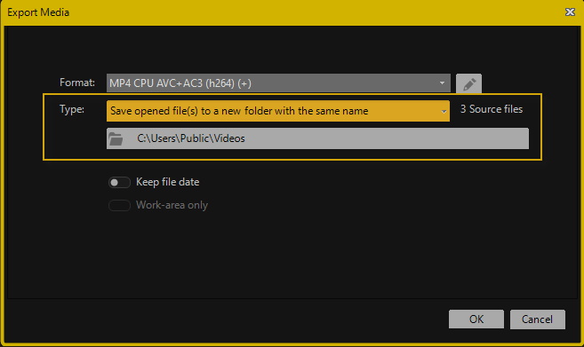

Thereafter, you can play the videos with an installed software player.

Furthermore, the exported videos are available in the tab **Target Media**.

***Note:***\
*Subsequent changes of stabilization settings are possible, simply highlight the video in the* ***tab*** ***Source Media****, make the new settings and then export with the newly selected properties without* *further analysis.*

Depending on which export format you have selected, this file (your stabilized video) is now available for further use (e.g. for burning to a DVD or Blu-ray). You can also import the file into video editing software and edit it there further.

##### 2.3.2.3. Empty media bin - Scene detection

The option **Empty Media Bin (1)** removes all imported media in Mercalli SAL.

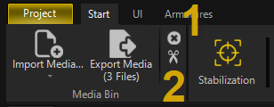

First activate the option **Scene Detection (2),** then load a video via the option **Import Media** and the Scene Detection will start automatically. The individual scenes are stored and marked as thumbnails in the **Media Bin**. The option **Empty Media Bin** removes all scenes from the media tray.

##### 2.3.2.4. Video stabilization - Start video analysis

**Stabilization - start the video analysis**\
After the import of a video, first activate the **stabilization (1)**

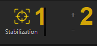

or trigger the video analysis.

The **video analysis** is necessary for the correction/smoothing of the camera movements. After completing the video analysis, the video is stabilized, but you can carry out further detailed settings or optimizations.

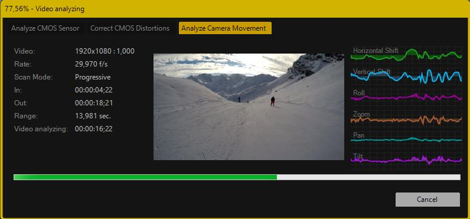

**Setting of scaling - smoothing of movement**\
The option **Scaling +/- (2)** can improve stabilization by zooming in more.

The option **Smooth Movements** enables switching the stabilization of a video on or off.

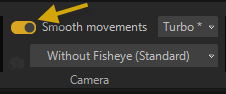

With the help of different methods for smoothing the camera movements, you can analyze and correct your shaky video. For this, select a suitable **method** (the method **Turbo** is preset).

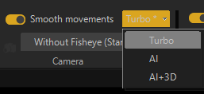

1. **Turbo**, this method enables a fast and very robust video analysis with good to very good results.
2. **AI** enables a video analysis that is supported by artificial intelligence. Better results are often achieved with difficult scenes/videos.
3. **AI+3D**, this additionally analyzes the tilting of the camera, thus reducing disruptive perspective effects.

##### 2.3.2.5. Fishe-eye correction

By selecting the correct **camera optics**, a possible fish eye effect (caused by the lens curvature) in the video/photo can be removed.

If **no fish eye effect** is available in your video, then select **Without Fisheye (Standard).**

If a **fish eye effect** is available in your video, select the camera profile that suits your camera and resolution here.

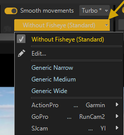

Click the option **Correct curved representation of a fish eye lens and straighten lines**.

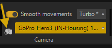

Click on the Remove Fisheye option. The corrected video will then be shown in preview.\
If your camera is not listed, then try the 3 generic profiles.

You reach the **intrinsic properties** via **edit**:

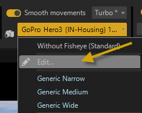

The current **Intrinsic properties** are displayed in a dialogue at the time of opening. The values in the dialogue that can be modified can be compared with the selection of one of the profiles. The first two of the three modes are technical methods; nothing on the right is therefore modifiable.

If **Remove Fisheye** is selected, this is equivalent to pressing the button in the **Ribbon**. The right side can only be changed during **Adjustment**. The preview shows the effect of a change in the values as soon as it is performed. If hardly anything is visible, then the optical difference between the left and right parameters is probably not very large.

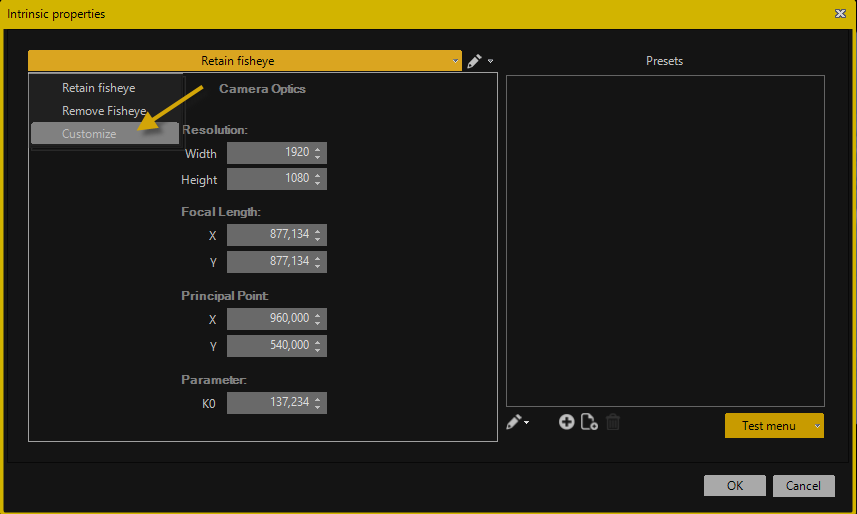

##### 2.3.2.6. CMOS Correction (Turbo, Remove wobble + Intensive Repair)

First, you will need to remove undesired **CMOS effects** from your video and then you will get even better stabilization effects, because pictures that are free of shaking and wobbling are the better basis for the subsequent stabilization of undesired camera movements!

**Almost all action cameras**, DSLR cameras, as well as professional video cameras have so-called CMOS sensors. If these cameras are exposed to vibrations or shaking, the recording of individual images becomes faulty and these image errors will show up naturally.\
First, remove undesired CMOS effects from your video. This is the best basis for better stabilization results. The subsequent stabilization of undesired camera movements is much more optimized on the basis of images that are free of vibrations and wobbling!

Mercalli V4 offers extensive adaptation possibilities for this, however, the use of the program is very simple, as the stabilization as well as the CMOS correction take place fully automatically. Of course, there is additional fine adjustment - therefore, you will always have the opportunity to intervene.

**Enabling CMOS correction**\
With the activation of the option **CMOS correction** a possible distortion (only with CMOS), which can occur in moving pictures (video) can be compensated. This option **CMOS correction** is activated by default.

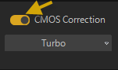

As long as a recording has not been stabilized, the rolling shutter effect is either not or only slightly noticeable. But as soon as a successful stabilization has taken place during post production, the rolling shutter effect will remain and will now become slight to significantly annoying.\
Therefore, Mercalli counteracts this undesired effect on request - because a stabilized recording will remain worthless, if the undesired consequence effect destroys this result.

Furthermore, Mercalli SAL offers different **CMOS correction method** to choose from, which may be included in the video, such as Standard, Vibrations / Wobble as well as differentiated settings (Intensive Repair) to counteract vibrations and waves. If you wish to further optimize the **fully automatic CMOS correction** in the video, you will choose one of the available **CMOS Distortion Types** from the menu that offers the best possible optimization.

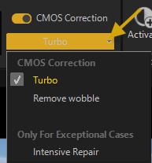

1. **Turbo**, enables an extremely fast correction of the most common CMOS distortions. Turbo only works in combination with the smoothing of the camera movements.
2. **Remove wobble** eliminates very annoying pudding-like distortions in the video.
3. **The Intensive repair** eliminates wavy image distortions due to a computationally intensive correction. You can set different levels for intensive CMOS correction.

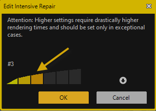

Furthermore, further detailed settings for **intensive repair** are available.

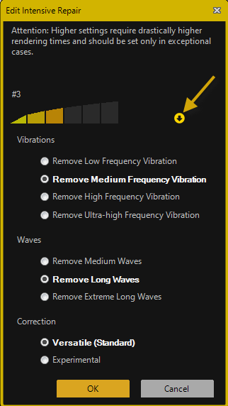

##### 2.3.2.7. Color Enhancers

In **Color Enhancers**, you can optimise the brightness and contrast settings automatically (dynamically) in the video/photo; the dynamic setting can be switched on, turned up and switched off with a simple mouse click.

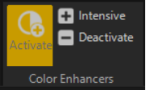

##### 2.3.2.8. Snapshot - Analyze all media - magnifying glass

A **snapshot** of the current timeline cursor position can be created and saved with a mouse click.

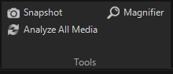

The **Analyse All option** starts video analysis for all imported and marked videos in the project. The **magnifying glass** enables the enlarged representation of an image area in the preview monitor. For this, activate the magnifying glass and move the mouse to the preview, a self-selected section in the video is now shown enlarged.

##### 2.3.2.9. View Mode

The **View Mode** menu contains various options to display video previews.

1. Display **result** (displays the stabilised video in the preview)
2. **Compare horizontally** (comparison of original/stabilised in horizontal split screen)
3. **Compare vertically** (comparison of original/stabilised in vertical split screen)
4. Display **original** (displays the original video in the preview)

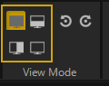

##### 2.3.2.10. Set up rotation

Mercalli SAL offers the setting option of **Rotation** of the video in the top right menu. One click on the option **Rotation by 90 degrees counterclockwise** or **Rotation by 90 degrees clockwise** will cause a rotation of the video in the respective direction.

Rotation about 90 degrees changes the display orientation, but not the pixels. Further setting options for rotation in the Z-direction can be found under **Effects/Layout/Rotation**.

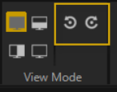

#### 2.3.3. UI Tab

In the tab **UI**, you can define what should be displayed in the Mercalli SAL workspace.\
You can additionally switch the Media Bin, templates, logging, histogram, and the input device on or off.

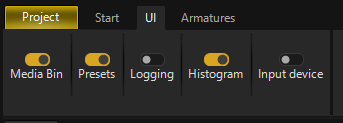

#### 2.3.4. Armatures Tab

If you click on the **Armatures Tab**, various display instruments will be displayed in the upper area of Mercalli SAL, which symbolize the settings made for stabilization and CMOS correction.

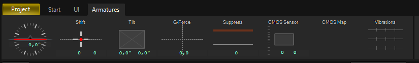

### 2.4. Timeline - Preview - Media Bin - Charts

Here, you obtain important information regarding the functions in the **Timeline (incl. specify trim area)**, regarding **preview** with the control elements and regarding the **Media Bin** available below, when it was switched on in the tab **UI**.

**Diagrams** display the graphic representation of the correction of the camera movements (stabilization And CMOS correction). Mercalli SAL offers diagrams for the displacement, rolls, CMOS-Sensor, zoom, inclination und Zoom-In dynamic scaling an.

#### 2.4.1. Preview - Control elements

After the import, the video can be played back in the Mercalli preview via **Control** = control of the playback such as **Play (6).** A click on **Pause (5)** stops the video.

The **time information (1)** of the video (current = 03 seconds / image 23) is available below the preview on the left. You can also switch between the imported videos in the preview, **previous video (2)** and **next video (9).** A **repetition (3)** of the video can also be implemented. The **switch (4)** jumps to the start of the video or to the start of the trim area, the **switch (7)** jumps to the end of the video or to the end of the trim area. With the **switch (8)** you change the playback speed step by step by clicking several times. In the timeline, the red **playback ma**rker **(10)** symbolizes the current position in the video.

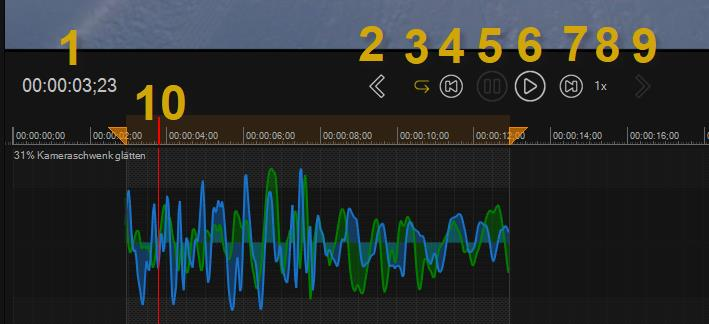

You can adjust the **preview size** via the slider at the bottom right of the program.

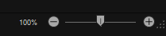

#### 2.4.2. Timeline and define trim area

Below is **Timeline** of Mercalli SAL, here, you can define a **Trim area**. Then, only this area will be used for stabilization and export.

The red **playback marker (1)** shows the current position in the video. If you now set a specific **trim area (3)** in the video via the orange **IN/Out Highlighters (2),** then only this will be edited and taken into account when the video is exported.

The **scissors icon (4)** cuts the video at the current position of the playback marker, provided the playback marker is in the selected trim area.

The **Trim mode (5)** can be activated and deactivated. The IN and OUT points can be edited in the activated state. Thus, the video analysis can be changed. The IN and OUT operating points can be selected in the non-activated state, the video analysis does not change. For a better overview, the timeline is reduced to the specified IN and OUT points.

#### 2.4.3. Media Bin

The **Media Bin** can be activated in the **UI** tab, after which it appears below the Mercalli SAL timeline.

In **Media Bin**, imported/edited videos and recognised scenes are displayed as a thumbnail in a row. You can change the order of these here using drag & drop. Right-clicking will open a menu with functions such as Cut, Copy, Paste, Delete, Rename and Select; video properties can also be viewed.

***Note:***\
*The clip order is important if all media shall be exported to one file.*

Media Bin behaves synchronously with the Quell-Medium.

If you deselect videos/scenes in the tab **Source Media**,

then the thumbnails in the **Media Bin** are shown shaded. These videos/scenes will then not be exported.

#### 2.4.4. Charts

**Diagrams** display the graphic representation of the correction of the camera movements (stabilization and CMOS correction). Mercalli SAL has diagrams regarding Smooth camera swivel (displacement), Z-Axis (rolling), CMOS-Sensor, Zoom smoothing, X/Y-Axis smoothing und Zoom-In - Dynamic Scaling.

##### 2.4.4.1. Pan Shot Smoothing

In the **Pan Shot Smoothing** diagram, the movement in the video, such as sliding in the **X-Y Direction** (horizontal/vertical) is displayed.

With the slider **Pan Shot Smoothing** (Tab **Stabilization/Pan Shot Smooting)** you balance the total movements in the video.

If you move the slider further to the right, Mercalli increases the stabilization, the video appears quieter. The slider **Pan Shot Smoothing** causes the greatest visual change (smoothing of the movements in the video). Also, in the **Pan Shot Smoothing** diagram, you will see the changes in the correction curve.

If you want to remove almost all of the unwanted movements that are signaled by a\
in the diagram **Displacements**, then move the slider **Scaling** in the tab **Stabilization/Edge/without edge**

only as far to the right as necessary (more zoom IN), in order to keep the original resolution in the stabilized result as far as possible. If you select **Best stabilization** in the tab in the tab **Stabilization/edge**, then Mercalli will automatically zoom deeper into the video, no edge will be shown then.

The shaded marking (visible above / below in the diagram), which shows the limitation of the maximum movements in the video, is adjusted accordingly in height after changing the slider **Scaling**.

##### 2.4.4.2. Z-Axis (Roll with On/Off)

In the **Z-Axis (Roll)** diagram, the movement in the video or the rotation around the **Z-Axis** is displayed. Move the mouse directly into the diagram; this will also show the current values.

If a diagram for **rolling** is not displayed, then the z-axis slider is disabled in the tab **stabilization/smoothing**, then no correction and no display of stabilization around the Z-axis is available.

The shaded marking (visible above / below in the diagram), which shows the limitation of the maximum rotational movement in the video, is adjusted accordingly in height after changing the slider **Scaling**. The undesired movements, that are signaled by a

in the diagram can be eliminated thereby.

##### 2.4.4.3. CMOS-Sensor (with On/Off)

The fully automatic CMOS-Correction correction retroactively removes weaknesses caused by the CMOS sensor. The green curve shows the correction (counter-action) by Mercalli, the orange curve shows the residual errors (incorrigible). Move the mouse directly into the diagram; this will also show the current values.

If no diagram for CMOS correction is displayed, then the CMOS correction is deactivated in the ribbon.

##### 2.4.4.4. Zoom Smoothing (with On/Off)

The **Zoom Smoothing** diagram shows the movement in the video regarding **Zoom**.

The correction and the display in the diagram depends on the position of the slider **Zoom smoothing** in the tab **Stabilization/Extras**. If the slider **Zoom smoothing** is displaced further to the right, the zoom is distributed over several images, a harmonious zoom results.

If no diagram is displayed for the **zoom corrections**, then the slider **Zoom smoothing** is deactivated in the tab **Stabilization/Extras**.

##### 2.4.4.5. X/Y - Axis Smoothing

In the diagram **X/Y axis smoothing (swivel + inclination)**, the movement in the video for tilting around the **X/Y axis** is shown. If you move the mouse directly into the diagram, instantaneous values will also be displayed.

The correction and the display in the diagram depends on the position of the sliders **X-axis smoothing (swivel)** and **Y-axis smoothing (inclination)** in the tab **Stabilization/Extras**. If you move the sliders **X/Y axis smoothing**, the correction related to the rotation around the X/Y axis is changed. The change in curve form is visible in the diagram.

If no diagram for **X/Y axis smoothing** is displayed, then the sliders **X/Y axis smoothing** are deactivated in the tab **Stabilization/Extras**.

##### 2.4.4.6. Zoom-In - Dynamic Scaling

The cyan colored line shows the Zoom In used in the corresponding time position in the diagram. A high Dyn-Scale value (**Dynamic Scaling** in the tab **Stabilization/Extras**) reduces the need for zoom-in. This is achieved by changing the zoom quickly.

***Note:***\
*Depending on the position of the slider* ***Dynamic Scaling*** *, the zoom requirement will also vary* *by time position. The maximum value is always constant, the minimum value can sink with a* *higher dynamic (but does not have to).*

Minimum 106% and Maximum 110% - Zoom In used

Minimum 103% and Maximum 111% - Zoom In used

### 2.5. Presets

Various preset effect templates are available for you to use. They can be adopted by double clicking on a video/photo. You can also create new templates (+), delete templates (-) and create new effect directories. After a template has been adopted, you can make finer adjustments to the Effects or remove the effect or the template.

You can also save **effect settings** as a new template. First make all the settings in the **Effects** tab, then click the (+) at the top left of the Templates tab. Then select which effect settings you want to save in the new template and accept them by clicking OK. The new template is then inserted in the Templates tab.

### 2.6. Panel Tabs

In **Mercalli SAL**, further **5 tabs** are available, in which the following can be displayed or set:

#### 2.6.1. Information

Information/details regarding the currently selected video are displayed in the tab **Information**.

#### 2.6.2. Stabilization

The detailed settings for correcting the camera movement are located in the tab **Stabilization**.

##### 2.6.2.1. Smoothing - Pan Shot Smoothing

With the slider **Pan Shot Smoothing** you balance the total movements in the video. If you move the slider further to the right, Mercalli increases the stabilization, the video appears quieter. The slider **Pan Shot Smoothing** causes the greatest visual change (smoothing of the movements in the video).

Changes in the correction curve are also visible in the **Pan Shot Smoothing**.

##### 2.6.2.2. Smoothing - Z-Axis Smoothing

The slider **Z-Axis Smoothing** effects a correction of the video regarding the movements (rotation) around the **Z Axis**. Changes in the correction curve are also visible in the **Z-Axis**.

The slider **Z-Axis Smoothing** can also be deactivated. Just click the switch in the tab **Stabilization**. Then, a smoothing of the **rolling movement (z-axis)** in the video does not take place.

The slider **Z-Achse Glättung** will be deactivated if rolling movements cannot be evaluated by Mercalli, or if only pans are to be stabilized.

##### 2.6.2.3. Border

**2.6.2.3.1.** If you select the option **Best Border**, there will be **No Border** in the stabilized video. The border will be eliminated by zooming into the video. This is done in relation to the blurs and the desired extent of correction in connection with the setting process done with the **Scale** slider.

You can find more detailed information on the subject of **Borders** (Border Handling) in the FAQ section in the support area of www.prodad.com.

**2.6.2.3.2.** If you select the option **Best Stabilization**, a black **Border** will be displayed in the stabilized video. This can vary between images, depending on the extent of the blur in the current situation.

The visible edge can be replaced with **Solid (black), Repeat and Mirror**.

\- **Solid** = black\
- **Mirror** and **repeat** mean that existing image material is calculated in the margins, once by mirroring or by repeating.

You can zoom into the video with the slider **Scale**, the border will be minimized further.\
Too much **Zoom In** can cause blurs (grainy image) in the video.

**2.6.2.3.3.** In the **Forensic View**, the display is zoomed out and has no limits. By zooming into a scene, the effected correction is easier to evaluate with Mercalli. The slider **Scale** will support you with Zoom IN/OUT.

##### 2.6.2.4. Dynamics

The option **Keep Camera Dynamic** is intended to maintain the vivacity in the video, i.e., deliberate camera movements of the person filming should neither be smoothed nor stabilized.

If you wish to stabilize a normal hand-filmed blurry camera shot into a **Tripod Recording**, you should deactivate the option **Keep Camera Dynamic**.

The **Dynamic scale** enables, which automatically varies the strength of the scaling during stabilization. In the case of very shaky videos, the image is zoomed in more and in the case of rather quiet videos less.

##### 2.6.2.5. Extras - Zoom Smoothing - X/Y Smoothing

**2.6.2.5.1.** With the slider **Zoom Smoothing**, you can smooth the **Zoom Movement** in the video.

Move the slider further to the right to effect a stronger smoothing of zoom changes. Existing blurring in the zoom is thus balanced. Changes in the zoom correction curve are also visible in the Zoom Smoothing diagram. The slider **Zoom Smoothing** can also be deactivated. Simply click on the checkmark on the **Stabilization** tab. Then, there will be no **Zoom Correction** in the video.

**2.6.2.5.2.** The slider **X-Axis Smoothing** effects a correction of the video regarding the movements (rotation) around the **X Axis** (tilting movement of the camera in the direction X). Displayed in the X-Axis diagram (below the preview) as the **cyan**-colored curve.

If you move the slider **X-Axis Smoothing**, this will change the correction regarding the rotation around the X Axis. In the diagram, this change will be displayed in the **cyan**-colored curve. The slider **X-Axis - Smoothing** can also be deactivated. Simply click on the checkmark on the **Stabilization/X-Axis Smoothing** tab. Then there will be no correction around the X Axis in the video.

**2.6.2.5.3.** The slider **Y-Axis Smoothing** effects a correction of the video regarding the movements (rotation) around the **Y Axis** (tilting movement of the camera in the direction Y). Displayed in the Y-Axis diagram (below the preview) as the **magenta**-colored curve.

If you move the slider **Y-Axis Smoothing** this will change the correction regarding the rotation around the Y-Axis. In the diagram, this change will be displayed in the **magenta**-colored curve. The slider **Y-Axis - Smoothing** can also be deactivated. Simply click on the checkmark on the **Stabilization/X-Axis Smoothing** tab. Then there will be no correction around the Y Axis in the video.

#### 2.6.3. Effects

In the **Effects** tab, you can set the details of different effects.

#### Histogramm

The **histogram** can be added to the Mercalli work surface via the tab **UI** (at the top in the ribbon). It displays a graphical representation of the color value distribution in a video/photo.

The **Histogram** displayed above the **Effects** is a graphical representation of the color value distribution in a video/photo. The histogram is the graphical representation of the color value distribution of an image; therefore, it is also described as a color value curve. During video playback, the histogram values constantly change, displaying how the lighting is changing in the video. The X-axis of the diagram represents the RGB color value, while the Y-axis gives the number of pixels in the video that have this value. The histogram is created with the 3 RGB color values (red/green/blue) that are assigned to each pixel in the video/photo. The grey parts specify where all 3 colors overlap in the histogram, while yellow, magenta and cyan are displayed when 2 of the colors overlap.

##### Keyframes

All effects and settings can also be controlled using **Keyframes**. First, move the timeline cursor to the required position on the timeline. Now, in the required effect setting, click on the **Clock symbol** and then move the slider to achieve the desired effect. In order to insert another keyframe, displace the timeline cursor again to a new position in the timeline, then click the **(+)** and then move the desired slider again to achieve the effect at the new position in the video. You can now change between the keyframes using the **White arrows (left/right)**. The keyframes can also be deactivated **(-)**. The set effect can be deleted using the **x** (e.g. in the Effect Enhancer).

##### 2.6.3.1. Color

###### 2.6.3.1.1. Enhancer

**Dynamics:** The **Dynamics** option can be used to make the colors in the video/photo brighter and more lively (dynamic); duller colors are optimised.

**Brightness Balancing:** This balances the differences in brightness throughout the video/photo.

###### 2.6.3.1.2. Basic colors

###### 2.6.3.1.2.1. White Balance

The **White Balance** can be used to remove any **Color cast** that might be present in the video/photo. To do this, use the **Color pipette** to select the color that should be white. The image content will then be adjusted automatically, removing the color cast. You can also select a **color** in the color palette.

###### 2.6.3.1.2.2. Exposure, Contrast, Brightness and Saturation

You can adjust over- and under-lit areas here and optimise the contrast, brightness and saturation in the video/photo.

###### 2.6.3.1.3. Tune

###### 2.6.3.1.3.1. Cold/Warm

Use this option to adjust the color temperature in the video/photo. A negative value uses a colder color temperature, while a positive value makes the video/photo warmer.

###### 2.6.3.1.3.2. Tint

Use the **Color tone** option to set the color tone that is to be used for the video/photo. Use the **Saturation** option to optimise the intensity of the toning in the video/photo..

###### 2.6.3.1.3.3. Color Shift

This option allows colors to change relative to one another in the video/photo.

###### 2.6.3.1.4. Tone Curve (Blacks, Shadows, Lights and Whites)

The histogram is the graphical representation of the color value distribution of an image; therefore, it is also described as a color value curve. You can use the available options to define the lighting conditions in dark and light areas in the video/photo image.

###### 2.6.3.1.5. Split Toning (Shadows, Midtone and Lights)

Use the slider to adjust the **Color Tone** and **Saturation** of the deep, middle and light tones in a video/photo. Use the **Color Tone** slider to set the color tone or color of deep tones in the video/photo. You can also select the exact color (tone and saturation) using the **Color Pipette** or use a color from the **Color Palette** to be used in the deep, middle and light tones. Use the **Saturation** slider to set the strength of the colors used.

###### 2.6.3.1.6. Channel (Exposure, Contrast and Saturation)

Here, you can define the lighting, contrast and saturation ratios for the individual channels **Red/Green/Blue** in the video/photo.

###### 2.6.3.1.7. Denoise / Sharpen

You can sharpen a video/photo here or remove/minimise any noise (e.g. that caused by recording in the dark).

##### 2.6.3.2. Layout

**Scale:** You can shrink or enlarge the **Image detail** in the video/photo here.

**Rotation:** Rotate the video/photo in the **Along the X/Y/Z axes**, either in a positive or negative direction.

***Note:***\
*With the display orientation, a 90 degree rotated recording (portrait recording) is e.g. displayed* *correctly again on smartphones by representing the video as e.g. 1080x1920, without changing* *the pixel data in the video stream. The video can be rotated pixel by pixel with the slider* ***Rotation Z***. *However, edges can occur thereby.*

**Shift:** Move the photo along the **X/Y axes** (left or right).

**Border:** After **Scaling** is used, a black border (solid) will appear around the video/photo. Using the **Replicate** or **Reflect** options will cause the **Border** to be re-generated; the result depends on the content of the image.

**Solide Replicate Reflect**

##### 2.6.3.3. Vignette

To the left in Presets, you will find pre-configured vignette effects; if you use the **Edge** preset, for example, this will be used in the preview. You can now configure other details in the **Effects** menu under **Vignette**, such as the vignette dimensions using the **Angle** option, or the **Sharpness** or blur of the vignette edge. The **Aspect Ratio** option sets the form of the vignette. The **Centre X/Y** options set the position of the vignette in the preview.

##### 2.6.3.4. Spotlight

To the left in the Presets, you will find pre-configured Spotlight effects, which you can use by double clicking on them. You can then make finer adjustments in the **Spotlight** effect dialogue.

###### 2.6.3.4.1. Basics

You can select the exact colors using the **Color pipette** or use a color from the **Color palette** to be used for the spotlight effect. The **Luminance** option can be used to change the brightness of the spotlight, the **Saturation** option to change the color intensity, or you can choose another color tone for the spotlight. The **Spot Size** option can be used to scale the spotlight; **Diffusion** defines the spread of the spotlight in the video/photo you are using.

###### 2.6.3.4.2. Location

The **Centre X/Y** options define the position of the spotlight in the preview. The **Aspect Ratio** option defines the form of the spotlight.

###### 2.6.3.4.3. Tint

The **Darkening** option darkens the video/photo while having no effect on the spotlight. The **Shadows**, **Midtone** and **Lights** options define the tone properties of the spotlight in dark and light areas, as well as in the middle tones.

#### 2.6.4. Source Media

All imported media are displayed in the **Source Media** tab.

In the tab **Source-Media**, you also receive information about the file path, resolution, run-time, frames/sec (f/s), pixel ratio (par) and about the source path of the imported videos. You can also add or remove media and define the start and end position via the option properties.

The video selected in the tab **Source Media** is displaced one position upwards by clicking the button **Arrow up**. It is displaced downwards with the button **Arrow down**.

***Note:***\
*The position is important if all media are exported in one output file.*

In front of the file name, **highlight** the videos that are intended for export after stabilization/correction has taken place.\
There is also an option to rename an imported video/photo in the **Source Media** tab.

#### 2.6.5. Target Media

All exported media are displayed in the **Target Media** tab.

© proDAD

[www.prodad.com](http://www.prodad.com/)
