# proDAD Mercalli V6 SAL

マニュアル

© proDAD GmbH

Autor : Uwe Wenz

## 目次

- Welcome
- [概要](#1-概要)
  - [著作権 /法律情報](#11-著作権--法律情報)
  - [Mercalliとは?](#12-mercalliとは)
  - [Mercalli製品名の由来](#13-mercalli製品名の由来)
  - [Mercalli SALの新機能](#14-mercalli-salの新機能)
  - [インストール、アクティベーションとユーザー登録](#15-インストールアクティベーションとユーザー登録)
  - [システム要件](#16-システム要件)
  - [ヘルプ機能](#17-ヘルプ機能)
  - [ショートカット](#18-ショートカット)
- [Mercalli SAL 詳細](#2-mercalli-sal-詳細)
  - [プログラムの開始](#21-プログラムの開始)
  - [Mercalli SAL 概要](#22-mercalli-sal-概要)
  - [リボン](#23-リボン)
    - [プロジェクトタブ - プロジェクトを開く/保存](#231-プロジェクトタブ---プロジェクトを開く保存)
    - アンドゥ/リドゥ変更
    - [開始タブ](#232-開始タブ)
      - メディアをインポート
        - メディアをエクスポート
          - [エクスポート設定](#23221-エクスポート設定)
            - エクスポート編集設定
            - [バッチ編集](#23223-バッチ編集)
          - [Media binを空にする - シーン検出](#2323-media-binを空にする---シーン検出)
        - ビデオスタビライゼーション - ビデオ解析の開始
        - [フィッシュアイ修正](#2325-フィッシュアイ修正)
          - [CMOS修正（Turbo、ウォブルを除去 + 強化修正）](#2326-cmos修正-turbo-ウォブルを除去--強化修正)
        - [カラーエンハンサー](#2327-カラーエンハンサー)
        - [スナップショット - すべてのメディアを解析 - 拡大鏡](#2328-スナップショット---すべてのメディアを解析--拡大鏡)
        - [表示モード](#2329-表示モード)
        - [回転の設定](#23210-回転の設定)
      - [UIタブ](#233-uiタブ)
      - [Armaturesタブ](#234-armaturesタブ)
  - [タイムライン – プレビュー - Media Bin – チャート](#24-タイムライン--プレビュー---media-bin--チャート)
    - [プレビュー - コントロールエレメント](#241-プレビュー---コントロールエレメント)
    - [タイムラインとトリム範囲の定義](#242-タイムラインとトリム範囲の定義)
      - [Media Bin](#243-media-bin)
    - [チャート](#244-チャート)
      - [パンショット補正](#2441-パンショット補正)
        - [Z軸（ロールOn/Off）](#2442-z-軸-ロールonoff)
          - [CMOSセンサー（On/Off）](#2443-cmosセンサー-onoff)
        - [ズーム平滑化（On/Off）](#2444-ズーム平滑化-onoff)
          - [X/Y - 軸平滑化](#2445-xy---軸平滑化)
        - [ズームイン－ダイナミックスケール](#2446-ズームイン---ダイナミックスケール)
  - [プリセット](#25-プリセット)
  - [パネルタブ](#26-パネルタブ)
    - [インフォメーション](#261-インフォメーション)
    - [スタビライゼーション](#262-スタビライゼーション)
      - [スムージング - パンショット補正](#2621-スムージング---パンショット補正)
        - [スムージング - Z-軸平滑化](#2622-スムージング---z-軸平滑化)
        - [ボーダー](#2623-ボーダー)
        - [ダイナミクス](#2624-ダイナミクス)
        - [エクストラ - ズーム平滑化 - X/Y平滑化](#2625-エクストラ---ズーム平滑化---xy平滑化)
    - [エフェクト](#263-エフェクト)
      - [ヒストグラム](#ヒストグラム)
        - [キーフレーム](#キーフレーム)
        - [色](#2631-色)
          - [エンハンサー](#26311-エンハンサー)
            - [ベーシックカラー](#26312-ベーシックカラー)
              - [ホワイトバランス](#263121-ホワイトバランス)
              - 露出
              - コントラスト
              - 明るさ
              - 彩度
            - [調和](#26313-調和)
              - [冷たい/暖かい](#263131-冷たい暖かい)
              - [色合い](#263132-色合い)
              - [カラーシフト](#263133-カラーシフト)
            - [トーンカーブ](#26314-トーンカーブ黒影光白)
              - 黒
              - 影
              - 光
              - 白
            - [分割調色](#26315-分割調色影中間色光)
              - 影
              - 中間色
              - 光
            - [チャンネル](#26316-チャンネル露出コントラスト彩度)
              - 露出
              - コントラスト
              - 彩度
            - [デノイズ / シャープネス](#26317-デノイズ--シャープネス)
        - [レイアウト](#2632-レイアウト)
        - [ビネット](#2633-ビネット)
        - [スポットライト](#2634-スポットライト)
          - [ベーシック](#26341-ベーシック)
            - [ロケーション](#26342-ロケーション)
            - [色合い](#26343-色合い)
    - [ソースメディア](#264-ソースメディア)
    - [ターゲットメディア](#265-ターゲットメディア)

### Welcome to proDAD Mercalli!

Mercalliは撮影したビデオからカメラの揺れや振動を取り除き、映像のクオリティーを向上させることができます。また Mercalliなら激しいパンやズームなども滑らかにし、素材を改良することができます。

Mercalliは、あなたの大切なビデオクリップを最適化する大変価値の高いツールとなるでしょう。\
どうぞMercalliで最高の映像効果をお楽しみください！

## 1. 概要

### 1.1. 著作権 / 法律情報

Copyright proDAD GmbH. All rights reserved. （不許複製・禁無断転載）

ライセンス条件ソフトウェアをインストールされる前に本ライセンス条件をよくお読みください。

使用許諾契約セットアップが開始すると、使用許諾契約が出てきますので、よくお読みください。\
ソフトウェアをインストールすることによって、著作権条件、使用許諾契約、使用許諾手続きに同意したものとみなします。

ライセンス保証\
proDAD GmbHは正規目的で本製品を使用することを許諾します。\
本製品は 1 台のコンピュータにのみインストールできます。proDADは本契約によって無償でライセンス・キーを 1 つ提供することを保証します。本製品をインストールすることにより、ユーザーはライセンス保証、著作権条件、責任制限に同意して承諾されたものとします。

登録商標同マニュアル内で言及されたすべての製品ならびに商標は、各所有者に帰属します。すべての商標は、自由に使用できるものであるか、登録商標であるかにかかわらず、使用されています。

責任制限損害賠償請求 1 件あたりの賠償責任の上限は、当該製品の交換とします。これは、proDAD GmbH、すべてのライセンス取得者、および小売店に適用されます。損害賠償請求は、ソフトウェアが適切な手順で、proDAD GmbH との事前合意に基づく返品番号と共に返品された場合にのみ受け付けます。製品には購入証明の添付が必要です。この保証は、製品の不調が不適切な使用、酷使、事故、不適切な取り扱いに起因する場合、無効となります。proDAD GmbH、販売店、およびライセンス供与者は、本製品の無理な使用に起因する損害および後発損害に対する責任を負いません。責任範囲はいかなる場合も製品の購入価格を上限とします。

ドキュメンテーションハンドブックの編集と翻訳には細心の注意を払っております。しかしながら、完全に不正確な記述を排除することはできません。proDAD GmbHはドキュメンテーションか翻訳を含むどのような不正確な記述や情報の誤りによって生じるいかなる損害について責任は一切負いかねます。技術的な変更の場合も同様です。\
本マニュアルに関して不正確な記述がございましたら弊社までご連絡ください。

proDAD GmbHは本プログラム、コンテンツを使用した発行物、および本プログラム作成したデータの使用に対する責任は一切負いかねます。

ProDAD GmbH \* Gauertstr. 2 \* 78194 Immendingen \* Deutschland \* HRB 1077

### 1.2. Mercalliとは？

Mercalliはビデオ撮影の際の振動、揺れ、歪み、ウォブルの除去にご利用いただけ、ビデオの品質を向上させることができます。また激しいパンやズームも滑らかにし、さらにクオリティーを上げることができます。

三脚がない場合や使いづらい場所では、不要な映像の揺れが生じることがあります。予期せぬ出来事で準備もなく急に撮影しなければならないことや、ビデオ機材の不備といったことも起こりうるでしょう。

もし撮影が基本的には成功しており、しかし映像に修正が必要な場合は、Mercalliにおまかせください。ほぼ完全自動で映像を最適化します！

**Mercalli**を使えば、どのように撮影をしたビデオでも改良し最適化できます。

### 1.3. Mercalli製品名の由来

イタリアの火山学者ジュゼッペ・メルカリは、地震の程度を表現するメルカリ震度階級を作成しました。階級は“きわめて弱い”から“絶望的”と、地震による被害の状況に基づいて判定されるよう作成されました。

それはまさにMercalliとの共通点です。

Mercalliソフトウェアは、振動、揺れ、歪み、ウォブルや圧縮の編集ができます。

完全自動の**CMOS**修正機能で、ビデオ内のぼやけや揺れなどのエラーを非常に効率的な方法で取り除くことができます。これらのエラーは、"Jello（揺動）, Wobble（動体歪み）, Skew（スキュー）"または"Distortions"と呼ばれており、カメラのCMOSセンサーにより、モーターによる振動や物質的な振動、ぼやけや揺れを減少させるために使用するジンバルを使っていても生じます。ほとんどのケースにおいて、CMOS修正により、映像から揺れがなくなり、元の映像より改良されます。

この修正の重要な利点は、完全自動であり、基本的にズームインの必要がないということです。したがって、大きな改良にもかかわらず、最大の解像度を保つことができます！もしまだぼやけがビデオに残る場合は、すでにご存知のスタビライズ機能を追加していただければ、CMOS修正した素材がさらにきれいになります。このユニークな完全修正により、ビデオはベストなものとなるでしょう。

不規則な映像は高く複雑な数学的プロセスにより検出され除去されます。ここでは、非常に複雑な計算が実行され、どの動きが必要でどの動きが不必要かを分類します。不必要な動きは、除去するようユーザーに提案します。

詳しくは、proDAD.com. でもご覧いただけます。

### 1.4. Mercalli SALの新機能

Mercalli SAL最新追加:

- 人口知能(AI)内蔵、パラメーター自動的に調整され、さらに手動での微調整も可能
- 全く新しいモダンなUI
- 簡単操作と高速レンダリング
- 新しいイメージ最適化モード＋カラー修正
- フィッシュアイ修正
- プロジェクトの保存

### 1.5. インストール、アクティベーションとユーザー登録

1. **Mercalli**スタンドアローンバージョンのインストールとアクティベーション

バージョン2以降、Mercalliはスタンドアローンアプリケーションとしてご利用いただけます。 (詳細はスタンドアローンバージョンの章参照) インストールを始めるには、セットアップファイルをダブルクリックしてください。ソフトウェアのインストールが始まりましたら、 法律上の表示項 の契約条件とライセンス条項に同意してください。Mercalliがダウンロードできましたら、まずアーカイブファイルが解凍されインストールが始まります。Mercalliがインストールされたフォルダーを選んでください。

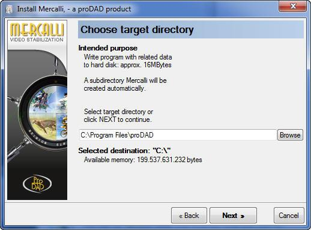

次にインストールの指示に従ってください。

デスクトップのショートカットからMercalliをスタートできます。

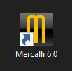

もしくは スタート / すべてのプログラム / proDAD / Mercalli 2.0 Start からも開けます。

初めて**Mercalli**をインストールされる場合、インストール中、ライセンスキー（シリアルナンバー）が要求されます。ダウンロード購入された場合、ライセンスキーはダウンロード手順のメールにあります。DVDでご購入された場合はパッケージに入っています。「Unlock（解除）」をクリックしてください。

重要：

アクティベートするにインターネットへの接続が必要です。接続していない場合にはアクティベーションすることができません。もし問題が発生した場合は、セキュリティ設定（ファイヤーウォールなど）を確認し、再度アクティベーションを続行してください。

もしMercalliをデモバージョンでお試しいただきたい場合は、「Continue with Demo Version（デモバージョンで続ける）」をクリックしてください。シリアル番号を入力するとアクティベートされ、フルバージョンになります。

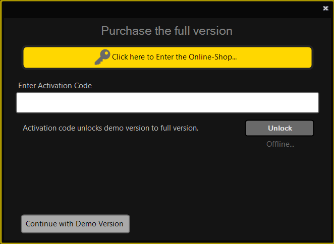

**Mercalli SAL**は**Start**タブで始まります。これよりビデオ素材のインポートを開始できます。

2. **Mercalli**の登録

Mercalliのアップデートやさらなる情報をご希望ですか？こちらからあなたのproDAD Mercalliをご登録ください。 http://www.prodad.de/register.html.

### 1.6. システム要件

Mercalli SALには次のシステム要件が必要です：

- 64bit Windows (Windows 7, 8, 10 or 11)
- 少なくとも8 GB main memory RAM, 16 GB RAMをお勧めします

### 1.7. ヘルプ機能

**program aid**へはMercalli SALの右上[？]から行けます。

PDFの使用説明書は、プロダクトページの (ww.prodad.com)からご覧いただけます。

また、Mercalli SALの機能に関するさまざまなワークショップビデオが提供されています。

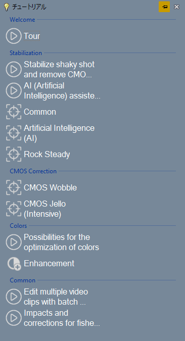

その他の情報はwww.prodad.com をご覧ください。

- FAQ
- ワークショップ
- オンラインショップ

### 1.8. ショートカット

Mercalli SALの重要なショートカット:

グローバルショートカット：

| キー | 機能 |
| --- | --- |
| **Ctrl + O** | プロファイルを開く |
| **Ctrl + S** | プロジェクトを保存 |
| **Ctrl + Shift + S** | 新しい名前でプロジェクトを保存 |
| **Ctrl + I** | メディアファイルのインポート |
| **Ctrl + E** | メディアファイルのエクスポート |
| **Ctrl + Z** | アンドゥ |
| **Ctrl + Y** | リドゥ |
| **F7** | すべてのクリップの解析 |
| **F8** | 拡大鏡 On/Off |
| **F6** | 分割スクリーン On |
| **F5** | 分割スクリーン Oｆｆ |

ナンバーブロック(On)ショートカット：

| キー | 機能 |
| --- | --- |
| **Up** | 前のビデオをアクティベート（いくつかロードさ れている場合） |
| **Down** | 次のビデオをアクティベート（いくつかロードさ れている場合） |
| **Right** | 次のフレームを表示 |
| **Left** | 前のフレームを表示 |
| **Pos1** | カーソルをCut-INへ |
| **End** | カーソルをCut-OUTへ |
| **Enter-** または **Return-**キー | トグル再生 |

タイムラインショートカット：

| キー | 機能 |
| --- | --- |
| 右カーソル | 次のフレームを表示 |
| 左カーソル | 前のフレームを表示 |
| **I** | Cut-In設定 |
| **O** | Cut-Out設定 |
| スペース | トグル再生 |

## 2. Mercalli SAL 詳細

### 2.1. プログラムの開始

デスクトップのショートカットからMercalliをスタートできます。

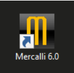

もしくは スタート / すべてのプログラム / proDAD / Mercalli からも開けます。

**Mercalli SAL**は、アクティブなレジスタ開始からスタートし、ここではビデオをスタビライズさせるためのすべての設定を行います。

### 2.2. Mercalli SAL 概要

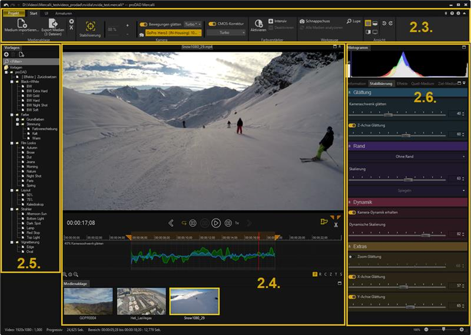

### 2.3. リボン

リボンは、プロジェクト、開始、**UI** および **Armatures**の各タブに分かれています。編集したビデオのエクスポートに関する情報は、こちらをクリックしてください。

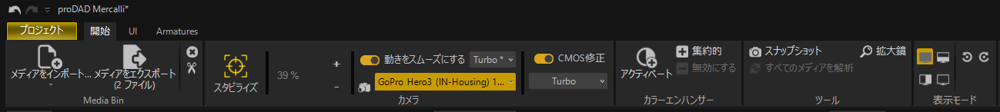

開始タブ内には、インポート/エクスポート と スタビライゼーションCMOS修正,フィッシュアイ修正および明るさとコントラスト設定(dynamics)のすべての設定があります。

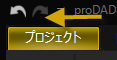

プログラム内の、アンドゥ**/**リドゥ機能 はとても重要です。また、Mercalli SALにはアンドゥと復元変更オプションがあります。

#### 2.3.1. プロジェクトタブ - プロジェクトを開く/保存

**Mercalli SAL**では、実行されたすべての作業をプロジェクトに保存できるようになり、いつでもプロジェクトを再ロードして編集を続けることができます。プロジェクトを開く、追加、保存は、プロジェクトタブで直接実行できます。

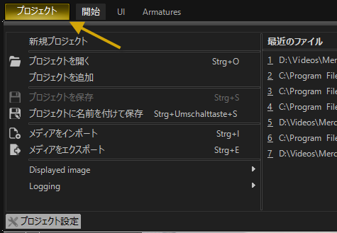

- 新しいプロジェクトを作成
- プロジェクトを開く、既存のプロジェクトを招く
- プロジェクトを添付、現在編集中のプロジェクトに他のプロジェクトを追加
- （新しいファイルパスを保存と入力）としてプロジェクトを保存

また、ここにメディアをインポートし、すでに編集済みのメディアのエクスポートもスタートできます。表示されたイメージも印刷したり、印刷プレビューを表示することも可能です。Mercalli SALでは、ロギングの表示や印刷の保存も提供しており、問題が発生した際はproDAD サポートに役立ちます。

Mercalliプロジェクトの基本設定は、プロジェクト設定で選択できます。

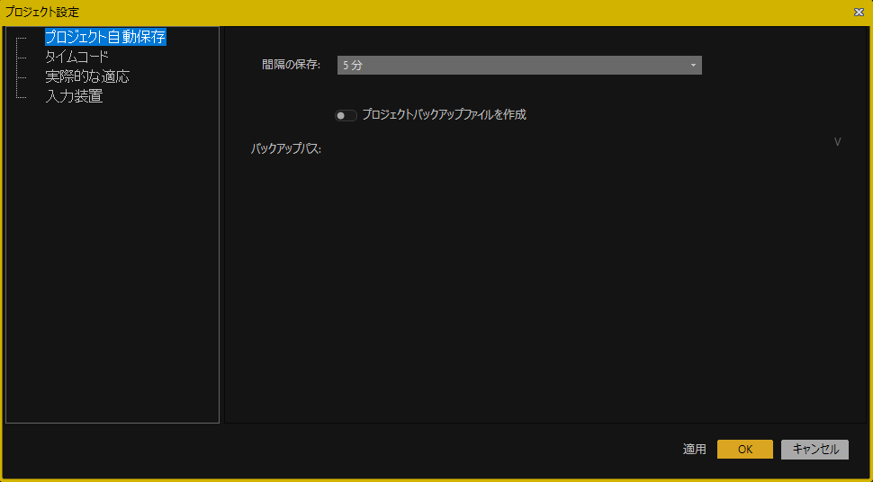

アンドゥ**/**リドゥ変更

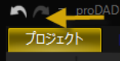

各プログラウでは、アンドゥ/リドゥ機能 はとても重要です。また、Mercalli SALにはアンドゥと復元変更オプションがあります。

#### 2.3.2. 開始タブ

開始タブ内には、 インポート/エクスポート とスタビライゼーション、CMOS修正、フィッシュアイ修正 および 明るさとコントラスト設定(色合い向上dynamics)のすべての設定があります。

##### 2.3.2.1. メディアのインポート

次に、ビデオをインポートする4つのオプションがあります。

1. ファイルを選択（ビデオファイルをインポートする）
2. フォルダーを選択（フォルダーからイメージファイルをインポートする、Mercalliが変換します）
3. ここをクリックしてメディアを開く（ビデオファイルをインポートする）
4. Mercalli SALのプレビューに直接デスクトップからドラッグ＆ドロップでインポートする

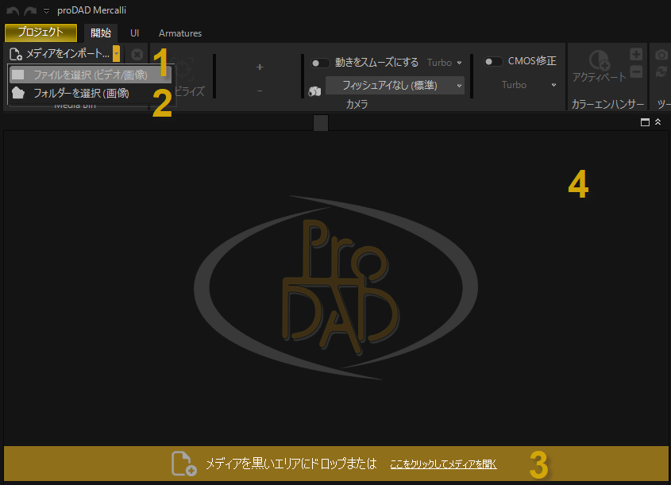

##### 2.3.2.2. メディアのエクスポート

**Mercalli SAL**は包括的なビデオエクスポートを提供しています。多数のプレインストールされているエクスポートテンプレートを選択でき、また個別にも編集することができます。ビデオは個別にエクスポートすることも、複数ビデオを１つのファイルにまとめることもできます。

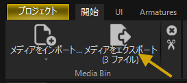

もちろん、Mercalli SALでは1つのワークスペースで複数ビデオの解析とエクスポートも可能です（バッチ編集）。

###### 2.3.2.2.1. エクスポート設定

ビデオを編集した後、最後のビデオがエクスポートされます。\
ソースメディアタブで、エクスポートしたいビデオなど、編集したビデオをハイライトできます。

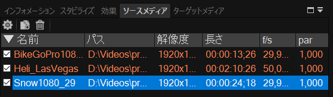

ハイライトしたビデオはエクスポートできます。（ソースメディアタブから)エクスポートするビデオの数がここに再度表示されます。

この作業には、リボンのエクスポートメディアをクリックします。エクスポートメディアダイアログが開きます。

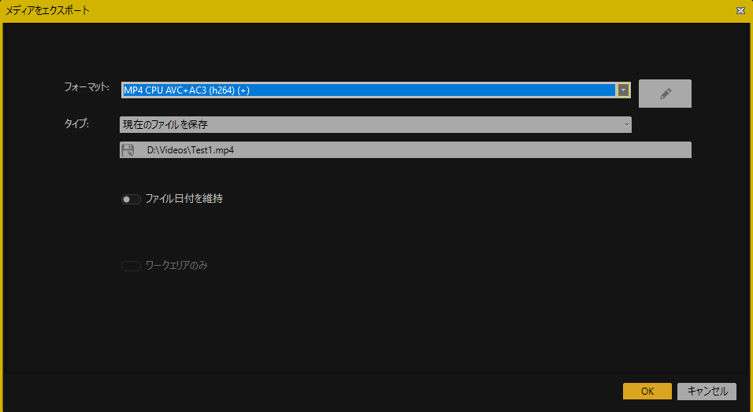

ここでご希望のエクスポートフォーマットテンプレートを選択できます。

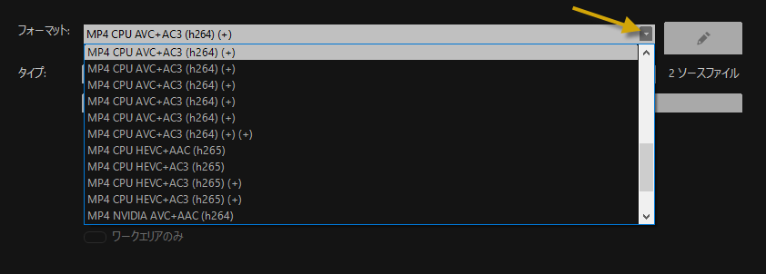

独自のエクスポートフォーマット設定を行うこともできます。

フォーマットテンプレートを選択した後、エクスポートタイプを選択します。

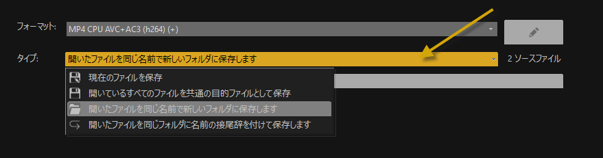

原稿ファイルの保存、共通ターゲットファイルとしてすべてのオープンファイルを保存、同じ名前で新しいディレクトリにオープンファイルを保存、および新しい名前の拡張子で同じディレクトリにオープンファイルを保存することも可能です。

次に、ご希望のエクスポートパスを選択します。

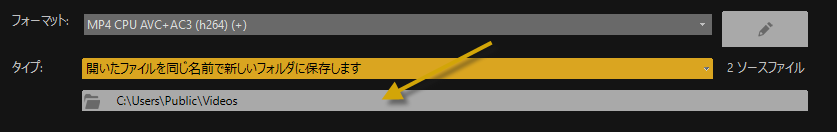

また、ファイルの日付を維持するか、選択したワークエリア（トリミングエリア）のみをエクスポートするか、を指定することもできます。

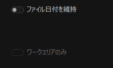

次にOKをクリックしてエクスポートを開始します。その後、インストールしたソフトウェアプレーヤーでビデオを再生できます。

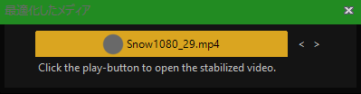

さらに、エクスポートされたビデオは、ターゲットメディアタブで使用できます。

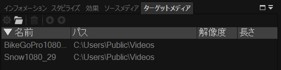

###### 2.3.2.2.2. エクスポート設定の編集

リボンの メディアをエクスポート をクリックします。メディアをエクスポートダイアログが開きます。

これでご希望のエクスポートフォーマットテンプレートを選択できます。

また、独自のエクスポート詳細設定も実行できます。そのためには、フォーマット設定の編集オプションをクリックしてください。

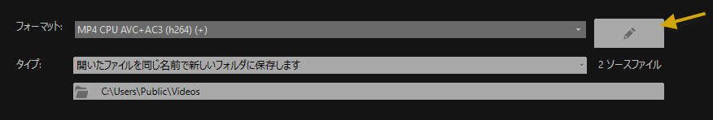

フォーマット設定の編集ダイアログで、選択したテンプレートの編集ができます。そのためには、 (+) 記号をクリックし、最初にテンプレート名を変更し、3つの品質レベル（低/中/高）のいずれかを選択し、ビデオコーデック、フォーマットとサイズの設定を実行できます。ビデオの設定はオンとオフを切り替えることもできます。

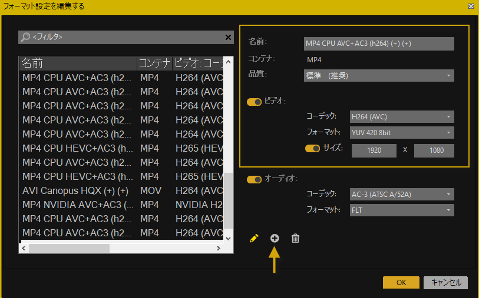

さらに、コーデックとフォーマットに関するオーディオの個々の設定もあります。オーディオの設定もオンとオフを切り替えることができます。

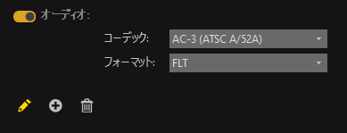

フォーマット設定は追加および削除することもできます。**OK**をクリックすると、フォーマット設定の変更できるようになり、新しい個々のフォーマットテンプレートが作成され、エクスポートに試用できるようになります。

###### 2.3.2.2.3. バッチ編集

**Mercalli**では、複数のビデオを個別のビデオとして、またはマージされたビデオとして、バッチ編集が可能です。

バッチ編集には、次の方法があります：

1. ビデオ解析による個々のビデオのビデオ分析と、次にハイライトされたすべてのビデオを共通ファイルへのエクスポート Mercalliにビデオをインポートし、スタビライゼーション設定などを選択し、ビデオの解析します。さらにビデオをインポートして解析します。その後ソースメディアタブで使用できます。その後、スタビライゼーションに関するさまざまな設定を変更できるように、ソースメディアタブの対応するビデオをハイライトします。

それぞれハイライトされたビデオの再生は、プレビューでもスタートできます。

注：

タイムライン下の**Media Bin**で、すべてのビデオを1つのファイルに結合したい場合は、ドラッグ＆ドロップで並び替えすることもできます。

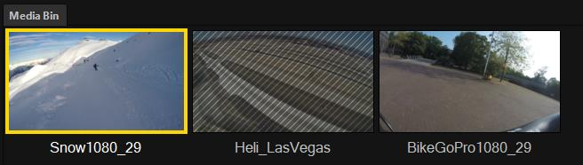

Media Bin内の個々のビデオをハイライトし、カラーエンハンサーやその他の効果をさらに適用することもできます。

ハイライトされたビデオはエクスポートできるようになり、そのためには、リボンの メディアをエクスポート をクリックします。

エクスポートされるビデオ数（ソースメディアタブから）がここに表示されます。次にエクスポートの設定に注意します。

これでご希望のエクスポートフォーマットテンプレート、独自の詳細エクスポート設定、タイプ、エクスポートパスを選択することができます。次に**OK**をクリックしてエクスポートを開始します。

この例では、共通ビデオファイル（ソースメディアタブでハイライトした2つのビデオから）は、自分で選択したディレクトリに作成されました。（ショットメディアのエクスポート参照） これでビデオはターゲットメディアに表示されます。

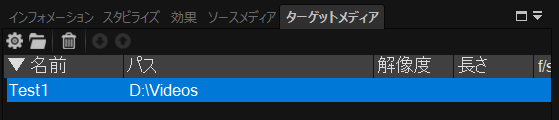

2. ビデオ解析とエクスポート設定を1つの作業で

まず複数のビデオをMercalliにインポートし、例えば各ビデオのスタビライゼーション設定などを選択します。次に、ソースメディアタブで解析とエクスポートが必要なすべてのビデオをハイライトします。Media Bin内の個々のビデオをハイライトし、カラーエンハンサーやその他の効果を適用することもできます。

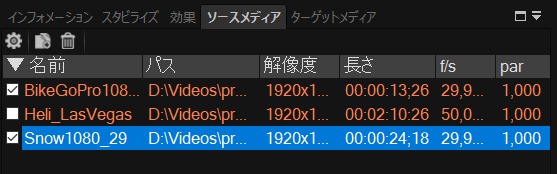

ビデオ解析とエクスポートを開始するには、リボンのメディアをエクスポートをクリックします。解析およびエクスポートされるビデオの数がここに表示されますので、エクスポートの設定に注意してください。これでご希望のエクスポートフォーマットテンプレート、独自の詳細エクスポート設定、タイプおよびエクスポートパスを選択することができます。次に、**OK**をクリックしてエクスポートを開始します。

エクスポートされるビデオは自動的に解析され、1つずつエクスポートされます。\
この例では、3つのハイライトされたビデオがソースメディアタブで、自分で選択したディレクトリにエクスポートされました。ビデオはターゲットメディアタブに表示されます。

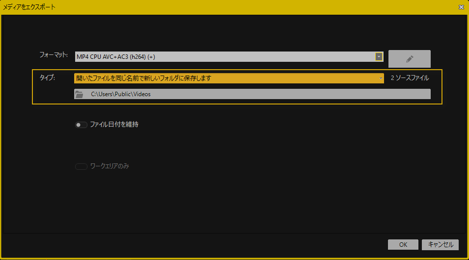

その後、インストールしたソフトウェアプレーヤーでビデオを再生できます。

さらに、エクスポートされたビデオは、ターゲットメディアタブで使用できます。

注：\
その後のスタビライゼーション設定の変更は可能で、ソースメディアタブでビデオをハイライトし、新しい設定を行い、その後それ以上の分析なしで、新しく選択したプロパティでエクスポートします。

選択したエクスポートフォーマットによって、このファイル（スタビライズしたビデオ）は、例えばDVDまたはBlu-rayへの書き込みなどに使用できるようになります。ファイルをビデオ編集ソフトにインポートし、さらに編集することも可能です。

##### 2.3.2.3. Media Binを空にする - シーン検出

**Media Bin**を空にするオプション (1) を選択すると、Mercalli SALのインポートしたすべてのメディアが削除されます。

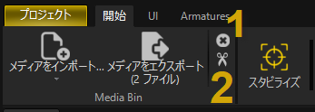

まずシーン検出オプション**(2)**を有効にし、次に メディアをインポート オプションを使ってビデオをすると、シーン検出が自動的に開始されます。個々のシーンは保存され、**Media Bin**でサムネイルとしてマークされます。**Media Bin**を空にするオプションを選択すると、メディアトレイからすべてのシーンが削除されます。

##### 2.3.2.4. スタビライゼーション – ビデオの解析を開始

スタビライゼーション **–** ビデオの解析を開始ビデオをインポートした後、まずスタビライズ**(1)**を有効にする。

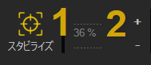

またはビデオ解析を動作させる。

ビデオ解析は、カメラの動きの修正/スムージングに必要です。ビデオ解析が完了すると、ビデオはスタビライズされますが、さらに詳細な設定や最適化を実行できます。

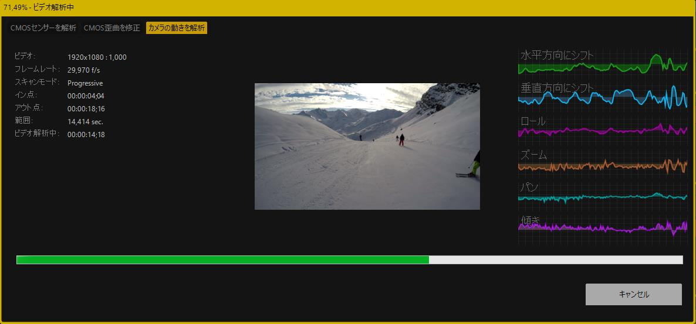

スケーリング設定 **-** 動きをスムーズにするスケーリング**+/- (2)**オプションを使用すると、さらにズームインすることでスタビライゼーションを改良することができます。

動きをスムーズにするオプションを使用すると、ビデオのスタビライゼーションのON/OFFを切り替えることができます。

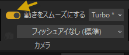

カメラの動きを滑らかにするさまざまな方法で、揺れのあるビデオを解析して修正することができます。このためには、適切なメソッド（Turboメソッドはプリセットされています）を選択してください。

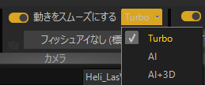

1. **Turbo**、この方法により、高速で安定したビデオ解析が可能になり、良いから非常に良い結果をもたらします。
2. **AI**、この方法により、高速で安定したビデオ解析が可能になり、良いから非常に良い結果をもたらします。
3. **AI+3D**の場合、カメラの傾き解析が追加され、破壊的な遠近効果が低減されます。

##### 2.3.2.5. フィッシュアイ修正

正しいカメラレンズを選択することで、ビデオ/写真内の可能性のあるフィッシュアイ効果（レンズの湾曲による）を除去することができます。

ビデオにフィッシュアイ効果が見られない場合は、フィッシュアイなし（標準）を選択してください。

ビデオにフィッシュアイ効果がある場合は、ここでカメラと解像度に合ったカメラプロファイルを選択します。

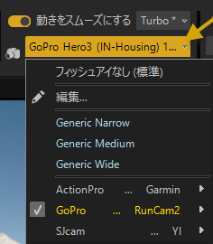

魚眼レンズの湾曲表現を修正し、線を直線化するオプションをクリックします。

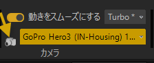

フィッシュアイを除去するオプションをクリックします。するとプレビューに修正されたビデオが表示されます。\
カメラがリストにない場合は、3つのジェネリックプロファイルを試してください。

編集によって固有特性に至ります：

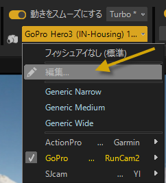

現在の固有特性は、開くときにダイアログに表示されます。変更可能なダイアログの値は、プロファイルの1つの選択と比較できます。3つのモードのうち最初の2つは、技術的な方法です。右側の何も変更できません。

フィッシュアイの除去が選択されている場合、リボンのボタンを押すことと同じです。右側のみ調整中に変更できます。プレビューには、値の変更が実行されるとすぐにその効果が表示されます。ほとんど何も見えない場合、左右のパラメーターの視覚的な差はあまり大きくありません。

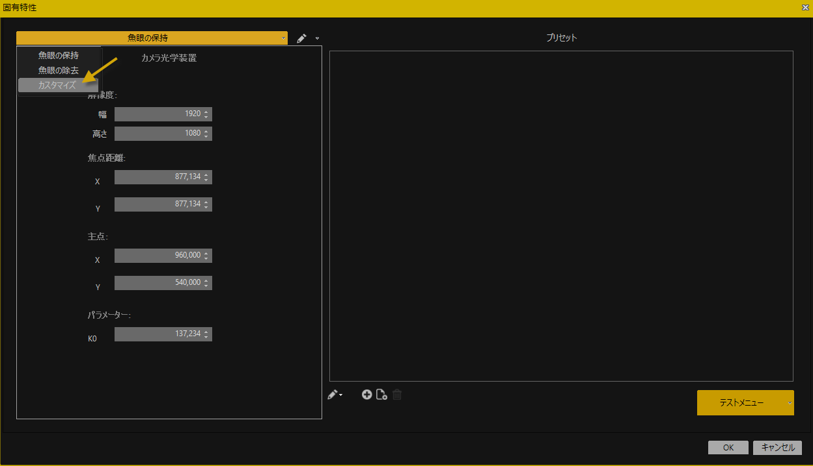

##### 2.3.2.6. CMOS修正 (Turbo, ウォブルを除去 + 強化修正)

最初に、ビデオから不要な**CMOS**効果を除去すると、その上でよりよいスタビライズ効果が得られます。なぜなら映像にはたくさんの揺れやゆがみがあり、不要なカメラの動きをスタビライズするのによりよい基礎となるからです。

ほぼ全てのアクションカメラ、一眼レフカメラ、プロ用ビデオカメラにはいわゆるCMOSセンサーが付いています。このようなカメラで振動や揺れの多い撮影をすると、個々のイメージに欠陥があらわれ、自然にイメージエラーとなります。

最初に、撮影したビデオから不要なCMOS効果を除去してください。これがよりよいスタビライズ結果の最良のベースとなります。それに続く不要なカメラの動きのスタビライズは、さらに最適化され振動やゆがみのない映像へと生まれ変わります！

Mercalliはこの最高の映像処理をご提供します。プログラムはいたってシンプルで、スタビライズもCMO修正も完全に自動で行います。もちろん追加の調整も可能です－自動手動はいつでも選べます。

CMOS修正を有効にする CMOS修正オプションを有効にすると、動く映像（ビデオ）に生じるゆがみ（CMOSによる）を補正できます。このCMOS修正オプションはデフォルトで有効になっています。

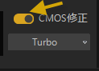

スタビライズ処理をしない限り、ローリングシャッター効果は現れないか少しわかる程度です。しかし編集中にスタビライズすると、ローリングシャッター効果が現れ、映像に乱れが生じます。\
したがって、Mercalliで不要な効果を除去します－不要な効果が残っている映像は最終結果の価値を落としてしまうからです。

さらにMercalli SALは、ビデオに含まれうるスタンダード、振動/ウォブルなど、揺れや波に対応する設定（強化修正）を、異なるCMOS修正メソッドで提供します。ビデオ内の完全自動CMOS修正をさらに最適化したい場合は、可能な限りベストな最適化のCMOS歪曲タイプをメニューから1つ選択します。

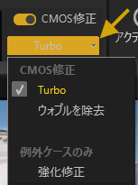

1. **Turbo**、最も一般的なCMOS歪曲の修正を、極めて速く行うことができます。「ターボ」は、カメラの動きのスムージングを組み合わせてのみ機能します。
2. ウォブルを除去は、ビデオ内の非常に目に障る歪みを取り除くことができます。
3. 強化修正は、計算的負荷の高い修正による波状の画像の歪みを取り除きます。集中的なCMOS修正に、異なるレベルを設定できます。

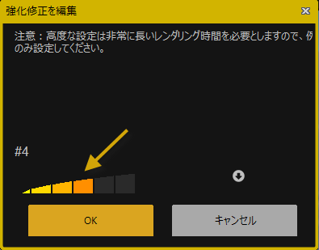

さらに強化修正の詳細設定も可能です。

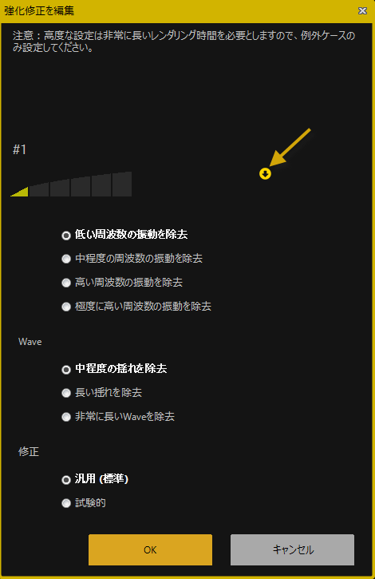

##### 2.3.2.7. カラーエンハンサー

カラーエンハンサーでは、ビデオ/写真の明るさとコントラストの設定を自動的に（ダイナミックに）最適化できます；ダイナミック設定は、マウスをクリックするだけで、オン/オフ等の設定ができます。

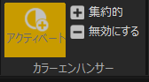

##### 2.3.2.8. スナップショット - すべてのメディアを解析 – 拡大鏡

現在のタイムラインのスナップショットは、マウスをクリックすると作成と保存ができます。

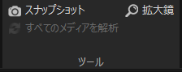

すべてのメディアを解析オプションで、プロジェクトのすべてのインポートされマークされたビデオの解析を開始します。虫眼鏡を使うと、プレビューモニターの画像領域を拡大表示できます。そのためには、虫眼鏡をアクティブにし、プレビューにマウスを移動すると、ビデオ内の自分で選んだセクションが拡大表示されます。

##### 2.3.2.9. 表示モード

表示モードメニューでは異なるオプションでビデオプレビューをお選びいただけます。

1. 結果表示（プレビューにスタビライズされたビデオを表示）
2. 上下に比較（オリジナルとスタビライズしたビデオを上下分割スクリーンに表示）
3. 縦に比較（オリジナルとスタビライズしたビデオを左右分割スクリーンに表示）
4. オリジナル表示（プレビューにオリジナルビデオを表示）

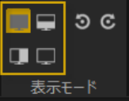

##### 2.3.2.10. 回転の設定

Mercalli SALには、メニュー右上に回転のオプション設定がございます。「反時計回りに90°回転」または「時計回りに 90°回転」オプションを1度クリックしていただくと、それぞれの方向にビデオが回転します。

約90度回転すると表示方向が変わりますが、ピクセルは変わりません。Z方向の回転に関するその他の設定オプションについては、エフェクト/レイアウト/回転を参照してください。

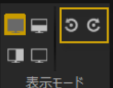

#### 2.3.3. UIタブ

**UI**タブでは、Mercalli SALワークスペースに表示するものを決めることができます。\
さらにMedia Bin、テンプレート、Logging、ヒストグラム、および入力装置のON/OFFを切り替えることができます。

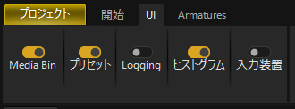

#### 2.3.4. Armaturesタブ

**Armatures**タブをクリックすると、Mercalli SALの上部にさまざまな表示機器が表示され、スタビライゼーションと CMOS修正の設定を記号で表します。

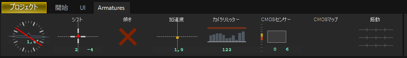

### 2.4. タイムライン – プレビュー - Media Bin – チャート

ここでは、タイムライン（トリム範囲の指定を含む）の機能、コントロールエレメントのプレビュー、および下で利用可能な **Media Bin**は、**UI**タブでオンになっている時、重要な情報を取得することができます。

図は、カメラの動き（スタビライゼーションとCMOS修正）の補正のグラフィック表現を表示します。Mercalli SALは、移動、ロール、CMOSセンサー、ズーム、傾斜、ズームインダイナミックスケーリングの図を提供します。

#### 2.4.1. プレビュー - コントロールエレメント

インポート後、ビデオはコントロール（例えば再生**(6)**などの再生コントロール。ビデオの停止は停止**(5)**をクリック）を介してMercalliプレビューで再生できます。

ビデオの時間情報(1) （現在＝03秒/23イメージ）は、左のプレビュー下に表示されます。プレビューにインポートしたビデオ、前のビデオ(2)と次のビデオ(9)を切り替えることもできます。ビデオの繰り返し(3)も可能です。スイッチ(4)はビデオの開始またはトリムエリアの開始へジャンプし、スイッチ(7)はビデオの最後またはトリムエリアの最後へジャンプします。スイッチ(8)を使用すると、数回クリックして再生速度を段階的に変更できます。タイムラインで、赤い再生マーク(10)は、ビデオの現在位置を表します。

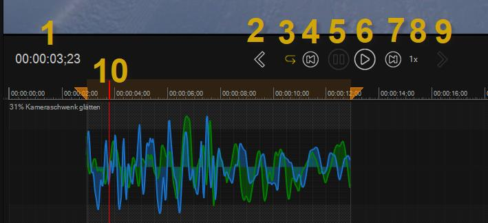

プログラムの右下にあるスライダーで、プレビューサイズを調整できます。

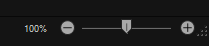

#### 2.4.2. タイムラインとトリム範囲の定義

次にあるのがMercalli SALのタイムラインです。ここでトリム範囲を決めることができます。その後、この範囲のみがスタビライズとエクスポートに使用されます。

赤い再生マーカー**(1)**は、ビデオ内の現在位置を示します。オレンジの**In/Out**ハイライター**(2)**を使用してビデオの特定のトリム範囲**(3)**を設定すると、その部分のみが編集され、アカウントへエクスポートされます。

ハサミアイコン**(4)**は、再生マーカーが選択したトリム範囲にある場合に限り、再生マーカーの現在位置でビデオをカットします。

トリムモード**(5)**は、有効または無効にすることができます。イン点とアウト点は、有効化された状態で編集できます。これにより、ビデオ解析を変更することができます。インおよびアウトオペレーティングポイントは、無効化状態で選択することができ、ビデオ解析に変更は起こりません。全体を見やすくするため、タイムラインは指定されたイン点とアウト点に縮小されています。

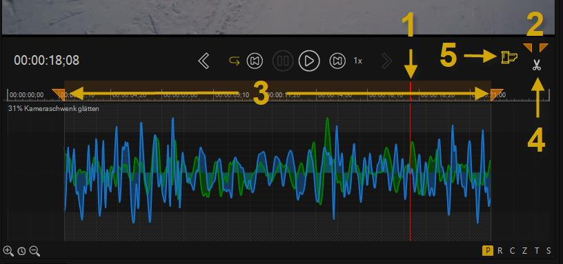

#### 2.4.3. Media Bin

**Media Bin**は、UIタブで有効にすることができ、その後Mercalli SALタイムラインの下に表示されます。

**Media Bin**では、インポート/編集されたビデオと認識されたシーンはサムネイルとして連続して表示されます。これらの順序は、ドラッグ＆ドロップを使用してここで変更できます。右クリックすると、切り取り、コピー、貼り付け、削除、名前の変更、選択などの機能を含むメニューが開きます。ビデオプロパティも表示できます。

注：\
クリップの順序は、すべてのメディアを1つのファイルにエクスポート場合に重要です。

Media BinはQuell-Mediumと同期して動作します。

ソースメディアタブでビデオ/シーンの選択を解除すると、

**Media Bin**のサムネイルが影付きで表示されます。これらのビデオ/シーンはエクスポートされません。

#### 2.4.4. チャート

図は、カメラの動きの修正（スタビライゼーションとCMOS修正）のグラフ表現を表しします。Mercalli SALには、スムースカメラスイベル（置き換え）、Z軸（ローリング）、CMOSセンサー、ズームスムージング、X/Y軸スムージング、およびズームインダイナミックスケーリングに関する図があります。

##### 2.4.4.1. パンショット補正

パンショット補正図では、**X-Y**方向（水平/垂直）のスライドなど、ビデオ内の動きが表示されます。

パンショット補正（スタビライズ/パンショット補正）で、ビデオの全体のバランスが調整できます。

スライダーを右へ動かすと、Mercalliのスタビライズが大きくなり、ビデオがさらに静かになります。パンショット補正スライダーを使うと、ビデオが大きく変化します。（ビデオの動きが滑らかになります）また、パンショット補正図では、修正カーブで変化を見ることができます。

図の置き換えの によって合図された不要な動きのほぼすべてを削除する場合は、スタビライゼーション/エッジ/エッジなしタブのスケールスライダーを動かしてください。

スタビライズした結果に元の解像度をできるだけ保つために、必要なだけ（よりズームイン）右へ動かしてください。スタビライゼーション/エッジタブのベストスタビライゼーションを選択すると、Mercalliは自動的にビデオの深部にズームし、エッジは表れません。

ビデオの最大の動きの制限を示す、影付きのマーキング（図の上/下に見える）は、スライダースケーリングを変更した後、それに応じて高さが調整されます。

##### 2.4.4.2. Z-軸 (ロールOn/Off)

**Z-**軸 **(Roll)**図では、ビデオの動きまたはZ軸の回転を表示します。グラフ上で直接マウスを動かすと、現在値を見ることができます。

ローリングの図が表示されない場合、スタビライズ/スムージングタブのZ軸スライダーが無効になり、Z軸周りのスタビライゼーションの修正も表示も利用できなくなります。

ビデオ内の最大回転の動きの制限を示す影付きマーキング（図の上/下に見える）は、スケールのスライダーを変更した後、それに応じて高さが調整されます。不要な動きは、図中の

により合図され、それによって取り除かれます。

##### 2.4.4.3. CMOSセンサー (On/Off)

完全自動CMOS修正は、CMOSセンサーによる弱点を遡及的に除去するものです。緑の曲線はMercalliによる修正を示し、オレンジの曲線は未処理のエラー（修正できていない）を示します。図上で直接マウスを動かしていただくと、現在値が表示されます。

CMOS修正の図が表示されない場合は、リボンでCMOS修正が無効になっています。

##### 2.4.4.4. ズーム平滑化 (On/Off)

ズーム平滑化のグラフは、ビデオのズームの動きを表示します。

修正と図の表示は、スタビライゼーション/エクストラタブのスライダーズーム平滑化の位置によります。スライダーズーム平滑化をさらに右へ動かすと、ズームは複数のイメージに区分され、調和のとれたズーム結果が得られます。

ズーム修正の図が表示されない場合は、スライダーズーム平滑化がスタビライゼーション/エクストラタブで無効になっています。

##### 2.4.4.5. X/Y - 軸平滑化

X/Y軸平滑化（スイベル＋傾斜）図では、X/Y軸周りの傾けるためのビデオの動きが表示されています。マウスを図中に直接動かすと、瞬間的な値も表示されます。

修正と図の表示は、スタビライズ/エクストラタブのX軸スムージング（スイベル）とY軸スムージング（傾斜）スライダーの位置によります。X/Y軸スムージングスライダーを動かすと、X/Y軸周りの回転に関する修正が変更されます。曲線形の変化は、図に見られます。

X/Y軸平滑化の図が表示されない場合は、スタビライズ/エクストラタブでX/Y軸平滑化スライダーが無効になっています。

##### 2.4.4.6. ズームイン - ダイナミックスケール

シアン色の線は、図において対応する時間位置のズームを表示します高いダイナミックスケール値（設定タブのダイナミックスケール）はズームを減少します。速いズームにご利用いただけます。

注：

ダイナミックスケールスライダーの位置によりますが、ズーム必要条件は時間位置にもより変化します。最大値は常に一定で、最小値は高いダイナミックにより沈むことがあります。

最小106%および最大110% -使用されたズーム

最小102%および最大115% -使用されたズーム

### 2.5. プリセット

さまざまなプリセット効果テンプレートを使用することができます。ビデオ/写真をダブルクリックすると選択できます。また、新しいテンプレートの作成(+)、テンプレートの削除(-)、新しいエフェクトディレクトリの作成を行うこともできます。テンプレートを選んだ後、エフェクトをより細かく調整したり、エフェクトやテンプレートを削除したりできます

エフェクトの設定を新しいテンプレートとして保存することもできます。まず、効果タブですべての設定を行い、テンプレートタブの左上にある（＋）をクリックします。次に、新しいテンプレートに好みのエフェクト設定を選択し、OKをクリックします。 これで新しいテンプレートがテンプレートタブに挿入されます。

### 2.6. パネルタブ

**Mercalli SAL**では、さらに5つのタブが利用可能で、次のタブを表示または設定できます：

#### 2.6.1. インフォメーション

現在選択されているビデオに関する情報/詳細は、インフォメーションタブに表示されます。

#### 2.6.2. スタビライゼーション

カメラの動きを修正する詳細設定は、スタビライズタブにあります。

##### 2.6.2.1. スムージング - パンショット補正

パンショット補正のスライダーで、ビデオの全体のバランスが調整できます。さらに右へ動かすと、Mercalliのスタビライズが大きくなり、ビデオがさらに静かになります。パンショット補正スライダーを使うと、ビデオが大きく変化します。（ビデオの動きが滑らかになります）

パンショット補正では、修正カーブで変化を見ることができます。

##### 2.6.2.2. スムージング - Z-軸平滑化

Z軸平滑化スライダーは、Z軸周りの動き（回転）に関するビデオの補正をもたらします。補正曲線の変化は、Ｚ軸にも表示されます。

Z軸平滑化スライダーは無効にすることもできます。スタビライゼーションタブのスイッチをクリックするだけです。その後、ビデオの回転の動き（Z軸）のスムージングは行われません。

Z軸平滑化スライダーはMercalliが回転の動きを評価できない場合、またはパンのみをスタビライズさせる場合に無効になります。

##### 2.6.2.3. ボーダー

**2.6.2.3.1.** ベストボーダーオプションを選択すると、スタビライズしたビデオにボーダーは表示されません。ボーダーは、ビデオにズームすることで削除されます。これは、ブラーとスケールスライダーで行われた設定プロセスで、必要な修正範囲に関連して行われます。

ボーダー（ボーダーの使い方）に関する詳しい情報は、 www.prodad.com のサポートエリアのFAQセクションにあります。

**2.6.2.3.2.** ベストスタビライゼーションオプションを選択すると、スタビライズしたビデオに黒いボーダーが表示されます。これは現状のブラーの程度に応じて、画像間で異なる場合があります。

見えるエッジは、ソリッド（黒）、リピート、ミラーに置き換えることができます。

\- ソリッド＝黒\
- ミラーとリピートとは、既存の画像素材が、ミラーリングまたはリピートによって余白に計算されることを意味します。

スケールスライダーではビデオをズームでき、エッジは最小限になります。\
過度なズームはビデオにぼやけ（画質の粗さ）が生じます。

**2.6.2.3.3.** フォレンジックビューでは、表示がズームアウトし制限がありません。ズームすると、修正を簡単に見ることができます。スケールスライダーでズームイン/アウトができます。

##### 2.6.2.4. ダイナミクス

カメラダイナミックスの保持オプションは、ビデオの快活を維持することを目的としています。例えば、撮影中の人物のカメラの動きの平滑またはスタビライズをしすぎないことです。

通常の手持ち撮影の不鮮明なカメラショットを三脚で撮影したような映像にスタビライズするには、カメラダイナミックスの保持オプションを無効にする必要があります。

ダイナミックスケールは、スタビライゼーション中にスケーリングの強度を自動的に変化させることを可能にします。揺れの激しいビデオの場合、画像はよりズームインされ、揺れの少ないビデオではそれは少なくなります。

##### 2.6.2.5. エクストラ - ズーム平滑化 - X/Y平滑化

**2.6.2.5.1.** ズーム平滑化スライダーで、ビデオ内のズームの動きを平滑化できます。

スライダーをさらに右に動かすと、ズーム平滑化が強くなります。したがって、ズーム内の既存のぼやけが調和されます。ズーム修正曲線の変更は、ズーム平滑化図にも表示されます。ズーム平滑化スライダーは無効にすることもできます。スタビライズタブのチェックマークをクリックするだけです。その後、ビデオにズーム修正は生じません。

**2.6.2.5.2.** X軸平滑化スライダーは、X軸（X方向のカメラの傾きの動き）周りの動き（回転）に関するビデオの修正をもたらします。X軸ダイアグラム（プレビュー下）にシアン色の曲線として表示されます。

X軸平滑化スライダーを動かすと、X軸周りの回転に関する修正が変更されます。図内では、この変更はシアン色の曲線で表示されます。X軸平滑化スライダーは、無効にすることもできます。スタビライズ/X軸平滑化タブのチェックマークをクリックするだけです。その後、ビデオのX軸周りの補正は生じません。

**2.6.2.5.3.** Y軸平滑化スライダーは、Y軸（Y方向のカメラの傾きの動き）周りの動き（回転）に関するビデオの修正をもたらします。Y軸ダイアグラム（プレビュー下）にマゼンタ色の曲線として表示されます。

Y軸平滑化スライダーを動かすと、Y軸周りの回転に関する修正が変更されます。図内では、この変更はマゼンタ色の曲線で表示されます。Y軸平滑化スライダーは、無効にすることもできます。スタビライズ/X軸平滑化タブのチェックマークをクリックするだけです。その後、ビデオのX軸周りの補正は生じません。

#### 2.6.3. エフェクト

効果タブでは、違うエフェクトの詳細を設定できます。

###### ヒストグラム

ヒストグラムは、**UI**タブ（リボン上部）で、Mercalli作業画面に追加できます。ビデオ/写真内のカラー値分布のグラフィカルな表現を表示します。

エフェクト上に表示されるヒストグラムは、ビデオ/写真のカラー値分布をグラフで表したものです。ヒストグラムは、画像

のカラー値分布のグラフ表現ですので、カラー値曲線とも言われます。ビデオの再生中、ヒストグラムの値は常に変化

し、ビデオ内の光がどのように変化しているかを示します。図のX軸はRGBカラー値を表し、Y軸はこの値を持つビデオ内

のピクセル数を示します。ヒストグラムは、ビデオ/写真の各ピクセルに割り当てられた3つのRGBカラー値（赤/緑/青）で

作成されます。グレー部分はヒストグラムの3色すべてが重なる部分を特定し、黄色、マゼンタ、シアンは2つの色が重なるところを表示します。

###### キーフレーム

すべてのエフェクトと設定は、キーフレームを使ってコントロールすることもできます。まず、タイムライン上の必要な位置にタイムラインカーソルを動かします。次に、必要なエフェクト設定で、時計マークをクリックし、スライダーを動かして好みのエフェクトに仕上げます。別のキーフレームを挿入するには、タイムラインカーソルを再度タイムラインの新しい位置に置き換え、その後(+)をクリックし、ご希望のスライダーを再度動かすと、ビデオの新しい位置で効果が見られます。白い矢印（左/右）を使ってキーフレーム間を変更できます。キーフレームは無効**(-)**にすることもできます。設定されたエフェクトは**x**で削除できます。（エフェクトエンハンサーなど）。

##### 2.6.3.1. 色

###### 2.6.3.1.1. エンハンサー

ダイナミックス：ダイナミックスオプションを使うと、ビデオ/写真の色をより明るく、より活気のある（ダイナミック）色にすることができます；鈍い色が最適化されます。

明るさバランス：これはビデオ/写真全体の明るさの違いのバランスを取ります。

###### 2.6.3.1.2. ベーシックカラー

###### 2.6.3.1.2.1. ホワイトバランス

ホワイトバランスを使うと、ビデオ/写真に生じうる色かぶりを取り除くことができます。これを行うには、カラーピペットを使い、白にする必要がある色を選択します。画像の内容は自動的に調整され、色がぶりは取り除かれます。カラーパレットで色を選択することもできます。

###### 2.6.3.1.2.2. 露出、コントラスト、明るさ、彩度

ここで上と下のライト領域を調整し、ビデオ/写真のコントラスト、明るさ、彩度を最適化できます。

###### 2.6.3.1.3. 調和

###### 2.6.3.1.3.1. 冷たい/暖かい

このオプションを使って、ビデオ/写真の色温度を調整します。負の値を指定すると色温度が低くなり、正の値を指定する

とビデオ/写真が暖かくなります。

###### 2.6.3.1.3.2. 色合い

色合いオプションを使って、ビデオ/写真に使用する色合いを設定します。彩度オプションを使うと、ビデオ/写真の色合いの強度を最適化します。

###### 2.6.3.1.3.3. カラーシフト

このオプションを使用すると、ビデオ/写真内の色を互いに相対的に変化させることができます。

###### 2.6.3.1.4. トーンカーブ（黒、影、光、白）

ヒストグラムは、画像のカラー値分布のグラフ表現です；したがって、カラー値曲線とも言われます。使用可能なオプションを使用して、ビデオ/写真イメージの暗い領域と明るい領域の光のコンディションを指定できます。

###### 2.6.3.1.5. 分割調色（影、中間色、光）

スライダーを使って、ビデオ/写真の深い、中間、明るいトーンの色合いと彩度を調整します。色合いスライダーを使って、ビデオ/写真の色合いまたは深いトーンの色を設定します。また、カラーピペットを使用して正確な色（トーンと彩度）を選択するか、カラーパレットから深い、中間、明るいトーンで使用する色を使うこともできます。

###### 2.6.3.1.6. チャンネル（露出、コントラスト、彩度）

ここでは、ビデオ/写真の個々のチャンネル赤/緑/青の光、コントラスト、彩度比を指定できます。

###### 2.6.3.1.7. デノイズ / シャープネス

ビデオ/写真をシャープにしたり、ノイズ（暗闇での録画により生じるノイズなど）を削除/最小限に抑えることができます。

##### 2.6.3.2. レイアウト

スケール：ビデオ/写真の画像の詳細を縮小または拡大できます。

回転：ビデオ/写真をX/Y/Z軸に沿って正方向または負方向に回転させます。

注：\
表示方向では、90度回転記録（ポートレート記録）は、例えばビデオストリームのピクセルデータを変更することなく、例 1080×1920としてビデオを表すことによって、スマートフォン上で再度正しく表示されます。ビデオは回転Zスライダーでピクセルごとに回転させることができます。しかしながらエッジが発生する可能性があります。

シフト：写真をX/Y軸（左または右）に沿って動かします。

ボーダー：スケーリングを使うと、ビデオ/写真の周りに黒いボーダー（枠線）が現れます。「複製」または「反映」オプションを使うと、ボーダーが再生成されます；結果は画像の内容によって異なります。

枠線 複製 反映

##### 2.6.3.3. ビネット

プリセットの左側には、あらかじめ設定されたビネットエフェクトがあります；例えばエッジプリセットを使うと、プレビューでこれが使用されます。ビネットの下にあるエフェクトメニューで、角度オプションを使用したビネットの程度や、ビネットエッジのシャープネスやぼかしなど、その他の詳細を設定できるようになりました。アスペクト比オプションは、ビネットの形式を設定します。X/Y中心オプションは、プレビューでのビネットの位置を設定します。

##### 2.6.3.4. スポットライト

プリセットの左側には、あらかじめ設定されたスポットライトエフェクトがあり、ダブルクリックで使用できます。その後、スポットライト効果ダイアログで、より細かい調整を行うことができます。

###### 2.6.3.4.1. ベーシック

カラーピペットを使って、正確な色を選択するか、カラーパレットからスポットライト効果に使用する色を使用できます。輝度オプションを使うと、スポットライトの明るさを変更したり、彩度オプションで色の強度を変更したり、スポットライトに別の色調を選択したりできます。スポットサイズオプションを使って、スポットライトを拡大縮小できます；拡散は、使用しているビデオ/写真のスポットライトの広がりを指定できます。

###### 2.6.3.4.2. ロケーション

X/Y中心オプションは、プレビューでのスポットライトの位置を指定します。アスペクト比オプションは、スポットライトの形式を指定します。

###### 2.6.3.4.3. 色合い

遮光オプションは、スポットライトには影響しませんが、ビデオ/写真を暗くします。シャドウ、中間調、ライトオプションは、暗い領域と明るい領域、および中間のトーンでのスポットライトのトーンプロパティを指定します。

#### 2.6.4. ソースメディア

インポートされたすべてのメディアは、ソースメディアタブに表示されます。

ソースメディアタブでは、ファイルパス、解像度、ランタイム、フレーム/秒(f/s)、ピクセル比(par)、およびインポートされたビデオのソースパスについての情報も表示されます。また、メディアを追加したり削除したり、オプションプロパティを使って開始と終了ポジションを定義することもできます。

ソースメディアタブで選択したビデオは、上矢印ボタンをクリックして上方に1つ移動します。下矢印ボタンで、下向きに変わります。

注：\
すてべのメディアが１つの出力ファイルにエクスポートされる場合、位置は重要です。

ファイル名の前に、スタビライゼーション/修正した後にエクスポートするビデオをハイライトします。\
ソースメディアタブでインポートしたビデオ/写真の名前を変更するオプションもあります。

#### 2.6.5. ターゲットメディア

エクスポートされたすべてのメディアは、ターゲットメディアタブに表示されます。

© proDAD

[www.prodad.com](http://www.prodad.com/)
