# proDAD ProDRENALIN V2

**Anleitung**

© proDAD GmbH

Autor: Uwe Wenz

## Inhaltsverzeichnis

- Willkommen
- [Vorwort](#vorwort)
  - [Was ist ProDRENALIN?](#11-was-ist-prodrenalin)
  - [Copyright / Rechtliches](#12-copyright--rechtliches)
  - [Neuerungen/Änderungen in ProDRENALIN V2](#13-neuerungenänderungen-in-prodrenalin-v2)
- [Systemanforderungen](#systemanforderungen)
  - [Allgemein](#21-allgemein)
  - Empfohlen
- [Installation](#3-installation)
- [Produktaktivierung + Registrierung](#4-produktaktivierung--registrierung)
- [ProDRENALIN](#prodrenalin)
  - Überblick
  - [Ribbon](#51-ribbon)
    - [Projekt-Menü](#511-projekt-menü)
    - [Start-Menü](#512-start-menü)
      - [Medium importieren](#5121-medium-importieren)
      - [Szenenerkennung](#5122-szenenerkennung)
      - [Stabilisierung](#5123-stabilisierung)
      - [Rolling-Shutter Korrektur](#5124-rolling-shutter-korrektur)
        - 1 Stern
        - 2 Sterne
        - 3 Sterne
      - [Verwendete Kameraoptik](#5125-verwendete-kameraoptik)
        - [Profilliste](#51251-profilliste)
        - [Linsenkorrektur/Fischauge entfernen](#51252-linsenkorrektur--fischauge-entfernen)
        - [Intrinsische Eigenschaften](#51243-intrinsische-eigenschaften)
      - [Farbverstärker](#5126-farbverstärker)
      - [Werkzeuge](#5127-werkzeuge)
        - [Schnappschuss](#51271-schnappschuss)
        - [Alles analysieren](#51272-alles-analysieren)
      - [Ansicht](#5127-ansicht)
    - [Export-Menü](#513-export-menü)
      - [Export starten](#5131-export-starten)
      - [Videos zusammenfassen](#5132-videos-zusammenfassen)
      - [Exportpfad festlegen](#5133-exportpfad-festlegen)
      - [Dateidatum erhalten](#5134-dateidatum-erhalten)
      - [Exporteinstellungen](#5135-exporteinstellungen--einrichten)
      - [Batchverarbeitung](#5146-batchverarbeitung)
  - [Vorlagen](#52-vorlagen)
  - [Medienablage](#53-medienablage)
  - [Steuerung](#54-steuerung)
    - Trimmbereich wählen
    - Setzen von IN/OUT Punkten
    - Ausschneiden
  - [Canvas](#55-canvas)
  - [Histogramm](#56-histogramm)
  - [Panel Tabs](#57-panel-tabs)
    - Keyframesteuerung
    - [Effekte](#571-effekte)
      - [Farbe](#5711-farbe)
        - [Verstärker](#57111-verstärker)
        - [Grundfarben](#57112-grundfarben)
          - [Weissabgleich](#571121-weissabgleich)
          - Belichtung
          - Kontrast
          - Helligkeit
          - Sättigung
        - [Stimmung](#57113-stimmung)
          - [Kalt/Warm](#571131-kaltwarm)
          - [Tönung](#571132-tönung)
          - [Farbverschiebung](#571133-farbverschiebung)
        - [Tonwertkurve](#57114-tonwertkurve-schwarze-tiefen-lichter-und-weiße)
          - Schwarze
          - Tiefen
          - Lichter
          - Weisse
        - [Geteilte Färbung](#57115-geteilte-färbung-tiefen-mitteltöne-lichter)
          - Tiefen
          - Mitteltöne
          - Lichter
        - [Kanal](#57116-kanal-belichtung-kontrast-und-sättigung)
          - Belichtung
          - Kontrast
          - Sättigung
        - [Entrauschen / Schärfen](#57117-entrauschenschärfen)
      - [Layout](#5712-layout)
      - [Vignette](#5713-vignette)
      - [Strahler](#5714-strahler)
        - [Grundwerte](#57141-grundwerte)
        - [Lage](#57142-lage)
        - [Tönung](#57143-tönung)
    - [Quell-Medium](#572-quell-medium)
    - [Ziel-Medium](#573-ziel-medium)
  - [Status](#58-status)
- [Shortcuts](#6-shortcuts)
  - [Global Shortcuts](#61-global-shortcuts)
  - [Local Shortcuts](#62-local-shortcuts)

### Willkommen zu proDAD ProDRENALIN!

Durch ProDRENALIN werden Ihre spontanen Action- und Sport-Videos mit effektiven und schnellen Tools prompt und mühelos zu professionell aussehendem Filmmaterial verarbeitet. ProDRENALIN entfernt automatisch Fischaugeneffekte von Videos oder Standbildern, stabilisiert Videos, korrigiert CMOS Fehler und verfügt über integrierte Schnitttechniken und Werkzeuge zur professionellen Farbkorrektur.

Wir wünschen Ihnen viel Freude mit proDAD ProDRENALIN und stets effektvolle Ergebnisse !

## Vorwort

### 1.1. Was ist ProDRENALIN?

Durch ProDRENALIN werden Ihre spontanen Action- und Sport-Videos mit effektiven und schnellen Tools prompt und mühelos zu professionell aussehendem Filmmaterial verarbeitet. ProDRENALIN entfernt automatisch Fischaugeneffekte von Videos oder Standbildern, stabilisiert Videos, korrigiert CMOS Fehler und verfügt über integrierte Schnitttechniken und Werkzeuge zur professionellen Farbkorrektur.

Die enthaltende Rolling-Shutter Korrektur verbessert die durch schnelles Schwenken entstehenden Verzerrungen oder Verwacklungen. Die Software ProDRENALIN bearbeitet ebenfalls Erschütterungen, Verwacklungen, Verzerrungen, Wabbeln und Stauchungen.

Die vollautomatische CMOS-Korrektur (3-stufig), entfernt hocheffizient Fehler, die gerne auch als Verwacklungen in Video wahrgenommen werden. Diese Fehler in Form von Wabbeln, Verzerrungen und Stauchungen werden üblicherweise “Jello, Wobble, Skew“ oder auch „Distortions“ genannt. Die Ursache liegt hier im CMOS-Sensor einer Kamera und entstehen durch motorbedingte Vibrationen und physikalischen Erschütterungen - selbst bei verwendeten Gimbals zur Reduktion von Verwacklungen. In den meisten Fällen hilft die CMOS-Korrektur allein, das Video bereits deutlich ruhiger und hochwertiger aussehen zu lassen.

Ein gravierender Vorteil dieser Art der Korrektur ist, dass diese absolut vollautomatisch erfolgt und darüber hinaus so gut wie keinen Zoom-In-Bedarf benötigt. Somit behalten wir bei deutlicher Verbesserung dennoch die maximale Auflösung bei! Sind dann noch „echte“ Verwacklungen im Video enthalten, kann natürlich die bekannte Videostabilisierung hinzugefügt werden, die dann auf bereits CMOS-Fehler korrigiertes Material erneut präziser funktionieren kann. Diese einzigartige Form der Komplett-Korrektur ist schlicht das Beste, was Ihre(n) Videos passieren kann.

ProDRENALIN verfügt auch über Werkzeuge zur professionellen Farbkorrektur.

Es ist auch ganz einfach mehrere Videos gleichzeitig zu laden, zu optimieren, zusammenzuführen, selbst Videos mit verschiedenen Einstellungen können dank Batchverarbeitung gleichzeitig bearbeitet werden.

### 1.2. Copyright / Rechtliches

Rechtliches\
Copyright proDAD GmbH. Alle Rechte vorbehalten.

Lizenzbestimmungen\
Vor der Installation lesen Sie bitte folgende Lizenzbestimmungen sorgfältig durch.

Lizenzvertrag\
Beim Start des Setups wird ein Lizenzvertrag angezeigt, den Sie bitte sorgfältig durchlesen.\
Mit der Installation erkennen Sie diese Copyrightbestimmungen, den Lizenzvertrag und das Lizenzierungsverfahren an.

Lizenzgewähr\
proDAD GmbH räumt den bestimmungsgemäßen und erlaubten Gebrauch des vorliegenden Produkts ein. Das vorliegende Produkt kann nur auf einem Arbeitsplatz eingesetzt werden. Weder die Software, noch die Anleitung darf, auch in Teilen, reproduziert werden, es sei denn, es liegt eine schriftliche Genehmigung der proDAD GmbH vor. Mit Installation des Produkts gilt die Lizenzgewähr, die Urheberrechtsbestimmung, sowie die Haftungsbegrenzung als anerkannt.

Warenzeichen\
Alle Produkt- und Warenzeichen, die in diesem Produkt erwähnt wurden, sind Warenzeichen der jeweiligen Eigentümer. Alle Warenzeichen werden ohne Gewährleistung der freien Verwendbarkeit benutzt und sind eventuell eingetragene Warenzeichen.

Haftungsbegrenzung\
Der gesamte Haftungsumfang besteht im alleinigen Anspruch auf Ersatz des Produkts. Dies gilt für proDAD GmbH, Lizenznehmer und evtl. Vertreiber. Anspruch besteht nur bei korrekter Rückgabe der Software unter Angabe einer Warenrücksendenummer, die zuvor mit proDAD GmbH vereinbart werden muss. Ferner muss bei der Rückgabe ein Kaufbelege beiliegen. Ist eine Fehlfunktion des vorliegenden Produkts auf eine fehlerhafte Anwendung, Missbrauch, Unfall oder unsachgemäße Handhabung zurückzuführen, gilt die Garantie nicht. proDAD GmbH, deren Vertriebspartner und Lizenznehmer haften nicht für Schäden und Folgeschäden, die aufgrund der unmöglichen Nutzung des vorliegenden Produkts entstehen. In jedem Fall ist der Haftungsbetrag auf den Kaufpreis des Produkts beschränkt.

Dokumentationen\
Die Produktion und Übersetzung der Handbücher wurde mit größter Sorgfalt durchgeführt. Fehler können jedoch nicht hundertprozentig ausgeschlossen werden. proDAD GmbH übernimmt keinerlei Verantwortung oder Haftung für Folgen evtl. verbliebener fehlerhafter Aussagen oder Angaben. Technische und optische Änderungen vorbehalten. Hinweise sind stets willkommen.

Urheberrecht\
Die Software sowie die Einzelkomponenten dieses Produkts sind Eigentum der proDAD GmbH. Mit der Installation des vorliegenden Produkts stimmt der Lizenznehmer zu, unautorisierten Gebrauch und Duplizierung zu vermeiden.

proDAD GmbH übernimmt keinerlei Verantwortung für die Anwendung des Programms und die Veröffentlichung von Inhalten und Daten, die mit diesem Programm erzeugt wurden.

ProDAD GmbH \* Gauertstr. 2 \* 78194 Immendingen \* Deutschland \* HRB 1077

### 1.3. Neuerungen/Änderungen in ProDRENALIN V2

- **Medienablage**
   - Die Medienablage kann (als Storyboard) zur zeitlichen Anordnung der Videos eingesetzt werden.
   - Zu jedem Video wird ein Vorschaubild angezeigt.
   - Alle Videos können zusammen als ein Video exportiert werden oder getrennt voneinander.
   - Drag & Drop möglich
   - Copy/Paste möglich
   - Die Videos können z.B. vom Explorer direkt übernommen werden. Dabei kann auch gleich die Einfüge-Position bestimmt werden.
   - Die Reihenfolge der Videos mittels Drag & Drop anpassbar.
   - Der Videoname kann angepasst werden.
   - Der Pfad oder Name mehrerer Videos ist mit einem Schritt veränderbar.
   - IN/OUT bzw. Start- und Endpunkt der Videos sind auch nummerisch einstellbar.
   - IN/OUT kann für mehrere Videos mit einem Schritt festgelegt werden.
   - IN/OUT kann auch relativ zum Video Start oder Ende festgelegt werden.
- **Farbkorrektur**
   - Das Histogramm zur Visualisierung der Farb- und Helligkeitsverteilung im Bild ist verfügbar. Während dem Abspielen können Veränderungen sehr schnell erkannt werden.
   - Umfangreiche und professionelle Farbkorrekturen
      - Farbstich entfernen (super einfach)
      - Film-Looks (wie aus Kino und Blockbustern bekannt)
      - gezielte Verbesserung/Veränderung von Farbe, Helligkeit, Kontrast und Tönung
      - Einfärben
      - Tone-Curve
      - Split Toning
      - Color Channels
   - Vollautomatische Bilderverbesserung
      - Dynamischer Kontrast
      - Besonders ActionCam-Videos werden extrem verbessert. Sie wirken danach lebendiger und zeigen eine größere Tiefe.
      - Helligkeitsunterschiede werden ausgeglichen
- **Bildkorrektur**
   - Bild entrauschen bzw. schärfen (viel besser und schneller als in v1)
   - Verbesserte Videostabilisierung
      - Kann mit Fischaugen-Video umgehen
      - Videoanalyse arbeitet ca. doppelt so schnell
      - Kombination von Stabilisierung und dem Entfernen von einer Fischaugen-Optik ist ohne Qualitätsverlust oder schwarze Ränder möglich.
      - Alle Videos können auf einen Rutsch analysiert werden.
   - Erweiterte Korrektur von CMOS-Sensor Verzerrungen
      - Dreistufige Möglichkeit Wobble- und Jello-Effekte zu entfernen.
      - Auch extreme Jello-Effekte können jetzt entfernt werden.
- **Optische Korrektur/Effekt**
   - Neue Kamera-Profile für Fischaugen-Verarbeitung und zur besseren Stabilisierung
   - Verbesserte Fischaugen-Entfernung.
   - Es besteht die Möglichkeit die intrinsischen Kamera-Parameter zu editieren.
   - Videostabilisierung von Fischaugen-Video, ohne dabei die Fischaugen-Optik zu beschädigen.
   - Stürzende Linien sind korrigierbar
      - Arbeitet mit „normalen“ Aufnahmen
      - auch mit Fischaugen-Aufnahmen
      - sowie in Kombination mit der Fischaugen-Entfernung.\
  Besonders in diesem Fall wird die Korrektur oft benötigt, weil eine schräge Kamera in der Kugeloptik nicht erkannt werden kann. Jedoch nachdem die Kugeloptik entfernt wurde, bleibt die Kameraschrägstellung als störende Wirkung zurück.
- **Video/Foto-Import**
   - Beim Import kann ein Video automatisch in Szenen aufgeteilt werden. Das ist wichtig zur besseren Kontrolle der Stabilisierung und der anderen Korrekturmöglichkeiten.
   - Weitere Import-Formate sind verfügbar (Canopus-HQ, Canopus-HQX, GoPro Cineform, etc.).
   - Es ist auch ein Verzeichnis mit Einzelbildern als Video-Sequenz ladbar.
- **Video/Foto-Export**
   - Exportberechnung in 8bit und 16bit (früher nur 8bit)
   - Weitere Export-Formate (z.B. Canopus-HQX)
   - Export-Eigenschaften sind wählbar
   - Die aktuelle Bildposition ist als Einzelbild (Foto-Schnappschuss) speicherbar.
- **Effekte**
   - Die Effektparameter können über Keyframes gesteuert werden
   - Bild-Lage, Rotation und Skalierung
   - Vignette-Effekt
   - Stahler-Effekt
- **Projektverwaltung**
   - Laden, Speichern, etc.
- **Vorlagen**
   - Eigene Effekt-Vorlagen sind erstellbar
   - Eigene Effekte können über Filter-Optionen nur bestimmte Effekt-Paramater beeinflussen
   - Vorlagen können anhand der Namen gefiltert angezeigt werden
   - Vorlagen werden in einer Baumstruktur verwaltet
      - können beliebig arrangiert werden
      - Copy/Paste möglich
      - Import/Export möglich
      - Drag & Drop möglich
   - Die zuletzt angewendete Vorlage kann rückgängig gemacht werden bzw. kann wieder hergestellt werden.
- **Timeline**
   - skalierbar
   - über Shortcuts steuerbar
   - Video kann mit nur einem Klick an der aktuellen Stelle geschnitten werden
   - wählbare Abspielgeschwindigkeit
   - umschaltbar zwischen Trimmen und Bearbeiten
- **Canvas**
   - skalierbar
   - Context-Menu zur Steuerung der Wiedergabe
   - Verbesserte Echtzeit-Wiedergabe
- **Shortcuts**
   - Steuerung über die Medien-Tasten (sind auf den meisten Keyboards vorhanden)
   - Steuerung über den Zifferblock
- **Anpassung der Oberflache an eigene Gewohnheiten**
- **Stapelverarbeitung**
   - verbessert und konsequenter
- **Mehrere Videos zusammen bearbeiten**
   - Alle Veränderungen wirken sich auf alle ausgewählten Videos der Medienablage aus.
      - Farbkorrekturen
      - Lage-Anpassungen
      - Trimmen
      - Stabilisieren
      - Optische Korrekturen
      - Anwenden von Vorlagen
      - Ändern von Eigenschaften
- **Technisches**
   - Durchgängiger 16bit Farbwert-Workflow
   - 8K Videos sind bearbeitbar
   - Optimierte Nutzung von Multi-Core Systemen.
   - Zeigt mehr Details zum verwendeten Codecs und Format

## Systemanforderungen

### 2.1. Allgemein

- Windows 64 Bit: Vista, Win7, Win8, Win8.1, Win10
- 4GB-Hauptspeicher
- Grafikkarte mit 512MB und Shader 3.0

### 2.2. Realtime Anwendung

- Windows 64 Bit: Vista, Win7, Win8, Win8.1, Win10
- 6GB-Hauptspeicher
- Grafikkarte mit 1GB und Shader 3.0
- I7-CPU mit 8 Cores

## 3. Installation

Um die Installation zu starten, klicken Sie bitte einfach doppelt auf die Setup-Datei. Mit der Installation stimmen Sie den Bedingungen unter Rechtliches und den Lizenzbedingungen zu. Wenn Sie ProDRENALIN als Download bezogen haben, wird das Programmarchiv zunächst entpackt und die Installation gestartet. Wählen Sie dann das Zielverzeichnis in dem ProDRENALIN installiert werden soll.

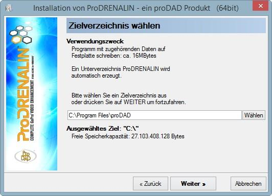

Folgen Sie nun den Installationsanweisungen. ProDRENALIN kann danach per Shortcut auf dem Desktop gestartet werden.

## 4. Produktaktivierung + Registrierung

**Die Aktivierung:**

Beim ersten Programmstart von ProDRENALIN werden Sie zur Eingabe eines Aktivierungscodes (Seriennummer) aufgefordert, geben Sie den Code ein, den Sie bei elektronischer Lieferung mit der Download-Instructions-Email erhalten haben, oder falls Sie eine physische Lieferung (auf DVD) erhalten haben, innerhalb der Box vorfinden. Klicken Sie dann **Freischalten**.

***WICHTIG:*** Beachten Sie das Ihr System im Moment der Aktivierung über eine Internetverbindung benötigt, nur dann kann die Aktivierung erfolgreich durchgeführt werden. Sollte ein Problem bestehen, dann prüfen Sie die Sicherheitseinstellungen (Firewall etc.) im System und wiederholen die Aktivierung.

Wenn Sie ProDRENALIN im **DEMO-Modus** testen möchten, dann klicken Sie **Mit der**

**Demoversion weiter arbeiten**. Die Demoversion ist solange aktiv, bis eine Seriennummerneingabe die Lizenz zur Vollversion wandelt.

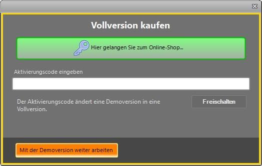

**Die Registrierung:**

Sie möchten Updates und weitere Informationen über ProDRENALIN erhalten, dann registrieren Sie es unter http://www.prodad.de/register.html.

## ProDRENALIN

## 5. Überlick

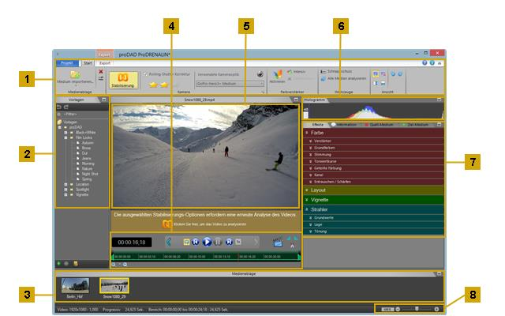

### 5.1. Ribbon

Das Ribbon unterteilt sich in die Menüs **Projekt**, **Start** und **Export**.

#### 5.1.1. Projekt-Menü:

Menüpunkte zur Projektverwaltung:

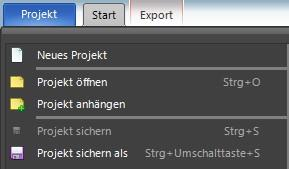

- Projekt anhängen, fügt ein weiteres Projekt dem aktuell bearbeiteten Projekt hinzu
- Projekt sichern als (Speichern mit Pfadangabe)

#### 5.1.2. Start-Menü:

##### 5.1.2.1. Medium importieren

- Datei wählen (zum Import von Videodateien)
- Ordner wählen (zum Import von Bilddateien aus einem Ordner, daraus wird ein Video erzeugt)
- Hier klicken, um Medien zu öffnen (zum Import von Videodateien)
- Import von Videos via Drag & Drop aus dem Arbeitsplatz, direkt in die Vorschau

##### 5.1.2.2. Szenenerkennung

Aktivieren Sie zunächst die Option **Szenenerkennung**, dann laden Sie ein Video über die Option **Medien importieren** und die Szenenerkennung startet automatisch. In der **Medienablage** werden die einzelnen Szenen als Thumbnail abgelegt und gekennzeichnet. Die Option **Medienablage leeren** entfernt alle Szenen aus der Medienablage.

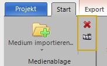

##### 5.1.2.3. Stabilisierung

Sollte jetzt Ihr Video bei der Aufnahme (durch freihand filmen) verwackelt worden sein, dann können Sie dieses in ProDRENALIN automatisch stabilisieren. Ein einfacher Mausklick auf die Option **Stabilisierung** prüft Ihr Video und startet die Videoanalyse.

##### 5.1.2.4. Rolling-Shutter Korrektur

Der CMOS-Sensor ist ein Bildsensor, der in Camcordern und Digitalkameras eingesetzt wird.\
Der Rolling-Shutter-Effekt ist ein Lagefehler im Video, der bei der zeilenweisen Aufnahme von bewegten Bildern auftreten kann. Ist das Bild unbewegt (statisch) so erfolgt die Aufnahme korrekt. Ist das Motiv bewegt oder die Kamera in Bewegung bewegt, so erfolgt die Aufnahme zeilenweise nacheinander (also in der Zeit verschoben), so kann es zum Rolling-Shutter-Effekt kommen.

Solange eine Aufnahme nicht stabilisiert wurde, ist der Rolling-Shutter-Effekt nicht oder nur dezent auffällig. Sobald aber eine Stabilisierung in der Post-Production erfolgreich war, verbleibt der Rolling-Shutter Effekt und wirkt nun dezent bis deutlich störend.

Deshalb wirkt ProDRENALIN auch diesem unerwünschten Effekt auf Wunsch entgegen – denn eine stabilisierte Aufnahme bleibt erst einmal wertlos, wenn der unerwünschte Folgeeffekt das Ergebnis wiederum zunichte macht.

ProDRENALIN bietet nun die **Rolling-Shutter Korrektur** (CMOS-Korrektur) in 3 Stufen an, gekennzeichnet durch 1, 2 und 3 **Sterne**.

Möchten Sie die vollautomatische CMOS-Korrektur im Video weiter optimieren, dann wählen Sie eine der 3 verfügbaren Korrektur-Stufen im Menü aus, bis Sie die bestmögliche Optimierung erzielt haben. Je nach Auswahl einer Korrektur-Methode (Sterne) kann es zu unterschiedlichen Bearbeitungszeiten kommen.\
Ist die Option **Rolling-Shutter Korrektur** nicht markiert, dann erfolgt keine CMOS-Korrektur. Wird jetzt die Videoanalyse gestartet, dann erfolgt nur die Videostabilisierung.

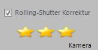

###### 5.1.2.4.1. 1 Stern

- 1 Stern = Die am meisten auftretenden Verzerrungen entfernen

###### 5.1.2.4.2. 2 Sterne

- 2 Sterne = Seltener vorkommende Wobble-Verzerrungen entfernen

###### 5.1.2.4.3. 3 Sterne

- 3 Sterne = Entfernen von Jello- oder Wobble-Verzerrungen

##### 5.1.2.5. Verwendete Kameraoptik

Durch Auswahl der korrekten **Kameraoptik** kann ein möglicher Fischaugen-Effekt (bedingt durch die Linsenkrümmung) im Video/Foto entfernt werden.

###### 5.1.2.5.1. Profilliste

Wählen Sie hier das zu Ihrer Kamera und Auflösung passende **Kameraprofil** aus.

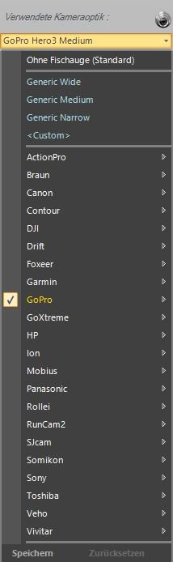

###### 5.1.2.5.2. Linsenkorrektur / Fischauge entfernen

Klicken auf die Option **Fischauge entfernen**. Danach wird das korrigierte Video sofort in der Vorschau angezeigt.\
Sollte Ihre Kamera nicht gelistet sein, dann probieren Sie die 3 Generic-Profile.

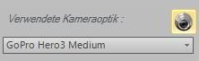

###### 5.1.2.4.3. Intrinsische Eigenschaften

Zum Zeitpunkt des Öffnens werden die aktuellen **intrinsischen Eigenschaften** im Dialog dargestellt. Die im Dialog möglichen Werteänderungen sind vergleichbar mit der Auswahl eines der Profile. Die ersten zwei der drei Modi sind technische Methoden, deshalb ist rechts auch dazu nichts änderbar. Ist **Fischauge entfernen** gewählt, so ist das gleichbedeutend mit dem Button im **Ribbon**. Nur bei **Anpassen** kann die rechte Seite variiert werden. Die Vorschau zeigt nach einer Werteänderung sofort die Wirkung. Ist kaum was sichtbar, dann ist vermutlich der resultierende optische Unterschied der linken zu den rechten Parametern nicht groß.

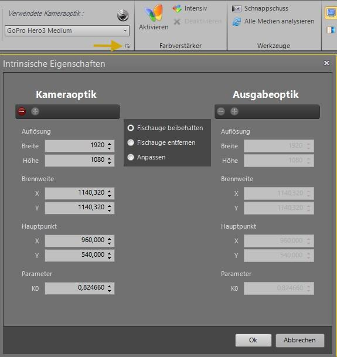

##### 5.1.2.6. Farbverstärker

Im **Farbverstärker** optimieren Sie automatisch Helligkeits- und Kontrasteinstellungen (Dynamik) im Video/Foto, die Dynamik-Einstellung kann per einfachen Mausklick eingeschaltet, verstärkt und ausgeschaltet werden.

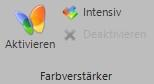

##### 5.1.2.7. Werkzeuge

###### 5.1.2.7.1. Schnappschuss

Durch Mausklick kann ein **Schnappschuss** (Einzelbild) von der aktuellen Timiline-Cursor-Position erstellt und gespeichert werden.

###### 5.1.2.7.2. Alles analysieren

Die Option **Alles analysieren** startet die Videoanalyse für alle importierten und markierten Videos im Projekt.

##### 5.1.2.7. Ansicht

Es stehen im Menü **Ansicht** verschiedene Optionen zur Darstellung der Videovorschau zur Verfügung.

- Ergebnis anzeigen (zeigt das stabilisierte Video in der Vorschau an)
- Original anzeigen (zeigt das Original-Video in der Vorschau an)
- Horizontal vergleichen (Gegenüberstellung Original / Stabilisiert im horizontalen Splittscreen)
- Vertikal vergleichen (Gegenüberstellung Original / Stabilisiert im vertikalen Splittscreen)

Weiterhin besteht die Möglichkeit das Video/Foto zu drehen (Rotation), jeweils in Uhrzeigersinn und gegen den Uhrzeigersinn in 90 Grad-Schritten.

#### 5.1.3. Export-Menü:

Zum Export der bearbeiteten Videos wechseln Sie in das Menü **Export**.

##### 5.1.3.1. Export starten

Klicken Sie auf **Export starten** und die Berechnung der bearbeiteten Videos bzw. der markierten Videos im Menü **Quell-Medium** beginnt.

##### 5.1.3.2. Videos zusammenfassen

Diese Option ermöglicht mehrere markierte Videos aus der Medienablage zu einem Video zusammenzufassen.

##### 5.1.3.3. Exportpfad festlegen

Markieren Sie auf die Option **Dateien in ein anderes Verzeichnis exportieren**, dann besteht die Möglichkeit einen eigenen Export-Pfad festzulegen. Klicken Sie auf den gekennzeichneten Pfeil und der Dialog Ordner suchen öffnet. Hier legen Sie einen eigenen Zielordner fest.

##### 5.1.3.4. Dateidatum erhalten

Markieren Sie diese Option, dann wird im exportierten Video das Aufnahmedatum erhalten.

##### 5.1.3.5. Exporteinstellungen / Einrichten

Nun wählen Sie über die Option **Einrichten** den gewünschten Media-Encoder für Video aus, es stehen hier verschiedene Media-Encoder für Video zur Verfügung. Weiterhin wählen Sie über die Option **Einrichten** den gewünschten Media-Encoder für Audio aus, auch hier können Sie zwischen verschiedenen Media-Encodern für Audio auswählen.

Es besteht die Möglichkeit zwischen 3 Qualitätsstufen für den Export zu wählen.\
Wir empfehlen die Qualität **Mittel** auszuwählen.

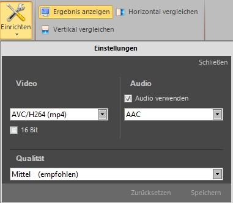

##### 5.1.4.6 Batchverarbeitung:

**Die Möglichkeiten zur Batch-Verarbeitung:**

Super einfach mit wenigen Handgriffen:

- Video-Clips in das Menü **Quell-Medium** ziehen
- Export durchführen

Bei Videos mit vergleichbaren Eigenschaften:

- Videos in das Menü Quell-Medium ziehen
- Alle Videos markieren und gewünschte Optionen wählen
- Export durchführen

Hier erhalten Sie weitere Hinweise zum Menü Quell-Medium.

### 5.2. Vorlagen

Hier stehen Ihnen verschiedene voreingestellte Effekt-Vorlagen zur Anwendung bereit, die durch Doppelklick auf ein Video/Foto übernommen werden können. Sie können auch neue Vorlagen erstellen (+), Vorlagen löschen (-) und neue Effekt-Verzeichnisse anlegen. Nach Übernahme einer Vorlage können Sie in den Effekten weitere Feineinstellungen zum Effekt vornehmen oder den Effekt bzw. die Vorlage entfernen.

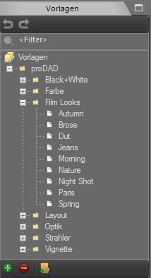

### 5.3. Medienablage

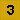

In der **Medienablage** werden importierte/bearbeitete Videos sowie erkannte Szenen als Thumbnail angezeigt und nacheinander aufgereiht. Sie können hier in der Reihenfolge per Drag & Drop verändert werden. Via Rechtsklick öffnet ein Menü mit Funktionen, wie Ausschneiden, Kopieren, Einfügen, Löschen, Umbenennen und Auswählen zur Verfügung stehen, auch Video-Eigenschaften können angezeigt werden.

***Hinweis:***\
*Die Clip-Reihenfolge ist wichtig, wenn alle Medien in eine* gemeinsame Ausgabedatei *exportiert* *werden.*

Die **Medienablage** verhält sich synchron mit dem Menü Quell-Medium.

### 5.4. Steuerung

In der Steuerungseinheit finden Sie die klassischen Optionen zur Video-Wiedergabe inklusive Zeit-und Geschwindigkeitsangabe.\
Der rote Timenline-Cursor zeigt die aktuelle Position im Video an. Setzen Sie jetzt über die orangen In/Out Marker einen bestimmten **Trimmbereich** im Video, dann wird nur dieser bearbeitet und beim Export des Videos berücksichtigt. Das **Scheren-Symbol** (Cut) schneidet das Video an der aktuellen Zeitmarke, vorausgesetzt die Zeitmarke befindet sich im gewählten Trimmbereich.

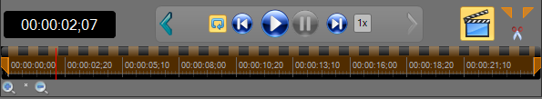

Über das **Filmklappen-Symbol** schalten Sie in die Auswahl des **Wiedergabebereiches** um. Die jetzt grünen In/Out Marker bestimmen den Bereich der Wiedergabe im gewählten Video.

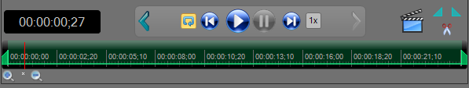

### 5.5. Canvas

Hier wird der Vorschaubereich gekennzeichnet, in dem das aktuell bearbeitete Video/Foto angezeigt wird.

### 5.6. Histogramm

Das oberhalb der **Effekte** angezeigte **Histogramm** ist eine graphische Darstellung der Farbtonwertverteilung in einem Video/Foto. Das Histogramm ist die graphische Darstellung der Tonwertverteilung eines Bildes, es wird daher auch als Tonwertkurve bezeichnet. Während des Abspielens eines Videos (Playback) ändern sich die Histogrammwerte ständig und geben auf diese Weise an, wie sich die Beleuchtung im Video ändert. Die X-Achse des Diagramms stellt den RGB-Farbtonwert dar, während die Y-Achse die Anzahl der Pixel in dem Video angibt, die diesen Wert haben. Das Histogramm wird mit den 3 RGB-Farbtonwerten (Rot/Grün/Blau) erstellt, die den einzelnen Pixeln im Video/Foto zugewiesen werden. Die grauen Teile geben an, wo die 3 Farben im Histogramm überlappen, während Gelb, Magenta und Zyan angezeigt werden, wenn 2 der Farben überlappen.

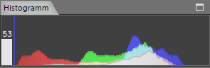

### 5.7. Panel Tabs

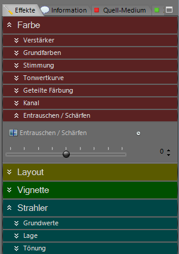

#### 5.7.1. Effekte

Im Menü **Effekte** können Sie Detaileinstellungen zu verschiedenen Effekten vornehmen.

Alle Effekte bzw. Einstellungsmöglichkeiten können auch über **Keyframes** gesteuert werden. Bewegen Sie zuerst den Timeline-Cursor an eine gewünschte Position in der Zeitleiste. Klicken Sie nun in der gewünschten Effekteinstellung auf das **Uhr-Symbol** und verändern danach den Schieberegler, um den Effekt zu erzielen. Um ein weiteres Keyframe einzufügen, verschieben erneut den Timeline-Cursor an eine neue Position in der Zeitleiste, verändern Sie danach den Schieberegler erneut, um den Effekt an der neuen Position im Video zu erzielen. Mit den **blauen Pfeilen (links/rechts)** können Sie nun zwischen den Keyframes wechseln. Die Keyframes sind auch abschaltbar **(-)**. Der eingestellte Effekt kann über das **x** (z.B. im Effekt Verstärker) gelöscht werden.

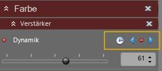

Links in den Vorlagen finden Sie zahlreiche vorgefertigte Effekt-Vorlagen, die Sie im Menü **Effekte** weiterbearbeiten und optimieren können.

##### 5.7.1.1. Farbe

###### 5.7.1.1.1. Verstärker

**Dynamik:** Die Option **Dynamik** lässt die Farben des Videos/Fotos heller und lebhafter (dynamischer) wirken, mattere Farben werden optimiert.

**Helligkeitsausgleich:** Hiermit gleichen Sie Helligkeitsunterschiede im Video/Foto aus.

###### 5.7.1.1.2. Grundfarben

###### 5.7.1.1.2.1. Weissabgleich

Über den **Weisabgleich** entfernen Sie einen möglichen **Farbstich** im Video/Foto. Wählen Sie dazu mit der **Farbpipette** den Ton aus, der weiss werden soll. Danach wird der Bildinhalt automatisch angepasst, der Farbstich wurde entfernt. Auch die Auswahl einer **Farbe** in der Farbpallette ist möglich.

###### 5.7.1.1.2.2. Belichtung, Kontrast, Helligikeit und Sättigung

Hier passen Sie über- oder unterbelichtete Bereiche an und optimieren den Kontrast, die Helligkeit und die Sättigung im Video/Foto.

###### 5.7.1.1.3. Stimmung

###### 5.7.1.1.3.1. Kalt/Warm

Verwenden Sie diese Option, um die Farbtemperatur im Video/Foto anzupassen. Ein negativer Wert wendet eine kältere Farbtemperatur an, während ein positiver Wert das Video/Foto wärmer wirken lässt.

###### 5.7.1.1.3.2. Tönung

Verwenden Sie die Option **Farbton**, um den Farbton festzulegen, der für das Video/Foto verwendet werden soll. Verwenden Sie die Option **Sättigung**, um die Intensität der Tönung im Video/Foto zu optimieren.

###### 5.7.1.1.3.3. Farbverschiebung

Diese Option ermöglicht das Gegeneinander-Verschieben von Farben im Video/Foto.

###### 5.7.1.1.4. Tonwertkurve (Schwarze, Tiefen, Lichter und Weiße)

Das Histogramm ist die graphische Darstellung der Tonwertverteilung eines Bildes, es wird daher auch als Tonwertkurve bezeichnet. Mit den zur Verfügung stehenden Optionen bestimmen Sie die Belichtungsverhältrnisse in dunklen und hellen Bildbereichen im Video/Foto.

###### 5.7.1.1.5. Geteilte Färbung (Tiefen, Mitteltöne, Lichter)

Passen Sie jeweils mit dem Schieberegler den **Farbton** und die **Sättigung** der Tiefen, Mitteltöne und Lichter eines Videos/Fotos an. Verwenden Sie den Schieber **Farbton**, um den Farbton oder die Farbe der Tiefen im Video/Foto festzulegen. Sie können auch mit der **Farbpipette** die genaue Farbe (Farbton und Sättigung) auswählen oder nutzen eine Farbe aus der **Farbpalette**, die in den Tiefen, Mitteltönen und Lichtern verwendet werden soll. Legen Sie mit dem Schieberegler **Sättigung** die Stärke der verwendeten Farbe fest.

###### 5.7.1.1.6. Kanal (Belichtung, Kontrast und Sättigung)

Bestimmen Sie hier für die einzelnen Kanäle **Rot/Grün/Blau** die Belichtungs,- Kontrast- und Sättigungsverhältnisse im Video/Foto.

###### 5.7.1.1.7. Entrauschen/Schärfen

Hier schärfen Sie ein Video/Foto oder entfernen bzw. minimieren mögliches Rauschen (z.B. bei Aufnahmen im Dunkeln).

##### 5.7.1.2. Layout

**Skalierung:** Hier vergrößern oder verkleinern Sie den **Bildausschnitt** im Video/Foto.

**Rotation:** Rotieren Sie das Video/Foto in **X/Y/Z-Richtung**, jeweils in positive oder negative Richtung.

**Verschiebung:** Verschieben Sie das Video/Foto in **X/Y-Richtung** (links oder rechts).

**Rand:** Nach Anwendung der **Skalierung** erscheint ein schwarzer Rand (Solide) um das Video/Foto. Durch Anwendung der Optionen **Wiederholen** und **Spiegeln** kann der **Rand** neu gestaltet werden, das Ergebnis hängt vom Bildinhalt ab.

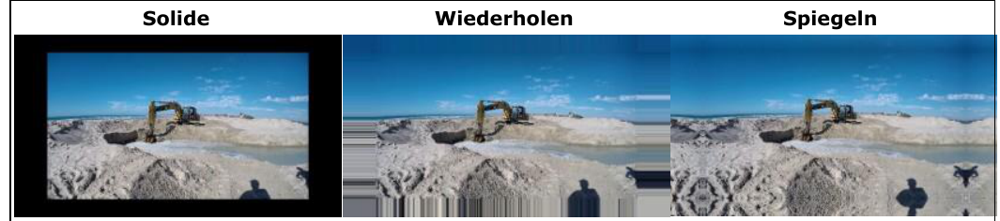

**Solide**

**Wiederholen**

**Spiegeln**

##### 5.7.1.3. Vignette

Links in den Vorlagen finden Sie voreingestellte Vignetten-Effekte, übernehmen Sie z.B. den Effekt **Edge**, dann wird diese in der Vorschau angewendet. Jetzt können im Menü **Effekte** unter **Vignette** weitere Detaileinstellungen treffen, u.a. mit der Option **Winkel** die Dimension der Vignette einstellen sowie die **Schärfe** bzw. Unschärfe der Vignettenkante bestimmen. Die Option **Seitenverhältnis** bestimmt die Form der Vignette. Die Optionen Zentrum X/Y bestimmen die Lage/Position der Vignette in der Vorschau.

##### 5.7.1.4. Strahler

Links in den Vorlagen finden Sie voreingestellte Strahler-Effekte, die Sie durch Doppelklick übernehmen können. Die Feineinstellungen nehmen Sie dann im Effekt-Dialog **Strahler** vor.

###### 5.7.1.4.1. Grundwerte

Sie können mit der **Farbpipette** die genaue Farbe auswählen oder nutzen eine Farbe aus der **Farbpalette**, die für den Strahler-Effekt genutzt werden soll. Mit der Option **Luminanz** verändern Sie die Helligkeit des Lichtstrahls, mit der **Sättigung** die Farbintensität oder Sie wählen einen anderen Farbton für den Lichtstrahl aus. Mit der Option **Spot-Größe** skalieren Sie den Lichtstrahl, die **Diffusion** bestimmt die Ausbreitung des Lichtstrahls im verwendeten Video/Foto.

###### 5.7.1.4.2. Lage

Die Optionen **Zentrum X/Y** bestimmen die Lage/Position des Lichtstrahls in der Vorschau. Die Option **Seitenverhältnis** bestimmt die Form des Lichtstrahls.

###### 5.7.1.4.3. Tönung

Die Option **Verdunklung** dunkelt das Video/Foto ab, der Lichtstrahl bleibt jedoch erhalten. Die Optionen **Tiefen**, **Mittelton** und **Lichter** bestimmen die Tönungseigenschaften des Lichtstrahls in dunklen und hellen Bereichen sowie in den Mitteltönen.

#### 5.7.2. Quell-Medium

Im Menü **Quell-Medium** werden alle importierten Medien angezeigt.

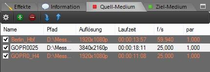

Sie erhalten Informationen zum Dateipfad, Auflösung, Laufzeit, Bilder/Sek (f/s), Pixelratio (par) sowie zum Quellpfad der importierten Videos. In der Medienablage können auch Medien hinzugefügt (+) oder entfernt (-) werden.

Das im Menü **Quell-Medium** ausgewählte Medium wird durch einen Klick der Pfeil-Hoch Taste eine Position nach oben verschoben. Mit der Pfeil-Runter Taste wird es nach unten verschoben. Die Reihenfolge im Menü **Quell-Medium** ist synchron mit der Reihenfolge in der Medienablage.

Wird die Reihenfolge hier geändert, dann erfolgt ein Update in der Medienablage.

***Hinweis:***\
*Die Position ist wichtig, wenn alle Medien in eine gemeinsame Ausgabedatei exportiert werden.*

Vor dem Dateinamen markieren Sie die Videos, die für den Export nach erfolgter Stabilisierung/Korrektur vorgesehen sind.

Es besteht auch die Möglichkeit ein importiertes Video/Foto im Menü **Quell-Medium** umzubenennen, der neue Dateiname wird dann beim Export berücksichtigt. Der Dateiname der Originaldatei bleibt jedoch erhalten.

Nutzen Sie auch die Möglichkeiten zur Batchverarbeitung.

#### 5.7.3. Ziel-Medium

Im Menü **Ziel-Medium** werden alle exportierten Medien angezeigt.

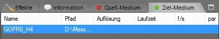

### 5.8. Status

Links in der Statusleiste erhalten Sie Informationen zum verwendeten Video, auf der rechten Seite können die Vorschaugrösse bestimmen.

## 6. Shortcuts

### 6.1. Global Shortcuts

**6.1.1. Nummernblock** (wenn aktiviert und in den Projekteinstellungen zugelassen)

- Nächste Media [NumPad+2]
- Vorheriges Media [NumPad+8]
- 1 Bild vor [NumPad+6]
- 1 Bild zurück [NumPad+4]
- Geh an den Anfang [NumPad+7]
- Geh ans Ende [NumPad+1]

**6.1.2. Multimedia keys** (oft vorhandene Zusatztasten)

- Toggle Wiedergabe: nach jedem Tastendruck wird zwischen Wiedergabe und Pause gewechselt
- Start Wiedergabe
- Stop Wiedergabe
- Browse Next Media
- Browse Prev. Media

### 6.2. Local shortcuts

#### 6.2.1. Im ganzen Programm verfügbar

- Projekt öffnen [Ctrl+O]
- Projekt speichern [Ctrl+S]
- Toggle Wiedergabe [Ctrl+Space]

#### 6.2.2. Timeline

- Bild vor [Cursor Right] [Mouse-Wheel]
- Bild zurück [Cursor Left] [Mouse-Wheel]
- Toggle Wiedergabe [Space] [Enter]
- Geh zum Videoanfang [Home]
- Geh zum Videoende [End]
- Setze IN Punkt [I]
- Setze OUT Punkt [O]
- **Timeline-Details**
- Ctrl+0 Auto: das komplett-montierte Video ist in der Timeline verfügbar
- Ctrl+1 Frames: Frame-Schritte anzeigen, indem der Zoom angepasst wird
- Ctrl+2 Sekunden: Sekunden-Schritte anzeigen, indem der Zoom angepasst wird
- Ctrl+3 Minuten: Minuten-Schritte anzeigen, indem der Zoom angepasst wird
- Ctrl+4 Stunden: Stunden-Schritte anzeigen, indem der Zoom angepasst wird

#### 6.2.3. Canvas

- Toggle Wiedergabe - nach jedem Tastendruck wird zwischen Wiedergabe und Pause gewechselt [Space]
- Geh zum Videoanfang [Home]
- Geh zum Videoende [Ende]
- Setze IN Punkt [I]
- Setze OUT Punkt [O]

© proDAD GmbH

www.prodad.com
