# proDAD ProDRENALIN V2

**MANUAL**

© proDAD GmbH

Autor: Uwe Wenz

## Content

- Welcome
- [General information](#general-information)
  - [What is ProDRENALIN?](#11-what-is-prodrenalin)
  - [Copyright / Legal information](#12-copyright--legal-information)
  - [New features/changes in ProDRENALIN V2](#13-new-featureschanges-in-prodrenalin-v2)
- [System requirements](#system-requirements)
  - [General](#21-general)
  - Recommended
- [Installation](#3-installation)
- [Product Activation + Registration](#4-product-activation--registration)
- [ProDRENALIN](#prodrenalin)
  - [Overview](#5-overview)
  - [Ribbon](#51-ribbon)
    - [Project menu](#511-project-menu)
    - [Start menu](#512-start-menu)
      - [Import Media](#5121-import-media)
      - [Scene detection](#5122-scene-detection)
      - [Stabilization](#5123-stabilization)
      - [Rolling-Shutter Compensation](#5124-rolling-shutter-compensation)
        - 1 star
        - 2 stars
        - 3 stars
      - [Used Camera Optics](#5125-used-camera-optics)
        - Profil list
        - [Remove Fisheye](#51252-remove-fisheye)
        - [Intrinsic properties](#51243-intrinsic-properties)
      - Color Enhancers
      - [Tools](#5127-tools)
        - [Snapshot](#51271-snapshot)
        - Analyze All Media
      - [View Mode](#5127-view-mode)
    - [Export menu](#513-export-menu)
      - [Start export](#5131-start-export)
      - [Combine Videos](#5132-combine-videos)
      - [Select export path](#5133-select-export-path)
      - [Keep file date](#5134-keep-file-date)
      - [Export Settings / Setup](#5135-export-settingssetup)
      - [Batch processing](#5146-batch-processing)
  - [Presets](#52-presets)
  - [Media-Bin](#53-media-bin)
  - [Control](#54-control)
    - Trimming mode
    - Set IN/OUT Points
    - Cuts the video-clip
  - [Canvas](#55-canvas)
  - [Histogram](#56-histogram)
  - [Panel Tabs](#57-panel-tabs)
    - Keyframesteuerung
    - [Effects](#571-effects)
      - [Colour](#5711-colour)
        - [Enhancer](#57111-enhancer)
        - [Basic colors](#57112-basic-colors)
          - [White Balance](#571121-white-balance)
          - Exposure
          - Contrast
          - Brightness
          - Saturation
        - [Tune](#57113-tune)
          - [Cold/Warm](#571131-coldwarm)
          - [Tint](#571132-tint)
          - [Color Shift](#571133-color-shift)
        - [Tone Curve](#57114-tone-curve-blacks-shadows-lights-and-whites)
          - Blacks
          - Shadows
          - Lights
          - Whites
        - [Split Toning](#57115-split-toning-shadows-midtone-lights)
          - Shadows
          - Midtone
          - Lights
        - [Channel](#57116-channel-exposure-contrast-and-saturation)
          - Exposure
          - Contrast
          - Saturation
        - [Denoise / Sharpen](#57117-denoise--sharpen)
      - [Layout](#5712-layout)
      - [Vignette](#5713-vignette)
      - [Spotlight](#5714-spotlight)
        - [Basics](#57141-basics)
        - [Location](#57142-location)
        - [Tint](#57143-tint)
    - [Source Media](#572-source-media)
    - [Target Media](#573-target-media)
  - [Status](#58-status)
- [Shortcuts](#6-shortcuts)
  - [Global Shortcuts](#61-global-shortcuts)
    - Numeric keyboard
    - Multimedia Keys
  - [Local Shortcuts](#62-local-shortcuts)
    - [Usable anywhere in the program](#621-usable-anywhere-in-the-program)
    - [Timeline](#622-timeline)
    - [Canvas](#623-canvas)

### Welcome to proDAD ProDRENALIN

Your spontaneous action and sports videos are promptly and effortlessly processed into professionally looking film material by using ProDRENALIN. ProDRENALIN can automatically remove the fish-eye effect from videos or still images, stabilise videos and correct CMOS errors, and has integrated cutting technology and tools for professional colour correction.

We hope you enjoy working with proDAD ProDRENALIN and that you achieve good results!

## General information

### 1.1. What is ProDRENALIN?

ProDRENALIN lets you quickly and effortlessly edit your spontaneous action and sports videos with effective and fast tools, turning them into professional-looking film material. ProDRENALIN can automatically remove the fish-eye effect from videos or still images, stabilise videos and correct CMOS errors, and has integrated cutting technology and tools for professional colour correction.

The software’s rolling shutter correction feature removes the distortion or shaking that can occur as a result of panning rapidly. ProDRENALIN software also processes vibration, shaking, distortion, wobbling and compression.

Its fully-automatic CMOS correction (3-step) very effectively removes errors that are also often perceived as shaking in videos. These errors, in the form of wobbling, distortion and compression, are usually known as “jello, wobble, skew” or “distortion”. The cause of this can be found in the camera’s CMOS sensor and arises from vibrations caused by the motor and physical tremors - even if gimbals are used to reduce this shaking. In most cases, the CMOS correction alone helps to make the video appear significantly more stable and high-quality.

A serious advantage of this type of correction is that the process is fully automated and does not require that the user zooms in. This means that there is a significant enhancement with no loss of resolution. If the video contains “real” shaking, of course, then the well-known video stabilisation feature can be used, which then functions even more precisely on material that has already been corrected for CMOS errors. Simply put, this unique kind of complete correction is the best thing that can happen to your videos.

ProDRENALIN also has tools for professional colour correction.

It is also very simple to load, optimise and combine several videos at once; even videos with different settings can be edited at the same time thanks to the batch editing feature.

### 1.2. Copyright / Legal information

Copyright proDAD GmbH. All rights reserved.

Licensing Conditions\
Please read these licensing conditions carefully before installing the software.

Licensing agreement\
When setup starts, a licensing agreement is shown, which you should read carefully.\
By installing the software, you state that you accept the copyright conditions, the licensing agreement and the licensing procedure.

License Guarantee\
proDAD GmbH grants the user the right to use this product for its proper and permitted purpose. The present product may only be installed on one computer. proDAD hereby guarantees to provide a license key free of charge. By installing this product, the user acknowledges and accepts the license guarantee, the copyright terms, and the limitation of liability.

Trademarks\
All products and trademarks mentioned in association with this product are trademarks that belong to the respective owners. All trademarks are used without any guarantee that they may be used freely, and they may be registered trademarks.

Limitation of Liability\
The extent of liability for any one claim is limited to a replacement of the product. This applies to proDAD GmbH, all licensees and retailers. Claims shall only be recognized if the software is returned in an orderly manner, together with the returned goods number that has to be previously arranged with proDAD GmbH. The goods must also be accompanied by proof of purchase. This guarantee becomes void if a malfunction of this product is due to improper use, mistreatment, an accident or improper handling. proDAD GmbH, its sales partners and licensees, shall not be held liable for damages or subsequent damages arising from the impossible usage of this product. Liability is limited in all cases to the purchase price of the product.

Documentation\
The greatest of care has been taken in compiling and translating the handbook. However, the possibility of errors cannot be fully excluded. proDAD GmbH shall assume no responsibility or liability whatsoever for the consequences of any incorrect statements or information which the documentation or translation may contain. Subject to technical and optical modifications. Information regarding any inaccuracies is always welcome.

Copyright\
The software and the individual components of this product are the property of proDAD GmbH. By installing this product, the licensee agrees to refrain from unauthorized use and duplication.

proDAD GmbH does not accept any responsibility for the usage of this program and the publication of its contents and data that has been created with this program.

ProDAD GmbH \* Gauertstr. 2 \* 78194 Immendingen \* Deutschland \* HRB 1077

### 1.3. New features/changes in ProDRENALIN V2

- **Media storage**
   - Media storage can (as a storyboard) be configured to arrange the videos according to the time they were taken.
   - A thumbnail is displayed for each video.
   - All videos can be exported separately from each other or together as one video.
   - Drag & drop option
   - Copy/Paste option
   - Videos can be accessed directly, via Explorer for example. This means that the insert position can be chosen at the same time.
   - The video order can be changed using drag & drop.
   - The video file name can be changed.
   - The path or file name of several videos can be changed in one step.
   - IN/OUT and the start/end point of the videos can be altered numerically.
   - IN/OUT can be set for several videos in one step.
   - IN/OUT can also be set relative to the video start or end.
- **Colour correction**
   - The histogram to visualise the distribution of colour and brightness in the image is available. Alterations can be seen very quickly during video playback.
   - Comprehensive and professional colour correction
      - Remove colour cast (super simple)
      - Film looks (like in cinema blockbusters)
      - Targeted enhancement/alteration of colour, brightness, contrast and tone
      - Toning
      - Tone curve
      - Split toning
      - Colour channels
   - Fully automatic image enhancement
      - Dynamic contrast
      - ActionCam videos in particular are dramatically improved. They are more lively and show greater depth.
      - Differences in brightness compared
- **Image correction**
   - Remove noise/sharpen image (much better and faster than in v1)
   - Improved video stabilisation
      - Can deal with fisheye video
      - Video analysis is twice as fast
      - Combination of stabilisation and removal of fisheye optics is possible without any loss of quality or black edges.
      - All videos can be analysed in one go.
   - Improved correction of CMOS sensor distortion
      - Three-step wobble and jello effect removal feature.
      - Even extreme jello effect can now be removed.
- **Optical correction/effect**
   - New camera profile for fisheye processing and for better stabilisation
   - Improved fisheye removal.
   - There is now an option to edit the intrinsic camera parameters.
   - Video stabilisation of fisheye video without harming the fisheye optics.
   - Aberrant lines can be corrected
      - Works with “normal” images
      - and also with fisheye images
      - as well as in combination with fisheye removal.\
  Correction is needed especially frequently in this case because a slanted camera often cannot be recognised in spherical optics. However, after the spherical optics have been removed, the slanted camera position often remains as a disruptive effect.
- **Importing video/photo**
   - A video can be divided automatically into scenes during import. This is important for better control of stabilisation and other options for correction.
   - Extra import formats are available (Canopus HQ, Canopus HQX, GoPro Cineform, etc.).
   - A directory with still images can also be loaded as a video sequence.
- **Exporting video/photo**
   - Export encoding in 8 bit and 16 bit (previously, only 8 bit was available)
   - Extra export formats (e.g. Canopus HQX)
   - Export properties can be selected
   - The current image position can be saved as a single frame (photo snapshot).
- **Effects**
   - The effect parameter can be controlled using Keyframes
   - Image position, rotation and scaling
   - Vignette effect
   - Spotlight effect
- **Project management**
   - Loading, saving etc.
- **Templates**
   - Users can make their own effect templates
   - User's effects can only affect defined effect parameters using filter options
   - Templates can be displayed filtered by name
   - Templates are managed in a tree structure
      - Can be arranged according to user preference
      - Copy/Paste option
      - Import/export option
      - Drag & drop option
   - The template last used can be cancelled or made again.
- **Timeline**
   - Scalable
   - Can be controlled using shortcuts
   - Video can be cut at the current position with just one click
   - Selectable playback speed
   - Switch between Trim and Edit
- **Canvas**
   - Scalable
   - Contextual menu to control playback
   - Improve real-time playback
- **Shortcuts**
   - Control using media buttons (found on most keyboards)
   - Control using numeric keypad
- **Alteration of interface according to user preference**
- **Batch editing**
   - Improved and more consistent
- **Edit several videos together**
   - All changes are applied to all selected videos in media storage.
      - Colour correction
      - Position adjustment
      - Trimming
      - Stabilisation
      - Optical corrections
      - Use of templates
      - Changes to properties
- **Technical**
   - 16-bit colour workflow throughout
   - 8k videos can be edited
   - Optimised utilisation of multi-core systems
   - Displays more details on codecs and format used

## System requirements

### 2.1. General

- Windows 64 Bit: Vista, Win7, Win8, Win8.1, Win10
- 4GB main storage space
- Graphics card with 512MB memory and Shader 3.0

### 2.2. Real-time application

- Windows 64 Bit: Vista, Win7, Win8, Win8.1, Win10
- 6GB main storage space
- Graphics card with 1GB memory and Shader 3.0
- I7 CPU with 8 cores

## 3. Installation

Double-click the Setup-file to start the Installation. By carrying out the installation you agree with the legal conditions and the licence terms. If you have purchased ProDRENALIN as a download version, the Program archive will be unpacked before the installation starts. Then select a directory in which you would like to install ProDRENALIN.

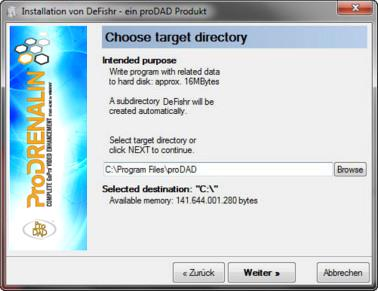

Now follow the installation instructions. ProDRENALIN can then be started using a desktop shortcut.

## 4. Product Activation + Registration

**Product Activation:**

When ProDRENALIN first starts, you will be asked to input a activation code (serial number); enter the code that you received in the email containing the download instructions, or if you have a physical copy (on DVD), inside the box. Then click **Activate**.

***IMPORTANT:*** Make sure your system is connected to the internet when you click Activate; an internet connection is required to complete the activation successfully. If there is a problem, check your system’s security settings (firewall etc.) and try to activate again.

If you would like to test ProDRENALIN in **DEMO mode**, click **Continue to work with the demo version**. The demo version will be active until a serial number converts the licence to the full version.

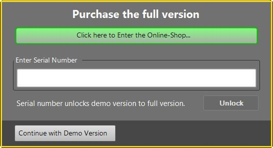

**Registering proDAD ProDRENALIN:**

You would like to receive Updates and further information about ProDRENALIN? Please tab your proDAD ProDRENALIN at http://www.prodad.de/register.html.

## ProDRENALIN

## 5. Overview

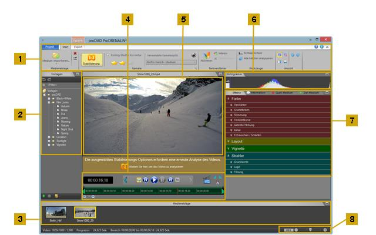

### 5.1. Ribbon

The ribbon is divided into menus **Project**, **Start** and **Export**.

#### 5.1.1. Project menu:

Menu items for project management:

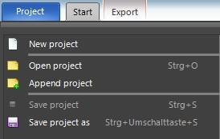

- Attach project, adds another project to the project currently being edited
- Save project as (save and enter new file path)

#### 5.1.2. Start menu:

##### 5.1.2.1. Import media

- Select file (to import video files)
- Select folder (to import image files from a folder; a video is created from this)
- Click here to open media (to import video files)
- Import videos using drag & drop from a work space directly into the preview

##### 5.1.2.2. Scene detection

First, activate the **Scene detection** option, then load a video using the **Import media** option; Scene detection will start automatically. The individual scenes will be filed and marked in the **Media Bin** as a thumbnail. The **Clear Media Bin** option removes all scenes from media storage.

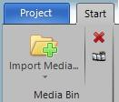

##### 5.1.2.3. Stabilization

If your video now becomes blurred when filming (when filming freehand), you can stabilise it automatically in ProDRENALIN. A simple mouse click on the **Stabilisation** option checks your video and starts video analysis.

##### 5.1.2.4. Rolling Shutter Compensation

The CMOS sensor is an image sensor that is used in camcorders and digital cameras.\
The rolling shutter effect is a positional error in the video that can occur during line-by-line filming of moving images. If the image is static, recording is done correctly. If the object moves or the camera begins to move, recording takes place line-by-line (displaced in time); the rolling shutter effect can result.

Until the recording is stabilised, the rolling shutter effect will not be noticeable, or will only be slightly noticeable. However, if stabilisation is successful in post-production, the rolling shutter effect will remain and will be subtle to significant.

Therefore, ProDRENALIN negates this undesired effect if the user chooses - because a stabilised recording is worthless if the undesired effect that results from it ruins the final product.

ProDRENALIN now offers **Rolling Shutter Compensation** (CMOS correction) in 3 steps, marked by 1, 2 and 3 **Stars**.

If you would like to optimise the fully-automatic CMOS correction in the video further, select one of the 3 available levels of correction in the menu, until you have achieved the best possible optimisation. Processing times may differ depending on the selection of correction method (with the stars).

If the **Rolling Shutter Compensation** option is not marked, no CMOS correction will take place. If video analysis is now started, only video stabilisation will occur.

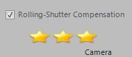

###### 5.1.2.4.1. 1 star

- 1 star = Remove the most common types of distortion

###### 5.1.2.4.2. 2 stars

- 2 stars = Remove less common wobble distortion

###### 5.1.2.4.3. 3 stars

- 3 stars = Remove jello or wobble distortion

##### 5.1.2.5. Used Camera Optics

Potential fisheye effect (caused by the curvature of the lens) in the video/photo can be removed by selecting the correct **camera optics**.

###### 5.1.2.5.1. Profile list

Select the **Camera profile** here that matches your camera and resolution.

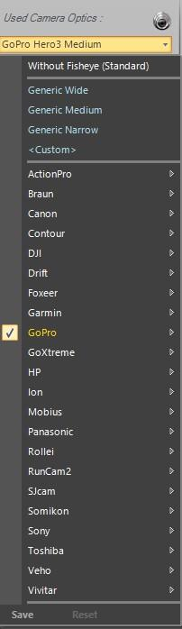

###### 5.1.2.5.2. Remove Fisheye

Click on the **Remove Fisheye** option. The corrected video will then be shown in preview. If your camera is not listed, then try the 3 generic profiles.

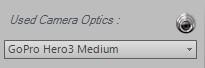

###### 5.1.2.4.3. Intrinsic properties

The current **Intrinsic properties** are displayed in a dialogue at the time of opening. The values in the dialogue that can be modified can be compared with the selection of one of the profiles. The first two of the three modes are technical methods; nothing on the right is therefore modifiable. If **Remove Fisheye** is selected, this is equivalent to pressing the button in the **Ribbon**. The right side can only be changed during **Adjustment**. The preview shows the effect of a change in the values as soon as it is performed. If hardly anything is visible, then the optical difference between the left and right parameters is probably not very large.

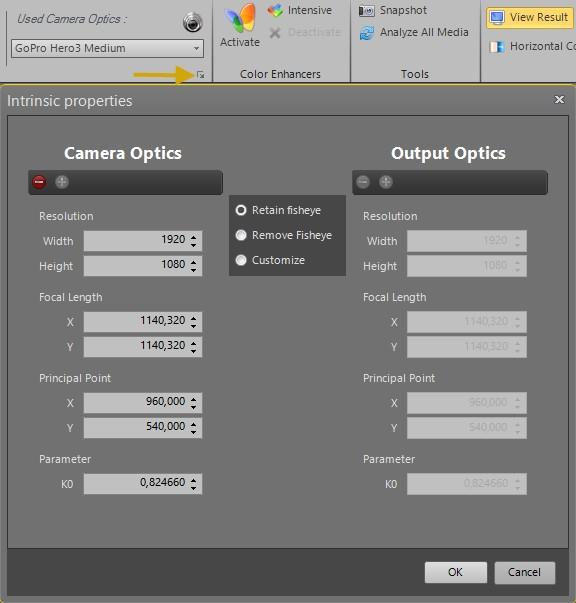

##### 5.1.2.6. Colour enhancers

In **Colour Enhancers**, you can optimise the brightness and contrast settings automatically (dynamically) in the video/photo; the dynamic setting can be switched on, turned up and switched off with a simple mouse click.

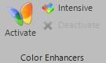

##### 5.1.2.7. Tools

###### 5.1.2.7.1. Snapshot

A **snapshot** of the current timeline cursor position can be created and saved with a mouse click.

###### 5.1.2.7.2. Analyse All Media

The **Analyse All** option starts video analysis for all imported and marked videos in the project.

##### 5.1.2.7. View Mode

The **View Mode** menu contains various options to display video previews.

- Display result (displays the stabilised video in the preview)
- Display original (displays the original video in the preview)
- Compare horizontally (comparison of original/stabilised in horizontal split screen)
- Compare vertically (comparison of original/stabilised in vertical split screen)

There is also an option to rotate the video/photo (Rotation), either clockwise or anticlockwise in 90-degree stages.

#### 5.1.3. Export menu:

Use the **Export** menu to export edited videos.

##### 5.1.3.1. Start export

Click on **Start export** to begin encoding the edited videos or the videos marked in the **Source Medium** menu.

##### 5.1.3.2. Combine Videos

This option allows you to combine several marked videos from media storage into one video.

##### 5.1.3.3. Select Export Path

If you select the option **Export files to another directory**, you have the option of defining your own export path. Click on the marked arrow and the **Folder search** dialogue will open. Use this to define your own target folder.

##### 5.1.3.4. Keep file date

Select this option if you would like the date of recording to be retained in the exported video.

##### 5.1.3.5. Export Settings/Setup

Now, use the **Setup** option to select the required media encoder for video; several options are available. Then, use the **Setup** option to select the required media encoder for audio; you can choose between several options here as well.\
You can choose between 3 quality levels for export.\
We recommend selecting the quality **Medium**.

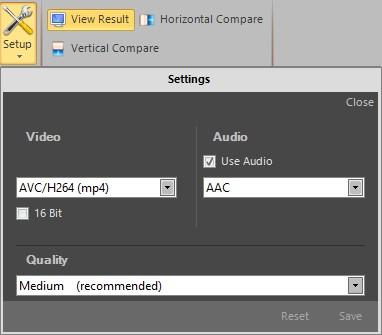

##### 5.1.4.6 Batch processing:

**Options for batch processing:**

Super simple without many controls:

- Drag video clips into the **Source Media** menu
- Export them

For videos with comparable properties:

- Drag videos into the **Source Media** menu
- Select all videos and required options
- Export them

### 5.2. Presets

Various preset effect templates are available for you to use. They can be adopted by double clicking on a video/photo. You can also create new templates (+), delete templates (-) and create new effect directories. After a template has been adopted, you can make finer adjustments to the effect or remove the effect or the template.

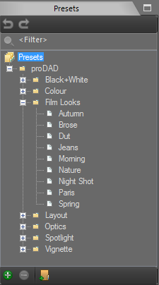

### 5.3. Media Bin

In Media storage, imported/edited videos and recognised scenes are displayed as a thumbnail in a row. You can change the order of these here using drag & drop. Right-clicking will open a menu with functions such as Cut, Copy, Paste, Delete, Rename and Select; video properties can also be viewed.

***Note:***\
*The order of the clips is important if all media are exported in* one output file *(Combine Videos).*

**Media storage** behaves synchronously with the Source medium menu.

### 5.4. Control

The classic options for video playback, including time and speed input, can be found in the control centre.\
The red timeline cursor shows the current position in the video. Use the orange in/out marker now to set a defined **trim area** in the video; this will then be processed and used when the video is being exported. The **Cut symbol** cuts the video at the current time marker, assuming that the time marker is within the selected trim area.

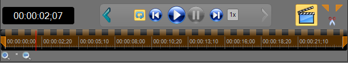

The **clapperboard symbol** can be used to switch the selection of **playback area**. The in/out markers, now green, define the area of playback in the selected video.

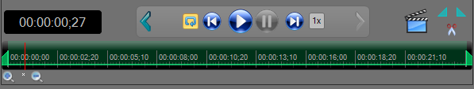

### 5.5. Canvas

The preview area is marked here in which the video/photo currently being edited is displayed.

### 5.6. Histogram

The **Histogram** displayed above the **Effects** is a graphical representation of the colour value distribution in a video/photo. The histogram is the graphical representation of the colour value distribution of an image; therefore, it is also described as a colour value curve. During video playback, the histogram values constantly change, displaying how the lighting is changing in the video. The X-axis of the diagram represents the RGB colour value, while the Y-axis gives the number of pixels in the video that have this value. The histogram is created with the 3 RGB colour values (red/green/blue) that are assigned to each pixel in the video/photo. The grey parts specify where all 3 colours overlap in the histogram, while yellow, magenta and cyan are displayed when 2 of the colours overlap.

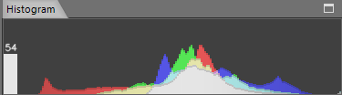

### 5.7. Panel Tabs

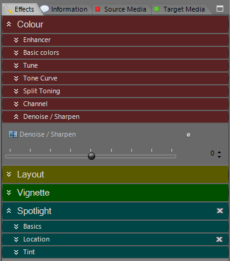

#### 5.7.1. Effects

In the **Effects** menu, you can set the details of different effects.

All effects and settings can also be controlled using **Keyframes**. First, move the timeline cursor to the required position on the timeline. Now, in the required effect setting, click on the **Clock symbol** and then move the slider to achieve the desired effect. To insert another keyframe, move the timeline cursor to another point in the timeline and then move the slider again in order to achieve the effect at the new position in the video. You can now change between the keyframes using the **Blue arrows (left/right)**. The keyframes can also be deactivated **(-)**. The set effect can be deleted using the **x** (e.g. in the Effect Enhancer).

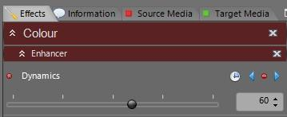

To the left in the presets you will find a large number of pre-made effect templates, which you can continue to edit and optimise in the **Effects** menu.

##### 5.7.1.1. Colour

###### 5.7.1.1.1. Enhancer

**Dynamics:** The **Dynamics** option can be used to make the colours in the video/photo brighter and more lively (dynamic); duller colours are optimised.

**Brightness Balancing:** This balances the differences in brightness throughout the video/photo.

###### 5.7.1.1.2. Basic colors

###### 5.7.1.1.2.1. White Balance

The **White Balance** can be used to remove any **Colour cast** that might be present in the video/photo. To do this, use the **Colour pipette** to select the colour that should be white. The image content will then be adjusted automatically, removing the colour cast. You can also select a **colour** in the colour palette.

###### 5.7.1.1.2.2. Exposure, Contrast, Brightness and Saturation

You can adjust over- and under-lit areas here and optimise the contrast, brightness and saturation in the video/photo.

###### 5.7.1.1.3. Tune

###### 5.7.1.1.3.1. Cold/Warm

Use this option to adjust the colour temperature in the video/photo. A negative value uses a colder colour temperature, while a positive value makes the video/photo warmer.

###### 5.7.1.1.3.2. Tint

Use the **Colour tone** option to set the colour tone that is to be used for the video/photo. Use the **Saturation** option to optimise the intensity of the toning in the video/photo.

###### 5.7.1.1.3.3. Color Shift

This option allows colours to change relative to one another in the video/photo.

###### 5.7.1.1.4. Tone Curve (Blacks, Shadows, Lights and Whites)

The histogram is the graphical representation of the colour value distribution of an image; therefore, it is also described as a colour value curve. You can use the available options to define the lighting conditions in dark and light areas in the video/photo image.

###### 5.7.1.1.5. Split Toning (Shadows, Midtone, Lights)

Use the slider to adjust the **Colour Tone** and **Saturation** of the deep, middle and light tones in a video/photo. Use the **Colour Tone** slider to set the colour tone or colour of deep tones in the video/photo. You can also select the exact colour (tone and saturation) using the **Colour Pipette** or use a colour from the **Colour Palette** to be used in the deep, middle and light tones. Use the **Saturation** slider to set the strength of the colours used.

###### 5.7.1.1.6. Channel (Exposure, Contrast and Saturation)

Here, you can define the lighting, contrast and saturation ratios for the individual channels **Red/Green/Blue** in the video/photo.

###### 5.7.1.1.7. Denoise / Sharpen

You can sharpen a video/photo here or remove/minimise any noise (e.g. that caused by recording in the dark).

##### 5.7.1.2. Layout

**Scale:** You can shrink or enlarge the **Image detail** in the video/photo here.

**Rotation:** Rotate the video/photo in the **Along the X/Y/Z axes**, either in a positive or negative direction.

**Shift:** Move the photo along the **X/Y axes** (left or right).

**Border:** After **Scaling** is used, a black border (solid) will appear around the video/photo. Using the **Replicate** or **Reflect** options will cause the **Border** to be re-generated; the result depends on the content of the image.

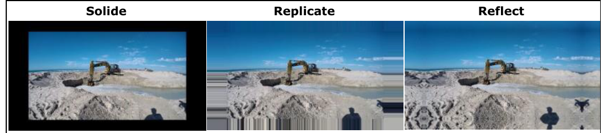

**Solide**

**Replicate**

**Reflect**

##### 5.7.1.3. Vignette

To the left in Presets, you will find pre-configured vignette effects; if you use the **Edge** preset, for example, this will be used in the preview. You can now configure other details in the **Effects** menu under **Vignette**, such as the vignette dimensions using the **Angle** option, or the **Sharpness** or blur of the vignette edge. The **Aspect Ratio** option sets the form of the vignette. The **Centre X/Y** options set the position of the vignette in the preview.

##### 5.7.1.4. Spotlight

To the left in the Presets, you will find pre-configured Spotlight effects, which you can use by double clicking on them. You can then make finer adjustments in the **Spotlight** effect dialogue.

###### 5.7.1.4.1. Basics

You can select the exact colours using the **Colour pipette** or use a colour from the **Colour palette** to be used for the spotlight effect. The **Luminance** option can be used to change the brightness of the spotlight, the **Saturation** option to change the colour intensity, or you can choose another colour tone for the spotlight. The **Spot Size** option can be used to scale the spotlight; **Diffusion** defines the spread of the spotlight in the video/photo you are using.

###### 5.7.1.4.2. Location

The **Centre X/Y** options define the position of the spotlight in the preview. The **Aspect Ratio** option defines the form of the spotlight.

###### 5.7.1.4.3. Tint

The **Darkening** option darkens the video/photo while having no effect on the spotlight. The **Shadows**, **Midtone** and **Lights** options define the tone properties of the spotlight in dark and light areas, as well as in the middle tones.

#### 5.7.2. Source Media

All imported media are displayed in the **Source Media** menu.

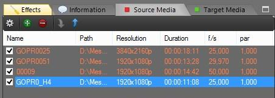

You can find information on the file path, resolution, run time, frames/sec (f/s), pixel ratio (par) the source path of the imported video here. Media can also be added (+) or removed (-) in media storage.

The medium selected in the **Source Media** menu can be moved one position up by clicking on the up-arrow button. The down-arrow button moves it down one position. The order of items in the **Source Media** menu is synchronised with the order in the Media Bin. If the order is changed here, media storage will be updated.

***Note:***\
*The position is important if all media are exported in one output file (Combine Videos).*

In front of the file name, mark the videos you would like to export after they have been successfully stabilised/corrected.

There is also an option to rename an imported video/photo in the **Source Media** menu; the new file name will then be used for the export, but the name of the original file will be unaffected.

Use the batch processing options as well.

#### 5.7.3. Target Media

All exported media are displayed in the **Target Media** menu.

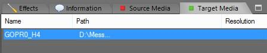

### 5.8. Status

To the left in the status bar, you can find information on the video you are using; on the right, you can set the size of the preview.

## 6. Shortcuts

### 6.1. Global Shortcuts

**6.1.1. Numeric keypad** (if activated and permitted in the project settings)

- Next Media [NumPad+2]
- Prev. Media [NumPad+8]
- Frame forward [NumPad+6]
- Frame backward [NumPad+4]
- Go to video start [NumPad+7]
- Go to video end [NumPad+1]

**6.1.2. Multimedia keys** (additional keys on many keyboards)

- Toggle Playback: this button toggles between playback and pause
- Start Playback
- Stop Playback
- Browse Next Media
- Browse Prev. Media

### 6.2. Local shortcuts

#### 6.2.1. Usable anywhere in the program

- Project open [Ctrl+O]
- Project save [Ctrl+S]
- Toggle Playback [Ctrl+Space]

#### 6.2.2. Timeline

- Frame forward [Cursor Right] [Mouse-Wheel]
- Frame backward [Cursor Left] [Mouse-Wheel]
- Toggle Playback [Space] [Enter]
- Go to video start [Home]
- Go to video end [End]
- Set IN point [I]
- Set OUT point [O]
-
- Timeline-Details
- Ctrl+0 Auto: the whole video-clip is fitted to timeline
- Ctrl+1 Frames: Zoom is set to show single frame
- Ctrl+2 Seconds: Zoom is set to show single seconds
- Ctrl+3 Minutes: Zoom is set to show single minutes
- Ctrl+4 Hours: Zoom is set to show single hours

#### 6.2.3. Canvas

- Toggle Playback - this button toggles between playback and pause [space]
- Go to video start [Home]
- Go to video end [Ende]
- Set IN point [I]
- Set OUT point [O]

© proDAD GmbH

www.prodad.com
