# proDAD ReSpeedr V2

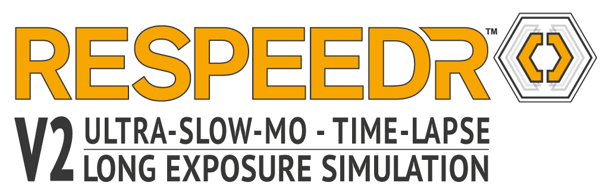

**Willkommen zu proDAD ReSpeedr !**

Mit **ReSpeedr** gelingen Ihnen atemberaubende Zeitlupen- und Zeitraffer-Videos. Neueste Technologien ermöglichen optimale Qualität der Geschwindigkeitsänderungen im Video. Auch die automatische Stabilisierung von Videos mit Rolling-Shutter Korrektur sowie verschiedene Effekte werden von **ReSpeedr** unterstützt.

Wir wünschen Ihnen viel Freude mit proDAD ReSpeedr und stets effektvolle Ergebnisse !

(c) proDAD GmbH

Autor: Uwe Wenz

## Inhaltsverzeichnis

- [Allgemeine Informationen](#allgemeine-informationen)
  - [Copyright / Rechtliches](#copyright--rechtliches)
  - [Was ist ReSpeedr?](#was-ist-respeedr)
  - [Installation und Registrierung](#installation-und-registrierung)
  - [Programmhilfe](#programmhilfe)
- [ReSpeedr im Detail](#respeedr-im-detail)
  - [Erste Anwendung, Programmoberfläche, Aktivierung und Undo/Redo](#1-erste-anwendung-programmoberfläche-aktivierung-und-undoredo)
  - [Ribbon - Datei, Start & Benutzeroberfläche](#2-ribbon---datei-start--benutzeroberfläche--tabs)
    - [Medien importieren](#21-medien-importieren)
    - [Geschwindigkeitsbearbeitung - Geschwindigkeit & Laufzeit einstellen](#22-geschwindigkeitsbearbeitung---geschwindigkeit--laufzeit-einstellen)
    - [Zwischenbild-Modus](#23-zwischenbild-modus)
    - [Stabilisierung & Rolling-Shutter Korrektur](#24-stabilisierung--rolling-shutter-korrektur)
    - [Effekte - Bewegungsunschärfe, Langzeitbelichtung & Lichtspur + Keyframes](#25-effekte---bewegungsunschärfe-langzeitbelichtung--lichtspur--keyframes)
  - [Bereichsauswahl - Arbeitsbereich - Trimmbereich](#3-bereichsauswahl---arbeitsbereich---trimmbereich)
  - [Information - Quell-Medium - Ziel-Medium (Einstellung Bildrate)](#4-information---quell-medium---ziel-medium-einstellung-bildrate)
  - [Medienablage & Ausgabe Medienablage](#5-medienablage--ausgabe-medienablage)
  - Videoexport & Batchverarbeitung
    - [Exporteinstellungen](#61-exporteinstellungen)
    - [Format-Einstellungen bearbeiten](#62-format-einstellungen-bearbeiten)
    - [Die Batchverarbeitung im Detail](#63-die-batchverarbeitung-im-detail)
  - [Workshop - Geschwindigkeit regeln Zeitlupe/Zeitraffer - Stabilisieren](#7-workshop---geschwindigkeit-regeln-zeitlupezeitraffer---stabilisieren)

## Allgemeine Informationen

### Copyright / Rechtliches

Rechtliches\
Copyright proDAD GmbH. Alle Rechte vorbehalten.

Lizenzbestimmungen\
Vor der Installation lesen Sie bitte folgende Lizenzbestimmungen sorgfältig durch.

Lizenzvertrag\
Beim Start des Setups wird ein Lizenzvertrag angezeigt, den Sie bitte sorgfältig durchlesen. Mit der Installation erkennen Sie diese Copyrightbestimmungen, den Lizenzvertrag und das Lizenzierungsverfahren an.

Lizenzgewähr\
proDAD GmbH räumt den bestimmungsgemäßen und erlaubten Gebrauch des vorliegenden Produkts ein. Das vorliegende Produkt kann nur auf einem Arbeitsplatz eingesetzt werden. Weder die Software, noch die Anleitung darf, auch in Teilen, reproduziert werden, es sei denn, es liegt eine schriftliche Genehmigung der proDAD GmbH vor. Mit Installation des Produkts gilt die Lizenzgewähr, die Urheberrechtsbestimmung, sowie die Haftungsbegrenzung als anerkannt.

Warenzeichen\
Alle Produkt- und Warenzeichen, die in diesem Produkt erwähnt wurden, sind Warenzeichen der jeweiligen Eigentümer. Alle Warenzeichen werden ohne Gewährleistung der freien Verwendbarkeit benutzt und sind eventuell eingetragene Warenzeichen.

Haftungsbegrenzung\
Der gesamte Haftungsumfang besteht im alleinigen Anspruch auf Ersatz des Produkts. Dies gilt für proDAD GmbH, Lizenznehmer und evtl. Vertreiber. Anspruch besteht nur bei korrekter Rückgabe der Software unter Angabe einer Warenrücksendenummer, die zuvor mit proDAD GmbH vereinbart werden muss. Ferner muss bei der Rückgabe ein Kaufbelege beiliegen. Ist eine Fehlfunktion des vorliegenden Produkts auf eine fehlerhafte Anwendung, Missbrauch, Unfall oder unsachgemäße Handhabung zurückzuführen, gilt die Garantie nicht. proDAD GmbH, deren Vertriebspartner und Lizenznehmer haften nicht für Schäden und Folgeschäden, die aufgrund der unmöglichen Nutzung des vorliegenden Produkts entstehen. In jedem Fall ist der Haftungsbetrag auf den Kaufpreis des Produkts beschränkt.

Dokumentationen\
Die Produktion und Übersetzung der Handbücher wurde mit größter Sorgfalt durchgeführt. Fehler können jedoch nicht hundertprozentig ausgeschlossen werden. proDAD GmbH übernimmt keinerlei Verantwortung oder Haftung für Folgen evtl. verbliebener fehlerhafter Aussagen oder Angaben. Technische und optische Änderungen vorbehalten. Hinweise sind stets willkommen.

Urheberrecht\
Die Software sowie die Einzelkomponenten dieses Produkts sind Eigentum der proDAD GmbH. Mit der Installation des vorliegenden Produkts stimmt der Lizenznehmer zu, unautorisierten Gebrauch und Duplizierung zu vermeiden.

proDAD GmbH übernimmt keinerlei Verantwortung für die Anwendung des Programms und die Veröffentlichung von Inhalten und Daten, die mit diesem Programm erzeugt wurden.

ProDAD GmbH \* Gauertstr. 2 \* 78194 Immendingen \* Deutschland \* HRB 1077

### Was ist ReSpeedr?

**ReSpeedr** bringt zusätzliche Action in Ihr Video, es ermöglicht perfekte Geschwindigkeitsänderungen im Video, soll es eine Zeitlupe oder ein Zeitraffer sein, kein Problem. ReSpeedr nutzt auch die Optical Flow-Methode zur Berechnung der Geschwindigkeitsänderungen im Video. Diese Methode erzeugt Videos mit Super-Zeitlupen und Zeitraffer, ganz ohne Geisterbilder. ReSpeedr ermöglicht jetzt auch harmonische Übergänge bei Geschwindigkeitswechsel, einstellbar direkt in der Timeline.

**ReSpeedr** kann auch ein evt. verwackeltes Video automatisch stabilisieren. Die enthaltende **Rolling-Shutter Korrektur** verbessert die durch schnelles Schwenken entstehenden Verzerrungen oder Verwacklungen. Es ist ganz einfach mehrere Videos gleichzeitig zu laden und zu optimieren, selbst Videos mit verschiedenen Einstellungen können dank **Batchverarbeitung** gleichzeitig bearbeitet werden.

**ReSpeedr** verfügt auch über verschiedene Effekte, die die Dynamik im Video beeinflussen können, u.a. die Bewegungsunschärfe, die Langzeitbelichtung und die Lichtspur.

### Installation und Registrierung

Um die **Installation** zu starten, klicken Sie bitte einfach doppelt auf die Setup-Datei. Mit der Installation stimmen Sie den Bedingungen unter Rechtliches und den Lizenzbedingungen zu. Wenn Sie **ReSpeedr** als Download bezogen haben, wird das Programmarchiv zunächst entpackt und die Installation gestartet. Wählen Sie dann das Zielverzeichnis in dem ReSpeedr installiert werden soll.

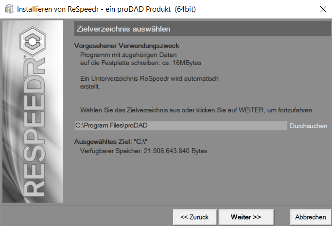

Folgen Sie nun den Installationsanweisungen. Weitere Hinweise zur Nutzung als **DEMO** bzw. zur **Aktivierung** finden Sie hier.

**Registrierung von ReSpeedr**\
Sie möchten Updates und weitere Informationen über ReSpeedr erhalten, dann registrieren Sie Ihr **proDAD ReSpeedr** hier.

### Programmhilfe

Die **Programmhilfe** ist generell per F1-Taste erreichbar.

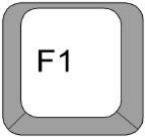

Bitte verwenden Sie auch die Suche-Funktion zum schnellen Auffinden von bestimmten Begriffen oder Themen in der Anleitung.\
Eine PDF-Anleitung können Sie auf www.prodad.com herunterladen.

## ReSpeedr im Detail

### 1. Erste Anwendung, Programmoberfläche, Aktivierung und Undo/Redo

**ReSpeedr** kann per **Shortcut** auf dem Desktop

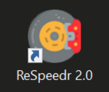

oder über **Start/Programme/proDAD/ReSpeedr Start** gestartet werden.

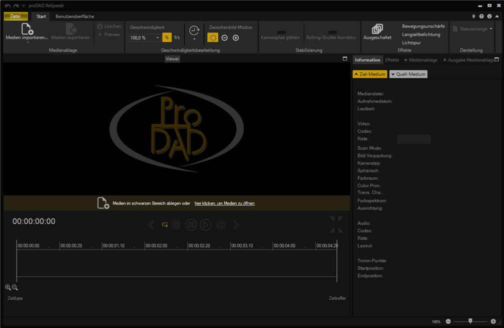

Beim ersten Programmstart von **ReSpeedr** werden Sie zur Eingabe eines **Aktivierungscodes** (Seriennummer) aufgefordert, geben Sie den Code ein, den Sie bei elektronischer Lieferung mit der Download-Instructions-Email erhalten haben, oder falls Sie eine physische Lieferung (auf DVD) erhalten haben, innerhalb der Box vorfinden. Klicken Sie dann **Unlock**.

Wenn Sie **ReSpeedr** im **DEMO-Modus** testen möchten, dann klicken Sie **Continue with Demo Version**. Die Demoversion ist solange aktiv, bis eine Seriennummerneingabe die Lizenz zur Vollversion wandelt.

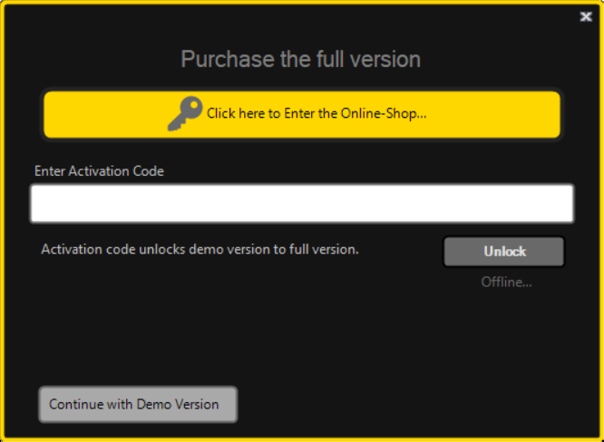

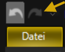

In jedem Programm ist die **Undo/Redo** Funktion sehr wichtig. Auch ReSpeedr verfügt über die Möglichkeit Veränderungen rückgängig zu machen sowie wieder herzustellen.

**ReSpeedr** startet dann mit dem aktiven Register Start.

### 2. Ribbon - Datei, Start & Benutzeroberfläche – Tabs

Das **Ribbon** unterteilt sich in die Tabs **Datei**, **Start** und **Benutzeroberfläche**.

1. **Datei Tab**

In **ReSpeedr** können jetzt alle durchgeführten Arbeiten in einem Projekt gespeichert werden, das Projekt können Sie jederzeit wieder laden und weiter bearbeiten. Das **Öffnen** eines Projekt, das **Anhängen** und **Sichern** ist direkt im Tab **Datei** umsetzbar.

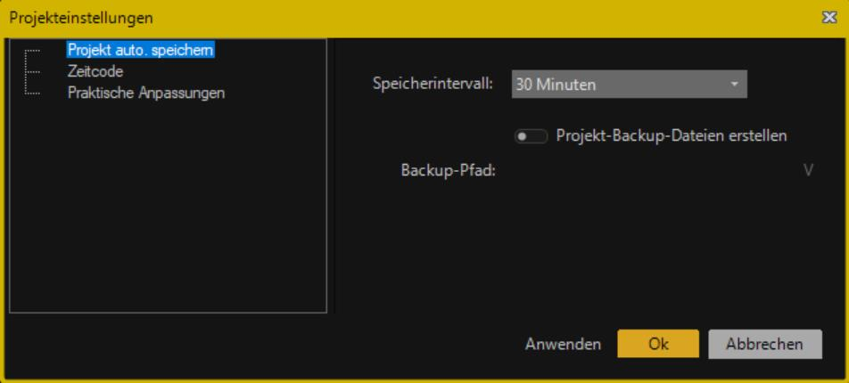

- Neues Projekt anlegen
- Projekt öffnen, lädt ein bestehendes Projekt
- Projekt anhängen, fügt ein weiteres Projekt dem aktuell bearbeiteten Projekt hinzu
- Projekt sichern (Speichern)
- Projekt sichern als (Speichern mit Pfadangabe)

Zusätzlich können Sie hier **Medien importieren** und den **Export** von bereits bearbeiteten Medien starten. Ein **angezeigtes Bild** kann jetzt auch gedruckt bzw. eine Druckvorschau angezeigt werden. Mercalli SAL bietet auch das Speichern, Anzeigen und Drucken einer **Protokollierung**, die bei evt. verfügbaren Problemen für den den proDAD Support nützlich sein kann.

In den **Projekteinstellungen** sind grundlegende Einstellungen zum ReSpeedr-Projekt wählbar.

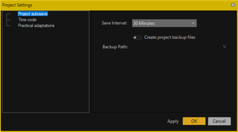

2. **Start Tab**

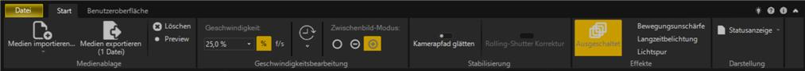

Im **Start** Tab finden Sie den Import/Export sowie alle Einstellungen zur Geschwindigkeitsbearbeitung (Zeitlupe und Zeitraffer) inklusive Zwischenbild-Modus, Einstellungen zur Stabilisierung von Videos (Kamerapfad glätten) und Rolling-Shutter Korrektur, zu den Effekten Bewegungsunschärfe, Langzeitbelichtung und Lichtspur sowie zur Darstellung der Statusanzeige.

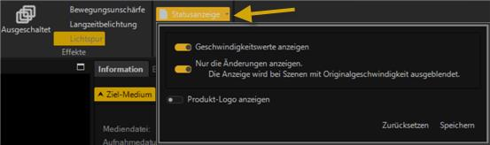

3. **Benutzeroberfläche Tab**

Im **Benutzeroberfläche** Tab können Sie die Programm-Protokollierung aktivieren, darüber werden evt. wichtige Informationen für den technischen Support gesichert.

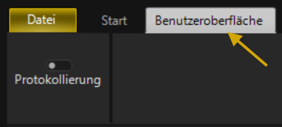

Informationen zum **Export** bearbeiteter Videos finden Sie **hier**.

#### 2.1. Medien importieren

In **ReSpeedr** stehen Ihnen 4 Möglichkeiten zum **Import** von Videos zur Verfügung.

1. **Datei wählen** (zum Import von Videodateien)
2. **Ordner wählen** (zum Import von Bilddateien aus einem Ordner, ReSpeedr erzeugt daraus ein Video)
3. **Hier klicken, um Medien zu öffnen** (zum Import von Videodateien)
4. **Import von Videos via Drag & Drop** aus dem Arbeitsplatz, direkt in die Vorschau von ReSpeedr

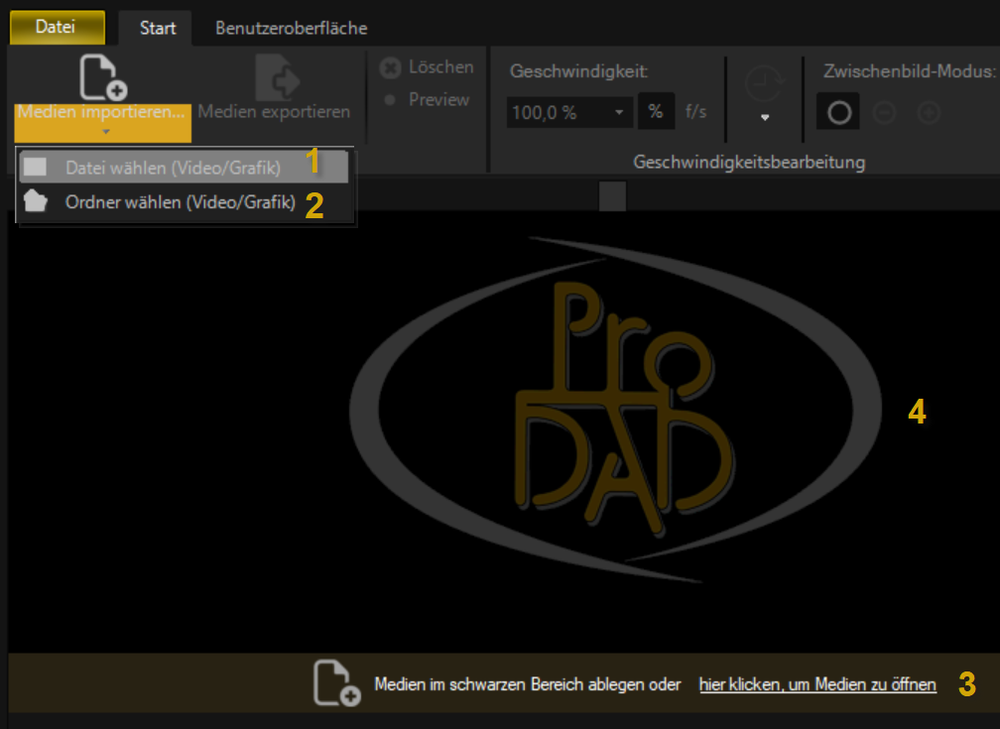

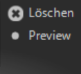

Weiterhin können Sie hier die **Medienablage löschen** und eine **Video-Vorschau berechnen**, die dann in einem externen Player abgespielt werden kann.

#### 2.2. Geschwindigkeitsbearbeitung - Geschwindigkeit & Laufzeit einstellen

Im Bereich **Geschwindigkeitsbearbeitung** legen Sie zwischen 1% und 500% die Geschwindigkeit im Video fest.

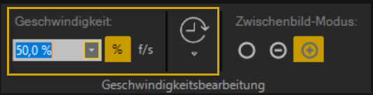

Geschwindigkeiten von **1%** bis **75%** sind Einstellungen für eine **Zeitlupe**, das entspricht einer Geschwindigkeitsabsenkung im Video. Die Geschwindigkeit von **100%** entspricht dem Originalvideo.\
Geschwindigkeiten von **110%** bis **500%** sind Einstellungen für **Zeitraffer**, das entspricht einer Geschwindigkeitserhöhung im Video.

Im Bereich **Laufzeit** wird die **Quell-Laufzeit** (Laufzeit des importierten Videos) sowie die **Ziel-Laufzeit** angezeigt.

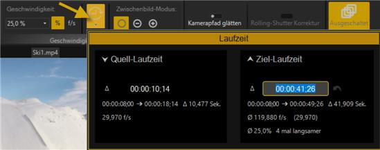

Die **Quell-Laufzeit** ist nicht veränderbar, jedoch besteht die Möglichkeit eine neue **Ziel-Laufzeit** (neue Videolänge) einzustellen. Dann wird die Geschwindigkeit im Video zur neu eingestellten Laufzeit automatisch angepasst. Die Änderung der Ziel-Laufzeit nehmen Sie direkt in der **Zeitanzeige** (aktuell grün dargestellt) durch Klick und Eingabe der neuen Zeit vor. Mit **Anwenden** übernehmen Sie die neue Ziel-Laufzeit.

Weitere Hinweise finden Sie im Workshop...

#### 2.3. Zwischenbild-Modus

Im Bereich **Zwischenbild-Modus** stehen 3 verschiedene Berechnungsmethoden zur Verfügung.

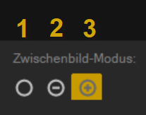

1. **Automatische Methode:**\
  Diese Methode wählt automatisch zwischen schneller und hoher Qualität (Optical Flow). Wir empfehlen zunächst mit dieser Standard-Einstellung zu arbeiten. Sollten sich störende Geisterbilder im Video einbinden, dann nutzen Sie die *Optical-Flow* Methode.
2. **Schnelle Berechnungs-Methode:**\
  Es erfolgt die Berechnung der Zwischenbilder für die Geschwindigkeitsänderung durch Überblenden der Einzelbilder. Die schnelle Berechnungs-Methode benötigt weniger Rechenaufwand. Hier kann es jedoch zu *Geisterbildern* während der Geschwindigkeitsänderung (abhängig von der bewegten Bildinhalten im Video) kommen, sollten die sich störend im Video auswirken, dann nutzen Sie die *Optical-Flow* Methode.
3. **Berechnungs-Methode für hohe Qualität - Optical Flow-Modus** (oder optischer Fluss):\
  Hier werden effiziente Algorithmen zur Bestimmung von bewegten Bildinhalten in einem Video ermittelt.\
  Es wird die Bewegungsrichtung und Geschwindigkeit für jeden Bildpunkt genutzt. Damit werden evt. verfügbare Geisterbilder während der Geschwindigkeitsänderung beseitigt und eine hohe Qualität erzeugt. Z.B. gelingen so bei langen Zeitlupen sinnvolle Ergebnisse. Die Optical-Flow Methode benötigt jedoch mehr Rechenaufwand.

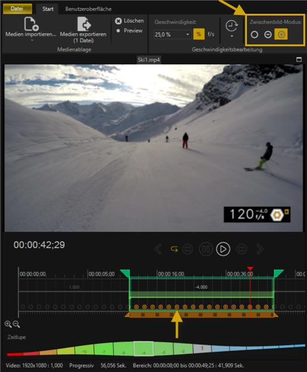

Die jeweils gewählte Methode wird im Arbeitsbereich der Timeline angezeigt. Beachten Sie auch die Qualitätseinstellungen für die Darstellung des Videos mit veränderter Geschwindigkeit in der Programm-Vorschau.

#### 2.4. Stabilisierung & Rolling-Shutter Korrektur

Sollte jetzt Ihr Video bei der Aufnahme (durch freihand filmen) verwackelt worden sein, dann können Sie dieses in **ReSpeedr** stabilisieren und eine Rolling-Shutter Korrektur (CMOS Fehler) durchführen. Schalten Sie dazu die Funktionen **Kamerapfad glätten** und **Rolling-Shutter Korrektur** im Ribbon ein,

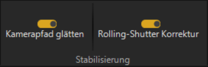

dann prüft ReSpeedr das importierte Video und startet die **Videoanalyse**, dabei werden das Video (bzw. der gewählte Trimmbereich) automatisch stabilisiert und evt. verfügbare Rolling-Shutter Effekte minimiert bzw. entfernt.

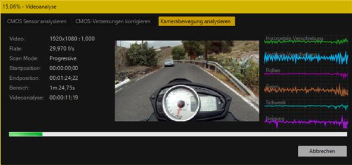

Nach erfolgtem Durchlauf der Videoanalyse besteht in der **Programm-Vorschau** die Möglichkeit der Kontrolle des stabilisierten Videos.

***Hinweis:***\
*Sie können das komplette Video stabilisieren oder auch einen eigenen Trimmbereich in der* *Timeline festlegen. Dann wird nur dieser gewählte Videoabschnitt stabilisiert.*

Weiterhin bietet ReSpeedr die **Rolling-Shutter Korrektur** an.

Die **Rolling-Shutter Korrektur** reduziert evt. verfügbare Verzerrungen bzw. Wabbel-Effekte (Erscheinungen wie "Wackelpudding") im Video.

Die vollautomatische Rolling-Shutter-Korrektur korrigiert diese Erscheinungen, was insbesondere Aufnahmen von Action-Cameras, kleinen Photocams, Handys und nicht zuletzt digitalen Spiegelreflex-Kameras zugute kommen dürfte.

Sollte der **Rolling-Shutter Effekt** (Verzerrungen oder wabbelndes Bild) nach der ersten Stablilisierung Ihres Videos in der Vorschau auftreten, so können Sie diesen Effekt durch Aktivierung der Option **Rolling-Shutter Korrektur** beseitigen.

Der Rolling-Shutter-Effekt ist ein **Lagefehler im Video**, der bei der zeilenweisen Aufnahme von bewegten Bildern auftreten kann.\
Ist das Motiv **unbewegt** (statisch), so erfolgt die Aufnahme korrekt. Ist das Motiv **bewegt** oder die **Kamera in Bewegung**, so erfolgt die Aufnahme zeilenweise nacheinander (also in der Zeit verschoben), das kann zum Rolling-Shutter-Effekt führen.\
Dieser Effekt erscheint in Form einer diagonalen Verzerrung bei der Aufnahme von schnell bewegten Motiven, auch stärkere Verwacklungen der Kamera, wie sie bei Aufnahmen aus einer Bewegung (z.B. aus dem Auto) vorkommen, führen zu einer starken Verzeichnung des gesamten Bildes, wodurch die Aufnahmen sehr leiden können.

**Hinweise zu möglichen Rolling-Shutter Effekten (CMOS Fehler):**

- Jello effect (Jello = Wackelpudding)
- eine geometrische Verzerrung des Bildes bei Schwenks
- ein wabbelndes Bild (ähnlich wie Hitzeflimmern)
- Vibrationen (möglich bei Drohnenaufnahmen oder mit Kameras an Bikes)

#### 2.5. Effekte - Bewegungsunschärfe, Langzeitbelichtung & Lichtspur + Keyframes

**ReSpeedr** verfügt jetzt über 3 Effekte, mit denen zusätzliche Dynamik ins Video eingefügt werden können.

1. **Bewegungsunschärfe**

Die Bewegungsunschärfe bezieht sich auf einen Effekt in Videos und Fotos, wo bewegte Objekte während der Aufnahme verschwommen erscheinen. Das geschieht, wenn die Belichtungszeit der Kamera zu lang ist und während dieser Zeit das Motiv oder die Kamera selbst in Bewegung ist. ReSpeedr ermöglicht es nun in Videos eine Bewegungsunschärfe hinzuzufügen, diese kann auch per Keyframes im Tab **Effekte** animiert werden.

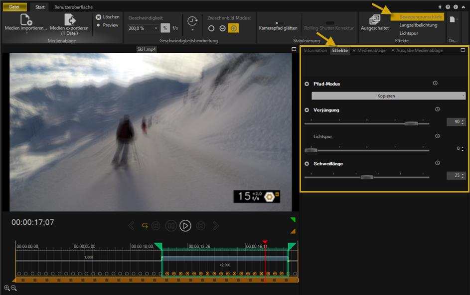

2. **Langzeitbelichtung**

Die Langzeitbelichtung bleibt der Verschluss der Kamera für eine längere Zeit geöffnet, um Licht über einen längeren Zeitraum einzufangen. Dies führt zu verschiedenen kreativen Effekten, insbesondere in Bezug auf Bewegung und Helligkeit.

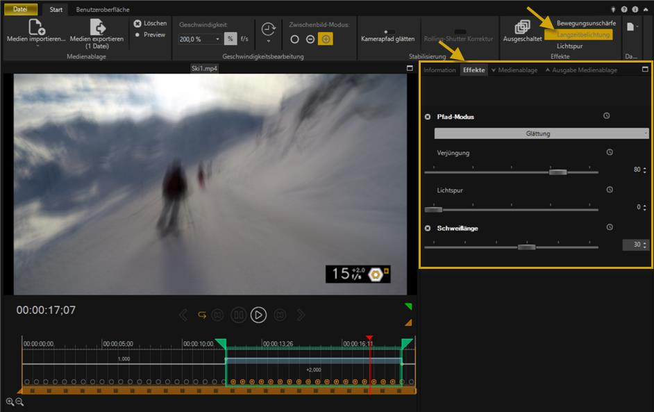

3. **Lichtspur**

Eine Lichtspur ist eine sichtbare Spur, die durch die Bewegung von Lichtquellen während einer Langzeitbelichtung entsteht. Dieser Effekt tritt auf, wenn die Kamera für eine längere Zeit belichtet wird und dabei Licht von sich bewegenden Lichtquellen aufzeichnet. Typischerweise werden Lichtspuren bei der Fotografie von Fahrzeugen, wie z.B. Autos, erzeugt.

Diese **Effekte** bzw. zugehörige Einstellungsmöglichkeiten lassen sich auch per **Keyframes** steuern.\
Bewegen Sie zuerst den Timeline-Cursor an eine gewünschte Position in der Zeitleiste. Klicken Sie nun in der gewünschten Effekteinstellung auf das **Uhr-Symbol** und verändern danach den Schieber, um den Effekt zu erzielen. Um ein weiteres Keyframe einzufügen, verschieben Sie erneut den Timeline-Cursor an eine neue Position in der Zeitleiste, klicken dann auf das **(+)** und verändern danach den gewünschten Schieber erneut, um den Effekt an der neuen Position im Video zu erzielen. Mit den **Pfeilen (links/rechts)** können Sie nun zwischen den Keyframes wechseln. Die Keyframes sind auch abschaltbar **(-)**. Der eingestellte Effekt kann über das **x** gelöscht werden.

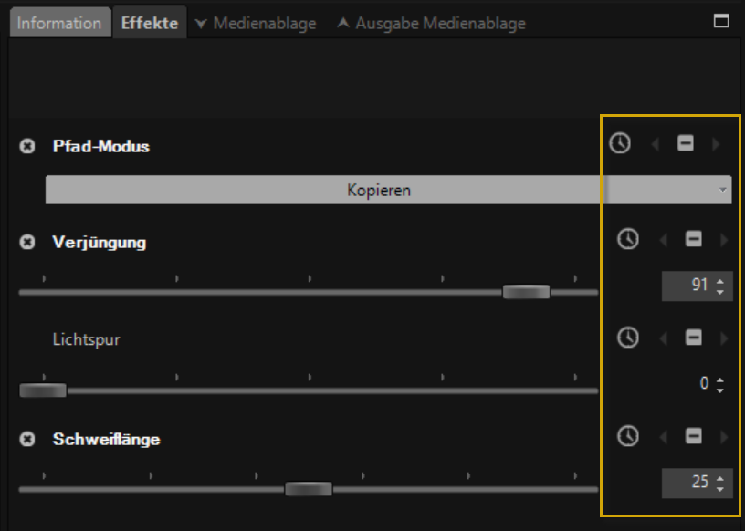

### 3. Bereichsauswahl - Arbeitsbereich - Trimmbereich

Nach dem Import kann das Video in der ReSpeedr-Vorschau via **Steuerung** = Steuerung des Playbacks wie **Play (7)** abgespielt werden. Ein Klick auf **Pause (6)** stoppt das Video.

Die **Zeitinformation (2)** des Videos (aktuell = 00:01:21 Sekunde / Bild 15) ist links unterhalb der Vorschau verfügbar. Sie können auch zwischen den importierten Videos in der Vorschau wechseln, **vorheriges Video (3)** und **nächstes Video (9)**. Auch eine **Wiederholung (4)** des Videos ist umsetzbar. Der **Schalter (5)** springt an den Videoanfang oder an den Anfang des Trimmbereiches. Mit dem **Schalter (8)** verändern Sie durch mehrfachen Klick die Wiedergabegeschwindigkeit stufenweise.

In **ReSpeedr** können Sie ***einen Trimmbereich*** (Startpunkt/Endpunkt) festlegen, das ist der braun gekennzeichnete Bereich in der Zeitleiste, dieser wird später beim Video-Export erstellt.

In diesem **Trimmbereich (11)** können Sie ***mehrere Arbeitsbereiche*** **(10)** mit Startpunkt/Endpunkt festlegen. Darin treffen Sie dann Ihre **Geschwindigkeitseinstellungen** (Zeitlupe oder Zeitraffer).\
Der Trimmbereich (braun) und die Arbeitsbereiche (grün) werden unterhalb der **Programm-Vorschau** festgelegt, nutzen Sie dazu die folgenden Optionen (siehe Abbildung), verschieben Sie jeweils vor dem Setzen des Start- und Endpunktes für den Trimmbereich den **roten Timeline-Cursor (Abspielmarker) (12)** an die gewünschte Position, dieser kennzeichnet die aktuelle Position in der **Zeitleiste**.

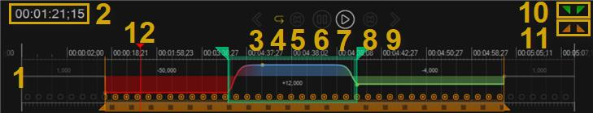

Dann ist der **Trimmbereich** festgelegt, nun folgt der **Arbeitsbereich**. Auch hier muß zunächst der *rote Timeline-Cursor* **im Trimmbereich** an die gewünschte Position für den Startpunkt verschoben werden. Wurde der **Startpunkt** gesetzt, durch Klick auf die grüne gekennzeichnete Option ***Bearbeitung-Startpunkt setzen***, dann folgt der **Endpunkt** durch Klick auf die Option ***Bearbeitung-Endpunkt setzen***.\
Nun kann eine Geschwindigkeitseinstellung am Video für diesen **Arbeitsbereich** vorgenommen werden.

Danach besteht die Möglichkeit eine **weitere Arbeitsbereiche im Trimmbereich** festzulegen, die wiederum neue Geschwindigkeitseinstellungen erhalten können, wie in der folgenden Abbildung angezeigt. So gelingen im Video verschiedene Geschwindigkeiten, die unmittelbar aufeinander ablaufen können. In der Abbildung sind **Arbeitsbereiche** mit 50 facher Zeitlupe (rot dargestellt), 12 fachem Zeitraffer (blau dargestellt) und einer weiteren 4 fachen Zeitlupe (grün dargestellt) hinzugefügt worden.

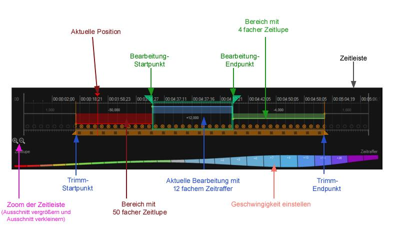

In **ReSpeedr** sind jetzt **harmonische Geschwindigkeitsübergänge** möglich, dazu legen Sie zunächst wie zuvor mehrere Arbeitsbereiche mit verschiedenen Geschwindigkeiten fest, dann bewegen Sie die Maus auf einen gelben Punkt an den Übergängen und verschieben ihn nach links oder rechts. So können Sie eine **Kurve** erstellen, die den Übergang zwischen den gewählten Geschwindigkeitsstufen darstellt. Verlängern Sie diesen Übergang, so läuft der Übergang langsamer, ist er kürzer, dann läuft der Übergang schneller ab.

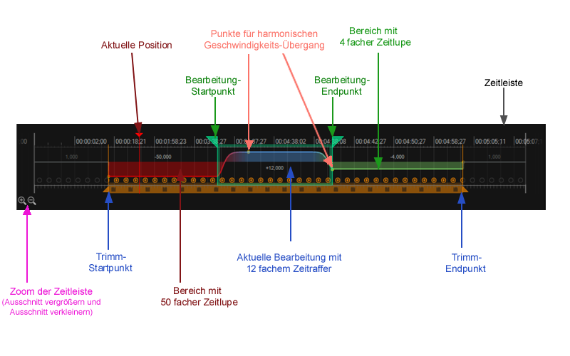

Weitere Hinweise erhalten Sie in der Lektion Geschwindigkeitsbearbeitung und im Workshop.

### 4. Information - Quell-Medium - Ziel-Medium (Einstellung Bildrate)

Im Register **Informationen** finden Sie Informationen zum **Quell-Medium** sowie zum **Ziel-Medium**, jeweils zu den Videoeigenschaften (wie z.B. Video, Rate, Laufzeit usw.).

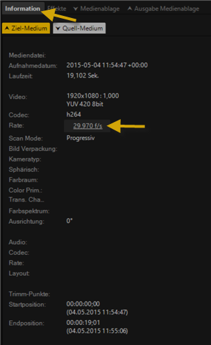

Es können **keine** Einstellungen zum **Quell-Medium** vorgenommen werden, jedoch zum **Ziel-Medium**. Klicken Sie dazu auf die angezeigten **FPS** (z.B. 29,97 f/s). Im Dialog **Ziel-Medium Eigenschaften** besteht die Möglichkeit zwischen verschiedenen Bildraten zu wählen.

Die Auswahl **Original-Bildrate verwenden** nutzt die Bildrate des originalen Videos (Quell-Video). Bei **Standard-Bildrate verwenden** wird Standard gesetzt, Detaileinstellungen sind nicht möglich. Bei Auswahl von **Beliebige Bildrate verwenden** kann die Bildrate manuell angepasst werden. Die **Laufzeit** bzw. die **Geschwindigkeit des Videos** wird nicht verändert.

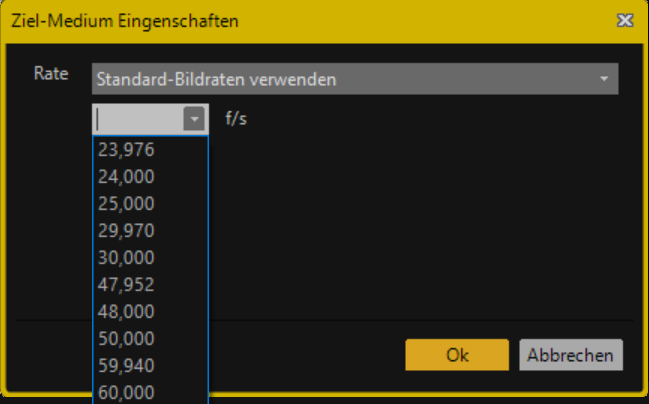

### 5. Medienablage & Ausgabe Medienablage

Im Tab **Medienablage** werden ihnen alle importierten Medien angezeigt.

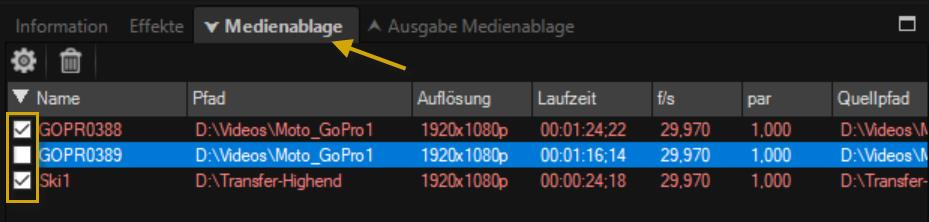

Sie erhalten im Tab **Medienablage** auch Informationen zum Dateipfad, Auflösung, Laufzeit, Bilder/Sek (f/s), Pixelratio (par) sowie zum Quellpfad der importierten Videos. Sie können auch Medien hinzugefügten oder entfernen sowie über die Option Eigenschaften u.a. die Start- und Endposition definieren.\
Vor dem Dateinamen **markieren** Sie die Videos, die für den Export nach erfolgter Korrektur vorgesehen sind.

In ReSpeedr gibt es auch das Tab **Ausgabe Medienablage**, hier werden alle exportierten Videos angezeigt.

### 6. Videoexport & Batchverarbeitung

#### 6.1. Exporteinstellungen

Nach der Bearbeitung der Videos erfolgt zum Abschluss der finale Videoexport.

Markieren Sie die bearbeiteten Videos im Tab **Medienablage**, die Sie exportieren möchten.

Die markierten Videos können dann exportiert werden. Hier wird Ihnen nochmal die Anzahl der zu exportierenden Videos (aus dem Tab **Medienablage**) angezeigt.

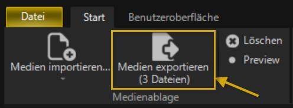

Klicken Sie dazu im Ribbon auf **Medien exportieren**. Es öffnet der Dialog **Medium exportieren**.

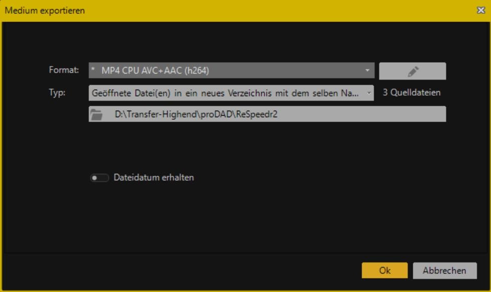

Sie können nun eine gewünschte **Export-Formatvorlage** wählen.

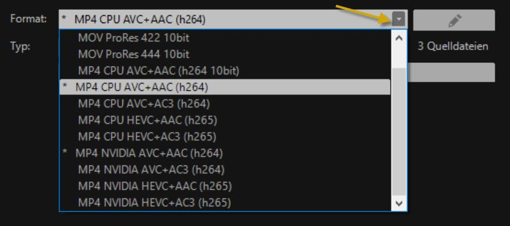

Es ist auch möglich eigene Export-Formateinstellungen vorzunehmen.

Nach der Auswahl der Formatvorlage erfolgt die Auswahl des Export-Typs.

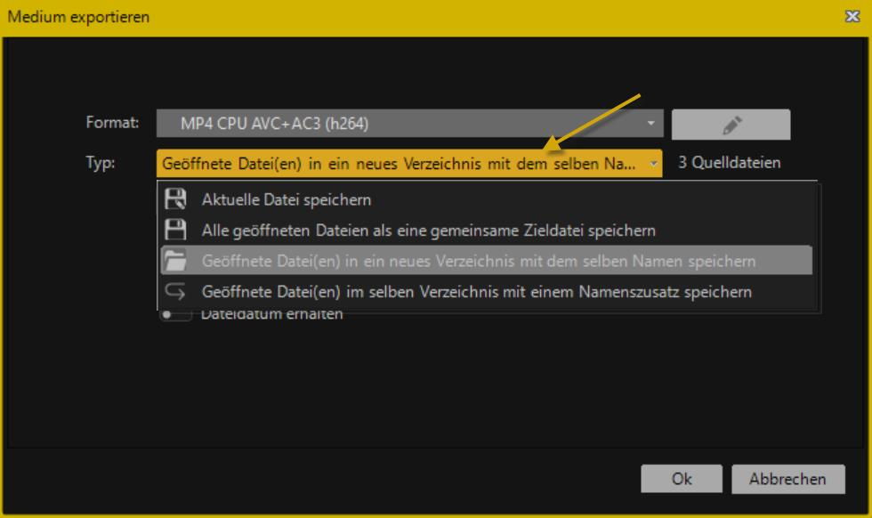

Es besteht die Möglichkeit die aktuelle Datei zu speichern, Alle geöffneten Dateien als eine gemeinsame Zieldatei zu speichern, Geöffnete Datei(en) in ein neues Verzeichnis mit dem selben Namen zu speichern sowie Geöffnete Datei(en) im selben Verzeichnis mit neuen Namenszusatz zu speichern.

Darunter wählen Sie dann den gewünschten **Exportpfad**.

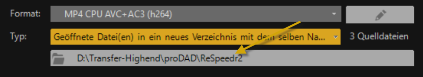

Weiterhin können Sie festlegen, ob das **Dateidatum erhalten** bleiben soll und ob nur der **gewählte Arbeitsbereich (Trimmbereich)** exportiert werden soll.

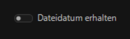

Starten Sie danach den Export durch Klick auf **OK**. Danach können Sie die Videos mit einem installierten Software-Player abspielen.

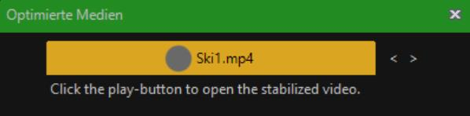

Des weiteren stehen die exportierten Videos im Tab **Ausgabe Medienablage** zur Verfügung.

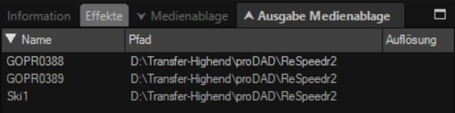

#### 6.2. Format-Einstellungen bearbeiten

Klicken Sie im **Ribbon** auf **Medien exportieren**. Es öffnet der Dialog **Medium exportieren**.

Sie können nun eine gewünschte **Export-Formatvorlage** wählen

und auch **eigene** Export-Detaileinstellungen vornehmen. Klicken Sie dazu auf die Option **Formateinstellungen bearbeiten**.

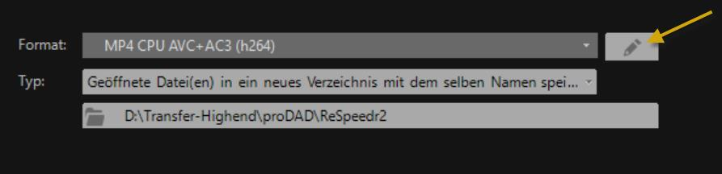

Im Dialog **Formateinstellungen bearbeiten** können Sie nun die **gewählte Vorlage bearbeiten**. Klicken Sie dazu auf das **(+)** Symbol, danach können Sie zuerst den **Vorlagen-Namen** ändern, eine der **3 Qualitätsstufen** (Niedrig/Mittel/Hoch) auswählen und Einstellungen zum **Videocodec, Format und Größe** vornehmen. Die Einstellungen zum Video können auch ein- und ausgeschaltet werden.

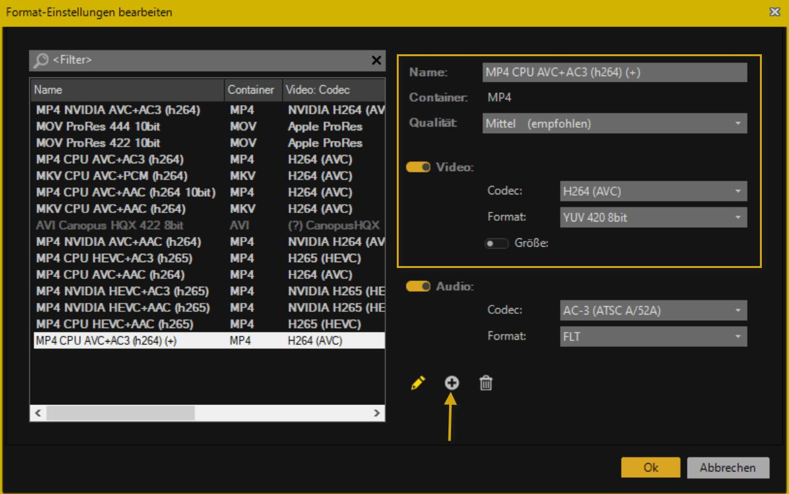

Weiterhin gibt es auch individuelle Einstellungen zum **Audio** bzgl. des **Codecs** und des **Formats**. Die Einstellungen zum Audio können auch ein- und ausgeschaltet werden.

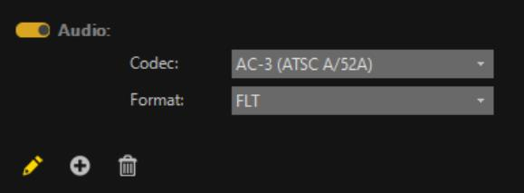

Formateinstellungen können auch hinzugefügt und gelöscht werden. Mit **OK** übernehmen Sie die Änderungen in den Formateinstellungen, eine neue **individuelle Formatvorlage** wird erstellt, sie kann nun zum Export genutzt werden.

#### 6.3. Die Batchverarbeitung im Detail

In **ReSpeedr** ist eine Batchverarbeitung von mehreren Videos als einzelne Videos möglich.

Es gibt folgende Wege der **Batchverarbeitung**:

1. **Videoanalyse einzelner Videos mit Videoanalyse und anschließendem Export aller markierten Videos in eine gemeinsame Datei**

Importieren Sie **ein Video** in ReSpeedr, wählen z.B. die Stabilisierungseinstellungen und analysieren das Video. Importieren Sie weitere Videos und analysieren diese. Danach stehen diese im Tab **Medienablage** zur Verfügung. Sie können nun nachträglich verschiedene Einstellungen zur Stabilisierung ändern, markieren Sie dazu das entsprechende Video im im Tab **Medienablage** um.

Auch ein Playback vom jeweilig markierten Video kann in der Vorschau gestartet werden.

Die markierten Videos können dann exportiert werden. Klicken Sie dazu im Ribbon auf **Medien exportieren**.

Hier wird Ihnen nochmal die Anzahl der zu exportierenden Videos (aus dem Tab **Medienablage**) angezeigt. Beachten Sie nun die Einstellungen zum Export.

Sie können nun eine gewünschte Export-Formatvorlage wählen, eigene Export-Detaileinstellungen, den Typ und den Exportpfad wählen. Starten Sie danach den Export durch Klick auf **OK**.\
Das Video wird nun im Tab **Ausgabe Medienablage** angezeigt.

2. **Videoanalyse und Export zusammen in einem Vorgang**

Importieren Sie zuerst **mehrere Videos** in ReSpeedr und wählen für jedes Video z.B. die Geschwindigkeits- und Stabilisierungseinstellungen aus. Dann markieren Sie im Tab **Medienablage** alle Videos die analysiert und exportiert werden sollen.

Klicken Sie zum Start der Videoanalyse und des Exports im Ribbon auf **Medien exportieren**. Hier wird Ihnen die Anzahl der zu analysierenden und exportierenden Videos angezeigt, beachten Sie nun die Einstellungen zum Export. Sie können nun eine gewünschte Export-Formatvorlage wählen, eigene Export-Detaileinstellungen, den Typ und den Exportpfad wählen. Starten Sie danach den Export durch Klick auf **OK**.

Die zum Export stehenden Videos werden nun automatisch nacheinander analysiert und exportiert.\
In diesem Beispiel wurden 3 markierte Videos im Tab Quell-Medium in ein selbstgewähltes Verzeichnis exportiert. Die Videos werden nun im Tab **Ausgabe Medienablage** angezeigt.

Danach können Sie die Videos mit einem installierten Software-Player abspielen.

Des weiteren stehen die exportierten Videos im Tab **Ausgabe Medienablage** zur Verfügung.

***Hinweis:***\
*Nachträgliche Änderungen von Geschwindigkeits- und Stabilisierungseinstellungen sind* *möglich, einfach das Video in der* ***Tab Medienablage*** *markieren, die neuen Einstellungen* *treffen und danach ohne weitere Analyse mit den neu gewählten Eigenschaften exportieren.*

Je nachdem, welches Export-Format Sie gewählt haben, steht Ihnen nun diese Datei (Ihr stabilisiertes Video) zur weiteren Verwendung (z.B. zum Brennen auf eine DVD oder Blu-ray) zur Verfügung. Sie können die Datei aber auch in eine Videoschnittsoftware importieren und dort weiter verarbeiten.

### 7. Workshop - Geschwindigkeit regeln Zeitlupe/Zeitraffer - Stabilisieren

Sie haben z.B. ein Video mit einer **Actioncam** am Bike aufgenommen.\
Nun soll das Video in der Geschwindigkeit verändert werden, das können Sie mit **proDAD ReSpeedr** umsetzen.

Importieren Sie zuerst ein Video über die Importfunktion **Medium importieren** oder ziehen es direkt (mit gedrückter linker Maustaste) aus dem Arbeitsplatz in den **Vorschaubereich** von ReSpeedr.

Dann legen Sie in der **Zeitleiste** den **Trimmbereich** und darin zunächst *einen* **Arbeitsbereich** fest, in dem dann die Geschwindigkeitsänderung eingefügt werden soll. Detaillierte Hinweise dazu erhalten Sie in der Lektion Bereichsauswahl - Arbeitsbereich - Trimmbereich.

Nach der Festlegung des Trimmbereiches (braun markiert) und des Arbeitsbereiches (grün markiert) erhalten Sie z.B. folgende Ansicht in der Zeitleiste.

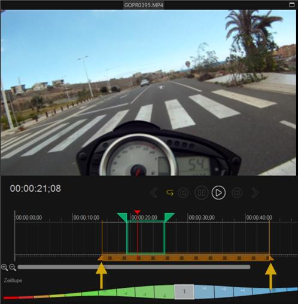

Jetzt bestehen verschiedene Möglichkeiten **Geschwindigkeitseinstellungen** in ReSpeedr vorzunehmen.

1. durch Auswahl einer Voreinstellung (von 1% bis 500%) im Menü Geschwindigkeit für Zeitlupe oder Zeitraffer
2. durch Festlegung einer neuen Ziel-Laufzeit im Menü Laufzeit
3. oder durch Auswahl einer Geschwindigkeitsänderung direkt im angezeigten Laufbalken unterhalb der Zeitleiste, die jetzt zur Erklärung genutzt wird.

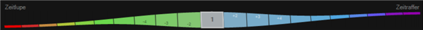

Die **grau gekennzeichnete 1** stellt die **Originalgeschwindigkeit** des importierten Videos dar.

**a.** Wählen Sie jetzt einen Wert **links** der **1**, dann wird eine **Zeitlupe** mit dem jeweilig gewählten Wert (z.B. **-2** bedeutet 2 mal langsamer oder **-16** = 16 mal langsamer) eingestellt.

**b.** Wählen Sie jetzt einen Wert **rechts** der **1**, dann wird ein **Zeitraffer** mit dem jeweilig gewählten Wert (z.B. **+3** bedeutet 3 mal schneller oder **+29** = 29 mal schneller) eingestellt.

Für das Beispiel wird ein **Zeitraffer von +3** gesetzt.\
Im grünen **Arbeitsbereich** wird die gewählte Geschwindigkeitsänderung, aktuell **+3** (3 mal schneller) angezeigt.

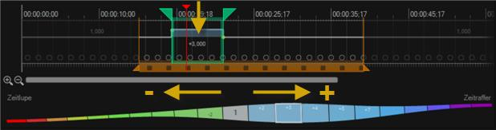

Standardmäßig ist die Berechnungs-Methode **Automatisch** (dargestellt durch die *kleinen* *Kreise* in der Zeitleiste) gewählt.

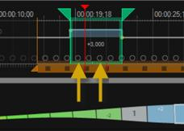

Es ist zu empfehlen, die aktuell eingestellte Geschwindigkeitsänderung (Zeitraffer) in der **Programm-Vorschau (Preview)** oder in einer **externen Vorschau** (durch Klick auf die Option **Preview** *in einem externen Player wiedergeben*, oben im Ribbon) zu betrachten. Nach einer Berechnung startet dann die Wiedergabe des Videos in der Programm-Vorschau oder im externen Player.

Sollten jetzt bedingt durch die Wahl der **automatischen** Berechnungs-Methode evt. **Geisterbilder** in der Bewegung erscheinen, dann wählen Sie im Bereich

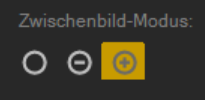

**Zwischenbild-Modus** die Berechnungs-Methode **Optical Flow** aus (oben im Ribbon). Die Methode Optical Flow beseitigt evt. verfügbare Geisterbilder während der Geschwindigkeitsänderung und erzeugt eine hohe Qualität. **Optical Flow** wird nun auch symbolisch (dargestellt durch orange *Kreise)* in der Zeitleiste, direkt im grünen Arbeitsbereich angezeigt.

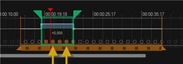

Soll nun z.B. dem *3 mal schnelleren Abschnitt im Video* eine **Zeitlupe** (z.B. von -10 = 10 mal langsamer) unmittelbar folgen, dann legen Sie einen **2. Arbeitsbereich** (grün) in der Zeitleiste fest. Zuerst wird der *rote Timeline-Cursor* an die gewünschte Position in der **Zeitleiste** verschoben, danach legt ein Klick auf die Option **Arbeitsbereich-Startpunkt auf die aktuelle Zeit setzen** den neuen Startpunkt fest. Danach wird der *rote Timeline-Cursor* an die Position in der **Zeitleiste** verschoben, wo der Arbeitsbereich bzw. die Zeitlupe enden soll. Ein Klick auf die Option **Arbeitsbereich-Endpunkt auf die aktuelle Zeit setzen** den Endpunkt fest.

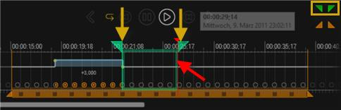

Für das Beispiel wird eine **Zeitlupe** von **-10** gesetzt. Die Auswahl erfolgt im, direkt unter der **Zeitleiste**, verfügbaren Laufbalken.\
Im grünen **Arbeitsbereich** wird die gewählte Geschwindigkeitsänderung, aktuell **-10** (10 mal langsamer) angezeigt.

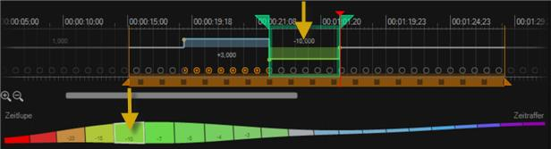

Im Bereich **Zwischenbild-Modus** wählen Sie wiederum die Berechnungs-Methode **Optical Flow** aus.\
**Optical Flow** wird nun auch symbolisch (dargestellt durch orange *Kreise)* in der Zeitleiste, direkt im grünen Arbeitsbereich angezeigt.

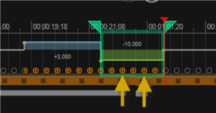

Es ist zu empfehlen, die aktuell eingestellte Geschwindigkeitsänderung (Zeitraffer + Zeitlupe) in der **Programm-Vorschau (Preview)** oder in einer **externen Vorschau** (durch Klick auf die Option **Preview** *in einem externen Player wiedergeben*, oben im Ribbon) zu betrachten. Nach einer Berechnung startet dann die Wiedergabe des Videos in der Programm-Vorschau oder im externen Player.

Jetzt legen Sie z.B. dahinter einen neuen Arbeitsbereich für eine weitere Geschwindigkeitserhöhung fest. Hier wählen Sie eine Zeitraffer-Einstellung von **+ 10** (10 mal schneller) sowie **Optical Flow** aus.

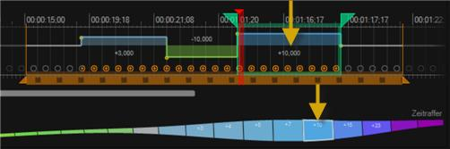

Aktuell sind die Übergänge an den einzelnen Geschwindigkeitsänderungen (Zeitraffer +3 / Zeitlupe -10 / Zeitraffer +10) harte Übergänge. Diese kann durch eine selbst eingestellte Kurve harmonisch gestaltet werden. Bewegen Sie dazu die Maus auf die gelben Punkte an den Übergängen und ziehen die Maus nach links bzw. rechts, damit wird eine jeweils eine Kurve eingefügt. Die Länge der Kurve bestimmt die Härte/Weichheit des Geschwindigkeitsübergangs.

***Hinweis:***\
*Natürlich besteht die Möglichkeit im Trimmbereich weitere Geschwindigkeitseinstellungen* *vorzunehmen, dabei sollte der beschriebene Weg wiederholt werden, jedoch mit Ihren* *gewünschten Geschwindigkeiten.*

Sollte jetzt Ihr Video bei der Aufnahme (durch freihand filmen) verwackelt worden sein, dann können Sie dieses in **ReSpeedr** stabilisieren. Weiterhin steht auch die Rolling-Shutter Korrektur zur Verfügung. Schalten Sie dazu die Optionen **Kamerapfad glätten** und **Rolling-Shutter Korrektur** ein.

**ReSpeedr** prüft nun das bearbeitete Video und startet die **Videoanalyse**, dabei wird das Video (bzw. der gewählte Trimmbereich) automatisch stabilisiert und mögliche CMOS-Fehler minimiert bzw. entfernt.

Nach erfolgtem Durchlauf der Videoanalyse besteht in der **Programm-Vorschau** die Möglichkeit der Kontrolle des stabilisierten Videos.

Danach können Sie noch weitere Effekte, wie Bewegungsunschärfe, Langzeitbelichtung und Lichtspur im Video hinzufügen. Es auch direkt der Export der finalen Videodatei erfolgen.

© proDAD GmbH

www.prodad.com
