# proDAD ReSpeedr V2

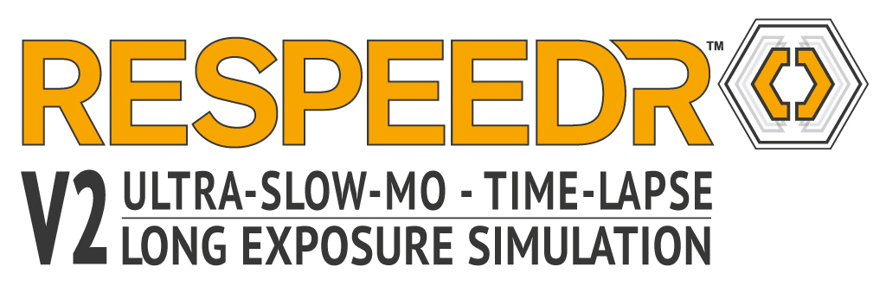

**Welcome to proDAD ReSpeedr !**

With ReSpeedr, you can create stunning slow-motion and time-lapse videos. Cutting-edge technologies enable optimal quality of speed changes in the video. ReSpeedr also supports automatic stabilization of videos with rolling shutter correction as well as various effects.

We hope you enjoy working with proDAD ReSpeedr and that you achieve good results!

(c) proDAD GmbH

Autor: Uwe Wenz

## Inhaltsverzeichnis

- [General information](#general-information)
  - [Copyright / legal information](#copyright--legal-information)
  - [What is ReSpeedr?](#what-is-respeedr)
  - [Installation and registration](#installation-and-registration)
  - [Help function](#help-function)
- [ReSpeedr in detail](#respeedr-in-detail)
  - [Using ReSpeedr for the first time, User Interface, Activation and Undo/Redo](#1-using-respeedr-for-the-first-time-user-interface-activation-and-undoredo)
  - [Ribbon - File, Start & User Interface](#2-ribbon---file-start--user-interface---tabs)
    - [Import media](#21-import-media)
    - [Speed Control Options - Speed & Setting the Duration](#22-speed-control-options---speed--setting-the-duration)
    - [Sub-Frame Mode](#23-sub-frame-mode)
    - [Stabilization & Rolling-Shutter Compensation](#24-stabilization--rolling-shutter-compensation)
    - [Effects - Motion Blur, Long Exposure & Light Trail + Keyframes](#25-effects---motion-blur-long-exposure--light-trail--keyframes)
  - [Range selection - Work area - Trimming range](#3-range-selection---work-area---trimming-range)
  - [Information - Source Media - Target Media (Frame rate setting)](#4-information---source-media---target-media-frame-rate-setting)
  - [Media Bin & Output Media-Bin](#5-media-bin--output-media-bin)
  - [Video export & batch processing](#6-video-export--batch-processing)
    - [Export settings](#61-export-settings)
    - [Batch processing in detail](#63-batch-processing-in-detail)
    - Editing format settings
  - [Workshop - ReSpeedr - Speed control for slow motion/time lapse - Stabilizing](#7-workshop---respeedr---speed-control-for-slow-motiontime-lapse---stabilizing)

## General information

### Copyright / legal information

Copyright proDAD GmbH. All rights reserved.

Licensing Conditions\
Please read these licensing conditions carefully before installing the software.

Licensing agreement\
When setup starts, a licensing agreement is shown, which you should read carefully.\
By installing the software, you state that you accept the copyright conditions, the licensing agreement and the licensing procedure.

License Guarantee\
proDAD GmbH grants the user the right to use this product for its proper and permitted purpose. The present product may only be installed on one computer. proDAD hereby guarantees to provide a license key free of charge. By installing this product, the user acknowledges and accepts the license guarantee, the copyright terms, and the limitation of liability.

Trademarks\
All products and trademarks mentioned in association with this product are trademarks that belong to the respective owners. All trademarks are used without any guarantee that they may be used freely, and they may be registered trademarks.

Limitation of Liability\
The extent of liability for any one claim is limited to a replacement of the product. This applies to proDAD GmbH, all licensees and retailers. Claims shall only be recognized if the software is returned in an orderly manner, together with the returned goods number that has to be previously arranged with proDAD GmbH. The goods must also be accompanied by proof of purchase. This guarantee becomes void if a malfunction of this product is due to improper use, mistreatment, an accident or improper handling. proDAD GmbH, its sales partners and licensees, shall not be held liable for damages or subsequent damages arising from the impossible usage of this product. Liability is limited in all cases to the purchase price of the product.

Documentation\
The greatest of care has been taken in compiling and translating the handbook. However, the possibility of errors cannot be fully excluded. proDAD GmbH shall assume no responsibility or liability whatsoever for the consequences of any incorrect statements or information which the documentation or translation may contain. Subject to technical and optical modifications. Information regarding any inaccuracies is always welcome.

Copyright\
The software and the individual components of this product are the property of proDAD GmbH. By installing this product, the licensee agrees to refrain from unauthorized use and duplication.

proDAD GmbH does not accept any responsibility for the usage of this program and the publication of its contents and data that has been created with this program.

ProDAD GmbH \* Gauertstr. 2 \* 78194 Immendingen \* Deutschland \* HRB 1077

### What is ReSpeedr?

**ReSpeedr** brings additional action into your video; it enables perfect speed changes in the video; should it be slow motion or time lapse, no problem. ReSpeedr also uses the optical flow method to calculate the speed changes in the video. This method creates videos with super slow motion and time lapses completely without ghost images. ReSpeedr now also allows for smooth transitions in speed changes, adjustable directly in the timeline.

**ReSpeedr** can also automatically stabilize a potentially blurry video. The included **Rolling-Shutter Compensation** improves distortions or blurs that developed through quick panning. It is very easy to simultaneously load and optimize several videos, even videos with various settings can be simultaneously processed thanks to **batch processing**.

Additionally, **ReSpeedr** offers various effects that can influence the dynamics in the video, including motion blur, long exposure, and light trails.

### Installation and registration

Double-click the Setup-file to start the **Installation**. By carrying out the installation you agree with the legal conditions and the licence terms. If you have purchased **ReSpeedr** as a download version, the Program archive will be unpacked before the installation starts. Then select a directory in which you would like to install ReSpeedr.

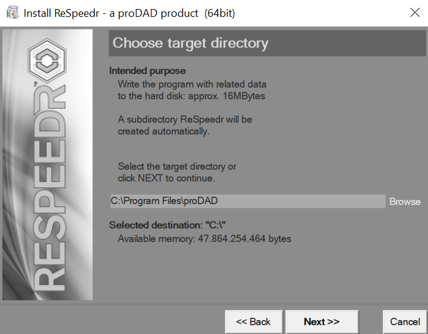

Now follow the installation instructions. You'll find further information on the use of the program as a **DEMO** and on **Activation** here.

**Registering proDAD ReSpeedr**\
You would like to receive Updates and further information about ReSpeedr? Please tab your **proDAD ReSpeedr** at http://www.prodad.de/register.html.

### Help function

Pressing the **F1 key** opens the Help function.

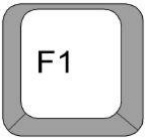

You can also use the Search function to quickly find specific terms or topics in the user guide.\
A PDF manual can be downloaded at www.prodad.com (in the ReSpeedr product).

## ReSpeedr in detail

### 1. Using ReSpeedr for the first time, User Interface, Activation and Undo/Redo

You can start **ReSpeedr** via **Shortcut** on your desktop

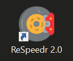

or via **Start/Program/proDAD/ReSpeedr Start**.

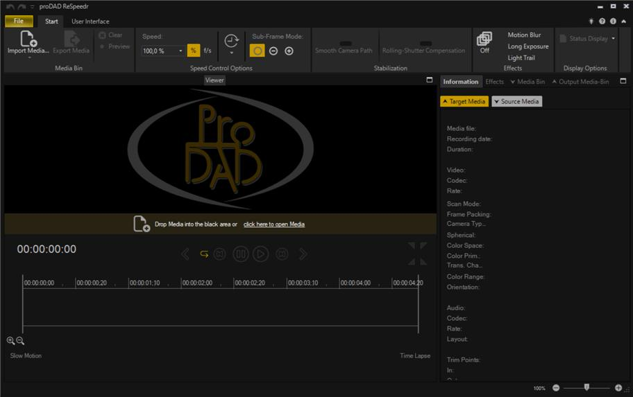

When you start **ReSpeedr** for the first time, you will be asked to enter a **Code** (Serial Number) to activate the program. In case that you purchased the download version, enter the Code which you received along with the download instructions email. In case that you purchased the DVD version, you'll find the code inside the box. Click **Unlock**.

If you want to test ReSpeedr in the **DEMO-Mode**, click **Continue with Demo Version**. The Demo version is activated until you enter the serial number. By entering the serial number you obtain the licence that converts it into the full version.

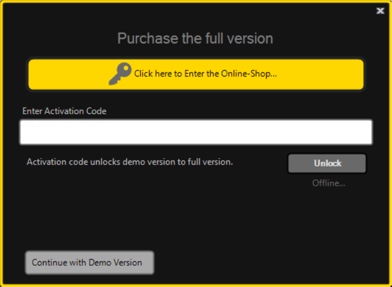

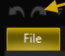

In any program, the **Undo/Redo** function is crucial. ReSpeedr also provides the ability to undo and redo changes.

**ReSpeedr** starts with the Start Register activated.

### 2. Ribbon - File, Start & User Interface - Tabs

The **Ribbon** is divided into the tabs **File**, **Start**, and **User Interface**.

1. **File Tab**

In **ReSpeedr**, all work carried out can now be stored in a project, you can load the project again at any time and continue editing. **Opening** a project, **attaching** and **saving** can be implemented directly in the tab **File**.

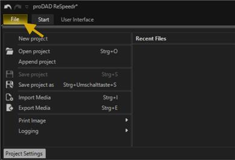

- Create new project
- Open project, invites an existing project
- Attach project, adds another project to the project currently being edited
- Save project (save)
- Save project as (save and enter new file path)

In addition, you can **import media** here and start the **export** of media that have already been edited. A **displayed image** can now also be printed or a print preview can be displayed. ReSpeedr also offers the storing, display and printing of a **logging**, which can be useful for proDAD Support in the event of any problems that may arise.

Basic settings for the Mercalli project can be selected in the **project settings**.

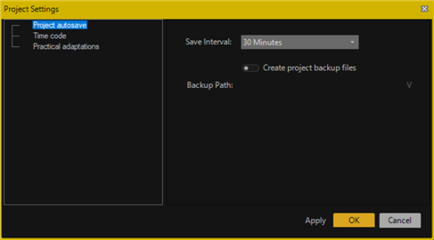

2. **Start Tab**

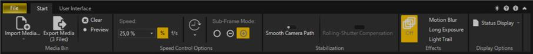

In the **Start** tab, you will find the Import/Export options, along with all settings for speed editing (slow-motion and time-lapse), including the frame interpolation mode, settings for video stabilization (smoothing camera path) and rolling shutter correction, as well as options for effects such as motion blur, long exposure, and light trails and for displaying the status indicator.

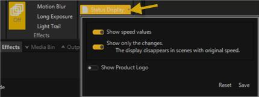

3. **User Interface Tab**

In the **User Interface tab**, you can activate program logging, which will secure any potentially important information for technical support purposes.

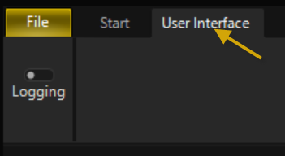

Information on **exporting** edited videos can be found here.

#### 2.1. Import media

**ReSpeedr** offers you 4 options for **importing videos**.

1. **Select file** (to import video files)
2. **Select folder** (to import image files from a folder, ReSpeedr will convert these into a video)
3. **Click here to open Media** (to import video files)
4. **Import videos via Drag & Drop** from the desktop directly into the preview of ReSpeedr

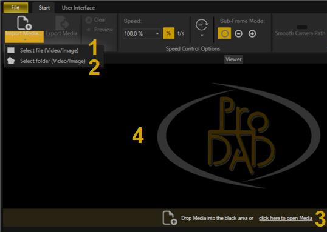

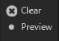

Furthermore, you can delete the **media bin** and **calculate a video preview** here, which can then be played in an external player.

#### 2.2. Speed Control Options - Speed & Setting the Duration

You define the speed in the video between 1% and 500% in the area **Speed**.

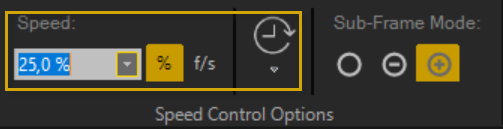

Speeds of **1%** to **75%** are settings for **slow motion**, which corresponds with a speed reduction in the video. The speed of **100%** corresponds with the original video.\
Speeds of **110%** to **500%** are settings for **time lapse**, which corresponds with a speed increase in the video.

In the **Duration** area, the **Source Duration** (runtime of the imported video) and the **Target Duration** are shown.

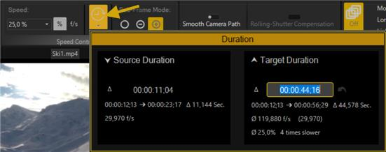

The **Source Duration** cannot be changed, however, the option to set a new **Target Duration** (new video length) is available. The speed in the video is then automatically adjusted to the newly set runtime. Changes in the target runtime can be directly accomplished in the **time display** (currently shown in green) by a click and an entry of the new time. By using **Apply**, your are accepting the new **Target Duration**.

#### 2.3. Sub-Frame Mode

In the area **Sub-Frame Mode**, 3 different calculation methods are available.

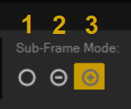

1. **Calculation method is automatically selected between fast and high quality:**\
  This method automatically selects between fast and high quality (Optical Flow). We recommend to first work with this standard setting. If disturbing ghost images should be captured in the video, use the *Optical Flow* method.
2. **Fast calculation method:**\
  The sub frames for the speed change are then calculated by cross-fading the individual images. The fast calculation method requires less of a calculation effort. However, *ghost images* can still occur during the speed change (depending on the moving image contents in the video), if these affect the video, then use the *Optical Flow* method.
3. **Calculation method for high quality - Optical Flow-Mode** (or optical flow):\
  The efficient algorithms are determined here for defining moving image contents in a video.\
  The direction of movement and speed for each pixel are used. Any potentially existing ghost images are thereby eliminated during the speed change and high quality is created: i.e. meaningful results therefore succeed at long slow motion. However, the optical flow method requires more calculation effort.

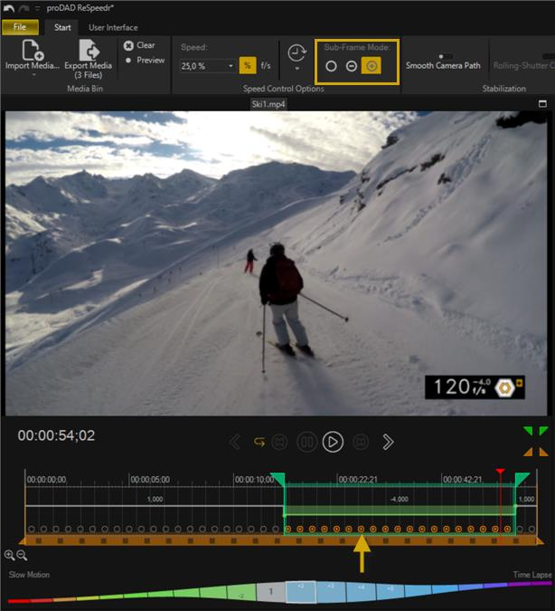

The respective selected method is displayed in the work area of the timeline. Also, please note the quality settings for displaying the video with altered speed in the program preview.

#### 2.4. Stabilization & Rolling-Shutter Compensation

If your video now has become blurry (by filming freehand) during recording, you can If your video has become shaky due to handheld filming, you can stabilize it and perform rolling shutter correction (CMOS error) in ReSpeedr. To do this, activate the Camera Path Smoothing and Rolling Shutter Correction functions in the Ribbon.

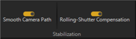

Then, ReSpeedr checks the imported video and initiates video analysis. During this process, the video (or the selected trimming range) is automatically stabilized, and any available rolling shutter effects are minimized or removed.

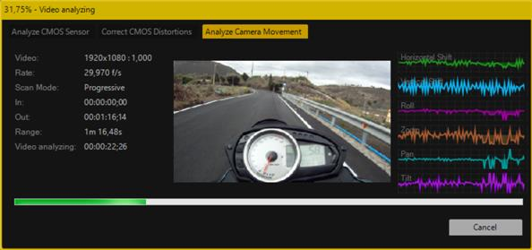

After completing the pass of the video analysis, the option of checking the stabilized video exists in the **program preview**.

***Note:***\
*You can stabilize the complete video or define your own trimming range in the timeline. Only this* *selected video segment is then stabilized.*

ReSpeedr also offers the **Rolling-Shutter Compensation**.

The **Rolling-Shutter Compensation** may reduce available distortions or wobbling effects (appearances such as "jelly") in the video.

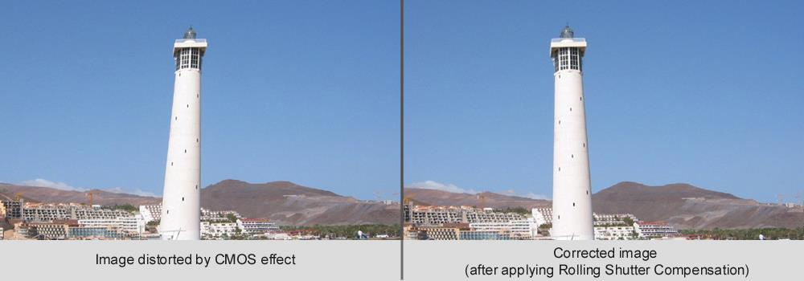

The fully automatic rolling-shutter correction corrects these phenomena, which should in particular benefit recordings of action cameras, small photo cams, cell phones, and not least, digital SLR cameras.

If the **Rolling-Shutter Effect** (distortions or wobbling image) should occur after the first stabilization of your video during the preview, you can remedy this effect by activating the **Rolling-Shutter Compensation** option.

The rolling shutter effect is a positional error in the video, which occurs in moving footage when the frame is scanned line by line.\
If the image is static, the footage is correct because all points of the frame are exposed at their correct positions. Rolling shutter effect may result in the case of a subject in motion or a moving camera, when a frame is scanned line by line (i.e. not all at exactly the same time).\
This effect appears in the form of a diagonal distortion when filming fast-moving subjects. And also if the filming equipment is subject to heavy shaking, as may occur when filming with a moving camera (e.g. from a car), strong distortion of the entire image may result, severely impairing the quality of the footage.\
The image may acquire a parallelogram form compared with the subject's true shape, but it may also be squashed or stretched.

**Common rolling shutter effects are (CMOS faults):**

- Jello effect
- Skew, geometric distortion occurring in pan shots
- Wobble (similar to heat shimmer)
- Vibrations (possible with drone footage or cameras mounted on bikes)

#### 2.5. Effects - Motion Blur, Long Exposure & Light Trail + Keyframes

**ReSpeedr** now features 3 effects that can add additional dynamism to the video.

1. **Motion Blur**

Motion Blur refers to an effect in videos and photos where moving objects appear blurred during capture. This occurs when the camera's exposure time is too long, and during this time, the subject or the camera itself is in motion. ReSpeedr now allows adding motion blur to videos, which can also be animated using keyframes in the **Effects** tab.

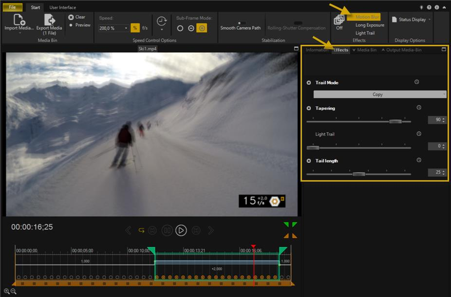

2. **Long Exposure**

Long Exposure involves keeping the camera's shutter open for an extended period to capture light over a longer duration. This results in various creative effects, particularly concerning motion and brightness.

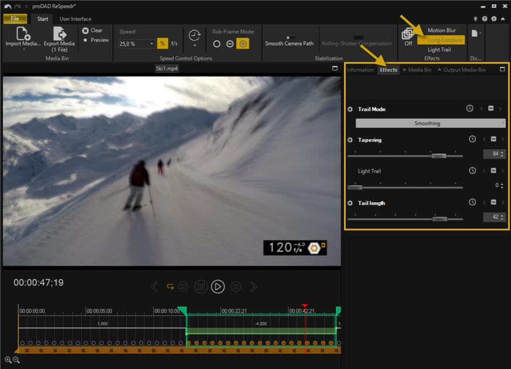

3. **Light Trail**

A Light Trail is a visible trace created by the movement of light sources during a long exposure. This effect occurs when the camera is exposed for an extended period, capturing light from moving light sources. Typically, light trails are produced when photographing vehicles, such as cars.

These **effects** and associated setting options can also be controlled via **keyframes**.\
First, move the timeline cursor to the required position on the timeline. Now, in the required effect setting, click on the **Clock symbol** and then move the slider to achieve the desired effect. In order to insert another keyframe, displace the timeline cursor again to a new position in the timeline, then click the **(+)** and then move the desired slider again to achieve the effect at the new position in the video. You can now change between the keyframes using the **White arrows (left/right)**. The keyframes can also be deactivated **(-)**. The set effect can be deleted using the

**x**.

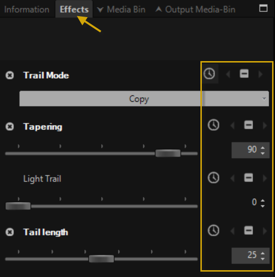

### 3. Range selection - Work area - Trimming range

After importing, the video can be played in the ReSpeedr preview via **playback controls**, such as **Play (7)**. Clicking **Pause (6)** stops the video.

The **time information (2)** of the video (currently = 00:01:21 second / Frame 15) is available below the preview on the left. You can also switch between imported videos in the preview: **previous video (3)** and **next video (9)**. **Repeating the video (4)** is also possible. The **switch (5)** jumps to the beginning of the video or the beginning of the trim range. By clicking the **switch (8)** multiple times, you can gradually change the playback speed.

In **ReSpeedr**, you can set a **trim range** (start point/end point), which is indicated by the brown area on the timeline. This range will be created during video export.

Within this **trim range (11)**, you can **set multiple workspaces (10)** with start points/end points. Here, you can adjust your **speed settings** (slow motion or time-lapse). The trim range (brown) and workspaces (green) are set below the **program preview**. Use the following options (see illustration): before setting the start and end points for the trim range, move the **red timeline cursor (playback marker) (12)** to the desired position. This marks the current position on the **timeline**.

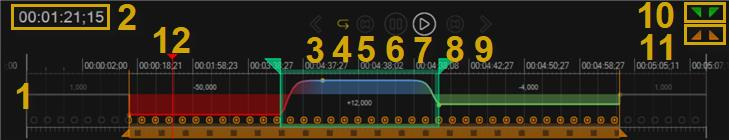

The **trimming range** is then defined, the **work area** follows now. The *red timeline cursor* **in the trimming range** must also be moved to the desired position for the start here. If the **start** was set, set the option ***set processing start*** marked in green by clicking, which is followed by the **end** by clicking on the option ***set processing end***.\
A speed setting can now be performed on the video for this **work area**.

An option to define **additional work areas in the trimming range** then exists, which again can receive new speed settings as shown in the following figure. Various speeds can therefore be successful in the video, which can proceed successively. In the figure, **work areas** with a slow-motion of 50 times (illustrated in red), time-lapse of 12 times (illustrated in blue) and an additional 4 times slow motion (illustrated in green) were added.

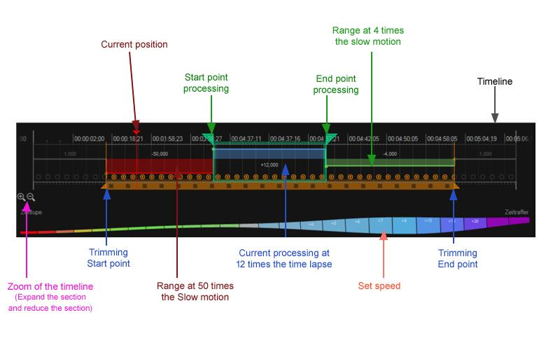

In **ReSpeedr**, **harmonious speed transitions** are now possible. To achieve this, start by setting multiple workspaces with different speeds as before. Then, hover the mouse over a yellow point at the transitions and move it to the left or right. This allows you to create a **curve** representing the transition between the selected speed levels. Lengthening this transition will result in a slower transition, while shortening it will make the transition faster.

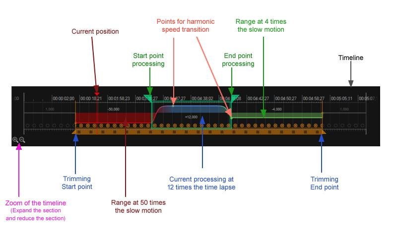

For more information, see the lesson speed processing and in the workshop.

### 4. Information - Source Media - Target Media (Frame rate setting)

In the **Information** register you will find information for the **Source Media** and the **Target Media**, always at the video properties (such as video, rate, runtime, etc.).

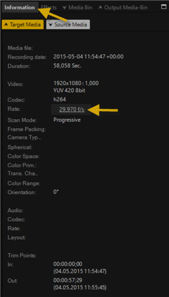

**No** settings for the **Source Media** can be made, however, for the **Target Media**. For this, click on **Edit**. To do this, click on the displayed **FPS** (for example, 29.97 fps). In the **Target Medium Properties** dialog, you have the option to choose between different frame rates.

The selection **Use of original frame-rate** uses the frame rate of the original video (source video). For **Use of standard frame-rates**, standard is set, detailed settings are not possible. When selecting **Use of custom frame-rate**, the frame rate can be manually adjusted. The **duration** or the **speed of the video** will not be changed.

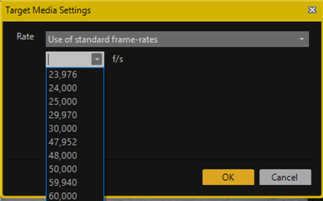

### 5. Media Bin & Output Media-Bin

All imported media are displayed in the **Media Bin** tab.

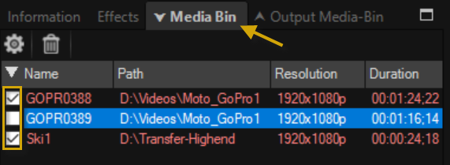

In the **Media Bin** tab, you also receive information about the file path, resolution, duration, frames per second (fps), pixel ratio (par) and the source path of the imported videos. You can also add or remove media and define start and end positions using the Properties option, among others.\
Before the file name, **mark** the videos that are intended for export after correction.

In ReSpeedr, there is also the **Output Media-Bin** tab, where all exported videos are displayed.

### 6. Video export & batch processing

#### 6.1. Export settings

After editing the videos, the final step is the video export.

Mark the edited videos in the **Media Bin** tab that you want to export.

The selected videos can then be exported. Here, you will be shown the number of videos to be exported again (from the **Media Bin** tab).

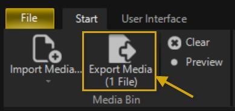

To do this, click on **Export Media** in the ribbon. The **Export Media** dialogue opens.

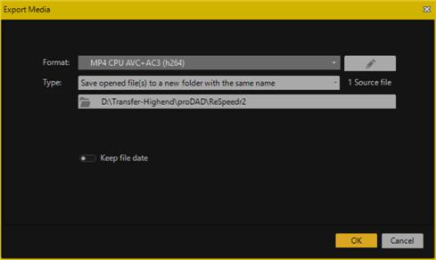

You can now select the desired **export format template**.

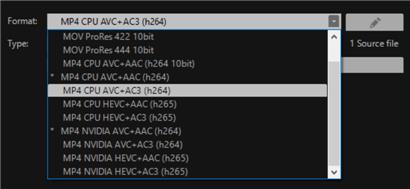

It is also possible to customize your own export format settings.

After selecting the format template, you will choose the export type.

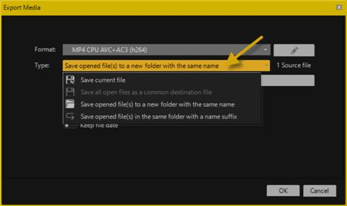

You have the option to save the current file, save all open files as a single shared target file, save open file(s) to a new directory with the same name, or save open file(s) in the same directory with a new name suffix.

Below that, you then select the desired **export path**.

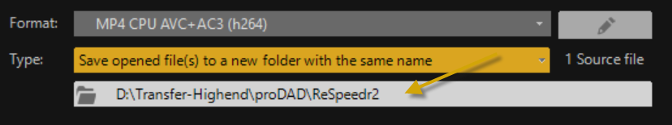

Furthermore, you can specify whether to **keep the file date** and whether only the selected workspace (trim range) should be exported.

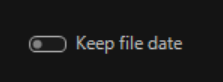

Afterwards, initiate the export by clicking on **OK**. Then, you can play the videos using an installed software player.

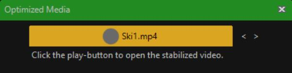

The exported video(s) are also available in the **Output Media-Bin** tab.

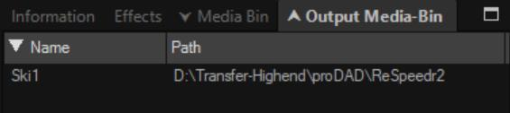

#### 6.2. Editing format settings

Click on **Export Media** in the **ribbon**. The **Export Media** dialogue opens.

You can now select the desired **export format template**

and also make your **own export detail settings**. To do this, click on the **Edit format settings** option.

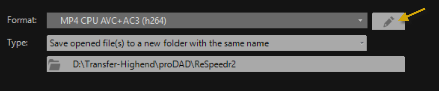

In the **Edit Format Settings** dialog, you can now **edit the selected template**. Click on the **(+)** symbol, then you can first change the **template name**, choose one of the **3 quality levels** (Low/Medium/High), and make settings for the **video codec, format, and size**. Video settings can also be toggled on and off.

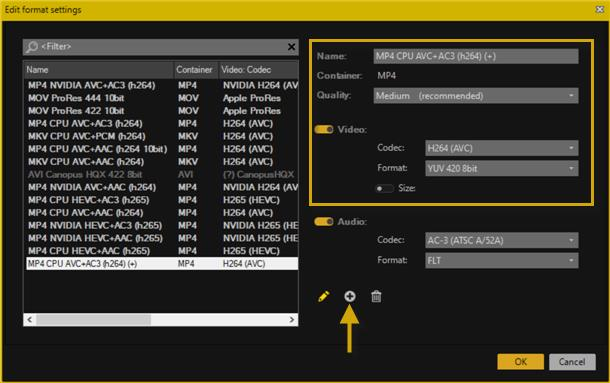

Furthermore, there are also individual settings for **Audio** regarding the **codec** and **format**. Audio settings can also be toggled on and off.

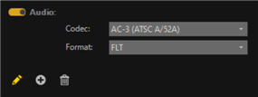

Format settings can also be added and deleted. Click **OK** to apply the changes in the format settings; a new **individual format template** will be created, which can now be used for export.

#### 6.3. Batch processing in detail

In **ReSpeedr**, batch processing of multiple videos as individual videos is possible.

There are the following ways of **batch processing**:

1. **Analyzing individual videos with video analysis followed by exporting all selected videos into a single file**\
  Import a video into ReSpeedr, choose stabilization settings, and analyze the video. Import additional videos and analyze them. Afterwards, they will be available in the **Media Bin** tab. You can then modify various stabilization settings later by selecting the corresponding video in the **Media Bin** tab.

You can also start playback of the currently selected video in the preview.

The selected videos can then be exported. To do this, click on **Export Media** in the **Ribbon**.

Here you will again see the number of videos to be exported (from the **Media Bin** tab). Now, pay attention to the export settings.

You can now choose a desired export format template, customize export details, select the type, and choose the export path. Afterward, initiate the export by clicking **OK**.\
The video will now be displayed in the **Output Media-Bin** tab.

2. **Video analysis and export together in one process**

First, import **multiple videos** into ReSpeedr and choose speed and stabilization settings for each video, for example. Then, in the **Media Bin** tab, select all the videos that should be analyzed and exported.

To initiate the video analysis and export process, click on **Export Media** in the Ribbon. Here, you will see the number of videos to be analyzed and exported. Pay attention to the export settings. You can now choose a desired export format template, customize export details, select the type, and choose the export path. Afterward, start the export by clicking **OK**.

The videos available for export will now be automatically analyzed and exported one by one. In this example, three selected videos from the Source Media tab were exported to a user-defined directory. The exported videos will now be displayed in the **Output Media-Bin** tab.

You can then play the videos with an installed software player.

The exported videos are also available in the **Output Media-Bin** tab.

Subsequent changes to speed and stabilization settings are possible. Simply select the video in the **Media Bin** tab, make the new settings, and then export it with the newly chosen properties without further analysis.

Depending on the export format you have chosen, this file (your stabilized video) is now available for further use (e.g., burning to a DVD or Blu-ray). However, you can also import the file into video editing software and continue processing it there.

### 7. Workshop - ReSpeedr - Speed control for slow motion/time lapse - Stabilizing

You recorded a video mounted on a bike with an **action cam**.\
The video should now be changed in speed, you can implement this by using **proDAD ReSpeedr**.

First import a video via the import function **Import Media...** or pull it directly (by pressing the left mouse key) from the work area into the **preview area** of ReSpeedr.

In the **Timeline**, first define the **trimming range** and then *a* **work area**, in which the speed change should then be inserted. You will receive detailed information in lesson Area selection - work area - trimming range.

After defining the trimming range (marked in brown) and the work area (marked in green), you may receive the following view in the timeline.

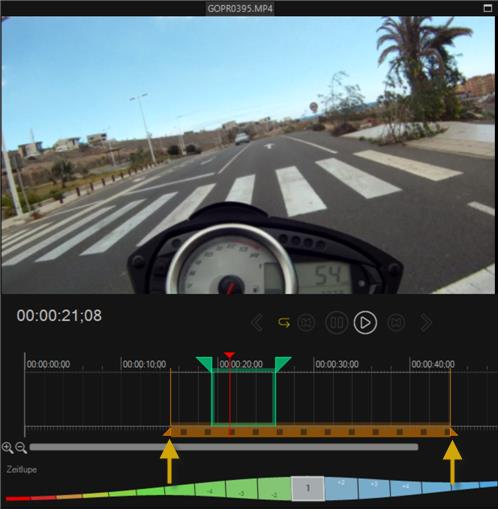

Now there are various options available to adjust **speed settings** in ReSpeedr:

1. by selecting a default setting (from 1% to 500%) in the speed menu for slow motion or time lapse.
2. by defining a new target runtime in the Duration **menu**.
3. or by selecting a speed change directly in the displayed progress bar under the timeline, which is now used for clarification.

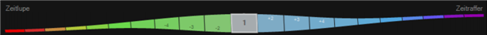

The **gray 1** represents the **original speed** of the imported video.

**a.** Now select a value **on the left** of the **1**, then a **Slow Motion** is set at the respectively set value (i.e. **-2** means 2 times slower or **-16** = 16 times slower).

**b.** Now select a value **on the right** of the **1**, a **Time Lapse** with the respective selected value (i.e. **+3** means 3 times faster or **+29** = 29 times faster) is set.

A **time lapse of +3** is set for the example.\
In the green **work area**, the selected speed change, currently **+3** (3 times faster) is displayed.

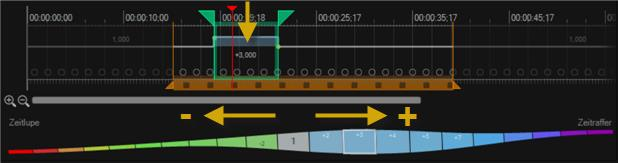

According to standard, the calculation method **Automatic** (illustrated by the *small circles* in the timeline) is selected.

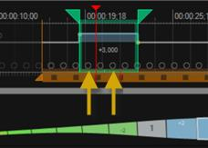

It is recommended to view the speed change (time lapse) in the **program preview** or in an **external preview** (by clicking on the option *play back preview in an external player*, at the top of the ribbon).\
The playback of the video then starts in the program preview or an external player after a calculation.

Based on the selection of the **automatic** calculation method, if **ghost images** now appear in the movement, select the calculation method **Optical Flow** in the area **Sub-frame mode** (at the top

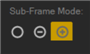

of the ribbon).

The method Optical Flow eliminates any existing ghost images during the speed change and creates a very high quality.\
**Optical Flow** is now also symbolically displayed (shown in orange *circles)* in the timeline directly in the green work area.

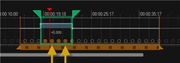

If in the *3 times faster segment in the video* a **slow motion** (for example of -9 = 9 times slower) directly occurs, define a **2. work area** (green) in the timeline. First, the *red timeline cursor* is moved to the desired position in the **timeline**, then a click on the option **Set work-area start-point on current time** defines the new start point. Then the *red timeline cursor* is moved to the position in the **timeline**, where the work area or the slow motion should end. A click on the option **Set work-area end-point on current time** defines the end point.

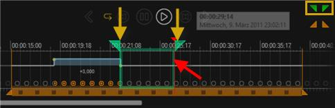

A **slow motion** of **-10** is set for the example. The selection occur directly under the **timeline**, the available progress bar.\
In the green **work area**, the selected speed change, currently **-10** (10 times slower) is displayed.

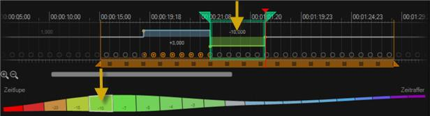

In the area **Sub-frame mode** select the calculation method **Optical Flow** again.\
**Optical Flow** is now also symbolically displayed (shown in orange *circles)* in the timeline directly in the green work area.

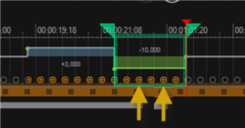

It is recommended to view the speed changes (time lapse and slow motion) in the **program preview** or in an **external preview** (by clicking on the option *play back preview in an external* *player*, at the top of the ribbon). The playback of the video then starts in the program preview or an external player after a calculation.

Now, for example, you set up a new workspace for an additional speed increase. Here, you select a time-lapse setting of +10 (10 times faster) and choose **Optical Flow**.

Currently, the transitions between the individual speed changes (time-lapse +3 / slow motion -10 / time-lapse +10) are hard transitions. These can be made smooth by adjusting a custom curve. To do this, move the mouse over the yellow points at the transitions and drag the mouse to the left or right. This will insert a curve at each transition. The length of the curve determines the hardness/softness of the speed transition.

***Note:***\
*Of course, there is the option to perform additional speed settings in the trimming range, the* *described path should thereby be repeated, however, at your desired speeds.*

If your video now has become blurry (by filming freehand) during recording, you can stabilize it in **ReSpeedr**. Furthermore, the Rolling-Shutter Compensation is also available. A simple mouse click on the **Smooth Camera Path** and **Rolling-Shutter Compensation**

**ReSpeedr** now checks the edited video and initiates the video analysis. During this process, the video (or the selected trim range) is automatically stabilized, and potential CMOS errors are minimized or removed.

After the video analysis is completed, you have the option to preview the stabilized video in the **program preview**.

Then, you can still add additional effects such as motion blur, long exposure, and light trails to the video. You can also proceed directly with exporting the final video file.

© proDAD GmbH

[www.prodad.com](http://www.prodad.com/)
