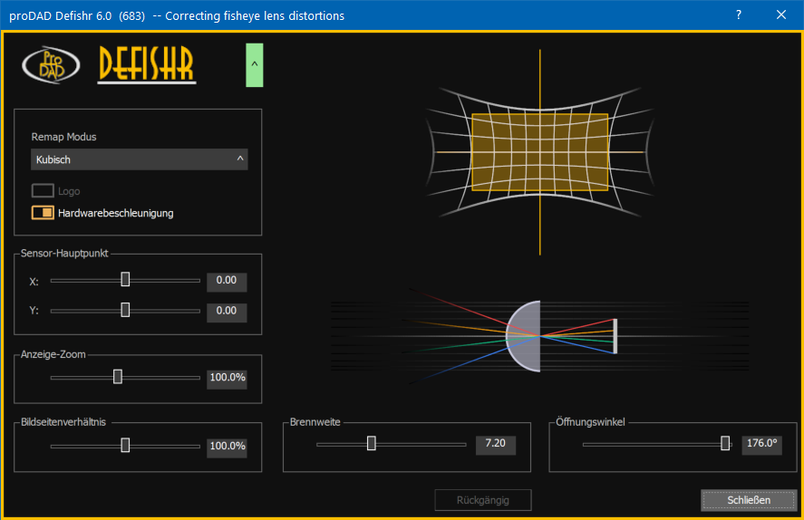
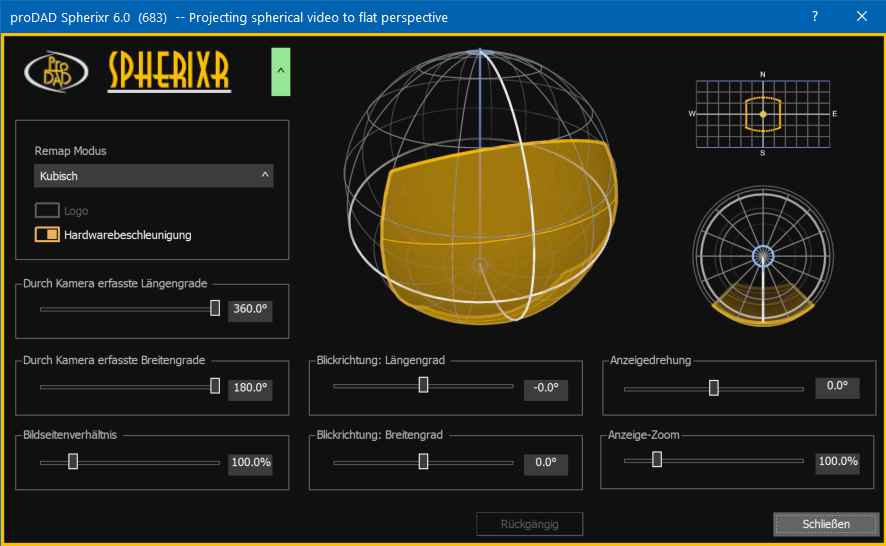

# proDAD Projection Plug-ins Manual

  
  

  
  
  
  
  
  
  
  
  
  
  
  
  
  

-----

**Softwareentwickler:** Holger Burkarth  
**Autor des Handbuchs:** Holger Burkarth  
**Copyright:** © 2026 proDAD GmbH  
*Alle Rechte vorbehalten. Die Nutzung der Software unterliegt den Lizenzbedingungen der proDAD GmbH.*

-----

## **Einleitung**

Die proDAD Projections-Plug-ins "**Defishr**" und "**Spherixr**" wurden speziell zur Korrektur von Verzerrungen entwickelt, die bei Aufnahmen mit Weitwinkel- oder Fisheye-Objektiven entstehen.

- **Defishr** eignet sich für Objektive mit einem Sichtfeld von bis zu 180°. Dazu gehören herkömmliche Fisheye-Objektive und Weitwinkelobjektive, die häufig bei **Action-Kameras** oder **DSLRs** eingesetzt werden und bei denen das Bild keine vollständige Kugel abdeckt.
- **Spherixr** ist für Objektive und Formate mit einem Sichtfeld von mehr als 180° ausgelegt. Es ist die richtige Wahl für equirektangulare Projektionen, 360°-Kameras und spezielle Objektive, die mehr als eine Halbkugel erfassen.

> Im Gegensatz zu **Defishr** bietet **Spherixr** die Möglichkeit, die Blickrichtung anzupassen und dadurch alle Bereiche der Aufnahme zu betrachten.

----

## **Inhaltsverzeichnis**

1.  Einleitung & Über proDAD
2.  Kontakt & rechtliche Informationen
3.  **Defishr** (Fisheye- & Weitwinkelkorrektur)
      * Menüpunkte
      * UI-Parameter
      * Visualisierungsoptionen
4.  **Spherixr** (Sphärische Korrektur für Objektive mit einem Sichtfeld von mehr als 180°)
      * Menüpunkte
      * UI-Parameter
      * Visualisierungsoptionen

## Über proDAD

proDAD ist ein renommiertes deutsches Unternehmen, das sich auf die Entwicklung und den Vertrieb hochwertiger Video- und Bildbearbeitungssoftware spezialisiert hat. Seit seiner Gründung im Jahr 1990 hat sich proDAD als führender Anbieter innovativer Lösungen für die professionelle Videobearbeitung etabliert.

Das Unternehmen proDAD zeichnet sich durch besondere Kompetenz in den Bereichen digitale Bild- und Videotechnologie sowie Softwareentwicklung aus. Mit einem engagierten Team aus erfahrenen Entwicklern und Designern arbeitet das Unternehmen kontinuierlich an der Entwicklung fortschrittlicher Lösungen, die den Anforderungen professioneller Anwender gerecht werden.

Die Softwareprodukte von proDAD bieten eine breite Palette an Funktionen und Werkzeugen zur Optimierung, Bearbeitung und Verbesserung von Videos und Bildern. Die Lösungen zeichnen sich durch eine intuitive Benutzeroberfläche, hohe Leistungsfähigkeit und hervorragende Qualität aus. Sie eignen sich sowohl für Einsteiger als auch für erfahrene Profis und bieten eine große Auswahl an Effekten, Filtern, Stabilisierungstechniken und weiteren Werkzeugen zur Verbesserung der visuellen Qualität von Medieninhalten.

Ein Schwerpunkt von proDAD liegt auf der Videostabilisierung. Das Unternehmen hat mehrere patentierte Techniken entwickelt, um Verwacklungen und Bildzittern in Videos wirksam zu reduzieren und eine gleichmäßige, professionelle Bildstabilisierung zu erreichen. Diese Technologie wird von vielen Profis in der Filmindustrie, bei Fernsehproduktionen und bei Sportaufnahmen eingesetzt.

proDAD ist für die enge Zusammenarbeit mit führenden Herstellern von Videoschnittsoftware bekannt. Die Produkte des Unternehmens werden als eigenständige Softwarelösungen angeboten, lassen sich aber auch nahtlos in bestehende Videobearbeitungsprogramme integrieren. Dadurch profitieren Anwender von erweiterten Funktionen und Möglichkeiten, um ihre Videoprojekte auf professionellem Niveau zu erstellen.

Mit langjähriger Erfahrung, technischer Innovation und einem starken Fokus auf Kundenzufriedenheit hat sich proDAD als zuverlässiger Partner in der Videobearbeitungsbranche etabliert. Die Softwarelösungen des Unternehmens werden weltweit von professionellen Videobearbeitern, Filmemachern, YouTubern und anderen Kreativen eingesetzt, um beeindruckende visuelle Inhalte zu erstellen.

## **Kontakt & rechtliche Informationen**

### **Kontaktinformationen**

Wir von proDAD beantworten gerne alle Fragen zu unserem Programm.

  * **E-Mail:** [support@prodad.com](mailto:support@prodad.com)
  * **Postanschrift:** proDAD GmbH, Gauertstr. 2, 78194 Immendingen, Deutschland
  * **Homepage:** [www.proDAD.com](https://www.prodad.com)

### **Lizenz- und Urheberrechtsinformationen**

**Defishr** und **Spherixr** sind proprietäre Softwareprodukte, die von der proDAD GmbH entwickelt und vertrieben werden. Alle Rechte vorbehalten. Die Nutzung der Software unterliegt den Lizenzbedingungen der proDAD GmbH.

### **Lizenzvereinbarung**

  * **Installation:** Mit der Installation der Software erklären Sie sich mit den Urheberrechtsbestimmungen, der Lizenzvereinbarung und dem Lizenzierungsverfahren einverstanden.
  * **Nutzung:** Die proDAD GmbH gewährt dem Benutzer das Recht, dieses Produkt bestimmungsgemäß auf einem Computer zu verwenden.
  * **Haftung:** Der Umfang der Haftung für jegliche Ansprüche ist auf den Ersatz- oder Kaufpreis des Produkts begrenzt. Die proDAD GmbH und ihre Lizenzgeber haften nicht für Schäden, die aus der Unmöglichkeit der Nutzung dieses Produkts entstehen.
  * **Dokumentation:** Das Handbuch wurde mit größter Sorgfalt erstellt; proDAD übernimmt jedoch keine Verantwortung für die Folgen fehlerhafter Angaben oder Informationen.

## **Defishr** (Fisheye- & Weitwinkelkorrektur)

Das **Defishr**-Plug-in ermöglicht die Korrektur von Fisheye- und Weitwinkelverzerrungen. Objektive mit einem Sichtfeld von bis zu 180° können korrigiert werden, was besonders bei Aufnahmen mit extremen Weitwinkelobjektiven nützlich ist. Es eignet sich ideal für Fotografen und Videofilmer, die Verzerrungen minimieren und ihren Bildern ein natürliches Aussehen verleihen möchten.

> **Defishr** eignet sich für Objektive mit einem Sichtfeld von bis zu 180°. Dazu gehören herkömmliche Fisheye-Objektive und Weitwinkelobjektive, die häufig bei **Action-Kameras** oder **DSLRs** eingesetzt werden und bei denen das Bild keine vollständige Kugel abdeckt.

### **Menüpunkte**

  * **Freischalten:** Öffnet ein Dialogfenster zur Aktivierung des Plug-ins über einen Aktivierungscode und stellt einen Link zur Shop-Seite bereit.
  * **News:** Zeigt Nachrichten oder Aktualisierungen des Herstellers an.
  * **Manual:** Öffnet die Hilfedokumentation für das Plug-in.
  * **Über:** Zeigt Informationen zum Plug-in, beispielsweise die Versionsnummer, und ermöglicht die Suche nach Updates.

### **Defishr UI-Parameter**

  * **Remap Modus:** Legt das Verfahren zur Korrektur der Verzerrung fest. Je nach Anforderungen an Qualität und Geschwindigkeit stehen verschiedene Modi zur Verfügung:
      * **Kubisch:** Verwendet kubische Interpolation und bietet ein gutes Verhältnis zwischen Bildqualität und Verarbeitungsgeschwindigkeit.
      * **Linear:** Verwendet lineare Interpolation. Sie ist schneller als die kubische Interpolation, kann jedoch zu einer geringeren Bildqualität führen.
      * **Nächster:** Das schnellste Verfahren, kann jedoch zu einer deutlich geringeren Bildqualität führen und wird im Allgemeinen nicht empfohlen.
  * **Hardwarebeschleunigung:** Ermöglicht die Verwendung der GPU, um die Verzerrungskorrektur zu beschleunigen. Dies verbessert die Verarbeitungsgeschwindigkeit insbesondere bei hochauflösenden Bildern oder Videos erheblich. Wenn eine kompatible Grafikkarte vorhanden ist, wird empfohlen, diese Option zu aktivieren.
  * **Anzeige-Zoom:** Ermöglicht das Hineinzoomen in das Bild, um Details zu untersuchen, oder das Herauszoomen für einen besseren Überblick über die gesamte Aufnahme. Dies ist hilfreich, um zu überprüfen, ob die Korrektur in allen Bereichen wirksam und gleichmäßig ist.
  * **Bildseitenverhältnis:** Legt das für die Korrektur verwendete Pixel-Seitenverhältnis fest. Dadurch können Bilder korrigiert werden, deren Proportionen verzerrt sind.
  * **Sensor-Hauptpunkt:** Definiert den Hauptpunkt des Sensors. Dieser dient als Bezugspunkt für die Berechnungen und ist entscheidend für eine präzise Verzerrungskorrektur.
  * **Brennweite:** Legt die Brennweite des verwendeten Objektivs fest. Dieser Wert wird in einer virtuellen Einheit angegeben, damit er unabhängig von der Pixelgröße bleibt, und ist für die Berechnung der korrekten Verzerrung unerlässlich.
  * **Öffnungswinkel:** Definiert den Öffnungswinkel des Objektivs. Weitwinkelobjektive haben typischerweise einen Winkel zwischen 120° und 180°. Dieser Parameter ist für genaue Korrekturberechnungen von entscheidender Bedeutung.

### **Defishr-Visualisierung**

  * **Verzerrungsansicht:** Bietet eine schematische Darstellung der erforderlichen Verzerrungskorrektur und hilft dem Benutzer zu verstehen, wie sich die Einstellungen auf das Bild auswirken.
  * **Projektionsansicht:** Verwendet eine schematische Darstellung des Objektivs und der Lichtstrahlen, um zu veranschaulichen, wie **Brennweite** und **Öffnungswinkel** die Verzerrung beeinflussen.

## **Spherixr** (Sphärische Korrektur für Objektive mit einem Sichtfeld von mehr als 180°)

*Die Blickrichtung kann auch interaktiv mit der Maus eingestellt werden.*

Das **Spherixr**-Plug-in kann Verzerrungen bei Objektiven mit einem Sichtfeld von mehr als 180° korrigieren. Es wurde speziell für sphärische Verzerrungen entwickelt. Der Benutzer kann die Blickrichtung anpassen, um alle Bereiche der Aufnahme zu betrachten und auch bei extremen Fisheye-Objektiven ein natürliches Aussehen zu gewährleisten.

> **Spherixr** ist für Objektive und Formate mit einem Sichtfeld von mehr als 180° ausgelegt. Es ist die richtige Wahl für equirektangulare Projektionen, 360°-Kameras und spezielle Objektive, die mehr als eine Halbkugel erfassen.

### **Menüpunkte**

  * **Freischalten:** Öffnet den Aktivierungsdialog und ermöglicht den Zugriff auf den Shop.
  * **News:** Zeigt Aktualisierungen des Herstellers an.
  * **Manual:** Öffnet die spezifische Hilfe für dieses Plug-in.
  * **Über:** Zeigt Versionsinformationen an und sucht nach Updates.

### **Spherixr UI-Parameter**

  * **Remap Modus:** Legt das Verfahren zur Korrektur der Verzerrung fest. Je nach Anforderungen an Qualität und Geschwindigkeit stehen verschiedene Modi zur Verfügung:
      * **Kubisch:** Verwendet kubische Interpolation und bietet ein gutes Verhältnis zwischen Bildqualität und Verarbeitungsgeschwindigkeit.
      * **Linear:** Verwendet lineare Interpolation. Sie ist schneller als die kubische Interpolation, kann jedoch zu einer geringeren Bildqualität führen.
      * **Nächster:** Das schnellste Verfahren, kann jedoch zu einer deutlich geringeren Bildqualität führen und wird im Allgemeinen nicht empfohlen.
  * **Hardwarebeschleunigung:** Ermöglicht die Verwendung der GPU, um die Verzerrungskorrektur zu beschleunigen. Dies verbessert die Verarbeitungsgeschwindigkeit insbesondere bei hochauflösenden Bildern oder Videos erheblich. Wenn eine kompatible Grafikkarte vorhanden ist, wird empfohlen, diese Option zu aktivieren.
  * **Anzeige-Zoom:** Ermöglicht das Hineinzoomen in das Bild, um Details zu untersuchen, oder das Herauszoomen für einen besseren Überblick über die gesamte Aufnahme. Dies ist hilfreich, um zu überprüfen, ob die Korrektur in allen Bereichen wirksam und gleichmäßig ist.
  * **Anzeigedrehung:** Ermöglicht das Drehen der Anzeige, um sie an den Betrachtungswinkel der Aufnahme anzupassen. Dies ist nützlich bei Kameras, die nicht in einer Standardposition montiert sind, oder um die Blickrichtung zu ändern.
  * **Bildseitenverhältnis:** Legt das für die Korrektur verwendete Pixel-Seitenverhältnis fest. Dadurch können Bilder korrigiert werden, deren Proportionen verzerrt sind.
  * **Durch Kamera erfasste Längengrade:** Gibt die von der Kamera erfassten Längengrade an, die für die Berechnung der sphärischen Korrektur erforderlich sind.
  * **Durch Kamera erfasste Breitengrade:** Gibt die von der Kamera erfassten Breitengrade an und beeinflusst die Genauigkeit der Verzerrungsberechnung.
  * **Blickrichtung: Längengrad:** Legt den spezifischen Längengrad fest, in dessen Richtung die Ansicht ausgerichtet ist, und bestimmt damit, welcher Bereich der Aufnahme angezeigt wird.
  * **Blickrichtung: Breitengrad:** Legt den spezifischen Breitengrad fest, in dessen Richtung die Ansicht ausgerichtet ist, und bestimmt damit, welcher Bereich der Aufnahme angezeigt wird.

### **Spherixr-Visualisierung**

  * **Globusansicht:** Eine schematische Darstellung einer Kugel, die Blickrichtung und Sichtfeld veranschaulicht und dem Benutzer hilft, die Auswirkungen von **Blickrichtung: Längengrad**, **Blickrichtung: Breitengrad**, **Anzeige-Zoom** und **Anzeigedrehung** zu verstehen.
  * **Nordpolansicht:** Eine schematische Darstellung der Aufnahme aus der Perspektive des Nordpols, die dabei hilft, die von der Kamera erfassten Bereiche anhand der **durch Kamera erfassten Längengrade** und **durch Kamera erfassten Breitengrade** zu identifizieren.
  * **Nord-Süd- und Ost-West-Rechteckansicht:** Veranschaulicht die Position der Parameter **Blickrichtung: Längengrad** und **Blickrichtung: Breitengrad**, um erfasste Bereiche zu identifizieren und ein natürliches Erscheinungsbild sicherzustellen.
