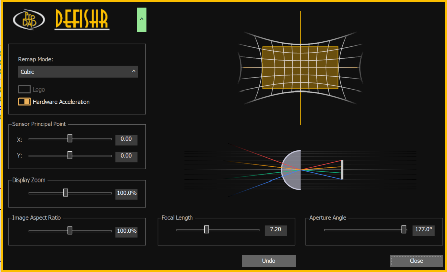
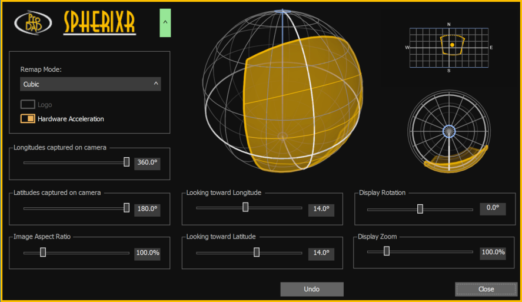

# proDAD Projection Plug-ins Manual

  
  

  
  
  
  
  
  
  
  
  
  
  
  
  
  
  
-----

**Software Developer:** Holger Burkarth  
**Manual Author:** Holger Burkarth  
**Copyright:** © 2026 proDAD GmbH  
*All rights reserved. Use of the software is subject to the license terms of proDAD GmbH.*

-----

## **Introduction**

The proDAD Projections plug-ins "**Defishr**" and "**Spherixr**" were specifically developed for correcting distortions in recordings made with wide-angle or fisheye lenses.

- **Defishr** is suitable for lenses with a field of view of up to 180°. This includes standard fisheye lenses and wide-angle lenses commonly used on **action cameras** or **DSLRs** where the image does not cover a full sphere.
- **Spherixr** is designed for lenses and formats with a field of view of over 180°. It is the correct choice for equirectangular projections, 360° cameras, and specialized lenses that capture more than a hemisphere.

> In contrast to **Defishr**, **Spherixr** offers the possibility to adjust the viewing direction to view all areas of the recording.

----

## **Table of Contents**

1.  Introduction & About proDAD
2.  Contact & Legal Information
3.  **Defishr** (Fisheye & Wide-Angle Correction)
      * Menu Items
      * UI Parameters
      * Visualization Options
4.  **Spherixr** (Spherical Correction for Lenses with a Field of View Over 180°)
      * Menu Items
      * UI Parameters
      * Visualization Options

## About proDAD

proDAD is a renowned German company specializing in developing and distributing high-quality video and image editing software. Since its founding in 1990, proDAD has established itself as a leading provider of innovative solutions for professional video editing.

The proDAD company is characterized by a distinctive expertise in the areas of digital image and video technology as well as software development. With a dedicated team of experienced developers and designers, the company works continuously to develop advanced solutions that meet the needs of professional users.

proDAD's software products offer a wide range of features and tools for optimizing, editing and enhancing video and images. The solutions are characterized by an intuitive user interface, high performance and excellent quality. Suitable for both beginners and experienced professionals, they offer a wide range of effects, filters, stabilization techniques and other tools to improve the visual quality of media content.

One of proDAD's main focuses is video stabilization. The company has developed several patented techniques to effectively reduce shake and jitter in video and achieve consistent, professional-quality image stabilization. This technology is used by many professionals in the film industry, television productions and sports footage.

proDAD is known for its close collaboration with leading video editing software manufacturers. The company's products are offered as stand-alone software solutions, but can also be seamlessly integrated into existing video editing programs. As a result, users benefit from enhanced features and capabilities to create their video projects at a professional level.

With years of experience, technical innovation and a strong focus on customer satisfaction, proDAD has established itself as a trusted partner in the video editing industry. The company's software solutions are used by professional video editors, filmmakers, YouTubers and other creators worldwide to produce stunning visual content.

## **Contact & Legal Information**

### **Contact Information**

We at proDAD are happy to answer any questions you may have about our program.

  * **Email:** [support@prodad.com](mailto:support@prodad.com)
  * **Postal Mail:** proDAD GmbH, Gauertstr. 2, 78194 Immendingen, Germany
  * **Homepage:** [www.proDAD.com](https://www.prodad.com)

### **License and Copyright Information**

**Defishr** and **Spherixr** are proprietary software products developed and distributed by proDAD GmbH. All rights reserved. Use of the software is subject to the license terms of proDAD GmbH.

### **License Agreement**

  * **Installation:** By installing the software, you agree to be bound by the copyright terms, the license agreement, and the licensing procedure.
  * **Usage:** proDAD GmbH grants the user the right to use this product for its intended purpose on one computer.
  * **Liability:** The extent of liability for any claim is limited to the replacement or purchase price of the product. proDAD GmbH and its licensees are not liable for damages resulting from the inability to use this product.
  * **Documentation:** The manual has been compiled with the utmost care; however, proDAD assumes no responsibility for the consequences of incorrect statements or information.

## **Defishr** (Fisheye & Wide-Angle Correction)

The **Defishr** plug-in allows for the correction of fisheye and wide-angle distortions. Lenses with a field of view of up to 180° can be corrected, which is particularly useful for footage captured with extreme wide-angle lenses. It is ideal for photographers and videographers who want to minimize distortion and ensure a natural look in their images.

> **Defishr** is suitable for lenses with a field of view of up to 180°. This includes standard fisheye lenses and wide-angle lenses commonly used on **action cameras** or **DSLRs** where the image does not cover a full sphere.

### **Menu Items**

  * **Unlock:** Opens a dialog window for activating the plug-in via an activation code and provides a link to the shop page.
  * **News:** Displays messages or updates from the manufacturer.
  * **Manual:** Opens the help documentation for the plug-in.
  * **About:** Displays information about the plug-in, such as the version number, and allows for update checks.

### **Defishr UI Parameters**

  * **Remap Mode:** Sets the method used to correct the distortion. Different modes are available based on quality and speed requirements:
      * **Cubic:** Uses cubic interpolation, offering a good balance between image quality and processing speed.
      * **Linear:** Uses linear interpolation; it is faster than cubic but may result in lower image quality.
      * **Nearest:** The fastest method, but it can lead to significantly lower image quality and is generally not recommended.
  * **Hardware Acceleration:** Allows the use of the GPU to speed up distortion correction. This significantly improves processing speed, especially for high-resolution images or videos. It is recommended to enable this if a compatible graphics card is available.
  * **Display Zoom:** Allows zooming into the image to examine details or zooming out for a better overview of the entire shot. This is useful for verifying that the correction is effective and uniform across all areas.
  * **Image Aspect Ratio:** Sets the pixel aspect ratio used for correction. This provides the ability to correct images that are distorted in their proportions.
  * **Sensor Principal Point:** Defines the principal point of the sensor. This serves as the reference point for calculations and is crucial for accurate distortion correction.
  * **Focal Length:** Sets the focal length of the lens used. This value is given in a virtual unit to remain independent of pixel size and is essential for calculating the correct distortion.
  * **Aperture Angle:** Defines the opening angle of the lens. Wide-angle lenses typically have an angle between 120° and 180°. This parameter is vital for accurate correction calculations.

### **Defishr Visualization**

  * **Distortion View:** Provides a schematic representation of the required distortion correction, helping users understand how settings affect the image.
  * **Projection View:** Uses a schematic representation of the lens and light rays to illustrate how **Focal Length** and **Aperture Angle** impact the distortion.

## **Spherixr** (Spherical Correction for Lenses with a Field of View Over 180°)

*The viewing direction can also be set interactively using the mouse.*

The **Spherixr** plug-in can correct distortions for lenses with a field of view exceeding 180°. It is specifically designed for spherical distortions. Users can adjust the viewing direction to see all areas of the capture, ensuring a natural look even with extreme fisheye lenses.

> **Spherixr** is designed for lenses and formats with a field of view of over 180°. It is the correct choice for equirectangular projections, 360° cameras, and specialized lenses that capture more than a hemisphere.

### **Menu Items**

  * **Unlock:** Opens the activation dialog and provides access to the shop.
  * **News:** Shows manufacturer updates.
  * **Manual:** Opens the specific help for this plug-in.
  * **About:** Displays version info and checks for updates.

### **Spherixr UI Parameters**

  * **Remap Mode:** Sets the method used to correct the distortion. Different modes are available based on quality and speed requirements:
      * **Cubic:** Uses cubic interpolation, offering a good balance between image quality and processing speed.
      * **Linear:** Uses linear interpolation; it is faster than cubic but may result in lower image quality.
      * **Nearest:** The fastest method, but it can lead to significantly lower image quality and is generally not recommended.
  * **Hardware Acceleration:** Allows the use of the GPU to speed up distortion correction. This significantly improves processing speed, especially for high-resolution images or videos. It is recommended to enable this if a compatible graphics card is available.
  * **Display Zoom:** Allows zooming into the image to examine details or zooming out for a better overview of the entire shot. This is useful for verifying that the correction is effective and uniform across all areas.
  * **Display Rotation:** Allows for the rotation of the display to match the viewing angle of the recording. This is useful for cameras not mounted in a standard position or to change the viewing direction.
  * **Image Aspect Ratio:** Sets the pixel aspect ratio used for correction. This provides the ability to correct images that are distorted in their proportions.
  * **Longitudes captured on camera:** Specifies the longitudinal degrees captured by the camera, which is essential for calculating the spherical correction.
  * **Latitudes captured on camera:** Specifies the latitudinal degrees captured by the camera, influencing the accuracy of the distortion calculation.
  * **Looking toward Longitude:** Sets the specific longitude toward which the view is directed, determining which part of the recording is displayed.
  * **Looking toward Latitude:** Sets the specific latitude toward which the view is directed, determining which part of the recording is displayed.

### **Spherixr Visualization**

  * **Globe View:** A schematic representation of a sphere illustrating the viewing direction and field of view, helping users understand the impact of **Looking toward Longitude**, **Looking toward Latitude**, **Display Zoom**, and **Display Rotation**.
  * **North Pol View:** A schematic of the recording from a North Pole perspective to help identify the areas captured by the camera based on **Longitudes captured on camera** and **Latitudes captured on camera**.
  * **North-South and East-West Rectangle View:** Illustrates the location of the **Looking toward Longitude** and **Looking toward Latitude** parameters to help identify captured areas and ensure a natural appearance.