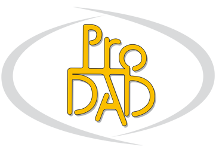
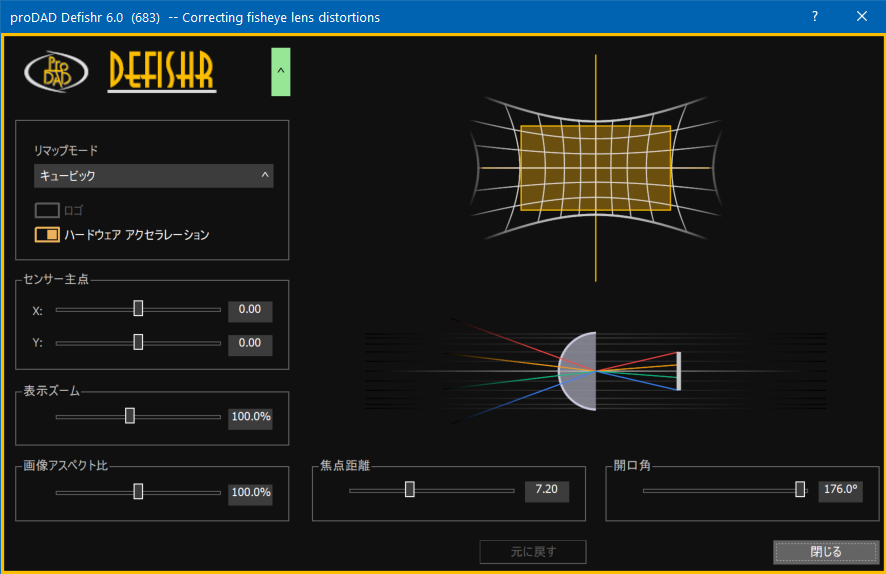
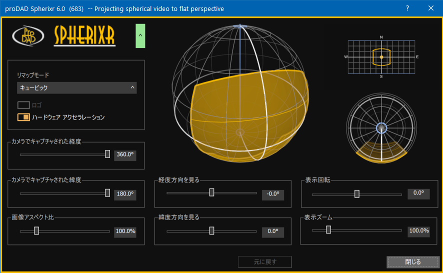

# proDAD Projection プラグイン マニュアル

  
  

  
  
  
  
  
  
  
  
  
  
  
  
  
  

-----

**ソフトウェア開発者:** Holger Burkarth  
**マニュアル作成者:** Holger Burkarth  
**Copyright:** © 2026 proDAD GmbH  
*All rights reserved. ソフトウェアの使用には、proDAD GmbH のライセンス条件が適用されます。*

-----

## **はじめに**

proDAD Projections プラグイン "**Defishr**" と "**Spherixr**" は、広角レンズまたは魚眼レンズで撮影した映像に生じる歪みを補正するために特別に開発されました。

- **Defishr** は、最大 180° の画角を持つレンズに適しています。これには、一般的な魚眼レンズや、**アクションカメラ**または **DSLR** でよく使用される広角レンズが含まれます。これらは、画像が球全体を覆わないタイプのレンズです。
- **Spherixr** は、180° を超える画角を持つレンズやフォーマット向けに設計されています。正距円筒図法（equirectangular projection）、360° カメラ、および半球を超える範囲を撮影する特殊なレンズに適しています。

> **Defishr** とは異なり、**Spherixr** では視線方向を調整して、撮影映像のすべての領域を見ることができます。

----

## **目次**

1.  はじめに & proDAD について
2.  お問い合わせ & 法的情報
3.  **Defishr**（魚眼・広角補正）
      * メニュー項目
      * UI パラメーター
      * 表示オプション
4.  **Spherixr**（180°を超える画角を持つレンズの球面補正）
      * メニュー項目
      * UI パラメーター
      * 表示オプション

## proDAD について

proDAD は、高品質なビデオおよび画像編集ソフトウェアの開発・販売を専門とする、ドイツの著名な企業です。1990 年の創業以来、proDAD はプロフェッショナルなビデオ編集向けの革新的なソリューションを提供する主要企業としての地位を確立してきました。

proDAD は、デジタル画像・映像技術およびソフトウェア開発の分野で、際立った専門知識を有しています。経験豊富な開発者とデザイナーによる専任チームが、プロフェッショナルユーザーのニーズに応える先進的なソリューションの開発に継続的に取り組んでいます。

proDAD のソフトウェア製品は、ビデオや画像の最適化、編集、品質向上のための幅広い機能とツールを提供します。これらのソリューションは、直感的なユーザーインターフェース、高い性能、優れた品質を特徴としています。初心者から経験豊富なプロフェッショナルまで利用でき、メディアコンテンツの視覚的な品質を向上させるための多彩なエフェクト、フィルター、手ブレ補正技術などを提供します。

proDAD の主要な重点分野の一つがビデオの手ブレ補正です。同社は、ビデオの揺れやブレを効果的に低減し、安定したプロ品質の映像を実現するため、複数の特許技術を開発してきました。この技術は、映画業界、テレビ制作、スポーツ映像など、多くのプロフェッショナルに利用されています。

proDAD は、主要なビデオ編集ソフトウェアメーカーとの緊密な協力でも知られています。同社の製品は単体のソフトウェアソリューションとして提供されるだけでなく、既存のビデオ編集プログラムにもシームレスに統合できます。そのため、ユーザーは機能や性能を拡張し、ビデオプロジェクトをプロフェッショナルなレベルで制作できます。

長年にわたる経験、技術革新、そして顧客満足への強い取り組みにより、proDAD はビデオ編集業界で信頼されるパートナーとしての地位を確立しています。同社のソフトウェアソリューションは、世界中のプロフェッショナルなビデオ編集者、映像制作者、YouTuber、その他のクリエイターに利用され、印象的なビジュアルコンテンツの制作に役立っています。

## **お問い合わせ & 法的情報**

### **お問い合わせ先**

proDAD では、プログラムに関するご質問に喜んでお答えします。

  * **E-mail:** [support@prodad.com](mailto:support@prodad.com)
  * **郵送先:** proDAD GmbH, Gauertstr. 2, 78194 Immendingen, Germany
  * **ホームページ:** [www.proDAD.com](https://www.prodad.com)

### **ライセンスおよび著作権情報**

**Defishr** および **Spherixr** は、proDAD GmbH が開発・販売する独自ソフトウェア製品です。All rights reserved. ソフトウェアの使用には、proDAD GmbH のライセンス条件が適用されます。

### **ライセンス契約**

  * **インストール:** ソフトウェアをインストールすることにより、著作権条件、ライセンス契約、およびライセンス手続きに同意したものとみなされます。
  * **使用:** proDAD GmbH は、ユーザーに対し、本製品をその intended purpose に従って 1 台のコンピューターで使用する権利を許諾します。
  * **責任:** いかなる請求に対する責任の範囲も、製品の交換価格または購入価格に限定されます。proDAD GmbH およびそのライセンサーは、本製品を使用できないことから生じる損害について責任を負いません。
  * **ドキュメント:** 本マニュアルは細心の注意を払って作成されていますが、proDAD は誤った記述または情報によって生じる結果について責任を負いません。

## **Defishr**（魚眼・広角補正）

**Defishr** プラグインは、魚眼レンズおよび広角レンズによる歪みを補正できます。最大 180° の画角を持つレンズを補正でき、特に超広角レンズで撮影した映像に適しています。歪みを最小限に抑え、画像に自然な見た目を与えたい写真家やビデオ制作者に最適です。

> **Defishr** は、最大 180° の画角を持つレンズに適しています。これには、一般的な魚眼レンズや、**アクションカメラ**または **DSLR** でよく使用される広角レンズが含まれます。これらは、画像が球全体を覆わないタイプのレンズです。

### **メニュー項目**

  * **解除:** アクティベーションコードを使用してプラグインを有効化するためのダイアログを開き、ショップページへのリンクを表示します。
  * **News:** メーカーからのメッセージや更新情報を表示します。
  * **Manual:** プラグインのヘルプドキュメントを開きます。
  * **製品について:** プラグインに関する情報（バージョン番号など）を表示し、更新を確認できます。

### **Defishr UI パラメーター**

  * **リマップモード:** 歪みの補正に使用する方法を設定します。品質と処理速度の要件に応じて、複数のモードを利用できます。
      * **キュービック:** 3 次補間を使用し、画質と処理速度のバランスに優れています。
      * **リニア:** 線形補間を使用します。キュービックより高速ですが、画質が低下する場合があります。
      * **最寄り:** 最も高速な方法ですが、画質が大幅に低下する可能性があり、通常は推奨されません。
  * **ハードウェア アクセラレーション:** GPU を使用して歪み補正を高速化できます。特に高解像度の画像やビデオでは処理速度が大幅に向上します。対応するグラフィックカードがある場合は、有効にすることを推奨します。
  * **表示ズーム:** 画像を拡大して細部を確認したり、縮小してショット全体を見渡したりできます。補正がすべての領域で効果的かつ均一に行われているかを確認するのに役立ちます。
  * **画像アスペクト比:** 補正に使用するピクセルのアスペクト比を設定します。これにより、縦横比が歪んだ画像を補正できます。
  * **センサー主点:** センサーの主点を定義します。これは計算の基準点として機能し、正確な歪み補正に不可欠です。
  * **焦点距離:** 使用するレンズの焦点距離を設定します。この値はピクセルサイズに依存しないよう仮想単位で指定され、正しい歪みを計算するために不可欠です。
  * **開口角:** レンズの開口角を定義します。広角レンズでは通常 120°～180° の範囲です。このパラメーターは、正確な補正計算に不可欠です。

### **Defishr の表示**

  * **歪みビュー:** 必要な歪み補正を模式的に表示し、設定が画像にどのような影響を与えるかを理解するのに役立ちます。
  * **投影ビュー:** レンズと光線を模式的に表示し、**焦点距離**と**開口角**が歪みにどのような影響を与えるかを示します。

## **Spherixr**（180°を超える画角を持つレンズの球面補正）

*マウスを使って視線方向をインタラクティブに設定することもできます。*

**Spherixr** プラグインは、180°を超える画角を持つレンズの歪みを補正できます。特に球面状の歪みを補正するために設計されています。視線方向を調整して撮影映像のすべての領域を確認できるため、極端な魚眼レンズを使用した場合でも自然な見た目を実現できます。

> **Spherixr** は、180°を超える画角を持つレンズやフォーマット向けに設計されています。正距円筒図法、360°カメラ、および半球を超える範囲を撮影する特殊なレンズに適しています。

### **メニュー項目**

  * **解除:** アクティベーションダイアログを開き、ショップにアクセスできます。
  * **News:** メーカーからの更新情報を表示します。
  * **Manual:** このプラグイン専用のヘルプを開きます。
  * **製品について:** バージョン情報を表示し、更新を確認します。

### **Spherixr UI パラメーター**

  * **リマップモード:** 歪みの補正に使用する方法を設定します。品質と処理速度の要件に応じて、複数のモードを利用できます。
      * **キュービック:** 3 次補間を使用し、画質と処理速度のバランスに優れています。
      * **リニア:** 線形補間を使用します。キュービックより高速ですが、画質が低下する場合があります。
      * **最寄り:** 最も高速な方法ですが、画質が大幅に低下する可能性があり、通常は推奨されません。
  * **ハードウェア アクセラレーション:** GPU を使用して歪み補正を高速化できます。特に高解像度の画像やビデオでは処理速度が大幅に向上します。対応するグラフィックカードがある場合は、有効にすることを推奨します。
  * **表示ズーム:** 画像を拡大して細部を確認したり、縮小してショット全体を見渡したりできます。補正がすべての領域で効果的かつ均一に行われているかを確認するのに役立ちます。
  * **表示回転:** 録画の視角に合わせて表示を回転できます。標準的な位置に取り付けられていないカメラを使用する場合や、視線方向を変更する場合に便利です。
  * **画像アスペクト比:** 補正に使用するピクセルのアスペクト比を設定します。これにより、縦横比が歪んだ画像を補正できます。
  * **カメラでキャプチャされた経度:** カメラが捉えた経度の範囲を指定します。これは球面補正の計算に不可欠です。
  * **カメラでキャプチャされた緯度:** カメラが捉えた緯度の範囲を指定し、歪み計算の精度に影響します。
  * **経度方向を見る:** 視線が向けられる特定の経度を設定し、録画のどの部分を表示するかを決定します。
  * **緯度方向を見る:** 視線が向けられる特定の緯度を設定し、録画のどの部分を表示するかを決定します。

### **Spherixr の表示**

  * **グローブビュー:** 球体を模式的に表示し、視線方向と画角を示します。**経度方向を見る**、**緯度方向を見る**、**表示ズーム**、**表示回転**の各設定が及ぼす影響を理解するのに役立ちます。
  * **北極ビュー:** 北極から見た撮影映像を模式的に表示し、**カメラでキャプチャされた経度**と**カメラでキャプチャされた緯度**に基づいて、カメラが捉えた領域を確認するのに役立ちます。
  * **南北・東西の矩形ビュー:** **経度方向を見る**と**緯度方向を見る**の各パラメーターの位置を示し、撮影範囲を確認して自然な見た目を確保するのに役立ちます。
