# proDAD Vitascene

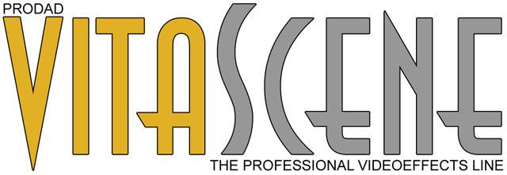

**proDAD Vitascene**

© proDAD GmbH

Autor : Uwe Wenz

## Inhaltsverzeichnis

- [Willkommen](#willkommen)
  - Copyright / Rechtliches
  - [Weitere Infos](#weitere-infos)
  - [Philosophie](#philosophie)
  - [Was ist neu in Vitascene 3.0?](#was-ist-neu-in-vitascene-30)
  - [Was ist neu in Vitascene 4.0?](#was-ist-neu-in-vitascene-40)
  - [Was ist neu in Vitascene 5.0?](#was-ist-neu-in-vitascene-50)
  - [Workshops & Schulungen für Vitascene](#workshops--schulungen-für-vitascene)
- [Installation, Registrierung, Hilfe, Support, Technologie und System-Voraussetzungen](#installation-registrierung-hilfe-support-technologie-und-system-voraussetzungen)
  - Installation, Aktivierung und Registrierung
  - [Hilfe](#hilfe)
  - [Technische Unterstützung - Support](#technische-unterstützung---support)
  - [Technologie und System-Voraussetzungen](#technologie-und-system-voraussetzungen)
- [Programmstart und Plugins](#programmstart-und-plugins)
  - [Vitascene stand-alone (eigenständig)](#vitascene-stand-alone-eigenständig)
  - [Adobe Premiere Elements](#adobe-premiere-elements)
    - [Plugin als Videoeffekt](#plugin-als-videoeffekt)
    - [Plugin als Videoüberblendung](#plugin-als-videoüberblendung)
  - [Adobe Premiere](#adobe-premiere)
    - [Plugin als Videoeffekt](#plugin-als-videoeffekt-1)
    - [Plugin als Videoüberblendung](#plugin-als-videoüberblendung-1)
  - [Avid Media Composer](#avid-media-composer)
    - [Plugin als Videoeffekt](#plugin-als-videoeffekt-2)
    - [Plugin als Videoüberblendung](#plugin-als-videoüberblendung-2)
  - [Grass Valley EDIUS](#grass-valley-edius)
    - [Plugin als Videoeffekt](#plugin-als-videoeffekt-3)
    - [Plugin als Videoüberblendung](#plugin-als-videoüberblendung-3)
    - [Effektübernahme](#effektübernahme)
  - [MAGIX Vegas](#magix-vegas)
    - [Plugin als Videoeffekt](#plugin-als-videoeffekt-4)
    - [Plugin als Videoüberblendung](#plugin-als-videoüberblendung-4)
  - [Corel Video Studio](#corel-video-studio)
    - [Plugin als Videoeffekt](#plugin-als-videoeffekt-5)
    - [Plugin als Videoüberblendung](#plugin-als-videoüberblendung-5)
  - [Pinnacle Studio](#pinnacle-studio)
    - [Plugin als Videoeffekt](#plugin-als-videoeffekt-6)
    - [Plugin als Videoüberblendung](#plugin-als-videoüberblendung-6)
  - [MAGIX](#magix)
    - [Plugin als Videoeffekt](#plugin-als-videoeffekt-7)
    - [Plugin als Videoüberblendung](#plugin-als-videoüberblendung-7)
  - [Davinci Resolve](#davinci-resolve)
    - [Plugin als Videoeffekt](#plugin-als-videoeffekt-8)
    - [Plugin als Videoüberblendung](#plugin-als-videoüberblendung-8)
- [Workshops zum Kennenlernen](#workshops-zum-kennenlernen)
  - [Text mit Ray-Filter und Keyframes](#text-mit-ray-filter-und-keyframes)
  - [Sparkle-Filter auf Bild anwenden](#sparkle-filter-auf-bild-anwenden-ua-mit-nutzung-von-keyframes)
  - Transition-Effekt Shape Wipe anwenden
  - [Miniaturlandschaft aus Realvideos erstellen](#miniaturlandschaft-aus-realvideos-erstellen)
- [Benutzeroberfläche/Einführung](#benutzeroberflächeeinführung)
  - [Startseite](#startseite)
    - [Navigation](#navigation)
      - [Filter-Vorlagen](#filter-vorlagen)
      - [Vorschau](#vorschau)
      - [Exportieren](#exportieren)
        - [Animation exportieren](#animation-exportieren)
        - [Einzelbilder exportieren](#einzelbilder-exportieren)
      - [Einstellungen](#einstellungen)
        - [Suchpfade für Grafiken/Animationen](#suchpfade-für-grafikenanimationen)
        - [Alternative Videos](#alternative-videos)
        - [Spezialisierung anpassen](#spezialisierung-anpassen)
        - [Videoformat](#videoformat)
        - [Hintergrund / Ränder](#hintergrund--ränder)
        - [Effektlänge](#effektlänge)
        - [Sprache der Benutzeroberfläche](#sprache-der-benutzeroberfläche)
        - [Undo](#undo)
        - [Speichern](#speichern)
      - [Anleitung](#anleitung)
  - [Bedienelemente](#bedienelemente)
    - [Vorschaubereich / Timeline / Keyframes](#vorschaubereich--timeline--keyframes)
    - [Menu-Erklärung](#menu-erklärung)
    - [Tastaturkürzel (Shortcuts)](#tastaturkürzel--shortcuts)
  - [Vorlagen anwenden](#vorlagen-anwenden)
    - [Filter-Vorlagen](#filter-vorlagen-1)
    - [eigene Vorlagen](#eigene-vorlagen)
    - [Filter Gruppe / Sparkle](#filter-gruppe--sparkle)
      - [Filter](#filter)
      - [Farbkorrektur](#farbkorrektur)
      - [Quelle / Video A](#quelle--video-a)
    - [Transition Gruppe / Glow Wipes](#transition-gruppe--glow-wipes)
      - [Formen / Masken auswählen](#formen--masken-auswählen)
      - [Effekt anpassen](#effekt-anpassen)
      - [Maske anpassen](#maske-anpassen)
      - [Texture](#texture)
      - [Filter](#filter-1)
      - [Quelle / Video A](#quelle--video-a-1)
      - [Quelle / Video B](#quelle--video-b)
    - [Siehe auch](#siehe-auch)
      - [Exportieren](#exportieren-1)
      - [Einstellungen](#einstellungen-1)
      - [Bearbeiten](#bearbeiten)
  - [Operatoren](#operatoren)
    - [Geometrie](#geometrie)
      - [Rotation](#rotation)
      - [Skalierung](#skalierung)
      - [Bildlage horizontal](#bildlage-horizontal)
      - [Bildlage vertikal](#bildlage-vertikal)
      - [Ränder vermeiden, durch vergrößern](#ränder-vermeiden-durch-vergrößern)
      - [Translate World](#translate-world)
    - [Pixel-Aspect](#pixel-aspect)
      - [Anpassen durch](#anpassen-durch)
      - [Pixelverhältnis](#pixelverhältnis)
    - [Attribute](#attribute)
      - [Spiegeln](#spiegeln)
      - [Invertieren](#invertieren)
      - [Wrap](#wrap)
    - [Motion Blur](#motion-blur)
      - [Motion Blur](#motion-blur-1)
      - [Hubble Shift](#hubble-shift)
    - [Farbkorrektur](#farbkorrektur-1)
      - [Helligkeit](#helligkeit)
      - [Kontrast](#kontrast)
      - [Farbe](#farbe)
      - [Farbton](#farbton)
      - [Gamma](#gamma)
    - Blur
      - [Gauss Blur (3x3...11x11)](#gauss-blur-3x311x11)
      - [Gauss Blur](#gauss-blur)
      - [Horizontal Gauss Blur](#horizontal-gauss-blur)
      - [Vertikal Gauss Blur](#vertikal-gauss-blur)
      - [Center Blur](#center-blur)
      - [Zoom Blur](#zoom-blur)
      - [Disc Blur](#disc-blur)
      - [Direction Blur](#direction-blur)
      - [Annulus Blur](#annulus-blur)
      - [Cross Blur](#cross-blur)
      - [Blur + Expand white](#blur--expand-white)
      - [Blur + Expand black](#blur--expand-black)
      - [Frequence Blur](#frequence-blur)
      - [Cycle Frequence Blur](#cycle-frequence-blur)
      - [Fish-eye](#fish-eye)
    - [Filter](#filter-2)
      - [Bright Bloom](#bright-bloom)
      - [Bright Direction Bloom](#bright-direction-bloom)
      - [Bright Cross Bloom](#bright-cross-bloom)
      - [Saturation Bloom](#saturation-bloom)
      - [Saturation Direction Bloom](#saturation-direction-bloom)
      - [Defocus](#defocus)
      - [Defocus + Bokeh](#defocus--bokeh)
      - [Hollywood Night](#hollywood-night)
      - [Color Blur](#color-blur)
      - [Sparkle](#sparkle)
      - [Glim](#glim)
      - [Starburst](#starburst)
      - [Rays](#rays)
      - [Dust](#dust)
      - [Motion Dust](#motion-dust)
      - [Zoom Dust](#zoom-dust)
      - [Cross Dust](#cross-dust)
      - [Color Composite](#color-composite)
      - [Edge Contrast](#edge-contrast)
      - [Bevel](#bevel)
      - [Light](#light)
      - [Tilt Shift](#tilt-shift)
      - [RGB-Shift](#rgb-shift)
    - [Effekt Parameter](#effekt-parameter)
      - [A/B Schärfe](#ab-schärfe)
      - [A/B Färbung](#ab-färbung)
      - [Fade Punkt](#fade-punkt)
      - [X / Y - Achse für Wrap](#x--y---achse-für-wrap)
      - [Hor. / Vert. Verschiebung für Wrap](#hor--vert-verschiebung-für-wrap)
      - [Deckkraft](#deckkraft)
      - [Luminanz blenden](#luminanz-blenden)
      - [Anzahl](#anzahl)
      - [Wellenform](#wellenform)
      - [Rotation](#rotation-1)
      - [Iris](#iris)
      - [Richtung drehen](#richtung-drehen)
      - [Geom-Coupling](#geom-coupling)
      - [Motion Blur](#motion-blur-2)
      - [Hubble Shift](#hubble-shift-1)
    - [Dynamik](#dynamik)

## Willkommen

Willkommen zu Vitascene Version 5.0 !

Effekte und Transitions unter Zuhilfenahme von gewollter Unschärfe, geschickt gewählte Farbkorrekturen, oder dezente Lichterscheinungen, sorgen für anspruchsvolle visuelle Stimmungen im Film. Glamour, Esprit, Charme und Dramatik lassen sich dadurch perfekt untermalen und deshalb sind in professionellen Produktionen solche Effekte kaum mehr wegzudenken:\
Vitascene ermöglicht diese Stilmittel nun in perfekter Qualität, verblüffend einfach und dank neuster GPU-Technologie rasend schnell!

Wir wünschen Ihnen viel Freude mit Vitascene Version 5.0 und stets effektvolle Ergebnisse!

#### Copyrightbestimmungen

Copyright proDAD GmbH. Alle Rechte vorbehalten.

Lizenzbestimmungen\
Vor der Installation lesen Sie bitte folgende Lizenzbestimmungen sorgfältig durch.

Lizenzvertrag\
Beim Start des Setups wird ein Lizenzvertrag angezeigt, den Sie bitte sorgfältig durchlesen. Mit der Installation erkennen Sie diese Copyrightbestimmungen, den Lizenzvertrag und das Lizenzierungsverfahren an.

Lizenzgewähr\
proDAD GmbH räumt den bestimmungsgemäßen und erlaubten Gebrauch des vorliegenden Produkts ein. Das vorliegende Produkt kann nur auf einem Arbeitsplatz eingesetzt werden. Weder die Software, noch die Anleitung darf, auch in Teilen, reproduziert werden, es sei denn, es liegt eine schriftliche Genehmigung der proDAD GmbH vor. Mit Installation des Produkts gilt die Lizenzgewähr, die Urheberrechtsbestimmung, sowie die Haftungsbegrenzung als anerkannt.

Warenzeichen\
Alle Produkt- und Warenzeichen, die in diesem Produkt erwähnt wurden, sind Warenzeichen der jeweiligen Eigentümer. Alle Warenzeichen werden ohne Gewährleistung der freien Verwendbarkeit benutzt und sind eventuell eingetragene Warenzeichen.

Haftungsbegrenzung\
Der gesamte Haftungsumfang besteht im alleinigen Anspruch auf Ersatz des Produkts. Dies gilt für proDAD GmbH, Lizenznehmer und evtl. Vertreiber. Anspruch besteht nur bei korrekter Rückgabe der Software unter Angabe einer Warenrücksendenummer, die zuvor mit proDAD GmbH vereinbart werden muss. Ferner muss bei der Rückgabe ein Kaufbelege beiliegen. Ist eine Fehlfunktion des vorliegenden Produkts auf eine fehlerhafte Anwendung, Missbrauch, Unfall oder unsachgemäße Handhabung zurückzuführen, gilt die Garantie nicht. proDAD GmbH, deren Vertriebspartner und Lizenznehmer haften nicht für Schäden und Folgeschäden, die aufgrund der unmöglichen Nutzung des vorliegenden Produkts entstehen. In jedem Fall ist der Haftungsbetrag auf den Kaufpreis des Produkts beschränkt.

Dokumentationen\
Die Produktion und Übersetzung der Handbücher wurde mit größter Sorgfalt durchgeführt. Fehler können jedoch nicht hundertprozentig ausgeschlossen werden. proDAD GmbH übernimmt keinerlei Verantwortung oder Haftung für Folgen evtl. verbliebener fehlerhafter Aussagen oder Angaben. Technische und optische Änderungen vorbehalten. Hinweise sind stets willkommen.

Urheberrecht\
Die Software sowie die Einzelkomponenten dieses Produkts sind Eigentum der proDAD GmbH. Mit der Installation des vorliegenden Produkts stimmt der Lizenznehmer zu, unautorisierten Gebrauch und Duplizierung zu vermeiden.

proDAD GmbH übernimmt keinerlei Verantwortung für die Anwendung des Programms und die Veröffentlichung von Inhalten und Daten, die mit diesem Programm erzeugt wurden.

ProDAD GmbH \* Gauertstr. 2 \* 78194 Immendingen \* Deutschland \* HRB 1077

### Weitere Infos

**WEITERE INFORMATIONEN ZU VITASCENE**

Workshops und FAQs : www.prodad.com

**Schulungen und Lern-Medien:**\
Die Fa. Vidcom 30th-century S.L. / Uwe Wenz ist offizieller Schulungspartner von proDAD Vitascene & anderen proDAD Produkten. Bei Interesse an weitergehenden Seminaren erhalten Sie hier detaillierte Informationen [www.shop-filmbearbeitung.de.](http://www.shop-filmbearbeitung.de)

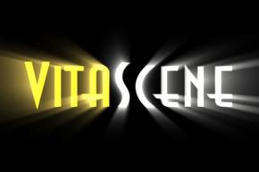

### Philosophie

**Vitascene** ist eine moderne Software, die auf einer innovativen Architektur basiert. Gegenüber ähnlichen Produkten hat dies den Vorteil, von sämtlichen Altlasten alter Entwicklungskonzepten befreit zu sein. Gleichzeitig bietet dieser glückliche Umstand auch immer die Gelegenheit, neue Konzepte einzubinden, die zwar auf den ersten Blick ungewohnt, aber einmal verstanden, von Vorteil sind oder werden.

Ein zusammenfassender und stark gekürzter Einblick in die verschiedenen Bereiche, die

- Benutzeroberfläche ist weitestgehend gleichzeitig sichtbar, nahezu alle Elemente sind im Überblick gleichzeitig zueinander sichtbar
- Komplette Interaktivität: Alle getätigten Eingaben sind ohne lästige Bestätigungen umgehend sichtbar
- Echtzeit-Vorschau: die Vorschau ist interaktiv und der Rechnerleistung anpaßbar, was ein experimentelles Arbeiten ohne unnötige Eingabebestätigungen erleichtert.
- An moderne Windows Systeme angelehnte Benutzerführung zur schnellen Verständlichkeit
- Kontextmenüs (rechte Maustaste) weitestgehend verfügbar zur schnelleren Arbeit
- Gleiche oder ähnliche Funktionen an unterschiedlichen Stellen anwendbar, um je nach Geschmack agieren zu können
- Mouse-Over Hilfe in Kurzform für schnelle Tipps während der Arbeit
- Menüführung in Baumform oder als Struktur, Optionen jeweils im Optionsfenster eingeblendet verfügbar für schematische und geordnete Benutzerführung und weitest mögliche Erweiterbarkeit
- Dynamisches GUI-System, um Anwender-Gewohnheiten zusammenfassend und in weniger Einzelschritten zentraler zur Verfügung stellen
- Grenzenlose Gestaltungsfläche für grenzenlose Freiheit im Editieren von Rolltiteln, überdimensionalen Grafiken etc.
- Innovative Layoutmerkmale für interaktive Ausrichtung, Skalierung etc.
- Objektorientierte Gestaltungsmerkmale für uneingeschränkten Ausbau und uneingeschränkte Vielfalt
- Objektorientierte Effekt-Engine für maximale Skalierbarkeit der Effektwirkung durch Kombination der einzelnen Effekteinstellungen
- Anwendungsorientierte Vorschaufunktionen für eindrückliche Vorschau nahe am Ergebnis (statt Drahtgittermodellen), interaktiv und qualitativ verstellbar
- Vielseitige Exportfunktionen zur weitgehenden Verwendungsmöglichkeit
- Zukunftsorientierte Berechnungsmethoden, die auf Standardsysteme ausgelegt werden und künftig Co-Hardware nutzbar machen und mit steigender Hardwareleistung auch stetig optimiert erden
- Moderne Pluginstruktur zu NLE-Host-Applikationen
- Moderne Pluginstruktur als Host-Applikation für andere Hersteller und Plugins
- Interner objektorientierter Programmaufbau ultraskalierbar und zukunftssicher

Somit haben Sie mit dem Kauf dieses Produkts nicht nur für die Gegenwart eine gute Entscheidung getroffen, sondern auch die Sicherheit, auch in Zukunft eine dem entsprechenden Umfeld stets angepasste Applikation zur Verfügung zu haben, die durch ihren eigenen Ausbau stets an Leistung und Perfektion gewinnt.

**Ein nicht zu unterschätzender Vorteil vor, während und erst recht nach dem Kauf einer innovativen Software!**

### Was ist neu in Vitascene 3.0?

Alle exakt unterstützten NLE-Versionen als Plugin (Blende und Effekt) finden Sie auf www.prodad.com.

Folgende neue Filtervorlagen sind in Vitascene 3.0 enthalten:

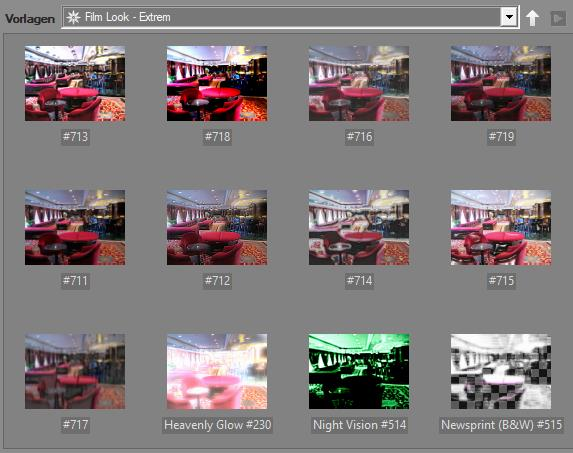

und **Blendenvorlagen** in Vitascene 3.0 verfügbar.

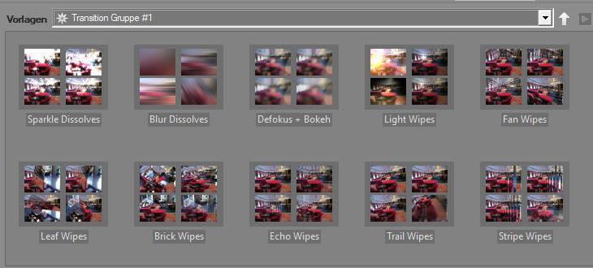

### Was ist neu in Vitascene 4.0?

Folgende neue **Blendenvorlagen** (Seamless Transitions) sind in Vitascene 4.0 zusätzlich verfügbar.

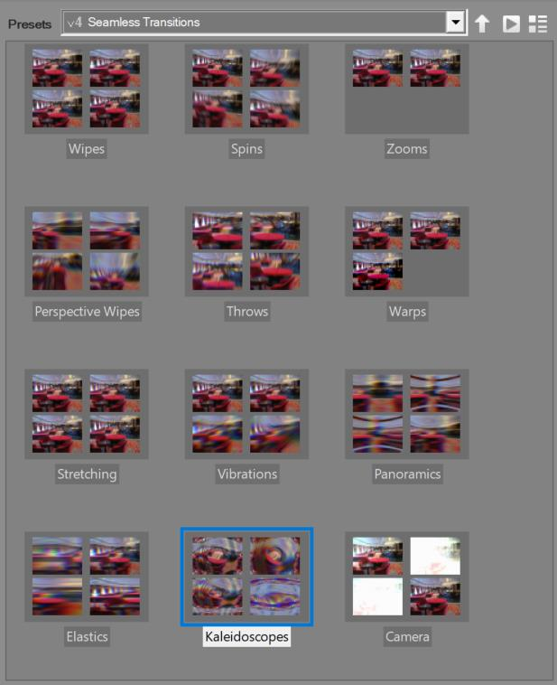

In Vitascene 4.0 sind auch noch Blendenvorlagen **Nur IN/OUT** verfügbar:

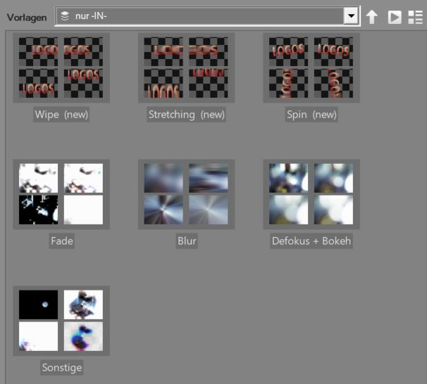

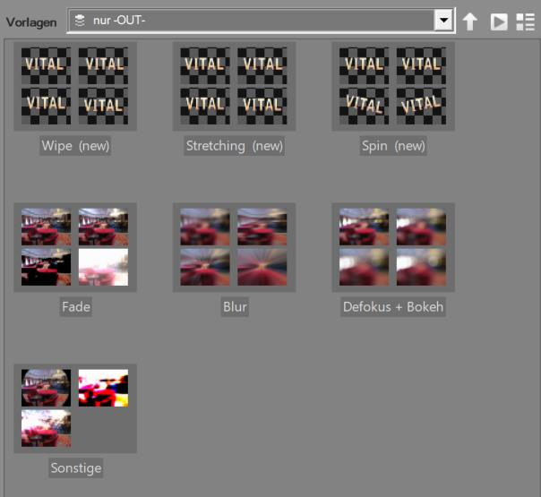

Weiterhin gibt es eine proDAD-Erfindung **Hubble Shift**, einen RGB-Effekt in Anhängigkeit zur Bewegungsrichtung und Geschwindigkeit.

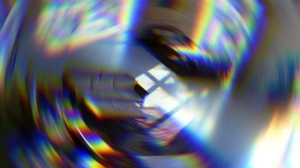

### Was ist neu in Vitascene 5.0?

The following new **Glitch transitions** are available in Vitascene 5.0.

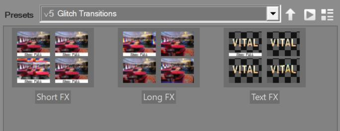

The following glitch transition templates are available in **Short FX**, which can also be edited individually after accepting the template.

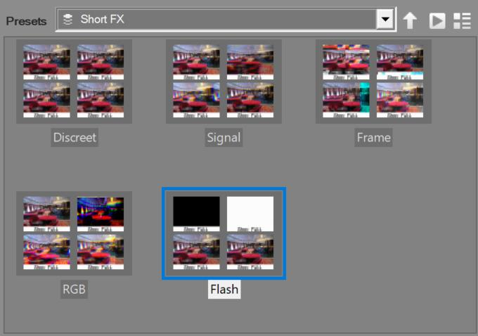

The following glitch transition templates are available in **Long FX**, which can also be edited individually after accepting the template.

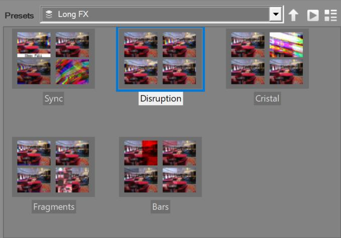

In **Text FX** the following glitch transition templates are available, which can be applied to available titles, of course they can be edited individually after accepting the template.

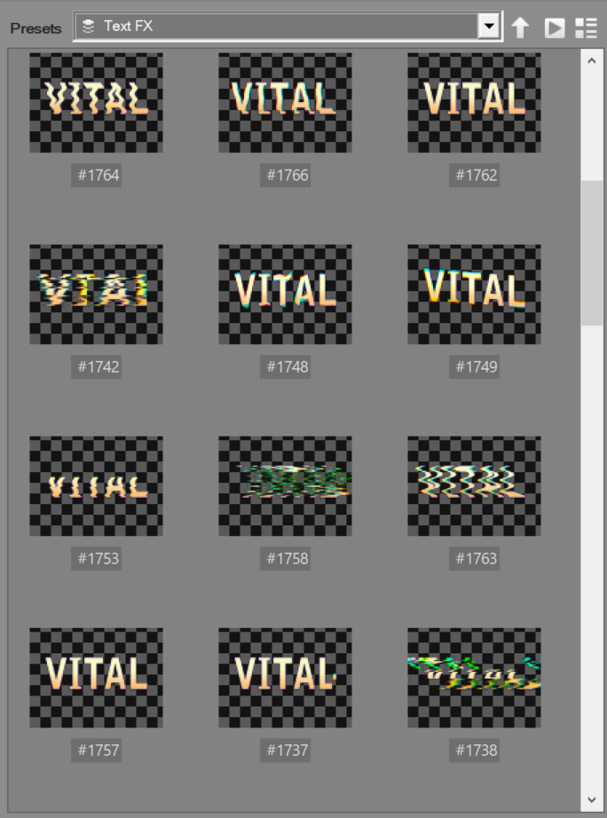

### Workshops & Schulungen für Vitascene

Hinweis für Einsteiger und Fortgeschrittene Anwender von Vitascene.

**Schulungen und Lern-Medien:**\
Die Fa. Vidcom 30th-century S.L. / Uwe Wenz ist offizieller Schulungspartner von proDAD Vitascene & anderen proDAD Produkten. Bei Interesse an weitergehenden Seminaren erhalten Sie hier detaillierte Informationen www.shop-filmbearbeitung.de.

**Video-Foto-Training-Center**

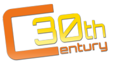

## Installation, Registrierung, Hilfe, Support, Technologie und System-Voraussetzungen

In den folgenden Lektionen erhalten Sie Inormationen zur Installation, Registrierung, Hilfe sowie zu den Systemvoraussetzungen.

#### Installation, Akitivierung und Registrierung

1. **Installation**

Starten Sie entweder die **.exe** Datei Ihres Downloads oder die Setup-Datei Ihrer DVD. Folgen Sie nun den Installationsanweisungen.\
Beachten Sie bei der Installation, dass Ihr Plugin auch installiert wird.

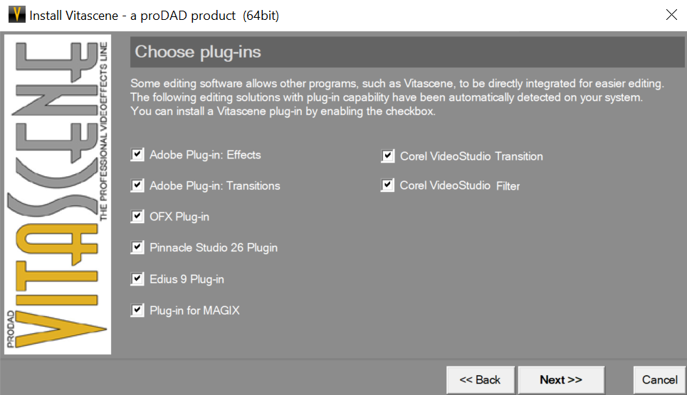

2. **Aktivierung von Vitascene 5.0**

In Vitascvene 5.0 aktivieren Sie nun Ihre gekaufte Version, entweder die Full-Version oder in den Funktionen eingeschränkte Version. Starten Sie nun Vitascene 5.0 als Plugin oder eigenständige Version.\
Nach dem ersten Programmstart von Vitascene 5.0, als eigenständiges Programm oder als Plugin in Ihrem Videobearbeitungsprogramm, sollten Sie die Aktivierung mit Ihrem Aktivierungscode (Seriennummer) durchführen. Geben Sie den Code ein, den Sie bei elektronischer Lieferung mit der Download-Instructions-Email erhalten haben, oder falls Sie eine physische Lieferung (auf DVD) erhalten haben, innerhalb der Box vorfinden. Klicken Sie dann **Aktivieren**.

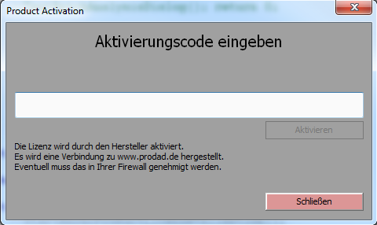

**WICHTIG:** Beachten Sie das Ihr System im Moment der Aktivierung über eine Internetverbindung benötigt, nur dann kann die Aktivierung erfolgreich durchgeführt werden. Sollte ein Problem bestehen, dann prüfen Sie die Sicherheitseinstellungen (Firewall etc.) im System und wiederholen die Aktivierung.

**Weitere Hinweise zu möglichen Aktivierungsproblemen:**

- Produkt lässt sich nicht aktivieren:

Der Aktivierungsschlüssel wurde u.U. nicht korrekt eingegeben.\
Zeichen wie „1“ und „I“, „8“ und „B“ oder auch „O“ und „0“ sind zu prüfen.

- Verbindung zu www.prodad.de nicht möglich:

Sollte die Verbindung zu www.prodad.com fehlschlagen, dann prüfen Sie Ihre Internetverbindung, Netzwerkeinstellungen bzw. Sicherheitseinstellungen im System.

Wenn Sie Vitascene im **DEMO-Modus** testen möchten, dann klicken Sie **Continue with Demo Version**. Die Demoversion ist solange aktiv, bis eine Seriennummerneingabe die Lizenz zur Vollversion wandelt.

**Vitascene** können Sie nach der Installation und Aktivierung als eigenständige Software starten aber auch in verschiedener Schnittsoftware als Plugin (Blende und Effekt) einsetzen.

3. **Registrierung von Vitascene**

Bitte registrieren Sie Ihr proDAD Vitascene unter **http://www.prodad.de/register.html**.

### Hilfe

Vitascene, stilvolle Übergangseffekte und Filter! 100% GPU-Renderpower! 100% interaktiv! Für anspruchsvolle Profis mit maximalem Qualitäts-Anspruch und minimaler Zeit!

Natürlich ist Vielseitigkeit auch immer ein Zeichen an Anspruch. Sowohl and die Qualität, als auch an den Anwender. Zwar ist die Bedienung sehr intuitiv ausgelegt, dennoch wird eine gewisse Einarbeitung in leistungsstarke Multimediaprogramme stets eine gewisse Einarbeitung erforderlich machen. So empfehlen wir Ihnen, zuerst dieses Handbuch zu lesen, um ein Gespür für das Programm zu erhalten. Arbeiten Sie unbedingt einmal die Tutorials durch. Die dort beschriebenen Arbeitsbeispiele sind speziell auf Erlernen des Programms und Verstehen der Systematik ausgelegt. Erst danach erhalten Sie auch das Gespür für verdeckte und versteckte Möglichkeiten, wie Sie teilweise erst in der Kombination mehrerer Leistungsmerkmale entstehen können. Wenn Sie die Grundlagen nach den Tutorials innehaben, sollten Sie innerhalb eines Tages locker in der Lage sein, komplexe und anspruchsvolle Ergebnisse zu erzielen. Im weiteren hilft Ihnen dann die im Programm eingebaute Hilfe , die stets eine Übersicht über die reichhaltigen Einsteller und Optionen zur Verfügung hält.

**Hilfe**\
Bei jedem Programm tauchen während der Arbeit Fragen auf. Im Falle Vitascenes erhalten Sie schnell und einfach Antwort darauf. Der Schlüssel ist die im Programm eingebaute Hilfe, die über das Menü "?" stets greifbar, unverlierbar und immer schnell zum Ergebnis führend, greifbar ist.

Hier finden Sie auch einen Index zum einfacheren Nachschlagen - in zeitgemäßer elektronischer Form.\
Die primäre Hilfe, der Ratgeber, die Komplettübersicht zur Software ist die Online-Hilfe im Programm.\
In dieser Anleitung erhalten Sie eine Einweisung und diverse systematische Informationen vermittelt. Die tiefgreifenden Detailinfos erhalten Sie dann in erwähnter Online-Hilfe.

**Weitere Informationen:**

Die Anlaufstation für weitere Informationen ist die Webseite www.prodad.com.

Hier finden Sie :

| • | Workshops |
| --- | --- |
| • | Ergänzende Anleitungen |
| • | Tutorials |
| • | Infos über neue Plugins (die nach der Erstellung dieser Anleitung entstanden sind) |
| • | sonstige Infos rund um proDAD |
| **Hinweis für Einsteiger und Fortgeschrittene Anwender von Vitascene:** Schulungen und Lern-Medien: Die Fa. Vidcom 30th-century S.L. / Uwe Wenz ist offizieller Schulungspartner von proDAD Vitascene & anderen proDAD Produkten. Bei Interesse an weitergehenden Seminaren erhalten Sie hier detaillierte Informationen [www.shop-filmbearbeitung.de.](http://www.shop-filmbearbeitung.de) |  |

### Technische Unterstützung - Support

**proDAD Support**

Wir, proDAD, stehen gerne für Sie bereit, wenn es um Fragen zum Programm geht.

Kontaktieren Sie uns einfach

- per email an customerservice@prodad.com
- per Telefon: ++49 (0)7462 9459 0
- per Fax: ++49 (0)7462 9459 79
- per Post: proDAD GmbH, Gauertstr. 2, 78194 Immendingen, Deutschland

Halten Sie auf jeden Fall folgende Informationen für uns bereit:

- Versionsnummer und Datum des Programms (Menü: **Hilfe/Über Vitascene**)
- Ihr verwendetes Betriebssystem
- Ggf. Name und die Versionsnummer des verwendeten Videoschnitt-Programms
- Ggf. welche Updates vom Programm bereits installiert wurden

Idealerweise senden Sie uns Ihre Anfrage per Menu **Hilfe, bei Problem email schreiben ....** Dann werden uns auch Installations- und Anwendungsprotokoll automatisch in gezippter Form übermittelt.\
Sie brauchen also nichts weiter zu tun. Übrigens enthalten die übermittelten Daten keinerlei persönliche Daten.

***Hinweis :***\
*Im* ***Hilfe-Menü*** *von Vitascene finden Sie die Option* ***Service Update****, hierüber gelangen Sie* *auf eine Service Seite von www.prodad.com um Service Updates* ***(Service Packs)*** *der* *Software herunterzuladen. Nach der Installation der neuesten Version von Vitascene stehen* *Neuerungen zur Verfügung bzw. wurden mögliche Probleme beseitigt.*

### Technologie und System-Voraussetzungen

Nun erhalten Sie grundlegende Informationen zur Technologie von proDAD Vitascene. Besonders wichtig für die einwandfreie Nutzung ist die Einhaltung der PC-Voraussetzungen.

**Was bedeutet GPU ?**

Zeitgemäße Grafikkarten verfügen über eine extrem hohe Rechenleistung, die weitaus größer ist, als die eigentliche PC-CPU. In Vitascene wird diese Leistung nun zur Berechnung von Effekten genutzt! Die Berechnungen werden auf der Grafikkarte durchgeführt und beschleunigen den Vorgang extrem.

**Brandneue Technologie - 50x schneller als bisherige Berechnung - GPU beschleunigt!**

Vorteile der GPU-Berechnung:

- bis zu 50mal schneller als über die CPU
- perfekte Qualität durch 16Bit und 32Bit IEEE
- genauere Berechnung für mehr Qualität und Details

**System-Voraussetzungen :**

- Windows 64-Bit Vista, Win7, Win8, Win8.1, Win10, Win11
- i7-cpu, 2GB RAM, besser 6GB-RAM

**Mögliche Einschränkungen in der Leistungsfähigkeit :**

- durch nicht aktuelle Grafikhardwaretreiber
- durch nicht aktuelle DirectX Version

***Hinweis:***\
*Halten Sie Ihr PC-System immer auf den aktuellsten Stand in Sachen Treibersoftware für* *Grafikkarte und DirectX-Version. Weiterhin empfehlen wir den GPU-Test anzuwenden, um in* *Erfahrung zu bringen, welche Leistungsfähigkeit Ihre Grafikkarte besitzt.*

## Programmstart und plugins

In den folgenden Kapiteln finden Sie Informationen zur Nutzung von **proDAD Vitascene** als **eigenständige Version**:

- Vitascene stand-alone (eigenständig)

als auch zum **Plugin-Betrieb** in folgenden verschiedenen Videoschnittapplikationen:

- Adobe Premiere Elements
- Adobe Premiere Pro
- Avid Media Composer
- Grass Valley EDIUS
- MAGIX Vegas
- Corel Video Studio
- Pinnacle Studio
- MAGIX
- Davinci Resolve

***Hinweis:***\
*Welche Version Ihrer* ***Schnittsoftware*** *unterstützt wird, finden Sie in der Sektion Vitascene* *auf www.prodad.com.*

Die hier folgenden Plugin-Beschreibungen sind zu Informationszwecken und der Vollständigkeit halber für alle theoretisch erhältlichen Plugins aufgezeigt. Möglicherweise ist die\
Nutzung EINES SPEZIELLEN PLUGINS in der von Ihnen erworbenen Lizenz NICHT ENTHALTEN und somit nicht möglich. Auch die Beschreibung der Nutzung der Standalone-Version bedeutet nicht zwingend den Inhalt der erworbenen Lizenz.

### Vitascene stand-alone (eigenständig)

Sie können **Vitascene** direkt vom Desktop aus per Doppelklick auf das **Vitascene 5.0 Icon**

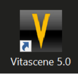

oder über das Windows-Startmenü starten :\
**Start**/Alle Programme/proDAD/**Vitascene 5.0 starten**

Vitascene startet nun, wählen Sie jetzt in den Effekt-Vorlagen einen geeigneten Videoeffekt oder eine Videoüberblendung aus.

### Adobe Premiere Elements

#### Plugin als Videoeffekt

Mit der Installation von Vitascene wird das **Premiere Elements-Plugin** automatisch mitinstalliert. Innerhalb Premiere Elements ist das Plugin dann in den **Effekten** zu finden:

**Vorgehensweise :**

1. Lokalisieren Sie die **Effekte** (im Register **Bearbeiten**)
2. Wählen Sie hier das Verzeichnis **proDAD**.
3. Ziehen Sie den Eintrag **Vitascene Filter** (via drag & drop) auf den gewünschten Videoclip in der Timeline.

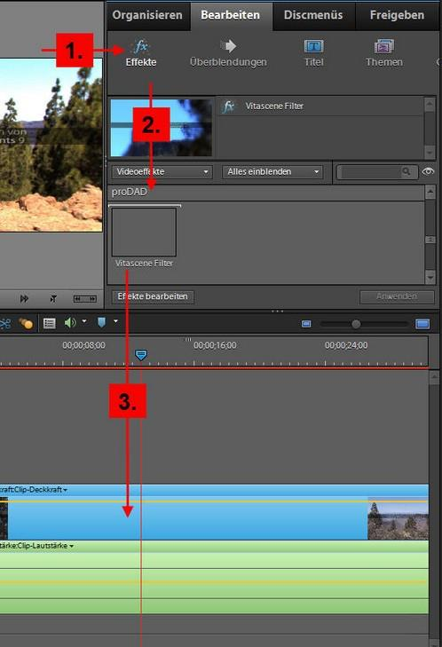

4. Vitascene startet. Wechseln Sie dazu in die **Vorlagen** und wählen z.B. in dem Vorlagen-Ordner **Tilt Shift** den Effekt **Commercial Look 631** durch Doppelklick aus. Der Effekt erscheint in der Vorschau von Vitascene.

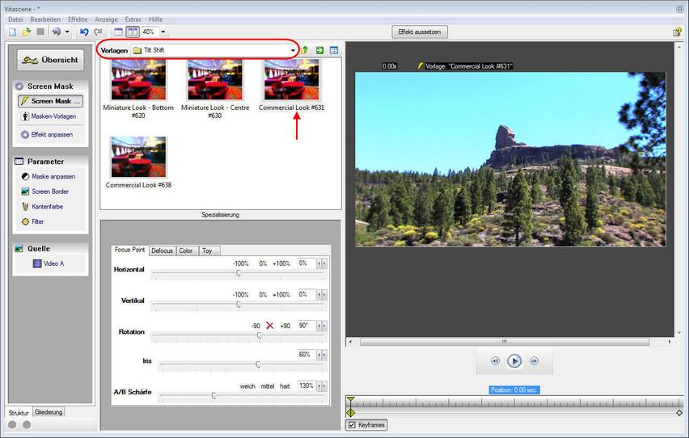

5. Ist in Vitascene das Projekt bearbeitet und fertiggestellt, kehren Sie einfach per **F12-Taste** oder Klick auf das Symbol 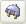 zurück zu Elements. Hierbei wird das Vitascene-Projekt automatisch abgespeichert.
6. Möchten Sie Vitascene erneut starten, so markieren Sie den Clip in der Timeline
7. Klicken Sie nun auf den Button **Effekte bearbeiten**.

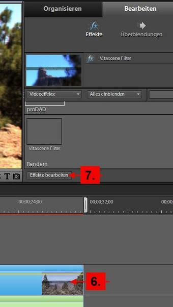

8. Jetzt erscheint die Effektauswahl **Vitascene Filter**, klicken Sie hier auf den Button **Setup...** und Vitascene startet erneut.

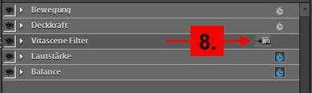

***Hinweis:***\
*Möchten Sie den Effekt Vitascene löschen, so klicken Sie auf* ***Vitascene Filter*** *mit der rechten* *Maustaste und wählen die Option* ***Löschen*** *aus.*

#### Plugin als Videoüberblendung

Mit der Installation von Vitascene wird das **Premiere Elements-Plugin** automatisch mitinstalliert. Innerhalb Premiere Elements ist das Plugin dann in den **Überblendungen** zu finden:

**Vorgehensweise :**

1. Lokalisieren Sie die **Überblendungen**
2. Wählen Sie hier das Verzeichnis **proDAD**.
3. Ziehen Sie den Eintrag **Vitascene Transition** (via drag & drop) zwischen die beiden Clips in der Timeline.
4. Klicken Sie dann auf den Button **Überblendung bearbeiten**.

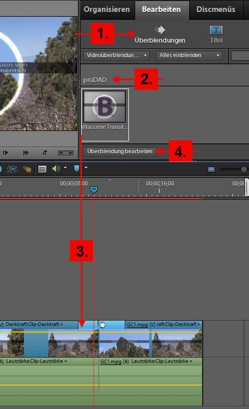

5. Es erscheint der Dialog **Vitascene Transition**.
6. Klicken Sie hier auf den Button **Benutzerdefiniert**.

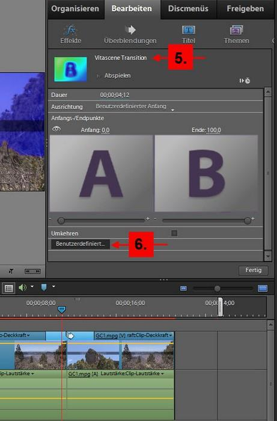

7. Vitascene startet. Wechseln Sie dazu in die **Vorlagen** und wählen z.B. in dem Vorlagen-Ordner **Sonstige** den Effekt **Soft Psychedelic wipe** durch Doppelklick aus. Der Blenden-Effekt erscheint in der Vorschau von Vitascene.

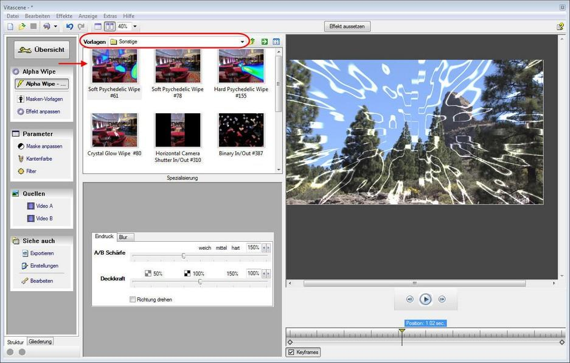

8. Ist in Vitascene das Projekt bearbeitet und fertiggestellt, kehren Sie einfach per **F12-Taste** oder Klick auf das Symbol  zurück zu Elements. Hierbei wird das Vitascene-Projekt automatisch abgespeichert.

### Adobe Premiere

#### Plugin als Videoeffekt

Mit der Installation von Vitascene wird das **Premiere-Plugin** automatisch mitinstalliert. Innerhalb Premiere ist das Plugin dann in den **Effekten** zu finden:

**Vorgehensweise :**

1. Lokalisieren Sie die **Videoeffekte** (im Register **Effekte**) und dort das Verzeichnis **proDAD**, öffnen Sie dieses.
2. Ziehen Sie den Eintrag **Vitascene Filter** (via drag & drop) auf den gewünschten Videoclip in der Timeline.
3. Vitascene startet. Wechseln Sie dazu in die **Vorlagen** und wählen z.B. in dem Vorlagen-Ordner **Tilt Shift** den Effekt **Commercial Look 631** durch Doppelklick aus. Der Effekt erscheint in der Vorschau von Vitascene.
4. Ist in Vitascene das Projekt bearbeitet und fertiggestellt, kehren Sie einfach per **F12-Taste** oder Klick auf das Symbol  zurück zu Premiere. Hierbei wird das Vitascene-Projekt automatisch abgespeichert.
5. Möchten Sie **Vitascene Filter** erneut starten, so wechseln Sie in das Register **Effekteinstellungen/Vitascene Filter** und klicken auf den **Setup-Button**.

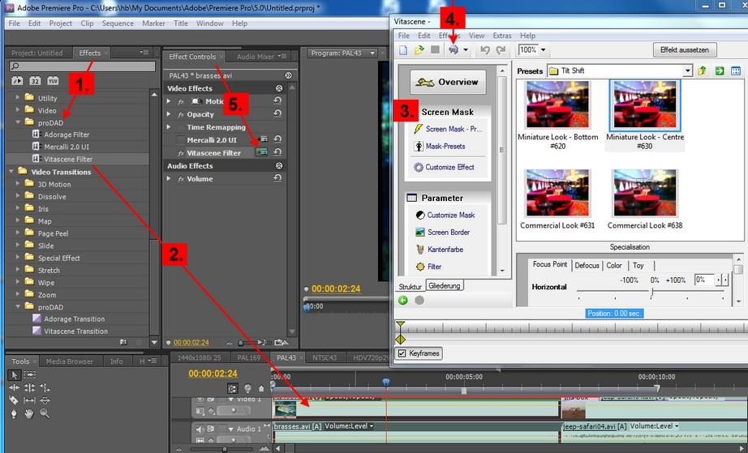

#### Plugin als Videoüberblendung

Mit der Installation von Vitascene wird das **Premiere-Plugin** automatisch mitinstalliert. Innerhalb Premiere Elements ist das Plugin dann in den **Überblendungen** zu finden:

**Vorgehensweise :**

1. Lokalisieren Sie die **Effekte**.
2. Lokalisieren Sie hier die **Überblendungen** und darin das Verzeichnis **proDAD**.
3. Ziehen Sie den Eintrag **Vitascene Transition** (via drag & drop) zwischen die beiden Clips in der Timeline.
4. Vitascene startet. Wechseln Sie dazu in die **Vorlagen** und wählen z.B. in dem Vorlagen-Ordner **Sonstige** den Effekt **Soft Psychedelic wipe** durch Doppelklick aus. Der Blenden-Effekt erscheint in der Vorschau von Vitascene.
5. Ist in Vitascene das Projekt bearbeitet und fertiggestellt, kehren Sie einfach per **F12-Taste** oder Klick auf das Symbol  zurück zu Premiere. Hierbei wird das Vitascene-Projekt automatisch abgespeichert.
6. Möchten Sie **Vitascene Transition** erneut starten, so markieren Sie per Mausklick die Überblendung in der Timeline und wechseln in das Register **Effekteinstellungen/Vitascene Transition** und klicken auf den Button **Benutzerdefiniert**.

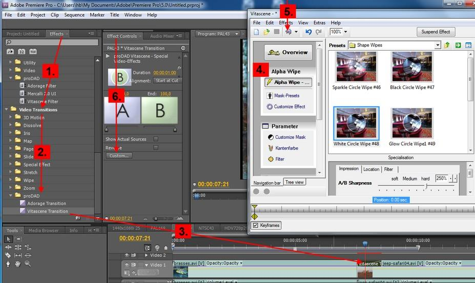

### Avid Media Composer

#### Plugin als Videoeffekt

Starten Sie **Media Composer**. Nach erfolgter Installation des Vitascene - Media Composer-Plugins ist **Vitascene** im Effekt-Dialog (Effect-Editor) von Media Composer verfügbar.

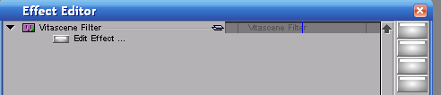

Ziehen Sie nun via Drag and Drop das **Vitascene Filter** in die Timeline und klicken auf die Option **Edit Effect**. Es startet Vitascene. Das Playback des aktuellen Videoclips wird mit dem ausgewählten Videoeffekt im Vorschaubereich von Vitascene angezeigt. Natürlich können Sie den ausgewählten Effekt in Vitascene Ihren Wünschen nach modifizieren.\
Ist in Vitascene das Projekt bearbeitet und fertiggestellt, kehren Sie einfach per **F12-Taste** oder Klick auf das Symbol  zurück zu Media Composer. Hierbei wird das Vitascene-Projekt automatisch abgespeichert.

#### Plugin als Videoüberblendung

Starten Sie **Media Composer**. Nach erfolgter Installation des Vitascene - Media Composer-Plugins ist **Vitascene** im Effekt-Dialog (Effect-Editor) von Media Composer verfügbar.

Ziehen Sie nun via Drag and Drop das **Vitascene Transition** in die Timeline und klicken auf die Option **Edit Effect**. Es startet Vitascene. Das Playback wird mit der ausgewählten Transition im Vorschaubereich von Vitascene in Echtzeit angezeigt. Natürlich können Sie die Transition in Vitascene Ihren Wünschen nach modifizieren.\
Ist in Vitascene das Projekt bearbeitet und fertiggestellt, kehren Sie einfach per **F12-Taste** oder Klick auf das Symbol  zurück zu Media Composer. Hierbei wird das Vitascene-Projekt automatisch abgespeichert.

### Grass Valley EDIUS

#### Plugin als Videoeffekt

Mit der Installation von Vitascene wird das **EDIUS-Plugin** automatisch im System installiert. Innerhalb EDIUS ist das Plugin dann in den **Videofiltern** zu finden:

**Vorgehensweise :**

1. Lokalisieren Sie die **Videofilter** (im Register **Effekt**).
2. Klicken Sie auf den darin enthaltenen Ordner **proDAD**.
3. Den darin enthaltenen Eintrag **Vitascene Filter** ziehen Sie nun auf den markierten Videoclip (via drag & drop) in der EDIUS Timeline.
4. In der **Informationspalette** klicken Sie doppelt auf den Eintrag **Vitascene Filter**.

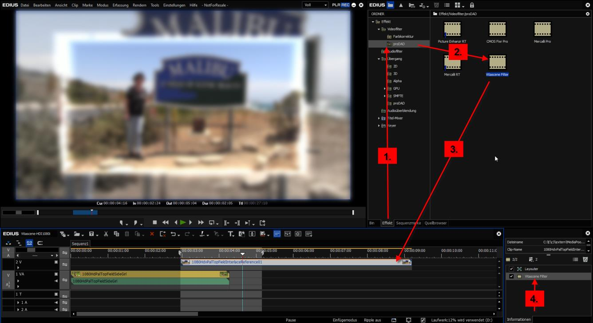

Vitascene startet. Wechseln Sie in die **Vorlagen** und wählen den gewünschten Effekt aus.

#### Plugin als Videoüberblendung

Mit der Installation von Vitascene wird das **EDIUS-Plugin** automatisch im System installiert. Innerhalb EDIUS ist das Plugin dann in den Übergängen zu finden :

**Vorgehensweise :**

1. Lokalisieren Sie die Übergänge (im Register **Effekt**).
2. Klicken Sie auf den darin enthaltenen Ordner **proDAD**.
3. Ziehen Sie nun die Vitascene Transition (via drag & drop) zwischen die beiden Clips in der Timeline.
4. In der **Informationspalette** klicken Sie doppelt auf den Eintrag **Vitascene Transition**.

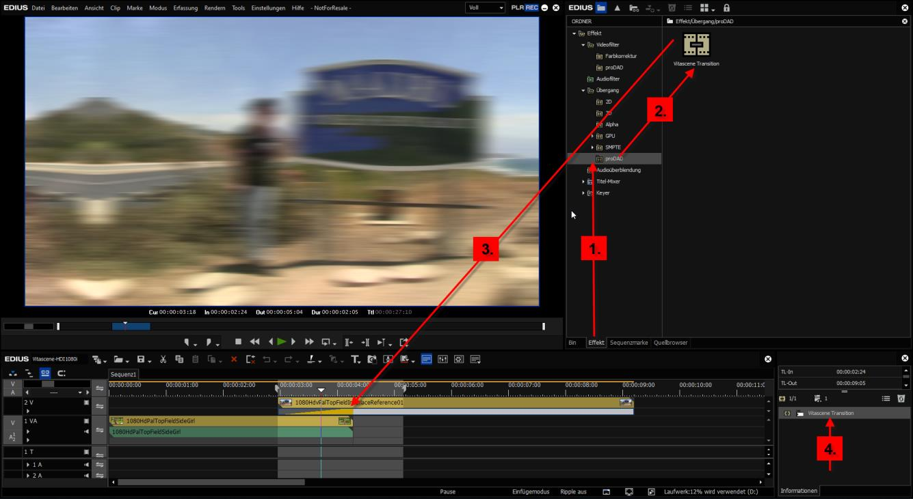

Vitascene startet. Wechseln Sie jetzt in die **Vorlagen** und wählen eine geeignete Blende aus.

#### Effektübernahme

Wenn Sie einen Vitascene-Effekt oder eine Vitascene-Blende gewählt haben, dann kann die Bearbeitung erfolgen, Sie sehen jede Änderung direkt in der EDIUS-Vorschau.\
Ist in Vitascene das Projekt bearbeitet und fertiggestellt, kehren Sie einfach per **F12-Taste** oder Klick auf das Symbol 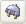 zurück zu EDIUS. Hierbei wird das Vitascene-Projekt automatisch abgespeichert.

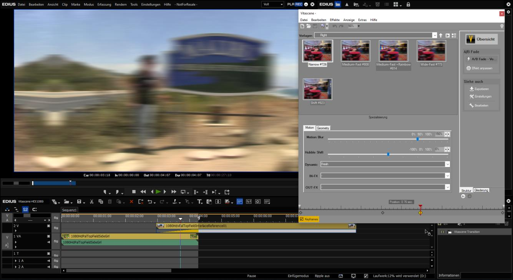

### MAGIX Vegas

#### Plugin als Videoeffekt

Mit der Installation von Vitascene wird das **Vegas-Plugin** automatisch mitinstalliert. Innerhalb Vegas ist das Plugin **Vitascene Filter** dann im Register **VideoFX** zu finden:

**Vorgehensweise :**

1. Lokalisieren Sie das Register **VideoFX** für die Videoeffekte.
2. Ziehen Sie den Eintrag **proDAD Vitascene Filter** mit gehaltener linker Maustaste auf den markierten Videoclip in der Timeline.
3. Nun wird der Dialog **proDAD Vitascene** in Vegas (Videoevent-FX) eingefügt.
4. Klicken Sie hier auf den Button **Filter bearbeiten**.

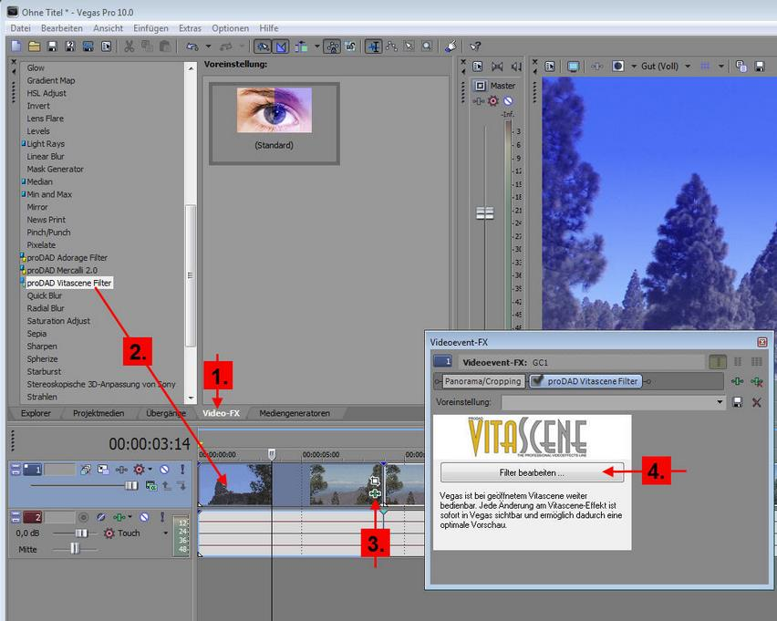

5. Vitascene startet. Wechseln Sie dazu in die **Vorlagen** und wählen z.B. in dem Vorlagen-Ordner **Tilt Shift** den Effekt **Commercial Look 631** durch Doppelklick aus. Der Effekt erscheint in der Vorschau von Vitascene.

6. Ist in Vitascene das Projekt bearbeitet und fertiggestellt, kehren Sie einfach per **F12-Taste** oder Klick auf das Symbol  zurück zu Vegas. Hierbei wird das Vitascene-Projekt automatisch abgespeichert.

***Hinweis:***\
*Möchten Sie das* ***Filter Vitascene*** *erneut öffnen, dann klicken Sie im Videoclip (mit Vitascene-**Effekt) in der Timeline auf den Button* ***Event-FX...*** *(grün gekennzeichnet).*

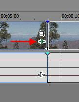

*Über den Dialog* ***Videoevent-FX*** *können Sie Vitascene erneut öffnen.*

#### Plugin als Videoüberblendung

Mit der Installation von Vitascene wird das **Vegas-Plugin** automatisch mitinstalliert. Innerhalb Vegas ist das Plugin **Vitascene Transition** dann im Register **Übergänge** zu finden:

**Vorgehensweise :**

1. Starten Sie **Vegas**, legen Sie zwei Videoclips in die Timeline (überlappend).
2. Lokalisieren Sie das Register **Übergänge**.
3. Ziehen Sie den Eintrag **proDAD Vitascene Transition** (via drag & drop) zwischen die Clips in die Timeline.
4. Nun wird der Dialog **proDAD Vitascene Transition** in Vegas (Videoevent-FX) eingefügt.
5. Klicken Sie hier auf den Button **Übergang bearbeiten**.

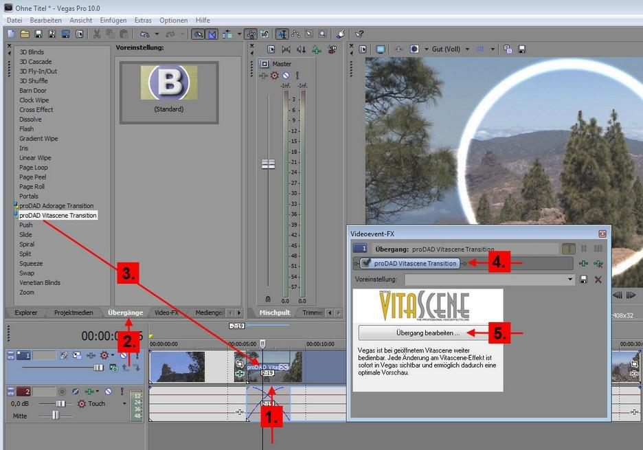

6. Vitascene startet. Wechseln Sie dazu in die **Vorlagen** und wählen z.B. in dem Vorlagen-Ordner **Sonstige** den Effekt **Soft Psychedelic wipe** durch Doppelklick aus. Der Blenden-Effekt erscheint in der Vorschau von Vitascene.

7. Ist in Vitascene das Projekt bearbeitet und fertiggestellt, kehren Sie einfach per **F12-Taste** oder Klick auf das Symbol  zurück zu Vegas. Hierbei wird das Vitascene-Projekt automatisch abgespeichert.

***Hinweis:***\
*Möchten Sie das Vitascene* ***Transition*** *erneut öffnen, dann klicken Sie im Blendenbereich in* *der Timeline auf den Button* ***Übergangseigenschaften...****.*

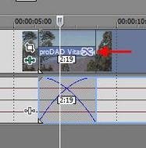

*Über den Dialog* ***Videoevent-FX*** *können Sie erneut Vitascene öffnen.*

### Corel Video Studio

#### Plugin als Videoeffekt

Mit der Installation von Vitascene wird das **Corel-Plugin** automatisch mitinstalliert.

**Vorgehensweise :**

1. Lokalisieren Sie **FX**.
2. Aktivieren Sie nun Ihren Clip in der Timeline durch **Doppelklick**.
3. Klicken Sie dann in **FX** auf **proDAD**.
4. Den darin enthaltenen Eintrag **Vitascene 2.0** ziehen Sie nun auf den markierten Videoclip (via drag & drop) in der Timeline von Corel.
5. Klicken Sie jetzt auf den Button **Filter anpassen**.

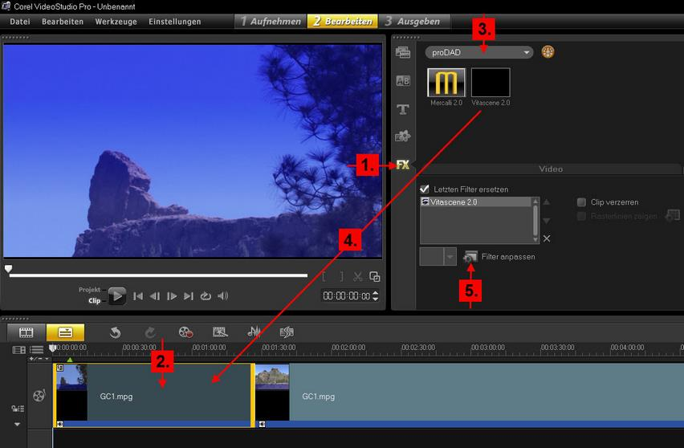

6. Vitascene startet. Wechseln Sie dazu in die **Vorlagen** und wählen z.B. in dem Vorlagen-Ordner **Tilt Shift** den Effekt **Commercial Look 631** durch Doppelklick aus. Der Effekt erscheint in der Vorschau von Vitascene.

7. Ist in Vitascene das Projekt bearbeitet und fertiggestellt, kehren Sie einfach per **F12-Taste** oder Klick auf das Symbol  zurück zu Corel. Hierbei wird das Vitascene-Projekt automatisch abgespeichert.
8. Möchten Sie Vitascene erneut starten, so aktivieren Sie den Clip in der Timeline erneut durch Doppelklick, wechseln in **FX / proDAD / Vitascene** und klicken auf den Button **Filter anpassen**.

***Hinweis:***\
*Möchten Sie Vitascene vom Clip als Effekt entfernen, so wechseln in* ***FX / proDAD /*** ***Vitascene*** *und klicken auf den Button* ***Filter löschen (X)****.*

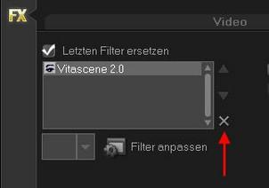

#### Plugin als Videoüberblendung

Mit der Installation von Vitascene wird das **Corel-Plugin** automatisch mitinstalliert.

**Vorgehensweise :**

1. Starten Sie **Corel**, legen Sie zwei Videoclips in die Timeline (überlappend).
2. Lokalisieren Sie **Übergang A/B**.
3. Klicken Sie darin auf **proDAD**.
4. Ziehen Sie den Eintrag **Vitascene** (via drag & drop) zwischen die Clips in die Timeline.
5. Klicken Sie jetzt auf den Button **Anpassen**.

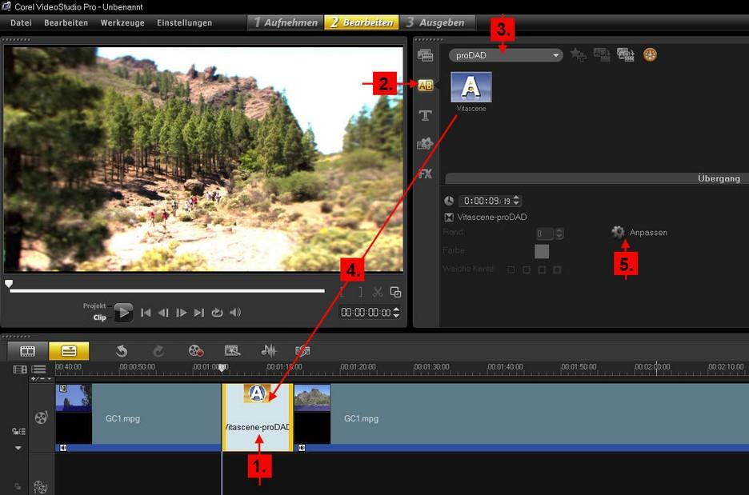

6. Vitascene startet. Wechseln Sie dazu in die **Vorlagen** und wählen z.B. in dem Vorlagen-Ordner **Sonstige** den Effekt **Soft Psychedelic wipe** durch Doppelklick aus. Der Blenden-Effekt erscheint in der Vorschau von Vitascene.

7. Ist in Vitascene das Projekt bearbeitet und fertiggestellt, kehren Sie einfach per **F12-Taste** oder Klick auf das Symbol  zurück zu Corel. Hierbei wird das Vitascene-Projekt automatisch abgespeichert.
8. Möchten Sie Vitascene erneut starten, so klicken Sie auf den Blendenbereich in der Timeline doppelt, wechseln in **Übergang (A/B) / proDAD / Vitascene** und klicken auf den Button **Anpassen**.

***Hinweis:***\
*Möchten Sie Vitascene als Übergang entfernen, so klicken Sie auf den Blendenbereich in der* *Timeline mit der rechten Maustaste und wählen* ***Löschen*** *aus*

*.*

### Pinnacle Studio

#### Plugin als Videoeffekt

Mit der Installation von **Vitascene** wird das **Pinnacle Studio-Plugin** automatisch mitinstalliert.

**Vorgehensweise :**

1. Lokalisieren Sie die **Effekte/proDAD** und dort das Verzeichnis **Vitascene**, öffnen Sie dieses.
2. Ziehen Sie den Eintrag **Vitascene** mit gehaltener linker Maustaste auf den markierten Videoclip in der Timeline.
3. Der Effekt wird durch eine ***magenta-farbene Linie*** im Clip dargestellt. Klicken Sie darauf doppelt.

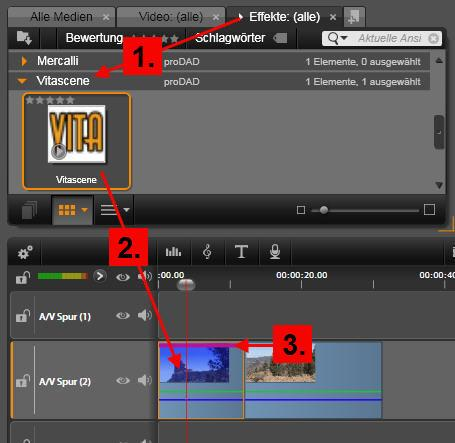

4. Es öffnet ein neuer Dialog mit aktiven Register **Effekte**.
5. Rechts erscheint der ausgewählte Effekt **Vitascene**, klicken Sie hier auf den Button **Bearbeiten**.

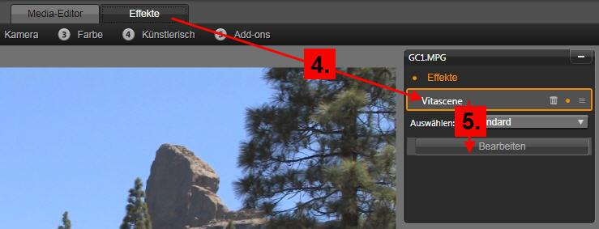

6. Vitascene startet. Wechseln Sie dazu in die **Vorlagen** und wählen z.B. in dem Vorlagen-Ordner **Tilt Shift** den Effekt **Commercial Look 631** durch Doppelklick aus. Der Effekt erscheint in der Vorschau von Vitascene.

7. Ist in Vitascene das Projekt bearbeitet und fertiggestellt, kehren Sie einfach per **F12-Taste** oder Klick auf das Symbol  zurück zu Studio. Hierbei wird das Vitascene-Projekt automatisch abgespeichert.
8. Bestätigen Sie nun den Vitascene-Effekt im Register **Effekte** mit **OK**. Der Effekt wird in die Timeline übernommen.

***Hinweis:***\
*Möchten Sie* ***Vitascene*** *vom Clip als Effekt entfernen, so klicken Sie mit der rechten Maustaste* *auf die* ***magenta-farbene Linie*** im Clip und wählen die Option ***Effekt/Löschen/Vitascene*** aus.

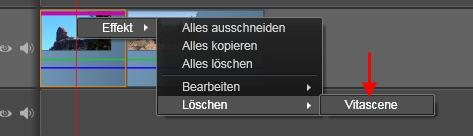

#### Plugin als Videoüberblendung

Mit der Installation von **Vitascene** wird das **Pinnacle Studio-Plugin** automatisch mitinstalliert.

**Vorgehensweise :**

1. Lokalisieren Sie die **Überblendungen/proDAD** und dort das Verzeichnis **Vitascene**, öffnen Sie dieses.
2. Ziehen Sie den Eintrag **Vitascene** mit gehaltener linker Maustaste an das Ende eines Videoclips in der Timeline. Die **Überblendung** wird in der Timeline eingefügt.
3. Klicken Sie nun mit der rechten Maustaste auf die **Überblendung** und wählen die Option **Überblendeffekte/Bearbeiten**.

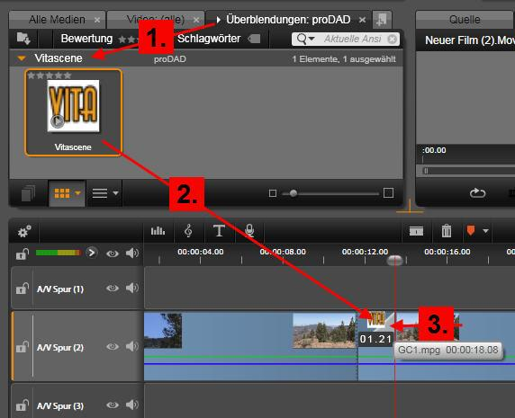

4. Es öffnet der Dialog **Vitascene**, in dem u.a. auch die Blenden-Dauer eingestellt werden kann. Klicken Sie hier auf den Button **Bearbeiten**, um Vitascene zu starten.

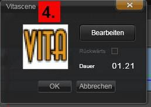

5. Vitascene startet. Wechseln Sie dazu in die **Vorlagen** und wählen z.B. in dem Vorlagen-Ordner **Sonstige** den Effekt **Soft Psychedelic wipe** durch Doppelklick aus. Der Blenden-Effekt erscheint in der Vorschau von Vitascene.

6. Ist in Vitascene das Projekt bearbeitet und fertiggestellt, kehren Sie einfach per **F12-Taste** oder Klick auf das Symbol  zurück zu Pinnacle Studio. Hierbei wird das Vitascene-Projekt automatisch abgespeichert.
7. Dann bestätigen Sie den Dialog **Vitascene** (in Studio) mit **OK**, die Überblendung erscheint in der Studio-Vorschau.

***Hinweis:***\
*Möchten Sie Vitascene vom Clip als* ***Überblendung*** *entfernen, so klicken Sie mit der rechten* *Maustaste auf die Überblendung* und wählen die Option ***Überblendeffekte/Entfernen*** aus.

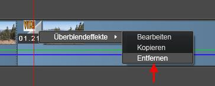

### MAGIX

#### Plugin als Videoeffekt

Mit der Installation von Vitascene wird das **MAGIX-Plugin** automatisch mitinstalliert.

**Vorgehensweise :**

1. Starten Sie **MAGIX Video deluxe,** legen Sie einen Videoclip in die Timeline, achten Sie auf dessen Markierung (orange).
2. Wechseln in das Register **Effekte**.
3. Nach dem Öffnen des Registers **Effekte** finden Sie hier ein Verzeichnis **proDAD**.
4. Hier wird Ihnen **Vitascene** angezeigt, klicken Sie darauf.

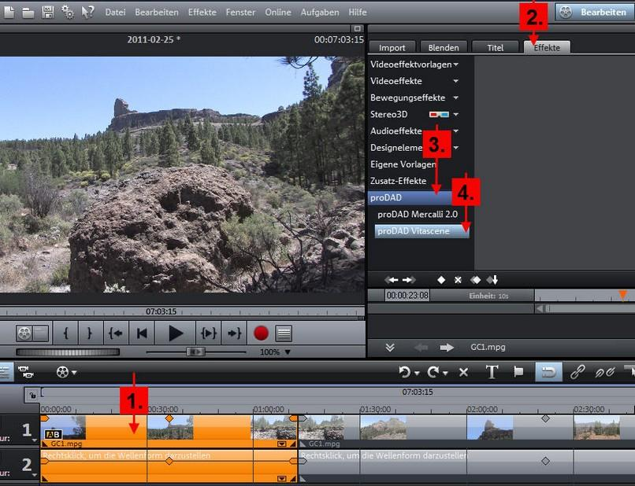

5. Vitascene startet. Wechseln Sie dazu in die **Vorlagen** und wählen z.B. in dem Vorlagen-Ordner **Tilt Shift** den Effekt **Commercial Look 631** durch Doppelklick aus. Der Effekt erscheint in der Vorschau von Vitascene.

6. Ist in Vitascene das Projekt bearbeitet und fertiggestellt, kehren Sie einfach per **F12-Taste** oder Klick auf das Symbol  zurück zu MAGIX. Hierbei wird das Vitascene-Projekt automatisch abgespeichert.

#### Plugin als Videoüberblendung

Mit der Installation von Vitascene wird das **MAGIX-Plugin** automatisch mitinstalliert.

**Vorgehensweise :**

1. Starten Sie MAGIX Video deluxe, legen Sie zwei Videoclips in die Timeline, überlagern Sie diese (d.h. ordnen Sie beide Clips in der Timeline überlappend an).
2. Wechseln in das Register **Blenden**.
3. Nach dem Öffnen des Registers **Blenden** finden Sie hier ein Verzeichnis **Zusatz-Blenden**.
4. Hier wird Ihnen **Vitascene** angezeigt, ziehen Sie nun die Blende proDAD Vitascene via Drag & Drop in den Clip-Übergang.
5. Klicken Sie nun mit der rechten Maustaste in den Blendenbereich auf **A/B** und wählen die Option **Einstellungen**.

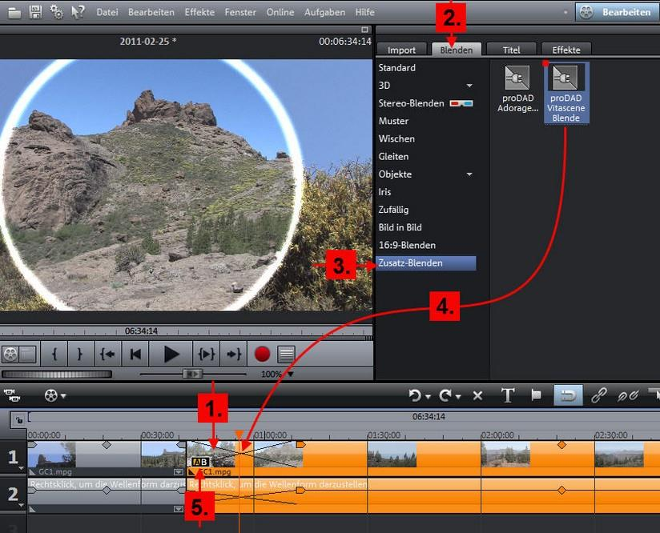

6. Vitascene startet. Wechseln Sie dazu in die **Vorlagen** und wählen z.B. in dem Vorlagen-Ordner **Sonstige** den Effekt **Soft Psychedelic wipe** durch Doppelklick aus. Der Blenden-Effekt erscheint in der Vorschau von Vitascene.

7. Ist in Vitascene das Projekt bearbeitet und fertiggestellt, kehren Sie einfach per **F12-Taste** oder Klick auf das Symbol  zurück zu MAGIX. Hierbei wird das Vitascene-Projekt automatisch abgespeichert.

### Davinci Resolve

#### Plugin als Videoeffekt

Mit der Installation von Vitascene wird das **OFX-Plugin** automatisch mitinstalliert.

**Vorgehensweise:**

1. Lokalisieren Sie **Effects**.
2. Klicken Sie dann in **Open FX** auf **Filters**.
3. In **Filters** finden Sie den Ordner **proDAD**.
4. Den darin enthaltenen Eintrag **Vitascene V5** ziehen Sie nun auf den markierten Videoclip (via drag & drop) in der Timeline von Davinci Resolve.
5. Klicken Sie jetzt auf **Inspector/Effects** .

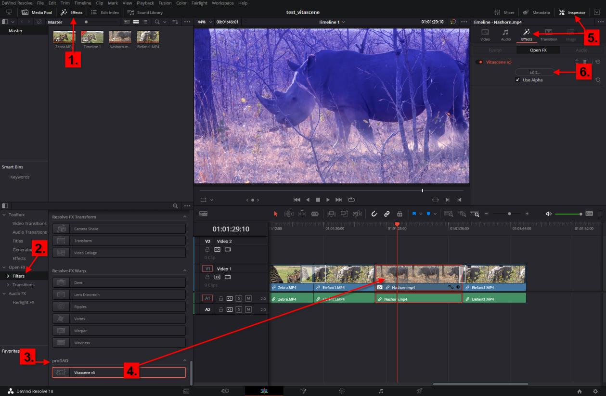

6. Hier kann nun **Vitascene als Video-Effekt-Plugin** geöffnet werden. In Vitascene wählen Sie dann eine gewünschte Effekt-Vorlage (z.B. Film Look - Extrem / Demon Sunset #385) aus und passen gegebenenfalls Detaileinstellungen an.

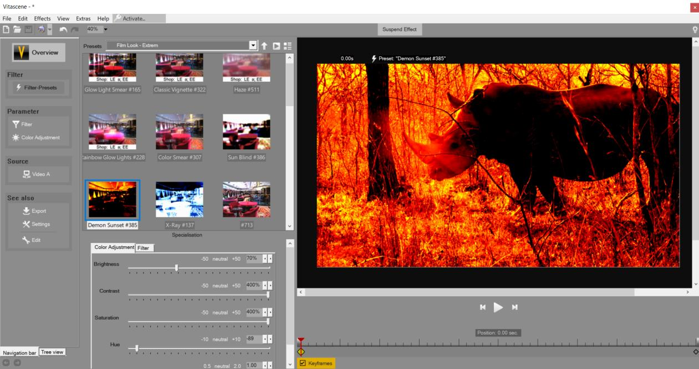

7. Ist in Vitascene das Projekt bearbeitet und fertiggestellt, kehren Sie einfach per **F12-Taste** oder Klick auf das Symbol  zurück zu Davinci Resolve. Hierbei wird das Vitascene-Projekt automatisch abgespeichert.

#### Plugin als Videoüberblendung

Mit der Installation von Vitascene wird das **OFX-Plugin** automatisch mitinstalliert.

**Vorgehensweise:**

1. Lokalisieren Sie **Effects**.
2. Klicken Sie dann in **Open FX** auf **Transitions**.
3. In **Transitions** finden Sie den Ordner **proDAD**.
4. Den darin enthaltenen Eintrag **Vitascene V5** ziehen Sie nun zwischen 2 aufeinanderfolgende Videos (via drag & drop) in der Timeline von Davinci Resolve. Trimmen Sie aber zuvor die 2 Videos in der Timeline am Ende sowie am Anfang, nur dann kann die Transition eingefügt und angepasst werden.
5. Klicken Sie danach auf **Inspector/Transitions**.

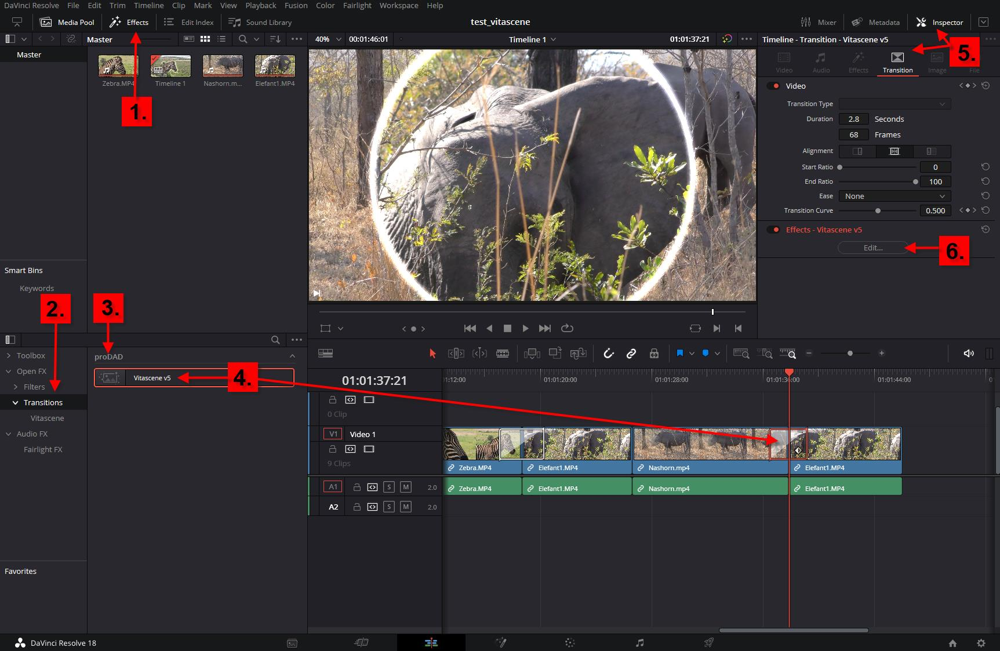

6. Hier kann nun **Vitascene V5 als Video-Transition-Plugin** geöffnet werden. In Vitascene wählen Sie dann eine gewünschte Transition-Vorlage (z.B. Glitch Transitions / Long FX / Cristal / # 1467) aus und passen gegebenenfalls Detaileinstellungen an.

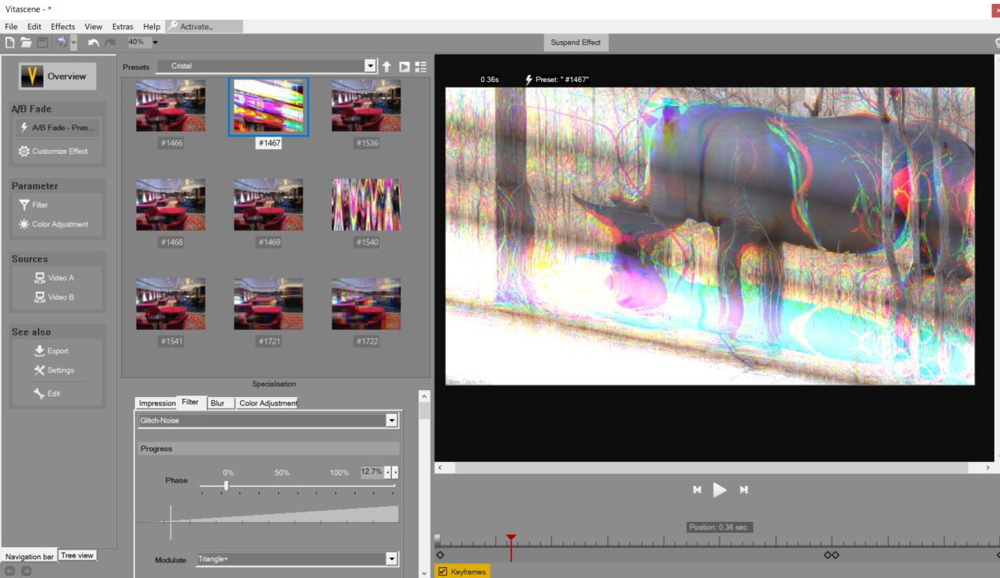

7. Ist in Vitascene das Projekt bearbeitet und fertiggestellt, kehren Sie einfach per **F12-Taste** oder Klick auf das Symbol  zurück zu Davinci Resolve. Hierbei wird das Vitascene-Projekt automatisch abgespeichert.

## Workshops zum Kennenlernen

Hier finden Sie einige Anwendungen in Schritt-für-Schritt-Form.\
Diese Beispiele durchzuarbeiten kostet ca. 40 Minuten Zeit. Danach verfügen Sie über das Wissen, wie Sie an Projekte mit Vitascene herangehen und Ihre Vorstellungen umsetzen können.\
Arbeiten Sie diese Beispiele durch und Sie sparen sich später Zeit beim Erforschen von Logik und Anwendung.

**Folgende Workshops sind verfügbar :**

1. Text mit Ray-Filter und Keyframes belegen (Titel in proDAD Heroglyph mit Alpha Kanal erzeugt und 1. in die Timeline einer Videoschnitt-Software sowie 2. direkt in Vitascene importiert)
2. Sparkle-Filter auf Bild mit Nutzung von Keyframes anwenden
3. Anwendung des Transition-Effektes Shape Wipes mit integrierten Sparkle Effekt (Vitascene als Blenden-Plugin in einer Videoschnittsoftware nutzen)
4. Miniaturlandschaft aus Realvideos erstellen (Vitascene als Effekt-Plugin in einer Videoschnittsoftware nutzen)

**Viel Spaß und Erfolg beim Kennenlernen!**

Die Fa. 30th-century / Uwe Wenz ist offizieller Schulungspartner von proDAD Vitascene. Bei Interesse an weitergehenden Seminaren und zur LernDVD erhalten Sie hier detaillierte Informationen www.30th-century.com.

### Text mit Ray-Filter und Keyframes

Der farblich effektreiche Titel (mit Text) wurde zuvor mit proDAD Heroglyph unter Verwendung des Alpha Keys (als \*.tif gespeichert) erstellt.\
Benutzen Sie folgende Einstellungen für den Einzelbild-Export in Heroglyph.

**Anwendung stand-alone:**\
Oder Sie importieren den Titel direkt in Vitascene, um ihn hier mit dem Filter **Ray** zu belegen bzw. den Titel mit wandernden Lichtreflexionen unter Anwendung von Keyframes zu modifizieren.

Zuerst starten Sie Vitascene, dann wechseln Sie hier in die **Filter-Vorlagen** und wählen das Filter **Ray** (z.B. den Effekt #390) per Doppelklick in den Vorschaubereich von Vitascene. Der Effekt wird auf den Titel (erstellt in proDAD Heroglyph) angewendet. In der Vorschau sind bereits Lichtreflexionen sichtbar.

Nach dem Ablegen des Effektes wird im Vorschaubereich der gewünschte Hintergrund (Bild oder Clip) noch nicht sichtbar sein. Um unser zuvor angefertigtes Bild zu importieren, wechseln Sie nun im **Navigations-Menü** in den Bereich **Quelle.** Hier klicken Sie auf die Option **Video A**.

Es öffnet der Dialog **Video A**. Klicken Sie im Bereich **Quelle** auf die Option **Füllart**, es öffnet ein PullDown-Menü, hier wählen Sie die Option **Grafik / Animation** aus**.** Anschließend klicken Sie zur Auswahl z.B. unserer Bild-Datei auf den **Ordner-Button** rechts neben dem PullDown-Menü **Grafik** und importieren die Datei mit Hilfe der Option **Datei wählen**. In den Details zur verwendeten Grafik wird das Format **720x576 Pixel RGB + Alpha** angezeigt.

Die Bild-Datei erscheint sofort im Vorschaubereich (mit bereits integrierten Filter **Ray**) von Vitascene.

Weiterhin finden Sie im Dialog **Video A** Einstellungsmöglichkeiten zum importierten Bild (oder Clip) für Pixel-Aspekt, Attribute und Geometrie.\
Für diesen Workshop verwenden Sie jedoch das Original-Bild, ohne weitere Einstellungen.

Nun wechseln Sie im **Navigations-Menü** in den Bereich **Parameter** und klicken auf die Option **Filter**.

Es öffnet der Dialog **Filter** mit verschiedenen Einstellungen zum aktiven Filter **Ray**.

Hier werden die Eigenschaften des Filters **Ray** modifiziert, zuvor wechseln Sie aber in den Vorschaubereich und prüfen, ob die Option **Keyframes** (Schlüsselpunkte im Verlauf der Animation, die über unterschiedliche Eigenschaften zu selbst definierten Zeitpunkten verfügen) eingeschaltet ist.\
Ohne Aktivierung der Option **Keyframes** werden keine Veränderungen im Effekt, bezogen auf den Verlauf der Animation angezeigt. Die Einstellungen gelten dann für jeden Zeitpunkt der Animation.

Nun verändern Sie die Einstellung für die Option **Ausdehnung**, wählen Sie hier z.B. den Wert 24%, sowie setzen den Regler **Flickern mindern** auf 35%.

Wählen Sie nun im PullDown-Menü **Erkennung** die Einstellung **Helle Kante**.\
Weiterhin setzen Sie den Regler **Schwelle** auf 20%, im PullDown-Menü **Methode** wählen Sie die Einstellung **Motion Beam** aus.

Den Regler **Verlauf** setzen Sie auf 4.50, den Regler **Zoom** auf 1%.

In der Vorschau erscheint nun folgende Darstellung des Ray-Filters auf dem verwendeten Bild. Es sind innerhalb des Textes **Vitascene** deutlich Lichtreflexionen sichtbar, die vom Bildmittelpunkt zum Textrand verlaufen.

Nun verändern Sie den Effekt **Ray** mit Hilfe der Regler

**Composite** = 0%\
**Szene-Intensität** = 100%\
sowie setzen die **Glühen-Intensität** = 55%.

Die Option **Aufhellen-Farbe** belassen Sie weiß, die **Aufhellen-Intensität** bei 25%.

Nun wählen Sie die **Tönungs-Farbe** Rot (bezieht sich auf die Lichtstrahlen), die **Tönungs-****Intensität** setzen Sie auf 200% und den **Tönungs-Verlauf** auf den Wert 1.15.

In der Vorschau erscheint nun folgende Darstellung des Filters **Ray** auf dem verwendeten Bild. Es sind innerhalb des Textes **Vitascene** deutlich Lichtreflexionen sowie Verfärbungen nach **Rot** sichtbar.

Nun verändern Sie abschließend die Position des Strahlenursprungs in horizontale und vertikale Richtung, verwenden Sie dabei Keyframes (am Anfang und Ende der Animation).

Zuerst setzen Sie den Slider (Position in der Zeitachse unterhalb der Vorschau) an den **Anfang** der Animation.

Dann verschieben Sie den Regler **Horizontal** auf den Wert -57% und den Regler **Vertikal** auf 46%.

Die Vorschau sieht wie folgt aus.

Setzen Sie nun den Slider (Position in der Zeitachse unterhalb der Vorschau) an das **Ende** der Animation.

Dann verschieben Sie den Regler **Horizontal** auf den Wert 57% und den Regler **Vertikal** auf 46%.

Die Vorschau sieht wie folgt aus.

Starten Sie nun eine Animation im Vorschaubereich mit Hilfe des Play-Buttons. Sie werden feststellen, dass die Lichtreflexionen sich im Verlauf der Animation bewegen. Die Bewegung wurde erzielt durch das Setzen eines Anfangs-Keyframes und eines End-Keyframes. Selbstverständlich können Sie weitere Keyframes im Verlauf der Animation setzen. Dazu ist es notwendig den Slider an Ihre Wunschposition zu setzen und verändern anschließend die Eigenschaften zum Effekt via Regler. Dieses wiederholen Sie dann für jedes Keyframe in der Animation.

***Hinweis:***\
Selbstverständlich können Sie in der Zeitleiste Keyframes verschieben, bewegen Sie hierzu die Maus auf ein Keyframe, halten die linke Maustaste gedrückt und verschieben es an die neue Position in der Zeitleiste. Natürlich können Sie auch Keyframes im Verlauf der Animation löschen, bewegen Sie hierzu den Slider auf das entsprechende Keyframe und drücken die Taste **Entf** auf Ihrer Tastatur.

Zum Abschluss klicken Sie im **Navigations-Menü** auf die Option **Farbkorrektur**.

Es öffnet der Dialog Farbkorrektur, hier sind folgende Bild-Einstellungen zum verwendeten Bild- oder Videomaterial möglich.

### Sparkle-Filter auf Bild anwenden (u.a. mit Nutzung von Keyframes)

In dieser Lektion erhalten Sie Informationen zur Anwendung und Einstellung eines Sparkle-Filters auf ein gewähltes Bild (oder Clip) in Vitascene. Auch hier wird die Anwendung von Keyframes besprochen. Dadurch werden z.B. im Hintergrund-Bild die Sparkle-Strahlen animiert dargestellt (in Bewegung versetzt).

Zuerst starten Sie Vitascene, dann wechseln Sie hier in die **Filter-Vorlagen** und wählen das Filter **Sparkle** (z.B. den Effekt #131) per Doppelklick in den Vorschaubereich von Vitascene.

Sollten Sie Vitascene **stand-alone** betreiben, so wird nach dem Ablegen des Effektes im Vorschaubereich noch nicht der gewünschte Hintergrund (sondern ein Beispielbild) sichtbar sein. Um unser Bild zu importieren, wechseln Sie nun im **Navigations-Menü** in den Bereich **Quelle.** Hier klicken Sie auf die Option **Video A**.

Es öffnet der Dialog **Video A**. Klicken Sie im Bereich **Quelle** auf die Option **Füllart**, es öffnet ein PullDown-Menü, hier wählen Sie die Option **Grafik / Animation** aus**.**

Anschließend klicken Sie zur Auswahl z.B. unserer Bild-Datei auf den **Ordner-Button** rechts neben dem PullDown-Menü **Grafik** und importieren die Datei mit Hilfe der Option **Datei wählen**. Die Bild-Datei erscheint sofort im Vorschaubereich (mit bereits integrierten Filter **Sparkle**) von Vitascene.

Weiterhin finden Sie im Dialog **Video A** Einstellungsmöglichkeiten zum importierten Bild (oder Clip) für Pixel-Aspekt, Attribute und Geometrie.

Für diesen Workshop verwenden Sie jedoch das Original-Bild, ohne weitere Einstellungen.

Nun wechseln Sie ins **Navigations-Menü** und klicken auf die Option **Filter-Vorlagen**.

Es öffnet der Dialog **Filter-Vorlagen** mit verschiedenen Vorlagen sowie Einstellungen zum aktiven Filter **Sparkle**.\
Wechseln Sie nun im **Navigations-Menü** in den Bereich **Parameter** und klicken auf die Option **Filter**.

Es öffnet der Dialog **Filter** mit verschiedenen Einstellungen zum aktiven Filter **Sparkle** (ohne Filter-Vorlagen, denn es wurde bereits eine Vorlage im Vorschaubereich angewendet).

Hier werden die Eigenschaften des Filters **Sparkle** modifiziert, zuvor wechseln Sie aber in den Vorschaubereich und prüfen, ob die Option **Keyframes** (Schlüsselpunkte im Verlauf der Animation, die über unterschiedliche Eigenschaften zu selbst definierten Zeitpunkten verfügen) eingeschaltet ist.\
Ohne Aktivierung der Option **Keyframes** werden keine Veränderungen im Effekt, bezogen auf den Verlauf der Animation angezeigt. Die Einstellungen gelten dann für jeden Zeitpunkt der Animation.

Stoppen Sie nun die Vorschau durch Klick auf Stopp. Das Anfangs-Keyframe belassen Sie in den aktuellen Einstellungen (siehe Vorschau bzw. aktuelle Reglerposition). Anschließend bewegen Sie den Slider an eine neue Position im Verlauf der Animation. Es wird noch kein neues Keyframe gesetzt, erst wenn Sie die erste Einstellung im Dialog **Sparkle**, bezogen auf die aktuelle Position in der Zeitleiste, treffen.

Verändern Sie nun folgende Einstellungen via Regler :

**Glühen-Intensität** = 70%\
**Spot-Intensität** = 0%\
**Orientierung** = 60%\
und **Flickern mindern** = 54%

Damit wird für das 2. Keyframe folgende Vorschau erzeugt. Starten Sie zur Veranschaulichung des Effektes die Vorschau mit Hilfe des Play-Buttons.

Stoppen Sie nun die Vorschau durch Klick auf Stopp. Bewegen Sie jetzt den Slider an eine neue Position im Verlauf der Animation. Es wird noch kein neues Keyframe gesetzt, erst wenn Sie die erste Einstellung im Dialog **Sparkle**, bezogen auf die aktuelle Position in der Zeitleiste, treffen.

Verändern Sie nun folgende Einstellungen via Regler :

**Strichlänge** = 25\
**Abtragen-Schwelle** = 91%\
**Glühen-Intensität** = 70%\
**Spot-Intensität** = 0%\
**Orientierung** = 80%\
und **Flickern mindern** = 30%

Damit wird für das 3. Keyframe folgende Vorschau erzeugt. Starten Sie zur Veranschaulichung des Effektes die Vorschau mit Hilfe des Play-Buttons.

Stoppen Sie nun die Vorschau durch Klick auf Stopp. Bewegen Sie jetzt den Slider an die End-Position im Verlauf der Animation.

Verändern Sie nun folgende Einstellungen via Regler :

**Strichlänge** = 20\
**Aufhellen-Schwelle** = 20%\
**Abtragen-Schwelle** = 13%\
**Glühen-Intensität** = 30%\
**Spot-Intensität** = 0%\
**Orientierung** = 90%\
und **Flickern mindern** = 20%

Damit wird für das End-Keyframe folgende Vorschau erzeugt. Starten Sie zur Veranschaulichung des Effektes die Vorschau mit Hilfe des Play-Buttons.

Stoppen Sie nun die Vorschau durch Klick auf Stopp.

Nun können Sie die Animation in der Vorschau mit Hilfe von Exportieren als Videoclip berechnen lassen.

***Hinweis:***\
Selbstverständlich können Sie in der Zeitleiste Keyframes verschieben, bewegen Sie hierzu die Maus auf ein Keyframe, halten die linke Maustaste gedrückt und verschieben es an die neue Position in der Zeitleiste. Natürlich können Sie auch Keyframes im Verlauf der Animation löschen, bewegen Sie hierzu den Slider auf das entsprechende Keyframe und drücken die Taste **Entf** auf Ihrer Tastatur.

Damit ist die Anwendung des Sparkle-Filters im Zusammenhang mit der Nutzung von Keyframes in der Zeitleiste abgeschlossen.

Weitere Details zum Filter **Sparkle** finden Sie hier.

#### Transition-Effekt Shape Wipe (mit integrierten Sparkle Effekt)

In dieser Lektion steht die Anwendung eines Transition-Effektes aus der **Shape Wipe-Galerie** im Vordergrund. Vitascene wird als Plugin in einer Videoschnittsoftware (z.B. Pinnacle Studio) eingesetzt.

Klicken Sie nun auf die **Vitascene Transition** in der Timeline (zwischen den Clips grau dargestellt) doppelt, Vitascene startet, im Vorschaubereich wird das Video-Material aus der Videoschnitt-Software angezeigt.

Wählen Sie nun in den Filter-Vorlagen eine geeignete Transition (z.B. Sparkle Cirkle Wipe #46) aus. Das Playback wird mit der ausgewählten Transition im Vorschaubereich von Vitascene in Echtzeit angezeigt. Es wird von Video A nach Video B geblendet. Natürlich können Sie die Transition in Vitascene Ihren Wünschen nach modifizieren.

Wechseln Sie nun in die Zeitleiste unterhalb des Vorschaubereiches, stoppen das Playback und setzen den Slider an eine Position Ihrer Wahl.\
Das **Anfangs-Keyframe** belassen Sie in den Original-Einstellungen, da die Blende im Vorschaubereich noch nicht sichtbar ist und den Verlauf von Null (zentriert) starten soll.

Nun wechseln Sie in den unteren Bereich des Dialoges **Vorlagen**, hier finden Sie 3 Register

(**Eindruck, Lage** und **Filter**).

Wählen Sie im Register **Eindruck** folgende Einstellungen, bezogen auf das gesetzte Keyframe im Verlauf der Animation :

**A/B Schärfe** = 150%\
**Deckkraft** = 30%

Im Register **Lage** treffen Sie keine Einstellungen, da die Position des Kreisrings zentriert bleibt.

Im Register **Filter** wählen Sie nun folgende Einstellungen zum Sparkle-Effekt.

**Ausdehnung** = 10\
**Aufhellen-Schwelle** = 60%\
**Abtragen-Schwelle** = 30%\
und **Orientierung** = 30%

Damit wird für das **2. Keyframe** folgende Vorschau erzeugt. Starten Sie zur Veranschaulichung des Effektes die Vorschau mit Hilfe des Play-Buttons.

Es sind parallel zum Kreisring (Maske) zusätzlich platzierte Strahlen (Sparkle) sichtbar.

Stoppen Sie nun die Vorschau durch Klick auf Stopp. Bewegen Sie jetzt den Slider an eine neue Position im Verlauf der Animation. Es wird noch kein neues Keyframe gesetzt, erst wenn Sie die erste Einstellung in einem der Register **Eindruck, Lage** oder **Filter**, bezogen auf die aktuelle Position in der Zeitleiste, treffen.

Wählen Sie im Register **Eindruck** folgende Einstellungen, bezogen auf das gesetzte Keyframe im Verlauf der Animation :

**A/B Schärfe** = 160%\
**Deckkraft** = 40%

Im Register **Lage** treffen Sie keine Einstellungen, da die Position des Kreisrings zentriert bleibt.

Im Register **Filter** wählen Sie nun folgende Einstellungen zum Sparkle-Effekt.

**Ausdehnung** = 10\
**Aufhellen-Schwelle** = 80%\
**Abtragen-Schwelle** = 30%\
**Glühen-Intensität** = 100%\
**Orientierung** = 60%\
und **Flickern mindern** = 70%

Damit wird für das **3. Keyframe** folgende Vorschau erzeugt. Starten Sie zur Veranschaulichung des Effektes die Vorschau mit Hilfe des Play-Buttons.

Es sind parallel zum vergrößerten Kreisring (vergrößert durch den Zeitverlauf seit dem 2. Keyframe) zusätzlich mehr und kräftigere Strahlen (Sparkle) sichtbar.

Stoppen Sie nun die Vorschau durch Klick auf Stopp.\
Das **End-Keyframe** wird nicht weiter modifiziert, da es nicht mehr sichtbar ist (der Kreisring hat zu diesem Zeitpunkt den sichtbaren Teil der Vorschau verlassen).

Damit ist die Erstellung des Transition-Effektes **Shape Wipe** (als Basis des Sparkle Cirkle Wipe

#46) abgeschlossen. kehren Sie einfach per **F12-Taste** oder Klick auf das Symbol  zurück zu Avid Studio. Hierbei wird das Vitascene Projekt automatisch abgespeichert.

Im **Navigations-Menü** finden Sie weitere zusätzliche Einstellungsmöglichkeiten zum Effekt.

1. **Masken-Vorlagen**\
  Selbstverständlich ist es auch möglich die Maske (aktuell ein Kreisring) im Projekt zu wechseln. Dieses erledigen Sie im Dialog **Masken-Vorlagen**. Weitere Hinweise erhalten Sie hier.

2. **Effekt anpassen**\
  Hier können Sie Einstellungen zum **Übergang, Wrap, Betonung, Geometrie** und **Steuerung der Iris** vornehmen.

Weitere Hinweise erhalten Sie hier.

3. **Maske anpassen**\
  Hier können Sie Einstellungen zur **Quelle, Blur, Pixel-Aspect, Attribute** und **Geometrie** vornehmen.\
  Weitere Hinweise erhalten Sie hier.

4. **Texture**\
  Hier können Sie Einstellungen zur **Quelle** und **Geometrie** vornehmen. Weitere Hinweise erhalten Sie hier.

5. **Filter**\
  Diese Einstellungen wurden bereits getroffen (Anwendung des Sparkle Effektes).

### Miniaturlandschaft aus Realvideos erstellen

In dieser Lektion steht die Anwendung eines Effektes aus der **Tilt Shift**-Galerie im Vordergrund. Vitascene wird als Plugin in einer Videoschnittsoftware (z.B. Sony Vegas) eingesetzt. Es soll auf Personen im Video/Bild ein animierter **Fokuspunkt** erzeugt werden, der äußere Bereich soll **unscharf** dargestellt werden. Außerdem soll die **Farbe** und der **Kontrast** erhöht sowie Keyframes verwendet werden. Dazu wird die Effekt-Kombination **Tilt Shift** genutzt.

Nach dem Sie Ihren Clip/Bild in der Timeline von Vegas abgelegt haben, übernehmen Sie das **Vitascene Filter** (aus dem Register **Effekte** in Vegas) auf diesen Clip. Starten Sie Vitascene und wechseln hier in die **Filter-Vorlagen (1)** und wählen das Filter **Tilt Shift** z.B. den Effekt

Miniature Look Centre #630 **(2)** per Doppelklick aus. In der Vorschau von Vitascene erscheint sofort der ausgewählte Effekt in der Standardeinstellung **(3)**.

Zuerst wird nun das **Anfangskeyframe** auf das verwendete Video abgestimmt. Bewegen Sie den Slider in der Timeline von Vitascene an den Anfang. Beachten Sie auch die Aktivierung der Option **Keyframes**.

Mit Hilfe der **Keyframes** wird im Verlauf des Videos eine zusätzliche Animation im Effekt **Tilt Shift** erzeugt. Es werden 3 Keyframes im Workshop verwendet (ein Anfangs-, Mittel- und Endkeyframe).\
Wechseln zuerst in das Register **Defocus (1)** und erhöhen den Fokuswert **(2)** auf **10**, damit werden scharfe und unscharfe Bereiche **(3)** im Video sichtbarer.

Nun wechseln Sie in das Register **Fokus Point (1)** der Fokus im Video auf die Personen ausgerichtet.\
Verschieben Sie den Regler **Vertikal (2)**, z.B. auf den Wert **35%** um den Fokus auf die Personen auf der Straße auszurichten. Dann verschieben Sie den Regler **Iris (3)** auf **80%**, damit vergrößert sich der **Focus Point** auf die Personen im unteren Bilbbereich. Die Änderung ist sofort in der **Vorschau (4)** sichtbar.

Nun verschieben Sie den **Slider** in der Timeline von Vitascene auf die Mittelposition.

Wechseln Sie erneut in das Register **Defocus (1)** und erhöhen den Fokuswert **(2)** auf **12**.

Nun wechseln Sie in das Register **Fokus Point (1)** zurück und verändern den **Fokus Point** im Video in seiner Position.\
Verschieben Sie den Regler **Vertikal (2)**, z.B. auf den Wert **25%** um den Fokus auf die Person am U-Bahneingang auszurichten. Dann verschieben Sie den Regler **Iris (3)** auf **85%**, damit verkleinert sich der **Focus Point**. Verändern Sie noch die **Rotation (4)**, z.B. auf den Wert **70**. Die Änderung des scharf dargestellten Ausschnittes sofort in der **Vorschau (5)** sichtbar. Ein neues **Keyframe (6)** ist an der Mittelposition in der Timeline erstellt worden.

Erhöhen Sie noch die Option **A/B Schärfe (1)** auf den Wert **280%**, so wird der Übergang zwischen dem scharfen und unscharfen Bereich im Video härter dargestellt, sichtbar in der **Vorschau (2)**.

Nun verschieben Sie den **Slider** in der Timeline von Vitascene auf die Endposition.

Wechseln Sie erneut in das Register **Defocus (1)** und erhöhen den Fokuswert **(2)** auf **5**.

Nun wechseln Sie in das Register **Fokus Point (1)** zurück und verändern den **Fokus Point** im Video in seiner Position.\
Verschieben Sie den Regler **Vertikal (2)**, z.B. auf den Wert **0%** um den Fokus auf die Busmitte auszurichten. Dann verschieben Sie den Regler **Iris (3)** auf **75%**, damit vergrößert sich der **Focus Point**, ausgerichtet auf die Personen auf dem Felsen, weiter. Verändern Sie noch die **Rotation (4)**, z.B. auf den Wert **40** sowie die **A/B Schärfe (5)** auf den Wert **130%**. Die Änderung des scharf dargestellten Ausschnittes an der Busmitte wird sofort in der **Vorschau (6)** sichtbar. Ein neues **Keyframe (7)** ist an der Endposition in der Timeline erstellt worden.

Abschließend wird noch für jedes **Keyframe** die Einstellung zur **Farbe** und **Kontrastes** verändert. Wechseln Sie dazu in das Register **Color (1)**.\
Hier verschieben Sie die Regler **Kontrast (2)** und **Farbe (3)** Ihren Wünschen nach.\
Die Änderung wird sofort in der **Vorschau (4)** sichtbar.

***Hinweis:***\
*Diese* ***Farb- und Kontrasteinstellung*** *bezog sich soeben nur auf das Endkeyframe.* *Wiederholen Sie diese Einstellungen auch für das Anfangs- und Mittelkeyframe. Verschieben* *Sie dazu den Slider in der Timeline auf das entsprechende Keyframe.*

Damit sind die Einstellung zur Effekt-Kombination **Tilt Shift** abgeschlossen. Kehren Sie einfach per **F12-Taste** oder Klick auf das Symbol  zurück zu Sony Vegas.

Der Effekt wird dem Video in der Vegas-Timeline hinzugefügt und in der Vorschau angezeigt.

***Hinweis.***\
*Sollten Sie Vitascene als eigenständige Software verwendet haben, dann können Sie jetzt* *diese Animation mit* ***Tilt Shift*** *über die Option* ***Exportieren/Animation exportieren als*** ***Video*** *sichern.*

## Benutzeroberfläche/Einführung

Lesen Sie in diesem Kapitel die wichtigen Informationen über den Aufbau der Benutzeroberfläche Vitascenes.\
Weiterhin erhalten Sie hier alle Informationen zur Anwendung der zahlreichen Effekte und dessen Veränderungsmöglichkeiten und Kombination.

### Startseite

Übersichtlich aufbereitet präsentieren sich die Punkte, die zum Programmstart sinnvoll erscheinen.

1. Start
2. Zuletzt geöffnete Projekte

Um ein neues Projekt in Vitascene zu erstellen, klicken Sie auf die Option **neues Projekt** im Bereich **Projekte bearbeiten** :

Über die Option **Öffnen** können Sie bereits erstellte (gespeicherte) Projekte öffnen.

Die Navigationsleiste von proDAD Vitascene kann umgeschaltet werden, Sie können entweder in der Ansicht **Struktur** oder in der Ansicht **Gliederung** arbeiten, passen Sie so die Software-Oberfläche Ihrer Arbeitsweise an. Die Umschaltung finden Sie im unteren Bereich der Navigation.

**Die Navigationsleiste von Vitascene (Ansicht / Struktur)**, umschaltbar im unteren Bereich der Navigation **Struktur / Gliederung**.

**Die Navigationsleiste von Vitascene (Ansicht / Gliederung)**, umschaltbar im unteren Bereich der Navigation **Struktur** / **Gliederung**.

#### Navigation

Klicken Sie im **Navigations-Menü** auf die Option

Es öffnet der Dialog **Startseite / Übersicht der Navigation** :

**In der Navigationsleiste von Vitascene** stehen nun weitere Optionen zur Verfügung :

##### Filter-Vorlagen

Im Dialog **Filter-Vorlagen** befinden sich im Ordner **Root** 2 Gruppen, geordnet nach Filter-Gruppe und Transition-Gruppe.

In der **Filter-Gruppe** befinden sich weitere **Ordner** in denen zahlreiche Effekt-Vorlagen zur Anwendung bereitstehen.

In der **Transition-Gruppe** befinden sich weitere **Ordner** in den zahlreiche Effekt-Vorlagen zur Anwendung bereitstehen.

Um eine Filter-Vorlage auszuwählen, wechseln Sie z.B. in ein Vorlagen-Ordner (z.B. Filter-Gruppe / Film Look - Extrem). Jetzt werden Ihnen Effekt-Vorlagen angezeigt. Durch Doppelklick auf ein Effekt Ihrer Wahl übernehmen Sie diesen in den Vorschaubereich.

##### Vorschau

In diesem Dialog geben Sie den aktuellen Projektstand kurzfristig als berechnete Vorschau aus:

Angenommen, Sie haben ein **Sparkle-Effekt** erstellt und möchten den aktuellen Stand kurz als berechnete Vorschau-Animation betrachten, können Sie dies hier bequem erledigen:

**Erstellen als**\
Animation = Berechnung einer Animationsdatei mit umgehender Abspielmöglichkeit

**Kontrolle**\
Anzeige des aktuellen Stands in der Echtzeit-Vorschau

Schalter **Abspielen :**\
Anzeige des aktuell eingestellten Timeline-Bereichs in der animierten Echtzeit-Vorschau

Klicken Sie im Bereich **Erstellen als** auf

es öffnet der Dialog **Animation als Vorschau**.

Hier treffen Sie Einstellungen zum Zeitraum, zur Frame-Rate, Qualität, Skalierung, Bildtyp, Berechnung, Codec, Treiber, Keyframes und legen den Temp-Pfad fest.

##### Exportieren

Wählen Sie hier die Art des gewünschten Exports:

Animation = Animationsdatei (z. B. AVI, MPG, WAV etc.) exportieren

Einzelbilder = Export in ein Verzeichnis von einem Einzelbild (z.B. JPEG, PNG, PPM, SGI, TARGA, TIFF) oder einer fortlaufenden Bildsequenz

###### Animation exportieren

Folgender Einsteller ermöglicht die individuelle Ausgabe einer Animation (Einstellungen siehe unten).

**Zeitraum**\
Hier können die zeitlichen Daten für das aktive Timelineobjekt per Tastatureingabe eingestellt werden.

**Rate**\
Hier werden die Bilder pro Sekunde eingestellt. Voreinstellungen für PAL und NTSC stehen zur Schnellwahl zur Verfügung.

**Qualität**\
Hier wird die Qualitätsstufe gewählt:

- gering: die schnellste, qualitativ aber schlechteste Darstellungsweise während der Arbeit, also in der Vorschau, ideal für leistungsarme Rechner oder bei Verwendung umfangreicher Animationen in Objekten
- mittel: etwas weichere Darstellung, als **gering**
- gut: Bestmögliche Darstellung der Glyphen, aber lediglich grobe Darstellung von Grafiken/Animationen
- hochwertig: bestmögliche Vorschauqualität, weiche Glyphen und scharfe Texturen. Bei kleinen Konturen wird zusätzlich ein Rausch-Unterdrücker hinzugenommen.

Diese Einstellung benötigt, insbesondere bei der Verwendung von Animationen die meiste Rechenzeit.

**Skalierung**\
Dieser Einsteller dient zum schnellen halbieren der unter Format eingestellten Werte. Ideal auch, um eine Animationsberechnung zwar in höchster Qualität zu berechnen, aber durch eine Verkleinerung in ihrer Berechnungszeit zu reduzieren.

**Bildtyp**\
Hier werden die Halbbild- / Vollbild Einstellungen vorgenommen

Wenn ein Ergebnis exportiert werden soll und entweder die Projekteinstellung der Schnittsoftware oder die der Videohardware eine Änderung der Halbbild-Abfolge erfordern, ist dies hiermit problemlos anpassbar.\
**Vollbilder** werden insbesondere für Web-Animationen oder Ergebnisse, zur Verwendung außerhalb der Video-Anwendung, benötigt.

Ist im berechneten Ergebnis eine Kamm-Wirkung zu beachten, so ist vermutlich der falsche Halbbild-Typ gewählt. Ist im berechneten Ergebnis ein leichtes Ruckeln bemerkbar, muss evtl.

die Einstellung **Vollbilder** auf eine der **Halbbilder** Einstellungen geändert werden.

In einigen Einstellern anderer Schnittprodukte werden diese Halbbildbezeichnungen auch anders bezeichnet:

- Upper First = Even
- Lower First = Odd

**Optimieren für Video**\
Dieser Filter sollte immer dann aktiviert werden, wenn das Endergebnis für Videoausgabe gedacht ist.\
Vorteil: weniger Bildrauschen, optimiertes Farbspektrum.\
Das Ausschalten des Filters bringt einen Geschwindigkeitsvorteil in der Berechnung von ca. 20%, allerdings auch eine geringere Qualität im Videoeinsatz.

**Berechnung**\
Hier wird festgelegt, in welchem Format die Animation verwendet wird (AVI) und wie die Alphakanal-Regelung erfolgen soll.

- Berechnung RGB+Alpha (in einer Grafik) : 24 Bit RGB-Farbdaten sowie 8Bit Alphakanal Daten werden in einer Datei gespeichert. Die Daten sind jedoch separat abrufbar und noch nicht verrechnet.
- RGB mit Alpha verrechnet : 24 Bit RGB-Farbdaten sowie 8Bit Alphakanal Daten werden in einer Datei bereits verrechnet gespeichert.

**RGB-Stream exportieren als**\
Hier wird das Animation-Ausgabeformat (AVI) bestimmt.

**Ordner**\
hier wird der Pfad nebst Ausgabeordner bestimmt, in welchen die Sequenz ausgegeben wird.

**Codec**\
die angebotenen Codecs werden bereits mit der Auswahl einer Kontrolle unterzogen. Warum? Manche Codecs melden sich im System nicht korrekt an. Wird dann der Export-Prozess begonnen, erscheint eine System-Fehlermeldung, die so aussieht, als könne Vitascene mit diesem Codec nicht exportieren. Der wahre Grund ist aber i. d. R. eine schlechte Systemeinbindung des Codecs - oder natürlich eine andere Ausrichtung auf andere Medien (z. B. spezielle Ausgabegeräte o. ä.) Ist bei der Fehlerprüfung eine Auffälligkeit festgestellt worden, wird diese im Codec-Infofenster angezeigt (Codec unterstützt Format nicht o. ä.) Wichtig: da manche Codecs bei dieser Überprüfung einen pauschalen Fehlercode übermitteln, ist die korrekte Fehlerursache nicht immer zu er- und vermitteln. So kann selbst ein nicht korrekter Dateipfad der Grund für das Misslingen eines Exports sein. Deshalb bitte den Export-Pfad auf Gültigkeit immer überprüfen (insbesondere wenn Wechseldatenträger, RAM-Disks o. ä. verwendet werden).

***Wichtiger Hinweis:***\
*Raw-Format : ideal für unkomprimierte Animationsdateien (AV) für den Studioeinsatz ohne* *evtl. verfügbare Plugins. Unterstützt RGB-A (inklusive Alphakanal!)*

Der Button

Mit Klick auf diesen Schalter beginnt die Animations-Berechnung.

- Es werden immer die im System angemeldeten Codecs zum Export angeboten, die das Schreiben von Daten zulassen.
- das Format von Animationen ist, ohne die verwendete Skalierungsoption, immer dem Format in Exportieren/Format gleich
- AVI-Animationen können keinen Alphakanal beinhalten und sind deshalb, wenn in der schlussendlichen Verwendung das Keying per Alphakanal möglich ist, nicht zu verwenden. Hier besteht die Möglichkeit über TIFF oder TGA 32 im Einzelbildsequenz-Export.

###### Einzelbilder exportieren

Hier werden die Einstellungen für berechnete zu exportierende Einzelbildsequenzen getroffen. Folgende Möglichkeiten bestehen:

**Zeitraum**\
Hier können die zeitlichen Daten für das aktive Timelineobjekt per Tastatureingabe eingestellt werden.

**Rate**\
Hier werden die Bilder pro Sekunde eingestellt. Voreinstellungen für PAL und NTSC stehen zur Schnellwahl zur Verfügung.

**Qualität**\
Hier wird die Qualitätsstufe gewählt:

- gering: die schnellste, qualitativ aber schlechteste Darstellungsweise während der Arbeit, also in der Vorschau, ideal für leistungsarme Rechner oder bei Verwendung umfangreicher Animationen in Objekten
- mittel: etwas weichere Darstellung, als **gering**
- gut: Bestmögliche Darstellung der Glyphen, aber grobe Darstellung von Grafiken/Animationen
- hochwertig: bestmögliche Vorschauqualität, weiche Glyphen und scharfe Texturen. Bei kleinen Konturen wird zusätzlich ein Rausch-Unterdrücker hinzugenommen. Diese Einstellung benötigt, insbesondere bei der Verwendung von Animationen die meiste Rechenzeit.

**Skalierung**\
Dieser Einsteller dient zum schnellen Reduzieren der unter Format eingestellten Werte.

Ideal auch, um eine Animationsberechnung zwar in höchster Qualität zu berechnen, aber durch eine Verkleinerung in ihrer Berechnungszeit zu reduzieren.

**Bildtyp**\
Hier werden die Halbbild- / Vollbild Einstellungen vorgenommen

Wenn ein Ergebnis exportiert werden soll und entweder die Projekteinstellung der Schnittsoftware oder die der Videohardware eine Änderung der Halbbild-Abfolge erfordern, ist dies hiermit problemlos anpassbar.\
**Vollbilder** werden insbesondere für Web-Animationen oder Ergebnisse, zur Verwendung außerhalb der Video-Anwendung, benötigt. Ist im berechneten Ergebnis eine Kamm-Wirkung zu beachten, so ist vermutlich der falsche Halbbild-Typ gewählt.Ist im berechneten Ergebnis ein leichtes Ruckeln bemerkbar, muss evtl. die Einstellung **Vollbilder** auf eine der **Halbbilder** Einstellungen geändert werden.

In einigen Einstellern werden diese Halbbildbezeichnungen auch anders bezeichnet:

- Upper First = Even
- Lower First = Odd

**Optimieren für Video**\
Dieser Filter sollte immer dann aktiviert werden, wenn das Endergebnis für Videoausgabe gedacht ist.\
Vorteil: weniger Bildrauschen, optimiertes Farbspektrum.\
Das Ausschalten des Filters bringt einen Geschwindigkeitsvorteil in der Berechnung von ca. 20%, allerdings auch eine wesentlich geringere Qualität im Videoeinsatz.

**Berechnung**\
Hier wird festgelegt, in welchem Format die Einzelbildabfolge verwendet wird (TIF, JPG, PNG, TGA, PPM, SGI)und wie die Alphakanal-Regelung erfolgen soll.

- Berechnung RGB+Alpha (in einer Grafik) : 24 Bit RGB-Farbdaten sowie 8Bit Alphakanal Daten werden in einer Datei gespeichert. Die Daten sind jedoch separat abrufbar und noch nicht verrechnet.
- RGB+Alpha (als zwei Grafiken) : 24 Bit RGB-Farbdaten sowie 8Bit Alphakanal Daten werden in zwei separaten Dateien gespeichert.
- RGB mit Alpha verrechnet : 24 Bit RGB-Farbdaten sowie 8Bit Alphakanal Daten werden in einer Datei bereits verrechnet gespeichert.
- nur RGB (Alpha ignorieren) : 24 Bit RGB-Farbdaten werden gespeichert.
- nur Alpha (RGB ignorieren) : 8Bit Alphakanal Daten werden gespeichert.

**RGB exportieren als**\
hier wird das Einzelbild-Ausgabeformat bestimmt. Folgende stehen zur Verfügung: tiff, jpg, tga, png, ppm, sgi

**Ordner**\
hier wird der Pfad nebst Ausgabeordner bestimmt, in welchen die Einzelbildsequenz ausgegeben wird.

Mit Klick auf den Button beginnt der Export.

##### Einstellungen

Hier finden Sie allgemeine Einstellungen für die\
Suchpfade für Grafiken/Animationen, Alternative Videos sowie Spezialisierung anpassen,\
zur Anzeige (Videoformat, Hintergrund / Ränder, Effektlänge und Sprache der Benutzeroberfläche).

Weiterhin finden Sie hier Einstellungen zum Projekt (Undo und Speicher-Funktion).

###### Suchpfade für Grafiken/Animationen

Hier werden globale Suchpfade festgelegt, in denen beim Einladen eines Projekts nach den zugehörigen Komponenten, wie Grafiken oder Animationen gesucht wird.\
Prinzipiell sind diese Komponenten nicht in einer Projektdatei eingebettet. Dies hat den Vorteil, dass diese wesentlich kompakter gehalten werden kann.

Eigentlich ergibt sich jedoch daraus der Nachteil, dass eine hinzugeladene Grafik immer an dem Platz stehen muß, auf welchen verwiesen wird. Wird ein Projekt nun weitergegeben, erschwert dies die Projektkompatibilität. Anders durch diesen Einsteller:\
Wenn ein Projekt auf einen anderen Rechner mit anderer Laufwerksumgebung portiert wird, so müssen die Komponenten einfach ein einem der hier gewählten Suchpfade liegen, um gefunden zu werden.

Per Klick auf **Neu** kann ein Suchpfad hinzugefügt werden.

**Bitte beachten: Es werden keine Unterverzeichnisse durchsucht.**

###### Alternative Videos

In diesem Einstellungs-Dialog legen Sie die Videoquelle A bzw. die Videoquelle B fest.

Sie können hier folgende Formate in Vitascene importieren, klicken Sie hierzu auf die Option **anpassen** :

***Hinweis:***\
*Im Plugin-Betrieb ist die Auswahl der Quellen nicht möglich, da das Filter* ***Vitascene*** *z.B.* *direkt auf einen Clip (Host-Video) aus der Videoschnitt-Software angewendet wird. Gleiches* *gilt für die Anwendung Vitascenes als Transition.*

###### Spezialisierung anpassen

In diesem Einstellungsdialog stellen Sie Einstellungsmöglichkeiten zu einem Effekt zusammen.

Klicken Sie zur Auswahl eines Effektes auf den Button **Neu**, es erscheint der Dialog

Klicken Sie wiederum auf den Button **Neu**, es öffnet eine Auswahl von Effekten.

Wählen Sie jetzt den Effekt **Video Filter / Color Adjust** aus.\
Dieser wird im Dialog **Seite bearbeiten** übernommen und wie folgt dargestellt:

Unter **Kategorie** finden Sie folgende Auswahlmöglichkeiten:

Wählen Sie z.B. die Option **Video A** so wird dieses als **Kategorie** gesetzt.

Im unteren Bereich sehen Sie **Verfügbare Elemente** und **aktuelle Elemente** zum Effekt. Durch Doppelklick auf ein Element (z.B. Invertieren) im Bereich verfügbare Elemente können Sie dieses Element in den Bereich **aktuelle Elemente** übernehmen. Anschließend steht Ihnen dann die Option **Invertieren** zur Verfügung, zur Kontrolle klicken Sie bitte auf den Button **Test**. Es erscheint der Dialog **Test** mit integrierter Option **Invertieren**, die nun verwendet werden kann.

So können Sie beliebige Effekt-Funktionen in die Liste der Vorlagen als **Spezialisierung** integrieren und anzeigen.

###### Videoformat

Definieren Sie hier das auszugebende Videoformat, das Sie später über die Plugin-Schnittstelle oder die Exportfunktionen ausgeben möchten.

Treffen Sie die Einstellung zu Breite und Höhe, sowie Overscan-Begrenzung und auch Framerate sowie Pixel X-/Y-Verhältnis.

Nutzen Sie entweder die vorgegebenen Grundeinstellungen für HDV, HDTV, 16:9, Cineon, PAL, NTSC etc. oder verwenden Sie jedes beliebige Format, um Ihr Zielmedium mit Vitascene zu bedienen.

verfügbare Formate im PullDown-Menü :

**Video Overscan, Breite und Höhe**\
Diese Einstellung stellt den gesamten, also maximal nutzbaren Bereich (die Auflösung) dar. Mit diesem Wert werden auch Datenexport und Vorschau der Animation durchgeführt

**Text Overscan, der titelsichere Bereich**\
Dieser Wert wird, falls verwendet, generell kleiner gehalten, als der Video Overscan. Werden z. B. entgegen einem Video Overscan von 720 Breite und 576 Höhe hier nun 700 \*

556 Pixel gewählt,\
entsteht ein **Reserve-Bereich**, der nicht angetastet werden sollte.\
Innerhalb dieses Bereichs sollten keine Gestaltungsmaßnahmen vorgenommen werden, da die hier reinragenden Objekte evtl. unter kritisch eingestellten TV-Geräten abgeschnitten oder gar ganz verschwinden würden.

**Tipp:**\
Vitascene kann auch zur Grafikanimation, bspw. für die endgültige Anwendung in Internet-Bannern verwendet werden. Hierzu sollte unter Video-Overscan die Breite und Höhe des schlussendlichen Banners eingetragen werden, um nicht überflüssige Bereiche bei der Vorschau berechnen und sich später die Ausschneideprozedur zur Endgröße von vornherein ersparen zu können.

Kleinere Formate werden immer von der Nullkoordinate, oben links, ausgehend angezeigt.

###### Hintergrund / Ränder

Hier kann das Benutzeroberflächen-Design je nach Geschmack und verwendetem Monitortyp frei eingestellt werden.

Zunächst kann zwischen 3 vordefinierten Schemas und einer freien Einstellung ausgewählt werden:

- Automatisch: neutraler Bearbeitungsbereich mit leicht abgedunkelten Abgrenzungen und Aussenbereichen
- Schwarz: dunkler Bearbeitungsbereich mit helleren Abgrenzungen und Außenbereichen
- Weiß: heller Bearbeitungsbereich mit dunkleren Abgrenzungen und Aussenbereichen
- frei konfigurierbar: hier können die jeweiligen Farbanpassungen nach Geschmack vorgenommen werden.

*Hier die Erklärung der einzelnen Elemente bei Auswahl der Option* ***frei konfigurierbar****:*

- sichtbarer Hintergrund: entspricht dem Video-Overscan minus dem Text-Overscan
- unsichtbare Fläche: ist die Fläche, die dem sichtbaren Hintergrund angrenzt

###### Effektlänge

In diesem Einstellungs-Dialog legen Sie die Länge des angewendeten Effektes fest.

***Hinweis:***\
Die Einstellung der Effektlänge kann im Plugin-Betrieb (d.h. die Anwendung von Vitascene aus einer Videoschnitt-Software) nicht verändert werden.

###### Sprache der Benutzeroberfläche

Definieren Sie hier die Sprache der Benutzeroberfläche.

Die Auswahl erfolgt zur Laufzeit des Programms. Ein Neustart der Software ist nicht notwendig.

###### Undo

Hier stellen Sie die Anzahl der dynamisch gespeicherten Undo-Schritte ein.

Theoretisch ist die Anzahl der Schritte unbegrenzt, allerdings bedeutet jeder zwischengespeicherte Undo-Schritt auch Speicherbedarf, weshalb dieser Wert nicht unnötig hoch eingestellt werden sollte.

###### Speichern

Hier definieren Sie sowohl die Anzahl, als auch den Intervall automatischer Dateisicherungen während der Vitascene-Sitzungen.

##### Anleitung

Durch Klick auf die Option **Anleitung** startet die Bedienungsanleitung von Vitascene.

### Bedienelemente

Hier finden Sie eine Auflistung verschiedener Funktionen und Bedienelemente in Vitascene, so z. B.

1. Vorschaubereich / Timeline / Keyframes
2. Menu-Erklärung
3. Tastaturkürzel (Shortcuts)

#### Vorschaubereich / Timeline / Keyframes

Oberhalb des Vorschaubereiches ist der Button **Effekt aussetzen** verfügbar, durch Anklicken und dem gedrückt halten der linken Maustaste wird der Effekt in der Vorschau ausgeblendet.

Nach Klick auf dem Button unterhalb des Vorschaubereiches wird automatisch die Video-Vorschau angezeigt.

Die Timeline ist die zeitliche Steuerzentrale Vitascenes : Für weitere Informationen und Greifpunkte beachten Sie bitte auch die während der Arbeit im Mauszeiger eingeblendeten Informationen.

**Die Player-Details :**

 rückwärts

Animation abspielen

 vorwärts

Animation stoppen

aktuelle Position und Animationslänge

**Die Timeline-Details (Zeitleiste) :**\
Die Timeline mit der aktuellen Position (Slider, senkrechter Balken) sowie der gesamten Projektlänge, definiert durch die blaue Linie.

**Keyframes in der Timeline :**\
Keyframes sind selbst festgelegte Punkte im Verlauf einer Animation, die unterschiedliche Eigenschaften eines gewählten Effektes beinhalten. Sie können beliebig viele Keyframes im Projekt setzen. Zuvor aktivieren Sie die Option **Keyframes** unterhalb der Timeline.

Bewegen Sie dann den Slider in der Timeline an eine Position Ihrer Wahl, wechseln dann in den Effektbereich und verändern mit Hilfe diverser Regler die Effekteigenschaften bezogen auf dieses Keyframe (oder Position im Verlauf der Animation). Anschließend bewegen Sie wiederum den Slider in der Timeline an eine weitere gewünschte Position und treffen wiederum Effekteinstellungen, bezogen auf die aktuelle Position.\
So setzen Sie beliebig viele Keyframes im Projekt und erstellen Ihre eigene Animation. Selbstverständlich können Sie auch Keyframes im Verlauf der Animation löschen, bewegen Sie hierzu den Slider auf das entsprechende Keyframe und drücken die Taste **Entf** auf Ihrer Tastatur.

#### Menu-Erklärung

**Die Menus im aufgeklappten Zustand und Ihre Aufgaben:**

 **Datei**

Neu

neues Projekt : Leerprojekt erstellen

Öffnen... : ein Vitascene Projekt öffnen\
Zuletzt geöffnete Projekte : Auflistung der zuletzt bearbeiteten Projekte\
Schließen : Projekt beenden und zurück zum Programm-Startzustand\
Sichern : Projekt unter gleichem Namen speichern\
Sichern als... : Projekt unter anderem Namen speichern\
Importieren

Projekt anhängen... : Ein anderes Projekt and das aktuelle Projekt zeitlich anhängen Grafik einladen : Eine Grafikdatei als Grafikobjekt fertig einladen

Exportieren

Animation : Eine Animationsdatei erstellen und speichern\
Einzelbilder : Eine Einzelbildsequenz speichern

Beenden : Programmende

 **Bearbeiten**

Rückgängig : Undo\
Wiederherstellen : Redo\
Keyframes : Aktivieren der Keyframe-Funktion

 **Effekte**

Abspielen : Abspielen des aktuellen Effektes\
Zeitraum (Effektlänge) : Festlegung der Effektlänge

 **Anzeige**

%-Werte : Anzeige der Gestaltung vergrößern / verkleinern (-> +/- Taste!)\
gering : geringe Qualität, schnellste Darstellung\
mittel : bessere Qualität, schnelle Darstellung\
gut : hohe Qualität, hoher Rechenaufwand, langsamere Darstellung\
hochwertig : höchste Qualität und Rechenaufwand, langsamere Darstellung\
Optionen : Öffnen des Dialoges Anzeige mit weiteren Einstellungen zum Videoformat und Hintergrund/Ränder

 **Extras**

Startseite : Zurück zur Übersicht (Start/Übersicht der Navigation)\
Zurück : Ansicht von Vitascene ändern (zurück)\
Vorwärts : Ansicht von Vitascene ändern (vorwärts)\
Vorschau : Erstellung einer berechneten Vorschau\
Zuletzt geöffnete Projekte : Auflistung der zuletzt bearbeiteten Projekte\
Einstellungen : Öffnen des Einstellungs-Dialoges von Vitascene

 **Hilfe**

Über Vitascene : Infos über Programmversion, Lizenzierungsdaten\
Anleitung : die Programmhilfe anzeigen (auch F1-Taste)\
Lizenzdatei laden : Eine Lizenzdatei \*.mtkey manuell einladen\
Registrieren : nur nach Demo-Download und Installation verfügbar, nach erfolgter Registrierung bei proDAD nicht mehr in der Auflistung\
Bei Problem Email schreiben : sollte nur im Problemfall verwendet werden. Für Support-

Anfragen.\
Vitascene Homepage öffnen : www.prodad.com mit FAQs, Tipps, Infos etc.\
Service Update : aktuelle Programmversion downloaden/installieren\
Zubehörprodukte online\
weitere Produkte

#### Tastaturkürzel / Shortcuts

Hier finden Sie einige Arbeitserleichterungen, die auf den ersten Blick nicht sofort ersichtlich sind, die Arbeit aber ernorm erleichtern können, sofern Sie gerne tastaturorientiert arbeiten:

Projekt öffnen : Strg-0\
Sichern : Strg-S\
Beenden : Strg-Q

Rückgängig : Strg-Z

Anleitung : F1

### Vorlagen anwenden

Hier befindet sich das **Dach über allen Gestaltungsmöglichkeiten.**\
In dessen Speicher befinden sich Vorlagen geordnet nach Filter-Gruppen und Transition-Gruppen.

#### Filter-Vorlagen

Im Dialog **Filter-Vorlagen** befinden sich im Ordner **Root** 2 Gruppen, geordnet nach Filter-Gruppe und Transition-Gruppe.

In der **Filter-Gruppe** befinden sich weitere **Ordner** in denen zahlreiche Effekt-Vorlagen zur Anwendung bereitstehen.

In der **Transition-Gruppe** befinden sich weitere **Ordner** in den zahlreiche Effekt-Vorlagen zur Anwendung bereitstehen.

Um eine Filter-Vorlage auszuwählen, wechseln Sie z.B. in ein Vorlagen-Ordner (z.B. Filter-Gruppe / Film Look - Extrem). Jetzt werden Ihnen Effekt-Vorlagen angezeigt. Durch Doppelklick auf ein Effekt Ihrer Wahl übernehmen Sie diesen in den Vorschaubereich.

#### eigene Vorlagen

**Auch eigene Vorlagen können erzeugt und gespeichert werden:**

Per Klick auf  stehen zwei Menus zur Verfügung:

1. Menü **Vorlagen :**

\- einfügen: erstellt und fügt eine neue Vorlage ein\
- Gruppe anlegen: erstellt eine Gruppe für eigene Vorlagen\
- umbenennen: eine Vorlagengruppe umbenennen\
- löschen: eine Vorlagengruppe entfernen

2. Menü **Anzeige :**

\- Liste: Anzeige in Listenform\
- Tabelle: Anzeige der Vorlagen in Tabellenform\
- kleine Symbole: kleinste symbolische Anzeigeform (ein Klick darauf = Animation) - Symbole: mittlere symbolische Anzeigeform (ein Klick darauf = Animation)\
- große Symbole: größte symbolische Anzeigeform (ein Klick darauf = Animation)

#### Filter Gruppe / Sparkle

In diesem Kapitel wird die Anwendung eines Effektes aus der **Filter Gruppe** am Beispiel eines Sparkle-Effektes näher erläutert. Sparkle-Effekte finden Sie in den Filter-Vorlagen **Sparkle**.

Übernehmen Sie per Doppelklick den ***Effekt #131*** in den Vorschaubereich von Vitascene.

Das Navigations-Menü von Vitascene sieht nun wie folgt aus.

Im Navigations-Menü erscheint der Menüpunkt **Parameter**, hier können Einstellungen zum **Filter** und zur **Farbkorrektur** vorgenommen werden.

##### Filter

Klicken Sie nun im **Navigations-Menü / Parameter** auf die Option **Filter**.\
Es erscheint der Dialog **Filter**, hier finden Sie zahlreiche Regler, mit denen Sie z.B. den Effekt **Sparkle** modifizieren können.

Mit Hilfe der angezeigten Regler können Sie die Eigenschaften des Sparkle-Effektes verändern. Weitere Details zu den Einstellungsmöglichkeiten des **Sparkle-Filters** sowie graphische Darstellungen finden Sie hier.

Jede Veränderung einer Eigenschaft wird sofort in Echtzeit im Vorschaubereich angezeigt.

***Hinweis:***\
Natürlich können Sie im PullDown-Menü **Filter** auch andere Effekte auswählen, die Dialoge weichen jedoch voneinander ab, da jeder Effekt andere Einstellungsmöglichkeiten mitbringt. Die Anwendung der Regler ist aber gleich, zur Kontrolle wird im Vorschaubereich sofort jede Veränderung angezeigt.

##### Farbkorrektur

Eine weitere Option im **Navigations-Menü / Parameter** ist die **Farbkorrektur**.\
Nach dem Klicken auf die Option **Farbkorrektur** erscheint der Dialog **Farbkorrektur**. Mit Hilfe der angezeigten Regler können Sie die Bild-Eigenschaften des verwendeten Bild- oder Videomaterials verändern.

Jede Veränderung einer Eigenschaft wird sofort in Echtzeit im Vorschaubereich angezeigt.

##### Quelle / Video A

Im Dialog **Video A** legen Sie fest, welches Bild- oder Videomaterial Sie verwenden möchten. Bisher wurde im Vorschaubereich das Bildmaterial automatisch gewählt.

Klicken Sie im **Navigations-Menü / Quelle** auf die Option **Video A**, es erscheint der Dialog **Video A**.

1. **Quelle wählen :**\
  Im Bereich **Quelle** wählen Sie Ihr gewünschtes Bild- oder Videomaterial aus, klicken Sie hierzu im PullDown-Menü **Füllart** auf die Option **Grafik / Animation** und navigieren anschließend über den Ordner-Button in das entsprechende Verzeichnis in dem Ihre gewünschte Bild- oder Videodatei liegt.

Sie können aber auch die Option **Video A** oder **B** wählen und dann Ihr gewünschtes Bild- oder Videomaterial importieren. Klicken Sie hierzu auf den Button **Konfigurieren**.

2. **Pixel-Aspect :**\
  Im Bereich **Pixel-Aspect** kann das verwendete Bild- oder Videomaterial verkleinert, vergrößert und nicht verändert werden. Auch das Pixelverhältnis kann verändert werden. Weitere Details zu den Einstellungsmöglichkeiten **Pixel-Aspect** sowie graphische Darstellungen finden Sie hier.

3. **Attribute :**\
  Im Bereich **Attribute** steht Ihnen die Optionen **Spiegeln** in **horizontaler, vertikaler** sowie **diagonaler Richtung** zur Verfügung, natürlich kann auch die Option **unverändert** gewählt werden, dann wird kein Spiegeleffekt auf das verwendete Bild- oder Videomaterial gesetzt. Weiterhin kann der Effekt **Invertieren** angewendet werden, dieser kehrt die Farbwerte des verwendeten Bildes, Videoclips oder Maske um.\
  Weitere Details zu den Einstellungsmöglichkeiten **Attribute** sowie graphische Darstellungen finden Sie hier.

4. **Geometrie :**\
  Die Geometrie-Einstellungen haben Auswirkungen auf die Bildgröße, auf die Bildlage in horizontaler bzw. vertikaler Richtung sowie auf die Rotation eines Bildes, Videoclips oder einer Maske.\
  Weitere Details zu den Einstellungsmöglichkeiten **Geometrie** sowie graphische Darstellungen finden Sie hier.

Jede Veränderung einer Eigenschaft wird sofort in Echtzeit im Vorschaubereich angezeigt.

#### Transition-Gruppe / Glow Wipes

In diesem Kapitel wird die Anwendung eines Effektes aus der **Transition Gruppe** am Beispiel eines **Glow Wipes**-Effektes näher erläutert.

Übernehmen Sie per Doppelklick den **Glow Centre Sweep #04** in den Vorschaubereich von Vitascene.

Weiterhin werden folgende Einstellungen zum gewählten Effekt angeboten.

1. **Eindruck :**

2. **Lage :**

3. **Verzerren :**

Jede Veränderung einer Eigenschaft wird sofort in Echtzeit im Vorschaubereich angezeigt.

##### Formen / Masken auswählen

Klicken Sie nun im **Navigations-Menü / Alpha-Wipe** auf die Option **Masken-Vorlagen**.

Es erscheint der Dialog **Masken-Vorlagen**, hier finden Sie zahlreiche Masken (z.B. die kreisförmige Maske), die Sie per Doppelklick in den Vorschaubereich übernehmen können.

Weiterhin werden folgende Einstellungen zum gewählten Effekt angeboten.

1. **Eindruck :**

2. **Lage :**

3. **Verzerren :**

Jede Veränderung einer Eigenschaft wird sofort in Echtzeit im Vorschaubereich angezeigt.

##### Effekt anpassen

Klicken Sie nun im **Navigations-Menü / Alpha-Wipe** auf die Option **Effekt anpassen**. Es erscheint der Dialog **Effekt anpassen**. Hier finden Sie zahlreiche Optionen (Übergang, Wrap, Betonung, Geometrie und Steuerung der Iris), mit denen Sie die ausgewählte Maske verändern können.

1. **Übergang**

2. **Wrap :**

3. **Betonung :**

4. **Geometrie :**

5. **Steuerung der Iris :**

Jede Veränderung einer Eigenschaft wird sofort in Echtzeit im Vorschaubereich angezeigt.

##### Maske anpassen

Klicken Sie nun im **Navigations-Menü / Parameter** auf die Option **Maske anpassen**.

Es erscheint der Dialog **Maske anpassen**, hier können Sie Masken (z.B. eine kreisförmige Maske) in den Vorschaubereich importieren. Über den Ordner-Button gelangen Sie in ein Verzeichnis in dem vorinstallierte Masken bereit liegen.

1. **Quelle wählen :**\
  Im Bereich **Quelle** wählen Sie Ihre gewünschte Maskenform aus, klicken Sie hierzu im PullDown-Menü **Füllart** auf die Option **Grafik/Animation** und navigieren anschließend über den Ordnerbutton in das entsprechende Verzeichnis in dem Ihre gewünschte Maske liegt.

2. **Blur-Filter auswählen :**\
  Im Bereich **Blur** (Unschärfe) können Sie wiederum einen Effekt im PullDown-Menü hinzufügen.

3. **Pixel-Aspect :**\
  Im Bereich **Pixel-Aspect** kann das verwendete Bild- oder Videomaterial verkleinert, vergrößert und nicht verändert werden. Auch das Pixelverhältnis kann verändert werden.

4. **Attribute :**\
  Im Bereich **Attribute** steht Ihnen die Optionen **Spiegeln** in **horizontaler, vertikaler** sowie **diagonaler Richtung** zur Verfügung, natürlich kann auch die Option **unverändert** gewählt werden, dann wird kein Spiegeleffekt auf das verwendete Bild- oder Videomaterial gesetzt. Weiterhin kann der Effekt **Invertieren** angewendet werden, dieser kehrt die Farbwerte des verwendeten Bildes, Videoclips oder Maske um.

5. **Geometrie :**\
  Die Geometrie-Einstellungen haben Auswirkungen auf die Bildgröße, auf die Bildlage in horizontaler bzw. vertikaler Richtung sowie auf die Rotation eines Bildes, Videoclips oder einer Maske.

Jede Veränderung einer Eigenschaft wird sofort in Echtzeit im Vorschaubereich angezeigt.

##### Texture

Klicken Sie nun im **Navigations-Menü / Parameter** auf die Option **Texture**.\
Es erscheint der Dialog Texture.

1. **Quelle - Farbe als Texture auswählen :**\
  Hier können Sie im Bereich **Quelle** (Uni-Farbe) der Maske im Vorschaubereich z.B. eine Farbe zuweisen. Klicken Sie auf die Option **Farbe**, es öffnet der Dialog **Farbe**. Hier wählen Sie Ihre Wunschfarbe aus.

Anschließend wird die aktuell gewählte Farbe (z.B. Rot) in der Maske im Vorschaubereich angezeigt. Natürlich kann auch eine Grafik oder Animation als Texture ausgewählt werden.

2. **Quelle - Grafik / Animation, Video A oder Video B als Texture auswählen :**\
  Oder wählen Sie im Bereich **Quelle** Ihr gewünschtes Bild- oder Videomaterial aus, klicken Sie hierzu im PullDown-Menü **Füllart** auf die Option **Grafik / Animation** und navigieren anschließend über den Ordner-Button in das entsprechende Verzeichnis in dem Ihre gewünschte Bild- oder Videodatei liegt.

3. **Geometrie :**

Alle Details zu den angezeigten Parametern sowie graphische Darstellungen zur Veranschaulichung finden Sie hier.

Jede Veränderung einer Eigenschaft wird sofort in Echtzeit im Vorschaubereich angezeigt.

##### Filter

Klicken Sie nun im **Navigations-Menü / Parameter** auf die Option **Filter**.\
Es erscheint der Dialog **Filter**, hier finden Sie zahlreiche Filter zur Auswahl, wählen Sie z.B. den Effekt **Glim** aus.

Weitere Details zu den Einstellungsmöglichkeiten des **Glim-Filters** sowie graphische Darstellungen finden Sie hier.

Jede Veränderung einer Eigenschaft wird sofort in Echtzeit im Vorschaubereich angezeigt.

***Hinweis:***\
*Natürlich können Sie im PullDown-Menü* ***Filter*** *auch andere Effekte auswählen, die Dialoge* *weichen jedoch voneinander ab, da jeder Effekt andere Einstellungsmöglichkeiten mitbringt.* *Die Anwendung der Regler ist aber gleich, zur Kontrolle wird im Vorschaubereich sofort jede* *Veränderung angezeigt.*

##### Quelle / Video A

Klicken Sie nun im **Navigations-Menü / Quellen** auf die Option **Video A**.\
Im Dialog **Video A** legen Sie fest, welches Bild- oder Videomaterial Sie verwenden möchten. Bisher wurde im Vorschaubereich das Bildmaterial automatisch gewählt.

1. **Quelle wählen :**\
  Im Bereich **Quelle** wählen Sie Ihr gewünschtes Bild- oder Videomaterial (als Video A) aus, klicken Sie hierzu im PullDown-Menü **Füllart** z.B. auf die Option **Grafik/Animation** oder **Video A** und navigieren anschließend über den Ordner-Button in das entsprechende Verzeichnis in dem Ihre gewünschte Bild- oder Videodatei liegt.

2. **Filter wählen :**\
  Im Bereich **Filter** weisen Sie dem ausgewählten Bild- oder Videomaterial einen Filter hinzu. Öffnen Sie hierzu das PullDown-Menü.

3. **Farbkorrektur :**\
  Mit Hilfe der angezeigten Regler können Sie die Bild-Eigenschaften des verwendeten Bild- oder Videomaterials verändern.

4. **Blur-Effekt auswählen :**\
  Im Bereich **Blur** (Unschärfe) können Sie wiederum einen Effekt im PullDown-Menü hinzufügen.

5. **Pixel-Aspect :**\
  Im Bereich **Pixel-Aspect** kann das verwendete Bild- oder Videomaterial verkleinert, vergrößert und nicht verändert werden. Auch das Pixelverhältnis kann verändert werden.

6. **Attribute :**\
  Im Bereich **Attribute** steht Ihnen die Optionen **Spiegeln** in **horizontaler, vertikaler** sowie **diagonaler Richtung** zur Verfügung, natürlich kann auch die Option **unverändert** gewählt werden, dann wird kein Spiegeleffekt auf das verwendete Bild- oder Videomaterial gesetzt. Weiterhin kann der Effekt **Invertieren** angewendet werden, dieser kehrt die Farbwerte des verwendeten Bildes, Videoclips oder Maske um.

7. **Geometrie :**\
  Die Geometrie-Einstellungen haben Auswirkungen auf die Bildgröße, auf die Bildlage in horizontaler bzw. vertikaler Richtung sowie auf die Rotation eines Bildes, Videoclips oder einer Maske.

Jede Veränderung einer Eigenschaft wird sofort in Echtzeit im Vorschaubereich angezeigt.

##### Quelle / Video B

Im Dialog **Video B** legen Sie fest, welches Bild- oder Videomaterial Sie verwenden möchten. Bisher wurde im Vorschaubereich das Bildmaterial automatisch gewählt.

1. **Quelle wählen :**\
  Im Bereich **Quelle** wählen Sie Ihr gewünschtes Bild- oder Videomaterial (als Video B) aus, klicken Sie hierzu im PullDown-Menü **Füllart** z.B. auf die Option **Grafik/Animation** oder **Video B** und navigieren anschließend über den Ordner-Button in das entsprechende

Verzeichnis in dem Ihre gewünschte Bild- oder Videodatei liegt.

2. **Filter wählen :**\
  Im Bereich **Filter** weisen Sie dem ausgewählten Bild- oder Videomaterial einen Filter hinzu. Öffnen Sie hierzu das PullDown-Menü.

3. **Farbkorrektur :**\
  Mit Hilfe der angezeigten Regler können Sie die Bild-Eigenschaften des verwendeten Bild- oder Videomaterials verändern.

4. **Blur-Effekt auswählen :**\
  Im Bereich **Blur** (Unschärfe) können Sie wiederum einen Effekt im PullDown-Menü hinzufügen.

Alle Details zu den angezeigten **Blur**-Filtern sowie graphische Darstellungen zur Veranschaulichung finden Sie hier.

5. **Pixel-Aspect :**\
  Im Bereich **Pixel-Aspect** kann das verwendete Bild- oder Videomaterial verkleinert, vergrößert und nicht verändert werden. Auch das Pixelverhältnis kann verändert werden.

6. **Attribute :**\
  Im Bereich **Attribute** steht Ihnen die Optionen **Spiegeln** in **horizontaler, vertikaler** sowie **diagonaler Richtung** zur Verfügung, natürlich kann auch die Option **unverändert** gewählt werden, dann wird kein Spiegeleffekt auf das verwendete Bild- oder Videomaterial gesetzt. Weiterhin kann der Effekt **Invertieren** angewendet werden, dieser kehrt die Farbwerte des verwendeten Bildes, Videoclips oder Maske um.

7. **Geometrie :**\
  Die Geometrie-Einstellungen haben Auswirkungen auf die Bildgröße, auf die Bildlage in horizontaler bzw. vertikaler Richtung sowie auf die Rotation eines Bildes, Videoclips oder einer Maske.

Jede Veränderung einer Eigenschaft wird sofort in Echtzeit im Vorschaubereich angezeigt.

#### Siehe auch

Was auch immer Sie im Ablauf bzw. der Effektrubrik unternehmen, hier werden Ihnen weiterführende Aktionen angeboten, die zum aktuellen Zeitpunkt von Nutzen sein könnten.

Vitascene versucht einfach zu jeder Position evtl. anstehende interessante Aktionen in Ihren Fokus zu rücken und hilft an dieser Stelle weiter.

##### Exportieren

Wählen Sie hier die Art des gewünschten Exports:

Animation = Animationsdatei (z. B. AVI, MPG, WAV etc.) exportieren

Einzelbilder = Export in ein Verzeichnis von einem Einzelbild (z.B. JPEG, PNG, PPM, SGI, TARGA, TIFF) oder einer fortlaufenden Bildsequenz

##### Einstellungen

Hier finden Sie allgemeine Einstellungen für die\
Suchpfade für Grafiken/Animationen, Alternative Videos sowie Spezialisierung anpassen, zur Anzeige (Videoformat, Hintergrund / Ränder, Effektlänge und Sprache der Benutzeroberfläche).

Weiterhin finden Sie hier Einstellungen zum Projekt (Undo und Speicher-Funktion).

##### Bearbeiten

Durch Klick auf **Bearbeiten** im Dialog **Startseite / Übersicht der Navigation** (Bereich Arbeitsgruppen)

öffnet der Dialog **Bearbeiten.**\
Im Dialog **Bearbeiten** stehen Ihnen 2 Optionen zur Verfügung.

1. **Effekt anpassen** :\
  Hier gelangen Sie über die Option **Effekt anpassen** in den Dialog **Filter-Vorlagen**.\
  Im Ordner **Root** finden Sie zahlreiche Effektvorlagen (Filter sowie Transitions).

Die Anwendung der Filter-Vorlagen werden im weiteren Verlauf der Anleitung beschrieben.

2. **neues Projekt :**

Klicken Sie auf die Option n**eues Projekt** so öffnet wiederum der Dialog **Filter-Vorlagen**, hier finden Sie zahlreiche Effektvorlagen (Filter sowie Transitions), die Sie verwenden und verändern können.

### Operatoren

#### Geometrie

Die Geometrie-Einstellungen haben Auswirkungen auf die Bildgröße, auf die Bildlage in horizontaler bzw. vertikaler Richtung sowie auf die Rotation eines Bildes, Videoclips oder einer Maske.

##### Rotation

Die Option **Rotation** bewirkt die Drehung eines Bildes, Videoclips oder einer Maske.

ohne Rotation : mit Rotation :

##### Skalierung

Die Option **Skalierung** bewirkt die Verkleinerung oder Vergrößerung eines Bildes, Videoclips oder einer Maske.

ohne Skalierung :

mit Skalierung (Vergrößerung) :

mit Skalierung (Verkleinerung) :

##### Bildlage horizontal

Die Option **Bildlage horizontal ändern** bewirkt die Verschiebung der Bildlage eines Bildes, Videoclips oder einer Maske in horizontaler Richtung.

ohne horizontale Verschiebung : mit horizontale Verschiebung :

##### Bildlage vertikal

Die Option **Bildlage vertikal ändern** bewirkt die Verschiebung der Bildlage eines Bildes, Videoclips oder einer Maske in vertikaler Richtung.

ohne vertikale Verschiebung : mit vertikale Verschiebung :

##### Ränder vermeiden, durch vergrößern

Bei Aktivierung dieser Option wird folgende Veränderung eines Bildes, Videoclips oder einer Maske erzielt.

ohne Aktivierung mit Aktivierung

"Ränder vermeiden, durch vergrößern" : "Ränder vermeiden, durch vergrößern" :

##### Translate World

Mit der Aktivierung der Option **Translate World** wird der Mittelpunkt für Skalierung und Rotation unabhängig vom Objekt verschoben.

#### Pixel-Aspect

Im Bereich Pixel-Aspect kann ein Bild, Videoclip oder eine Maske unverändert, verkleinert oder vergrößert werden. U.a. kann hier ein 4x3 Bild, Videoclip oder eine Maske nach 16x9 modifiziert werden.

##### Anpassen durch

Hier stehen Ihnen 3 Möglichkeiten der Veränderung zur Verfügung :

1. **Anpassen durch unverändert**, ein Bild, Videoclip oder eine Maske bleibt in der Originalgröße erhalten

unverändert :

2. **Anpassen durch vergrößern**, ein Bild, Videoclip oder eine Maske wird vergrößert

vergrößern :

3. **Anpassen durch verkleinern**, ein Bild, Videoclip oder eine Maske wird verkleinert

verkleinern :

##### Pixelverhältnis

Hier kann das Pixelverhältnis eines Bildes, Videoclips oder eine Maske verändert werden.

Pixelverhältnis 1.0000 : Pixelverhältnis 2.0000 :

#### Attribute

Im Bereich **Attribute** stehen Ihnen die Option **Spiegeln** in **horizontaler, vertikaler** sowie **diagonaler Richtung** zur Verfügung, natürlich kann auch die Option **unverändert** gewählt werden, dann wird kein Spiegeleffekt auf ein Bild, Videoclip oder eine Maske angewendet.

##### Spiegeln

1. **Spiegeln unverändert**, ein Bild, Videoclip oder eine Maske bleibt im Original erhalten

Spiegeln unverändert :

2. **Spiegeln horizontal**, ein Bild, Videoclip oder eine Maske wird horizontal gespiegelt

Spiegeln horizontal :

3. **Spiegeln vertikal**, ein Bild, Videoclip oder eine Maske wird vertikal gespiegelt

Spiegeln vertikal :

4. **Spiegeln diagonal**, ein Bild, Videoclip oder eine Maske wird diagonal gespiegelt

Spiegeln diagonal :

##### Invertieren

Weiterhin kann der Effekt **Invertieren** angewendet werden, dieser kehrt die Farbwerte eines Bild, Videoclips oder eine Maske um.

Invertieren :

##### Wrap

Mit der Option **Wrap** legen Sie fest, wie das Objekt an den Rändern dargestellt wird (z.B. unverändert, replizieren oder refelektieren).

#### Motion Blur

Im Bereich **Motion Blur** verändern Sie die Unschärfe (Motion Blur) in Abhängigkeit der Bewegungsrichtung und Geschwindigkeit sowie den RGB-Effekt (Hubble Shift) in Anhängigkeit zur Bewegungsrichtung und Geschwindigkeit.

##### Motion Blur

Die Option **Motion Blur** bewirkt eine Veränderung der **Unschärfe** in Abhängigkeit der Bewegungsrichtung und Geschwindigkeit.

##### Hubble Shift

Die Option **Hubble Shift** stellt ein RGB-Effekt in Abhängigkeit zur Bewegungsrichtung und Geschwindigkeit dar, es handelt sich hier um eine proDAD-Erfindung zu Ehren von Edwin Hubble, der als erster die Expansion des Weltalls anhand von Rotverschiebungen erkannt hat.

#### Farbkorrektur

Im Bereich **Farbkorrektur** verändern Sie die Farb-Eigenschaften eines Bildes, Videoclips oder eine Maske.

##### Helligkeit

Die Option **Helligkeit** bewirkt eine Veränderung der Helligkeit eines Bildes, Videoclips oder eine Maske.

Helligkeit normal : Helligkeit aufgeregelt :

##### Kontrast

Die Option **Kontrast** bewirkt eine Veränderung eines Bildes, Videoclips oder eine Maske wie folgt.

Kontrast normal : Kontrast aufgeregelt :

##### Farbe

Die Option **Farbe** bewirkt eine Veränderung eines Bildes, Videoclips oder eine Maske wie folgt.

Farbe normal : Farbe aufgeregelt :

##### Farbton

Die Option **Farbton** bewirkt eine Veränderung der Farbbalance eines Bildes, Videoclips oder eine Maske wie folgt.

Farbton neutral : Farbton geregelt :

##### Gamma

Die Option **Gamma** (nicht lineare Helligkeitsänderung) bewirkt eine Veränderung eines Bildes, Videoclips oder eine Maske wie folgt.

Gamma neutral : Gamma geregelt :

#### Blur (Unschärfe)

Im Bereich **Blur** werden Ihnen verschieden Blur-Effektmöglichkeiten (Unschärfe) angeboten. Die Unterschiede der einzelnen Blur-Effekte werden hier graphisch näher erläutert. ***Blur ist*** ***gleichzusetzen mit Unschärfe oder Weichzeichnen.***

##### Gauss Blur (3x3...11x11)

Die Unschärfe wird wie folgt verstärkt :

Gauss Blur 3x3 Gauss Blur 7x7

Gauss Blur 9x9 Gauss Blur 11x11

##### Gauss Blur

Mit Hilfe der Option **Intensität** kann der Blur-Effekt (Unschärfe) manuell verstärkt werden.

##### Horizontal Gauss Blur

Mit Hilfe der Option **Intensität** kann der Blur-Effekt in horizontale Richtung verstärkt werden.

##### Vertikal Gauss Blur

Mit Hilfe der Option **Intensität** kann der Blur-Effekt in vertikale Richtung verstärkt werden.

##### Center Blur

Mit Hilfe der Option **Intensität** kann der Blur-Effekt vom Bildmittelpunkt aus verstärkt werden.

Mit der Option **Zoom**, zoomen Sie in das Bild oder aus dem Bild. Die Optionen **Horizontal** und

**Vertikal** verschieben die Lage des **Center Blur-Effektes** in horizontale bzw. in vertikale Richtung.

##### Zoom Blur

Mit Hilfe der Option **Intensität** kann der Blur-Effekt vom Bildmittelpunkt gezoomt werden.

Mit der Option **Zoom**, zoomen Sie in das Bild oder aus dem Bild. Die Regler **Horizontal** und **Vertikal** verschieben die Lage des **Zoom Blur-Effektes** in horizontale bzw. in vertikale Richtung.

##### Disc Blur

Mit Hilfe der Option **Intensität** kann der Blur-Effekt manuell verstärkt werden.

##### Direction Blur

Mit Hilfe der Option **Intensität** kann der Blur-Effekt (z.B. in horizontaler Richtung) manuell verstärkt werden.

Mit der Option **Orientierung** verändern Sie den Direction Blur-Effekt in eine andere Richtung.

##### Annulus Blur

Mit Hilfe der Option **Intensität** kann der Blur-Effekt verstärkt werden (Regler Abstand = 20%).

Verschieben Sie den Regler **Abstand** (z.B. auf ca. 70%) dann stellt sich der Annulus Blur-Effekt wie folgt dar.

##### Cross Blur

Mit Hilfe der Option **Intensität** kann der Blur-Effekt verstärkt werden.

Mit der Option **Orientierung** verändern Sie den Cross Blur-Effekt in eine andere Richtung.

##### Blur + Expand white

Mit Hilfe der Option **Intensität** kann der Blur-Effekt (der Weißwerte) verstärkt werden.

##### Blur + Expand black

Mit Hilfe der Option **Intensität** kann der Blur-Effekt (der Schwarzwerte) verstärkt werden.

##### Frequence Blur

Mit Hilfe der Option **Intensität** kann der Blur-Effekt verstärkt werden, hier werden die Konturen im Bild verändert (Regler Frequenz = 100%).

Verschieben Sie den Regler **Frequenz** (z.B. auf ca. 50%) dann stellt sich der Frequence Blur-Effekt wie folgt dar.

##### Cycle Frequence Blur

Mit Hilfe der Option **Intensität** kann der Blur-Effekt verstärkt werden, hier werden die Konturen im Bild farblich verändert.

Verschieben Sie den Regler **Frequenz** (z.B. auf ca. 100%) dann stellt sich der Cycle Frequence Blur-Effekt wie folgt dar.

##### Fish-eye

Hiermit simulieren Sie einen einstellbaren **Linseneffekt** (Linsenverzerrungseffekt) im Video oder Bild.

#### Filter

Im Bereich **Filter** werden Ihnen verschiedene Arten von **Filter** angeboten. Die Unterschiede der einzelnen Filter werden hier graphisch näher erläutert.

##### Bright Bloom

Ein **Bright Bloom**-Effekt ermöglicht die partielle Überbelichtung und die damit verbundene Ausweitung von hellen Flächen im verwendeten Bild- oder Videomaterial. Oft lässt sich ein Bloom-Effekt daran erkennen, dass helle Flächen ein Glühen umgibt.

ohne Bright Bloom mit Bright Bloom

- **Ausdehnung**\
  Hiermit vergrößern Sie helle Flächen im Bild- oder Videomaterial.
- **Aufhellen-Schwelle**\
  Damit regeln Sie, ab welcher Helligkeit der Effekt beginnt zu wirken, dadurch läßt sich der Effekt selektiv z.B. nur auf Lichter oder helle Bildbestandteile anwenden.
- **Szene-Intensität**\
  Hier beeinflussen Sie die Helligkeits-Intensität des Original-Bildes.
- **Glühen-Intensität**\
  Die Glüheigenschaft bereits vergrößerter heller Flächen (z.B. Lichter) im Bild kann hiermit verstärkt werden.
- **Aufhellen-Intensität**\
  Diese Einstellungsmöglichkeit verursacht eine zusätzliche Aufhellung der hellen Flächen im Bild.

##### Bright Direction Bloom

Der Effekt **Bright Direction Bloom** simuliert Reflexionen im Bild durch Streulicht, sehr gut sichtbar an hellen Lichtstrahlen oder Lichtquellen, wie z.B. die Sonne.

ohne Bright Bloom Direction mit Bright Bloom Direction

- **Ausdehnung**\
  Hiermit bestimmen Sie die Länge der Lichtstrahlen.
- **Aufhellen-Schwelle**\
  Damit legen Sie die Helligkeits-Schwelle fest, an der der Effekt zu wirken beginnt.
- **Szene-Intensität**\
  Die Intensität des originalen Bildes, dient der optionalen Abdunklung sowie zur Verstärkung des Effektes.
- **Glühen-Intensität**\
  Die erzeugten Lichtstrahlen können hier durch Glühen hervorgehoben werden
- **Aufhellen-Intensität**\
  Die erzeugten Lichtstrahlen können hiermit aufgehellt (die Farbe Weiß wird hinzugefügt) bzw. hervorgehoben werden.
- **Orientierung**\
  Hier wird die Richtung der Lichtstrahlen im Bild neu ausgerichtet.
- **Flickern mindern**\
  Damit reduzieren Sie Helligkeitsschwankungen der Lichtstrahlen in einer Sequenz.

##### Bright Cross Bloom

Der Effekt **Bright Cross Bloom** simuliert Reflexionen im Bild durch Streulicht, sehr gut sichtbar an hellen Lichtstrahlen oder Lichtquellen, wie z.B. die Sonne.

Der Unterschied zum Effekt **Bright Direction Bloom** liegt in der **Cross-** (über Kreuz) Ausbreitung der Lichtstrahlen.

ohne Bright Cross Bloom mit Bright Cross Bloom

- **Ausdehnung**\
  Hiermit bestimmen Sie die Länge der Lichtstrahlen.
- **Aufhellen-Schwelle**\
  Damit legen Sie die Helligkeits-Schwelle fest, an der der Effekt zu wirken beginnt.
- **Szene-Intensität**\
  Die Intensität des originalen Bildes, dient der optionalen Abdunklung sowie zur Verstärkung des Effektes.
- **Glühen-Intensität**\
  Die erzeugten Lichtstrahlen können hier durch Glühen hervorgehoben werden.
- **Aufhellen-Intensität**\
  Die erzeugten Lichtstrahlen können hiermit aufgehellt (die Farbe Weiß wird hinzugefügt) bzw. hervorgehoben werden.
- **Orientierung**\
  Hier wird die Richtung der Lichtstrahlen im Bild neu ausgerichtet.
- **Flickern mindern**\
  Damit reduzieren Sie Helligkeitsschwankungen der Lichtstrahlen in einer Sequenz.

##### Saturation Bloom

Der Effekt **Saturation Bloom** verstärkt farbige Flächen im Bildmaterial. Dadurch können Farben leuchtender dargestellt werden, sogar bis hin zum Glühen verstärkt werden.

ohne Saturation Bloom mit Saturation Bloom

- **Ausdehnung**\
  Hiermit vergrößern Sie die farblichen Flächen im Bild- oder Videomaterial.
- **Schwelle**\
  Bestimmen Sie hier die Farb-Schwelle, an der der Effekt zu wirken beginnt.
- **Gamma**\
  Diese Einstellungsmöglichkeit steuert die Wirkung auf helle bzw. dunkle Flächen.
- **Szene-Intensität**\
  Die Intensität des originalen Bildes, dient der optionalen Abdunklung sowie zur Verstärkung des Effektes.
- **Deckung**\
  Legen Sie hier die Darstellungs-Stärke des Effektes fest.
- **Farbe**\
  Bestimmen Sie hier Verstärkung der Farben im Bild.
- **Farbton**\
  Verändern Sie hier den Farbton im Bild.

##### Saturation Direction Bloom

Der Effekt **Saturation Direction Bloom** verstärkt farbige Flächen im Bildmaterial. Zusätzlich simuliert dieser Effekt Reflexionen im Bild durch Streulicht.

ohne Saturation Direction Bloom mit Saturation Direction Bloom

- **Ausdehnung**\
  Hiermit vergrößern Sie die farblichen Flächen sowie bestimmen die Länge der Reflexionen im Bild- oder Videomaterial.
- **Schwelle**\
  Bestimmen Sie hier die Farb-Schwelle, an der der Effekt zu wirken beginnt.
- **Szene-Intensität**\
  Die Intensität des originalen Bildes, dient der optionalen Abdunklung sowie zur Verstärkung des Effektes.
- **Deckung**\
  Legen Sie hier die Stärke des Effektes fest.
- **Farbe**\
  Bestimmen Sie hier Verstärkung der Farben im Bild.
- **Farbton**\
  Verändern Sie hier den Farbton im Bild.
- **Orientierung**\
  Hier wird die Richtung der Lichtstrahlen im Bild neu ausgerichtet.
- **Flickern mindern**\
  Damit reduzieren Sie Helligkeitsschwankungen der Lichtstrahlen in einer Sequenz.

##### Defocus

Der Effekt **Defocus** simuliert eine optische Unschärfe. Hier werden keine Spitzenlichter sichtbar, darum kann dieser Effekt wesentlich schneller realisiert werden.

ohne Defocus mit Defocus

- **Fokus**\
  Hiermit regeln Sie die Bildschärfe vom Original bis zur völligen Unschärfe.

##### Defocus + Bokeh

Der Effekt **Defocus + Bokeh** simuliert nicht nur eine optische Unschärfe sondern erzeugt auch Bokehs (Spitzenlichter) die aus hellen Bildbestandteilen (Flächen) entstehen.\
Dieser Effekt arbeitet im Gegensatz zum Effekt **Defocus** hochwertiger und orientiert sich an der Kameraoptik.

ohne Defocus + Bokeh mit Defocus + Bokeh

- **Fokus**\
  Hiermit regeln Sie die Bildschärfe vom Original bis zur völligen Unschärfe.
- **Gamma** und **Helligkeit**\
  Diese Parameter beeinflussen die Entstehung sowie die Helligkeit der Spitzenlichter (Bokeh).

Im Gegensatz ohne sichtbare **Spitzenlichter**, der Effekt Defocus.

##### Hollywood Night

Bei Anwendung dieses Effektes wird eine Tageslichtaufnahme zur Nachtaufnahme umgewandelt.\
Das menschliche Auge kann in der Nacht keine Farben mehr unterscheiden sowie Kontraste werden vermindert wahrgenommen, so wirkt auch dieser Effekt. Dies wird durch die **Scotopic** Methode berücksichtigt.

ohne Hollywood Night mit Hollywood Night

- **Helligkeit**\
  Hiermit verändern Sie nach Anwendung des Effektes **Hollywood Night** die Helligkeit des Bildes.\
  Die Regelung der Helligkeit erfolgt innerhalb des Effektes, zum Original-Bild kann nicht zurückgekehrt werden.
- **Kontrast**\
  Mit diesem Parameter beeinflussen Sie den Kontrast des Bildes. Die Regelung des Kontrastes erfolgt innerhalb des Effektes, zum Original-Bild kann nicht zurückgekehrt werden.

##### Color Blur

Das Bild- oder Videomaterial kann mit Hilfe des **Color Blur** Effektes und des Parameters **Ausdehnung** farblich sowie in der Schärfe verändert werden.

ohne Color Blur (Ausdehnung = 0)

mit Color Blur (Ausdehnung = 10)

- **Schwelle**\
  Hiermit legen Sie fest, mit welcher Sättigung der Effekt beginnt.
- **Schärfe**\
  Mit diesem Parameter bestimmen Sie die Weichheit des Farbüberganges.

##### Sparkle

Der Effekt **Sparkle** simuliert Leuchteffekte im Bild, sehr gut anwendbar auf helle Flächen im Bild.

- **Ausdehnung**\
  Hiermit legen Sie die Größe der Sparkles (Leuchteffekte) fest.

- **Aufhellen-Schwelle**\
  Mit diesem Parameter legen Sie fest, bei welcher Helligkeit der Effekt zu wirken beginnt.
- **Abtragen-Schwelle**\
  Hier wird die Anzahl der entstehenden Sparkles eingestellt. Auch die Option **Flickern mindern** wirkt sich auf die Entstehung neuer Sparkles aus.

- **Glühen-Intensität**\
  Diese Option reguliert die Stärke des Glüheffekts an den Sparkles.
- **Aufhellen-Intensität**\
  Hier wird die Helligkeit (Aufhellung) der Sparkles definiert.
- **Spot-Intensität**\
  Diese Option beeinflusst die Stärke der Spot-Ausbreitung.

- **Spot-Ausdehnung**\
  Hier bestimmen Sie die Größe der Spots.
- **Orientierung**\
  Diese Option legt die Richtung bzw. die Rotation der Sparkles fest, bei Auswahl der Methode **Spot** hat die Orientierung keine Wirkung.
- **Flickern mindern**\
  Damit reduzieren Sie Helligkeitsschwankungen der Sparkles in einer Sequenz.

##### Glim

Der Effekt **Glim** simuliert glimmende Flächen im Bild, sehr gut sichtbar in der folgenden Abbildung.

- **Aufhellen-Schwelle**\
  Mit diesem Parameter legen Sie fest, bei welcher Helligkeit der Effekt zu wirken beginnt.
- **Abtragen-Schwelle**\
  Hier wird die Anzahl der entstehenden glimmenden Flächen eingestellt. Auch die Option **Flickern mindern** wirkt sich auf die Entstehung neuer glimmender Flächen aus.
- **Glühen-Intensität**\
  Diese Option reguliert die Stärke des Glüheffekts der glimmenden Flächen.
- **Aufhellen-Intensität**\
  Hier wird die Helligkeit (Aufhellung) der glimmenden Flächen definiert.
- **Spot-Ausdehnung**\
  Hier bestimmen Sie die Größe der glimmenden Flächen.
- **Flickern mindern**\
  Damit reduzieren Sie Helligkeitsschwankungen der glimmenden Flächen in einer Sequenz.

##### Starburst

Die folgende Abbildung zeigt die Anwendung der Effektes **Starburst**, es sind deutlich die Lichteffekte zu erkennen.

- **Ausdehnung**\
  Hiermit bestimmen Sie die Länge der Lichtstrahlen.

- **Flickern mindern**\
  Hier mindern Sie das Rauschen und somit das Springen von Streaks (Strahlen)
- **Muster A**\
  Anhand eines Dokuments kann man erkennen, dass durch die Option **Muster A** die Darstellung der Text-Flächen variiert werden kann.

- **Muster B**\
  Anhand eines Dokuments kann man erkennen, dass durch die Option **Muster B** die Darstellung der Text-Flächen variiert werden kann. Diese Darstellung ist jedoch gröber.
- **Checker A**\
  Anhand eines Musters kann man erkennen, dass durch die Option **Checker A** die Erkennung der Größe von Flächen variiert werden kann. Die Erkennung wird anhand dieses Musters moduliert.

- **Checker B**\
  Anhand eines Musters kann man erkennen, dass durch die Option **Checker A** die Erkennung der Größe von Flächen variiert werden kann. Die Erkennung wird anhand dieses Musters moduliert. Diese Darstellung ist jedoch gröber.
- **Radial A**\
  Anhand eines Musters kann man erkennen, dass durch die Option **Radial A** die Erkennung der Größe von Flächen variiert werden kann. Die Erkennung wird anhand dieses Musters moduliert.

- **Radial B**\
  Anhand eines Musters kann man erkennen, dass durch die Option **Radial B** die Erkennung der Größe von Flächen variiert werden kann. Die Erkennung wird anhand dieses Musters moduliert. Diese Darstellung ist jedoch gröber.

Weitere Zusatzeinstellungen sind im Bereich **Erkennung** verfügbar :

- **Luminanz**\
  Diese Option verändert die Darstellung des Effektes **Starburst** in Abhängigkeit zur Helligkeit.
- **Luminanz-Kante**\
  Es erfolgt eine Kanten-Ermittlung zur Helligkeit, worauf sich der Effekt dann bezieht.
- **Alpha**\
  Hier wird der Alpha-Kanal verwendet, sollte keiner vorhanden sein, dann wirkt sich der Effekt auf das gesamte Bild aus.
- **Alpha-Kante**\
  Hier wird der Alpha-Kanal verwendet, sollte keiner vorhanden sein, dann wirkt sich der Effekt auf das gesamte Bild aus. Es erfolgt eine Kanten-Ermittlung, worauf sich der Effekt dann bezieht.
- **negative Luminanz**\
  Diese Methode verändert die Darstellung des Effektes **Starburst** in Abhängigkeit zur Helligkeit. Jedoch werden hier nur die dunklen Bereiche im Bild verwendet.
- **Helle Kante**\
  Es erfolgt eine Kanten-Ermittlung zur Helligkeit (Ermittlung von nur hellen Kanten), worauf sich der Effekt dann bezieht.
- **Farbe**\
  Hier werden Flächen mit hoher Farbsättigung bevorzugt verändert.
- **Maximum**\
  Hier werden Flächen mit maximalen Pegel der Farben verwendet, voll weiß hat dabei die gleiche Auswirkung wie voll rot, grün, blau, magenta, yellow oder cyan.

Weitere Optionen zur Effektgestaltung :

- **Schwelle**

Diese Option legt in Anhängigkeit zur verwendeten Methode fest, ab wann der Effekt zu wirken beginnt.

- **Methode**\
  Hier stehen Ihnen folgende Auswahlmöglichkeiten zur Strahlenanzahl bzw. Effektdarstellung zur Verfügung :\
  12 Streaks

6+ Streaks\
6 Streaks\
4 Streaks\
2 Streaks\
Spot

Sie unterscheiden sich in Ihrer Darstellung.

- **Orientierung**\
  Diese Option legt die Richtung bzw. die Rotation der Strahlen fest, bei Auswahl der Methode **Spot** hat die Orientierung keine Wirkung.
- **Szene-Intensität**\
  Hier beeinflussen Sie die Helligkeits-Intensität des Original-Bildes.
- **Deckung**\
  Diese Option verstärkt die Deckkraft des Effektes.
- **Farbe**\
  Hier verstärken bzw. reduzieren Sie die Farbe der Strahlenwirkung.
- **Farbton**\
  Mit Hilfe dieser Option verändern Sie den Farbton der Strahlenwirkung.
- **Aufhellen-Farbe**\
  Hier entscheiden Sie sich für eine Farbe zum Aufhellen der Strahlenwirkung.

- **Aufhellen-Intensität**\
  Diese Option ermöglicht die Einstellung der Stärke zur ausgewählten Aufhellen-Farbe.
- **Tönung-Farbe**\
  Hier wählen Sie eine Farbe mit der Sie die Strahlen tönen.

- **Tönung-Intensität**\
  Diese Option ermöglicht die Einstellung der Stärke zur ausgewählten Tönung-Farbe.
- **Tönung-Verlauf**\
  Hier bestimmen Sie die Art, wie sich die Tönung auswirkt.

##### Rays

**Rays** erzeugen im Bild Licht-Reflexionen mit Tiefenwirkung, sehr gut sichtbar in der folgenden Abbildung.

- **Ausdehnung**\
  Hiermit bestimmen Sie die Länge der Lichtstrahlen. Weiterhin wird die (sichtbare) Länge der Strahlen durch **Methode** und **Verlauf** beeinflusst.
- **Flickern mindern**\
  Hier mindern Sie das Rauschen und somit das Springen von Strahlen.
- **Muster A**\
  Anhand eines Dokuments kann man erkennen, dass durch die Option **Muster A** die Darstellung der Text-Flächen variiert werden kann.

- **Muster B**\
  Anhand eines Dokuments kann man erkennen, dass durch die Option **Muster B** die Darstellung der Text-Flächen variiert werden kann. Diese Darstellung ist jedoch gröber.
- **Checker A**\
  Anhand eines Musters kann man erkennen, dass durch die Option **Checker A** die Erkennung der Größe von Flächen variiert werden kann. Die Erkennung wird anhand dieses Musters moduliert.

- **Checker B**\
  Anhand eines Musters kann man erkennen, dass durch die Option **Checker A** die Erkennung der Größe von Flächen variiert werden kann. Die Erkennung wird anhand dieses Musters moduliert. Diese Darstellung ist jedoch gröber.
- **Radial A**\
  Anhand eines Musters kann man erkennen, dass durch die Option **Radial A** die Erkennung der Größe von Flächen variiert werden kann. Die Erkennung wird anhand dieses Musters moduliert.

- **Radial B**\
  Anhand eines Musters kann man erkennen, dass durch die Option **Radial B** die Erkennung der Größe von Flächen variiert werden kann. Die Erkennung wird anhand dieses Musters moduliert. Diese Darstellung ist jedoch gröber.

Weitere Zusatzeinstellungen sind im Bereich **Erkennung** verfügbar :

- **Luminanz**\
  Diese Option verändert die Darstellung des Effektes **Rays** in Abhängigkeit zur Helligkeit.
- **Luminanz-Kante**\
  Es erfolgt eine Kanten-Ermittlung zur Helligkeit, worauf sich der Effekt dann bezieht.
- **Alpha**\
  Hier wird der Alpha-Kanal verwendet, sollte keiner vorhanden sein, dann wirkt sich der Effekt auf das gesamte Bild aus.
- **Alpha-Kante**\
  Hier wird der Alpha-Kanal verwendet, sollte keiner vorhanden sein, dann wirkt sich der Effekt auf das gesamte Bild aus. Es erfolgt eine Kanten-Ermittlung, worauf sich der Effekt dann bezieht.
- **negative Luminanz**\
  Diese Methode verändert die Darstellung des Effektes **Rays** in Abhängigkeit zur Helligkeit. Jedoch werden hier nur die dunklen Bereiche im Bild verwendet.
- **Helle Kante**\
  Es erfolgt eine Kanten-Ermittlung zur Helligkeit (Ermittlung von nur hellen Kanten), worauf sich der Effekt dann bezieht.
- **Farbe**\
  Hier werden Flächen mit hoher Farbsättigung bevorzugt verändert.
- **Maximum**\
  Hier werden Flächen mit maximalen Pegel der Farben verwendet, voll weiß hat dabei die gleiche Auswirkung wie voll rot, grün, blau, magenta, yellow oder cyan.

Weitere Option zur Effektgestaltung :

- **Schwelle**\
  Diese Option legt in Anhängigkeit zur verwendeten Methode fest, ab wann der Effekt zu wirken beginnt.

Weitere Effekteinstellungen sind im Bereich **Methode** verfügbar :

- **Edge Light**\
  Der Helligkeits-Verlauf hat seinen Ursprung an der Entstehungskante und nicht im Fluchtpunkt. Die Helligkeit ändert sich zum Abstand der Entstehungskante.

- **Flat Light**\
  Der Helligkeits-Verlauf hat seinen Ursprung an der Entstehungskante und nicht im Fluchtpunkt. Die Helligkeit ändert sich zum Abstand der Fluchtpunktes.

- **Soft Light**\
  Der Helligkeits-Verlauf richtet sich ausgehend von der Entstehungskante in beide Richtungen, zum Fluchtpunkt sowie entgegengesetzt.

- **Motion Beam**\
  Diese Effekt-Option wirkt sich wie folgt aus.

- **Flat Beam**\
  Diese Effekt-Option wirkt sich wie folgt aus.

- **Spot Beam**\
  Diese Effekt-Option wirkt sich wie folgt aus.

- **Back Beam**\
  Diese Effekt-Option wirkt sich wie folgt aus.

- **3D Spot**\
  Die Strahlen werden wie auf einer Kugeloberfläche um das Objekt gelegt. Dieser Eindruck ist erst sichtbar in der Animation.

Weitere Optionen zur Effektgestaltung :

- **Verlauf**\
  In Abhängigkeit zur Methode wird der Helligkeitspegel der Strahlen vom Ursprung bis zur maximalen Länge geregelt.
- **Zoom**\
  Hier verschieben Sie die Strahlen in Richtung des Fluchtpunktes.
- **Composite**\
  Ist eine Art der Mischung von Hintergrund und Strahlenwirkung.\
  Je nach **Erkennung** wird das Composite in positiver bzw. negativer Slider-Richtung über die Luminanz bzw. der Alphawerte erzeugt. Damit immer beide Möglichkeiten zur Verfügung stehen, kann der Slider in negative Richtung für die zweite Möglichkeit bewegt werden.

Composite 0% Composite 100%

- **Szene-Intensität**\
  Hier beeinflussen Sie die Helligkeits-Intensität des Original-Bildes.
- **Glühen-Intensität**\
  Die erzeugten Lichtstrahlen können hier durch Glühen hervorgehoben werden.
- **Aufhellen-Farbe**\
  Hier entscheiden Sie sich für eine Farbe zum Aufhellen der Strahlenwirkung.

- **Aufhellen-Intensität**\
  Diese Option ermöglicht die Einstellung der Stärke zur ausgewählten Aufhellen-Farbe.
- **Tönung-Farbe**\
  Hier wählen Sie eine Farbe mit der Sie die Strahlen tönen.

- **Tönung-Intensität**\
  Diese Option ermöglicht die Einstellung der Stärke zur ausgewählten Tönung-Farbe.
- **Tönung-Verlauf**\
  Hier bestimmen Sie die Art, wie sich die Tönung auswirkt.

- **Horizontal**\
  Mit dieser Option verschieben Sie den Fluchtpunkt in horizontale Richtung.
- **Vertikal**\
  Mit dieser Option verschieben Sie den Fluchtpunkt in vertikale Richtung.

##### Dust

Der Effekt **Dust** erzeugt eine Schleier- oder Nebelwirkung, helle Flächen werden unscharf dargestellt und bestrahlen dunkle Flächen im Bild.

ohne Dust mit Dust

- **Methode**\
  Hier stellen Sie die Berechnungsart ein.
- **Ausdehnung**\
  Hiermit bestimmen Sie die Stärke der Unschärfe im Bild.
- **Unschärfe**\
  Legen Sie hier die Intensität der Dust-Wirkung (Nebel- oder Schleierbildung) fest.
- **Gamma**\
  Diese Einstellungsmöglichkeit steuert die Wirkung auf helle bzw. dunkle Flächen im Bild.
- **Glühen-Intensität**\
  Das Bild wird aufgehellt, indem den hellen Flächen ein Glüh-Effekt hinzugefügt wird.
- **Aufhellen-Intensität**\
  Mit dieser Einstellungsmöglichkeit werden helle Bildbestandteile aufgehellt bzw. abgedunkelt.

##### Motion Dust

Der Effekt **Motion Dust** erzeugt eine Schleier- oder Nebelwirkung, helle Flächen werden unscharf dargestellt und bestrahlen dunkle Flächen im Bild. Zusätzlich erscheint im Bild die Wirkung eines schnellen Kameraschwenks (oder Reflexion).

ohne Motion Dust mit Motion Dust

- **Ausdehnung**\
  Hiermit bestimmen Sie die Stärke der Unschärfe sowie die Ausbreitung der Reflexion im Bild.
- **Unschärfe**\
  Legen Sie hier die Intensität der Dust-Wirkung (Nebel- oder Schleierbildung) fest.
- **Gamma**\
  Diese Einstellungsmöglichkeit steuert die Wirkung auf helle bzw. dunkle Flächen im Bild.
- **Glühen-Intensität**\
  Das Bild wird aufgehellt, indem den hellen Flächen ein Glüh-Effekt hinzugefügt wird.
- **Aufhellen-Intensität**\
  Mit dieser Einstellungsmöglichkeit werden helle Bildbestandteile aufgehellt bzw. abgedunkelt.
- **Orientierung**\
  Hier wird die Richtung der Reflexion (oder Schwenkwirkung) im Bild neu ausgerichtet.

##### Zoom Dust

Der Effekt **Zoom Dust** erzeugt eine Schleier- oder Nebelwirkung, zusätzlich simuliert er im Bild Reflexionen mit Tiefenwirkung (z.B. Zoom in den Bild-Mittelpunkt).

ohne Zoom Dust mit Zoom Dust

- **Ausdehnung**\
  Hiermit bestimmen Sie die Stärke der Unschärfe sowie die Stärke der Reflexion im Bild.
- **Unschärfe**\
  Legen Sie hier die Intensität der Dust-Wirkung (Nebel- oder Schleierbildung) fest.
- **Gamma**\
  Diese Einstellungsmöglichkeit steuert die Wirkung auf helle bzw. dunkle Flächen im Bild.
- **Glühen-Intensität**\
  Das Bild wird aufgehellt, indem den hellen Flächen ein Glüh-Effekt hinzugefügt wird.
- **Aufhellen-Intensität**\
  Mit dieser Einstellungsmöglichkeit werden helle Bildbestandteile aufgehellt bzw. abgedunkelt.
- **Horizontal**\
  Hier erzielen Sie eine Veränderung der horizontalen Position des Fluchtpunktes (tiefste Position der Reflexion), der Wert (0%) entspricht der Mitte in horizontale Richtung.
- **Vertikal**\
  Hier erzielen Sie eine Veränderung der vertikalen Position des Fluchtpunktes (tiefste Position der Reflexion), der Wert (0%) entspricht der Mitte in vertikale Richtung.

##### Cross Dust

Der Effekt **Cross Dust** erzeugt eine Schleier- oder Nebelwirkung, zusätzlich simuliert er im Bild Cross-Reflexionen (über Kreuz).

ohne Cross Dust mit Cross Dust

- **Ausdehnung**\
  Hiermit bestimmen Sie die Stärke der Unschärfe sowie die Stärke der Cross-Reflexion im Bild.
- **Unschärfe**\
  Legen Sie hier die Intensität der Dust-Wirkung (Nebel- oder Schleierbildung) fest.
- **Gamma**\
  Diese Einstellungsmöglichkeit steuert die Wirkung auf helle bzw. dunkle Flächen im Bild.
- **Glühen-Intensität**\
  Das Bild wird aufgehellt, indem den hellen Flächen ein Glüh-Effekt hinzugefügt wird.
- **Aufhellen-Intensität**\
  Mit dieser Einstellungsmöglichkeit werden helle Bildbestandteile aufgehellt bzw. abgedunkelt.
- **Orientierung**\
  Hier wird die Richtung der Reflexion im Bild neu ausgerichtet.

##### Color Composite

Der Effekt **Color Composite** ermöglicht im Bildmaterial verschiedene Farbveränderungen.

Das Originalbild **ohne** Color Composite Effekt.

Die Beispiel-Bilder **mit** angewendeten **Color Composite** Effekt wurden mit folgenden Einstellungen erstellt:\
**Deckung**=70%,\
**Rot**=20%\
**Grün**=20%\
**Blau**=80%\
**Füllen als** ***Fläche***

Im Bereich **Composite** stehen verschiedene Methoden zur Verfügung:

- **Bildschirm**\
  Hier wird die Farbe mit der invertierten Helligkeit des Bildes multipliziert.

- **Überlagerung**\
  Diese Methode überlagert das Bild mit Farbe, helle und dunkle Flächen der Farben werden jedoch geschützt.

- **Abwedeln**\
  Hier wird die Farbe im Bild heller dargestellt.

- **Nachbelichten**\
  Die Farbe im Bild wird verstärkt aber auch dunkler dargestellt.

- **Harte Kante**\
  Anhand der Helligkeit des Bildes werden die Farben nach Methode **Bildschirm** oder **Überlagerung** eingerechnet.

- **Weiche Kante**\
  Anhand der Helligkeit des Bildes werden die Farben nach Methode **Bildschirm** oder **Überlagerung** eingerechnet, jedoch wird der Kontrast reduziert.

- **Faser extrahieren**\
  Hier wird die Farbe aus dem Bild entfernt.

- **Faser mischen**\
  Hier wird die Farbe im Bild verstärkt.

- **Unterschied**\
  Diese Methode subtrahiert die Farbe im Bild.

Im Bereich **Füllen als** steht weiterhin die Option

- **Füllen als :** ***Verlauf*** zur Verfügung\
  Dieser Option ermöglicht z.B. das getrennte Färben von Himmel und Boden.

Die Beispiel-Darstellung wurde mit folgender Einstellung erstellt: **Deckkraft**=70%, **Composite**=Überlagerung

Füllen als **Verlauf: obere Farbe**

**Rot**=80%, **Grün**=50%, **Blau**=0%

Füllen als **Verlauf: untere Farbe**\
**Rot**=33%, **Grün**=15%, **Blau**=60%

##### Edge Contrast

Der Effekt **Edge Contrast** ermöglicht die Kanten oder Konturen im Bild zu verändern.

ohne Edge Contrast mit Edge Contrast

- **Intensität**\
  Hier verändern Sie die Dominanz der Konturen.
- **Unschärfe**\
  Diese Option ermöglicht eine zusätzliche Unschärfe im Bild.
- **Kontrast**\
  Hier verändern Sie den Kontrast der Konturen.

##### Bevel

Der Effekt **Text Bevel** ermöglicht in einem Titel die Kanten eines Textes zu verändern.

ohne Text Bevel mit Text Bevel

- **Azimuth**\
  Hier erzielen Sie eine Veränderung des Neigewinkels des Beveleffektes.
- **Elevation**\
  Hier erzielen Sie eine Veränderung des Winkels des Beveleffektes in der Horizontalebene (Höhenwinkel).
- **Depth**\
  Hier erzielen Sie eine Veränderung in der Tiefe des Beveleffektes.

- **Concave and Source**\
  Hier erzielen Sie eine Veränderung in der Darstellung der Oberfläche des Beveleffektes.

- **Bevel Mode (Low / High)**\
  Hier erzielen Sie weitere Veränderungen in der Darstellung der Oberfläche des Beveleffektes.

- **Light Mode / Light Level**\
  Hier erzielen Sie eine Veränderung in der Beleuchtung (Aufhellung) der Oberfläche des Beveleffektes.

- **Dark Mode / Dark Level**\
  Hier erzielen Sie eine Veränderung in der Beleuchtung (Abdunklung) der Oberfläche des Beveleffektes

##### Light

Der Effekt **Light** erzeugt zusätzliche Lichteffekte.

ohne Light mit Light

- **Horizontal**\
  Hier erzielen Sie eine Veränderung der horizontalen Position des Lichteffektes, der Wert (0%) entspricht der Mitte in horizontale Richtung.
- **Vertikal**\
  Hier erzielen Sie eine Veränderung der vertikalen Position des Lichteffektes, der Wert (0%) entspricht der Mitte in vertikale Richtung.
- **Azimuth**\
  Hier erzielen Sie eine Veränderung des Neigewinkels des Lichteffektes.
- **Elevation**\
  Hier erzielen Sie eine Veränderung des Winkels des Lichteffektes in der Horizontalebene (Höhenwinkel).
- **Licht-Größe (Light Size)**\
  Hier erzielen Sie eine Veränderung der Größe des Lichteffektes.
- **Diffusion**\
  Damit wird die Streuung des Lichtes eingestellt.
- **Licht-Farbe (Light-Color)**\
  Hier wählen Sie eine Farbe aus, aus dem das Licht bestehen soll.
- **Szene-Intensität (Scene Intensity)**\
  Hier beeinflussen Sie die Helligkeits-Intensität des Original-Bildes.
- **Szene-Alpha (Scene Alpha)**\
  Hier beeinflussen Sie die Transparenz-Intensität des Original-Bildes.
- **Glühen-Intensität (Glow Intensity)**\
  Der erzeugte Lichteffekt kann hier durch Glühen hervorgehoben werden.
- **Aufhellen-Intensität (Highlight Intensity)**\
  Diese Option ermöglicht die Einstellung der Stärke des Original-Bildes.
- **Tönung-Intensität (Tint Intensity)**\
  Diese Option ermöglicht die Einstellung der Stärke zur ausgewählten Licht-Farbe.

##### Tilt Shift

Der Effekt **TiltShift** ist eine Kombination von Filtern. Hier wird ermöglicht einen bestimmten Bereich im Bild/Video zu fokussieren. Neben der Festlegung des Fokuspunktes sind auch Farbveränderungen einstellbar.

ohne TiltShift mit TiltShift

1. **Focus Point**
- **Horizontal**\
  Hier erzielen Sie eine Veränderung ses Fokuspunktes in horizontale Richtung.
- **Vertikal**\
  Hier erzielen Sie eine Veränderung des Fokuspunktes in vertikale Richtung.
- **Rotation**\
  Der Parameter **Rotation** verdreht den Fokuspunkt und wirkt ausschließlich auf den Masken-Übergang.
- **Iris**\
  Mit der Option **Iris** verändern Sie die Größe des Fokuspunktes.
- **A/B Schärfe**\
  Mit Hilfe der Option **A/B Schärfe** kann die Kanten-Kontur des Fokuspunktes **weich** / **mittel** oder **hart** eingestellt werden.
2. **Defocus + Bokeh**
- **Fokus**\
  Hiermit regeln Sie die Bildschärfe vom Original bis zur völligen Unschärfe.
- **Gamma** und **Helligkeit**\
  Diese Parameter beeinflussen die Entstehung sowie die Helligkeit der Spitzenlichter (Bokeh).
3. **Color**
- **Helligkeit**\
  Die Option **Helligkeit** bewirkt eine Veränderung der Helligkeit des Bildes.
- **Kontrast**\
  Die Option **Kontrast** bewirkt eine Schärfenveränderung im Bild.
- **Farbe**\
  Die Option **Farbe** bewirkt eine Farbveränderung im Bild.
- **Farbton**\
  Die Option **Farbton** bewirkt eine Veränderung der Farbbalance des Bildes.
- **Gamma**\
  Die Option **Gamma** (nicht lineare Helligkeitsänderung) bewirkt eine Helligkeitsveränderung im Bild.

##### RGB-Shift

Mit der Option **RGB-Shift** werden die Farbkanäle RGB versetzt angeordnet.

- **Intensität**\
  Hier beeinflussen Sie die Intensität der versetzt angeordneten Farbkanäle.
- **Orientierung**

Hier wird die Richtung der Farbkanäle (RGB) im Bild neu ausgerichtet.

#### Effekt Parameter

Unter **Effekt Parameter** werden Ihnen verschiedene **Einstellungsmöglichkeiten** zu verwendeten Effekten angeboten. Die verschiedenen Einstellungsunterschiede der einzelnen Parameter werden hier graphisch näher erläutert.

##### A/B Schärfe

Mit Hilfe des Parameters **A/B Schärfe** kann die Kanten-Kontur der Maske **weich** / **mittel** oder **hart** eingestellt werden.

A/B Schärfe (hart)

A/B Schärfe (weich)

##### A/B Färbung

Das Parameter **A/B Färbung** verändert die Farbgebung der Maske wie folgt.

A/B Färbung (30%)

A/B Färbung (200%)

##### Fade Punkt

Das Parameter **Fade Punkt** verändert das Blendverhalten der Maske wie folgt.

Fade Punkt (0%)

Fade Punkt (500%)

##### X / Y - Achse für Wrap

Das Parameter **X-Achse für Wrap** verändert die **Lage** der Maske nach rechts oder links sowie verursacht eine Verzerrung des Bild- oder Videomaterials.

Verschiebung in X-Richtung (-100%)

Verschiebung in X-Richtung (+100%)

Das Parameter **Y-Achse für Wrap** verändert die **Lage** der Maske nach oben oder unten sowie verursacht eine Verzerrung des Bild- oder Videomaterials.

Verschiebung in Y-Richtung (-100%)

Verschiebung in Y-Richtung (+100%)

##### Hor. / Vert. Verschiebung für Wrap

Das Parameter **Horizontale Verschiebung für Wrap** verzerrt die Maske sowie das Bildmaterial wie folgt.

horizontale Verschiebung (-100%)

horizontale Verschiebung (+100%)

Das Parameter **Vertikale Verschiebung für Wrap** verzerrt die Maske sowie das Bildmaterial wie folgt.

vertikale Verschiebung (-100%)

vertikale Verschiebung (+100%)

##### Deckkraft

Der Parameter **Deckkraft** verändert die **Intensität** der Maske.

mit Deckkraft (70%)

mit Deckkraft (100%)

##### Luminanz blenden

Mit dem Parameter **Luminanz blenden** wird die Helligkeit der Maske stark überzeichnet.

ohne Luminanz blenden (mit Deckkraft **100%**)

mit Luminanz blenden (mit Deckkraft **100%**)

##### Anzahl

Mit dem Parameter **Anzahl** verändern Sie die Anzahl der verfügbaren Wellen (z.B. von 1 auf 3 Wellen) im Vorschaubereich.

##### Wellenform

Der Parameter **Wellenform** verändert die Wellen wie folgt (zuvor wählen Sie eine Deckkraft von 100%).

mit 3 Wellen (Anzahl) und Wellenform (200%)

mit 3 Wellen (Anzahl) und Wellenform (100%)

mit 5 Wellen (Anzahl) und Wellenform (75%)

##### Rotation

Der Parameter **Rotation** verdreht die Maske und wirkt ausschließlich auf den Masken-Übergang.

##### Iris

Hier verändern Sie die Darstellung der Maske in seiner **Position**.

Iris (**20%**) Iris (**60%**)

##### Richtung drehen

Mit dem Parameter **Richtung drehen** kehren Sie den Verlauf des Effektes um (z.B. sichtbar mit Effekt #47).

Der Effekt verläuft mit aktiviertem Parameter z.B. als Zoom In (in Richtung von Vollbild auf Null, zentriert) oder bei desaktiviertem Parameter z.B. als Zoom Out (in Richtung von Null zum Vollbild, zentriert). Das Hintergrundbild wird jeweils ausgetauscht.

##### Geom-Coupling

Die Option **Geom-Coupling** ermöglicht die Kopplung von Bewegungen von Video A auf Video B.

##### Motion Blur

Die Option **Motion Blur** regelt die Unschärfe in Abhängigkeit der Bewegungsrichtung und Geschwindigkeit. Sie wird auf das **A/B Fade** Ergebnis angewendet.

##### Hubble Shift

Die Option **Hubble Shift** stellt ein RGB-Effekt in Abhängigkeit zur Bewegungsrichtung und Geschwindigkeit dar. Es wird auf das **A/B Fade** Ergebnis angewendet.

#### Dynamik

Mit den verschiedenen Optionen zur **Dynamik** beeinflussen Sie den Effektablauf durch Beschleunigung und Geschwindigkeit.

- Dynamik
- IN-FX
- OUT-FX

© proDAD GmbH

**www.prodad.com**
