# proDAD Vitascene

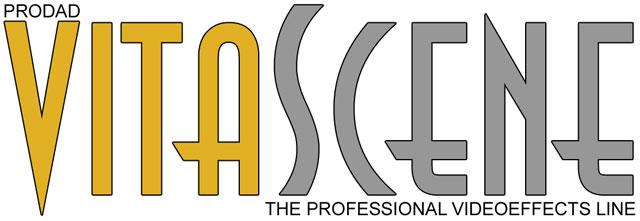

**proDAD Vitascene**

© proDAD GmbH

Autor : Uwe Wenz

## Content

- [Welcome](#welcome)
  - Copyright / legal Information
  - [Further Info's](#further-infos)
  - [Philosophy](#philosophy)
  - [What is new in Vitascene 3.0?](#what-is-new-in-vitascene-30)
  - [What is new in Vitascene 4.0?](#what-is-new-in-vitascene-40)
  - [What is new in Vitascene 5.0?](#what-is-new-in-vitascene-50)
  - [Workshops & Training for Vitascene](#workshops--training-for-vitascene)
- Installation, Activation, Registration, Help, Support and System requirements
  - [Installation, activation and registration](#installation-activation-and-registration)
  - [Help](#help)
  - [Technical Support - Support](#technical-support---support)
  - [Technology and System requirements](#technology-and-system-requirements)
- [Program start and Plug ins](#program-start-and-plug-ins)
  - [Vitascene stand-alone](#vitascene-stand-alone)
  - [Adobe Premiere Elements](#adobe-premiere-elements)
    - [Plugin as video effect](#plugin-as-video-effect)
    - [Plugin as video transition](#plugin-as-video-transition)
  - [Adobe Premiere](#adobe-premiere)
    - [Plugin as video effect](#plugin-as-video-effect-1)
    - [Plugin as video transition](#plugin-as-video-transition-1)
  - [Avid MediaComposer](#avid-mediacomposer)
    - [Plugin as video effect](#plugin-as-video-effect-2)
    - [Plugin as video transition](#plugin-as-video-transition-2)
  - [Grass Valley Edius](#grass-valley-edius)
    - [Plugin as video effect](#plugin-as-video-effect-3)
    - [Plugin as video transition](#plugin-as-video-transition-3)
    - [Effect transfer](#effect-transfer)
  - [MAGIX Vegas](#magix-vegas)
    - [Plugin as video effect](#plugin-as-video-effect-4)
    - [Plugin as video transition](#plugin-as-video-transition-4)
  - [Corel Video Studio](#corel-video-studio)
    - [Plugin as video effect](#plugin-as-video-effect-5)
    - [Plugin as video transition](#plugin-as-video-transition-5)
  - [Pinnacle Studio](#pinnacle-studio)
    - [Plugin as video effect](#plugin-as-video-effect-6)
    - [Plugin as video transition](#plugin-as-video-transition-6)
  - [MAGIX](#magix)
    - [Plugin as video effect](#plugin-as-video-effect-7)
    - [Plugin as video transition](#plugin-as-video-transition-7)
  - [Davinci Resolve](#davinci-resolve)
    - [Plugin as video effect](#plugin-as-video-effect-8)
    - [Plugin as video transition](#plugin-as-video-transition-8)
- [Workshops for familiarization](#workshops-for-familiarization)
  - [Text with Ray filter and Key frames](#text-with-ray-filter-and-key-frames)
  - [Apply Sparkle filter to an image](#apply-sparkle-filter-to-an-image-including-by-using-key-frames)
  - [Apply Shape Wipe transition effect](#apply-shape-wipe-transition-effect-with-integrated-sparkle-effect)
  - [How to create a miniature landscape in a real video](#how-to-create-a-miniature-landscape-in-a-real-video)
- [User interface/introduction](#user-interfaceintroduction)
  - [Start page](#start-page)
    - [Navigation](#navigation)
      - [Filter-Presets](#filter-presets)
      - [Preview](#preview)
      - [Export](#export)
        - [Export - Animation - AVI](#export---animation---avi)
        - [Export - Single frames](#export---single-frames)
      - [Settings](#settings)
        - [Search path for images/animations](#search-path-for-imagesanimations)
        - [Alternative video sources](#alternative-video-sources)
        - [Specialization customization](#specialization-customization)
        - [Video format](#video-format)
        - [Background / borders](#background--borders)
        - [Duration](#duration)
        - [Language - User interface](#language---user-interface)
        - [Undo](#undo)
        - [Save](#save)
      - [Manual](#manual)
  - [Control elements](#control-elements)
    - [Preview area / Timeline / Keyframes](#preview-area--timeline--keyframes)
    - [Menu description](#menu-description)
    - [Shortcuts](#shortcuts)
  - [Apply templates](#apply-templates)
    - [Filter-Presets](#filter-presets-1)
    - [Own templates](#own-templates)
    - [Filter group / Sparkle](#filter-group--sparkle)
      - [Filter](#filter)
      - [Color Adjustment](#color-adjustment)
      - [Source / Video A](#source--video-a)
    - [Transition group / Glow Wipes](#transition-group--glow-wipes)
      - [Mask-Presets](#mask-presets)
      - [Customize effect](#customize-effect)
      - [Customize mask](#customize-mask)
      - [Texture](#texture)
      - [Filter](#filter-1)
      - [Source / Video A](#source--video-a-1)
      - [Source / Video B](#source--video-b)
    - [See also](#see-also)
      - [Export](#export-1)
      - [Settings](#settings-1)
      - [Edit](#edit)
  - [Operators](#operators)
    - [Geometry](#geometry)
      - [Rotation](#rotation)
      - [Scale](#scale)
      - [Position horizontal](#position-horizontal)
      - [Position vertical](#position-vertical)
      - [Avoid edges, through may enlarge](#avoid-edges-through-may-enlarge)
      - [Translate World](#translate-world)
    - [Pixel-Aspect](#pixel-aspect)
      - [Adjust by](#adjust-by)
      - [Aspect Ratio](#aspect-ratio)
    - [Attributes](#attributes)
      - [Flip](#flip)
      - [Invert](#invert)
      - [Wrap](#wrap)
    - [Motion Blur](#motion-blur)
      - [Motion Blur](#motion-blur-1)
      - [Hubble Shift](#hubble-shift)
    - [Color Adjustment](#color-adjustment-1)
      - [Brightness](#brightness)
      - [Contrast](#contrast)
      - [Saturation](#saturation)
      - [Hue](#hue)
      - [Gamma](#gamma)
    - [Blur](#blur)
      - [Gauss Blur (3x3...11x11)](#gauss-blur-3x311x11)
      - [Gauss Blur](#gauss-blur)
      - [Horizontal Gauss Blur](#horizontal-gauss-blur)
      - [Vertical Gauss Blur](#vertical-gauss-blur)
      - [Center Blur](#center-blur)
      - [Zoom Blur](#zoom-blur)
      - [Disc Blur](#disc-blur)
      - [Direction Blur](#direction-blur)
      - [Annulus Blur](#annulus-blur)
      - [Cross Blur](#cross-blur)
      - [Blur + Expand white](#blur--expand-white)
      - [Blur + Expand black](#blur--expand-black)
      - [Frequence Blur](#frequence-blur)
      - [Cycle Frequence Blur](#cycle-frequence-blur)
      - [Fish-eye](#fish-eye)
    - [Filter](#filter-2)
      - [Bright Bloom](#bright-bloom)
      - [Bright Direction Bloom](#bright-direction-bloom)
      - [Bright Cross Bloom](#bright-cross-bloom)
      - [Saturation Bloom](#saturation-bloom)
      - [Saturation Direction Bloom](#saturation-direction-bloom)
      - [Defocus](#defocus)
      - [Defocus + Bokeh](#defocus--bokeh)
      - [Hollywood Night](#hollywood-night)
      - [Color Blur](#color-blur)
      - [Sparkle](#sparkle)
      - [Glim](#glim)
      - [Starburst](#starburst)
      - [Rays](#rays)
      - [Dust](#dust)
      - [Motion Dust](#motion-dust)
      - [Zoom Dust](#zoom-dust)
      - [Cross Dust](#cross-dust)
      - [Color Composite](#color-composite)
      - [Edge Contrast](#edge-contrast)
      - [Bevel](#bevel)
      - [Light](#light)
      - [Tilt Shift](#tilt-shift)
      - [RGB-Shift](#rgb-shift)
    - [Effect Parameter](#effect-parameter)
      - [A/B Sharpness](#ab-sharpness)
      - [A/B Tint](#ab-tin-t)
      - [Fade Point](#fade-point)
      - [X / Y-axis for Wrap](#x--y-axis-for-wrap)
      - [Hor. / Vert. displacement for Wrap](#hor--vert-displacement-for-wrap)
      - [Opacity](#opacity)
      - [blend luminance](#blend-luminance)
      - [Loops](#loops)
      - [Waveform](#waveform)
      - [Rotation](#rotation-1)
      - [Iris](#iris)
      - [swap direction](#swap-direction)
      - [Geom-Coupling](#geom-coupling)
      - [Motion Blur](#motion-blur-2)
      - [Hubble Shift](#hubble-shift-1)
    - [Dynamics](#dynamics)

## Welcome

**Welcome to Vitascene Version 5.0!**

Effects and transitions with the aid of deliberate blurring, expertly selected color matches and understated lighting create sophisticated visual moods on film, enabling glamour, flair, charm and drama to be perfectly accentuated - which is why it is barely possible to imagine a professional production without these kinds of effects:\
Vitascene makes a perfect quality stylistic device available to everyone - it’s amazingly easy to use and, thanks to the latest GPU technology, lightning fast!

We hope you enjoy Vitascene 5.0 and always produce results that are full of effects!

### Coppyright / legal Information

Copyright proDAD GmbH. All rights reserved.

Licensing Conditions\
Please read these licensing conditions carefully before installing the software.

Licensing agreement\
When setup starts, a licensing agreement is shown, which you should read carefully.\
By installing the software, you stale that you accept the copyright conditions, the licensing agreement and the licensing procedure.

License Guarantee\
proDAD GmbH grants the user the right to use this product for its proper and permitted purpose. The present product may only be installed on one computer. proDAD hereby guarantees to provide a license key free of charge. By installing this product, the user acknowledges and accepts the license guarantee, the copyright terms, and the limitation of liability.

Trademarks\
All products and trademarks mentioned in association with this product are trademarks that belong to the respective owners. All trademarks are used without any guarantee that they may be used freely, and they may be registered trademarks.

Limitation of Liability\
The extent of liability for any one claim is limited to a replacement of the product. This applies to proDAD GmbH, all licensees and retailers. Claims shall only be recognized if the software is returned in an orderly manner, together with the returned goods number that has to be previously arranged with proDAD GmbH. The goods must also be accompanied by proof of purchase. This guarantee becomes void if a malfunction of this product is due to improper use, mistreatment, an accident or improper handling. proDAD GmbH, its sales partners and licensees, shall not be held liable for damages or subsequent damages arising from the impossible usage of this product. Liability is limited in all cases to the purchase price of the product.

Documentation\
The greatest of care has been taken in compiling and translating the handbook. However, the possibility of errors cannot be fully excluded. proDAD GmbH shall assume no responsibility or liability whatsoever for the consequences of any incorrect statements or information which the documentation or translation may contain. Subject to technical and optical modifications. Information regarding any inaccuracies is always welcome.

Copyright\
The software and the individual components of this product are the property of proDAD GmbH. By installing this product, the licensee agrees to refrain from unauthorized use and duplication.

proDAD GmbH does not accept any responsibility for the usage of this program and the publication of its contents and data that has been created with this program.

proDAD GmbH \* Gauertstr. 2 \* 78194 Immendingen \* Deutschland \* HRB 1077

### Further Info's

**FURTHER INFORMATION ABOUT VITASCENE**

Workshops and FAQs : www.prodad.com

**Training and Learning-products :**\
The company Vidcom 30th-century S.L. / Uwe Wenz is proDAD Vitascene’s official training partner. Interested parties can obtain detailed information on advanced seminars at www.shop-filmbearbeitung.de.

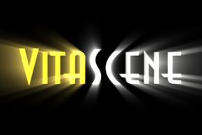

### Philosophy

**Vitascene** is a modern software based on an innovative architecture. The advantage it has in comparison to similar products is that it free from old development concepts. At the same time, this fortunate circumstance also offers the opportunity to incorporate new concepts, which may at first glance appear to be unusual, but which are, or will be, advantageous.

A greatly abbreviated insight into the various features of the application, User interfaces

- can be viewed simultaneously wherever possible: Almost all elements are visible in an overview in relation to one another.
- Complete interactivity: all parameters entered can be viewed immediately without annoying confirmations.
- Real-time preview: the preview is interactive and can be adjusted to the performance of your computer, which simplifies things when experimenting, entries do not need to be confirmed unnecessarily.
- User navigation based on the modern Windows systems for quicker comprehension.
- Shortcut menus (right mouse button) are provided wherever possible for quicker performance.
- Identical or similar functions can be used in different areas of the application to act according to one's own preferences.
- Help via the mouse in short form for quick tips while working.
- Menu navigation in tree form or as structure. Options are shown in the respective option window for schematic and orderly user navigation and the greatest possible extendibility.
- Dynamic GUI system for summarizing user habits and making functions available in just a few single steps.
- Limitless layout area for infinite freedom when editing roller titles, extra-dimensional graphics etc.
- Innovative layout features for interactive alignment, scaling etc.
- Object-oriented layout features for unlimited structure and diversity.
- Object-oriented effect engine for maximum scalability of results by combining individual effect settings.
- User-oriented preview functions for impressive, result-like previews (instead of wire frame models), interactively and qualitatively adjustable.
- Diverse export functions for extensive user possibilities.
- Future-oriented rendering methods designed for use on standardized systems. These make additional hardware useable in the future and can be continually optimized in line with increasing hardware performance.
- Modern plug-in structure for NLE host applications.
- Modern plug-in structure as host application for other manufacturers and plug-ins.
- Internal object-oriented program structure, ultra-scalable and future-safe.

By purchasing this product, you have not only made a good decision for the present, but you can also be assured that you will continue to have an application available in future that is always compatible with your environment and which attains performance and perfection by continually improving itself.

**An advantage that should not be underestimated, during and particularly following the acquisition of an innovative software!**

### What is new in Vitascene 3.0?

Visit the following website for further information on the supported NLE-versions as Plugin (transition and effect): **www.prodad.com**

Vitascene 2.0 includes the following new **filter templates**:

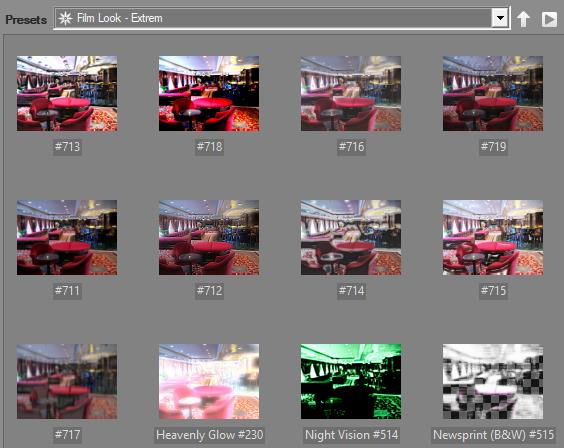

and **transition templates**.

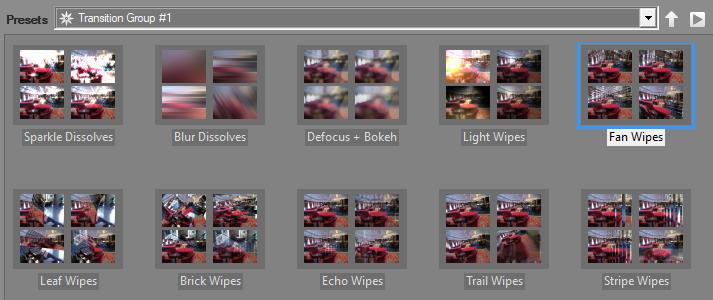

### What is new in Vitascene 4.0?

The following new **aperture templates** (Smooth/Seamless Transitions) are also available in Vitascene.

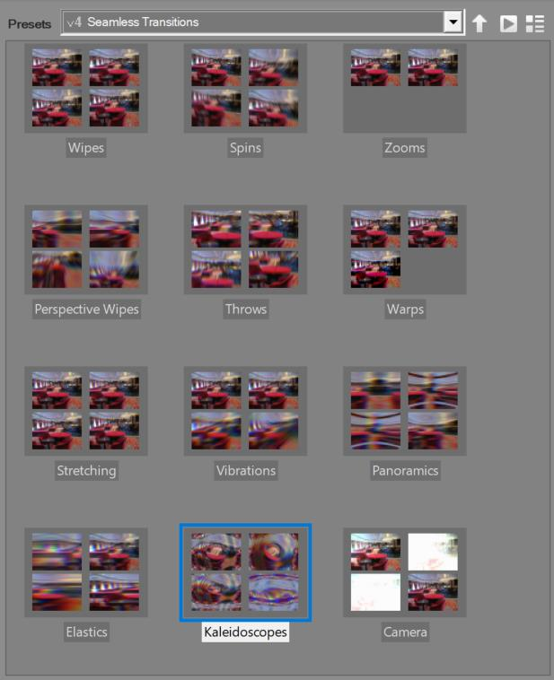

In Vitascene, aperture templates **Only IN/OUT** are also available:

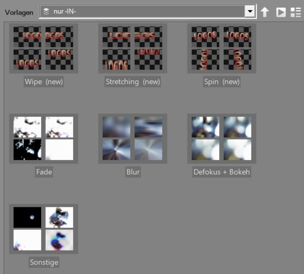

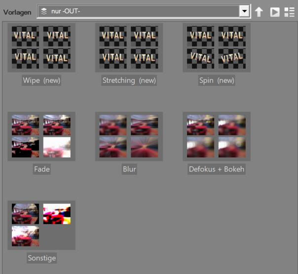

There is also a proDAD invention called **Hubble Shift**, an RGB effect that depends on the direction of movement and speed.

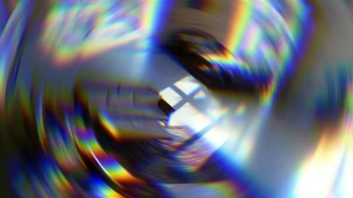

### What is new in Vitascene 5.0?

The following new **Glitch transitions** are available in Vitascene 5.0.

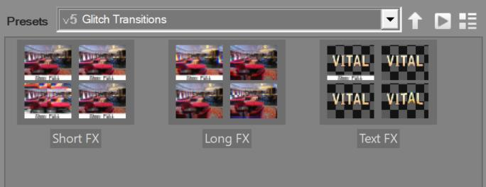

The following glitch transition templates are available in **Short FX**, which can also be edited individually after accepting the template.

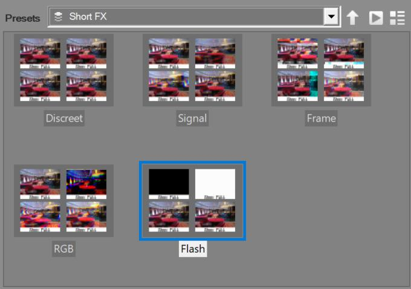

The following glitch transition templates are available in **Long FX**, which can also be edited individually after accepting the template.

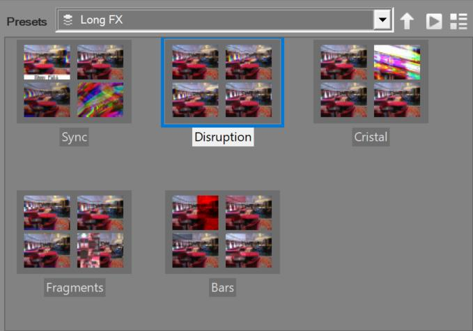

In **Text FX** the following glitch transition templates are available, which can be applied to available titles, of course they can be edited individually after accepting the template.

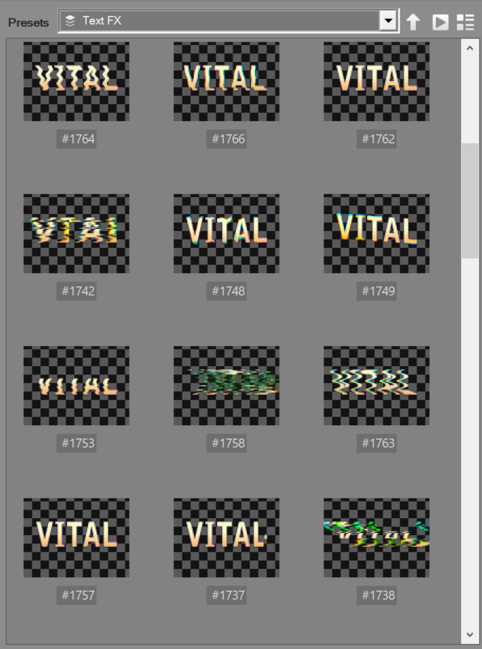

### Workshops & Training for Vitascene

Instructions for beginners and advanced users of Vitascene:

The company 30th century/Uwe Wenz is proDAD Vitascene’s official training partner. Interested parties can obtain detailed information on advanced seminars at www.shop-filmbearbeitung.de (powered by proDAD).

**Digital Video Training-Center**

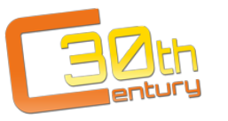

### Installation, Activation, Registration, Help, Support, Technology and System requirements

### Installation, activation and registration

1. **Installation**

Start either the **.exe** file from your download or the setup file from your DVD. Now follow the installation instructions.

When installing, ensure that your plug-in is also installed.

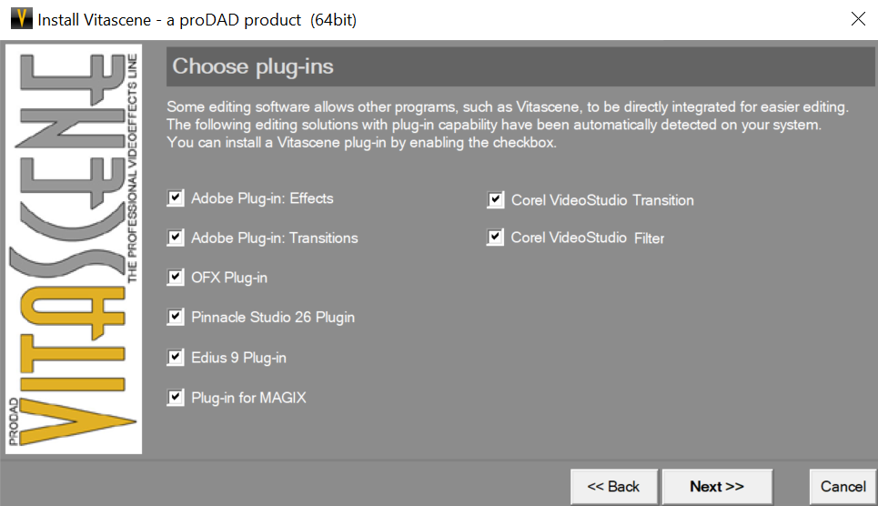

**2.Activation of Vitascene 5.0**

In Vitascvene 5.0, activate your purchased version, either the full version or the version with limited functions. Now start Vitascene 5.0 as a plug-in or standalone version.\
After starting Vitascene 5.0 for the first time, as a stand-alone program or as a plug-in in your video editing program, you should activate it with your activation code (serial number).Enter the code that you received with the download instructions email in the case of electronic delivery or, if you have received a physical delivery (on DVD), that is found inside the box. Then click **Activate**.

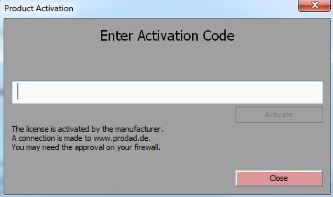

**IMPORTANT:** Please note that your system needs an internet connection at the moment of activation, only then can the activation be carried out successfully. If there is a problem, check the security settings (firewall etc.) in the system and repeat the activation.

**Further information regarding possible activation problems:**

- The product cannot be activated:

The activation key may have been entered incorrectly.\
Characters such as “1” and “I”, “8” and “B” or also “O” and “0” must be checked.

- Connection to www.prodad.de not possible:

If the connection to www.prodad.com fails, check your internet connection, network settings or security settings in the system.

If you would like to test Vitascene in the **DEMO Mode**, click **Continue with Demo Version**. The demo version is active until a serial number entry converts the licence to the full version.

You can start Vitascene after installation and activation as a **stand-alone software**, but you can also use it in different editing software programmes as **plug-in** (aperture and effect).

**3.Registering Vitascene**

Please register your proDAD Mercalli at **http://www.prodad.de/register.html**.

### Help

Vitascene, Stylish transition effects and filters! 100% GPU processing power! 100% interactive!\
For discerning professionals who are looking for the best quality in the shortest time!

Of course, being multifunctional also means that it is much more demanding both in terms of the quality and for the user. Although the operation of Vitascene has been designed very intuitively, a certain period of familiarization is always required for high-performance multimedia programs. We therefore recommend that you initially read this manual to get a feeling for the program. You should definitely work through the tutorials. The worked examples that are described there are specially tailored to help you learn how to use the program and understand the systematic behind it. Only after completing the tutorials will you have obtained a feeling for the hidden possibilities, many of which can only be achieved by combining several program features. Once you have grasped the basic principles of the tutorials, you should be in a position to create complex and demanding results after just a few days. Further assistance is always available in the program help, which gives you an overview of the comprehensive parameters and options that are available.

Help\
Questions will always arise while working with programs. In Vitascene, you can get the answers quickly and easily. The key is the integral program help, which is always available, easily found and quickly leads you to a result. Simply open the menu Help.

Here, you also find an index for quick reference in a modern electronic form.

The manual supplied with the program (with the exception of OEM versions and demo versions) as well as downloads or DVD versions of this product) is actually only intended to be an introduction to the program. The primary source of information and assistance, together with a full overview of the software, can be found in the program's online help. This manual shows you how to use the software and provides you with diverse systematic information. For in-depth detailed information, you should refer to the aforementioned online help.

***Further Info's :***

If you require further information about the program, visit the Website www.prodad.com.

Here you will find:

| • | Workshops |
| --- | --- |
| • | Supplementary instructions |
| • | Tutorials |
| • | Information about new plug-ins (that have been created after this manual had been compiled) |
| • | Other information about proDAD |
| **Instructions for beginners and advanced users of Vitascene:** The company Vidcom 30th century S.L / Uwe Wenz is proDAD Vitascene’s official training partner. Interested parties can obtain detailed information on advanced seminars at **www.shop-filmbearbeitung.de** (powered by proDAD). |  |

### Technical Support - Support

**proDAD Support**

We at proDAD are happy to answer any questions you may have about our program.

Simply contact us\
· by email at support@prodad.com\
· by telephone: +49 (0)7462 9459 0\
· by fax: +49 (0)7462 9459 79\
· by post: proDAD GmbH, Gauertstr. 2, 78194 Immendingen, Germany

Please provide us with the following information:\
· Version number and date of the program (menu **Help**)\
· Your operating system\
· Name and version number of your video editing program (if applicable)\
· Any program updates you have already installed (if applicable).

Ideally you will send us your request by menu **Help, in case of problems send an email....**\
Then the installation and user protocol is also sent to us automatically as a zip file.\
You do not need to do anything else. By the way, the transferred data does not include any personal information.

***Note:***\
In Vitascene’s Help Menu you will find the option **Service Update**, which will take you to the www.prodad.com service page to download Service Updates **(Service Packs)** of the software. When installed, the latest version of Vitascene offers enhancements and will solve possible problems.

### Technology and System requirements

At the moment, you are provided with basic information on the technology by proDAD Vitascene. One aspect that is particularly important for correct use is compliance with the requirements in terms of your PC.

**What is a GPU (graphics processing unit)?**

Modern graphics cards have an extremely high level of computing power, which is vastly superior to that of the CPUs used in PCs. With Vitascene this power is used to create effects! Digital processing is carried out by the graphics card, speeding up the whole procedure enormously.

**Brand new technology – 50 times faster than it used to be – with an accelerated GPU!**

The advantages of GPU processing:

- up to 50 times faster than using a CPU
- perfect quality using 16 bit and 32 bit IEEE
- more precise processing for improved quality and sharper details

**System requirements:**

- Windows 64-Bit Vista, Win7, Win8, Win8.1, Win10, Win11
- 2GB-memory (RAM), recommended: i7-cpu, 6 GB memory (RAM)

**Possible limitations in terms of performance:**

- An out of date graphics hardware driver
- An out of date version of DirectX

***Tip:***\
Always keep your PC system up to date in terms of driver software for graphics cards and your version of DirectX. We also recommend taking the GPU-Test to determine the capacity of your graphics card.

## Program start and Plug ins

The following chapters contain information on the use of proDAD Vitascene as a stand-alone version as well as for **plug-in operation** with the various video editing applications below:

- Vitascene stand-alone
- Adobe Premiere Elements
- Adobe Premiere
- Avid MediaComposer
- Grass Valley Edius
- MAGIX Vegas
- Corel Video Studio
- Pinnacle Studio
- MAGIX
- Davinci Resolve

***Please note:***\
*To check which version of your editing software is supported, refer to the Vitascene section* *at* ***www.prodad.com****.*

For information purposes and for the sake of completeness, the following plug-in descriptions include all potentially available plug-ins. Your licence may not include the use of a particular plug-in, in which case you will not be able to use that plug-in.\
Even if the description refers to use of the standalone version, this does not mean that the plug-in is covered by your licence.

### Vitascene stand-alone

Starting the independent version of the program:

Click on the **Vitascene icon** on your **desktop** by double-clicking

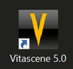

or via the Windows **start menu / Programs / proDAD / Vitascene 4.0**.

### Adobe Premiere Elements

#### Plugin as video effect

**This is what you do:**

1. Locate the **Effects**.
2. Select the **proDAD** directory.
3. Click the item **Vitascene Filter** and drag it onto the required clip in the timeline.

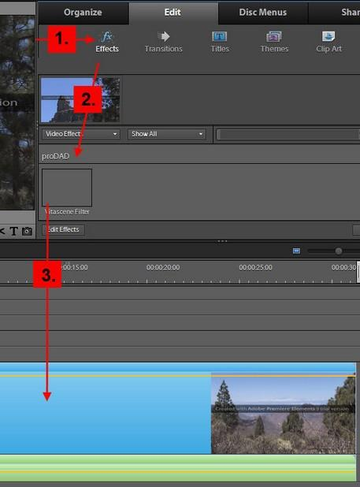

4. Vitascene starts, now choose a suitable video effect from the Filter Templates (e.g. **Tilt Shift** / **Commercial Look 631**). A playback of the current video clip with the selected video effect will appear in the Vitascene preview window, and, of course, you can modify the selected effect in Vitascene to suit you.

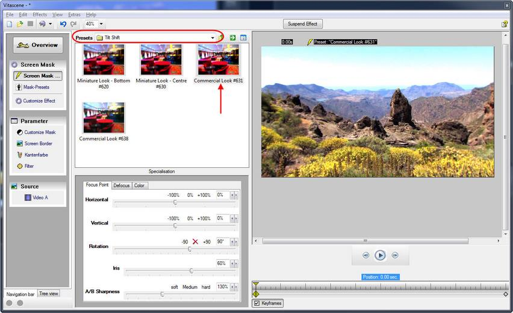

5. Once the project has been edited and completed in Vitascene, simply press the **F12 key** or click on the symbol 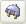 to return to Premiere Elements.\
  This will automatically save the Vitascene project.
6. If you want to start Vitascene again, select the clip in the timeline.
7. Now click the **Edit Effects** button.

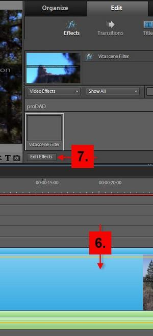

8. The **Vitascene Filter** effects list appears, click the **Setup...** button and Vitascene starts again.

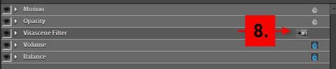

***Note:***\
*If you want to delete the Vitascene effect, right-click* ***Vitascene Filter*** *and choose the* ***Delete*** *option.*

#### Plugin as video transition

**This is what you do:**

1. Locate the **Transitions**.
2. Select the **proDAD** directory.
3. Hold down your left mouse button and drag this **Vitascene Transition** between the two clips in the Timeline.
4. Click the **Edit Transition** Button.

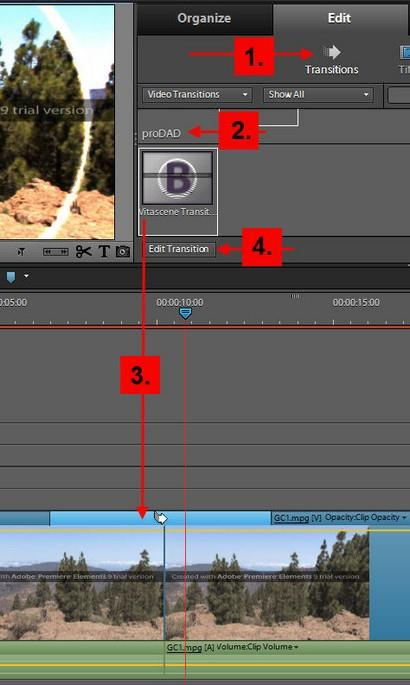

5. This opens the **Vitascene Transition** dialog.
6. Click on the **Custom** button.

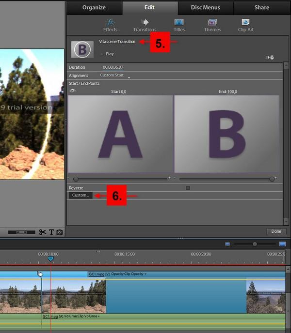

7. Vitascene starts, choose a suitable transition from the Transition Templates (e.g. **Soft Psychedelic wipe**). A playback with the selected transition will appear in the Vitascene preview window and, of course, you can modify the selected transition in Vitascene to suit you.

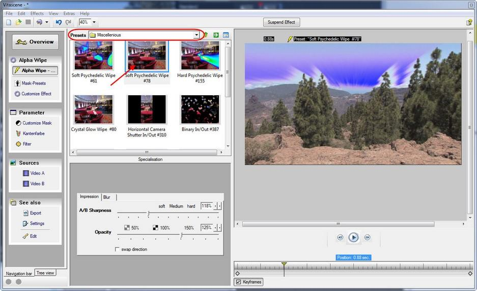

8. Once the project has been edited and completed in Vitascene, simply press the **F12 key** or click on the symbol  to return to Premiere Elements. This will automatically save the Vitascene project.

### Adobe Premiere

#### Plugin as video effect

**This is what you do:**

1. Go to the **video filters (Effects)** and click the **proDAD** directory to open it.
2. Click the item **Vitascene Filter** and drag it onto the required clip in the timeline.
3. Vitascene starts, now choose a suitable video effect from the Filter Templates (e.g. **Tilt Shift** / **Commercial Look 631**). A playback of the current video clip with the selected video effect will appear in the Vitascene preview window, and, of course, you can modify the selected effect in Vitascene to suit you.
4. Once the project has been edited and completed in Vitascene, simply press the **F12 key** or click on the symbol  to return to Adobe Premiere.\
  This will automatically save the Vitascene project.
5. If you want to start **Vitascene Filter** again, go to the **Effect Controls/Vitascene Filter r**egister and click the **Setup-Button**.

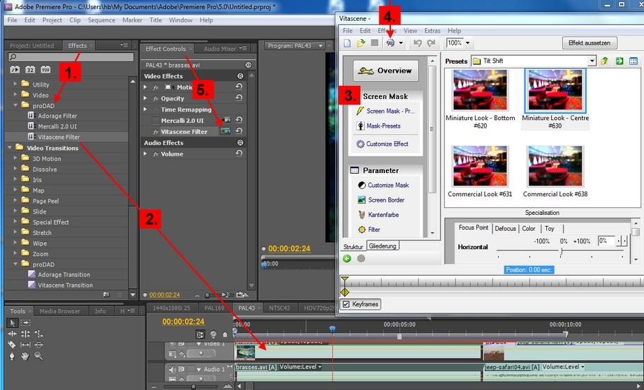

#### Plugin as video transition

**This is what you do:**

1. Locate the **Effects**.
2. Locate the **Video Transitions** and there the **proDAD** directory.
3. Hold down your left mouse button and drag this **Vitascene Transition** between the two clips in the Timeline.
4. Vitascene starts, choose a suitable transition from the Transition Templates (e.g. **Soft Psychedelic wipe**). A playback with the selected transition will appear in the Vitascene preview window and, of course, you can modify the selected transition in Vitascene to suit you.
5. Once the project has been edited and completed in Vitascene, simply press the **F12 key** or click on the symbol  to return to Adobe Premiere.\
  This will automatically save the Vitascene project.
6. If you want to start **Vitascene Transition** again, click the transition area in the Timeline and go to the **Effect Controls/Vitascene Transition** register and click on the **Custom...** button.

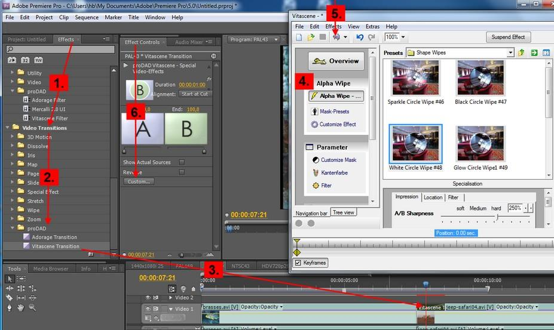

### Avid MediaComposer

#### Plugin as video effect

Start **Media Composer**. After successful installation of the Vitascene - Media Composer plug-in, **Vitascene** will be available via the Media Composer Effects dialogue box (Effects Editor).

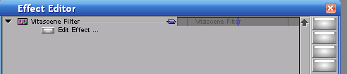

Now drag and drop the **Vitascene Filter** into the Timeline and click on the **Edit Effect** option. This will start Vitascene. A playback of the current video clip with the chosen video effect will appear in the Vitascene preview window and, of course, you can modify the selected effect in Vitascene to suit you.\
Once the project has been edited and completed in Vitascene, simply press the **F12 key** or click on the symbol  to return to Media Composer.\
This will automatically save the Vitascene project.

#### Plugin as video transition

Start **Media Composer**. After successful installation of the Vitascene - Media Composer plug-in, **Vitascene** will be available via the Media Composer Effects dialogue box (Effects Editor).

Now drag and drop the **Vitascene Filter** into the Timeline and click on the **Edit Effect** option. This will start Vitascene. A playback with the selected transition will appear in the Vitascene preview window in real time and, of course, you can modify the selected transition in Vitascene to suit you.\
Once the project has been edited and completed in Vitascene, simply press the **F12 key** or click on the symbol  to return to Media Composer.\
This will automatically save the Vitascene project.

### Grass Valley Edius

#### Plugin as video effect

**This is what you do:**

1. Go to the **video filters (Effects)**.
2. Click on the **proDAD** folder.
3. Click the item **Vitascene Filter** in the folder and drag it onto the required clip in the EDIUS timeline.
4. To start **Vitascene**, double-click the item **Vitascene Filter** in the **information panel**.

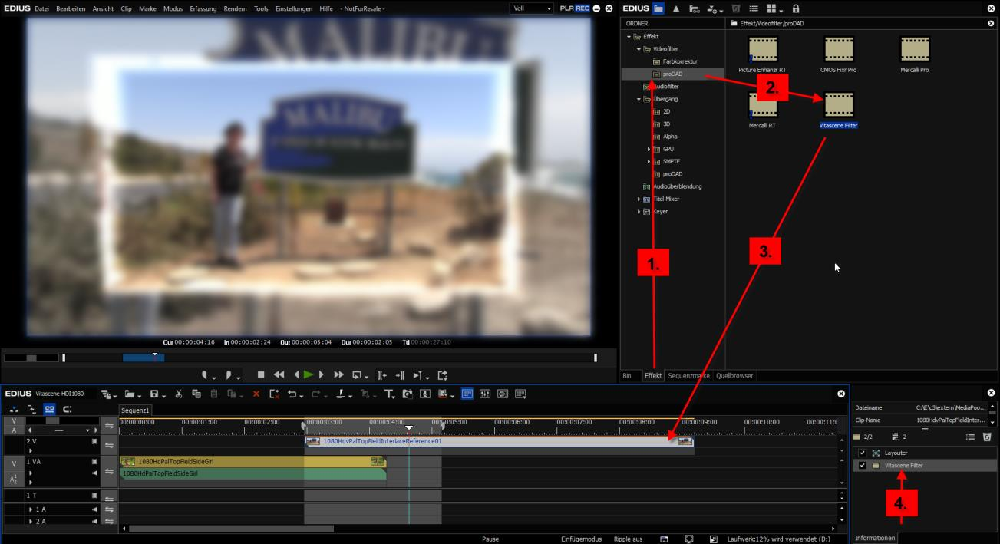

Vitascene starts. Change into the **Templates** and select the desired effect.

#### Plugin as video transition

**This is what you do:**

1. Locate the transitions (in the **Effects** register).
2. Click on the **proDAD** folder.
3. Hold down your left mouse button and drag this **Vitascene Transition** between the two clips in the Timeline.
4. Double-click the **Vitascene Transition** entry in the **Information panel**.

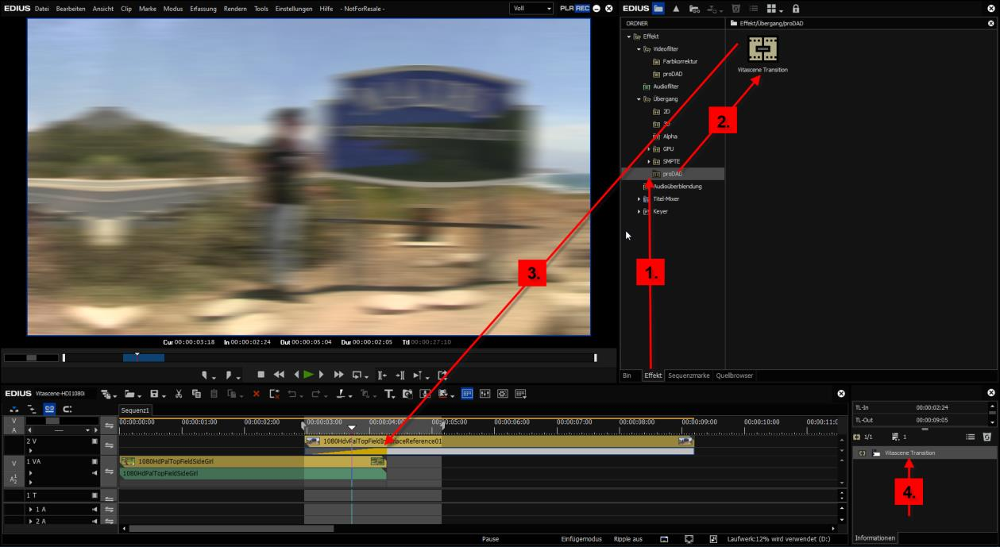

Vitascene starts. Now change into the **Templates** and select a suitable aperture.

#### Effect transfer

If you have selected a Vitascene effect or a Vitascene aperture, editing can take place, you can see every change directly in the EDIUS preview.\
Once the project has been edited and completed in Vitascene, simply press the **F12 key** or click on the symbol 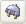 to return to Edius.\
This will automatically save the Vitascene project.

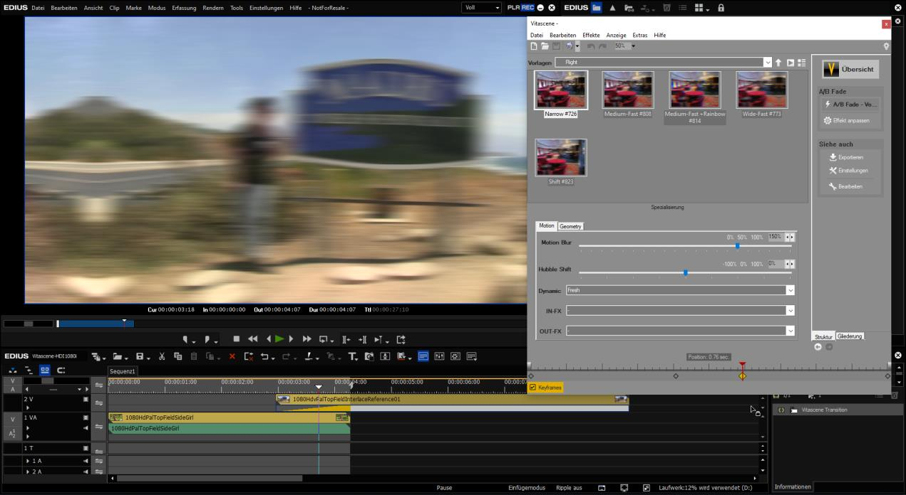

### MAGIX Vegas

#### Plugin as video effect

**This is what you do:**

1. Go to the Effects library **Video FX**.
2. Click the item **proDAD Vitascene Filter** and drag it onto the required clip in the timeline.
3. The dialog **proDAD Vitascene** will be included in Vegas (Videoevent-FX).
4. Click the **Edit Filter...** button.

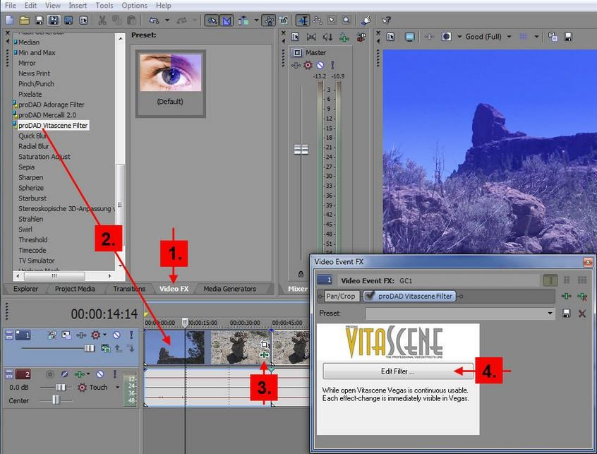

5. Vitascene starts, now choose a suitable video effect from the Filter Templates (e.g. **Tilt Shift** / **Commercial Look 631**). A playback of the current video clip with the selected video effect will appear in the Vitascene preview window, and, of course, you can modify the selected effect in Vitascene to suit you.

6. Once the project has been edited and completed in Vitascene, simply press the **F12 key** or click on the symbol  to return to Sony Vegas. This will automatically save the Vitascene project.

***Note:***\
*If you want to open* ***Filter Vitascene*** *again, click the* ***Event-FX...*** *button (green) in the* *videoclip (with Vitascene-effect) in the Timeline.*

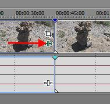

*You can then open Vitascene via the dialog* ***Videoevent-FX****.*

#### Plugin as video transition

**This is what you do:**

1. Start **Vegas**, place two video clips in the Timeline, superimposing them (i.e. arranging the two clips in the Timeline so that they overlap).
2. Locate the **Transitions**.
3. Hold down your left mouse button and drag this **Vitascene Transition** between the two clips in the Timeline.
4. The dialog **proDAD Vitascene Transition** will be included in Vegas (Videoevent-FX).
5. Click the **Edit Transition...** button.

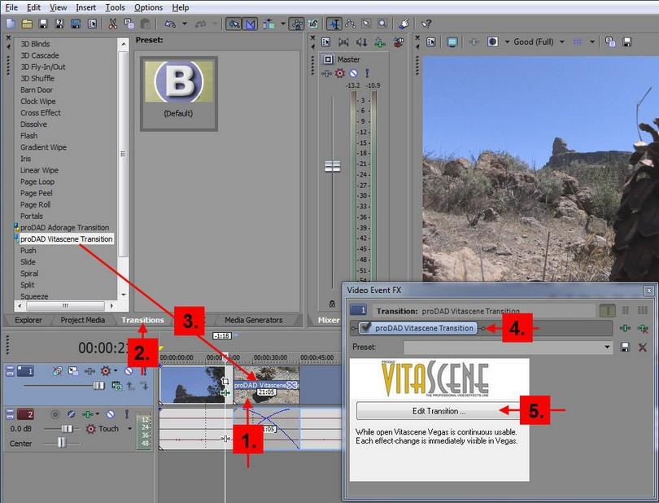

6. Vitascene starts, choose a suitable transition from the Transition Templates (e.g. **Soft Psychedelic wipe**). A playback with the selected transition will appear in the Vitascene preview window and, of course, you can modify the selected transition in Vitascene to suit you.

7. Once the project has been edited and completed in Vitascene, simply press the **F12 key** or click on the symbol  to return to Sony Vegas.\
  This will automatically save the Vitascene project.

***Note:***\
*If you want to open* ***Vitascene Transition*** *again, click the* ***Transition Properties...*** *button* *in the transition area of the videoclip (in the Timeline).*

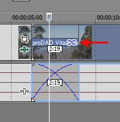

*You can then open Vitascene via the dialog* ***Videoevent-FX****.*

### Corel Video Studio

#### Plugin as video effect

**This is what you do:**

1. Locate the **FX**.
2. Activate your clip in the timeline by **double-clicking** it.
3. In FX, click **proDAD**.
4. Drag the **Vitascene 2.0** entry to the selected video clip (via drag & drop) in the Corel Video Studio timeline.
5. Now click on the **Customize Filter** button.

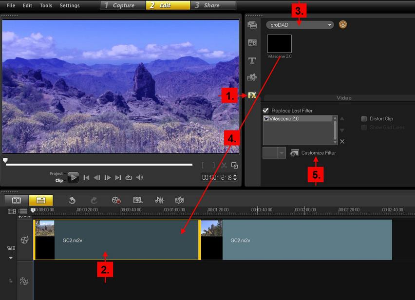

6. Vitascene starts, now choose a suitable video effect from the Filter Templates (e.g. **Tilt Shift** / **Commercial Look 631**). A playback of the current video clip with the selected video effect will appear in the Vitascene preview window, and, of course, you can modify the selected effect in Vitascene to suit you.

7. Once the project has been edited and completed in Vitascene, simply press the **F12 key** or click on the symbol  to return to Corel Video Studio.\
  This will automatically save the Vitascene project.
8. If you want to start **Vitascene 2.0** again, activate the clip again (double-click), go to **FX / proDAD / Vitascene 2.0** and click the **Customize Filter** button.

***Note:***\
*If you want to delete the Vitascene effect from the clip, go to* ***FX / proDAD / Vitascene*** ***2.0*** *and click the button* ***Delete filter (X)****.*

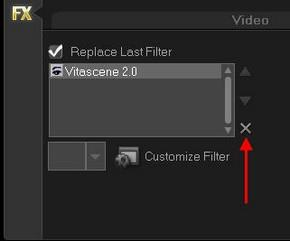

#### Plugin as video transition

**This is what you do:**

1. Start **Corel**, place two video clips in the Timeline, superimposing them (i.e. arranging the two clips in the Timeline so that they overlap).
2. Locate the **Transition A/B**.
3. Click on the **proDAD-**button.
4. Hold down your left mouse button and drag this **Vitascene Transition** between the two clips in the Timeline.
5. Click on the **Customize** button .

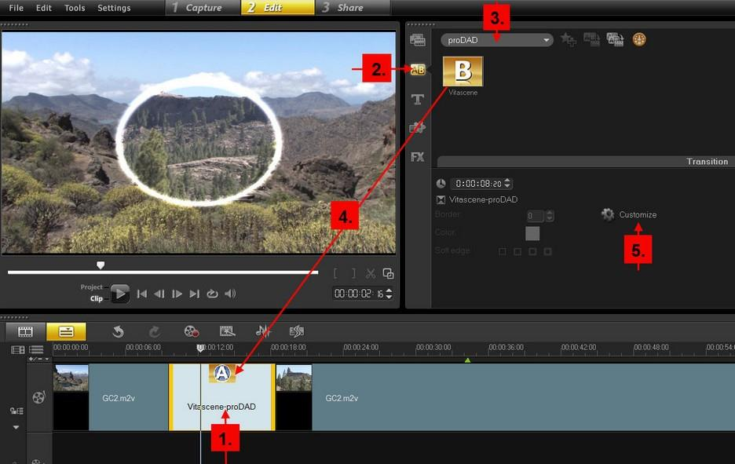

6. Vitascene starts, choose a suitable transition from the Transition Templates (e.g. **Soft Psychedelic wipe**). A playback with the selected transition will appear in the Vitascene preview window and, of course, you can modify the selected transition in Vitascene to suit you.

7. Once the project has been edited and completed in Vitascene, simply press the **F12 key** or click on the symbol  to return to Corel Video Studio.\
  This will automatically save the Vitascene project.
8. If you want to start Vitascene again, double-click on the transition area in the timeline, go to **Transition (A/B) / proDAD / Vitascene** and click on the **Customize**-button.

***Note:***\
*If you want to delete Vitascene as transion, right-click on the transition area in the timeline* *and select* ***Delete****.*

### Pinnacle Studio

#### Plugin as video effect

**This is what you do:**

1. Locate **Effects/proDAD** and there the **Vitascene** directory, open it.
2. Hold down your left mouse button and drag the **Vitascene** entry onto the selected videoclip in the timeline.
3. The effect will be depicted as a **magenta-colored line** in the clip. Double-click to open it.

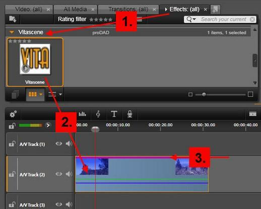

4. A new dialog opens with the **Effects** register activated.
5. On the right appears the selected **Vitascene** effect, click on the **Edit** button.

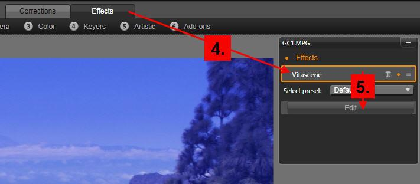

6. Vitascene starts, now choose a suitable video effect from the Filter Templates (e.g. **Tilt Shift** / **Commercial Look 631**). A playback of the current video clip with the selected video effect will appear in the Vitascene preview window, and, of course, you can modify the selected effect in Vitascene to suit you.

7. Once the project has been edited and completed in Vitascene, simply press the **F12 key** or click on the symbol  to return to Pinnacle Studio. This will automatically save the Vitascene project.
8. Click **OK** to confirm the Vitascene effect in the **Effects** register. The effect will be applied in the timeline.

***Note:***\
*If you want to delete* ***Vitascene*** *as an effect from the clip, right-click the* ***magenta-colored*** ***line*** in the clip and choose the ***Effect/Delete/Vitascene***option.

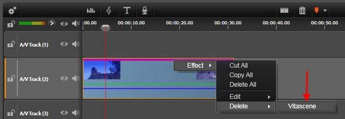

#### Plugin as video transition

**This is what you do:**

1. Locate the **Transitions/proDAD** and open the **Vitascene** directory.
2. Hold down your left mouse button and drag this **Vitascene Transition** between the two clips in the Timeline.
3. Now right-click the **transition area** and choose the **Transitions/Edit** option.

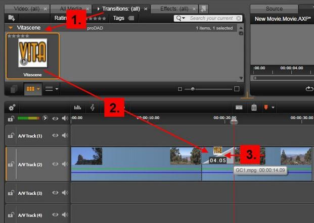

4. This opens the **Vitascene** dialog, which - among other settings - allows you to determine the duration of the transition. Click the **Edit** button to start Vitascene.

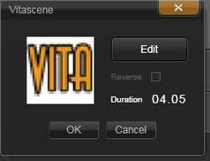

5. Vitascene starts, choose a suitable transition from the Transition Templates (e.g. **Soft Psychedelic wipe**). A playback with the selected transition will appear in the Vitascene preview window and, of course, you can modify the selected transition in Vitascene to suit you.

6. Once the project has been edited and completed in Vitascene, simply press the **F12 key** or click on the symbol  to return to Pinnacle Studio. This will automatically save the Vitascene project.
7. Then click **OK** to confirm the **Vitascene** dialog (in Studio), the transition appears in the Studio preview.

***Note:***\
*If you want to delete* ***Vitascene*** *as a transition from the clip, right-click the* ***transition area*** in the clip and choose the ***Transition/Remove*** option.

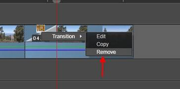

### MAGIX

#### Plugin as video effect

**This is what you do:**

1. Start **MAGIX Movie Edit Pro** and place a video clip in the timeline, making sure it is highlighted (orange).
2. Now go to the **Effects menu**.
3. After opening the **Effects** register, you will find the **Additional effects / proDAD** directory.
4. Click on **proDAD Vitascene**.

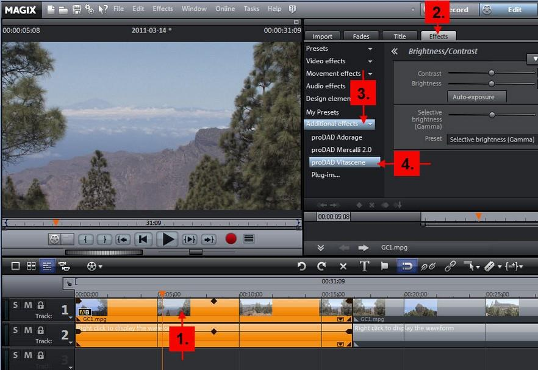

5. Vitascene starts, now choose a suitable video effect from the Filter Templates (e.g. **Tilt Shift** / **Commercial Look 631**). A playback of the current video clip with the selected video effect will appear in the Vitascene preview window, and, of course, you can modify the selected effect in Vitascene to suit you.

6. Once the project has been edited and completed in Vitascene, simply press the **F12 key** or click on the symbol  to return to MAGIX. This will automatically save the Vitascene project.

#### Plugin as video transition

**This is what you do:**

1. Start **MAGIX Movie Edit Pro**, place two video clips in the Timeline, superimposing them (i.e. arranging the two clips in the Timeline so that they overlap).
2. Go to the **Fades** register.
3. After opening the **Fades** register, you will find the **Additional-fades** directory.
4. Hold down your left mouse button and drag this **Vitascene Transition** between the two clips in the Timeline.
5. Now right-click on **A/B** in the transition area and choose the **Settings** option.

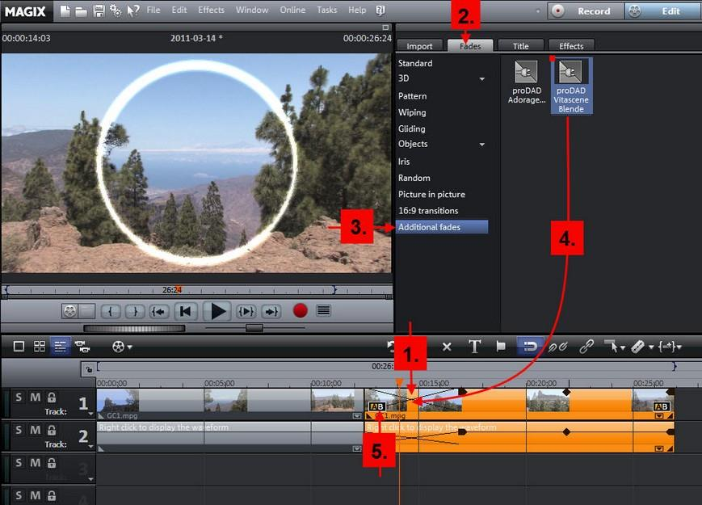

6. Vitascene starts, choose a suitable transition from the Transition Templates (e.g. **Soft Psychedelic wipe**). A playback with the selected transition will appear in the Vitascene preview window and, of course, you can modify the selected transition in Vitascene to suit you.

7. Once the project has been edited and completed in Vitascene, simply press the **F12 key** or click on the symbol  to return to MAGIX. This will automatically save the Vitascene project.

### Davinci Resolve

#### Plugin as video effect

With the installation of Vitascene, the **OFX plugin** is automatically installed.

**This is what you do:**

1. Localize **Effects**.
2. Then click on **Filters** in **Open FX**.
3. In **Filters** you will find the folder **proDAD**.
4. drag the **Vitascene V5** entry contained in the folder onto the selected video clip in the Davinci Resolve Timeline.
5. Now click on **Inspector/Effects**.

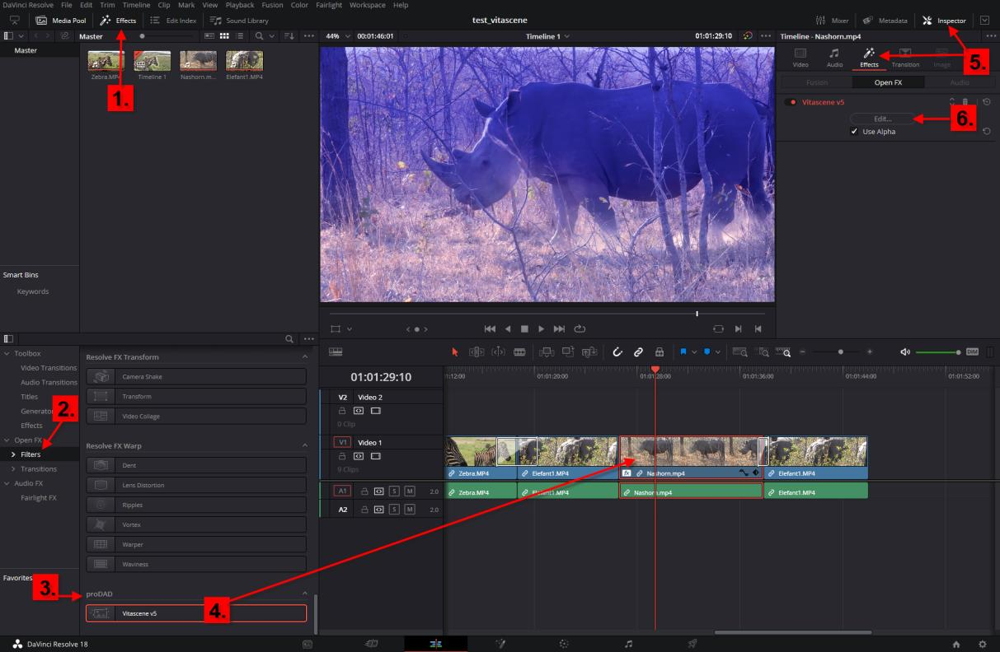

6. Here you can now open Vitascene as a video effect plug-in. In Vitascene, you then select a desired effect template (e.g. Film Look - Extreme / Demon Sunset #385) and adjust detail settings if necessary.

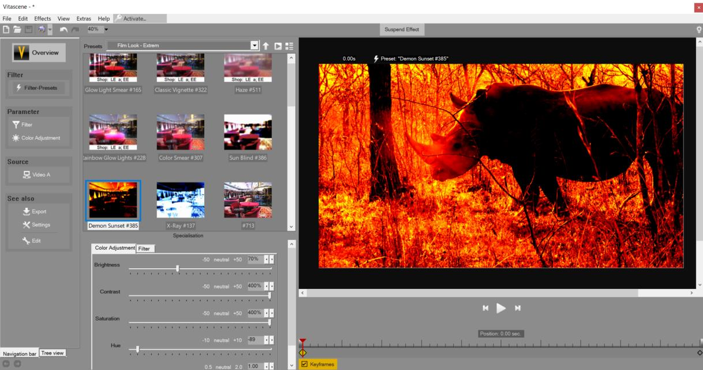

7. Once the project has been edited and completed in Vitascene, simply press the **F12 key** or click on the symbol  to return to MAGIX.\
  This will automatically save the Vitascene project.

#### Plugin as video transition

With the installation of Vitascene, the **OFX plugin** is automatically installed.

**This is what you do:**

1. localize **Effects**.
2. Then click on **Transitions** in **Open FX**.
3. In **Transitions** you will find the folder **proDAD**.
4. Drag and drop the **Vitascene V5** entry between 2 consecutive videos in the Davinci Resolve timeline. But first trim the 2 videos in the timeline at the end and at the beginning, only then the transition can be inserted and adjusted.
5. Then click on **Inspector/Transitions**.

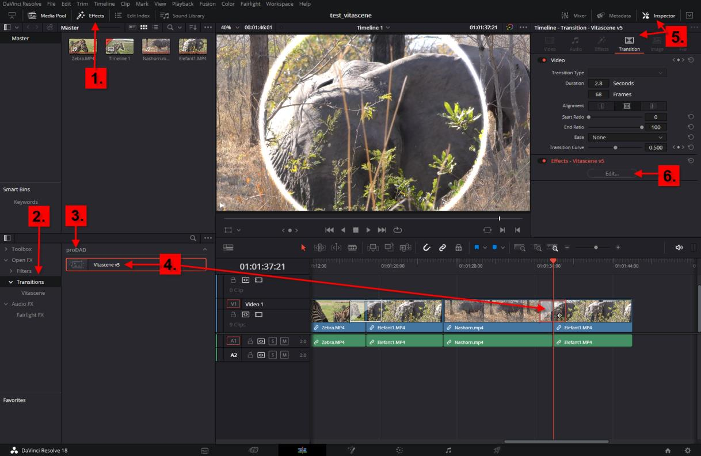

6. Here you can now open **Vitascene V5** as a video transition plugin. In Vitascene, you then select a desired transition template (e.g. Glitch Transitions / Long FX / Cristal / # 1467) and adjust detail settings if necessary.

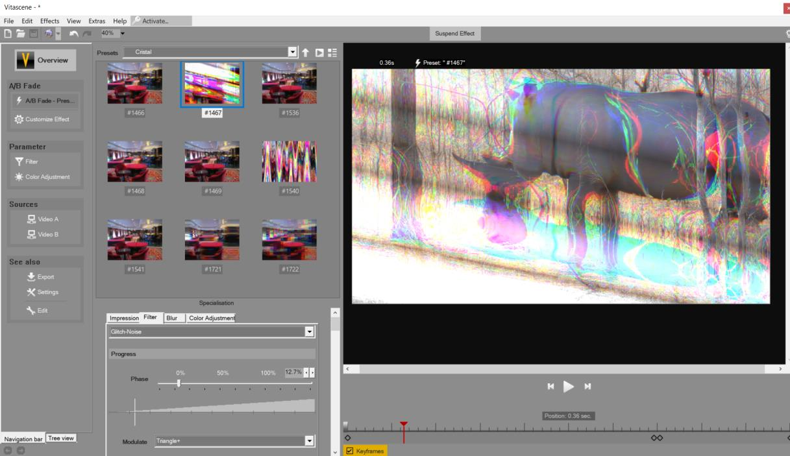

7. Once the project has been edited and completed in Vitascene, simply press the **F12 key** or click on the symbol  to return to Davinci Resolve. This will automatically save the Vitascene project.

## Workshops for familiarization

Here you can find some applications in a step-by-step guide.\
Working through these examples takes approx. 30 minutes. Afterwards, you will know how to carry out projects with Vitascene and realize your own ideas. If you work through the examples you will save time later when *exploring* the logic and application.

**Have fun getting to know the program!**

The company 30th century/Uwe Wenz is proDAD Vitascene’s official training partner. Interested parties can obtain detailed information on advanced seminars at www.shop-filmbearbeitung.de.

### Text with Ray filter and Key frames

The colorful title that is packed with effects (with text) has already been created with proDAD Heroglyph using Alpha Keys (saved as a \*.tif file).\
Use the following settings for single frame export in Heroglyph.

**Stand-alone use:**\
Or import the title direct into Vitascene, in order to apply the **Ray** filter or to modify the title with drifting light reflections by using Key frames.\
First start Vitascene, then go to the **Filter-Presets** and select the **Ray** filter (e.g. effect #390) by double clicking in the Vitascene preview window. The effect is applied to the title (created in proDAD Heroglyph) and light reflections are visible at the preview stage.

After saving the effect, the desired background (image or clip) will no longer be visible in the preview window. To import our previously created image, go to the **Navigation Menu** in the **Source** field and click on the **Video A** option.

This opens the **Video A** dialogue box. In the **Source** field click on the **Type of fill** option, this opens a drop-down menu; select the **Image / animation** option**.** Then click on the **Folder button -** to the right next to the **Image** drop-down menu **-** to select our image file, for example, and import the file with the help of the **Image** option. The format **720x576 Pixel RGB + Alpha** is displayed within the details of the graphics used.

The image file appears immediately in the Vitascene preview window (with the **Ray** filter already integrated).

The **Video A** dialogue box also contains setting options for imported images (or clips) for pixel-aspect, attributes and geometry.

For this workshop, use the original image without additional settings.

Now go to the **Navigation menu** in the **Parameter** field and click on the **Filter** option.

This opens the **Filter** dialogue box with various settings for the active **Ray** filter.

Here you can modify the settings for the **Ray** filter, but first go to the preview window and check whether the **Keyframes** option is activated (key points during the course of an animation, which have various properties at pre-determined times).\
Without activation of the **Keyframes** option no changes in the effect, in relation to the progress of an animation, will be shown. In this case, the settings will apply to all points in time during an animation.

Now alter the setting for the **Length** option, selecting a value of 24%, for example, and set the **reduce flicker** controller to 35%.

Now select the **Bright Edge** setting from the **Scan Mode** drop-down menu.\
In addition, set the **Threshold** controller to 20% and, in the **Method** drop-down menu, select the **Motion Beam** setting.

Set the **Exposure** controller to 4.50 and the **Zoom** controller to 1%.

The preview window will now display the effect of the Ray filter on the image used as follows. Clear light reflections are visible within the **Vitascene** text, which run from the centre of the image to the edge of the text.

Now alter the **Ray** effect with the help of the controller :

**Composite** = 0%\
**Scene-Intensity** = 100%\
And set the **Glow-Intensity** = 55%.

Leave the **Highlight Color** option as white and **Highlight -Intensity** at 25%.

Now select the **Tint-Color** Red (in relation to the rays of light), set the **Tint-Intensity** to 200% and **Exposure Tint** to 1.15.

The preview window will now display the effect of the Ray filter on the image used as follows. Clear light reflections as well as **Red** discoloration is visible within the **Vitascene** text.

Finally alter the position of the source of the rays of light in a horizontal and vertical direction, use Key frames to do this (at the beginning and end of the animation).

First place the slider (position in the time axis beneath the preview) at the **beginning** of the animation.

Then move the **Horizontal** controller to -57% and the **Vertical** controller to 46%.

The preview appears as follows.

Now place the slider (position in the time axis beneath the preview) at the **end** of the animation.

Then move the **Horizontal** controller to 57% and the **Vertical** controller to 46%.

The preview appears as follows.

Now start an animation in the preview window with the help of the Play button. You will notice that the light reflections move during the course of the animation. This movement is created by placing a beginning Key frame and an end Key frame. Of course, you can position further Key frames during the course of the animation. To do this, you need to place the slider in the required position and then alter the effect properties using the controller. Repeat this for each Key frame within the animation.

***Note:***\
Naturally, you can shift Key frames within the Timeline, to do this place your mouse on a Key frame, hold down the left mouse button and drag it to a new position in the Timeline. You can also delete Key frames during the course of an animation, to do this place the slider on the corresponding Key frame and press the **Delete** key on your keyboard.

To round off, click on the **Color Adjustment** option in the **Navigation menu**.

This opens the Color adjustment dialogue box, which provides access to the following display settings for the image or video material used.

### Apply Sparkle filter to an image (including by using Key frames)

This tutorial provides information on the application and adjustment of a Sparkle filter in relation to a selected image (or clip) in Vitascene. The use of Key frames is also discussed here. To do this, for example, Sparkle rays are presented as an animation in the background image (set in motion).

First start Vitascene, then go to the **Filter Templates** and select the **Sparkle** filter (e.g. Effect #131) by double clicking in the Vitascene preview window.

Should you be running Vitascene in a **stand-alone** format, after saving the effect, the desired background will no longer be visible in the preview window (but rather an example image). To import our image, go to the **Navigation Menu** in the **Source** field and click on the **Video A** option.

This opens the **Video A** dialogue box. In the **Source** field click on the **Type of fill** option, this opens a drop-down menu; select the **Image / animation** option**.**

Then click on the **Folder button -** to the right next to the **Image** drop-down menu **-** to select our image file, for example, and import the file with the help of the **Image** option. The image file appears immediately in the Vitascene preview window (with the **Sparkle** filter already integrated).

The **Video A** dialogue box also contains setting options for imported images (or clips) for pixel-aspect, attributes and geometry.\
For this workshop, use the original image without additional settings.

Now go to the **Navigation menu** and click on the **Filter-Presets** option.

This opens the **Filter-Presets** dialogue box with various templates and settings for the active **Sparkle** filter.\
Now go to the **Navigation menu** in the **Parameter** field and click on the **Filter** option.

This opens the **Filter** dialogue box with various settings for the active **Sparkle** filter (without filter templates, since a template is already applied in the preview window).

Here you can modify the settings for the **Sparkle** filter, but first go to the preview window and check whether the **Keyframes** option is activated (key points during the course of an animation, which have various properties at pre-determined times).\
Without activation of the **Keyframes** option no changes in the effect, in relation to the progress of an animation, will be shown. In this case, the settings will apply to all points in time during an animation.

Now stop the preview by clicking on stop. Leave the beginning Key frame with its current settings (see preview or current controller position). Next, move the slider to a new position during the course of an animation. No new Key frames will be placed, unless you enter the first setting in the **Sparkle** dialogue box, in relation to the current position in the Timeline.

Now alter the following settings using the controller:

**Glow-Intensity** = 70%\
**Spot-Intensity** = 0%\
**Orientation** = 60%\
and **reduce flicker** = 54%

nd

This will create the following preview for the 2 Key frame. Start the preview to look at the effect with the help of the Play button.

Now stop the preview by clicking on stop. Now move the slider to a new position during the course of an animation. No new Key frames will be placed, unless you enter the first setting in the **Sparkle** dialogue box, in relation to the current position in the Timeline.

Now alter the following settings using the controller:

**Length** = 25\
**Erosion-Threshold** = 91%\
**Glow-Intensity** = 70%\
**Spot-Intensity** = 0%\
**Orientation** = 80%\
and **reduce flicker** = 30%

This will create the following preview for the 3. Key frame. Start the preview to look at the effect with the help of the Play button.

Now stop the preview by clicking on stop. Now move the slider to the end position during the course of an animation.

Now alter the following settings using the controller:

**Length** = 20\
**Highlight-Threshold** = 20%\
**Erosion-Threshold** = 13%\
**Glow-Intensity** = 30%\
**Spot-Intensity** = 0%\
**Orientation** = 90%\
and **reduce flicker** = 20%

This will create the following preview for the End-Key frame. Start the preview to look at the effect with the help of the Play button.

Now stop the preview by clicking on stop.

Now you can process the animation as a video clip in preview, with the help of Export.

***Note:***\
Naturally, you can shift Key frames within the Timeline, to do this place your mouse on a Key frame, hold down the left mouse button and drag it to a new position in the Timeline. You can also delete Key frames during the course of an animation, to do this place the slider on the corresponding Key frame and press the **Delete** key on your keyboard.

This completes application of the Sparkle filter in connection with the use of Key frames in the Timeline.

### Apply Shape Wipe transition effect (with integrated Sparkle effect)

This tutorial focuses on the use of a transition effect from the **Shape Wipe Gallery**. Vitascene is used as a plug-in to video editing software (e.g. Pinnacle Studio).

Double click on the **Vitascene Transition** in the Timeline (appearing in grey between the clips), Vitascene will start, the video material from the video editing software will appear in the preview window.

Choose a suitable transition from the Filter Templates (e.g. Sparkle Circle Wipe #46). A playback with the selected transition will appear in the Vitascene preview window in real time. Video A is faded into video B. Of course, you can modify the transition in Vitascene to suit you.

Now go to the Timeline beneath the preview window, stop playback and place the slider in the position of your choice.

Leave the **Beginning Key frame** with its original settings, as the fade out is no longer visible in the preview window and the process should start from zero (centered).

Now go to the lower section of the **Templates** dialogue box, where there are 3 folders (**Impression, Location** and **Filter**).

Select the following settings in the **Impression** folder, in relation to the Key frame positioned during the course of an animation:

**A/B Sharpness** = 150%\
**Opacity** = 30%

There will be no settings in the **Location** folder, as the position of the circle remains centred.

In the **Filter** folder select the following settings for the Sparkle effect.

**Length** = 10\
**Highlight-Threshold** = 60%\
**Erosion-Threshold** = 30%\
and **Orientation** = 30%

**nd**

This will create the following preview for the **2 Key frame**. Start the preview to look at the effect with the help of the Play button.

Parallel to the circle (template) additionally placed rays (Sparkle) are visible.

No new Key frames will be set, unless you enter the first setting in one of the **Impression, Location** or **Filter** folders, in relation to the current position in the Timeline.

Select the following settings in the **Impression** folder, in relation to the Key frame positioned during the course of an animation:

**A/B Sharpness** = 160%\
**Opacity** = 40%

There will be no settings in the **Location** folder, as the position of the circle remains centered.

In the **Filter** folder select the following settings for the Sparkle effect.

**Length** = 10\
**Highlight-Threshold** = 80%\
**Erosion-Threshold** = 30%\
**Glow-Intensity** = 100%\
**Orientation** = 60%\
and **reduce flicker** = 70%

This will create the following preview for the **3. Key frame**. Start the preview to look at the effect with the help of the Play button.

Parallel to the enlarged circle (increased by the time passed since the 2nd Key frame) a greater number and more powerful rays (Sparkle) are visible.

The **End-Key frame** is not modified any further as it is no longer visible (at this point in time the circle has gone beyond the visible area of the preview window).

This completes creation of the **Shape Wipe** transition effect (as the basis for Sparkle Circle Wipe #46). Simply return to Pinnacle Studio using the **F12 key** or by clicking on the symbol.

 This will automatically save the Vitascene project.

The **Navigation menu** contains more additional effect options.

1. **Template-Presets**\
  Of course, it is also possible to change the templates (here a circle) within the project by using the **Template-Presets** dialogue box.

2. **Customize effect**\
  This is where you can alter the settings for **Crossing, Wrap, Emphasis, Geometry** and **Iris Control**.

3. **Customize mask**\
  This is where you can alter the settings for **Source, Blur, Pixel-Aspect, Attributes** and **Geometry**.

4. **Texture**\
  This is where you can alter the settings for **Source** and **Geometry**.

5. **Filter**\
  These settings have already been entered (application of the Sparkle effect).

### How to create a miniature landscape in a real video

This tutorial provides information on the use of an effect from the **Tilt Shift**-gallery. Vitascene will be used as a Plug-in to a video editing software (e.g. Sony Vegas). Our aim is to create an animated **Focus Point** on people appearing in the foreground while the other areas of the image are depicted blurred. Apart from that, we want to intensify **Color** and **Contrast**. We will also use keyframes. In order to put all this into practice, we will use the effect combination **Tilt Shift.**

After putting the clip/frame into the timeline of Vegas, apply the Vitascene Filter (from the register **Effects** in Vegas) in your material. Start Vitascene and go to **Filter-Presets (1)** and choose the **Tilt Shift** filter, e.g. the **Miniature Look Centre #630 effect (2)** by double-clicking it. You can see the selected effect with the default setting immediately in the Vitascene preview **(3)**.

First of all, we place the beginning keyframe to the clip. Move the slider in the timeline to the beginning. Make sure the **Keyframes** option is activated.

The **Keyframes** enable us to create an additional animation of the **Tilt Shift** effect in the video. We will set 3 Keyframes - one at the beginning, one in the middle and one at the end.

First go to the **Defocus** register**(1)** to increase **Focus (2)** to **10**. As a consequence, we will discern much better the areas with a high sharpness level from those which are blurred **(3)**.

Now go to the **Focus Point** register**(1)** to put the focus on the people. To achieve this aim, move the **Vertical** slider **(2)** to **35%**. Then move the **Iris** slider **(3)** to **80%**. This increases the extension of the **Focus Point**. You will see the changes instantly in the **Preview (4)**.

Now move the **keyframe slider** in the Vitascene timeline to the middle position.

Go again to the **Defocus** register **(1)** to increase the **Focus (2)** to **12**.

Now go back to the **Focus Point** register**(1)** to alter the position of the **Focus Point** in the video. Move the **Vertical** control button **(2)** to **25%** in order to put the focus on the people at the entrance of the subway station. Then move the **Iris** slider **(3)** to **85%** to make the **Focus Point** smaller. Now alter the **Rotation** value **(4)** to **70**. The change of the part with a high sharpness level can be seen immediately in the **Preview (5)**. This completes the setting of a new **Keyframe (6)** in the middle position.

Now increase the **A/B Sharpness (1)** value to **280%** to make the transition between areas with a high sharpness level and those with a low sharpness level appear harder. You can see this immediately in the **Preview (2)**.

Now move the **Slider** to the ending position of the Vitascene timeline.

Go again to the **Defocus** register **(1)** and increase the **Focus (2)** to **5**.

Now go back to **Focus Point** register **(1)** to change the position of the **Focus Point** in the video.\
Set the **Vertical** slider button **(2)** to **0%** to put the focus on the center part of the bus. Then move the **Iris** slider **(3)** to **75%** in order to increase the **Focus Point** which now occupies the area where the people are. Now alter the **Rotation** value **(4)** to **40** as well as the **A/B Sharpness** value **(5) to 130%**. You will notice the change of the sharply depicted middle part of the bus immediately in the **Preview (6)**. This completes the setting of a new **Keyframe (7)** at the ending position of the timeline.

Finally, we will change the **Color** and the **Contrast** setting at every **Keyframe**. In order to do so, go to the **Color** register **(1)**.\
Move the **Contrast (2)** and **Saturation (3)** control buttons according to your preferences. You will see the changes immediately in the **Preview (4)**.

***Note:***\
*The* ***settings*** *for* ***Color*** *and* ***Contrast*** *that you can see in the screenshot above are only the* *ones that have been carried out in the ending keyframe. In order to put the settings of the* *other keyframes, it is necessary to move the slider to the middle- and to the beginning* *keyframe where you repeat the procedure.*

This completes the settings for the effect combination **Tilt Shift**. Press the **F12-Key** or click on the symbol  to return to Sony Vegas.

The effect will be applied to the video in the Vegas timeline and can be seen in the **Preview**.

***Note:***\
*If you are using Vitascene as a stand-alone version, you can now save this* ***Tilt Shift*** *animation via* ***Export/Animation*** *as an* ***AVI*** *file.*

## User interface/introduction

In this chapter you can read important information about the structure of the Vitascene user interface.

In addition, this is where you can obtain all the information on applying numerous effects and options for modifying and combining them.

### Start page

The options that are useful at the start of the program are presented in an overview.

1. Start
2. Most recently opened projects

To create a **new project**, click on the new project option in the **Edit projects** area :

Using the **Open** option, you can open (saved) projects that have already been created.

The proDAD Vitascene navigation bar can be changed; you can work in either a **Structure** screen or a **Segmentation** screen, adjusting the software interface to your way of working. The change can be made in the lower section of the navigation menu.

**The Vitascene navigation bar (screen / structure)**, is switchable in the lower section of the navigation menu to **Structure / Segmentation**.

**The Vitascene navigation bar (screen / Segmentation)**, is switchable in the lower section of the navigation menu to **Structure / Segmentation**.

#### Navigation

In the **Navigation menu** click on the **Overview** option

the dialogue box Start page / Navigation overview is displayed as follows:

In the Navigation menu of Vitascene are further options available :

##### Filter-Presets

The **Filter Templates** dialogue box contains 2 groups in the **Root** folder, sorted by Filter group and Transition group.

The **Filter group** contains further **Folders**, which in turn contain numerous effect templates that are ready for use.

The **Transition group** contains further **Folders,** which in turn contain numerous effect templates that are ready for use.

To select a Filter template, go to a Template folder (e.g. Filter group / Film Look - Extrem), where effect templates are displayed. By double clicking on the effect of your choice, you will transfer it into the preview window.

##### Preview

For a short time, show the current status of the project as a rendered preview.

Let's assume that you have created a Sparkle effect and want to watch the current status as a rendered preview animation, you can carry this out here easily.

**Create as**\
Animation as preview = Rendering an animation file with immediate playing options

**Control**\
Display of the current status in the real time preview

**Playback**\
Display of the currently created timeline area in the animated real time preview

Click on **Create as**

this opens the **Animation as preview** dialogue box.

preview settings for :\
Period, Rate, Quality, Scale, Frame type, Rendering, Codec, Driver, Key frames and file directory

##### Export

Here you can choose your desired type of export:\
Animation = Animation file (e.g. AVI, MPG, WAV, etc.)\
Single frames = Export into an index of one picture or a continuous picture sequence

###### Export - Animation - AVI

The following parameter enables the individual display of animation (see below for settings)

**Time period**\
This is where you can adjust the temporal data for the active timeline object using the keyboard.

**Rate**\
This is where the frames per second are modified. Pre-selections for PAL and NTSC are available for easy access.

**Quality**\
This is where the quality level is chosen:

low: produces the fastest, but qualitatively poorest results when

- working, i.e. for previews, ideal for low-performance computers or\
  when using complicated animations in objects
- medium: produces somewhat softer results than low\
  good: best possible display of glyphs, but only crude display of
-\
  graphics/animations\
  premium: best possible preview quality, soft glyphs and sharp textures.
- A interference reducing device is additionally used in case of small\
  contours.

This setting requires the most rendering time, especially if animations are used.

**Scale**\
This parameter is used to quickly halve the set format values. It is also ideal for calculating an animation rendering of the highest quality, but to reducing it by decreasing the rendering time.

**Frame type**\
Here you can set the half or full frame parameters.

If you want to export a result, but either the editing software's project settings or the video hardware requires a change of the half frame sequence, this can be adjusted simply. "Full frames" is especially required for Web animations or results that are to be used elsewhere other than in the video application.

If a comb effect is evident in the rendered result, this probably means that the incorrect half frame type is selected. If the result is slightly jerky, it may be necessary to change the settings from Full frame to Half frame.

In some parameters of other cutting products these half frame settings have a different name:

- Upper first = even
- Lower first = odd

**Optimizing for video**\
This filter should always be selected if the end result is designed for video output. Advantage: less picture interference, optimized color spectrum.\
When the filter is switched off there is a speed advantage in calculating of about 20%, but with this it brings a lower quality during video usage.

**Rendering**\
This is where you can establish the format in which an animation will be used (AVI) and how the Alpha channel should be controlled.

- RGB+Alpha computation (in a graphic): 24 Bit RGB color data as well\
  as 8Bit alpha channel data is stored in a file. The data can nevertheless\
  be called up separately and is not yet offset.
- RGB offset with alpha: 24 Bit RGB color data as well as 8Bit alpha\
  channel data is stored in a file (already offset).

**Export RGB-Stream as**\
This is where the animation output format (AVI) is determined.

**File**\
This is where the path, together with the output folder, in which the individual image sequence is issued, are determined.

**Codec**\
the codecs available are already checked on selection. Why? Some codecs do not register correctly in the system. If the export process is then started, a system error appears that looks as though Heroglyph could not export with this codec. The real reason, however, is usually an insufficient system integration of the codec - or of course a different alignment to other media (e.g. special media players, etc.). If error checking brings up results these will be shown in the codec's info window (codec does not support format, etc.)\
Important: as some codecs transmit a default error code in this checking the real cause for error can not always be determined correctly. Even an incorrect data path can cause an export process to fail. Therefore, please always check the export path's validity (especially if removable media, RAM discs, etc. are used).

**Important Note:**\
***Raw format :*** ideal for uncompressed animation files (AV) for usage in studios without possible plug-ins. Supports RGB-A (inclusive of alpha channel!)

The Button

By clicking this button the animation rendering will start.

- The codecs registered in the system that allow data to be written are\
  always offered for export.\
  without applying the scaling option the format of animations is always
-\
  equal to the format in export/format\
  AVI animations cannot contain an alpha channel and are therefore not\
  to be used, if in the final usage the Keying per alpha channel is
-\
  possible. The possibility of single frame sequence export via TIFF or\
  TGA 32 can be applied here.

###### Export - Single frames

This is where the settings are set for rendered single frames sequences that are to be exported.\
The following options are available:

**Time period**\
This is where you can adjust the temporal data for the active timeline object using the keyboard.

**Rate**\
This is where the frames per second are modified. Pre-selections for PAL and NTSC are available for easy access.

**Quality**\
This is where the quality level is chosen:

low: produces the fastest, but qualitatively poorest results when

- working, i.e. for previews, ideal for low-performance computers or\
  when using complicated animations in objects
- medium: produces somewhat softer results than low\
  good: best possible display of glyphs, but only crude display of
-\
  graphics/animations\
  premium: best possible preview quality, soft glyphs and sharp textures.
- A interference reducing device is additionally used in case of small\
  contours.

This setting requires the most rendering time, especially if animations are used.

**Scale**\
This parameter is used to quickly halve the set format values.

It is also ideal for calculating an animation rendering of the highest quality, but to reducing it by decreasing the rendering time.

**Frame type**\
Here you can set the half or full frame parameters.

If you want to export a result, but either the editing software's project settings or the video hardware requires a change of the half frame sequence, this can be adjusted simply.\
"Full frames" is especially required for Web animations or results that are to be used\
elsewhere other than in the video application.

If a comb effect is evident in the rendered result, this probably means that the incorrect half frame type is selected. If the result is slightly jerky, it may be necessary to change the settings from Full frame to Half frame.

In some parameters of other cutting products these half frame settings have a different name:

- Upper first = even
- Lower first = odd

**Optimizing for video**\
This filter should always be selected if the final result is to be used for video output. Advantages: less picture interference, optimized color spectrum.\
Although deactivating this filter will increase the rendering speed by approx. 20%, this will diminish the quality when using the result for video productions.

**Rendering**\
This is where the format that is used for the single frame sequence (TIF, JPG, PNG, TGA,\
PPM, SGI) is defined and also how the alpha channels are to be controlled.

Calculation RGB+alpha (in one graphic) : 24 bit RGB color data as well as 8Bit alpha channel

-\
  data is saved in a file. However, the data can be opened separately and is not yet rendered.
- RGB + alpha (as two images): 24-bit RGB color data and 8-bit alpha channel data are stored in two files.\
  RGB rendered with alpha: rendered 24-bit RGB color data and 8-bit alpha channel data are
-\
  stored in a single file.
- only RGB (ignore alpha): 24-bit RGB color data is stored.
- only alpha (ignore RGB): 8-bit alpha channel data is saved.

**Export RGB as**\
this is where the single frame display format is defined. The following are available: tiff, jpg, tga, png, ppm and sgi.

**Folder**\
this is where the path and the target folder are defined in which the single frame sequence\
is distributed.

By clicking on this button the export process starts.

##### Settings

General settings for the Search path for images/animations, Alternative video sources and Specialization customization

Display:\
Video format, Background / borders, Duration and Language - User interface

Here you will find settings for project templates :\
Undo and Save

###### Search path for images/animations

The global search paths are defined here. When loading a project the corresponding components, such as graphics or animations are searched for. In principle, these components are not embedded in a project file. This has the advantage that the project file can be kept much more compact.

However, the disadvantage that comes up is that an uploaded graphic must always be stored in the location that is pointed at. This can create problems if you want to transfer the project to another PC, for example. However, this parameter eliminates the problem:

If a project is opened on another PC that has a different drive environment, the components only have to be located in one of the search paths selected here in order to be found.

You can create a search path by clicking New.

**Please note: No sub-folders will be searched.**

###### Alternative video sources

This setting dialogue box is used to determine video source A and/or video source B.

You can import the following formats into Vitascene, to do this click on the **customize** option:

***Note:***\
In plug-in operation, it is not possible to choose the source, as the **Vitascene** filter is applied directly to a clip (host video) from the video editing software, for example. The same applies to the use of Vitascene as a transition.

###### Specialization customization

This setting dialogue box is used to compile the setting options for an effect.

To select an effect, click on the **New** button, it appears in the dialogue box.

Click on the **New** button again, this opens a list of effects.

Now select the **Video Filter / Color Adjust** effect.\
This will be transferred into the **Edit page** dialogue box and displayed as follows:

Under **Category** you will see the following options:

Select the **Video A** option, for example, this will be set as a **Category**.

In the lower section, you can see **Available elements** and **Current elements** for an effect. By double clicking on an element (e.g. Inverse) in the **Available elements** window, you can transfer this element to the **Current elements** window. You are then offered the **Inverse** option, to check, simply click on the **Test** button. This opens the **Test** dialogue box with an integrated **Invert** option, which can now be used.

In this way, you can include and display any effect functions in the list of templates as **Specializations**.

###### Video format

Here you can define the video format that you wish to transfer via the plug-in interface or the export functions later.

Set the width and height settings, the overscan limit, the frame rate, as well as the pixel x-/y-relationship.

Either use the preset basic settings for HDV, HDTV, 16:9, Cineon, PAL, NTSC, etc. or use any desired format in order to operate your target medium with Vitascene.

available formats :

**Video overscan, width and height**\
This setting represents the entire, i.e. the maximum useable area (the resolution).\
The export of data and the preview of animations are carried out with this value.

**Text overscan, the title save area**\
If used, this value is generally smaller than the video overscan.\
If, for example, 700 \* 556 pixels are selected as opposed to 720 width and 576 height in the video overscan,\
a reserve area is created that should not be touched.\
Within this area no layout measures should be carried out, as objects that reach into this area may be cut off or disappear completely in critically set TV appliances.

***Tip:***\
*Vitascene can also be used for graphic animation, such as for the final application in Internet* *banners. For this the width and the height of the final banner should be input under video* *overscan in order to prevent rendering of unnecessary areas in the preview and save the* *cutting procedure to reach the final size.*

Smaller formats are always shown from the zero coordinate, top left.

###### Background / borders

This is where the user interface design can be freely adjusted according to personal taste and used monitor type.

First of all, the user can select between 3 pre-defined patterns and one free setting:

- Automatic: neutral editing area with slightly darkened borders and\
  outer areas.\
  freely configurable: this is where the individual color adjustments can
-\
  be carried out according to personal taste.
- black: dark editing area with lighter borders and outer areas.
- white: light editing area with darker borders and outer areas.

This is what the different elements mean:

- visible background: corresponds to the video overscan minus the text\
  overscan.
- invisible area: this is the area which borders on the visible background

###### Duration

This setting dialogue box is used to determine the length of the applied effect.

***Note:***\
The length of an effect cannot be altered during plug-in operation (i.e. operating Vitascene from video editing software).

###### Language - User interface

Here you can define the user interface's language.

The selected language is used while the program is running. It is not necessary to restart the software.

###### Undo

This is where you set the number of the dynamically saved undo steps.

Theoretically the number of the steps is unlimited, but every saved undo step in between takes up memory. Therefore, this value should not be set unnecessarily high.

###### Save

Here you can define the quantity as well as the interval of automatic file saves while using Vitascene.

##### Manual

By clicking on the Manual option the Vitascene service manual will begin.

### Control elements

Here you will find a list of different control elements in Vitasene,

#### Preview area / Timeline / Keyframes

The **Suspend effect** button appears above the preview window, by clicking and holding down the left mouse button, the effect is blanked from the preview window.

After clicking on the button beneath the preview window, the video preview is automatically displayed.

The Timeline is the Vitascene chronological control centre: For more information and access points, please pay attention to the information appearing alongside the cursor while working.

**Player details:**

 rewind

Play

 forward

Stop

Current position and animation length

**Timeline details (Timeline):**\
The Timeline with the current position (slider, vertical bar) as well as the entire project length, defined by the blue line.

**Key frames in the Timeline:**\
Key frames are pre-determined points during the course of an animation, which contain various properties of a selected effect. If desired, you can place a number of Key frames in a project. Prior to this, the **Keyframes** option beneath the Timeline must be activated.

Then move the slider within the Timeline to a position of your choice, go to the effects window and use various controllers to alter the effect properties in relation to this Key frame (or position during the course of an animation). Next, move the slider again within the Timeline to another selected position and enter the effect settings again, in relation to the current position. In this way, you can place any number of Key frames within a project and create your own animation.

#### Menu description

**The menus in their opened status and their tasks :**

 **File**

New

new project : Create empty project

Open... : opens a Vitascene project\
Recently opened projects : List of the last edited projects\
Close : Exit project and return to status at start of program\
Save : Save project under same name\
Save as... : Save project under another name\
Import

Append project ... : Temporally attach another project to the current project Graphic... : Load a graphic file as complete graphic object

Export

Animation : Create and save an animation file\
Single frames : Save a sequence of single frames

Exit : End of program

 **Edit**

Undo : Undo\
Restore : Redo\
Key frames : Activates the Key frame function

 **Effects**

Playback: Play the current effect\
Period of time (Duration): Determines the length of an effect

 **View**

% values : Increase / reduce layout display (-> +/- key!)\
low : lower quality, quickest presentation\
middle : better quality, quicker presentation\
good : high quality, higher rendering demand, slower presentation\
premium : highest quality and rendering demand, slower presentation\
Options : Display/ Video format and Background / borders

 **Extras**

Start page : Back to Overview (Start page / Navigation overview))\
Back: Change Vitascene screen (back)\
Next: Change Vitascene screen (next)\
Preview: Create an edited preview\
Recently opened projects : List of the last edited projects\
Settings: Open the Vitascene setting dialogue box

 **Help**

About Vitascene : Info about program version, licensing data\
Manual : Online manual\
Import license file : Manually load a license file \*.mtkey\
Register\
Incase of problems, send us an email... : should only be used if a problem arises. In case of need of support.\
Open Vitascene homepage : www.prodad.com with FAQs, tips, info etc.

Service update : download/install current version of program\
Add-on products\
Other products

#### Shortcuts

Here you will find several working aids. Although they may not be obvious at first glance, they are very helpful when working with Vitascene, provided that you enjoy using the keyboard:

Open... : Strg-0\
Save : Strg-S\
Quit : Strg-Q

Undo : Strg-Z

Manual : F1

### Apply templates

This is where you will find a **full range of all design options.**\
This memory contains templates sorted by Filter group and Transition group.

#### Filter-Presets

The **Filter Templates** dialogue box contains 2 groups in the **Root** folder, sorted by Filter group and Transition group.

The **Filter group** contains further **Folders**, which in turn contain numerous effect templates that are ready for use.

The **Transition group** contains further **Folders,** which in turn contain numerous effect templates that are ready for use.

To select a Filter template, go to a Template folder (e.g. Filter group / Sparkle), where effect templates are displayed. By double clicking on the effect of your choice, you will transfer it into the preview window.

#### Own templates

You can also create and save your own templates:

By clicking on  two menus are available:

1. Menu **Templates :**

- Create group: creates a group for your own templates
- rename: renames a template group
- delete: deletes a template group
2. Menu **Display :**

- List: display as a list
- Table: Display the templates in a table
- small Icons: smallest form of symbolic display (single mouse click = animation)\
  symbols: middle form of symbolic display (single mouse click =
-\
  animation)
- Big Icons: largest form of symbolic display (single mouse click =\
  animation)

#### Filter group / Sparkle

In this chapter, the application of an effect from the **Filter Group,** based on the example of a Sparkle effect, is explained in more detail. Sparkle effects can be found in the **Sparkle** filter templates.

Double click on ***Effect #131*** to transfer it to the Vitascene preview window.

The Vitascene navigation menu now looks like this.

The navigation menu contains the **Parameter** menu point, which can be used to alter **Filter** and **Colour adjustment** settings.

##### Filter

Click on the **Filter** option in **Navigation menu / parameter**.\
The **Filter** dialogue box appears, and contains numerous controllers with which you can modify the **Sparkle** effect, for example.

With the help of the controllers displayed, you can alter the sparkle effect properties.\
Any change to a property is immediately displayed in the preview window in real time.

***Tip:***\
*Of course, you can select other effects using the* ***Filter*** *drop-down menu, the dialogue boxes* *nevertheless differ from each other, since every effect comes with different setting options.*

*Use of the controller is still the same, for checking purposes every change is displayed* *immediately in the preview window.*

##### Color Adjustment

Another option in the **Navigation menu / Parameter** is **color adjustment**.\
After clicking on the **color adjustment** option, the **color adjustment** dialogue box appears. With the help of the controllers displayed, you can alter the display properties of the image or video material used.

Any change in a property is immediately displayed in the preview window in real time.

##### Source / Video A

In the **Video A** dialogue box, you can determine which image or video material you want to use. Until then, the image material is automatically selected in the preview window.

Click on **Video A** option in the **Navigation menu / Source**, the **Video A** dialogue box appears.

1. **Select source:**\
  In the **Source** window selected your desired image or video material, to do this click on the **Image / animation** option in the **Type of fill** drop-down menu and then use the Folder button to navigate to the folder that contains your required image or video file.

You can also select the **Video A** or **B** option and then import your desired image or video material. To do this click on the **Config** button.

2. **Pixel aspect:**\
  In the **Pixel aspect** menu, the image or video material used can be reduced, enlarged and left unchanged. The ratio aspect can also be modified.

3. **Attributes:**\
  The **Attributes** field contains **Flip** options in a **horizontal, vertical** and **diagonal direction**, and, of course, you can select the **unchanged** option, which means that no Flip effect will be applied to the image or video material used.\
  In addition, you can apply an **Invert** effect, which reverses the colour values of the image, video clip or template used.

4. **Geometry:**\
  Geometry settings have an effect on the size of an image and its position in a horizontal or vertical direction as well as the rotation of an image, video clip or template.

Any change in a property is immediately displayed in the preview window in real time.

#### Transition group / Glow Wipes

In this chapter, the application of an effect from the **Transition Group,** based on the example of a **Glow Wipe** effect is explained in more detail.\
Double click on **Glow Centre Sweep #04** to transfer it to the Vitascene preview window.

In addition, the following settings are available for the selected effect.

1. **Impressions :**

2. **Location :**

3. **Wrap :**

Any change in a property is immediately displayed in the preview window in real time.

##### Mask-Presets

Click on the **Mask-Presets** option in the **Navigation menu / Alpha-Wipe**.

The **Mask-Presets** dialogue box appears, this contains numerous templates (e.g. circular templates), which can be transferred into the preview window by double clicking on them.

In addition, the following settings are available for the selected effect.

1. **Impression :**

2. **Location :**

3. **Wrap :**

Any change in a property is immediately displayed in the preview window in real time.

##### Customize effect

Click on the **Customize effect** option in the **Navigation menu / Alpha Wipe**.\
The **Customize effect** dialogue box appears. This contains numerous options (Crossing, Wrap, Emphasis, Geometry and Iris Control), with which you can modify the selected template.

1. **Crossing**

2. **Wrap :**

3. **Emphasis :**

4. **Geometry :**

5. **Iris Control :**

Any change in a property is immediately displayed in the preview window in real time.

##### Customize mask

Click on the **Customize mask (template)** option in the **Navigation menu / Parameter**.

The **Customize mask** dialogue box appears: this is where you can import templates (e.g. a circular template) into the preview window. Using the Folder button, you can access a folder which contains pre-installed templates that are ready for use.

1. **Select source:**\
  In the **Source** field, select your desired template form, to do this click on the **Image/Animation** option in the **Type of fill** drop-down menu and then use the **Folder** button to navigate to the folder that contains the required template.

2. **Select Blur filter:**\
  In the **Blur** field (fuzziness) you can again add an effect using the drop-down menu.

3. **Pixel aspect:**\
  In the **Pixel aspect** menu, the image or video material used can be reduced, enlarged and left unchanged. The ratio aspect can also be modified.

4. **Attributes :**\
  The **Attributes** field contains **Flip** options in a **horizontal, vertical** and **diagonal direction**, and, of course, you can select the **unchanged** option, which means that no Flip effect will be applied to the image or video material used.\
  In addition, you can apply an **Invert** effect, which reverses the color values of the image, video clip or template used.

5. **Geometry :**\
  Geometry settings have an effect on the size of an image and its position in a horizontal or vertical direction as well as the rotation of an image, video clip or template.

Any change in a property is immediately displayed in the preview window in real time.

##### Texture

Click on the **Texture** option in the **Navigation menu / Parameter**.\
The Texture dialogue box appears.

1. **Select source – color as texture:**\
  This is where, in the **Source** field (single-color), you can assign a color to the template in the preview window, for example. Click on the **Color** option, this opens the **Color** dialogue box, where you can select your desired color.

The selected color (e.g. red) is then displayed in the template in the preview window. Of course, a graphic or animation can be selected as a texture.

2. **Select source - graphic / animation, Video A or Video B as texture:**\
  Or select your desired image or video material in the **Source** field, to do this click on the **Image / Animation** option in the **type of fill** drop-down menu and then use the Folder button to navigate to the folder that contains the required image or video file.

3. **Geometry :**

Any change in a property is immediately displayed in the preview window in real time.

##### Filter

Click on the **Filter** option in the **Navigation menu / Parameter**.\
The **Filter** dialogue box appears; it contains a choice of numerous filters, select the **Glim** effect, for example.

Any change in a property is immediately displayed in the preview window in real time.

***Tip:***\
*Of course, you can select other effects from the* ***Filter*** *drop-down menu, the dialogue boxes* *nevertheless differ from each other, since every effect comes with different setting options.* *Use of the controller is still the same, for checking purposes every change is displayed* *immediately in the preview window.*

##### Source / Video A

Click on the **Video A** option in the **Navigation menu / Source**.\
In the **Video A** dialogue box, you can determine which image or video material you want to use. Until then, the image material is automatically selected in the preview window.

1. **Select source:**\
  In the **Source** field, select your desired image or video material (as Video A), to do this click on the **Image /Animation** or **Video A** option in the **type of fill** drop-down menu, for example, and then use the Folder button to navigate to the folder that contains the required image or video file.

2. **Select filter:**\
  In the **Filter** field assign a filter to the selected image or video material. To do this open the drop-down menu.

3. **Color Adjustment:**\
  With the help of the controller displayed, you can modify the image properties of the image or video material used.

4. **Select Blur effect:**\
  In the **Blur** field (fuzziness) you can again add an effect using the drop-down menu.

5. **Pixel aspect :**\
  In the **Pixel aspect** menu, the image or video material used can be reduced, enlarged and left unchanged. The ratio aspect can also be modified.

6. **Attributes :**\
  The **Attributes** field contains **Flip** options in a **horizontal, vertical** and **diagonal direction**, and, of course, you can select the **unchanged** option, which means that no Flip effect will be applied to the image or video material used.\
  In addition, you can apply an **Invert** effect, which reverses the color values of the image, video clip or template used.

7. **Geometry :**\
  Geometry settings have an effect on the size of an image and its position in a horizontal or vertical direction as well as the rotation of an image, video clip or template.

Any change in a property is immediately displayed in the preview window in real time.

##### Source / Video B

Click on the **Video B** option in the **Navigation menu / Source**.\
In the **Video B** dialogue box, you can determine which image or video material you want to use. Until then, the image material is automatically selected in the preview window.

1. **Select source:**\
  In the **Source** field, select your desired image or video material (as Video B), to do this click on the **Image /Animation** or **Video B** option in the **type of fill** drop-down menu, for example, and then use the Folder button to navigate to the folder that contains the required image or video file.

2. **Select filter:**\
  In the **Filter** field assign a filter to the selected image or video material. To do this open the drop-down menu.

3. **Color Adjustment:**\
  With the help of the controller displayed, you can modify the image properties of the image or video material used.

4. **Select Blur effect:**\
  In the **Blur** field (fuzziness) you can again add an effect using the drop-down menu.

5. **Pixel aspect :**\
  In the **Pixel aspect** menu, the image or video material used can be reduced, enlarged and left unchanged. The ratio aspect can also be modified.

6. **Attributes :**\
  The **Attributes** field contains **Flip** options in a **horizontal, vertical** and **diagonal direction**, and, of course, you can select the **unchanged** option, which means that no Flip effect will be applied to the image or video material used.\
  In addition, you can apply an **Invert** effect, which reverses the color values of the image, video clip or template used.

7. **Geometry :**\
  Geometry settings have an effect on the size of an image and its position in a horizontal or vertical direction as well as the rotation of an image, video clip or template.

Any change in a property is immediately displayed in the preview window in real time.

#### See also

Whatever you do when inputting or designing, this is where continuative actions are available, which can be useful at the current time.

Vitascene simply tries to move interesting actions for each position into your focus and helps further in this situation.

##### Export

Here you can choose your desired type of export:

Animation = Animation file (e.g. AVI, MPG, WAV, etc.)

Single frames = Export into an index of one picture or a continuous picture sequence

##### Settings

General settings for the Search path for images/animations, Alternative video sources and Specialization customization

Display:\
Video format, Background / borders, Duration and Language - User interface

Here you will find settings for project templates :\
Undo and Save

##### Edit

By clicking on **Edit** in the **Start page / Navigation** Overview dialogue box (Work groups),

you will open the **Edit** dialogue box**.**\
The **Edit** dialogue box offers you 2 options..

1. **Customize effect**:\
  This is where you can access the **Filter-Presets** dialogue box via the **Customize effect** option.\
  The **Root** folder contains numerous effect templates (filters as well as transitions).

Application of the Filter-Presets is described later in the tutorial.

2. **New project :**

Click on the **New project** option to re-open the **Filter-Presets** dialogue box, which contains numerous effect templates (filters as well as transitions), which you can use and modify.

### Operators

Operators comprise various settings (parameters) and effect options.

#### Geometry

Geometry settings have an effect on the size of an image and its position in a horizontal or vertical direction as well as the rotation of an image, video clip or template.

##### Rotation

The **Rotation** turns an image, video clip or template (mask) around.

without Rotation : with Rotation :

##### Scale

The **Scale** option reduces or enlarges an image, video clip or template (mask).

without scaling :

with scaling (enlargement) :

with scaling (reduction) :

##### Position horizontal

The **Horizontal position** option moves the position of an image, video clip or template in a horizontal direction.

without horizontal displacement : with horizontal displacement :

##### Position vertical

The **Vertical position** option moves the position of an image, video clip or template in a vertical direction.

without vertical displacement : with vertical displacement :

##### Avoid edges, through may enlarge

By activating this option, the following changes are made to an image, video clip or template (mask).

without Activation with Activation

"Avoid edges, through may enlarge" : "Avoid edges, through may enlarge" :

##### Translate World

When the option **Translate World** is activated, the centre point for scaling and rotation is moved independently of the object.

#### Pixel-Aspect

In the Pixel-Aspect field, an image, video clip or template can be left unchanged, reduced or enlarged. For example, a 4x3 image, video clip or template can be changed to 16x9.

##### Adjust by

This provides 3 options for making changes:

1. **Adjust by unchanged**, an image, video clip or template retains its original size

unchanged :

2. **Adjust by enlarge**, an image, video clip or template is enlarged

enlarge :

3. **Adjust by reduce**, an image, video clip or template is reduced

reduce :

##### Aspect Ratio

This is where the Aspect Ratio of an image, video clip or template is altered.

Aspect Ratio 1.0000 : Aspect Ratio 2.0000 :

#### Attributes

The **Attributes** field contains **Flip** options in a **horizontal, vertical** and **diagonal direction**, and, of course, you can select the **unchanged** option, which means that no flip effect will be applied to the image, video clip or template used.

##### Flip

1. **Flip unchanged**; an image, video clip or template stays as it is

Flip unchanged :

2. **Flip horizontal**, an image, video clip or template is flipped horizontally

Flip horizontal :

3. **Flip vertical**, an image, video clip or template is flipped vertically

Flip vertical :

4. **Flip diagonal**, an image, video clip or template is flipped diagonally

Flip diagonal :

##### Invert

In addition, an **Invert** effect can be applied to reverse the colour values of an image, video clip or template.

Invert :

##### Wrap

With the option **Wrap**, you determine how the object is displayed at the edges (e.g. unchanged, replicate or reflect).

#### Motion Blur

In the area **Motion Blur**, you can change the blurring (Motion Blur) depending on the direction of movement and speed and the RGB effect (Hubble Shift).

##### Motion Blur

The option **Motion Blur** effects a change of the **blur** depending on the direction of movement and speed.

##### Hubble Shift

The option **Hubble Shift** represents an RGB effect depending on the direction of movement and speed, this is a proDAD invention in honour of Edwin Hubble, who was the first to recognize the expansion of space based on redshifts.

#### Color Adjustment

In the **Color Adjustment** field you can alter the color properties of an image, video clip or template.

##### Brightness

The **Brightness** option alters the brightness of an image, video clip or template.

Normal Brightness : Adjusted brightness :

##### Contrast

The **Contrast** option alters an image, video clip or template as follows.

Normal Contrast : Adjusted Contrast :

##### Saturation

The **Saturation** option alters an image, video clip or template as follows.

Normal Color : Adjusted Color :

##### Hue

The **Hue** option alters the color balance of an image, video clip or template as follows.

Neutral Hue : Adjusted Hue :

##### Gamma

The **Gamma** option (non-linear brightness adjustment) alters an image, video clip or template as follows.

Neutral Gamma : Adjusted Gamma :

#### Blur

In the **Blur** field, you are offered various Blur effect options (fuzziness). The differences between the individual Blur effects are presented in more graphic detail here. ***Blur means*** ***the same as fuzziness or soft-focus.***

##### Gauss Blur (3x3...11x11)

The blur is strengthened as follows :

Gauss Blur 3x3 Gauss Blur 7x7

Gauss Blur 9x9 Gauss Blur 11x11

##### Gauss Blur

With the help of the **Intensity** option, the Blur effect (fuzziness) can be manually strengthened.

##### Horizontal Gauss Blur

With the help of the **Intensity** option, the Blur effect can be strengthened in a horizontal direction.

##### Vertical Gauss Blur

With the help of the **Intensity** option, the Blur effect can be strengthened in a vertical direction.

##### Center Blur

With the help of the **Intensity** option, the Blur effect can be strengthened from the centre of the image.

With the **Zoom** option, you can zoom into or out of the image. The **Horizontal** and **Vertical** options move the position of the **Center Blur effect** in a horizontal or vertical direction.

##### Zoom Blur

With the help of the **Intensity** option, the Blur effect can be zoomed from the centre of the image.

With the **Zoom** option, you can zoom into or out of the image. The **Horizontal** and **Vertical** controller moves the position of the **Zoom Blur effect** in a horizontal or vertical direction.

##### Disc Blur

With the help of the **Intensity** option, the Blur effect can be manually strengthened.

##### Direction Blur

With the help of the **Intensity** option, the Blur effect can be manually strengthened (e.g. in a horizontal direction).

With the **Orientation** option, you can change the Direction Blur effect to a different direction.

##### Annulus Blur

With the help of the **Intensity** option, the Blur effect can be strengthened (controller spacing = 20%).

When the **Spacing** controller is moved (e.g. to approximately 70%), the Annulus Blur effect appears as follows.

##### Cross Blur

With the help of the **Intensity** option, the Blur effect can be strengthened.

With the **Orientation** option, you can change the Cross Blur effect to a different direction.

##### Blur + Expand white

With the help of the **Intensity** option, the Blur effect (the white value) can be strengthened.

##### Blur + Expand black

With the help of the **Intensity** option, the Blur effect (the black value) can be strengthened.

##### Frequence Blur

With the help of the **Intensity** option, the Blur effect can be strengthened and the image contours altered (Frequency controller = 100%).

When the **Frequency** controller is moved (e.g. to approximately 50%), the Frequency Blur effect appears as follows.

##### Cycle Frequence Blur

With the help of the **Intensity** option, the Blur effect can be strengthened and the color of the image contours altered.

When the **Frequency** controller is moved (e.g. to approximately 100%) the Cycle Frequency Blur effect appears as follows.

##### Fish-eye

With this you simulate an adjustable **lens effect** (lens distortion effect) in the video or image.

#### Filter

In the **Filter** field, you are offered various types of **Filter**.

##### Bright Bloom

A **Bright Bloom** effect allows partial overexposure and the related expansion of bright areas in the image or video material used. A Bloom effect can often be recognized by the bright areas being surrounded by a glow.

without Bright Bloom with Bright Bloom

- **Length**\
  This is where you can increase bright areas in an image or video material.
- **Highlight Threshold**\
  This allows you to control the brightness at which the effect begins, enabling the effect to be applied selectively e.g. only to light or bright sections of images
- **Scene-Intensity**\
  This is where you can control the brightness intensity of the original image.
- **Glow-Intensity**\
  The glow property of bright areas that have already been enlarged (e.g. lights) in an image can be strengthened.
- **Highlight-Intensity**\
  This setting option creates additional brightening of the bright sections of an image.

##### Bright Direction Bloom

The **Bright Direction Bloom** effect simulates reflections in an image by scattered light, which are highly visible in bright rays of light or light sources, like the sun, for example.

without Bright Bloom Direction with Bright Bloom Direction

- **Length**\
  This is where you can determine the length of rays of light.
- **Highlight Threshold**\
  This allows you to determine the brightness threshold at which the effect begins.
- **Scene-Intensity**\
  The intensity of the original image is used for optional dim-out as well as to strengthen the effect.
- **Glow-Intensity**\
  This allows the rays of light created to be highlighted with a glow.
-

**Highlight-Intensity**\
This allows the rays of light created to be brightened up (the color white is added) or highlighted.

- **Orientation**\
  This allows the direction of the rays of light in the image to be changed.
- **reduce flicker**\
  This allows you to reduce fluctuations in the brightness of rays of light in a sequence.

##### Bright Cross Bloom

The **Bright Cross Bloom** effect simulates reflections in an image by scattered light, which are highly visible in bright rays of light or light sources, like the sun, for example.

This differs from the **Bright Direction Bloom** effect in the **Cross** (crossways) dispersal of the rays of light.

without Bright Cross Bloom with Bright Cross Bloom

- **Length**\
  This is where you can determine the length of rays of light.
- **Highlight Threshold**\
  This allows you to determine the brightness threshold at which the effect begins.
- **Scene-Intensity**\
  The intensity of the original image is used for optional dim-out as well as to strengthen the effect.
- **Glow-Intensity**\
  This allows the rays of light created to be highlighted with a glow.
-

**Highlight-Intensity**\
This allows the rays of light created to be brightened up (the color white is added) or highlighted.

- **Orientation**\
  This allows the direction of the rays of light in the image to be changed.
- **reduce flicker**\
  This allows you to reduce fluctuations in the brightness of rays of light in a sequence.

##### Saturation Bloom

The **Saturation Bloom** effect intensifies colored areas in your image material. You can add a shine effect and even a glow effect on the colored areas.

without Saturation Bloom with Saturation Bloom

- **Length**\
  You can use this option to increase the colored sections of images or video material
- **Threshold**\
  This enables you to determine the color threshold at which the effect begins.
- **Gamma**\
  This setting option controls the effect on bright and dark areas.
- **Scene-Intensity**\
  The intensity of the original image is used for optional dim-out as well as to strengthen the effect.
- **Opacity**\
  Enables you to determine the display strength of the effect.
- **Saturation**\
  Enables you to determine the strength of the colors in the image.
- **Hue**\
  Use this option to alter the shade of the color in the image.

##### Saturation Direction Bloom

The **Saturation Direction Bloom** effect strengthens colored sections in the image material. This effect also simulates reflections in the image using scattered light.

without Saturation Direction Bloom with Saturation Direction Bloom

- **Length**\
  Use this option to increase the colored sections as well as to determine the length of reflections in the image or video material.
- **Threshold**\
  This enables you to determine the color threshold at which the effect begins.
- **Scene-Intensity**\
  The intensity of the original image is used for optional dim-out as well as to strengthen the effect.
- **Opacity**\
  Enables you to determine the display strength of the effect.
- **Saturation**\
  Enables you to determine the strength of the colors in the image.
- **Hue**\
  Use this option to alter the shade of the color in the image.
- **Orientation**\
  This allows the direction of the rays of light in the image to be changed.
- **reduce flicker**\
  This allows you to reduce fluctuations in the brightness of rays of light in a sequence.

##### Defocus

The **Defocus** effect simulates an optical blur, with no visible points of light, allowing this effect to be created much more rapidly.

without Defocus with Defocus

- **Focus**\
  This enables you to control the focus of the original - as far as a complete blur.

To display or highlight points of light, use the Defocus + Bokeh effect.

##### Defocus + Bokeh

The **Defocus + Bokeh** effect doesn’t just simulate an optical blur but also creates Bokehs (points of light) emerging from bright sections of images (areas).\
Unlike the Defocus effect, this is a more high quality effect determined by the camera lens.

without Defocus + Bokeh with Defocus + Bokeh

- **Focus**\
  This enables you to control the focus of the original - as far as a complete blur.
- **Gamma** and **Brightness**\
  These parameters affect the emergence and the brightness of points of light (Bokeh).

Unlike the Defocus effect, without visible **points of light**.

##### Hollywood Night

By applying this effect, a daylight shot is turned into a night time shot.\
At night, the human eye can not distinguish between colors, and contrasts are less easily perceived, this is what this effect does, taking account of **Scotopic** vision.

without Hollywood Night with Hollywood Night

- **Brightness**\
  After applying the **Hollywood Night** effect, you can use this option to alter the brightness of the image. Brightness is controlled within the effect and you cannot return to the original image.
- **Contrast**\
  With this parameter, you can adjust the contrast of the image. Contrast is controlled within the effect and you cannot return to the original image.

##### Color Blur

With the help of the **Color Blur** effect and the **Length** parameter, the color and **Sharpness** of the image or video material can be altered.

without Color Blur (Length = 0)

with Color Blur (Length = 10)

- **Threshold**\
  Use this option to determine at what level the effect begins.
- **Sharpness**\
  With this parameter, you can determine the gentleness of the color transition.

##### Sparkle

The **Sparkle** effect simulates light effects in the image and is best applied to bright areas of an image.

- **Length**\
  This option enables you to determine the size of the sparkle (light effects).

- **Highlight Threshold**\
  With this parameter, you can determine the brightness at which the effect begins.
- **Erosion Threshold**\
  This option is used to set the number of sparkles created. The **reduce flicker** option also has an effect on the creation of new sparkles.

- **Glow-Intensity**\
  This option controls the strength of the glow effect on the sparkle.
- **Highlight Intensity**\
  This option is used to define the brightness (brightening) of the sparkle.
- **Spot-Intensity**\
  This option affects the strength of the spot dispersion.

- **Spot-Size**\
  Use this option to determine the size of the spot.
- **Orientation**\
  This option determines the direction or rotation of the sparkle, when the **Spot** method is chosen, direction has no effect.
- **reduce flicker**\
  This enables you to reduce fluctuations in the brightness of sparkles in a sequence.

##### Glim

The **Glim** effect simulates glowing areas in an image, which are clearly visible in the following illustration.

- **Highlight Threshold**\
  With this parameter, you can determine the brightness at which the effect begins.
- **Erosion Threshold**\
  This is where the number of glowing areas created is set. The **reduce flicker** option also has an effect on the creation of new glowing areas.
- **Glow-Intensity**\
  This option controls the strength of the glow effect for glowing areas.
- **Highlight Intensity**\
  This is where the brightness (brightening) of glowing areas is defined.
- **Spot-Size**\
  This is where you can determine the size of glowing areas.
- **reduce flicker**\
  This enables you to reduce fluctuations in the brightness of glowing areas in a sequence.

##### Starburst

The following illustration shows the application of the **Starburst** effect, light effects are clearly visible.

- **Length**\
  Use this option to determine the length of rays of light.

- **reduce flicker**\
  This enables you to reduce murmur and therefore the emergence of streaks (rays).
- **Pattern A**\
  By means of a document, you can tell that by using the **Pattern A** option, the appearance of text areas can be varied.

- **Pattern B**\
  By means of a document, you can tell that by using the **Pattern B** option, the appearance of text areas can be varied However, this presentation is less refined.
- **Checker A**\
  By means of a sample, you can tell that by using the **Checker A** option, identification of the size of areas can be varied. Identification is modulated using this sample.

- **Checker B**\
  By means of a sample, you can tell that by using the **Checker B** option, identification of the size of areas can be varied. Identification is modulated using this sample. However, this presentation is less refined.
- **Radial A**\
  By means of a sample, you can tell that by using the **Radial A** option, identification of the size of areas can be varied. Identification is modulated using this sample.

- **Radial B**\
  By means of a sample, you can tell that by using the **Radial B** option, identification of the size of areas can be varied. Identification is modulated using this sample. However, this presentation is less refined.

Other additional settings are available in the **Scan Mode** field :

- **Luminosity**\
  This option alters the appearance of the **Starburst** effect, depending on the brightness.
- **Luminosity edge**\
  An edge is determined in terms of brightness, to which the effect then relates.
- **Alpha**\
  This is where the alpha channel is used; should there not be one, the effect is applied to the whole image.
- **Alpha Edge**\
  This is where the alpha channel is used, should there not be one the effect is applied to the whole image. An edge is determined, to which the effect then relates.
- **negative Luminosity**\
  This method alters the appearance of the **Starburst** effect, depending on the brightness. However, only the dark areas of the image are used.
- **Bright Edge**\
  An edge is determined in terms of brightness (tracing of bright edges only), to which the effect then relates.
- **Saturation**\
  This is where areas with a high concentration of color are altered in preference.
- **Maximum**\
  This is where areas with a maximum level of color are used; 100 % white has the same effect as 100 % red, green, blue, magenta, yellow or cyan.

Further options for creating effects :

- **Threshold**\
  This option determines when an effect begins, depending on the method used.
- **Method**\
  You have the following options for the number of rays or effect appearance:\
  12 Streaks\
  6+ Streaks\
  6 Streaks\
  4 Streaks\
  2 Streaks\
  Spot

You can decide on the appearance.

- **Orientation**\
  This option determines the direction or rotation of the rays, when the **Spot** method is chosen, direction has no effect.
- **Scene-Intensity**\
  This is where you can control the brightness intensity of the original image.
- **Opacity**\
  This option strengthens the opacity (covering power) of the effect.
- **Saturation**\
  This is where you can strengthen or reduce the color of the ray effect.
- **Hue**\
  With the help of this option you can alter the shade of the ray effect.
- **Highlight Color**\
  This is where you can decide on a color to brighten up the ray effect.

- **Highlight Intensity**\
  This option enables you to set the strength of the selected brightening color.
- **Tint Color**\
  This is where you can choose a color with which to tint the rays.

- **Tint-Intensity**\
  This option enables you to set the strength of the selected tint color.
- **Exposure Tint**\
  This is where you determine the way in which the tint works.

##### Rays

**Rays** create penetrating light reflections in the image, which are clearly visible in the following illustration.

- **Length**\
  This is where you can determine the length of the light rays. The (visible) length of rays is also affected by the **Method** and **Progress**.
- **reduce flicker**\
  This enables you to reduce murmur and therefore the emergence of streaks (rays).
- **Pattern A**\
  By means of a document, you can tell that by using the **Pattern A** option, the appearance of text areas can be varied.

- **Pattern B**\
  By means of a document, you can tell that by using the **Pattern B** option, the appearance of text areas can be varied However, this presentation is less refined.
- **Checker A**\
  By means of a sample, you can tell that by using the **Checker A** option, identification of the size of areas can be varied. Identification is modulated using this sample.

- **Checker B**\
  By means of a sample, you can tell that by using the **Checker B** option, identification of the size of areas can be varied. Identification is modulated using this sample. However, this presentation is less refined.
- **Radial A**\
  By means of a sample, you can tell that by using the **Radial A** option, identification of the size of areas can be varied. Identification is modulated using this sample.

- **Radial B**\
  By means of a sample, you can tell that by using the **Radial B** option, identification of the size of areas can be varied. Identification is modulated using this sample. However, this presentation is less refined.

Other additional settings are available in the **Scan Mode** field :

- **Luminosity**\
  This option alters the appearance of the **Rays** effect, depending on the brightness.
- **Luminosity edge**\
  An edge is determined in terms of brightness, to which the effect then relates.
- **Alpha**\
  This is where the alpha channel is used; should there not be one, the effect is applied to the whole image.
- **Alpha Edge**\
  This is where the alpha channel is used, should there not be one the effect is applied to the whole image. An edge is determined, to which the effect then relates.
- **negative Luminosity**\
  This method alters the appearance of the **Starburst** effect, depending on the brightness. However, only the dark areas of the image are used.
- **Bright Edge**\
  An edge is determined in terms of brightness (tracing of bright edges only), to which the effect then relates.
- **Saturation**\
  This is where areas with a high concentration of color are altered in preference.
- **Maximum**\
  This is where areas with a maximum level of color are used; 100 % white has the same effect as 100 % red, green, blue, magenta, yellow or cyan.

Further options for creating effects :

-

**Threshold**\
This option determines when an effect begins, depending on the method used.

More effect settings are available in the **Method** field :

- **Edge Light**\
  The progress of brightness has its origin in the source edge and not the vanishing point. Brightness changes according to its distance from the source edge.

- **Flat Light**\
  The progress of brightness has its origin in the source edge and not the vanishing point. Brightness changes according to its distance from the vanishing point.

- **Soft Light**\
  The progress of brightness is based on the source edge in both directions, to the vanishing point and in the opposite direction.

- **Motion Beam**\
  This effect option functions as follows.

- **Flat Beam**\
  This effect option functions as follows.

- **Spot Beam**\
  This effect option functions as follows.

- **Back Beam**\
  This effect option functions as follows.

- **3D Spot**\
  The rays are positioned around the object, as on the surface of a sphere. This effect is only visible in an animation.

Further options for creating effects :

- **Exposure**\
  Depending on the method, the brightness level of the rays is controlled from the source to the maximum length.
- **Zoom**\
  This is where you can move the rays towards the vanishing point.
- **Composite**\
  This is a type of combination of background and ray effect.\
  Depending on its **identity,** the composite is created in a positive or negative slider direction using the luminance or alpha value. To ensure that both options are always available, the slider can be moved in a negative direction for the second option.

Composite 0% Composite 100%

- **Scene-Intensity**\
  This is where you can control the brightness intensity of the original image.
- **Glow-Intensity**\
  This allows the rays of light created to be highlighted with a glow.
- **Highlight Color**\
  This is where you can decide on a color to brighten up the ray effect.

- **Highlight Intensity**\
  This option enables you to set the strength of the selected brightening color.
- **Tint Color**\
  This is where you can choose a color with which to tint the rays.

- **Tint-Intensity**\
  This option enables you to set the strength of the selected tint color.
- **Exposure Tint**\
  This is where you determine the way in which the tint works.

- **Horizontal**\
  Using this option you can move the vanishing point in a horizontal direction.
- **Vertical**\
  Using this option you can move the vanishing point in a vertical direction.

##### Dust

The **Dust** effect creates a misty or hazy effect; bright areas appear blurred and illuminate dark areas in the image.

without Dust with Dust

- **Method**\
  This is where you can set the type of editing.
- **Length**\
  Using this option you can determine the degree of blur in the image.
- **Haziness**\
  Using this option you can determine the intensity of the Dust effect (build up of haze or mist).
- **Gamma**\
  This setting option controls the effect on bright and dark areas within the image.
- **Glow-Intensity**\
  The image is brightened, by adding a glow to the bright areas.
- **Highlight-Intensity**\
  With this setting option, bright sections of images can be lightened or darkened.

##### Motion Dust

The **Motion Dust** effect creates a hazy or misty effect, bright areas become blurred and illuminate dark areas within the image. In addition, the effect of a rapid camera pan (or reflection) appears within the image.

without Motion Dust with Motion Dust

- **Length**\
  This is where you can determine the strength of the blur as well as the spread of the reflection in the image.
- **Haziness**\
  Using this option you can determine the intensity of the Dust effect (build up of haze or mist).
- **Gamma**\
  This setting option controls the effect on bright and dark areas within the image.
- **Glow-Intensity**\
  The image is brightened, by adding a glow to the bright areas.
- **Highlight-Intensity**\
  With this setting option, bright sections of images can be lightened or darkened.
- **Orientation**\
  This allows the reflection direction (or swivel effect) to be changed within the image.

##### Zoom Dust

The **Zoom Dust** effect creates a hazy or misty effect, in addition, it simulates penetrating reflections within the image (e.g. Zoom in the centre of the image).

without Zoom Dust with Zoom Dust

- **Length**\
  This is where you can determine the strength of the blur as well as the strength of the reflection in the image.
- **Haziness**\
  Using this option you can determine the intensity of the Dust effect (build up of haze or mist).
- **Gamma**\
  This setting option controls the effect on bright and dark areas within the image.
- **Glow-Intensity**\
  The image is brightened, by adding a glow to the bright areas.
- **Highlight-Intensity**\
  With this setting option, bright sections of images can be lightened or darkened.
- **Horizontal**\
  This option allows you to change the horizontal position of the vanishing point (the lowest position of the reflection); the value (0%) corresponds to the centre in a horizontal direction.
- **Vertical**\
  This option allows you to change the vertical position of the vanishing point (the lowest position of the reflection); the value (0%) corresponds to the centre in a vertical direction.

##### Cross Dust

The **Cross Dust** effect **creates a hazy or misty effect,** in addition, it simulates a cross reflection in the image (crossways).

without Cross Dust with Cross Dust

- **Length**\
  This is where you can determine the strength of the blur as well as the strength of the cross-reflection in the image.
- **Haziness**\
  Using this option you can determine the intensity of the Dust effect (build up of haze or mist).
- **Gamma**\
  This setting option controls the effect on bright and dark areas within the image.
- **Glow-Intensity**\
  The image is brightened, by adding a glow to the bright areas.
- **Highlight-Intensity**\
  With this setting option, bright sections of images can be lightened or darkened.
- **Orientation**\
  This allows the reflection direction to be changed within the image.

##### Color Composite

The **Color Composite** effect allows various color changes to be made within the image material.

The original image **without** a Color Composite effect.

The example illustrations **with** a **Color Composite** effect applied have been created using the following settings:\
**Opacity**=70%,\
**Red**=20%\
**Green**=20%\
**Blue**=80%\
**Fill as** ***Plane***

Various methods are available in the **Composite** field:

- **Screen**\
  With this option, the color is multiplied by the inverted brightness of the image.

- **Overlay**\
  This method overlays the image with color, however bright and dark areas of color are protected.

- **Dodge**\
  In this case, the color in the image is displayed as brighter.

- **Burn**\
  The color in the image is strengthened but displayed as darker.

- **Hard light**\
  Using the brightness of the image, the colors are applied using the **Screen** or **Dodge** method.

- **Soft light**\
  Using the brightness of the image, the colors are applied using the **Screen** or **Dodge** method, but the contrast is reduced.

- **Grain extract**\
  This option removes the color from the image.

- **Grain merge**\
  This option strengthens the color in the image.

- **Difference**\
  This method subtracts the color in the image.

In the **Fill as** field, there is also the option

- **Fill as:** ***Gradient***\
  This option enables the colors of sky and earth to be separated, for example.

The example illustration has been created using the following setting: **Opacity**=70%, **Composite**=Overlay

Fill as ***Gradient*****: upper color**\
**Red**=80%, **Green**=50%, **Blue**=0%

Fill as ***Gradient*****: lower color**\
**Red**=33%, **Green**=15%, **Blue**=60%

##### Edge Contrast

The **Edge Contrast** effect enables you to alter the edges and the contors of your image and video material.

without Edge Contrast with Edge Contrast

- **Intensity**\
  This is where you can determine the contour dominance.
- **Haziness**\
  This option enables you to add a blur effect to your material.
- **Contrast**\
  This is where you can determine the contour contrast.

##### Bevel

The **Text Bevel** effect enables you to alter the edges of a text in a title.

without Text Bevel with Text Bevel

- **Azimuth**\
  This is where you can determine the angle of inclination of the Bevel effect.
- **Elevation**\
  This is where you can determine the horizontal angle of the Bevel effect.
- **Depth**\
  This is where you determine the depth of the Bevel effect.

- **Concave and Source**\
  This is where you determine the depiction of the surface of the Bevel effect.

- **Bevel Mode (Low / High)**\
  This is where you can determine further changes in the depiction of the surface of the Bevel effect.

- **Light Mode / Light Level**\
  This is where you can determine the light level on the surface of the Bevel effect.

- **Dark Mode / Dark Level**\
  This is where you can determine the darkness level on the surface of the Bevel effect.

##### Light

The **Light** effect creates additional light effects.

without Light with Light

- **Horizontal**\
  This is where you can achieve changes of the horizontal position of the light effect, the value (0%) defines the center in a horizontal direction.
- **Vertical**\
  This is where you can achieve changes of the vertical position of the light effect, the value (0%) defines the center in a vertical direction.
- **Azimuth**\
  This is where you determine the angle of inclination of the light effect.
- **Elevation**\
  This is where you can modify the angle of the light effect in a horizontal direction.
- **Light Size**\
  This is where you can determine the size of the light effect.
- **Diffusion**\
  This is where you put the settings of the diffusion of the light.
- **Light-Color**\
  This is where you select the color of the light effect.
- **Scene Intensity**\
  This is where you determine the intensity of brightness in the original image.
- **Scene Alpha**\
  This is where you determine the intensity of transparency in the original image.
- **Glow Intensity**\
  This is where you can emphasize the light effect by adding a glow effect.
- **Highlight Intensity**\
  This option allows you to change the setting of the highlight intensity in the original image.
- **Tint Intensity**\
  This option allows you to change the setting of the tint intensity of the selected color.

##### Tilt Shift

The **Tilt Shift** effect is a combination of filters. It enables you to put the focus on a determined area of an image or a video and change the color settings.

without TiltShift with TiltShift

1. **Focus Point**
- **Horizontal**\
  This is where you change the focus point in a horizontal direction.
- **Vertical**\
  This is where you change the focus point in a vertical direction.
- **Rotation**\
  The parameter **Rotation** twists the focus point and has an effect only on the mask transition.
- **Iris**\
  This option allows you to modify the size of the focus point.
- **A/B Sharpness**\
  The option **A/B Sharpness** allows you to put the settings of the edge-contour of the focus point. You can select **soft, medium** or **hard**.
2. **Defocus + Bokeh**
- **Focus**\
  This enables you to control the focus of the original (to the extend of a complete blur).
- **Gamma und Brightness**\
  These parameters affect the emergence and the brightness of points of light (Bokeh).
3. **Color**
- **Brightness**\
  The **Brightness** option alters the brightness of an image or video clip
- **Contrast**\
  The **Contrast** option causes modifications of sharpness in the image.
- **Color**\
  The **Color** option alters the color in the image.
- **Hue**\
  The **Hue** option alters the color balance in the image.
- **Gamma**\
  The **Gamma** option (non linear alteration of brightness) alters the brightness in the image.

##### RGB-Shift

With the option **RGB-Shift**, the RGB colour channels are arranged in an offset manner.

- **Intensity**\
  Here you influence the intensity of the offset colour channels.
- **Orientation**\
  Here the direction of the colour channels (RGB) is realigned in the image.

#### Effect Parameter

´\
Within **Effect Parameter,** you are offered various **setting options** for the effects used.

##### A/B Sharpness

With the help of the **A/B Sharpness** parameter, the edge contours of the template can be set to **soft** / **medium** or **hard**.

A/B Sharpness (hard)

A/B Sharpness (soft)

##### A/B Tin t

The **A/B Tint** parameter alters the colour scheme of the template as follows.

A/B Tint (30%)

A/B Tint (200%)

##### Fade Point

The **Fade Point** parameter alters the cross fade behavior of the template as follows.

Fade Point (0%)

Fade Point (500%)

##### X / Y-axis for Wrap

The **X-axis for Wrap** parameter alters the **position** of the template to the right or left and causes distortion of the image or video material.

Displacement in the direction of the X- axis (-100%)

Displacement in the direction of the X- axis (+100%)

The **Y-axis for Wrap** parameter alters the **position** of the template upwards or downwards and causes distortion of the image or video material.

Displacement in the direction of the Y- axis (-100%)

Displacement in the direction of the Y- axis (+100%)

##### Hor. / Vert. displacement for Wrap

The **Horizontal displacement for Wrap** parameter distorts the template and the image material as follows.

horizontal displacement (-100%)

horizontal displacement (+100%)

The **Vertical displacement for Wrap** parameter distorts the template and the image material as follows.

Vertical displacement (-100%)

Vertical displacement (+100%)

##### Opacity

The **Opacity** parameter alters the **Intensity** of the template.

with Opacity (70%)

with Opacity (100%)

##### blend luminance

With the **blend luminance** parameter, the brightness of the template is greatly overdrawn.

with blend luminance (with Opacity **100%**)

with blend luminance (with Opacity **100%**)

##### Loops

With the **Loops** parameter, you can alter the number of available waves (e.g. from 1 to 3 waves) in the preview window.

##### Waveform

The **Waveform** parameter alters the waves as follows (first select opacity of 100%).

with 3 waves (Loops) and Waveform (200%)

with 3 waves (Loops) and Waveform (100%)

with 5 waves (Loops) and Waveform (75%)

##### Rotation

The **Rotation** parameter turns the template around and affects only transition templates.

##### Iris

This is where you can alter the appearance of the template in terms of its **Position**.

Iris (**20%**) Iris (**60%**)

##### Swap direction

With the **swap direction** parameter, you can reverse the effect process (e.g. visible with Effect #47).

The effect progresses with activated parameters, e.g. as Zoom In (in a direction from complete image to zero, centered) or with deactivated parameters e.g. as Zoom Out (in a direction from zero to complete image, centred). The background image is replaced each time.

##### Geom-Coupling

The option **Geom Coupling** enables the coupling of movements from video A to video B.

##### Motion Blur

The option **Motion Blur** controls the blurring depending on the direction of movement and speed.It is applied to the **A/B Fade** result.

##### Hubble Shift

The option **Hubble Shift** represents an RGB effect depending on the direction of movement and speed. It is applied to the **A/B Fade** result.

#### Dynamics

With the various options for **dynamics**, you can influence the course of the effect through acceleration or deceleration.

- Dynamics
- IN-FX
- OUT-FX

© proDAD GmbH

www.prodad.com
